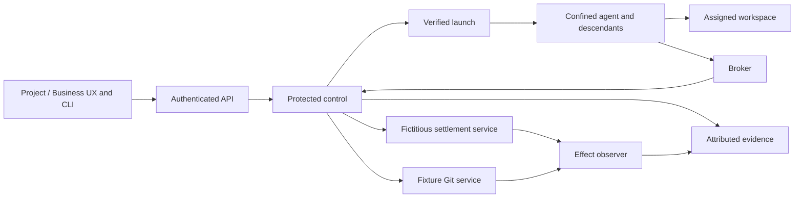

# PAEA — adopted APEX plan and execution record

[Français](../../../plans/actions-confiance/PAEA-APEX.md) ·
APEX queue (`../../APEX-QUEUE.md`, local tracking outside this publication) · AC-02 (`securite-execution-apex.md`, local tracking outside this publication)

## Authority and objective

October26 update: “fini push compile” authorizes compilation, scoped PAEA
commit/push and local delivery under standing authority. The compilation ban is
lifted; business authority and protected prerequisites remain unchanged.
See [increment 15](paea/INCREMENT-15.md).

On October 25, 2026 the user requested implementation of PA-00 through PA-13.
Root Codex owns integration. No implicit delegation or parallel execution.
Rust migration priority and prerequisites remain applicable. No commit, push,
real payment, external deployment or resumption of paused missions is granted.

Demonstrate for BOTH fictitious billing and software development that each
observed protected effect matches an authorization still valid for its exact
content at commitment. Activation is per project; missing required protection
denies the affected operation. The final target is experimental E3 with an
independent evaluator, a second implementation and preregistered comparison.
This is neither certification nor C3/C4 deployment authority.

The original PAEA v0.2 DOCX/PDF under `docs/security/` remain historical and
unchanged. Contract, code, local tests, installation and independent evaluation
must retain separate states.

The subsequently supplied [operational guide](../../../security/PAEA_v0.2_Guide_Operationnel.docx)
is a working implementation reference with [mapping and clarifications](paea/GUIDE-INTEGRATION.md).
Its examples replace neither versioned schemas nor session authority.

## Architecture and shared contracts

Reusing only in-process checks cannot protect control files/secrets from an
agent with the same UID. Retain existing kernels but separate agent execution,
protected control, effect services and observation under distinct trust boundaries.



Target architecture, not evidence of implementation. Control and keys stay
outside the agent domain under a distinct account. The first Linux profile covers
namespaces, mounts, privileges, FDs, processes and network. Authenticated peer UID
alone establishes no mandate. Bind the opened project instance, principal,
workload, scope and current authority. AC-02 policies retain SQLite persistence
and YAML exchange; existing global JSON settings are not silently relocated.
Admin/API/CLI share authoritative validation and effective values.

- Proposals are non-authoritative; control supplies admission context.
- Version schemas/canonicalization; reject duplicate/ambiguous/unknown fields.
- Derive business intent independently of transport request keys.
- Payment binds invoice ID/version, exact integer amount, currency and resolved
  account. Git binds assigned repository, direct ref, expected old OID, immutable
  candidate and existing checks/review/engine decision.
- Bind exact action, ordered sources and control versions. Relevant changes
  invalidate approval.
- Serialize current authority/revocation with effect commitment. Git/SQLite are
  not made atomic by an API call: retain durable intent and reconcile CAS updates.
- UNKNOWN is neither no-effect failure nor success; block potentially duplicating
  commitments until compatible reconciliation. Preserve prior effects/consumption.
- Legacy Trust paths must use protected control or explicitly refuse in protected
  projects. Errors preserve causes, safe codes and known/uncertain publication.

```text
PROPOSED → ADMITTED → APPROVAL_PENDING → AUTHORIZED → COMMIT_REQUESTED
COMMIT_REQUESTED → COMMITTED | DENIED | UNKNOWN
UNKNOWN → RECONCILED_COMMITTED | RECONCILED_NOT_COMMITTED
```

### PAEA-ERR-01

PAEA v0.2 §6.2 option (b): a content-bound single-use token can still be consumed
for the FIRST time after local revocation when the effect service does not check
that revocation. Uniqueness alone does not prove I17. Also require current
status/epoch under commitment order or disclose/prove propagation limits and
suspend uncovered critical use. Owner: PAEA author/effect control. Observable:
issue token → effective revocation → first redemption denied without effect.
Specified erratum; distributed evidence remains in PA-03/PA-12.

## Work packages and acceptance

| Package | Owner and dependencies | Work and observable output |
|---|---|---|
| PA-00 Baseline | Root Codex; current plans/source | Inventory Git/runtime, reservations, 17 invariants, evidence/resources and both controls. Bind exact bytes; never inherit Rust qualification from Go. |
| PA-01 Contracts | Codex; PA-00 | Schemas, canonicalization/vectors, business intents, commit order, errors, public operations, migration and bilingual diagrams. Testable contracts for both domains; data library grants nothing. |
| PA-02 Authority | Identity/integration; PA-01 + required IA3 output | Reuse enrollment/instances; separate control/keys, bind opened project, current mandates/approvals/revocation and shared Admin/API/CLI settings. Valid admission and attributed denials; missing protection fails closed. |
| PA-03 Effect services | Trust/managed repository; PA-01/02 | Separate fictitious ledger and conditional Git promotion, immutable candidate/checks/review, last-use authority, semantic uniqueness, durable intent and reconciliation. T04/05/06 in both journeys; new request keys never duplicate effects. |
| PA-04 Confinement | AC-02/A3; PA-02 + AC-02 prerequisites | Every launch/recovery/descendant; mounts/FS/FD/env/signals/detached processes, before untrusted code. Valid control and bypass test for each inventoried path. |
| PA-05 Network/secrets | AC-02/A4; PA-04 + AC-02/A2 | Mandatory broker, IPv4/6/DNS/redirects/sockets/persistent connections, control-side secrets, effective destination/labels, model/dependency/artifact flows. Valid traffic and zero observed forbidden sensitive bytes. |
| PA-06 Composition | Identity/Memory; PA-02/05 + required MEM-P2…P4 | Preserve instruction/data separation, provenance/versions/integrity/confidentiality over read/summary/transmission/compaction. Attenuated delegation and authenticated peers. No instruction/authority promotion in the defined scenarios. |
| PA-07 Tools/time | Launch/catalogue; PA-01/02/04 | Bind effective binary/schema/config, readmission on mutation, monotonic local leases and epochs/generations across restart. Inventory and ACS mapping only claim actual coverage. |
| PA-08 UX/approval | UX/integration; PA-02…07 interfaces | Admin with each policy; exact consequences/content/approver, visible denial/UNKNOWN, configured/applied/observed distinction, separate UX builds and measured vigilance. Both public journeys, FR/EN/themes/mobile/keyboard/focus/error/recovery. |
| PA-09 Evidence | Verification; PA-02…08, collect from first increment | Link proposal/admission/approval/commit/observation, preserve originals, separate key acquisition, detect tampering/omission/replay/rollback. Independent verification without believing agent reports. |
| PA-10 Local E2 | Codex + separate-context required review; PA-03…09 | Same candidate, actual no-fixture profiles, isolated CLI/API/browser, legacy bypass denial, supported build/install, process/hash/assets/version/FR-EN notes. Bounded E2 statement, not E3 closure. |
| PA-11 Prepare E3 | Sponsor + third-party team + evaluator | Designate independent roles; second effect boundary without Swarm control code, common schemas/vectors, preregister corpus/models/budgets/faults/metrics, B2/ablations and reserved attacks. Accepted resources and protocol before campaigns. |
| PA-12 E3 campaigns | Evaluator; PA-10/11 | T01…22/adaptive, direct effect oracles, equal-condition Swarm/B2/second implementation, ablations, authorized harmless human trials, full report and acknowledged defect handoff. |
| PA-13 Corrections/RETEX | Codex + evaluator; PA-12 | Reproduce, fix shared contracts, requalify affected earlier packages/verdicts, deliver verified candidate, final retrospective and learning transmission. Any required unresolved criterion keeps the program open. |

AC-02 retains Rust qualification prerequisites. Independent contract/protocol
preparation can proceed. Preserve IA3 → protected memory use → IA4 handoffs;
whole IA5/MEM-P5 closure is not an added circular dependency.

## Assurance and experimental protocol

| Invariant | Packages | Tests | Required observation |
|---|---|---|---|
| I01 Model non-authority | 01/02/06 | T01/T02 | Hostile contents cannot create permission. |
| I02 Identity/delegation | 02/06 | T03/T14 | Attributed principal and attenuated child rights. |
| I03 Provenance/flows | 05/06 | T02/T18 | Actual received context retains labels and versions. |
| I04 Exact approval | 01/03/08 | T04/T20 | Approved canonical content equals consumed action. |
| I05 Last-use authority | 02/03 | T05/T17 | Current authority at ordered commitment. |
| I06 Mediation | 04/05 | T07/T19 | Closed path inventory with actual enforcement. |
| I07 Secrets | 02/05 | T08/T17 | No critical unbounded effect credential in agent domain. |
| I08 Business uniqueness | 01/03 | T06/T09 | Same derived intent cannot repeat with a new key. |
| I09 UNKNOWN/recovery | 03/09 | T06/T21 | Reconcile service state without duplication/fabricated success. |
| I10 Human supervision | 08/12 | T10/T22 | Attributed qualified decisions and evaluated vigilance limits. |
| I11 Independent evidence | 09/12 | T12/T21 | Separate observer/anchors and attributable bounded proof. |
| I12 Safe failure | 03/04/05 | T10/T16 | No new sensitive effect without required preconditions; C4 excluded. |
| I13 Egress/confidentiality | 05/06 | T13/T19 | Effective destination and actually received bytes. |
| I14 A2A | 06 | T14/T18 | Peer, mandate, audience and reception linked. |
| I15 Tool qualification | 07 | T15/T20 | Changed effective tool requires readmission. |
| I16 Time/order | 02/03/07 | T16/T05 | Control clock/epochs, never agent-declared time. |
| I17 Sink revocation | 02/03/05 | T17/T21 | First redemption of pre-issued token fails after effective revocation. |

T11 additionally covers changed policy/source/candidate and stale proof. T09
includes split/cumulative effects across agents. Establish a valid control before
each injection. Read before/after service state; HTTP200/exit0/PASS labels alone
are insufficient. PA-01 local cases are not executed T01…T22 campaigns.

Keep forbidden effects, business/software success, false refusals, recovery/UNKNOWN,
p50/p95/p99 latency, cost/consumption/operator load and coverage separate.
Preregister volumes and budgets without universal magic numbers. Statistical
intervals require their assumptions. Publish low/no benefit against B2 honestly.

## Delivery and current state

Every increment retains exact inputs/candidate, policy/function-doc/error/document
reviews, actual compiler/features/binary/assets, permanent recipes and fresh
integrity-verified evidence. Changed inputs invalidate affected proofs. No arbitrary
global watchdog, erased history, fabricated acceptance or implicit paid calls.
Use replan with original cause, changed precondition, authorized action and observed
effect, then resume the objective.

Milestones: M0 baseline; M1 both controlled effects; M2 mediation; M3 composition;
M4 installed local E2; M5 independent E3 campaigns; M6 re-evaluated corrections and
final retrospective. Program remains open after M4. Disabling project protection
requires an authorized decision; no automatic permissive fallback.

October 25: PA-00 and PA-01 are partially implemented. The
`swarm-protection-contract` library, schema, fourteen vectors and public offline
`protection canonicalize` command cover data for both domains. This command
grants no authority and activates no protection. Complete authenticated mandate,
authority, approval and receipt contracts, and active CLI/API operations, remain
to be finalized with their protected producers. The [PA-11/E3 protocol](paea/E3-PROTOCOL.md)
is drafted, not preregistered. The user confirmed having no independent evaluator
or third-party team. No GLM/SKYNET call or delegation occurred in this increment.

The [retained recipe](../../../plans/actions-confiance/paea/evidence/20261025-contract-qekt2uwo/recipe-01/result.json)
ran 5 Python tests, 17 Rust contract tests and 4 CLI tests: 26 passed, zero failed.
Evidence integrity was verified. Clippy and Rustdoc also passed for the library
alone. These results establish no T01…T22 campaign, effect service, confinement or
E2/E3 qualification. The recipe inventory is declarative, not the full effective
compiler graph. Later documentation corrections are reviewed separately; original
evidence and corresponding executable inputs remain preserved.

### Replan: concurrent session and no compilation

The user is working in another session and requested avoiding compilation. No new
Cargo, Rustdoc, build, installation or restart will be launched by this conversation
under that instruction. Its last Rustdoc check had completed. Inspection found the
concurrent SCALING-S2 work in the Rust plan and effective managed-repository changes;
they remain with their owner. No other session's process is interrupted.

The instance observed before this instruction ran `v0.1.1-dev.65`; this PAEA
increment is not declared installed. Local integration owns delivery. Resume after
the instruction is lifted and the shared checkout is available, with full candidate
review and the supported delivery path. Global migration and required IA3 handoffs
remain open in inspected plans; AC-02 prerequisites remain in force. This foundation
starts no account, privilege, confinement or effect-service changes.

Owned files: this bilingual plan/contract, isolated library, schema/vectors/tests/
recipe, CLI `protection` module, targeted `swarm-cli/src/lib.rs` connections,
Cargo dependencies, bilingual `version_history.json` note, queue entry and own
evidence. No engine Trust, launch, supervision, active policy or live mission file
is reserved here. Preserve unrelated changes in shared files.

The [increment review](paea/INCREMENT-01.md) retains tested scope, all three review
axes, limits and resumption conditions. PA-00…PA-13 and its final retrospective
remain open.

### Increment 02 — authorized GLM contribution, without compilation

The user's “go next avec glm” authorizes targeted internal GLM contribution.
The no-compilation instruction remains active. The
[new public recipe](paea/INCREMENT-02.md) ran four tests and 88 invocations against
the existing binary: 16 document refusals and one output failure, with valid
controls/recovery. Evidence PASS/VERIFIED; no Rust edits or installation.
The usable GLM contribution covers the raw decoder only. Exhausted first call
and failed first recipe remain preserved with verified recovery. PA-00/01 and
previous resumption conditions stay open.

### Increment 03 — routing refusals with GLM

[Two tests added](paea/INCREMENT-03.md): six public tests total, 248 invocations,
69 expected refusals with exact recovery in both domains and FR/EN. Existing
binary stable, no compilation or restart. GLM proposal corrected before execution,
originals retained. PA-00/01 partial; IA3/Rust/AC-02/E3 dependencies unchanged.
No full program lot closed.

### Increment 04 — export consumer and corrected GLM method

[Correspondence tool implemented](paea/INCREMENT-04.md): nine named tests,
42 CLI observations across both domains, no compilation or installation.
No semantic admission/authority/effect established; PA-09 only started.
User correction removes default GLM client cap: nine local HTTP tests and actual
request without limit fields retained. PA-00/01 and Rust/IA3/AC-02/E3 prerequisites
remain open.

### Increment 05 — Rust comparison, not qualified

[Rust sources and three tests written](paea/INCREMENT-05.md), no compilation or
Rust test execution. New Python extension withdrawn after explicit user correction,
originals preserved. No CLI/API integration, installation or authority verdict.
PA-01/08/09 remain partial; qualification and IA3/AC-02 prerequisites open.

### Increment 06 — Rust CLI integration, not qualified

[Compare command and four CLI tests written](paea/INCREMENT-06.md), without
compilation or execution. Existing reader, two named files, output schema and
FR/EN help; recipe updated, not run. No project/effect/approval activated.
No-compilation persists; PA-01/08/09 and qualification remain open.

### Increment 07 — receipt/action/lifecycle source contract

[Rust checker and four tests written](paea/INCREMENT-07.md), uncompiled/unexecuted.
Reuses action/intent digests, expected sink and UNKNOWN/reconciliation lifecycle;
no authenticated receipt or effect service delivered. PA-01/03/09 and PA-02/AC-02
prerequisites stay open. No project activated.

### Increment 08 — receipt checker CLI consumer

The user resumed the program and explicitly reconfirmed **no compilation or
restart**. [Rust CLI adapter and four tests written](paea/INCREMENT-08.md),
uncompiled/unexecuted: two files, explicit sink/prior state, canonical recomputation
and binding/lifecycle checks. FR/EN help, schema, recipe and contract updated;
authority, authenticity and effect remain unestablished. No GLM call or service
started. Output-error tests are isolated outside the caller checkout; their effect
is unverified. PA-01/03/09, qualification, installation, protected dependencies and
RETEX remain open. Next proof: affected targets and recipe on frozen inputs after
explicit lifting of the instruction.

### Increment 09 — verification loop on an existing candidate

[14 public tests passed, 618 invocations](paea/INCREMENT-09.md), 167 expected
refusals, recipe PASS and integrity VERIFIED. Existing dev75 candidate from
another session frozen without compilation/restart here. All 432 effective input
archive members verified; eight PAEA inputs match observed sources. Two
increment-08 Rust assertions corrected to `failure.code`, unexecuted by Cargo.
Second loop: justified transitive Identity `serde`, removed temporal schema
descriptions and reexamined earlier lots without rewriting originals. PAEA-OBS-01
retains standalone report limitations with the applied transcript mitigation.
Six invariants have local structural observations; **0/17 demonstrated end to end**.
Protected PA-02/03/08/09, installation, E2/E3 and RETEX remain open. No-compilation/
restart instruction stays active: Rust tests after explicit lifting, effects after
protected IA3/PA-02 output, E3 with required third parties.

### Increment 10 — PAEA-OBS-01 implemented in source

[Standalone v2 report and seven tests written](paea/INCREMENT-10.md): exact raw
document/receipt hashes, canonicalization and the same binding/lifecycle checker.
New `receipt-report` command; v1 `check-receipt` shape retained in source, v1 inputs
unchanged. No new right, effect or dependency. FR/EN help/schema/recipe/local notes/
contract updated. **Uncompiled/unexecuted/uninstalled** under the active instruction.
Existing dev75 witness records v1 control, absent new route and recovery without
a build. PAEA-OBS-01 remains functionally unverified; increment-09 proofs retain
their archived source scope and do not qualify new code. PA-01/09/program open.


### Increment 11 — explicit UX request

After asking how to use the tests, the user explicitly requested adding UX access.
PA-08 now explicitly includes a menu entry. [First journey written](paea/INCREMENT-11.md):
**PAEA checks** in the native cockpit and Trusted actions; select action/receipt,
explicit service/state, correspondence check, visible refusal/UNKNOWN and v2 report.
Authenticated API uses the shared pure checker with no effect or activated
protection. Browser component is separately verifiable; native route, actual
binary assets and installation remain unqualified under no compilation/restart.
Two HTTP Rust tests written and permanent browser recipe added. PA-08 remains
partial: protected approvals/configured-applied-observed, both UX products and
vigilance still require PA-02…07 interfaces and the planned experiments.


### Increment 12 — qualification on an existing candidate

[Public and actual-CLI screen evidence](paea/INCREMENT-12.md): dev77 candidate
built by the other session, frozen without compilation/restart here. 434 effective
archive members verified, seven PAEA inputs match. 18 public tests passed, 973
invocations including 268 expected refusals; local v2 OBS-01 distinction verified,
v1 preserved. Screen: 174 assertions and 48 actual CLI calls through an HTTP fixture
bridge, FR/EN and both domains; no fabricated checker response. After another
session changed the catalogue, component replay passed 219 assertions/40 simulated
requests. Three recipes PASS, integrity VERIFIED. This bridge is not native HTTP: its two Rust tests, served
assets, installation and protected approvals remain open. Original 09…11 proofs
are preserved; no seventeen-invariant/E2/E3/RETEX closure.


### Increment 13 — operational guide and UX journey

The user supplied the operational guide to inform implementation.
[Complete mapping](paea/GUIDE-INTEGRATION.md) retains the original, maps chapters
to owners/plan/proofs and defines three dossiers plus target UX. Existing file
checking stays partial. Functional priority: effect card/owner/boundary/oracle
and three recipes in both pilots, preserving PA-02/03 and Rust/AC-02 prerequisites.
ERR-01 also applies to guide7.1; pedagogical JSON/figures do not replace schemas;
project+invoice intent requires protected project-unique debt resolution before
the sink. IAM/industrial execution remains out of scope. The [increment record](paea/INCREMENT-13.md)
also retains bounded PAEA-UX-02 contrast work, normal/hover/keyboard tests and
component-versus-installed-binary distinction.

### Increment 14 — two laboratory effects and separate observation

[Operational dossier](paea/OPERATIONAL-PILOT.md): payment/Git cards, missing
authorities, access graph and three executable recipes without a build.
SQLite and Git branch+canonical-marker transactions produce effects in 26
isolated roots; separate oracle process reads no receipt/decision journal.
**7 tests PASS, 132 subprocesses, recipe PASS/integrity VERIFIED**. T04, lost reply
and revocation before first use exercised in both domains with controls/recovery;
these are fixture orders, not distributed evidence. Git negative witness:
context-ignoring replay guard triggers the expected failing assertion.
PAEA-GUIDE-03 reproduces two entries for raw aliases without a business registry;
counterexample retained, protected debt resolution required before PA-03.
[Record and limits](paea/INCREMENT-14.md). Common UID/simulated authority: **0/17
end-to-end invariants**, protected PA-02/03, campaign menu, native qualification,
installation/E2/E3/RETEX open. No build or restart.

### Increment 15 — native qualification and authorized delivery

The user lifts the compilation ban. Checkout and targeted worktree on the
published base: **5 Python and45 Rust tests PASS**, including the two previously
unrun HTTP tests. Normal dev79 build prepared before any stop; real executable
and embedded assets in the browser: **237 assertions/12 configurations**,24
expected refusals, no unexpected diagnostics. Eight protected assets match
sources; FR/EN/themes/mobile, Version dialog, Git link and focus verified.
PAEA returns to the cockpit independently of Biba.
[Evidence, publication scope and delivery](paea/INCREMENT-15.md); generated local
result retains actual remote commit and active version/PID/hash. Correspondence
menu is qualified; lab campaigns remain outside UX. This delivery closes neither
protected PA-02/03, the **17 invariants**, nor program E2/E3/RETEX.

### Increment 16 — explicit debt identity

[Decision and criteria](paea/INCREMENT-16.md): preserve the v1 hash and resolve
supplier/reference to a stable debt object before admission. Pure library and
offline CLI reject collisions/stale versions; a separate fixture observation
checks one effect for two aliases. Supplied snapshots remain unauthenticated;
revision continuity and protected authority remain open.

Increment 16 verified and installed as **dev82**: 37 contract tests, 2 public tests
(33 calls), 8 fixture-effect scenarios and 26 live-instance checks PASS; browser
failure guard verified with an expected failure after a valid control. Sources
remain uncommitted; no new protected assurance or E2/E3 closure.

### Increment 17 — invoice resolution from the menu

[Contract, decision and evidence](paea/INCREMENT-17.md): PA-08 exposes the shared
resolver from PAEA checks, with a dedicated help/download page. Closed native API,
exact i64 values, refusal/recovery and explicit non-authority markers. Receipt
correspondence remains available; no protected registry activation.

Increment 17 delivered on **dev87**: 4 schema/4 HTTP tests, 219 component checks,
452 native assertions on dev86 with 448 identical delivery inputs, 30 actual
dev87 checks PASS. Build version/commit/date differences and bounded proof reuse
are retained. Clippy/Rustdoc PASS; script-loss guards verified after controls.
PAEA changes remain uncommitted; protected registries/approvals and E2/E3 open.

Publication requested on 26 October: isolated increments-16/17 commit, without
push or a new delivery; see the publication follow-up at the end of report 17.
The precommit statements above retain their historical scope.

### Increment 18 — GLM resumed

“reprends glm” authorizes a targeted internal contribution on delivered invoice
resolution/API/UI contracts. [Criteria and follow-up](paea/INCREMENT-18.md): each
finding must be reproduced or refuted, then corrected/verified when justified.
Protected handoffs and assurance limits remain open.

Increment 18 verified: one complete GLM contribution, two new exact Rust tests
PASS on stable frozen inputs, 28 native encoding assertions PASS. Four recipe
inventories corrected; no established product defect, product change or new
installation attributed to this slice. Full suites/protected guarantees stay open.

### Increment 19 — menu comparison with GLM

[Slice, criteria and evidence](paea/INCREMENT-19.md): expose the existing shared
comparator through native API/PAEA page, both domains, value-free report and exact
export. GLM proposes validation/rendering; Codex integrates/verifies existing and
new journeys and delivers locally. Protected authority remains unchanged.


Increment 19 installed locally as **dev95**: menu comparison, shared API/CLI,
report without values. Two schema/seven HTTP tests PASS; 1,310 browser assertions,
12 configurations × three views, 62 actual native refusals/recovery; 34 real live
delivery checks PASS. GLM returned HTTP 504 with no usable contribution; Codex
implemented and verified the connection. [Slice result and retrospective](paea/INCREMENT-19.md)
retain build refusals, qualified normal-candidate reuse, hashes and limits.
No commit/push. IA3/AC-02/human authorities, E2/E3 and protected acceptance remain open.


Next decision: the user authorizes committing increment 19, then continuing
directly with Codex, **without GLM**. Preserve protected prerequisites, rights
and budgets; select the next slice from the plan's actual state.


### Increment 20 — ready-to-download examples

[Direct slice without GLM](paea/INCREMENT-20.md): eight versioned fictional files,
help in all three views and actual native checks after completed downloads.
No automatic selection/submission; protected assurance unchanged.


Increment20 implemented without GLM and installed as **dev96**: eight examples
from all three help panels, 1,743 native assertions, 36 journeys/120 downloads,
and 40 live checks PASS.
Increment19 commit `f41003488`; no increment20 commit/push. Supported one-off
qualified normal-candidate activation preserves source configuration; concurrent
reviewer compilation (`Capture::new`, dev97 attempt) remains open. [Results and
resumption](paea/INCREMENT-20.md). No protected assurance added.


The user then requests committing installed increment20. Isolated Git recording,
without push or another delivery; dev96 results/limits remain in the
[increment20 record](paea/INCREMENT-20.md).


### Increment21 — exact action inspection

[Direct slice](paea/INCREMENT-21.md): byte-bound shared report, CLI/API and readable
terms/context/sources from the menu. No approval/effect; preserve canonical
contracts and qualify all four views.


Increment21 installed as **dev101**: **Inspect an action** in the PAEA menu, common
CLI/API report, exact terms/context/sources/revisions. Nine targeted tests,2,265
native assertions (four views),48 example journeys/144 downloads,87 native refusals
and46 live checks/20 assets PASS. [Slice result and retrospective](paea/INCREMENT-21.md)
retain initial freshness refusal, dev100/dev101 profiles/hashes and review scope.
No GLM, commit or push. IA3/AC02/humans, E2/E3 and0/17 protected invariants stay open.


User requests commit21 then next. Commit `72e0e32dc`,40 files,108 foreign staged
entries preserved,no push. [Increment22](paea/INCREMENT-22.md) connects supplied approval
binding to exact action/policy data,without protected activation.


Increment22 installed as **dev107**: **Compare a supplied approval** menu, common
CLI/API two-file-bound report,explicit match/mismatch/invalid refusal.11namedtests,
10generationchecks,3,086nativeassertions,60journeys/192downloads,113refusals and
52livechecks/23assets PASS. Primary1.28:1transitioncontrast reproduced and fixed
on the shared five-view component;36observations,min9.096:1. [Results/retrospective](paea/INCREMENT-22.md)
retain failures,recovery,profiles/hashes. No GLM/commit22/push; IA3/AC02/humans,
E2/E3 and0/17remainopen.


### Increment23 — laboratory campaigns in the menu

Commit22 `51a3ac828`,42files,108foreign staged paths preserved, no push.
[Slice23](paea/INCREMENT-23.md): explicit reproduction command and campaign
report reader from the menu; eight scenarios and preserved counterexample.
No web execution or protected activation is attributed to this slice.


Increment23 installed **dev109**: Laboratory campaigns menu,explicit command
and local report reader. Eight real tests,506nativeassertions,12downloads and
56livechecks/25assets PASS. Exact qualified normal candidate activated once,
source configuration preserved; concurrent engine compilation remains open.
[RETEX/evidence](paea/INCREMENT-23.md). No commit23/push; protected PA-02/03,
browser campaign execution,E2/E3 and0/17invariants stay open.


### Increment 24 — revocation/commit contention

Commit23 `97933d8b7`, 27 files, 108 foreign staged entries preserved.
[Qualification 24](paea/INCREMENT-24.md): extend T05/T17 to real overlapping
processes in both fixtures, contention refusal and explicit recovery. Criteria
and limits retained; no new protection or server installation claimed.


Qualification24 verified: four real SQLite/Git contentions with controls, four
expected early-release assertion failures and public eight-case campaign
PASS/VERIFIED. Pinned dev109 protection sources match its effective profile;
dev112 observed separately, without intervention by this slice. Recipe stream
defects corrected/originals retained, derived inventories completed; unchanged
browser not replayed. [Review/slice RETEX24](paea/INCREMENT-24.md). Protected
0/17 invariants, IA3/AC-02, humans, E2/E3 and final programme remain open.


### Increment25 — original laboratory evidence integrity

Commit24 `079635b29`,14 files,108 foreign staged paths preserved.
[Slice25](paea/INCREMENT-25.md): reproduced PAEA-EVIDENCE-25 on a copy (deleted
oracle, old export still possible); v2 call index and explicitly pinned inventory
with original-file verification. Keep report v1, no inferred authenticity or new
protection. Results pending recipe; programme remains open.


Slice25 verified: eight effect tests, eleven verifier regressions/68CLI checks,
1020observation and10recipe files bound,197v2calls. Final recipes and24contention
guard PASS/VERIFIED. Missing oracle refuses export; publication uncertainty is
UNKNOWN with expected pin and verified recovery. Forged-new-pin counterexample
retained; simulated authority/0of17protected, IA3/AC-02/humans/E2/E3/final RETEX
remain open. [Review/limits25](paea/INCREMENT-25.md). Checkout tooling, report v1
and server unchanged; no build/install/commit/push.


### Increment26 — native current-authority control core

PA-02 resumed directly by Codex without GLM. [Increment26](paea/INCREMENT-26.md):
retained connection to existing signed authority, exact current checks held
through real configuration/witness storage, revocation refusals and UNKNOWN
after possible effect. Library core only; no service activation or inferred
human identity. Protected transport/bootstrap, PA-03, E2/E3 and 0/17 global
invariants remain open.


Increment26 verified:41named tests, recipe PASS/VERIFIED,17effective local sources
matched for the normal build and four crates without test-fixtures; Rustdoc PASS.
Revocation ordering, UNKNOWN after effect, both causes and exact-event recovery
observed. [Review/RETEX26](paea/INCREMENT-26.md). No normal CLI consumer, hence no
installed service from this core; protected transport/bootstrap and local personal
authentication remain unconnected. PA-02 partial;0/17/E2/E3/final RETEX open.
