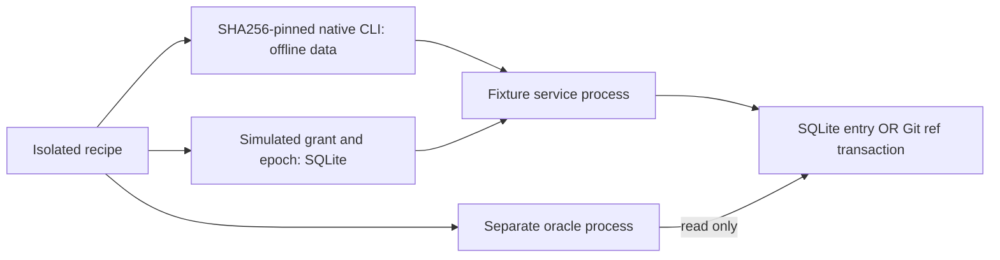

# PAEA — operational dossiers for both pilots

[Français](../../../../plans/actions-confiance/paea/PILOTE-OPERATIONNEL.md) ·
[Plan](../PAEA-APEX.md) · [Guide integration](GUIDE-INTEGRATION.md)

## Scope and ownership

This dossier prepares PA-00/01/02/03/09 using the supplied guide. Executable
services in `tools/paea/pilot_lab.py` are **laboratory fixtures**: actual changes
to isolated files, simulated authority, common UID. They provide neither a
protected PAEA service, real payment nor installation in the local instance.
`pilot_oracle.py` is a separate process and read path, with common authorship and
privileges. It is not independent evaluation. No global invariant or E2/E3 proven.

| Decision / role | Current laboratory | Product requirement |
|---|---|---|
| Integration and recipe | Root Codex alone | One objective owner, attributed evidence. |
| Business / risk owner | **Unassigned**; no C0…C4 classification decided | Authorized identity, consequences, scope and accepted risk recorded. |
| Human approver | **Absent**; simulated grant table | Actual identity/rights, exact action and current policy; AI review is separate. |
| Identity / key authority | **Absent**; names from test vectors | IA3/PA-02 outputs, separate account, bound opened project, keys outside agent. |
| Effect service owner | PA-03 business registry / managed repository roles | Actual service/account/permissions, commitment point and incident procedure. |
| Independent evaluator | **Absent** | E3 designation/rights, second implementation and preregistered B2. |

Missing assignments are realization prerequisites, never values to infer from
the F-12/4200 EUR example. Protected realization/activation remain subject to
their dependencies. The build restriction was lifted and increment 15 installed
dev80. The laboratory remains separate and cannot replace those gates.

## Effect cards

| Field | Fictitious settlement | Git promotion |
|---|---|---|
| Measured consequence | Canonical entry added to an isolated SQLite ledger. | `refs/heads/pilot` moves from old commit to candidate in an isolated bare repository. |
| Exact input | Existing `payment-control` vector: `invoice-17`, `v7`, `amount_minor:"420000"`, `EUR`, `account-17`. | `pilot-repository`, direct ref, old/candidate OIDs created as actual Git commit objects in each fixture. |
| v1 intent | Project + debt object `invoice_id`, excluding attempt/version/amount. | Project + repository + direct ref + old OID, excluding candidate/attempt key. |
| Required authority | Protected supplier/invoice/account/version registry resolving a project-unique debt object. **Absent from fixture.** | Physical repository ownership, candidate/review and promotion rights bound to project. **Absent from fixture.** |
| Fixture commitment point | SQLite transaction checking grant/current epoch and inserting unique effect. | Git transaction CASing branch and creating intent marker; SQLite lock shared with fixture revocation. |
| Raw oracle | `mode=ro`, `query_only` SQL read of `effects`, including exact canonical bytes. | Actual refs and canonical marker blobs, without SQL decision journal or receipt. |
| Unproven risks | Business aliases, impersonation, direct file access, cumulative budget, bypass, power loss. | Direct repository access, marker deletion/rollback, identity, actual candidate/review, power loss. |

Amounts, identities, initial epoch 1, deterministic commits, crash exit 86 and
domains are **test data/protocols**, not operator policies. SQLite `timeout=0`
surfaces fixture lock contention immediately. No watchdog, retry, product ceiling
or authorization lifetime is introduced. Actual future policies must remain
persisted, validated and editable through Admin/API/CLI under the shared contract.

## Access graph and commitment



**Laboratory graph, not a protected TCB.** All paths remain writable by the same
user. Module/process separation supplies no confinement. No secret, network,
native agent or Root database is used. Git excludes inherited `GIT_*` routing
and global/system configuration; hooks are disabled. The product must close
FS/FD/socket/network bypasses and bind actual accounts, binaries, manifests,
projects and privileges under IA3/PA-02 and Rust/AC-02.

Git marker `refs/paea-lab/intents/<intent_id>` points to a **blob containing the
entire canonical action**, not only the candidate commit. Branch and marker are
changed/created in one `update-ref --stdin` transaction. Exit after that effect
but before the SQL journal still leaves exact observable content. A new attempt
with changed context/candidate cannot be attributed to the old effect. This
property covers cooperating fixture participants only; it cannot resist an
agent directly writing those files.

## Three initial recipes

Before **each** fault injection a fresh valid control establishes an effect under
the same prerequisites. Raw snapshots and outputs are retained. Service and
observer operations use new processes, without sleep or retry.

| Recipe | Injection and observable assertions | Recovery |
|---|---|---|
| T04 | Fixture approval on A, then amount/candidate substitution. Pre-effect refusal, identical raw sink snapshot. | Reordered/indented equivalent JSON accepted, exact canonical content observed. |
| T06/T21 | Real process exit **86 after effect publication**, before any reply. Git SQL journal still empty. Client UNKNOWN; oracle sees one entry or exact branch+marker. | Known reconciliation; new attempt key does not duplicate. Changed context for same intent/candidate refuses without false attribution. |
| T05/T17 | Unused preissued grant; persisted revocation before first consumption refuses without effect. Reverse ordering also exercised. | Fresh current-epoch grant restores a valid operation. Effect committed before revoke remains recorded and reconcilable. |

These are deterministic orders under a lock, **not distributed concurrency or
immediate-revocation evidence**. Order comes from SQL sequence, never two client
clocks. Production T05/T17 must still exercise the real race at commitment and
the actual propagation conditions.

Additional cases: unavailable oracle → error/UNKNOWN, no empty DB creation;
restoration → same effect; stale/symbolic Git ref → refusal without mutation and
recovery; `/dev/full` after publication → writer failure, effect still observed
and reconciled. An error exit cannot prove no effect. The service does not retry
automatically following an unknown outcome.

**Retained PAEA-GUIDE-03 counterexample.** Two raw IDs hypothetically naming the
same debt yield two intents and two entries without a business registry. The
recipe expects this to refute global debt uniqueness from hashing alone; this
is not a security success. Required resolution: protected project-unique debt
objects and supplier/reference/alias/correction tests before PA-03; otherwise an
explicit schema version and migration. No implicit v1 hash change is made.

## Execution, evidence and UX access

Maintained recipe: `tools/verification/recipes/paea-pilot-lab.json`, eight named
tests including all three families in both domains. Required environment: exact
existing binary, SHA256 and a **fresh** `SWARM_PAEA_PILOT_EVIDENCE` directory.
No implicit build.

```sh
export SWARM_PAEA_TEST_BINARY=/absolute/path/to/already-qualified-binary
export SWARM_PAEA_TEST_BINARY_SHA256=exact-hash
export SWARM_PAEA_PILOT_EVIDENCE=/fresh/path/observations
python3 tools/verification/recipe.py run --recipe tools/verification/recipes/paea-pilot-lab.json --output /fresh/path/recipe
python3 tools/verification/recipe.py verify --evidence /fresh/path/recipe
```

Evidence directory parents must exist. The increment record binds actual paths,
hashes, argv, original CLI bytes, outputs, before/after states and sink roots.
Integrity VERIFIED preserves evidence and cannot turn an expected counterexample
into conformance.

The **PAEA checks → Laboratory campaigns** menu now exposes the explicit command
and local report reader. It does not start campaigns from the browser or grant
human approval. Native evidence and limits are in [increment23](INCREMENT-23.md).

Three distinct dossiers: **design** = this document; **realization** = exact
sources, frozen binary, retained profile and laboratory state; **qualification**
= recipe/observations/counterexample/local review with protected criteria open.
Actual results and resumption limits are in [increment 14](INCREMENT-14.md).

## Increment 16 — explicit resolution before fixture commitment

The recipe now contains eight tests. The new test invokes public CLI
`resolve-payment`, then the sink and separate oracle: two aliases converge on one
effect; corrected terms retain intent and refuse attribution to the prior content.
The unresolved counterexample remains retained. Cooperative same-UID snapshots
provide neither protected authority nor continuity across revisions.

## Increment 17 — operator access to the resolver

**PAEA checks → Resolve an invoice reference** checks registry/request files and
exports the raw report. Versioned examples are
`tests/fixtures/paea/payment-registry-v1.json` and `payment-request-v1.json`.
This menu runs no laboratory campaigns, stores no registry and provides no human
approval. [Journey and evidence](INCREMENT-17.md).


### Laboratory campaigns — increment23

Verification menu → Laboratory campaigns exposes scenarios and this explicit
repository command (Python/Git, existing exact binary, fresh output with existing parent):

```sh
python3 tools/paea/run_pilot.py --binary /PATH/BINARY --sha256 SHA256 --output /FRESH/DIRECTORY
```

No hidden build, provider, retry or watchdog. Live storage and source trees are
refused. The maintained recipe must PASS and verify before `paea-lab-report.json`
is exported. Failure retains originals and produces no success report; correct
the cause and resume in another fresh directory. Verify originals with
`python3 tools/verification/recipe.py verify --evidence /FRESH/DIRECTORY/recipe`.

The page reads an explicitly selected report locally and exports its exact bytes,
without upload or business request. Closed shape/eight named tests are checked;
authenticity and original evidence are not. Hashes link the binary, recipe result,
declared source inventory and call/oracle index, without signing them. The raw
alias test passes by observing two effects: uniqueness is refuted. Simulated
authority, same UID and separate oracle process with the same author establish no
protected guarantee.0/17invariants,E2/E3 and browser-triggered execution remain open.
[Slice results and limits](INCREMENT-23.md).


### Local concurrency — increment 24

The existing eight-case report contract remains compatible: T05/T17 adds four
contention scenarios (two domains × commit/revoke lock owner). Maintained helper
`tests/helpers/paea_pilot_contention.py` gates the actual authority read inside a
real transaction, starts a separate peer, retains the lock error, observes no
competing effect and explicitly recovers. No automatic retry is added. The read
cursor is fully consumed before pausing, so a premature-commit negative control
cannot accidentally retain a shared read lock. An unopposed control uses the same
worker/gate before every contention. Targeted recipe `paea-pilot-contention.json`;
full recipe `paea-pilot-lab.json`; eight report IDs unchanged, hashes distinguish
runs. `SWARM_PAEA_CONTENTION_FAULT=early-release` is a verification-only substitution
that must fail the test, never a normal campaign mode. Fixture locks do not protect
against a writer sharing the same UID. [Results, review and limits](INCREMENT-24.md).
