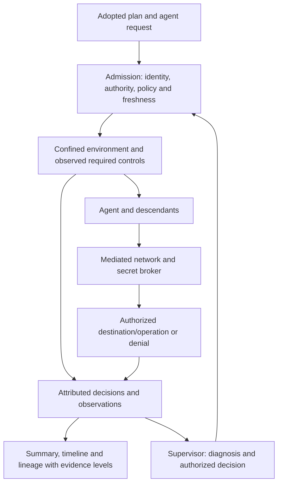
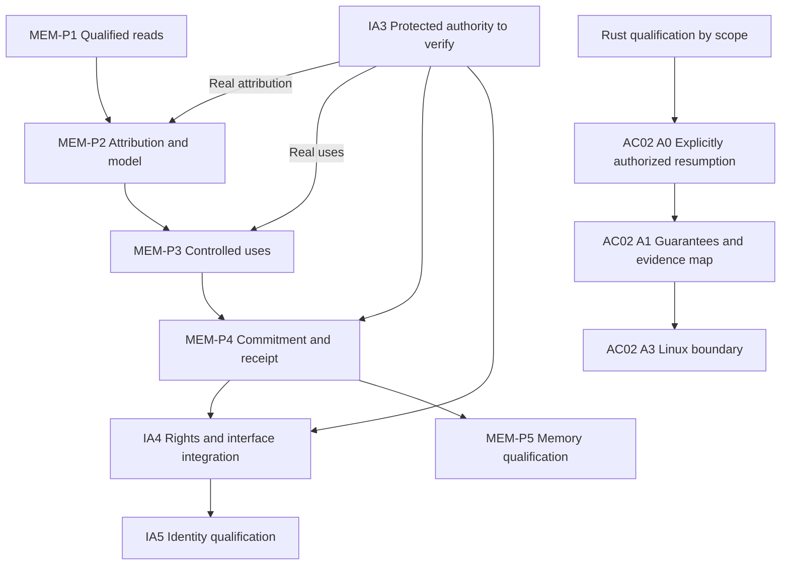

# AC-02 — Consolidated APEX plan with security-menu specifications

23 October 2026 — [Français](../../../plans/actions-confiance/securite-execution-apex.md).

**Status: plan recorded; work not started.** The user's final instruction is to
save the plan, not start it. Owner: root Codex. Recording this document starts
no A0–A7 work package, development, installation, provider call, delegated agent
or deployment.

Implementation remains conditional on Rust migration and qualification, followed
by a request to start. The [migration plan](../../../plans/migration-rust/PLAN.md)
retains its open criteria; [AFTER-CUTOVER](../../../plans/migration-rust/AFTER-CUTOVER.md)
links this future work. Recording a specification establishes neither
implementation nor acceptance nor effective protection.

## 1. Scope and references

The initial proposal did not specify menus sufficiently. This version retains
their destinations, behavior, permissions and verification criteria, together
with the audit details discussed with the user.

Retained decisions:

- A Swarm-owned engine, compatible with an explicitly declared OpenShell subset.
- Initial scope: an unprivileged agent, Linux, and a control service under a
  separate system account. The host, kernel and administrator remain trusted.
- Files/processes and TCP/HTTP-REST first; MCP, GraphQL, WebSocket and JSON-RPC
  remain separately identified extensions.
- Metadata by default; detailed local traces require explicit activation.
- Security menus and settings only: keep Swarm's existing navigation groups
  and independently deliverable Project/Business Process frontends.
- Reuse earlier work only after checking the final Rust implementation:
  fixed-helper confinement, secret broker, identity/delegation, launch gates,
  Live telemetry and eBPF attribution. Historical Go evidence does not establish
  an integrated, qualified Rust capability. The fixed helper does not confine
  general providers; positive historical kernel collection remains open.

### Sources and reading limits

| Source | Purpose and limitation |
|---|---|
| [Bromure article, 21 October 2026](https://bromure.io/en/blog/openshell-policies-and-network-lineage) | Renaud Deraison presents Bromure 5.4 and NVIDIA policies; product claims are not Swarm results. |
| [Agentic Coding manual](https://bromure.io/en/docs/agentic-coding) | Settings, credentials, traces and security timeline; its home page says 5.0.0, distinct from the 5.4 article. |
| [Settings](https://bromure.io/en/docs/agentic-coding/07-settings) and [context menus](https://bromure.io/en/docs/agentic-coding/05-sessions-home) | Grouped settings, search, contextual entry points and drafts, adapted to Swarm components. |
| [Timeline and actions](https://bromure.io/en/docs/agentic-coding/11a-security-timeline) | Separate decisions from detailed traffic, historical from current state, and hiding from deletion. |
| [Credentials](https://bromure.io/en/docs/agentic-coding/08-credentials) and [tracing](https://bromure.io/en/docs/agentic-coding/11-tracing) | Brokering, TLS, privacy, retention and rotation; do not inherit Bromure operator values implicitly. |
| [NVIDIA v0.1.5 schema](https://docs.nvidia.com/openshell/v0.1.5/how-it-works/policies/schema) and [network rules](https://docs.nvidia.com/openshell/v0.1.5/how-it-works/policies/network-rules) | Initial semantic and differential-test reference; freeze exact inputs when work starts. |
| [NVIDIA prover](https://docs.nvidia.com/openshell/v0.1.5/how-it-works/policies/prover) | Additional checks cover represented domains only and do not establish runtime confinement. |
| [The Secure Software Factory, version 1, 13 October 2026](https://github.com/agentbaseline/agentbaseline/blob/d842a1bb34a42e9d7c0d54a1b12ead9e0e59e283/software-factory/software-factory.md) | Reread in full on 23 October, including appendices: four boundaries, three autonomy levels, profiles and planning/authorization/execution separation. Supplement in section 6. |
| [controls.yaml](https://github.com/agentbaseline/agentbaseline/blob/d842a1bb34a42e9d7c0d54a1b12ead9e0e59e283/whitepaper/controls.yaml), [boundaries.yaml](https://github.com/agentbaseline/agentbaseline/blob/d842a1bb34a42e9d7c0d54a1b12ead9e0e59e283/software-factory/boundaries.yaml) and [levels.yaml](https://github.com/agentbaseline/agentbaseline/blob/d842a1bb34a42e9d7c0d54a1b12ead9e0e59e283/software-factory/levels.yaml) | Read and retained as documentary references: a control catalogue and presentation data; these files supply no confinement engine. |

The four visual references are the **policy editor, blocked-access drawer,
connection lineage and security timeline**. Light and dark versions are retained
in the [reference folder](../../../plans/actions-confiance/securite-execution-references/README.md),
with [provenance and hashes](../../../plans/actions-confiance/securite-execution-references/manifest.json).
The fourth reference is a frame at 0.5 seconds from the article's demonstration,
not its poster, which already shows lineage. Original videos are not copied
into the repository; their URLs and hashes are retained.

These attributed Bromure images are documentary references, not assets to ship
inside Swarm's interface. Recheck versions, sources, assumptions and coverage
when the work starts.

## 2. Menu and journey specifications

### UX-01 — Entry points

| Swarm location | Proposed entry | Expected result |
|---|---|---|
| Monitoring | Security | Opens the selected context's summary and journal. |
| Configuration → Administration | Security and confinement | Opens the shared settings editor. |
| Agent `⋯` menu | Effective protections; Security journal; Inspect denials | Opens the same views, filtered to the agent and attempt. |
| Denial detail | View chain; View rule; Examine authorization | Shows evidence or prepares an authorized change. |
| Security summary | Open relevant settings | Opens the matching section with its scope visible. |

All entries share components and public operations; shortcuts confer no extra
permissions. Reuse Swarm's components, semantic tokens, dialogs and translations
from [UI-DESIGN](../../../UI-DESIGN.md).

### UX-02 — Grouped settings editor

```text
Security and confinement
  Scope and target
  Search settings…

  Protection
    Files and processes
    Network and requests
    Secrets and usage authorizations

  Observation
    System collection
    Security journal
    Traces and privacy

  Policies
    OpenShell policy
    History and recovery
```

| Section | Content |
|---|---|
| Files and processes | Allowed paths, execution identity, required protection, availability and effect on subsequent launches. |
| Network and requests | Destinations, executables, TCP/REST, request restrictions, audit/enforcement and actually loaded revision. |
| Secrets and authorizations | References, authorized consumers/destinations and revocation; never return raw secrets. |
| System collection | Availability, activation, probes, attribution, loss and diagnostics. |
| Security journal | Decision retention, access and export, separate from detailed traffic capture. |
| Traces and privacy | Capture level, redaction, access, encryption, retention and deletion. |
| OpenShell policy | YAML, declared compatibility, validation, preview and effective policy. |
| History and recovery | Revisions, authors, reasons, observed application and preparation of a return to a previous revision. |

Forms and YAML represent one policy, without divergent parallel configurations.
YAML is the interchange format; SQLite remains the planned internal store for
these policies and their history, as specified in SE-01 below.
Distinguish configured, applied, observed, unavailable and unknown states;
configuration alone establishes no effective protection.

Deferred capabilities—prompt-injection detection, personal-data protection and
advanced dependency analysis—remain future work, not available protection.
A global navigation redesign or general command palette is outside this choice.

### UX-03 — Settings search and navigation

- Search section names, descriptions and FR/EN synonyms, never secrets or
  private trace contents.
- All search terms must match, ignoring case and accents. Group results and
  show their scope and an explanatory excerpt.
- Opening a result focuses its setting without changing it.
- No match: an explicit message and an action to clear the search.
- Section changes retain drafts in the same context.
- Changing scope or closing with a draft requires choosing between staying
  and discarding edits.
- Navigation never autosaves or changes security; searches make no provider calls.

### UX-04 — Scope, inheritance and permissions

Always display project and target; edited scope, inherited source and effective
value; saved and applied revisions; and read/write permissions.

Available scopes come from supported engine contracts. Existing execution-limit
scopes do not automatically become valid for every new security policy.

| Situation | Presentation and action |
|---|---|
| Future feature | Absent from active commands. |
| Unavailable capability | Visible with a diagnostic. |
| Read allowed, write denied | Read-only with a visible reason. |
| Current state unknown | Dependent actions disabled until reread. |

### UX-05 — Preview and apply

**Edit → Preview → Review differences and consequences → Apply → Verify application.**

Preview shows before/after values, scope, new permissions, restrictions, any
need to recreate the environment and required authority.

- Later edits invalidate the preview.
- Concurrent revisions require rereading; never silently overwrite. Preserve
  unsaved edits and require an explicit conflict decision instead of assuming
  a safe merge.
- Restoring historical values creates a new revision and preserves history.
- Do not offer Save all unless underlying operations guarantee joint application.
- Acknowledgment alone cannot establish applied status.
- Errors preserve the draft, safe cause and resumption condition.

### UX-06 — Summary, timeline and event menus

Monitoring → Security has Summary (effective protections, unavailable controls
and recent denials) and Timeline (filterable events, counts, pagination/export).

Depending on event type and permissions, its menu opens lineage, the historical
rule/revision, the current rule, change preparation and safe technical-reference
copying. Historical decisions remain historical; show current state separately
when it changed.

Counts follow filters and distinguish events, aggregation, pagination and loss.
CSV export matches the filtered result and discloses scope and any output limit.
Hiding events never deletes evidence; permissions/redaction also apply to export.

Lineage shows authorized purpose, declared intent, tool call, processes, flow,
policy and decision. Every link identifies its evidence level: established,
correlated or unknown. Timing, matching command text or provider statements
do not authenticate the actor.

## 3. Retained and refined security contracts

| Requirement | Expected contract |
|---|---|
| SE-01 — Compatibility | Retain original YAML, publish subset, reject unknown fields, duplicate keys and unqualified forms; differential tests on a pinned NVIDIA reference. |
| SE-02 — Protected control | Keep authority, policy, secrets and evidence beyond the agent; inventory all launches and resumptions. |
| SE-03 — Confinement | Protect actual agents and descendants; verify files, identity, environment, descriptors and syscall controls before execution. |
| SE-04 — Network and secrets | Mandatory mediation, TCP/REST constraints, destination-bound secrets, revocation and persistent-connection verification. |
| SE-05 — Traceability | Link mission, attempt, authorization, tool, process, flow and decision according to evidence; separate declarations and correlations. |
| SE-06 — Recovery | Structured denial reaches the supervisor; no automatic bypass; reconcile uncertain effects before retry. |

### SE-01 — YAML format and SQLite persistence

User-requested clarification: choosing YAML for OpenShell interoperability does
not mean replacing SQLite in Swarm.

- **YAML**: authoring, import and export using the declared OpenShell subset;
  retain the original imported file and its provenance.
- **SQLite**: planned internal persistence for validated policies, revisions,
  authors and history. Forms and the YAML editor address that same policy;
  no parallel YAML file becomes a second source of truth for the engine.
- **Rust engine**: verify and apply the authorized revision. Reading, importing
  or exporting YAML neither applies the policy nor grants authority. Preview,
  authorization, application and observed effects retain the UX-05 contract.

**Planned flow: YAML → validation and preview → authorized recording in SQLite
→ Rust engine application → verification of the effect.**

A0 maps the final Rust implementation's actual stores. This decision concerns
future AC-02 policies and does not move global settings already persisted in
JSON. A1 specifies representation and revisions; A2 implements YAML interchange
and persistence. These capabilities remain specified, not implemented or tested
in AC-02; recording this clarification executes no storage change.

### Obligations to specify when framing implementation, not delivered behavior

- SE-01: test absent sections, inherited values, `include_workdir`,
  `audit`/`enforce`, `best_effort`/`hard_requirement`, empty binary lists,
  ancestors and overlapping-rule precedence. Do not transfer ordered Bromure
  firewall precedence to OpenShell semantics. Separate imported policy,
  provider contributions and actually applied policy.
- SE-01/02: Swarm authority remains an explicit additional condition; importing
  YAML grants neither business authority nor secrets. Delegation cannot
  broaden rights. Keep counterexamples for every differential divergence;
  case count does not establish exhaustive coverage.
- SE-02/03: inventory workers, planners, reviewers, validations, assistants,
  terminals, resumptions and descendants. The working view must not expose
  private control storage. Check symlinks, mounts, inherited descriptors,
  memory access, detached processes and environment. Preserve trusted
  bootstrap and existing sealed-input transports.
- SE-03: unavailable required protection refuses; no silent sensitive degraded
  mode. Identify changes needing a new environment; do not promise live
  widening of irreversible Landlock rules.
- SE-04: establish a valid npm control accounting for audit requests and encoded
  package paths, so an earlier rejection cannot mask the malicious script.
- SE-04: specify TLS, upstream validation, proxy key protection/rotation,
  environment-scoped trust and rejection of unqualified bypasses. Cover IPv4,
  IPv6, DNS, redirects, private addresses, direct egress and executable changes.
- SE-04: proxy settings are not a boundary. Applied revision requires consumer
  observation, including persistent connections. Unqualified credential or
  signing mechanisms remain explicitly unsupported.
- SE-05: distinguish uncaptured, purged and undecryptable data; disabling future
  capture never implicitly deletes history. Define encryption, access,
  retention, deletion and key rotation before activation.
- SE-05: verify collector authentication/reconnects, start identity, host/boot,
  reused PIDs, scope attribution and probes that actually fire. A heartbeat or
  registered probe alone is insufficient.
- SE-04/05: verify each provider's actual transports. Deferred protocols get
  no implicit bypass.
- SE-01…06: persist operator policies, units, inheritance, defaults and zero
  semantics; expose shared validation/effective values through Admin/API/CLI.
  Do not inherit article timeouts, scores, caps or retention as implicit policy;
  measure before setting bounds.
- SE-06: hand the agent and supervisor a safe cause, policy/revision, known
  effect and next permitted action. Preserve consumption, reservations and
  history; reconcile uncertain effects before resumption. Loss of required
  protection blocks affected new commitments and triggers `replan`.
- Retained limitation: allowing a destination or HTTP method alone guarantees
  neither absence of exfiltration nor absence of business side effects.

### Target flow — not implemented by recording this plan



## 4. APEX sequence — every work package remains not started

| Package | Deliverable | Dependencies and exit criterion |
|---|---|---|
| A0 — Resume | Map final Rust, historical evidence and retained references. | Qualified migration and a request to start; documented actual state. |
| A1 — Specifications/design | SE/UX contracts, four illustrated journeys, menus and permissions/state matrix. | A0; each entry has a destination, effect, rejection and criterion. |
| A2 — Compatible policy | YAML import/export, versioned policies in SQLite, interpreter and NVIDIA differential tests. | A1; divergences handled, unsupported functions explicit; one persisted policy. |
| A3 — Linux boundary | Control separation and first complete confined journey. | A1; valid controls, bypasses and recovery checked. |
| A4 — Network/secrets | Mandatory controls and observed revision application. | A2+A3; real denials and revocation. |
| A5 — Observation | Attribution, journal, loss and supervisor handoff. | A3+A4; facts and uncertainty distinguished. |
| A6 — Menus/integration | UX-01…06 wired to the same public operations. | A2…A5; consistent navigation, authority and actual effects. |
| A7 — Qualification/RETEX | Consolidated recipe, independent review and documentation. | Required criteria satisfied on the same candidate. |

Root Codex owns the objective and integration; implementation and independent
review remain separate roles. This document delegates no agents. On actual
start, bind affected files to owners, permissions and budgets; incomplete Rust
does not justify inventing final code paths, commands or endpoints now.

Every increment includes FR/EN documentation, function documentation and review
of policies, errors and effective build inputs. Preserve original failures,
trigger `replan` and block dependent steps after a failed prerequisite.

## 5. Verification and retention

The main recipe permits installation of a fixture dependency, then denies its
script when it tries to read a fake key, modify control state or reach a forbidden
destination. Establish a valid control under the same preconditions before
every fault injection.

Verify the complete journey:

**Timeline → event → lineage → denial → relevant setting → preview → authorized
application → observed effect → revocation.**

Additional planned checks:

- Same result from every entry; wrong permission/scope, stale context and
  concurrent revisions refuse.
- Draft retention, searches without writes, historical/current distinction,
  and consistent filters, counts, pagination, aggregation and export.
- Invalid YAML import refuses without changing the saved policy; preview changes
  no revision. Check subset semantic equivalence across import/export, the same
  policy through forms and YAML, then its revision and history after reopening
  SQLite storage. Keep the saved revision distinct from the revision actually
  applied by the engine.
- Escaping symlinks, traversal, mounts, inherited descriptors, detached
  processes, executable replacement and reused PIDs.
- Direct egress, changed DNS, forbidden redirects, denied REST requests and
  persistent connections after revocation.
- Inactive probes, unavailable collector, loss, interruption, parent death,
  cleanup and recovery remain visible; foreign processes excluded.
- Storage/publication failure after an effect preserves known/unknown outcomes
  without duplication; no reconstructed success after interrupted execution.
- No secrets in search, logs, arguments, references or exports.
- FR/EN, `etat`/`sombre`, keyboard, Escape, focus and UI-DESIGN widths; loading,
  empty, denied, error, success and recovery states.
- Actual assets served by the intended binary, console and failed requests,
  not workspace source checks alone.

Use [permanent recipes](../../../../tools/verification/README.md), fresh evidence,
named tests and independent review bound to the candidate. Verify retained
evidence, build profile, features, dependencies, effective inputs and exercised
binary. Zero exit without assertions or collected tests is not success.
Measure overhead before proposing limits; add no convenience global watchdog
without a justified deadline.

NVIDIA's prover complements represented domains only. Unsupported/inconclusive
results never become a pass and cannot establish enforced confinement. Document
review qualifies no runtime.

Future activation: isolated fixtures, then an explicitly chosen pilot project,
with identifiable version and evidence-preserving rollback. This plan authorizes
no restart, installation, account creation, privilege elevation, paid calls,
commit, push, publication or recurring monitoring. Required qualification and
final RETEX remain closure criteria.

### Initial traceability matrix

| Requirements | Future observable | Planned check | Actual state |
|---|---|---|---|
| UX-01…06 | Same target, authority and outcome from every entry; four coherent journeys and drafts. | Browser/API/CLI, FR/EN, both themes. | Specified, not implemented/tested in AC-02. |
| SE-01 | Published subset semantics; YAML interchange and one SQLite policy, with explicit refusal outside coverage. | Pinned differential tests, import/export, refusal without mutation and reopened revisions/history. | Specified, not implemented/tested in AC-02. |
| SE-02/03 | Control beyond agent reach; actual descendant confinement. | Authorized fixture, bypasses, failure/recovery. | Specified; historical evidence needs requalification. |
| SE-04 | Mandatory network mediation and destination-bound secrets. | Dependency fixture, TLS, DNS, direct access and revocation. | Specified, not implemented/tested in AC-02. |
| SE-05 | Explicit attribution, evidence levels, loss and retention. | Real producers, fired probe and integrity checks. | Specified; positive kernel collection not established here. |
| SE-06 | Denial receipt, authorized decision, application and observed effect. | Distributed chain and reconciliation without duplication. | Specified; no runtime autonomy established. |

### Retained improvements, without implicitly broadening the initial scope

The requested [Agent Baseline](https://github.com/agentbaseline/agentbaseline)
reading is retained as a complementary reference: `v1.0-draft`, commit
`d842a1bb34a42e9d7c0d54a1b12ead9e0e59e283`, 35 controls, identifiers not yet
frozen, no certification. It replaces neither Swarm authority nor metadata by
default, and establishes no satisfied control.

| Origin | Proposed value/scope | Owner and future criterion | State and resumption |
|---|---|---|---|
| DIS-04…07 | Component inventory and approved/loaded reconciliation. | Root Codex; recover models, instructions, skills, tools and versions for each run. | Retained proposal; examine in A0/A1; no discovery scan started. |
| CON-02/04 | Versioned profiles and dangerous capability combinations. | Authority contract; prove composition grants no implicit rights. | Proposal to frame; no policy added. |
| AUT-05/07/08/09 | Separate independent approval, stronger human verification, temporary elevation and holder binding. | Identity/authority; verify exact decisions/refusals while preserving Swarm human requirements. | Proposal to map to the existing identity work. |
| RES-01…05 | Revocation, quarantine and impact mapping, including unapproved component changes. | Supervision/control; deny new launches/delegated rights and preserve evidence/impact. | Proposal to frame before adoption; no runtime action started. |
| VAL-01…04 / OBS-01…06 | A 35-control matrix and requalification after change. | Qualification; record applicability, owner, test, evidence, state and limits. | Retained proposal, not an executed conformance audit. |

Resistance to root inside a VM, additional protocols and other Bromure features
remain deferred. Root Codex retains provenance and scope; resume on an explicit
product need and authority after initial qualification. Persistent memory stays
within Swarm's contracts even though the studied factory architecture excludes it.

## 6. Software Factory and YAML — future supplement

Listing 35 controls did not adequately retain this architecture. This appendix
supplements Bromure/OpenShell without adopting the entire factory or claiming
an achieved autonomy level. Article and YAML snapshots are pinned to the commit
in the sources and local manifest.

### SF-01 — Boundaries and responsibilities

| Boundary/component | Swarm clarification | Lot and future criterion |
|---|---|---|
| Sandbox | Isolation per task/agent, descendants and tests; inventory mounts, shared volumes, IPC and management interfaces. No host Docker socket as a test shortcut. | A0/A1/A3: deny cross-context access. MicroVMs remain an extension, not an equivalent of the first Linux confinement scope. |
| Network | Include inference, registries, internal services and peer-agent communication. Deny implicit VPN, cloud metadata, unapproved DNS and direct IP access; explicit host/operation exceptions. | A1/A4: mediate or deny every real transport, with attributed identity and revision. |
| Supply chain | Separate component admission from input validation; reconcile image, harness, skills, tools, models and runtime-resolved versions with the approved profile. Provenance does not establish safety. | A0/A1: inventory capabilities/gaps. General admission, quarantine and output attestations need framing; one npm fixture does not prove the whole boundary. |
| Identity/access | Check permission to use Swarm, then task-specific authority; retain initiator and delegation hops. Profile, task and delegation jointly bound authority. | A1/A3/A4: map to existing identity work. A supervisor's proposed plan remains a request, never a grant. |
| Execution | The orchestrator proposes; the engine starts/stops with verified authority. A missing required control blocks the affected launch. | A0/A3/SE-06: inventory all launch/resume paths. Revocation, stopping and reconciliation have separate effects. |
| Observation | Define each boundary's required events, run correlation and protection from the agent. Distinguish missing events, declared loss and disabled optional traces. | A1/A5: specify denial/fallback when required evidence cannot be produced; no hidden mandatory detailed capture. |

### SF-02 — Profiles and authorization before launch

In A1, specify a versioned profile: components/context, tools, image/isolation
and access/action/network bounds. Verify launch authenticity and integrity;
a digest alone does not authenticate an approver. Retain exact profile,
actually loaded components and authority decisions. Instructions and hooks
guide the agent; signing them does not turn them into enforcement boundaries.

Effective authority jointly respects profile, initiator, task, delegation,
policy, target, time and approvals. An authenticated signal can contain hostile
text; that text grants no rights. The article supplies no universal algorithm
for deriving permissions from a goal; Swarm must still specify this contract.
Any expansion needs a new attributed decision; no agent approves changes to
its own protections.

### SF-03 — Quality, autonomy and explicit differences

- Retain both loops: build/verify, then RETEX/improvement. A7 separates result
  quality from evidence that actual authority boundaries were respected.
- The three levels describe who chooses the next step: human, workflow or
  agent. They are neither compliance scores nor elevation commands. Having a
  supervisor does not establish a qualified Level 3 factory.
- The article recommends prompt/response capture. Swarm keeps metadata by
  default and explicit sensitive-trace activation; show this difference in
  any future crosswalk.
- The article freezes the factory during a run. Swarm plans authorized policy
  revisions/revocation: distinguish pinned code/image/profile from dynamic
  protected-control rules, with revisions and observed effects. Equivalence
  remains unproven.
- Import no implicit threshold, budget, retention or admission cooldown.
  Stopping does not undo committed effects; quarantine, rollback and impact
  diagnosis each need authority/evidence. Incidents reported by the source
  are not verified Swarm evidence.

### SF-04 — Proposed YAML use

| Source read | Actual upstream role | Swarm inspiration |
|---|---|---|
| `whitepaper/controls.yaml` | Catalogue source of truth: version/status, six outcomes, 35 controls with ID, family, title, type, status and requirement. Evidence expectations belong to outcomes in this version. | Traceable reference catalogue; do not invent upstream per-control evidence fields. Keep Swarm evidence in a separate crosswalk. |
| `software-factory/boundaries.yaml` | Four boundary names/descriptions and figure caption, aligned with prose. | Security overview by boundary within existing navigation groups. |
| `software-factory/levels.yaml` | Three levels' names, descriptions and figures for the page. | Explain observed orchestration and limits without granting rights. |
| Other YAML | Author metadata or site workflows: different roles from the catalogue and presentation data. | No workflow copying or execution in Swarm. |

These files are not executable confinement profiles. OpenShell YAML remains
a distinct SE-01/A2 contract. A Swarm profile is a future specification, not
an adopted schema.

Proposed A1 documentation deliverable, to confirm before development:

1. Pin upstream catalogue, version, commit and hash; preserve draft status,
   withdrawals/replacements and history, with IDs separate from Swarm IDs.
2. Define the crosswalk: upstream ID, SE/UX/SF requirement, scope,
   applicability/reason, owner, observable criterion, planned checks,
   candidate/input-bound evidence, actual state and resumption condition.
   Nothing passes by default; documented does not mean verified.
3. Specify validation: supported version, required fields/types, unique IDs,
   existing references, explicit statuses and rejection of duplicates/ambiguous
   forms. Errors must not produce an empty page labeled complete.
4. Explore generating FR/EN matrices and help from that same source, then check
   actual consumers and served resources. Preserve UX-01…06 and a single
   effective policy without parallel settings.
5. Separate external catalogue, Swarm evidence and executable policy. Importing
   or opening YAML changes neither authority nor missions. Updates reexamine
   mappings without overwriting historical evidence.

Owner: root Codex; assign contract owner and review on authorized resumption.
SF-01…04 state: **specified/proposed, not implemented or tested**. A0 inventories;
A1 decides initial scope/extensions; this appendix starts no lots.

### This documentation increment

YAML/SQLite clarification on October 23, 2026, owned by root Codex: the ambiguity
concerned interchange format versus storage, not a necessary SQLite replacement.
The decision is retained in SE-01, A2 and future checks. Observable criterion:
the same versioned policy survives import/export and storage reopening without
implicit application. Only FR/EN document consistency is checked here; functional
verification remains future work. No code, function, execution policy, build,
runtime version, Word document or media is modified by this plan clarification.

The plan, translation and references are recorded; A0–A7 remain not started.
FR/EN architecture links and after-cutover tracking carry it to later contexts.
Already-running processes and embedded native contexts do not automatically
receive this update. Recording future work creates no runtime version or release
note claiming delivered protection.

## 7. Review after clarifying storage and architecture views

October 23, 2026 — root Codex, using `spec-audit`. Review of this plan and linked
contracts after discussing YAML/SQLite, the five views, the Rust engine, identity,
memory and human validation. This section retains the review report; it changes
no engine contract and starts no work package. This is the author's review,
not an independent candidate assessment.

**Verdict: the direction is preserved.** The YAML/SQLite clarification is
integrated. Three document connections still need explicit framing in A0/A1 and
qualification in A7; the diagrams imply no storage or engine redesign. The
resumption prerequisites at the beginning of this plan remain applicable.

| ID and priority | Finding established in the documents | Smallest follow-up and observable criterion | State |
|---|---|---|---|
| AC02-RV-01 — Document check passed | SE-01, UX-02 and A2 separate YAML interchange, SQLite policies and Rust application. SE-02/03 already protects private control storage. | A0 confirms actual storage and protection from the agent; A2/A7 check reopening, revisions, no second source of truth and refusals without mutation. Do not infer a move of global JSON settings. | Clarification integrated; this review establishes no functional result. |
| AC02-RV-02 — Minor | The plan retains four security references; the five complete architecture views have no explicit connection in the A0/A1 deliverables. | Attach the five views as references for existing contracts and integration: engine, identity, memory, supervision and logs. Keep the four future security journeys separate. A view → contract → package → evidence mapping must make each connection traceable. | Proposed A0/A1 clarification, to revisit in A7; no extra screen decided. |
| AC02-RV-03 — Major | UX-05 and SF-02/03 preserve authority and human requirements, but the AC-02 recipe does not explicitly cite the result contract in `human` mode. | Carry into A1/A7 that successful confinement, automatic checks and AI review never replace policy-required human validation. Future control: result pending human decision and downstream tasks blocked until that decision; distinguish permission to change protection from result acceptance. | Non-regression connection needs explicit framing; existing human contract unchanged. |
| AC02-RV-04 — Major | SE-05/SF-02 attribute decisions and context without detailing the connection to memory and instruction versions received by an instance, as defined in linked contracts. | In A1/A5/A7, link events to task, logical agent, attested instance when available, authority, attempt and context/version references actually established. Keep unproven links unknown and preserve access rights; no sensitive content capture by default. Keep the three memory uses and instruction revisions distinct as described below. | Proposed document connection; public memory rights and injection detection do not become delivered AC-02 capabilities. |

Sources and limits of the proposed connections:

- The [five architecture views](../../ARCHITECTURE.md) describe contracts and
  open integration. The deterministic Rust engine already exists; A0 must reuse
  the qualified final Rust implementation, without inferring qualification from
  a diagram or creating another engine. The four Bromure-inspired views remain
  those retained in the security references in section 1.
- [Result validation](../../ENGINE-ACCEPTANCE.md) preserves the human decision
  required by policy. Functional availability and protected authentication of
  the human require distinct evidence.
- The [identity contract](../../AGENT-IDENTITY-CONTRACT.md) and
  [memory-use contract, French](../../../plans/deepagents-integration/CONTRAT-USAGES-MEMOIRE.md)
  distinguish principal, instance, author and owner, and reading, summarizing
  and transmitting. A signature does not establish content truth; memory,
  agent names and imported files grant no authority. Open public integration
  remains owned by the corresponding workstreams.
- [Instruction revisions](../../INSTRUCTION-LEARNING.md) preserve the initial
  base and attributed history; they do not forbid every change. Supervisor
  additions are active by default and rejectable before reservation. Rejection
  or withdrawal does not purge already received context. This journey replaces
  no policy-required human result validation and decides no new authorization
  or silent rewrite in AC-02.

Follow-up owner: root Codex for framing and integration, with the owners of the
identity, memory and validation contracts. AC02-RV-02…04 are recommended
clarifications, not engine changes adopted or executed by this review. A0/A1 must
map them before the affected implementation; A7 must verify the criteria against
the same candidate. A0–A7 dependencies, the four security journeys, navigation
groups and deferred capabilities are preserved. This increment checks links,
FR/EN consistency and the diff only; no functional test, provider call or native
process is launched.

## 8. Cross-check with the Identity plan and APEX queue

The initial review below is retained; section 9 now clarifies AC02-RV-05/06
document dependencies without establishing functional evidence.

October 23, 2026 — user request to check consistency between Identity and the
latest plan. Root Codex, `spec-audit`; document findings, no independent review
or execution. Sources: [Identity plan, FR](../../../plans/actions-confiance/identites-agents-replan.md),
[IA3c.2 boundary, FR](../../../plans/actions-confiance/identites-agents-enrolement-IA3c2.md),
[memory follow-up, FR](../../../plans/deepagents-integration/PLAN.md),
[migration classification, FR](../../../plans/migration-rust/CHEMIN-CRITIQUE-SPEC.md)
and [APEX queue](../../APEX-QUEUE.md).

**Verdict: principles align; two dependencies need clarification before
execution.** The documents preserve default local human accounts, optional
enterprise identity, a separate-account local control service for the pilot and
trusted host kernel/administration. Peer identification, signatures and saved
policies grant no authority. YAML/SQLite concerns AC-02 policies; it replaces
neither protected installation configuration nor the Trust anchor independent
from the journal and imported data.

| ID and priority | Document gap and impact | Smallest clarification and exit criterion | State |
|---|---|---|---|
| AC02-RV-05 — Major | The queue connects Identity to G7. Migration qualifies parity contracts while IA3–IA5 also contain undelivered target integration. IA3 requires a protected boundary; AC-02/A3 follows Rust qualification. Merging those closure criteria or making the boundary wait exclusively for AC-02 could create a circular dependency. | Before closing a G7 criterion or enabling a use, identify its contract, required protection, owner and evidence. Separate Rust parity, functional Identity delivery and AC-02 extensions; language qualification never closes F01–F07/IDA/EP. Missing required protection keeps the affected use refused. | Connection ambiguity established; cycle only potential, no mandatory cycle or runtime defect demonstrated. Owners: migration integration and Identity; carry into A0/A1. |
| AC02-RV-06 — Major | IA4 depends on IA3 and M20; MEM-P2…P4 depend on protected identity authority/integration. A generic “depends on identity” does not name the required output: requiring all of IA5 before M20 would make the workstreams wait for each other. | Name the protected IA3 output consumed by M20/P2–P4, then the memory result consumed by IA4, before IA5 and MEM-P5 under their criteria. Preserve isolated preparation and MEM-P1; do not require strict serial execution of both entire plans. Assign one implementation and one proof to each shared connection. | Phase dependencies need explicit mapping; no actual cycle observed. Owners: Identity, memory and root integration. |

Cross-contract recipes must preserve both decisions: a permissive network rule
does not authorize a revoked agent, and an authorized identity does not bypass a
confinement denial. YAML imports and policy changes must not manufacture the
exact human approval required for out-of-plan creation or validate a result
pending human decision. SQLite must neither expose control to agents nor let
authority be reconstructed from the state being checked. These clarifications
reuse IDA, EP, SE-01…04 and AC02-RV-01/03/04; functional evidence remains future
work and earlier findings are not closed.

Human authentication, authority hosting and model provider remain three separate
choices. Remote authority remains a planned evolution; the pilot gains no
external-IdP requirement or root-resistance claim. Memory permissions, instruction
revisions and human validation retain their contracts and owners. AC02-RV-02…04
remain open for framing.

This report neither reorders packages, defers required protection nor adopts a
new mechanism. Identity remains partially implemented, AC-02 not started and the
queue documentary. Owners must map the boundaries above before the affected
implementation; checks here cover consistency, provenance, links and preservation.

## 9. Clarified dependencies and shared deliverables

October 23, 2026 — document continuation authorized by “next”. Root Codex retains
integration. Two approaches were compared: wait for each entire plan to close,
or identify the phase outputs actually consumed. The latter is chosen: preserve
existing criteria and avoid reciprocal waiting between IA4 and M20. IDs,
historical evidence and packages remain unchanged. Labels below describe future
deliverables, not new APIs.

| Deliverable / owner | Inputs and dependencies | Output and handoff criterion |
|---|---|---|
| G7 parity / migration integration | Migration reference and contracts for each affected journey. | Journey → required guarantee → candidate-bound evidence → limit/refusal matrix. Missing required guarantees prevent qualification of the affected journey; unsupported branches remain explicitly refused and open. Qualification never implicitly closes IA3–IA5, F01–F07, IDA or EP. |
| Protected IA3 authority / Identity | IA2, independent human bootstrap, protected configuration and required boundary; applicable EP/IDA requirements. | Attributed caller/instance, request bound to project/scope, exact operation/resource/content; current authority, delegation and revocation checked at commitment. The producer retains boundary, denial and recovery evidence. A fixture receipt establishes neither grants nor attested processes. |
| M20 memory uses, MEM-P2…P4 / memory | MEM-P1 as required by the memory plan, P2 data then P3 checks and P4 commitment; protected IA3 output for affected real uses. | Closed consumer over actual sources/versions and recipients; owner/author attribution, separate read/summarize/transmit rights, linked commitment and receipt. Produce applicable M20-U01…U10 evidence. Isolated preparation remains possible; no public activation before required P4 criteria. |
| IA4 integration / Identity and integration | IA3 output and M20/P2…P4 result required for exposed uses. | Wire permissions and interface to the memory consumer, preserving CLI/API/UX parity and visible denials; do not reimplement the same use checks elsewhere. Features without the protected consumer remain unavailable. |
| IA5 and MEM-P5 / respective plan owners | IA3/IA4 for IA5; P1–P4 for MEM-P5, plus their existing criteria. | Recipes, required review, evidence and retrospective for each scope. Whole-plan IA5 closure is not an input to M20; MEM-P5 closure is not added as an input to IA4. Shared evidence is produced once and reused only while relevant inputs remain valid. |
| AC-02 A0/A1/A3 / security integration | Rust qualification and explicit start request, then existing A0–A7 dependencies. | A0 inventories actually qualified boundaries; A1 maps guarantee, owner and evidence; A3 reuses available protected boundaries and implements remaining confinement requirements. Unproven Identity connections stay open; AC-02 success does not substitute for their evidence. |

Protection required by an Identity operation already belongs to IA3/EP-07/F07.
It must not be deferred solely because AC-02 is future work. Its mechanism still
needs implementation and verification within the affected scope; this framing
chooses no new infrastructure or exception. The G7 mapping must distinguish
parity requirements from unavailable target integration, showing actual effects
on eligibility. No required control becomes optional.

The following graph is a subset of future delivery dependencies. Other source
conditions remain, including isolated P2/P3 preparation. It describes neither
mission launch order nor already integrated engine behavior.



Every handoff retains scope/requirements, input and candidate versions/hashes,
original evidence, limits, producer/consumer owner, freshness check and integration
decision. Consumers inspect received material; a report path alone is insufficient.
Changed inputs invalidate affected reuse; refusals and uncertain effects return
to the owner with cause and resumption condition, never an accepted empty result.
Section 8's cross-contract recipes remain required and unexecuted.

**AC02-RV-05/06: document clarification completed; functional effects and
qualification unverified.** AC02-RV-02…04 remain for framing. No code package,
account, service, data migration, provider call or mission is started. FR/EN
documents and queue are updated together; the active migration plan and its
reserved files remain unchanged.
