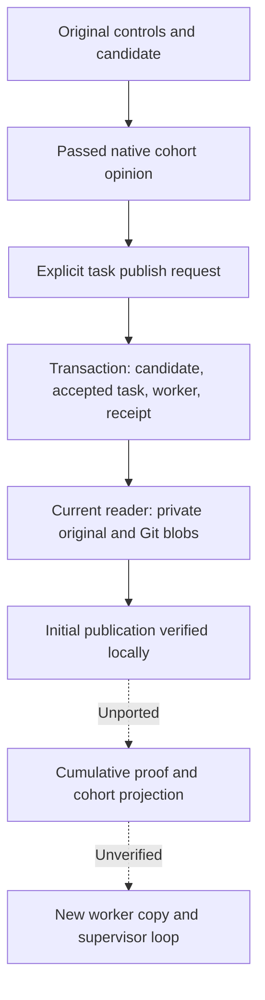
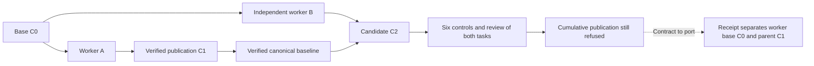
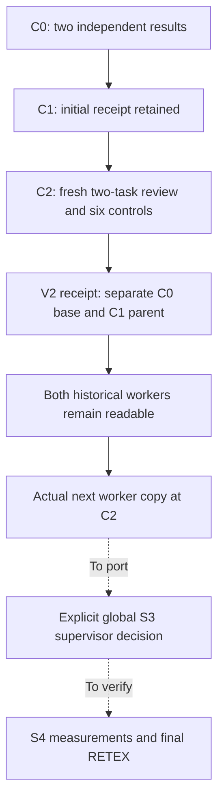

# Scaling agents — APEX Rust migration revision, October 25, 2026

[Français](../../../plans/migration-rust/SCALING-AGENTS-20261025.md) ·
[Contract and final diagrams](../../CURSOR-ENGINE-CONTRACT.md)

## S1 update — qualified owner handoff and recovery

The initial S0 documentation below is historical; S1 was subsequently integrated
and installed in Rust dev65 (`11414fafac47e3ca4db8fe9146b4b027b787d35bc39b50c0167a92bd518c0a8f`).
The current increment adds a maintained public recovery recipe on that exact
normal native profile, without changing production sources or restarting a service.
Two standalone Root journeys and the final subproject control/refusal pair pass.
After the owned report-path refusal, the Git ref survives; the same commit/report
is submitted with the original clone parked, no extra worker and no candidate
publication or acceptance. Five named tests cover the injector, channel backpressure,
malformed stdout and combined recovery/restoration failures. Final recipe integrity
is `VERIFIED` ([evidence](../../../plans/migration-rust/evidence/20261025-scaling-recovery-tl7d1g71/recipe-closure/result.json)).

GLM supplied the fault-device proposal; its swallowed error and invalid test were
corrected before integration. A complete broad review exhausted its output and
established no verdict. A smaller independent review identified unread-stderr
backpressure, reproduced before repair; its focused re-review confirmed the fix.
A later claim that recovery must recreate the worker copy is rejected by the
actual completed-worker consumer and public no-copy evidence. Its related cleanup
concern was independently reproduced and fixed: restore errors retain the original
failure. Raw stdout is retained before JSON parsing. Static GLM feedback and
executed assertions remain distinct ([report and RETEX](../../../plans/migration-rust/evidence/20261025-scaling-recovery-tl7d1g71/RESULT.md)).

This deliberately exercises a filesystem-shape refusal before final file writing,
not a real ENOSPC, mid-write failure or power-loss test. Those disk cases remain
open under the S1 owner. S2 managed candidate checks/final validation, S3 global
completion and S4 full-cycle measurements remain open. No new operator policy,
provider call, commit or push. The initial S0-only statements below apply to S0.

## Scope and actual result

The user requested APEX, detailed Cursor reading before SKYNET GLM delegation,
and documentation with Mermaid at the end. Swarm retains an **independent final
candidate validator**. January, February's successive designs and Swarm safeguards
remain distinct. Documentation and historical Go evidence do not establish a
shipped Rust loop.

This increment updates FR/EN principles, responsibilities, dependencies and actual
Rust gaps. It changes no engine code, mission, policy, budget or running service.
Source inspection is distinct from the previously observed dev.59 executable.

## S2 in progress — construction and evidence protocol

`managed_repository_candidate.rs` merges the result and previous candidate in an
owned scratch copy, creates a single-parent technical commit and resets before
controls. Three real-Git unit cases passed initially; a fourth existing scoped
contract test also matched. This is not public validation or installation. The
first command omitted `--lib`:100unnecessary integration executables ran zero
tests and count as no PASS. Only those newly generated own caches were removed
after retaining their hashes (11,452,343,912bytes); source/proofs, the unit binary
and releases remain. AGENTS now requires `--lib` or explicit `--test TARGET`;
Claude reads these shared instructions.

GLM segmentation/catalogue contributions are adapted in
`managed_review_citation_json.rs`, `managed_review_citations.rs` and
`managed_review_reply.rs`: lost closing quotes, incorrect literal references and
discarded codec causes corrected. Go768-byte/short-tail8 partition rules preserve
every byte; legacy8/1000 quote bounds become supplied persisted review limits
shared by schema and decoder. Root consumer/provider schema remain unwired, so
configuration effect is unproven.

The parser covers the exact candidate and whole cohort, v2 duplicate/exclusive
fields, hashes and attributed quotes, fail/unknown and saved transport bounds.
It grants no authority. Batch/fragment paths still refuse. The targeted unit-only
managed batch is in progress; final byte-bound review, public controls/reviewer,
publication, normal profile and installation remain open. The S1 Git fix is installed in dev67.
Actual catalogue assembly, candidate custody and cumulative controls must be
connected before removing any public guard.

Current targeted check: **31 managed unit tests PASS** (frozen sources, no fixture feature). Raw hashes refuse assume-unchanged/skip-worktree-hidden changes and recover after source restoration. The shared retention fix neutralizes local Git callbacks; the dev65 native counterexample is retained. Targeted GLM review and real Git casing/priority witnesses are complete; new-profile native recipe and installation remain open. These results do not wire S2 into Root.

[S2 evidence](../../../plans/migration-rust/evidence/20261025-scaling-s2-oi9dgo_e).

## Architecture and delivery ordering

Reject a file-by-file restart of all Go ports: existing Rust producers must be
reused. Deliver useful vertical journeys instead, with parallel independent work
and short protected state transitions rather than a registry lock during model
calls. Final candidate validation does not decide global completion: the root
owns that decision; the engine checks and applies authorized transitions.

| Lot | Owner/scope | Observable outcome |
| --- | --- | --- |
| S0 | Principal, FR/EN documentation, bounded GLM review | Explicit roles/limits, three end-of-page diagrams per language; documentation only. |
| S1 | Principal integrates bounded GLM proposals, G3/G4 managed result/owner handoff | Current immutable attributed result received exactly once; restart preserves identity, base, evidence and spending while another worker can continue. A report never substitutes for protected publication/acceptance. |
| S2 | G3/G4 final validator and actual producers/consumers | Whole-candidate/interactions opinion bound to checks; rejection/unknown/staleness and recovery/replay without duplicate spending. Batches/fragments retain refusal until their relevant protocol is ported completely. |
| S3 | Root and engine after S1/S2 | Completion only with current results/evidence; premature `end` refuses without mutation. Never merely remove the current Rust refusal. |
| S4 | Principal and separate verification | Multiple workers, handoff during ongoing production, rejection/correction/restart, separate compute/wait/check/review/publication measurements and RETEX. Fixture providers are distinct from real models. |

Engine changes will carry risk-A controls: valid controls before fault injection,
frozen inputs, byte-bound policy/function/error/documentation review, targeted
checks and one complete lot recipe. Operator policy stays persisted with
Admin/API/CLI/consumer parity. Qualify the actually installed binary, assets and
FR/EN notes through the supported launcher. No live mission or business provider
call is started by this documentation increment.

## GLM contributions and principal decisions

Unlike the historical DNS failure, the current DNS check succeeds and `/models`
declares API ID `glm-5.2`, limit 524288. The user's GLM 5.3 backend indication stays
distinct from that API identifier; no fill or price claim. Two bounded low-effort
calls completed without automatic retries. Hashed inputs and original answers
remain in the lot evidence directory. Models have no repository access or tools.

Retain the principle review's clearer validator/root roles, historical Go scope
and 53.149 s presentation without changing the original measurement. Do not adopt
an arbitrary contention deadline/refusal: measurement must come first.

Reject the migration proposal's inference that RootStore, LocalDirectory, fences
and managed observation are unported just because their implementations were not
all supplied: supplied Rust already calls them. Reimplementing that existing
observation would not advance delivery. Its list of required interface context is
useful, but no engine patch or acceptance follows from the answer. The next GLM
contribution must target an actual S1 missing interface with complete producers,
consumers, types and guards. Preserve concurrent Trust/memory/budget/instruction
work; the principal remains accountable for integration and verification.

## Documentary verification and transmission

Check explicit role/scope consistency, local links and the scoped diff. Initial
Mermaid rendering fails because its Puppeteer expects a missing Chrome version.
Select existing system Chrome explicitly, retain the failure and run a successful
control before remaining renders. No dependency install or product security change.
Rendered images and visual inspection qualify diagrams, not engine behavior.

No engine compilation/installation is required: these documentary pages change
no executed contract or application resource. They do not update running agent
contexts. Future delegations must explicitly receive relevant boundaries; retained
GLM requests prove only the context those two calls actually received.

Hierarchy, validation and Rust-gap Mermaid diagrams are at the end of the
[canonical contract](../../CURSOR-ENGINE-CONTRACT.md#mermaid-diagrams--target-and-migration-limits).

Shared Git fix delivered in dev67: add and write-tree protected together, forced native recipe PASS/VERIFIED, normal424-input profile and14FR/EN UI assertions. [Result/retrospective](../../../plans/migration-rust/evidence/20261025-scaling-s2-oi9dgo_e/S1-GIT-RESULT.md). S2 remains open.

S2 GLM resumption: verifier clean-filter execution reproduced and removed; three real-Git tests PASS and managed-candidate-custody recipe PASS/VERIFIED. Original checkpoint, refusal and restoration retained. No Root/final-validator wiring claimed. Evidence: `../../../plans/migration-rust/evidence/20261025-scaling-s2-oi9dgo_e/resume-glm-candidate/`.

S2: cumulative-control preflight consumed before candidate creation. An accepted task without a policy previously still produced a candidate (retained actual-Git counterexample); refusal and recovery are now covered. Original/normalized policies stay separate, order is preserved, transport IDs are distinct and no aggregate ceiling is added. The business digest cannot authorize a future job: normalized policies, settings and the physical candidate must also be bound. FR/EN docs and a fourth Mermaid distinguish tasks, agents and jobs. Evidence/delivery status: `../../../plans/migration-rust/evidence/20261025-scaling-s2-oi9dgo_e/native-controls-glm/`.

S2/job: the native success calculation accepted a foreign-control result in a supplied-data fixture (retained pre-fix counterexample; no live-mission exploit demonstrated). Policy/slot/result mapping now checked before public conversion, original readback and replay. Missing/unsuccessful results without the failed flag refuse; real failures/unattempted slots remain retained blocked data. S2 cohort, physical witnesses and final validator wiring remain open. Evidence/recipe/installation: `../../../plans/migration-rust/evidence/20261025-scaling-s2-oi9dgo_e/native-job-binding/`.

S2/origin: new native journal binding, still not the managed candidate. Scalar origin and effective policy recorded at claim; domain digest before mission overlay, shared permission/publication/review readers. Private v2 requires both fields; v1 omits them without reencoding or backfill. Retained actual dev70 public witness lacks this origin; new tests cover controls preimage and implicit-downgrade refusal. GLM found the missing controls preimage in the first proposal: corrected with effective_policy. Evidence/recipe/delivery: `../../../plans/migration-rust/evidence/20261025-scaling-s2-oi9dgo_e/native-source-origin/`.

S2/candidate preimage: reproduced defect — changing a saved default timeout retained the same candidate while changing normalized controls. Private v2 checkpoint retains the entire cumulative plan and refuses drift without replacement; unbound v1 stays preserved/refused. The historical native mapping recipe now expects the three tests actually present (dev70 evidence unchanged). Checks/delivery tracked in `evidence/20261025-scaling-s2-oi9dgo_e/candidate-controls-rbro0sp6/`. Native/final S2 remains open.

S2/preimage follow-up: GLM proposed checkpoint binding. Principal integration strengthened it to cover the entire checkpoint, including physical observations and tracked source hashes, without implicit authority; producer/reader and missing/altered-binding checks retained. The proposal omitted those observations and its assertions missed the actual error wrapper, so it was not applied verbatim. Final evidence is in the increment’s `full-binding/` subdirectory; initial dev72 evidence remains separate. The complete candidate is prepared, not yet executed through Root.

S2/physical custody: `pin_candidate` retains actual copy/.git/workspace descriptors after verification; Git lane released before return. Existing preparation/readback uses the same guard and explicit close. Ownership stays outside generic wrappers to preserve witness close causes after ancestor failure. Tests cover real command, available lane while held, replacement/refusal/restoration and actual EMFILE duplication failure in an isolated subprocess. No managed job or final reviewer enabled. Exact evidence/status: `evidence/20261025-scaling-s2-oi9dgo_e/candidate-witness-djwzsrgp/`.

S2/cumulative journal: private v3 reader retains full candidate, all-task plan and both preimages. Transport-bound mapping and target-only public results, while prior failures block the outcome. v1/v2 stay unchanged; no managed producer enabled. Retained counterexamples: opaque candidate digest admitted in v2 and matching empty argv becoming positive. Original SQL origin prevents a resealed partial cohort replacing the original; ordinary source read refuses implicit candidates. GLM module integrated with actual hash API and stronger original/normalized consistency. Evidence/recipe/delivery: `evidence/20261025-scaling-s2-oi9dgo_e/native-cohort-71bzc4jf/`. S2/permissions/final review remain open.

### S2 — Root candidate hookup, explicit preparation

Increment following dev75: `task validation-candidate` observes the actual native submission and cumulative policies, releases Root/settings locks before Git, retains and pins the candidate checkpoint, then rechecks Root state before returning. Previews remain nonmutating and managed launch/reviewer stays refused. Recipe: `native-managed-candidate`; report and evidence: `../../../../plans/migration-rust/evidence/20261025-scaling-s2-oi9dgo_e/native-admission-wj7wdoab/`. Actual preparation is neither a job nor executed controls: overall S2 remains open, as do S3/S4 and final RETEX.

Verified increment result: native preparation installed as **v0.1.1-dev.77**, maintained recipe PASS/integrity VERIFIED (26 targeted Rust tests, ordinary controls/replay, actual managed workers followed by 8 preparation/refusal/recovery assertions in `app`). Actual dev75/dev77 ordinary previews match, including source digest. Running executable, protected assets and 14 FR/EN version-dialog assertions verified; Works preserved. Report, limits and local RETEX: `../../../../plans/migration-rust/evidence/20261025-scaling-s2-oi9dgo_e/native-admission-wj7wdoab/RESULT.md`. No cumulative job or managed final reviewer launched.

### S2 — actual native controls on the candidate (dev78)

The prepared actual candidate now feeds Root claim: every slot, SQL origin bound
to full plan/candidate and actual Root/SQLite instance, optional actual lease,
permissions and commands in the held project subdirectory. Controller and helper
own separate descriptors; Git remains outside Root locks. The v3 producer,
result publication, reconciliation and replay without the candidate are wired.
Managed final review remains explicitly refused; no receipt or test accepts the
task or publishes the candidate pointer.

Evidence: [increment report and RETEX](../../../plans/migration-rust/evidence/20261025-scaling-s2-oi9dgo_e/native-launch-3w5nsudd/RESULT.md),
`recipe-complete-inputs/` PASS / integrity VERIFIED: 26 targeted Rust tests,
ordinary compatibility and actual managed workers then three controls per job,
three recorded/one retired jobs, actual automatic lease, failed command2 followed
by command3, publication refusal then reconciliation without reexecution,
terminal replay with candidate/admission frame parked. Preparation regression
retains eight PASS assertions. Normal no-fixture executable, qualified build SHA
matches `/proc/PID/exe`, **v0.1.1-dev.78**, protected assets and14 FR/EN dialog
assertions PASS; Works unchanged since dev77 witness. Activation is observed;
this continuation issued no redundant restart. Other dirty development is not
qualified by this recipe.

Separate-context GLM review: no authority defect demonstrated in its first
packet; addendum received: v3/retirement/raw-source readers examined without a
demonstrated defect within their supplied scope. Consult
the report for actual received conclusions, hashes and limits. This is neither
independent business acceptance nor global Rust qualification. Native proof
covers the current task; accepted-predecessor cohorts retain component evidence
only, without injected accepted states.

**Open recovery incident B1, owner: native controller/root supervisor.** Death
before the combined receipt, or a failed slot-journal write, may leave an active
job without its combined original. Replay/reconciliation/retirement then refuse;
owner absence establishes no child's result/wait. The ordinary path shares this
limit. Options: fabricate a receipt/unlock on PID absence (rejected: insufficient
evidence); retain exclusivity and implement explicit recovery from actual known
slot originals (chosen). Resumption condition: distinguish complete private slots
without combined receipt, never-admitted slots and unknown outcomes; reproduce
each after a valid witness and prove settlement without reexecution or improper
acceptance. Neither this managed path nor GLM review fixes that limit. Global S2,
S3/S4 and final project RETEX remain open.

Review follow-up: GLM hypothesized negative gate numbers could raise scores.
Actual dev78 CLI and `gate_json::Document::number` (finite and >=0) refute it.
Maintained `gate-nonnegative` recipe retains16 assertions for methods2/3:
valid pass/legitimate failure/negatives/zero/restored inputs, unchanged settings
and proof. No product fix was added. Lesson: include effective numeric/parser
accessor bodies before inferring missing validation from a caller; a model opinion
is not defect evidence.

### B1 — complete batches without a combined receipt

26October APEX recovery: actual dev80 reproduces refusal after a valid witness
and three waited command originals but no combined receipt. The candidate recovers
that same request without commands; changed source/missing slot/unknown wait
refusals, restoration and retirement are verified on this fixture. Final recipe PASS / integrity VERIFIED, scoped GLM review without a demonstrated
defect and verified dev82 installation are recorded in the
[increment report](../../../plans/migration-rust/evidence/20261025-scaling-s2-oi9dgo_e/native-partial-_vzckkq_/RESULT.md).
Reconstruction requires SQL origin, identical current source and every known
original. Batches with absent/unknown observations remain unresolved. The assembly
original preserves provenance/time; no exit/wait is reconstructed. Managed final
review remains an open S2 dependency.

### Complete inspection before final review — dev84

The public `task review-preview` / `task review-inputs` path now inspects the
retained Git candidate and the actual successful control cohort: all tracked
source text, canonical reports, criteria, hashes and literal symlink targets.
Non-UTF-8 files refuse; nothing is clipped and symlink targets are never followed.
All four saved reviewer limits are enforced with verified refusal and recovery.
No new hardcoded operator policy is introduced.

The dev82 counterexample is retained. The maintained recipe passes four public
journeys (ordinary inputs, ordinary fixture reviewer, managed text candidate,
binary refusal), with twelve text assertions and four binary assertions. The
no-controls path also refuses. Separate GLM review, Rustdoc, rendered FR/EN
Mermaid diagrams and actual dev84 binary installation are recorded in the
[increment report](../../../plans/migration-rust/evidence/20261025-scaling-s2-oi9dgo_e/native-review-context-ekf9ibrv/RESULT.md).

This context is explicitly `inspection_only`: no managed reviewer call, final
verdict, accepted-baseline verdict applicability proof, acceptance or candidate
pointer publication. Next owner: native controller/reviewer, binding these proofs
to actual reservation, permission, invocation, reply, recovery and authorized
application. Global S2, S3/S4 and final project RETEX remain open; this increment's
RETEX does not close them.

### Complete citation protocol — validator sources and schema

`task review-inputs` now prepares typed context/digest, the complete catalogue of
quotable originals/digest, and a citation-v2 whole-cohort reply schema. Saved quote
limits and the parser share source producers; without an admissible reference,
fail/unknown remain possible without fabricated pass evidence. Ordinary input
JSON is preserved.

GLM review: promotion of engine metadata to source evidence was reproduced after
a valid witness and fixed at the material-role boundary. All metadata bytes remain
in materials/receipts without becoming implementation evidence. Seven protocol
tests and one material-boundary test pass, including the real opaque-receipt JSON
roundtrip. Zero-criterion tasks require an explicit empty array in the schema;
the parser also accepts absence. Normalized minimum applies only to Markdown
fallback, not exact literal references.

Public recipe, delivered profile, installation and limits: [report](../../../plans/migration-rust/evidence/20261025-scaling-s2-oi9dgo_e/native-review-protocol-2vxq_rki/RESULT.md).
The initial saved131072-byte prompt refusal and recipe defects are retained.
Fixtures explicitly persist prompt quota0 via the public API; no product default
or operator cap is silently replaced. The protocol remains inspection_only:
managed invocation, applicable final reply, historical verdict applicability,
acceptance/publication and global S2 remain open. Next owner: native controller/
reviewer, binding protocol to actual reservation/permission/call/reply/recovery
without removing guards merely because the catalogue can be read.

Verified local delivery: dev91, eight targeted Rust tests, four public recipe
journeys with verified retained integrity, and12 inspection+4 protocol assertions
rechecked on the installed binary. Fourteen FR/EN Version checks and preserved
logical Works/numeric forms. Dev90->dev91 differs only in release notes/metadata;
unchanged ordinary-flow evidence is reused explicitly. Review lesson for the next
context: include review_quote.rs (exact vs Markdown fallback) and model_wire.rs
(GoRaw/canonical serialization) with the context producer and actual parser from
the first packet; caller-only observations produced an unnecessary conditional
finding. A leading-newline Git diff remains a dormant shared-producer refusal,
owner future diff support; current native context explicitly has no diff.

### Public supplied-output check — native invocation dependency

`task review-check` rebuilds the protocol under candidate custody, requires the
original prompt digest and checks supplied JSONL through the actual tool-free
transport and complete-cohort parser. Saved Admin limits, unique canonical names,
indices and citations apply. Its result is opinion data only: no provider start,
debit, recorded verdict or acceptance. Managed native invocation remains guarded.

Five targeted unit tests pass, including two tasks, transport failure and retained
rejected originals. The first actual CLI journey passes nine output assertions
in addition to twelve inspection and four protocol assertions; consolidated
recipe and installation are tracked in the
[increment report](../../../plans/migration-rust/evidence/20261025-scaling-s2-oi9dgo_e/native-review-check-vtinqwfv/RESULT.md).
The initial GLM implementation request failed HTTP504 after600.063s without code;
implementation resumed directly and GLM received a separate shorter review task.
Do not count the failure as an integrated contribution or zero consumption.
Global S2 and final project RETEX remain open.

Local journey closure: dev94 installed, three consolidated journeys PASS with
verified retained integrity; five actual-running-executable CLI assertions and
fourteen Version FR/EN checks pass. The focused GLM review answered after496.183s:
no direct defect in the two new modules, with explicit limits concerning unchanged
callee bodies not supplied. Related local evidence is linked in the report; this
opinion is not global independent acceptance. Both large calls remain retained
HTTP504 failures, consumption unknown. Concurrent later release notes and two
preparation help lines are not claimed installed by this lot. Delivered and tested
review-check code is unchanged.

### Managed native reviewer — cohort invocation, journal and recovery

`task review` now connects externally held candidate custody to reservation,
child checks, tool-free transport and complete-cohort publication. The journal
retains original protocol, limits and reply; content-addressed public context,
opinion and event bind checked bytes. No opinion accepts a task. Historical
managed result reading is wired; managed acceptance/production-retry authority
and accepted-baseline proof remain explicitly guarded, so global S2 stays open.

Actual counterexample: after provider completion, publication compared a typed
protocol with a differently ordered JSON projection. Generic fix compares two
canonical typed models while retaining context/policy/prompt checks. The same
original was then applied through review-reconcile without another invocation
or debit. Running-source observation uses the exact internal review record,
never a JSON-supplied permission.

Six journeys verified: ordinary reviewer, fresh managed invocation, rejected
partial cohort, publication refusal/recovery, live source drift, and review-check
compatibility. Three retained functional results are reused; three remaining
journeys pass. The original recipe wrapper remains FAIL: an arbitrary minimum
of five assertions rejected a complete four-assertion case. The maintained
recipe now checks named requirements per case. Two journal tests, nine capture
tests and the canonical regression pass. GLM contributed borrowed-custody design
and reviewed supplied boundaries: no direct confirmed defect, excerpt limits
preserved. Report, actual installation state and retrospective:
[evidence](../../../plans/migration-rust/evidence/20261025-scaling-s2-oi9dgo_e/native-review-launch-xxnx8icj/RESULT.md).

Next-context lessons: target the exact constructor when changing cfg(test) and
qualify the production profile; compare the same representation before declaring
source drift; recover the same original after publication refusal; assert named
case obligations. No commit/push or suspended-mission restart is implied.

This increment is verified locally: **dev.101** activated through the supported launcher; actual executable matches the default profile without fixtures, protected assets match, 14 FR/EN UI assertions pass and Works are preserved. A fresh complete native flow on this same binary passes five named assertions, including context corruption/refusal/restoration and replay without another call/debit. Isolated inert provider; no task acceptance or global S2 closure. Evidence and increment RETEX are in the report linked above.

### S2 — public prepublication entry verified, dev106

`task publication-preview` verifies the original native opinion, original controls and the currently retained candidate cohort without writes or provider calls. Atomic publication and accepted-baseline blockers stay explicit; a verified observation never means `publication_ready`. The Go integration contract confirms that status-only acceptance would leave the previous candidate pointer consumed by new worker copies: GLM's status-only proposal was rejected. Acceptance remains open and its guard stays in place. Sources, original dev101 refusal, maintained recipe, review and delivery are tracked in `evidence/20261025-scaling-s2-oi9dgo_e/native-review-accept-e1j5v2ic/`.

Observed dev106 delivery: passed and changes-requested native originals inspected on the actual serving executable; no provider, debit or Work change. Twelve favorable-flow cases and four complementary assertions pass; original and complementary recipe integrity verified separately. The actual blocked-task refusal was reproduced and corrected only for `RecordedOpinion` observation. Fourteen FR/EN UI assertions, protected assets, default profile without fixtures and exact Works preservation since dev101 verified. Focused GLM review found no confirmed defect in supplied boundaries; no task acceptance or global S2 conformance. [Report/RETEX](../../../../docs/plans/migration-rust/evidence/20261025-scaling-s2-oi9dgo_e/native-review-accept-e1j5v2ic/RESULT.md).

Current instance rechecked after another local delivery: **dev107**, identical Rust bytes for this increment, qualified profile, two public branches and14 FR/EN UI assertions verified again. Dev106 evidence remains historical and intact; see `activation2/` in the report.

### S2 — first protected publication, v0.1.1-dev.115, October 26

The preceding increment was committed as `a3be338b4`. Explicit `task publish`
atomically publishes the checked candidate, accepts its task, settles the worker
row and records a canonical SQL receipt. Replay invokes no provider/control and
adds no debit. Originals stay unchanged. The operator/supervisor explicitly
requests the decision; passing controls never finish the work by themselves.
This slice exposes CLI/Root, not a new autonomous conductor route or web button.

Four temporary SQL faults leave no partial write. The complete flow on the actual
serving binary verifies ten obligations, including integrated-worker recovery,
publication, replay and evidence refusal/restoration. Three additional canonical
corruptions refuse and recover: binding, cohort contract and result commit. The
last also changes the worker row to prove that mutually matching SQL data cannot
replace the private original. The unbound-field defect was reproduced before its
fix and retained. Permanent recipes and integrity verify; Rustdoc builds; fourteen
FR/EN Version assertions pass. Default native profile excludes fixtures; protected
assets match and Works remain unchanged. Installed hash `3635bd296a419b7d7c8f5c845a5caa87efea689b028358ec228c43c36d9fae62`; declared commit
`079635b295b68c9422c1276f31f87488aa849c50`, with dirty changes visibly disclosed.

Two focused GLM/SKYNET static-review requests yielded no final verdict. The first
packet became stale; the second produced private reasoning fragments only. Owned
clients were stopped and evidence retained; final consumption is unknown. No client
cap or reduced reasoning effort was introduced. This proves neither general service
failure nor completed independent review.

Concrete S2 continuation: cumulative baseline proof must bind every accepted task
to the new whole-cohort opinion and controls rerun on that same candidate, retaining
previous originals and historical worker provenance. Today's reader deliberately
requires the exact initial pointer. A status-only change or reassigned review ID
is insufficient. Then verify an actual new worker copy from the published pointer;
its SQL value alone does not establish that copy. Cumulative projections,
autonomous supervisor integration, S3/S4 and the final project RETEX remain open.
[Increment report and RETEX](../../../plans/migration-rust/evidence/20261025-scaling-s2-oi9dgo_e/native-first-publication-ytg974j3/RESULT.md).

### S2 — dependent worker after publication, dev121

The real journey reproduced two blockers: an ordinary clone missed the published
candidate under its native reference, and a dependency refusal could strand a
final copy before admission. Preparation now fetches the exact OID from the held
bare repository and checks shared prerequisites before any copy effect. The
writer retains its complete recheck.

The maintained recipe checks four obligations: published predecessor, actual
copy HEAD/content, preparation replay/refusal/restoration, and real completion
with one reservation. Prepublication refusal leaves no copy. Successful original
stages are explicitly reused rather than claimed as newly executed. No paid
provider or positive SQL seed. Normal no-fixture profile and identical effective
inputs bind the recipe to delivery; 14 FR/EN UI checks and three installed CLI
checks pass. Rustdoc compiles with the workspace graph; its feature profile is
separate from production qualification. Original failures remain retained.
Cumulative publication/projections, supervisor integration, S3/S4 and the final
project RETEX remain open. [Report and increment RETEX](../../../../docs/plans/migration-rust/evidence/20261025-scaling-s2-oi9dgo_e/post-publication-worker-hfzh_8zd/RESULT.md).

### S2 — verified native baseline before the next candidate, dev124

`task baseline-preview` rereads canonical publications, native originals, Git
reports and current policies for every accepted task. The same guard precedes
candidate and job preparation. An initial empty baseline explicitly reports
absent/unverified; corrupt evidence refuses rather than succeeding empty or
starting a provider. This CLI/Root observation adds no HTTP route, publication
authority or business completion.

Maintained recipes pass nine accepted-baseline cases and two initial-empty/
ordinary-Work cases, with VERIFIED integrity. The second candidate actually runs
six controls and a whole-cohort review of both tasks; the old accepted task stays
unchanged. Five installed public checks and 14 FR/EN Version UI assertions pass.
The normal no-fixture profile has 122 compiler artifacts with matching effective
features/profiles and identical affected engine bytes; three unrelated delivery
source differences are retained explicitly. Real Works remain unchanged. Rustdoc
compiles. Static GLM review is separate from execution evidence; its final state
is retained in the report, never inferred from stream fragments.

Observed on actual independent worker results: the second worker started at C0, while its
candidate parent is already C1. The next cumulative writer must distinguish
original worker base from current candidate parent in the receipt, SQL conditional
update and historical reader. No proposed field is claimed as implemented.
Next criterion: publish C2 from worker C0 onto C1, keep both workers and their
originals readable, refuse a tampered base without mutation and recover after
exact restoration. Owner Codex S2. The cumulative guard stays until this contract,
its projections and recipe are implemented. Supervisor integration, S3/S4, other
Go APIs and the final project RETEX remain open.
[Report and increment RETEX](../../../../docs/plans/migration-rust/evidence/20261025-scaling-s2-oi9dgo_e/native-baseline-4h9t3go0/RESULT.md).

### S2 — verified cumulative chain, historical workers and next copy, dev128

The v2 cumulative receipt separates worker base C0 from candidate parent C1, binds
its predecessor and publishes C2 atomically. The reader verifies lineage and the
latest whole cohort without replacing older Tasks/reviews. Nine publication, two
policy, four next-worker and five readback obligations pass; failed earlier
recipes stay retained, with no repeated successful provider calls. Four SQL faults
pass through the TEMP SDK, distinct from production. Missing future capacity is
raised through quota preview/apply/reopen, keeping2 consumed calls at2; the actual
next copy contains C2 and both reports.

Installed dev128 is verified: public readback of125 originals, normal no-fixture
profile,14 FR/EN Version checks and preserved real Works. Three owned Rust deltas
are comments only; twenty other changed inputs belong to parallel deliveries,
without asserting whole-build identity. Two complete static GLM reviews found no
demonstrated defect within their assignments; an intervening call failed ENOSPC
with unknown provider outcome/usage, followed by healthy tmpfs recovery and atomic
retention. Packet limits and external SQL-corruption hypotheses remain explicit;
no confinement or AI autonomy is inferred.
[Report and increment RETEX](../../../../docs/plans/migration-rust/evidence/20261025-scaling-s2-oi9dgo_e/native-cumulative-xgydfgxg/RESULT.md).

S2b supervisor-decision to native publication integration remains open, together
with S3 explicit completion, S4 measurements/RETEX and other Go APIs. Route migration must read actual aggregates: Go `/api/v1/task` includes
evidence, reports, gates, review and actions, so returning just a Task would miss
its contract. Go sources are currently Git-ignored: required inventories inspect
real files rather than default `rg --files` output alone. Lexical route counts
never prove behavioral coverage.

The recipe runs both workers sequentially (`for turn in range(2)`, first wait/
settlement before the second). A common C0 base proves independent results, not
simultaneous execution. S4 must still verify real overlap, including publication
while another worker is running.

