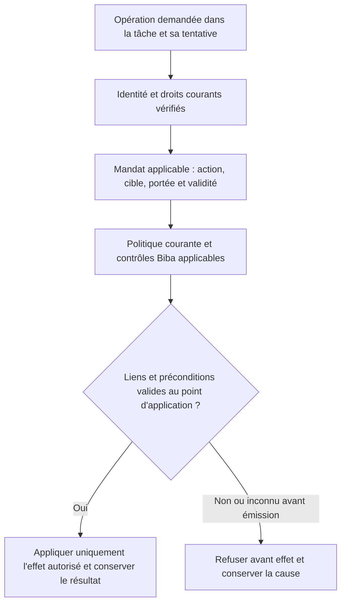

# Swarm — scénarios de PoC et de tests à reprendre après avancement du code

[English](../en/plans/AGENT-CONTROL-POCS.md).

Décision de Fabrice du 7 novembre 2026 : conserver ces pistes pour les mettre
en place une fois le code suffisamment avancé. **État : mis de côté sur demande,
à qualifier avant réalisation ; aucun test exécuté ni capacité produit validée.**
Exception décidée ensuite le même jour : Fabrice autorise le développement de
POC-06 avec GLM supervisé, Biba et documentation ; les autres PoC restent différés.
Suivi : [développement POC-06](actions-confiance/POC06-TASK-MANDATE.md).

Objectif : démontrer le contrôle effectif d’actions d’agents et leurs reprises,
avec des effets observables. Ces scénarios viennent des échanges X ; ils ne
constituent ni des défauts Swarm établis ni une qualification de produits tiers.

Propriétaire : Fabrice pour la priorité et la reprise ; Codex pour l’inventaire
et le cadrage lors de cette reprise. Le moteur ne décide pas l’autorité métier.

## Conditions et ordre de reprise

Reporter l’exécution jusqu’à la demande de reprise de Fabrice, après avancement
du code. Commencer alors par examiner les contrats réellement disponibles et
les tests/recettes existants, pour réutiliser leur couverture sans duplication.
Identifier le parcours public, le connecteur ou simulateur, l’autorité effective,
le stockage des décisions et preuves, et l’observateur de l’effet externe.
L’absence d’une intégration est un prérequis manquant, pas un test en échec.

Priorité proposée : commencer par POC-01, puis sélectionner les autres selon
les intégrations disponibles. Aucun calendrier, automatisme ou développement
supplémentaire n’est lancé par cette note.

## Scénarios conservés

| ID | Scénario et intérêt | Témoin et variante | Résultat observable attendu | Origine |
| --- | --- | --- | --- | --- |
| POC-01 | Destination modifiée après accord : empêcher la réutilisation d’un mandat pour un autre destinataire. | Export approuvé vers A qui réussit ; même export vers B avec l’accord A, par le parcours normal puis un autre chemin disponible dans la fixture. | Refus avant transmission vers B, absence d’effet interdite observée au destinataire ; cause et décision conservées. Reprise vers B seulement sous une autorité applicable. | [Amit / notre cas A-B](https://x.com/fabrice76346592/status/2119081585081188545), X-IDEE-02. |
| POC-02 | État changé après approbation : une commande identique peut avoir un autre effet. | Action approuvée avec état inchangé qui réussit ; schéma simulé changé avant une migration, commande inchangée. | Précondition pertinente devenue fausse détectée avant mutation ; aucune réutilisation aveugle de l’accord. Réévaluation/reprise contrôlée, historique intact. | [alexi](https://x.com/aleximarkett/status/2119108869460771185), X-IDEE-01/02, lot 8. |
| POC-03 | Notification tardive : préserver l’identité de la tentative et l’obligation satisfaite. | Tentative initiale échouée puis seconde réussie ; événement tardif relatif à la première, et variante résultat inconnu. | Ancien événement attribué à la bonne tentative, succès non écrasé, pas de nouvelle émission injustifiée ; réconciliation de l’inconnu selon le contrat du simulateur. | [Portotify](https://x.com/portotify/status/2119117960287559720), X-IDEE-07, lot 7. |
| POC-04 | Révocation pendant l’exécution : distinguer nouvelles actions et effets déjà engagés. | Mandat valide avec action réussie ; révocation avant émission puis pendant une émission contrôlée, avec travail enfant si pris en charge. | Nouvelles actions non autorisées bloquées ; effets engagés/inconnus conservés et réconciliés ; compensation soumise à une autorité distincte si nécessaire, sans effacement d’historique. | [Question d’Ashik](https://x.com/AI_Ashik07/status/2119135017482011007), X-IDEE-06/07 et lot 8. |
| POC-05 | Accès résiduel : ne pas confondre acceptation API et révocation complète. | Accès initial permis ; suppression du droit direct avec un chemin résiduel explicitement prévu dans la fixture, puis suppression autorisée de ce chemin. | Premier contrôle rapporte la portée incomplète, second confirme uniquement les chemins effectivement vérifiés ; chronologie et couverture conservées. | [Offboard / Defi Preacher](https://x.com/DefiPreacherr/status/2119121712260522123), X-IDEE-04/06, lot 7. |
| POC-06 | Mandat lié à la tâche et à la tentative : empêcher un même agent de transporter les droits de A vers B. | Action autorisée sur A réussie ; même identité, mandat A présenté depuis B, puis mandat applicable à B délivré par l'autorité compétente. | Réutilisation refusée avant effet, cible intacte ; reprise B seulement avec ses propres droits applicables, historique A conservé. | Échange Fabrice/Codex du 7 novembre 2026, demande « tu ajoute ca a swarm? » ; contrat cible ci-dessous. |

Complément transversal de [Phillip Shoemaker](https://x.com/pbsIdentity/status/2119120731334156403)
(X-IDEE-02, lot 8) : l’approbateur doit voir les données, le destinataire et les
conséquences pertinentes correspondant à l’effet proposé. Vérifier cette
correspondance dans POC-01/02 ; la simple présence d’un bouton ne prouve pas
un consentement lié à l’action exécutée.

## POC-06 — identité, mandat de tâche et politique courante

**État : développement du PoC isolé autorisé le 7 novembre 2026, GLM délégué,
intégration et vérification encore à réaliser.** Ce complément ne conclut
ni à un défaut actuel ni à une protection déjà livrée. Codex porte son cadrage ;
Fabrice conserve la décision de priorité et de reprise.

L'identité établit qui agit ; le mandat précise ce que cette identité peut faire,
sur quelle cible et dans quelles conditions. À chaque opération, les droits
effectifs doivent rester dans l'intersection des droits courants de l'identité,
du mandat applicable à la tâche/tentative et de la politique en vigueur. Une tâche,
son texte ou un prompt ne crée aucun pouvoir supplémentaire. Biba reste un contrôle
d'intégrité obligatoire distinct, avec les autres contrôles applicables ; un mandat
ne le contourne pas. Voir les [limites actuelles de Biba](../architecture/BIBA-RUST.md).

Contrat à qualifier dans le code existant avant de choisir une représentation :
lier l'identité vérifiée, le contexte d'installation/projet, la tâche, la tentative,
l'action, la cible, les préconditions, la décision autorisée et leurs versions
pertinentes. Définir la validité, l'annulation/révocation et la délégation explicite
sans élargissement de portée. Les paramètres envoyés par l'agent ne prouvent pas ces
liens. Ne pas inventer de durée de validité ni de nouveau mécanisme concurrent des
mandats existants : réutiliser et vérifier les contrats réellement disponibles.

**Schéma cible à vérifier**, pas description d'un parcours déjà raccordé. Prévoir
une liaison entre contrôle et application qui empêche un changement concurrent
de cible, mandat ou politique de rendre la vérification caduque. Pour un connecteur
externe, identifier la frontière réellement contrôlée et conserver les résultats
engagés ou inconnus : aucun schéma ne garantit une atomicité distribuée.

| Cas | Témoin préalable puis injection | Critère observable attendu |
| --- | --- | --- |
| A → B | Mandat A valide sur A ; même agent et même mandat présentés depuis B. | Refus avant effet sur B, aucune mutation/transmission interdite ; B fonctionne ensuite avec une autorité applicable à B. |
| Action ou cible élargie | Lecture/suggestion autorisée ; demande d'application ou cible différente avec le même mandat. | Aucune élévation de capacité ; refus et cible intacte. Un mandat permettant l'action exacte fournit le témoin positif. |
| Annulation et nouvelle tentative | Opération valide ; annulation/révocation avant émission ou passage à une autre tentative, puis rejeu du mandat précédent. | Ancienne autorité inapplicable refusée ; pas de réutilisation implicite par la nouvelle tentative. Distinguer rejeu d'un résultat déjà enregistré et nouvelle exécution. |
| Délégation | Délégation explicite valide dans sa portée ; transfert du mandat à une autre identité sans délégation applicable ou avec portée élargie. | Transfert non autorisé refusé, aucune attribution au mauvais agent, aucune amplification des droits. |
| Changement concurrent | Témoin à état stable ; modifier cible, mandat ou politique entre contrôle et application à une barrière déterministe de fixture. | Aucun effet sous une autorité périmée avant émission ; rejet/réévaluation observés. Pour un effet déjà engagé, état réel ou incertitude conservés et réconciliation autorisée, sans faux « aucun effet ». |
| Liens invalides | Requête valide ; supprimer ou falsifier un lien requis d'identité, tâche, tentative ou mandat. | Refus explicite sans succès vide ni effet ; aucun droit déduit d'un identifiant déclaré par l'agent. |

Réutiliser POC-01 pour les destinations et POC-04 pour la révocation, sans doubler
leurs recettes. Chaque variante doit conserver identité observée, tâche/tentative,
mandat/décision, versions contrôlées, état avant/après chez le consommateur et
condition de reprise. Une permission de lecture ne vaut pas permission d'appliquer ;
un statut terminal ne prouve ni l'identité ni l'absence d'effet.

## Critères communs à prévoir lors de la mise en place

- Fixture isolée, données fictives et effets simulés ; jamais une mission,
  base de production, transaction bancaire ou révocation d’accès réelle.
- Témoin valide avant chaque injection avec les mêmes préconditions ; variantes
  interdites, entrées invalides pertinentes et reprise après correction.
- Vérifier l’effet chez le consommateur : un refus textuel, une exception ou
  un journal ne suffit pas. Conserver l’état avant/après, la décision, le mandat,
  les paramètres, la tentative et la portée exacte du contrôle.
- Pour les chemins alternatifs, préciser ce qui est réellement contrôlé.
  Un connecteur simulé ou un test de moteur ne prouve pas une isolation OS,
  réseau ou une couverture universelle des outils.
- Pour les actions déjà engagées, garder l’incertitude explicite ; ne pas
  assimiler arrêt du processus, absence d’accusé et absence d’effet.
- Utiliser les recettes permanentes sous `tools/verification/recipes/` quand
  applicables, avec preuves fraîches et vérification de leur inventaire. Lier
  résultats aux sources, profil et binaire réellement exercés. Un PoC local
  reste distinct d’une installation et d’une acceptation globale.

## Provenance et suivi

Détails et idées d’origine :
[IDEES-DISCUSSIONS.md](../communication/x-swarm-20261107/IDEES-DISCUSSIONS.md).
Sources datées et textes des échanges : registres `discussion-replies*.json`
et `discussions-lot7-evidence.json` / `discussions-lot8-evidence.json` dans
[le dossier de campagne](../communication/x-swarm-20261107/).

À la reprise, faire évoluer ici chaque scénario en **à qualifier → décidé →
réalisé → vérifié**, avec les références de preuves, écarts, limites et travaux
restants. La présente note n’autorise pas à déclarer un test manquant ou un
contrat conforme sans examen du code. La mise de côté est la seule action
réalisée lors de la conservation initiale ; POC-01 à POC-05 restent différés.
La reprise ultérieure de POC-06 est suivie séparément, sans réécrire cette décision.

## Complément conservé — séparation des identités, retour Cortexx du 7 novembre

[Retour direct](https://x.com/AI_cortexx/status/2119148103571792165) : la séparation du plan de contrôle devient difficile quand l’agent utilise le compte du propriétaire de la politique. À rattacher aux préconditions d’identité de POC-01/04 et aux idées 02/10/11, sans ajouter une exécution. Vérifier, lors du cadrage futur, les pouvoirs effectifs de la session déléguée et les chemins de modification de politique ; témoin humain autorisé, action métier déléguée valide, tentative d’auto-élargissement refusée et absence de mutation observée. Propriétaire et condition de reprise inchangés : Fabrice, après avancement du code et demande de reprise. État : hypothèse de test à qualifier ; ce retour ne démontre aucun défaut du code Swarm. Détail et preuve datée dans `docs/communication/x-swarm-20261107/lot8-audience-cortexx-context.json`.

Complément POC-03, 08/11/2026 à 01:26 : [Portotify](https://x.com/portotify/status/2119202338023838177) demande l’application en simulation des trois critères (effet antérieur, nouvel effet, autorité actuelle). Ajouter au cadrage futur la variante reçus contradictoires, avec conflit visible et absence d’émission injustifiée observée. Couverture inconnue ici, aucun code examiné/test exécuté ; propriétaire, report et reprise inchangés. Détails dans X-IDEE-07, `IDEES-DISCUSSIONS.md`.
