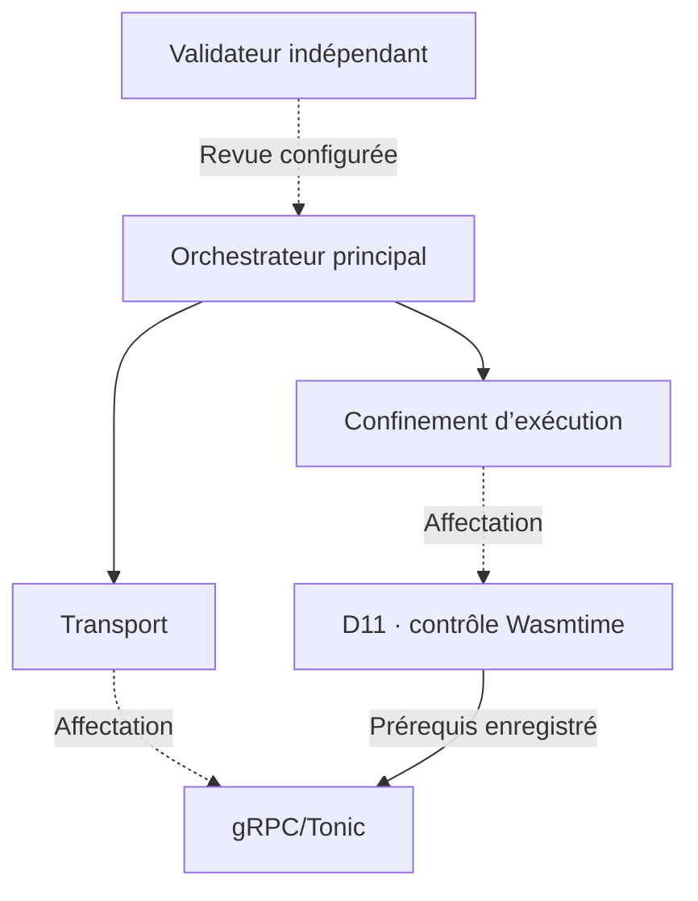

# Biba et Bell–LaPadula — audit appliqué de Conduite

## Analyse · révision 102

La lecture du Work et de la mission par le CLI du binaire local v0.1.1-dev.416
établit huit périmètres délégués, 60 tâches affectées, un validateur indépendant
configuré et zéro revue enregistrée. La mission est arrêtée, consentement
désactivé, 0 tâche acceptée sur 60. À cette révision, la seule dépendance
enregistrée est D11 Wasmtime → gRPC/Tonic. 59 tâches sont sans prérequis déclaré.
En navigateur isolé avant changement, les rôles sont dans un arbre à puces
distinct du graphe. La flèche de dépendance est hors du cadrage initial à 390 px.

## Décision

Conserver la **hiérarchie** pour la responsabilité des huit périmètres et
conserver la **séquence** D11 Wasmtime → gRPC/Tonic là où le plan l’impose.
Une chaîne séquentielle globale demanderait un ordre que le dossier ne fournit
pas. Une exécution parallèle de toutes les autres tâches n’est pas établie.
Le propriétaire du plan examine les éventuels prérequis métier manquants avant
validation d’une révision. Cet audit ne change ni l’architecture du plan ni
son consentement, et ne vaut pas validation d’un avis par l’utilisateur.

## Exécution et vérification

Projeter rôles et tâches dans le même canevas, conserver **Équipe et validation**
pour les reçus, distinguer visuellement les quatre relations, offrir une
navigation vers les dépendances et animer uniquement les processus dont
l’exécution est confirmée. Le contrôle navigateur couvre quatre combinaisons
langue/thème avec trois largeurs dont 320 px, une hiérarchie imbriquée, une
branche orpheline, le mode historique et le mouvement réduit. Une reproduction
en navigateur avec le plan Biba projeté vérifie séparément les cardinalités et
la navigation. L’installation requiert le contrôle de l’image servie et la
relecture de la mission. Le contrôle de dépendances métier demeure à la charge
du propriétaire du plan.

L’échec initial a exposé une collision entre les sélecteurs des cartes SVG et
ceux du panneau de validation. Le graphe porte désormais son propre attribut
de périmètre. Le témoin navigateur conserve le contrôle des données du panneau
et distingue ses lectures d’avis des mutations.
