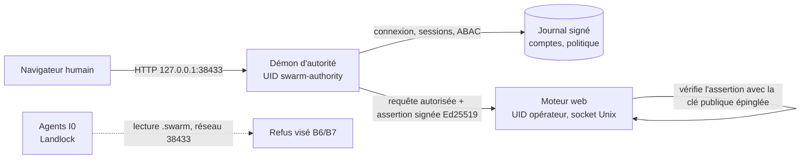

# Accès au cockpit — Phase B : autorité séparée, comptes et ABAC

[English](../../en/plans/acces-cockpit/PHASE-B-AUTORITE.md)

Statut : **plan, non exécuté**. Rédigé le 31 octobre 2026 après la phase A
(lien à usage unique, déconnexion, rotation de clé ; recette
`tools/verification/recipes/web-login-ticket-rust.json`). Aucune commande
`sudo` n'est lancée par l'assistant ; elles seront préparées, relues puis
exécutées par l'opérateur.

## Pourquoi une phase B

La phase A améliore l'ergonomie sans changer la frontière : la clé
`.swarm/web-session-*` reste un secret du même UID que les agents.

Constat vérifié dans le code (`swarm-biba-linux/src/lib.rs`, `Sandbox::prepare_bound`,
appelé par `native_provider_biba.rs` pour agent, planification, relecture,
validation et préparation CLI) : les agents I0 lisent tout le système de
fichiers **sauf** `<root>/.swarm`, écrivent seulement dans leur workspace, et
le réseau n'est pas restreint (`net:0`). Ils ne lisent donc pas la clé owner.
Restes réels : (a) un agent peut joindre `127.0.0.1:38433` (sans clé, il
n'obtient que `/login`) ; (b) `/proc/<pid>/cmdline` est lisible : le lien à
usage unique passé à `xdg-open` y est visible jusqu'à sa consommation (moins
d'une seconde en pratique) ; (c) les magasins de cookies du navigateur dans
le répertoire personnel sont lisibles ; (d) un programme lancé à la main sous
l'UID opérateur n'est pas confiné. La séparation humain/agent repose donc
encore sur un secret du même UID (EP-07 : « même UID + 0600 insuffisant »).
Correction : une première version de ce plan affirmait à tort que les agents
pouvaient lire la clé owner.

État réel de l'autorité d'enrôlement (cartographie du 31 octobre 2026) :
bibliothèques exécutées en processus par des commandes CLI ponctuelles ; un
seul compte `personal-account-v1` ; mot de passe vérifié à chaque appel, sans
session ; aucun démon, socket ni UID distinct ; canal `SO_PASSCRED` testé en
fixtures seulement ; installation sans compte système dédié.

## Architecture cible

Cible, non livrée. Principes :

1. **Le démon est le seul point d'entrée HTTP du cockpit.** Il sert `/login`,
   tient les sessions, évalue l'ABAC, puis relaie vers le moteur.
2. **Le moteur ne fait confiance qu'à une assertion signée** par la clé privée
   du démon (illisible pour l'UID opérateur). Une requête sans assertion
   valide est refusée ; la clé owner HTTP est retirée dès l'activation.
3. **Les agents ne peuvent ni lire les secrets ni joindre le moteur** :
   `.swarm/` est déjà illisible pour eux ; restent le réseau et les fuites par
   `/proc` (lot B7, complément du plan BT01–BT05).
4. **Aucun secours permissif** : démon absent ⇒ cockpit indisponible avec un
   diagnostic, jamais un retour silencieux à la clé owner (EP-08).

## Modèle ABAC

| Dimension | Attributs | Source |
| --- | --- | --- |
| Sujet | compte, rôles (`viewer`, `operator`, `approver`, `admin`), intégrité I1–I3, attributs libres (équipe, projets), méthode d'authentification, âge de session | Journal signé du démon |
| Action | `read`, `write`, `apply`, `approve`, `admin` | Table route → action, versionnée avec le moteur |
| Ressource | famille de route, mission, intégrité de l'objet | Table de routes + attributs fournis par le moteur |
| Environnement | boucle locale, heure, révision de politique | Démon |

Décision : `Allow | Deny(cause)`, refus par défaut. Règles ordonnées, révisées
(preview, apply avec révision attendue, historique). Les invariants Biba
(`check_biba`) et la séparation demandeur/approbateur restent appliqués en plus
et ne sont pas désactivables par une règle. Profils livrés : `viewer` (lecture),
`operator` (lecture/écriture), `admin` (réglages, comptes, politique).

## Lots

| Lot | Contenu | Critères de sortie | Ouvre / ferme |
| --- | --- | --- | --- |
| B0 | Décisions opérateur ci-dessous ; menace écrite | Décisions consignées ici | — |
| B1 | Script d'installation relu (`deploy/authority/install.sh`) : `useradd --system swarm-authority`, `/var/lib/swarm-authority` 0700, unité systemd durcie (`NoNewPrivileges`, `ProtectSystem=strict`, `PrivateTmp`, `RestrictAddressFamilies=AF_UNIX AF_INET`), socket `/run/swarm-authority/` ; déclaration `swarm-enrollment-bootstrap` (service_uid ≠ controller_uid) | Script idempotent, dry-run vérifié, désinstallation documentée ; exécuté par l'opérateur | UX1, EP-07 (partiel) |
| B2 | Binaire `swarm-authority` : écoute SEQPACKET + admission `SO_PEERCRED` (`swarm-linux-identity-channel`), journal signé, arrêt propre | Démon sous son UID, refus d'un pair non admis, redémarrage sans perte | EP-06, EP-08 |
| B3 | Comptes multiples dans le journal signé (créer, désactiver, réinitialiser, révoquer ; filiation conservée) ; bootstrap du premier admin hors canal agent | Premier compte par amorçage autorisé uniquement ; rejeu/concurrence refusés | EP-01, UX2, UX6 |
| B4 | Sessions détenues par le démon : jeton aléatoire haché, expiration absolue et inactivité, révocation linéarisée | Durées en réglages Admin (EP-09) ; révocation effective à la requête suivante | EP-04, EP-05 |
| B5 | Démon en façade HTTP : `/login` compte + mot de passe, relais vers le moteur par socket Unix, assertion signée vérifiée par le moteur ; retrait de la clé owner HTTP | Requête sans assertion refusée ; secours owner seulement par commande locale `sudo` | EP-02, EP-03 |
| B6 | Moteur d'ABAC dans le démon + table de routes ; invariants Biba et séparation | Viewer en écriture → 403 ; règle permissive incapable de contourner Biba ; preview sans mutation | UX5 |
| B7 | **Évalué le 31 octobre 2026, non retenu en l'état.** (a) Lien hors argv : le navigateur par défaut est Chromium snap, qui ne lit pas les dossiers cachés du répertoire personnel ; tout emplacement qu'il lit est aussi lisible par les agents, et masquer `/proc` casserait les fournisseurs. Reste accepté : vol par course sur `/proc/*/cmdline`, visible (le navigateur affiche « déjà servi »), supprimé par B5 (mot de passe, aucun secret en argv). (b) Réseau : Landlock filtre par port, pas par adresse, et la télémétrie OTEL des agents vise le port du cockpit (`telemetry_endpoint.rs:354`) ; bloquer ce port casserait la télémétrie. La clé reste illisible (`.swarm` exclu) | Restes documentés ici et dans `SECURITY.md` | EP-07 (inchangé) |
| B8 | Admin : onglets Comptes, Sessions, Politique ; menu utilisateur ; attribution réelle des écritures (ex-A4, littéraux `preparation_organization.rs:103`, `trust_store.rs:109`) | FR/EN, deux thèmes, mobile, clavier ; historique conservé | UX3, UX7 |
| B9 | Clés API personnelles (portée, durée, révocation) pour scripts | Jeton haché, refus après révocation | — |

Chaque lot : test qui échoue d'abord, correctif général, recette permanente,
documentation FR/EN, installation locale vérifiée.

## Décisions de l'opérateur (B0) — prises le 31 octobre 2026

Retenu : (1) démon en façade HTTP ; (2) lecture de `.swarm/` interdite aux agents I0 ; (3) premier admin par code à usage unique via `sudo` ; (4) clé owner conservée uniquement comme secours local `sudo`. B7 reste utile mais n'est plus urgent : la clé owner n'est pas lisible par les agents confinés.

Options présentées :

1. **Façade** : démon en façade HTTP (recommandé, ci-dessus) ou moteur qui
   interroge le démon à chaque requête (plus simple, mais le moteur sous l'UID
   opérateur reste le gardien et un agent qui lit sa mémoire contourne tout).
2. **Confinement des lectures agents (B7)** : interdire `.swarm/` en lecture
   aux agents I0 — déjà le cas, vérifié après la décision.
3. **Amorçage du premier admin** : commande locale `sudo -u swarm-authority
   swarm-authority bootstrap` affichant un code à usage unique (recommandé), ou
   fichier d'amorçage préparé hors ligne.
4. **Secours** : clé owner conservée seulement comme commande locale `sudo`
   (recommandé), ou supprimée.

## Spécification technique B2 (inventaire du 31 octobre 2026)

Briques réutilisées, telles qu'elles existent :

- **Déclaration d'installation** : `swarm_enrollment_bootstrap::Document`
  (`service_uid` ≠ `controller_uid`, répertoires de configuration et de témoin
  disjoints, pins) chargée par `loader::load(chemin, empreinte)`, qui refuse si
  l'euid n'est pas `service_uid` et ouvre les répertoires privés sans suivre de lien.
- **Journal signé** : `swarm_enrollment_state::Journal` / `sign_change`
  (`enroll`/`revoke`, Ed25519, CAS sur `Head`). Il gère déjà N identifiants ; un
  identifiant révoqué ne revit pas. Seule la couche `personal.rs` fige
  `personal-account-v1` : B3 la paramètre par compte.
- **Vérificateur de mot de passe** : `credentials::create`/`verify` (Argon2id,
  coûts explicites à placer en réglage Admin, EP-09).
- **Canal noyau** : `swarm_linux_identity_channel::configure` (SEQPACKET,
  `SO_PASSCRED`, `SO_PASSPIDFD`) ; aucune écoute n'existe. L'admission actuelle
  n'accepte qu'un contrôleur lancé par le service lui-même.

Décisions de conception B2 :

1. Nouveau crate binaire `swarm-authority` (Rust), sans dépendance au moteur.
2. Démarrage : `load` de la déclaration ; refus si l'euid diffère de
   `service_uid` ; aucun secours.
3. Façade HTTP (B5) sur l'adresse du cockpit ; relais vers le moteur par un
   socket Unix créé par le moteur dans un répertoire `0750` du groupe
   `swarm-authority` — à qualifier.
4. Nouveau chemin d'admission pour le socket de contrôle local :
   `SO_PEERCRED` uid = `controller_uid` **et** preuve d'un secret humain
   (mot de passe ou code d'amorçage) ; l'UID seul ne suffit jamais, puisque les
   agents partagent l'UID opérateur.
5. **État B2.1 : fait** (31 octobre 2026) — crate `rust/crates/swarm-authority`, `swarm-authority check --declaration … --pin … --json`, tests `tests/check.rs` 2/2. Les fixtures protégées vivent sous `~/.local/state/swarm-protected-fixtures` : le chargeur refuse tout ancêtre inscriptible par le groupe, or `ChatGPT/` et `swarm/` sont en `775`.
6. **État B2.2 : fait** (1er novembre 2026) — `Journal::snapshot` (tête vérifiée + identifiants actifs, lecture seule) dans `swarm-enrollment-state` ; registre `swarm_authority::accounts` : comptes multiples `account/<sujet>/<nonce>` (rôles `viewer|operator|approver|admin`, intégrité 1–3, attributs libres, vérificateur Argon2id), création, vérification sans oracle, changement de mot de passe par nouvelle génération puis révocation, désactivation, liste sans matériel secret. Tests `tests/accounts.rs` et `tests/snapshot.rs`. Restent ouverts : témoin anti-retour arrière (EP-06), coûts Argon2 en réglage Admin (EP-09), sessions, écoute.
7. Tranches : B2.1 crate + chargement de la déclaration + commande `check` ;
   B2.2 journal des comptes (fixture, UID courant comme `service_uid`) ;
   B2.3 écoute HTTP minimale `/login` + session ; puis B1 (script `sudo`) quand
   le binaire existe.

## Commandes privilégiées (préparées en B1, lancées par l'opérateur)

Liste prévisionnelle, à figer et relire dans le script :
`useradd --system --home /var/lib/swarm-authority --shell /usr/sbin/nologin swarm-authority`,
`install -d -o swarm-authority -m 0700 /var/lib/swarm-authority`,
`install -m 0644 swarm-authority.service /etc/systemd/system/`,
`systemctl daemon-reload && systemctl enable --now swarm-authority`.

## Limites

- Un utilisateur root ou l'opérateur avec `sudo` reste tout-puissant ; la
  phase B protège contre les agents, pas contre l'administrateur machine.
- Le confinement réseau des agents (B7) ne couvre que les processus lancés
  par Swarm sous Landlock ; un programme lancé à la main par l'opérateur n'est
  pas confiné.
- Docker (`compose.yaml`, un seul service sous l'UID opérateur) n'est pas
  couvert ; une variante conteneur est hors périmètre de ce plan.
