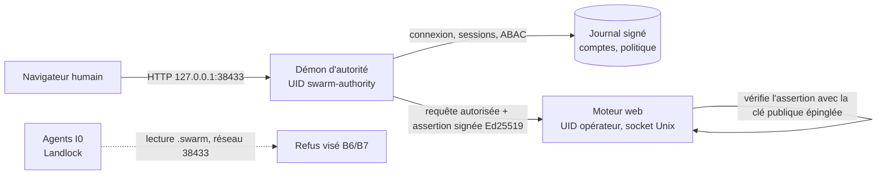

# Accès au cockpit — Phase B : autorité séparée, comptes et ABAC

[English](../../en/plans/acces-cockpit/PHASE-B-AUTORITE.md)

Statut : **plan, non exécuté**. Rédigé le 31 octobre 2026 après la phase A
(lien à usage unique, déconnexion, rotation de clé ; recette
`tools/verification/recipes/web-login-ticket-rust.json`). Aucune commande
`sudo` n'est lancée par l'assistant ; elles seront préparées, relues puis
exécutées par l'opérateur.

## Pourquoi une phase B

La phase A améliore l'ergonomie sans changer la frontière : la clé
`.swarm/web-session-*` reste un secret du même UID que les agents.

Constat vérifié dans le code (`swarm-biba-linux/src/lib.rs`, `Sandbox::prepare_bound`,
appelé par `native_provider_biba.rs` pour agent, planification, relecture,
validation et préparation CLI) : les agents I0 lisent tout le système de
fichiers **sauf** `<root>/.swarm`, écrivent seulement dans leur workspace, et
le réseau n'est pas restreint (`net:0`). Ils ne lisent donc pas la clé owner.
Restes réels : (a) un agent peut joindre `127.0.0.1:38433` (sans clé, il
n'obtient que `/login`) ; (b) `/proc/<pid>/cmdline` est lisible : le lien à
usage unique passé à `xdg-open` y est visible jusqu'à sa consommation (moins
d'une seconde en pratique) ; (c) les magasins de cookies du navigateur dans
le répertoire personnel sont lisibles ; (d) un programme lancé à la main sous
l'UID opérateur n'est pas confiné. La séparation humain/agent repose donc
encore sur un secret du même UID (EP-07 : « même UID + 0600 insuffisant »).
Correction : une première version de ce plan affirmait à tort que les agents
pouvaient lire la clé owner.

État réel de l'autorité d'enrôlement (cartographie du 31 octobre 2026) :
bibliothèques exécutées en processus par des commandes CLI ponctuelles ; un
seul compte `personal-account-v1` ; mot de passe vérifié à chaque appel, sans
session ; aucun démon, socket ni UID distinct ; canal `SO_PASSCRED` testé en
fixtures seulement ; installation sans compte système dédié.

## Architecture cible

Cible, non livrée. Principes :

1. **Le démon est le seul point d'entrée HTTP du cockpit.** Il sert `/login`,
   tient les sessions, évalue l'ABAC, puis relaie vers le moteur.
2. **Le moteur ne fait confiance qu'à une assertion signée** par la clé privée
   du démon (illisible pour l'UID opérateur). Une requête sans assertion
   valide est refusée ; la clé owner HTTP est retirée dès l'activation.
3. **Les agents ne peuvent ni lire les secrets ni joindre le moteur** :
   `.swarm/` est déjà illisible pour eux ; restent le réseau et les fuites par
   `/proc` (lot B7, complément du plan BT01–BT05).
4. **Aucun secours permissif** : démon absent ⇒ cockpit indisponible avec un
   diagnostic, jamais un retour silencieux à la clé owner (EP-08).

## Modèle ABAC

| Dimension | Attributs | Source |
| --- | --- | --- |
| Sujet | compte, rôles (`viewer`, `operator`, `approver`, `admin`), intégrité I1–I3, attributs libres (équipe, projets), méthode d'authentification, âge de session | Journal signé du démon |
| Action | `read`, `write`, `apply`, `approve`, `admin` | Table route → action, versionnée avec le moteur |
| Ressource | famille de route, mission, intégrité de l'objet | Table de routes + attributs fournis par le moteur |
| Environnement | boucle locale, heure, révision de politique | Démon |

Décision : `Allow | Deny(cause)`, refus par défaut. Règles ordonnées, révisées
(preview, apply avec révision attendue, historique). Les invariants Biba
(`check_biba`) et la séparation demandeur/approbateur restent appliqués en plus
et ne sont pas désactivables par une règle. Profils livrés : `viewer` (lecture),
`operator` (lecture/écriture), `admin` (réglages, comptes, politique).

## Lots

| Lot | Contenu | Critères de sortie | Ouvre / ferme |
| --- | --- | --- | --- |
| B0 | Décisions opérateur ci-dessous ; menace écrite | Décisions consignées ici | — |
| B1 | Script d'installation relu (`deploy/authority/install.sh`) : `useradd --system swarm-authority`, `/var/lib/swarm-authority` 0700, unité systemd durcie (`NoNewPrivileges`, `ProtectSystem=strict`, `PrivateTmp`, `RestrictAddressFamilies=AF_UNIX AF_INET`), socket `/run/swarm-authority/` ; déclaration `swarm-enrollment-bootstrap` (service_uid ≠ controller_uid) | Script idempotent, dry-run vérifié, désinstallation documentée ; exécuté par l'opérateur | UX1, EP-07 (partiel) |
| B2 | Binaire `swarm-authority` : écoute SEQPACKET + admission `SO_PEERCRED` (`swarm-linux-identity-channel`), journal signé, arrêt propre | Démon sous son UID, refus d'un pair non admis, redémarrage sans perte | EP-06, EP-08 |
| B3 | Comptes multiples dans le journal signé (créer, désactiver, réinitialiser, révoquer ; filiation conservée) ; bootstrap du premier admin hors canal agent | Premier compte par amorçage autorisé uniquement ; rejeu/concurrence refusés | EP-01, UX2, UX6 |
| B4 | Sessions détenues par le démon : jeton aléatoire haché, expiration absolue et inactivité, révocation linéarisée | Durées en réglages Admin (EP-09) ; révocation effective à la requête suivante | EP-04, EP-05 |
| B5 | Démon en façade HTTP : `/login` compte + mot de passe, relais vers le moteur par socket Unix, assertion signée vérifiée par le moteur ; retrait de la clé owner HTTP | Requête sans assertion refusée ; secours owner seulement par commande locale `sudo` | EP-02, EP-03 |
| B6 | Moteur d'ABAC dans le démon + table de routes ; invariants Biba et séparation | Viewer en écriture → 403 ; règle permissive incapable de contourner Biba ; preview sans mutation | UX5 |
| B7 | **Évalué le 31 octobre 2026, non retenu en l'état.** (a) Lien hors argv : le navigateur par défaut est Chromium snap, qui ne lit pas les dossiers cachés du répertoire personnel ; tout emplacement qu'il lit est aussi lisible par les agents, et masquer `/proc` casserait les fournisseurs. Reste accepté : vol par course sur `/proc/*/cmdline`, visible (le navigateur affiche « déjà servi »), supprimé par B5 (mot de passe, aucun secret en argv). (b) Réseau : Landlock filtre par port, pas par adresse, et la télémétrie OTEL des agents vise le port du cockpit (`telemetry_endpoint.rs:354`) ; bloquer ce port casserait la télémétrie. La clé reste illisible (`.swarm` exclu) | Restes documentés ici et dans `SECURITY.md` | EP-07 (inchangé) |
| B8 | Admin : onglets Comptes, Sessions, Politique ; menu utilisateur ; attribution réelle des écritures (ex-A4, littéraux `preparation_organization.rs:103`, `trust_store.rs:109`) | FR/EN, deux thèmes, mobile, clavier ; historique conservé | UX3, UX7 |
| B9 | Clés API personnelles (portée, durée, révocation) pour scripts | Jeton haché, refus après révocation | — |

Chaque lot : test qui échoue d'abord, correctif général, recette permanente,
documentation FR/EN, installation locale vérifiée.

## Décisions de l'opérateur (B0) — prises le 31 octobre 2026

Retenu : (1) démon en façade HTTP ; (2) lecture de `.swarm/` interdite aux agents I0 ; (3) premier admin par code à usage unique via `sudo` ; (4) clé owner conservée uniquement comme secours local `sudo`. B7 reste utile mais n'est plus urgent : la clé owner n'est pas lisible par les agents confinés.

Options présentées :

1. **Façade** : démon en façade HTTP (recommandé, ci-dessus) ou moteur qui
   interroge le démon à chaque requête (plus simple, mais le moteur sous l'UID
   opérateur reste le gardien et un agent qui lit sa mémoire contourne tout).
2. **Confinement des lectures agents (B7)** : interdire `.swarm/` en lecture
   aux agents I0 — déjà le cas, vérifié après la décision.
3. **Amorçage du premier admin** : commande locale `sudo -u swarm-authority
   swarm-authority bootstrap` affichant un code à usage unique (recommandé), ou
   fichier d'amorçage préparé hors ligne.
4. **Secours** : clé owner conservée seulement comme commande locale `sudo`
   (recommandé), ou supprimée.

## Spécification technique B2 (inventaire du 31 octobre 2026)

Briques réutilisées, telles qu'elles existent :

- **Déclaration d'installation** : `swarm_enrollment_bootstrap::Document`
  (`service_uid` ≠ `controller_uid`, répertoires de configuration et de témoin
  disjoints, pins) chargée par `loader::load(chemin, empreinte)`, qui refuse si
  l'euid n'est pas `service_uid` et ouvre les répertoires privés sans suivre de lien.
- **Journal signé** : `swarm_enrollment_state::Journal` / `sign_change`
  (`enroll`/`revoke`, Ed25519, CAS sur `Head`). Il gère déjà N identifiants ; un
  identifiant révoqué ne revit pas. Seule la couche `personal.rs` fige
  `personal-account-v1` : B3 la paramètre par compte.
- **Vérificateur de mot de passe** : `credentials::create`/`verify` (Argon2id,
  coûts explicites à placer en réglage Admin, EP-09).
- **Canal noyau** : `swarm_linux_identity_channel::configure` (SEQPACKET,
  `SO_PASSCRED`, `SO_PASSPIDFD`) ; aucune écoute n'existe. L'admission actuelle
  n'accepte qu'un contrôleur lancé par le service lui-même.

Décisions de conception B2 :

1. Nouveau crate binaire `swarm-authority` (Rust), sans dépendance au moteur.
2. Démarrage : `load` de la déclaration ; refus si l'euid diffère de
   `service_uid` ; aucun secours.
3. Façade HTTP (B5) sur l'adresse du cockpit ; relais vers le moteur par un
   socket Unix créé par le moteur dans un répertoire `0750` du groupe
   `swarm-authority` — à qualifier.
4. Nouveau chemin d'admission pour le socket de contrôle local :
   `SO_PEERCRED` uid = `controller_uid` **et** preuve d'un secret humain
   (mot de passe ou code d'amorçage) ; l'UID seul ne suffit jamais, puisque les
   agents partagent l'UID opérateur.
5. **État B2.1 : fait** (31 octobre 2026) — crate `rust/crates/swarm-authority`, `swarm-authority check --declaration … --pin … --json`, tests `tests/check.rs` 2/2. Les fixtures protégées vivent sous `~/.local/state/swarm-protected-fixtures` : le chargeur refuse tout ancêtre inscriptible par le groupe, or `ChatGPT/` et `swarm/` sont en `775`.
6. **État B2.2 : fait** (1er novembre 2026) — `Journal::snapshot` (tête vérifiée + identifiants actifs, lecture seule) dans `swarm-enrollment-state` ; registre `swarm_authority::accounts` : comptes multiples `account/<sujet>/<nonce>` (rôles `viewer|operator|approver|admin`, intégrité 1–3, attributs libres, vérificateur Argon2id), création, vérification sans oracle, changement de mot de passe par nouvelle génération puis révocation, désactivation, liste sans matériel secret. Tests `tests/accounts.rs` et `tests/snapshot.rs`. Restent ouverts : témoin anti-retour arrière (EP-06), coûts Argon2 en réglage Admin (EP-09), sessions, écoute.
7. **État B4 (bibliothèque) : fait** (1er novembre 2026) — `swarm_authority::config` (durées de session et coûts Argon2 : défauts livrés dans `config/authority-defaults.json`, surcharge opérateur `authority.json` dans le répertoire de configuration, fichier invalide refusé sans repli) et `swarm_authority::sessions` (jeton `as1-` aléatoire, seul son SHA-256 est gardé en mémoire ; expiration absolue et d'inactivité ; compte désactivé ou nouveau mot de passe ⇒ session refusée à la requête suivante ; déconnexion ; révocation par sujet). Tests `tests/sessions.rs`. Un redémarrage du démon déconnecte tout le monde (aucun secret de session sur disque).
8. **Conception B5 retenue** : le démon écoute l'adresse du cockpit, sert `/login` et les sessions, puis relaie au moteur qui écoute une adresse de boucle interne. Chaque requête relayée porte une assertion Ed25519 signée par le démon (sujet, rôles, intégrité, méthode, chemin, empreinte du corps, horodatage, nonce) ; le moteur la vérifie avec la clé publique épinglée et refuse sans elle. Un agent peut joindre le port interne mais ne peut pas signer (clé illisible). Socket Unix à réévaluer si nécessaire.
9. **État B5.1 : fait** — `swarm_authority::assertion` : signature Ed25519 (`X-Swarm-Assertion: v1.<revendications>.<signature>`), vérification pure (clé épinglée, méthode/chemin/empreinte du corps, fenêtre de fraîcheur et mémoire de nonces fournies par l'appelant). Tests `tests/assertion.rs`. Restent B5.2 (moteur : réglage de fenêtre, clé publique épinglée, refus sans assertion) et B5.3 (écoute HTTP du démon et relais).
10. **État B5.2 : fait, non installé** — réglages v52 (`web_access_mode` owner-key|authority, `web_authority_public_key`, `web_assertion_max_age_seconds`, groupe Admin « Serveur et accès ») ; le serveur les lit au démarrage dans `from_open_store` (chemin de production `swarm-rust web` compris). En mode `authority`, chaque route protégée exige une assertion valide (hôte exact, signature, requête liée, fraîcheur, usage unique) et le cookie owner n'ouvre plus rien ; un Root antérieur à v52 garde owner-key. Test `swarm-web/tests/authority_access.rs`. **Non installé volontairement** : sans démon (B5.3), passer en `authority` fermerait le cockpit ; secours = CLI `engine-settings apply` en owner-key.
11. **État B5.3 : fait, non installé** — `swarm_authority::server` + binaire : `swarm-authority init --admin SUJET --display NOM` (crée la graine de signature privée 0600 jamais remplacée **et le premier utilisateur** admin, intégrité 3 ; mot de passe demandé deux fois sans écho dans un terminal, ou première ligne de stdin ; refusé dès qu'un compte existe ; affiche la clé publique pour `web_authority_public_key`), `add-account SUJET --roles … --integrity … --display …` pour les utilisateurs suivants (à lancer en `sudo -u swarm-authority`), `serve --listen … --engine …`. Façade : `/login` compte + mot de passe (FR/EN, thèmes clair/sombre), cookie `HttpOnly; SameSite=Strict`, `Origin` exigé hors GET/HEAD, `/logout` et `/api/v1/logout` ferment la session du démon, relais signé avec flux de réponse, limite de corps `relay_body_max_bytes` (configuration du démon). Test de bout en bout `tests/front_e2e.rs` (vrais processus : connexion, relais accepté par le moteur, accès direct au moteur refusé, déconnexion). **B3** : décision opérateur du 1er novembre 2026 — système utilisateur + mot de passe, le premier utilisateur est créé par `init` (pas de code à usage unique). Restent : B1 (script `sudo` et unité systemd), lancement par `swarm.sh`, B6 ABAC, B8 Admin, EP-06.
12. **État B1 : prêt, non exécuté** — `swarm-authority prepare --dir … --controller-uid … --admin …` (sous le compte du service : dossiers 0700, graine, déclaration épinglant empreinte d'installation, clé publique du démon et premier admin ; `init` et `serve` refusent une graine non épinglée ou un admin non épinglé). Script `deploy/authority/install.sh` (à lancer par l'opérateur avec `sudo` après `cargo build --release -p swarm-authority`) : compte système `swarm-authority`, binaire `/usr/local/lib/swarm-authority/` appartenant à root, état `/var/lib/swarm-authority` 0700, pin et clé publique dans `/etc/swarm-authority` (root, 0644), unité systemd durcie (vérifiée par `systemd-analyze verify`), `init` interactif du premier utilisateur ; `--dry-run`, `--uninstall [--purge]`. Le service n'est pas démarré : le script affiche l'ordre de bascule (mode authority + clé dans l'Admin, moteur sur 127.0.0.1:38434 via `./swarm.sh configure`, puis `systemctl enable --now`). **Exécuté par l'opérateur le 1er novembre 2026** (clé publique `bmPXzC9HDHrZ04KfzGw_z3G4jaCelJV32a94sCL2Rxc`) ; bascule moteur non encore faite. `./swarm.sh open` en mode authority ouvre `http://<--listen de l'unité>/login` (voir NATIVE-LOCAL-LAUNCHER.md) ; refus explicite si l'unité manque.
13. **État B6 : fait, non installé** (1er novembre 2026) — `swarm_authority::policy`, évalué par le démon avant chaque relais. (a) Classement des routes du moteur (invariant de protocole, code) en `read` / `write` / `approve` / `administer` : GET/HEAD et `…/preview`, `…/describe`, `…/estimate` et les fonctions sans état `/api/v1/protection/*` = lecture ; `/api/v1/trust-actions` et `/api/v1/paea/git-call/approval` = approbation ; réglages et politiques (`native-settings`, `*-policy`, `quotas`, `run-limits`, `work-budget`, `providers`, `pricing`…) = administration ; missions, préparations, actions, visites = écriture ; **toute mutation inconnue = administration** (refus par défaut hors admin). Un test lit `swarm-web/src/service.rs` et refuse toute route `/api/v1/*` sans classe revue. (b) Politique opérateur `policy.json` dans le répertoire de configuration du démon (défaut livré `config/policy-defaults.json` : viewer→read, operator→read+write, approver→read+approve, admin→tout), autorisations par rôle avec conditions d'attributs `when` (ABAC) ; fichier invalide refusé sans repli ; relu au démarrage du service. (c) Plancher Biba non abaissable : read ≥ I1, write ≥ I2, approve/administer ≥ I3, vérifié avant les autorisations. Refus : HTTP 403 `{"error":"authority-policy-denied","action":…,"reason":"policy-no-grant"|"policy-integrity-floor"}`, sans lecture du corps ni appel au moteur. Prévisualisation sans mutation : `swarm-authority policy-check --method M --path P --integrity N [--roles …] [--attributes k=v,…]`. Attributs de compte : `add-account … --attributes k=v,…`. Tests `tests/policy.rs` (5) et `tests/front_e2e.rs` (viewer en écriture → 403 sans atteindre le moteur, admin accepté). La séparation demandeur/approbateur reste appliquée par le moteur (le démon ne connaît pas le demandeur). **Installation** : `cargo build --release -p swarm-authority` puis `sudo deploy/authority/install.sh --admin fabrice --display "Fabrice"` (idempotent : remplace le binaire et l'unité, redémarre le service s'il tourne, conserve comptes, clé et premier utilisateur). Restent : édition de la politique dans l'Admin (B8), attribution réelle des écritures côté moteur (B8).
14. **État B8/B9 : fait, non installé** (1er novembre 2026). Commande unique : `./swarm.sh authority install --admin LOGIN --display NOM` (compile le démon release puis `sudo deploy/authority/install.sh`), `./swarm.sh authority enable` (arrêt du moteur, mode `authority` + clé lue dans `/etc/swarm-authority/public_key`, moteur sur l'adresse interne `--engine` de l'unité, `sudo systemctl enable --now`, ouverture de `/login` ; refus si le démon installé diffère du dernier build release), `disable` (retour owner-key, clé vidée, moteur sur l'adresse publique) et `status`. (a) **API d'administration servie par le démon** (`swarm_authority::admin`, jamais relayée) sous `/api/v1/authority/*` : `me` (libre-service, changement de son mot de passe avec l'actuel), comptes (créer, profil via `Accounts::update_profile` sans couper les sessions, mot de passe, désactiver), sessions (liste sans jeton, révocation par identifiant public), politique (lecture, prévisualisation actuelle/proposée, application avec révision, écriture atomique de `policy.json`, effet immédiat), réglages du démon (`authority.json` : durées de session, Argon2id, taille relayée ; même patron, effet immédiat). Toutes ces routes, lectures comprises, sont `administer`. Gardes : pas d'auto-désactivation, pas d'auto-rétrogradation, pas de politique qui retirerait l'administration à son auteur (`authority-self-lockout`), révision obsolète refusée (409). (b) **Attribution** : journal d'audit `audit.jsonl` (`swarm_authority::audit`) : connexions acceptées/refusées, déconnexions et chaque requête non-lecture (intention **avant** exécution, refus 503 `authority-audit-unavailable` si l'intention ne s'écrit pas ; résultat avec statut HTTP après), compte et moyen (`session` ou `key:<id>`), chaîne SHA-256 qui révèle une modification sans l'empêcher. L'attribution dans les enregistrements du moteur reste `hôte/uid` : `operator_identity()` y sert aussi d'autorité (`graph_batch.rs` refuse une édition non bornée si l'acteur diffère, `mission.rs` filtre le statut), le remplacer casserait ces parcours en mode authority ; reprise : champ « au nom de » distinct dans le moteur. (c) **B9 clés API** (`swarm_authority::keys`) : `sak1-<id>.<secret>`, seul le SHA-256 est conservé dans le journal signé (`apikey/<id>`), portée maximale (`read` < `write` < `approve` < `administer`) en plus de la politique et des planchers, expiration obligatoire choisie par l'utilisateur, révocation définitive, compte relu à chaque requête ; `Authorization: Bearer` sans cookie dispense de l'en-tête Origin ; clés refusées sur toute l'API d'administration (`authority-key-scope`). (d) **Interface** : carte Admin « Comptes et accès » (`web/native-authority-admin.js`) masquée hors mode authority, nom de l'utilisateur et « Mon mot de passe » dans l'en-tête, groupes Clés API, Comptes, Sessions, Politique, Réglages du démon, Journal d'accès ; FR/EN, deux thèmes, mobile. Défauts trouvés par la vérification navigateur et corrigés : la page `/login` du démon était servie en `Referrer-Policy: no-referrer`, ce qui fait envoyer `Origin: null` au formulaire et le faisait refuser (403) ; `/` relayé affichait la page clé du moteur (`root_login` limité au mode owner-key) ; les requêtes simultanées d'un navigateur échouaient sur le journal SQLite occupé et étaient présentées comme une déconnexion (accès sérialisés dans le démon, et une erreur interne répond désormais 503 avec son code au lieu de 401). Preuves : `tests/admin_api.rs`, `tests/front_e2e.rs` (clés, 20 requêtes simultanées, `/`, en-tête Referrer-Policy), `tests/policy.rs`, `tests/authority_admin_ui.cjs` (25 contrôles, captures FR/EN × 2 thèmes et mobile), `tests/test_swarm_local.py` (enable/disable sur checkout isolé). Page de connexion du démon : logo et icône servis par le démon sans session (`/login/logo.png`, `/login/icon.svg`), choix FR/EN, lien « Mot de passe oublié ? » vers `/login/forgot` : sans e-mail en local, la demande est transmise aux administrateurs (réponse identique pour tout identifiant ; une ligne d'audit `reset-requested` par nouvelle demande d'un compte existant ; demandes en mémoire, effacées d'elles-mêmes au changement de mot de passe ou à la désactivation) et signalée dans l'Admin (badge sur le compte, avis en tête du groupe Comptes). Secours si aucun administrateur ne peut se connecter : `./swarm.sh authority reset-password LOGIN` (sudo, commande `swarm-authority set-password` sous le compte du démon). EP-06 et l'attribution côté moteur : traités à l'entrée 15.
15. **État EP-06 et attribution moteur : fait, non installé** (1er novembre 2026). (a) **Témoin croisé** : l'assertion passe en v2 (domaine `swarm-authority-assertion-v2`, v1 refusée) et porte la tête du journal des comptes (séquence, empreinte) et de l'audit du démon. Le moteur, sous le compte de l'opérateur, garde dans le Root `.swarm/authority-witness.json` la tête la plus haute vue et quand ; il refuse `web-assertion-fork` (même séquence, autre empreinte) et `web-assertion-rollback` (séquence plus basse dans une assertion émise après la première observation de la plus haute ; une requête simplement en vol passe). La nouvelle tête est écrite (fsync, renommage) avant d'accepter la requête. Restaurer une ancienne copie du journal ou de l'audit du démon est donc refusé ; restaurer en même temps ce fichier du Root (root) reste non détecté. Reprise après restauration voulue : `./swarm.sh authority accept-restore` (moteur arrêté, `swarm-rust web-authority-witness reset`, noté au registre). (b) **Attribution côté moteur** : registre `.swarm/web-attribution.jsonl` dans le Root (format chaîné de l'audit) : pour chaque requête authentifiée par assertion hors GET/HEAD, ligne `intent` (compte, méthode, chemin, `reference: assertion:<nonce>`) **avant** exécution — refus si elle ne s'écrit pas — puis `outcome` avec le statut. La même référence figure dans l'audit du démon. Les enregistrements métier du moteur gardent `hôte/uid`, qui y sert aussi d'autorité ; le registre donne le compte réel de chaque écriture sans changer ces formats. Démon et moteur partagent le format d'assertion : `./swarm.sh authority install` redémarre aussi le moteur en mode authority. Preuves : `swarm-web` `authority_ledger` (2 tests), `swarm-authority/tests/witness_e2e.rs` (attribution liée à l'audit ; redémarrage sans restauration accepté, journal restauré refusé, reprise), `tests/test_swarm_local.py` (`accept-restore`).
16. **État Administration façon Wattson : fait, non installé** (1er novembre 2026). (a) **Habilitations** : politique schéma 2 (`policy.json`, une politique v1 est convertie à la lecture) avec rôles personnalisables (intégrés `viewer`, `operator`, `approver`, `admin` non supprimables, `admin` toujours complet et verrouillé) et matrice rôle × habilitation sur un catalogue figé dans le code (`cockpit.read`, `missions.write`, `preparations.read/write`, `approvals.approve`, `settings.read/write`, `providers.read/write`, `budgets.read/write`, `accounts.manage`, `audit.read`, `unclassified.write` pour toute écriture non classée) ; chaque habilitation garde le plancher d'intégrité de sa famille ; conditions d'attributs (ABAC) conservées. Un compte ne reçoit qu'un rôle existant (`account-role-unknown`), un rôle attribué ne peut pas disparaître (`authority-role-in-use`). Admin : matrice à cases, Nouveau/Renommer/Dupliquer/Supprimer un rôle, autorisations conditionnelles, test de décision, JSON avancé, enregistrement après prévisualisation et contrôle de révision. (b) **Journaux** : l'audit note aussi la session (`session:<id>`), les consultations de pages et les refus de la politique (au mieux, sans bloquer les lectures) ; API `audit/sessions` (connexions par session, période, compte), `audit/sessions/ID` (détail), `audit/dashboard` (par jour et par compte), `audit/purge {older_than_days}` (≥ 1, aucune durée par défaut, refusée si la chaîne est rompue ; une ligne `purge-anchor` garde la chaîne vérifiable et la tête du témoin EP-06 ne change pas). Admin : onglets Connexions (détail par session), Tableau de bord, Purge ; visibles avec `audit.read`, même sans gérer les comptes (rôle « auditeur »). `/me` renvoie les habilitations détenues. (c) **Statut des missions planifiées** : la lecture refusait toute la mission quand d'anciens agents conducteurs terminés n'avaient pas le lien de mission devenu obligatoire ; ces agents sont maintenant signalés (`mission-status-legacy-provenance-unverified`, en succès seulement) sans être revérifiés, les lancements restant stricts ; la limite de portage restante (`mission-status-planning-unported`) répond 501 au lieu de 500. Preuves : `tests/policy.rs` (5), `tests/audit.rs`, `tests/admin_api.rs`, `tests/authority_admin_ui.cjs` (37 contrôles), tests unitaires `status_tests` (swarm-web) et `only_terminal_unbound_conductor_agents_skip_status_provenance` (moteur). Hors périmètre constaté : 2 tests du moteur (`mission_status_reports_contained_scan_symlinks_refusal_recovery`, `current_review_report_and_artifact_staleness_recover`) échouent sur l'arbre de travail, sans appeler le code modifié (travail en cours d'une autre session).
17. Tranches : B2.1 crate + chargement de la déclaration + commande `check` ;
   B2.2 journal des comptes (fixture, UID courant comme `service_uid`) ;
   B2.3 écoute HTTP minimale `/login` + session ; puis B1 (script `sudo`) quand
   le binaire existe.

## Commandes privilégiées (préparées en B1, lancées par l'opérateur)

Liste prévisionnelle, à figer et relire dans le script :
`useradd --system --home /var/lib/swarm-authority --shell /usr/sbin/nologin swarm-authority`,
`install -d -o swarm-authority -m 0700 /var/lib/swarm-authority`,
`install -m 0644 swarm-authority.service /etc/systemd/system/`,
`systemctl daemon-reload && systemctl enable --now swarm-authority`.

## Limites

- Un utilisateur root ou l'opérateur avec `sudo` reste tout-puissant ; la
  phase B protège contre les agents, pas contre l'administrateur machine.
- Le confinement réseau des agents (B7) ne couvre que les processus lancés
  par Swarm sous Landlock ; un programme lancé à la main par l'opérateur n'est
  pas confiné.
- Docker (`compose.yaml`, un seul service sous l'UID opérateur) n'est pas
  couvert ; une variante conteneur est hors périmètre de ce plan.
