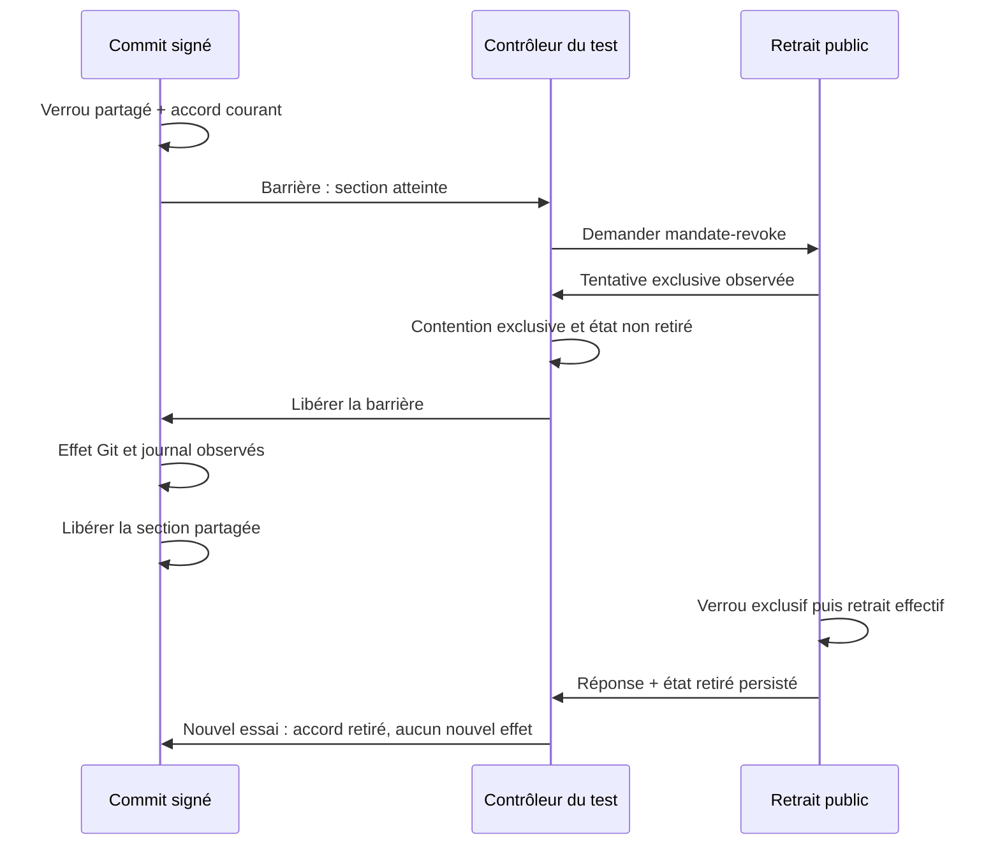

# Retrait concurrent — protocole et preuves

Statut courant : un test natif concurrent nommé PASS, recette à deux étapes et vérification d’intégrité PASS. Observation bornée au retrait public coopératif sur la fixture qualifiée ; ni H2 globale ni installation. Les contrôles composants/inertes antérieurs restent liés à leurs octets. Le protocole initial et les échecs conservés ci-dessous sont historiques.
Dépendances : contrats P2 Reconcile et P3 bail stabilisés, composition native
qualifiée, fixture neuve admise par Swarm00. Les preuves historiques ne seront
ni copiées pour substituer un inode accepté, ni modifiées.

## Point de synchronisation et observations

Le point visé est `call_paea_git_promote`, après la vérification finale
`paea_git_agreement_match` et avant `effect::commit`, pendant que
`project.directory.reserve_trust(false)` reste détenu. La production actuelle
acquiert ce verrou partagé ; `trust_scoped_reserved` prend le même verrou en
exclusif pour `mandate-revoke`. Lire ces sources ne prouve pas leur concurrence.

Le futur dispositif de fixture doit placer une barrière d’arrivée puis une
barrière de libération dans cette section exacte. Il ne sera compilé que dans
le profil `test-fixtures`, avec inventaire distinct du binaire livré. Il ne doit
permettre ni d’accepter une mission ni de contourner une vérification. Un second
point d’observation, avant le flock exclusif du retrait, distinguera une demande
réellement entrée dans le parcours public d’un simple thread créé mais non exécuté.
Ces points sont à concevoir et revoir ; aucune API correspondante n’est revendiquée.

Les barrières établissent l’ordre ; aucun sleep ou délai écoulé ne constitue une
preuve. Une tentative exclusive non bloquante sur le même inode établira la
contention réelle, avec contrôle positif hors section avant l’injection. La
réponse du retrait, les événements de synchronisation et les états Git/SQL/Trust
seront conservés séparément. Une erreur du commit ou du retrait devra libérer
les ressources et conserver causes et éventuels effets ; le test ne doit pas
rester suspendu sur une barrière abandonnée après échec d’un prérequis.

## Composition et témoin préalable

Avant allocation : déclarer les SHA-256 des sources effectives, manifests,
features, binaire, profil et helpers ; vérifier montage et réserve. La composition
P1 de 2109 fichiers n’est pas réputée complète pour une première publication native.
Utiliser le parcours de `tests/rust_native_first_publication.py` pour une fixture
neuve, sans `--reuse-from` historique ni écriture directe des tables d’acceptation.
Conserver son root réel, work, candidat, résultats de revue et acceptation et
attribution physique ; le résultat PASS seul ne suffit pas.

Les helpers de `rust/crates/swarm-engine/tests/paea_git_promote_call.rs` décrivent
la création du service, les intentions et effets, le dépôt privé, le transfert
réel du candidat, les appels Commit/Reconcile et les permissions signées. Relire
leur version finale : plusieurs assertions de Reconcile devront changer avec P2.
Exécuter d’abord un témoin valide sur la même nouvelle composition et le même
parcours d’accord/candidat/mandat ; un refus partagé ne doit pas masquer le test.
Les identifiants d’événements et racines restent propres à chaque essai.

Après le témoin : test concurrent nommé seul, un seul exécuteur, pas de watchdog
global arbitraire ; suivre les points de progression. Mesurer une absence de
progression avant tout diagnostic de blocage. Conserver stdout/stderr, argv,
profil, empreintes avant/après, erreurs originales et état des ressources.

## Critères et portée

Le test doit constater : accord valide ; section partagée atteinte ; demande de
retrait entrée pendant cette section ; contention exclusive ; aucun retrait
effectif avant libération ; publication/observation et résultat du commit ;
retrait persistant après libération ; refus d’un nouvel usage sans nouvel effet ;
Reconcile décrivant séparément histoire et référence actuelle après retrait.

Ce test observera une sérialisation dans ce parcours précis, pas la médiation de
tous les outils ni une borne d’expiration au point d’effet. Le bail, les horloges,
la publication Git et la livraison native restent des contrats distincts. La
recette permanente et sa documentation FR/EN devront accompagner son code final.

## Conception discriminante des points de fixture

Prévoir deux points compilés seulement avec `test-fixtures`, à portée d’un
thread et d’une invocation, nettoyés même lors d’une panique : le premier
après le match final dans Commit, le second juste avant le flock exclusif
effectivement pris par le retrait public. Le second transmet seulement le
témoin device/inode du fichier réel de verrou au contrôleur ; aucun descripteur
ou chemin de production ne devient une autorité. Ces API n’existent pas encore.

Le contrôleur n’ajoute surtout pas son propre verrou partagé : il masquerait
une suppression du verrou de production. La contention exclusive doit venir
uniquement du Commit sous test. Un contrôle non bloquant sur une ouverture
indépendante du même inode, après la barrière d’entrée du retrait, rend le
test discriminant : sans réservation partagée réelle, il ne peut pas établir
la contention attendue. Libérer les barrières et joindre les threads avant
propagation d’un échec, pour ne pas transformer le garde en blocage du test.

Le témoin Commit valide précède le scénario concurrent sur la même composition
et le même parcours, avec racines de service et événements propres. L’entrée
de retrait doit être prouvée avant libération du Commit ; un simple signal
juste avant d’appeler la fonction, ou un `try_recv` vide sur un thread peut-être
non planifié, ne suffisent pas. Le contrôle réutilise les opérations Trust et
les permissions signées des helpers existants, sans mutation directe de la base.
L’état retiré et la lecture Reconcile après libération devront être observés
par les opérations publiques ; la fenêtre de test ne dispense pas du bail.

### Attribuer la contention au bon acteur

Le seul probe du contrôleur pourrait rencontrer le verrou exclusif du retrait
lui-même et donner un faux témoin. Le point de fixture du retrait doit donc
effectuer sa tentative exclusive non bloquante sur le fichier qu’il vient
réellement d’ouvrir, avant son flock bloquant, pendant que Commit attend encore
sa libération. Il transmet le résultat et le témoin inode, pas le descripteur.
Si la tentative acquiert le verrou de façon inattendue, le test doit le libérer
explicitement puis signaler l’échec ; elle ne doit pas modifier le parcours
ultérieur en conservant ce verrou. Le nom d’opération rustix existant est
`FlockOperation::NonBlockingLockExclusive` (producteur local_storage.rs lu).
Cela discrimine la réservation partagée de Commit sans dépendre d’un thread
peut-être non planifié, ni du temps écoulé, ni du verrou détenu par un autre acteur.

Les points d’observation doivent être atteints par des messages de progression
avant chaque rendez-vous de barrière. Une erreur avant le point produit une
remise terminale plutôt qu’une attente éternelle. Ne pas affirmer avant d’avoir
libéré les rendez-vous et joint les acteurs ; conserver les causes de fermeture
et les fixtures nécessaires au diagnostic avant propagation de l’échec. Le
profil standard sans `test-fixtures` ne doit contenir aucun de ces points.

## Candidat intégré — 18 novembre 2026

Les paragraphes de conception précédents conservent le contrat initial ; le
point de contention final utilise le descripteur réellement ouvert par le
retrait, avant son flock bloquant, et non un probe ajouté par le contrôleur.

Le candidat ajoute `paea_git_fixture` sous Linux + `test-fixtures`, deux états
thread-local à garde RAII, une insertion après le match final dans Commit et
une insertion exclusivement avant le flock EX dans `reserve_trust`. Chaque
callback est consommé une fois ; re-registration refusée pendant sa portée,
nettoyage lors du retour ou unwind. Les erreurs suivent les fermetures existantes.
Aucun réglage opérateur, délai, retry ou défaut de production nouveau.

Le test nommé `promote_call_concurrent_withdrawal_waits_for_shared_section`
est ajouté à la cible `paea_git_promote_call`, avec `#[ignore]` conservé et
sélection explicite `--ignored --exact`. Un vrai Commit signé sur service propre
précède l'injection ; un retrait hors section contrôle l'acquisition EX puis
son déverrouillage explicite. Le scénario suivant utilise un autre service et
d'autres événements, le même parcours signé et la fixture native neuve admise.
Le contrôleur ne détient aucun SH supplémentaire. Le retrait public tente EX
sur le fichier réel, transmet device/inode et EAGAIN, puis attend une barrière
avant son flock bloquant. Commit reste à sa propre barrière. Les deux workers
sont joints avant les assertions ; résultats typés et erreurs de fermeture
restent distincts. Aucun sleep, receive-timeout ou watchdog global.

Services et grants de ces appels sont conservés avant concurrence ; aucune
suppression des fixtures d'autorité de ces appels. Les helpers historiques de
préparation/transfert gardent leur contrat et leurs fermetures. Après retrait,
le test vérifie accord absent, renouvellement refusé sans changement de ref,
et Reconcile avec histoire enregistrée et référence actuelle séparées.

Recette permanente : `tools/verification/recipes/paea-concurrent-withdrawal.json`.
Elle exige une fixture neuve via `SWARM_PAEA_SOURCE_FIXTURE` et une admission
externe du target Cargo ; elle ne qualifie pas elle-même le profil livré.
Les six gardes locaux, la compilation intégration, le profil natif sans fixture
et le corps concurrent sont encore NON EXÉCUTÉS. Le contrôle de syntaxe Rustfmt
ne remplace aucun de ces résultats. La proposition GLM initiale et ses défauts
(BarrierWaitResult, faux témoin, erreurs ignorées) restent dans le dossier P4.
La correction par le principal porte uniquement sur ce paquet borné.

### Fixture positive dédiée (source, non exécutée)

`tests/paea_concurrent_withdrawal_source.py` est réservé et intégré depuis
absence par Swarm00. Il remplace la campagne historique proposée plus haut :
aucun run() first-publication/reviewer/inspection/validation/auto-worker/planning.
Seulement naissance publique, source Git, deux planners inertes, une tâche et
un worker manuel inert réel créant son propre rapport, retenue immuable publique,
trois contrôles, un reviewer inert, preview puis publication publique unique.
Pas de copie historique, corruption, refus injecté, remboursement ni SQL écrit.
Les budgets fixture sont déclarés dans le helper, pas des défauts produit.

`observed-publication.json` conserve l'effet observé sans qualification. Le
PASS de `result.json` ne vient qu'après les hashes finaux binary/profil/closure,
originaux candidat/revue et marqueur, readback accepté et device/inode inchangés.
Les observations retenues sont hachées dans result. Un échec tardif peut laisser
un résultat visible : le lanceur doit conserver exit=0, refuser failure.json,
relire hashes des inputs/originaux/observations et publier son propre reçu lié
au hash result avant de fournir la fixture au test. La présence de PASS seule
ne suffit pas ; le raccordement consommateur de ce reçu reste à intégrer/revoir.

### Revue 09 : corrections du candidat, sans exécution

REQUEST_CHANGES conservé : le TempDir d'autorité était supprimé au retour,
une assertion de progression pouvait masquer le résultat typé, et la destruction
d'une capture sous borrow_mut pouvait paniquer/avorter pendant unwind.
`Fixture::retain_directory` ajouté dans l'unique ancre autorisée : pas de Drop
supprimant le répertoire, aucune promesse de sync ni fermeture implicite.
Le contrôleur reçoit le propriétaire et conserve séparément démarrage/use,
app.close et les deux journaux fermés indépendamment. Les deux threads sont
joints avant assertion ; RetainedFailure réunit panique initiale, résultats
originaux et nettoyages. Une projection sûre via native_error_links aide le
diagnostic, sans remplacer ces objets typés ni afficher de texte privé.

ScopeGuard extrait les captures sous emprunt, les détruit hors emprunt en restant
actif, conserve la panique de destruction puis libère l'état. Le body est capturé
avant cleanup : ScopeError::Cleanup garde son retour exact ; HookUnwind garde
les deux paniques. Trois gardes ajoutés (réentrée, retour+cleanup, deux paniques),
deux gardes d'intégration sans cycle natif (bundle et rétention réelle). Total
prévu : neuf gardes de module, deux composants, un corps concurrent ignoré.
Tous NON EXÉCUTÉS ; Rustfmt/AST sont syntaxiques uniquement.

Le helper se lance avec `--supervise` : un seul enfant, aucun retry. Son reçu
terminal lie exit zéro réel, hash result et processus ; le test refuse absence
du reçu, échec visible, hash divergent ou originaux/observations modifiés, puis
vérifie le device/inode réel. Aucun verdict H2, profil livré ou installation
n'est établi par ces fichiers. Les premiers manifests restent historiques.

### R09-2 résiduel — témoin EX conservé

La revue r2 a trouvé deux unwrap encore évalués avant stockage du résultat
du témoin EX hors section. `retain_ex_witness` conserve désormais le résultat
imbriqué complet dans une variable externe avant toute assertion ; le bundle
de contrôle garde cette variable avec call, fermeture et panique initiale.
Le garde `ex_witness_error_is_retained_before_assertion` a un témoin valide,
puis observe la conservation d'un errno injecté après assertion. Il prouve la
conservation du résultat générique, pas une contention kernel ni le retrait
public. Total prévu : neuf gardes du module, trois composants et un corps
concurrent ignoré ; aucun n'a encore été exécuté. Les pins r2 restent historiques.

### Q1 — composants observés, scénario natif toujours non exécuté

Les neuf gardes du module et les trois composants nommés passent sur une
nouvelle composition locale de 3498 entrées. Le corps ignoré est compilé, pas
exécuté. Source, registre et sorties sont liés aux Cargo artifacts/features,
profils test et empreintes de deux ELF conservés. Les depfiles réels identifient
539 sources workspace, 1070 sources registry et trois entrées générées ; cela
ne qualifie pas tout le graphe C/headers/système/proc-macro ni le profil livré.

Le même garde de réentrée, compatible avec l'ancienne API et précédé d'un
contrôle sain dans le cas, échoue à l'exécution sur l'ancien module : un test,
un échec « RefCell already borrowed », après compilation réussie. Seul ce
module et l'ajout du garde diffèrent de la copie candidate. Aucun test de
double-panique ancien n'a été lancé. L'ancien ELF est conservé séparément.
Cargo réutilise le même chemin d'ELF : après le contre-exemple, le cache contient
le binaire ancien. Les deux copies candidates ont été relues par hash ; ne
jamais sélectionner une preuve ou un binaire par son seul nom de fichier.

Le premier lancement a refusé avant rustc : exemple déclaré absent de la copie
3125, zéro artefact/test. La reprise conserve cet échec et utilise les manifests
TOML et metadata du dépôt réel, comparés à la copie nouvelle : 343 targets dans
17 packages, dont 52 déclarés explicitement ; noms, kinds, chemins et features
concordent. Les cinq concat CARGO_MANIFEST_DIR sont reliés au vrai fichier de
fixture déjà déclaré. Un metadata d'une copie tronquée ne prouve pas sa complétude.
211 archives crate sont liées à Cargo.lock et 11887 fichiers extraits vérifiés ;
l'ancienne hypothèse .cargo-checksum.json absente reste documentée, sans build
lancé avant réparation. Les archives sont des candidats registry, pas tous des
dépendants effectifs.

Preuves : `article-v6-withdrawal-f8vbbjjd/q1/recovery-r1/` et
`q1/old-hook-reproducer/`, sur le support SWARM admis. Aucun helper frais,
profil standard, test natif concurrent, service ou installation lancé. Quatre
gardes Python inertes de qualification sont proposés séparément, non exécutés.

### Gardes inertes de qualification préparés (non exécutés)

`tests/test_paea_withdrawal_source_qualification.py` contient quatre cas du
superviseur Python : témoin intact, PASS visible avec child nonzero, résultat
incomplet malgré exit0, et hash d'artefact divergent. Chaque refus suit un témoin
valide avec mêmes préconditions. subprocess.run est mocké par CompletedProcess :
aucun vrai child, CLI, helper public, kernel, provider, Root natif ou acceptation
n'est exécuté. Les originaux de fixture synthétique sont conservés. Cela teste
supervise(), pas le consommateur Rust et pas une vraie qualification native.
La recette référence ces gardes et toutes sources de packages nécessaires au
parsing Cargo ; elle ne crée pas le droit de lancer les étapes natives.
Aucune exécution nouvelle à ce stade ; total déclaré : quatre inertes, neuf
gardes de module, trois composants et un corps concurrent ignoré, non tous exécutés.

### Q2 — quatre inertes PASS et image standard qualifiée

Les quatre méthodes SourceQualificationGuards passent avec leurs noms conservés,
exit0 et sources avant/après identiques. Elles mockent subprocess.run ; aucun
helper public, vrai child métier, provider ou Root natif n'a été exécuté. Leur
copie isolée inclut les 38 sources Python et le vrai JSON de valeurs par défaut
lu à l'import de fixture_area ; ses fixtures synthétiques sont archivées.

Après cette précondition, une cible Cargo standard neuve, distincte de la cible
fixture, a été admise ; les cinq entrées précédentes ont été conservées. Une
nouvelle copie locale3499 est liée aux configs après registration. Ses targets
et features metadata concordent avec le vrai dépôt (343targets/52explicites).
verify_native_profile a terminé exit0 :206artefacts observés, quatre centraux
(engine/web/CLI/binaire) avec features vides et test=false, aucun test-fixtures
ou test-util parmi les artefacts. Les790entrées effectives de son depfile sont
archivées et relues ; le module paea_git_fixture n'y figure pas. Cela ne qualifie
ni tous les headers/C/OS/proc-macros, ni une exécution métier ou une installation.

Image gelée LOCALE sous le root q2b de la composition, SHA-256
`f429fde5cbe566cc1d741d60c15d53f6b4c5db46be2a4c71859f49e126e1f3fc`.
q2b/terminal.json lie son identité, le vrai exit0, hash profile, sources/registry
stables et installed=false. Profil/result et rawCargo restent conservés sous
article-v6-withdrawal-f8vbbjjd/q2b. Aucun appel de cette image ni helper fresh,
test ignoré, service, fusion ou installation n'a été lancé. Q3 doit encore être
alloué après remise de ces preuves. Les neuf gardes/trois composants ne sont pas
répétés pour ces deltas Python/docs ; les anciens manifests gardent leur portée.

### Q3A — échec conservé et correction SOURCE du producteur

L'unique Q3A autorisé a terminé exit1, sans résultat qualifié. Le worker
manuel a fini mais le relais automatique ne le prend pas :
mission_report_relay.rs:143 exige native_mission ou l'origine conducteur,
puis producer() exige AutomaticWorker. task_report.rs:160–164 ne fournit pas
une alternative d'amorçage : submit vérifie un résultat déjà retenu. Les seuls
appels de production courants à retain_result conduisent au relais automatique ;
les autres références trouvées sont internes ou tests. Aucun droit moteur n'est
élargi pour faire passer le helper.

Le watch possédé a reçu SIGINT après vérification pidfd/argv/root/SHA. Ses
événements finaux attestent children_still_running=0, lease_released=true,
root_closed=true ; la pause publique finale a rendu0. Child et superviseur
ont rendu1, failure/process/originaux et racine réelle restent conservés,
terminal absent. Les 18 commandes initiales et leurs débits estimés restent
historiques ; aucune consommation réinitialisée, aucun root accepté substitué.
Les événements drainés contiennent aussi scoped-worker-retry-decision-required.
Le fichier stdout vide pendant l'attente était tamponné : il ne prouvait pas
l'absence de tous événements. Le nouveau collecteur flush/fsync chaque trame.

La correction source choisit le conducteur CLI mission watch depuis une TODO
neuve sans agent et planning paused, avant Popen. dispatch_mission_worker puis
_mission_worker_entry produisent l'admission native réelle ; aucune origin ou
native_mission n'est écrite par le helper. Les guards réels de validation
(task_validation.rs:490) et revue (reviewer_native/runtime.rs:372) retournent
None sous planning paused : pas d'appels implicites supplémentaires. Un seul
worker inert est prévu, pas de serveur. Arrêt causal après handoff exact ET
worker-exited0 du même agent, puis SIGINT, drain/wait, reçu root/lease/children,
pause publique et lecture du producteur natif réel. Échecs et nettoyages sont
agrégés ; les seuls helpers adoptés vérifiés du root peuvent être nettoyés sous
le contrat subreaper existant. EOF/refus terminal/dispatch bloqué ne deviennent
pas une attente silencieuse ni une preuve de réussite.

Quatre gardes inertes supplémentaires sont écrits : préflight refuse l'ancien
état manuel avant Popen ; exige les deux événements de fin ; conserve refus et
exit échoué ; refuse planning non pausé avant départ. Chaque injection a un
contrôle sain. Total désormais huit méthodes Python prévues, NON EXÉCUTÉES sur
ce delta. Les quatre PASS Q2 restent attachés aux anciens octets. Rust Q1 et
image standard f429 restent inchangés ; aucun rebuild, nouvelle naissance ou
corps concurrent n'est lancé. Nouvelle revue et allocation sont requises.

Défaut de notre revue : la fermeture statique des imports et quatre mocks du
superviseur n'établissaient pas l'éligibilité du producteur au relais. Avant de
réutiliser une recette, lire producteur, filtre d'admission, consommateur et
fermeture. L'alerte de supervision >7h est conservée séparément : chat actif ne
valait pas calcul actif, aucune cause quota/outils n'était établie. Les nouvelles
écritures source sont des preuves de reprise, pas de réparation native.

### Revue source — ne pas rendre terminale une observation transitoire

Finding09 cursor134 conservé. managed-operation-busy et NoAdmission sont
prévus comme observations réobservables par le moteur. AutomaticProgress ne
refuse donc plus waiting après exit0 ni mission-watch-blocked après départ.
Le moteur conserve sa cadence sauvegardée et ses gardes ; le collecteur ne
réessaie aucun provider et n'ajoute ni durée ni nombre de tentatives. Il conserve
les trames de waiting/blocked sans leur attribuer succès ou refus définitif.
Les refus réellement terminaux restent nonzero worker exit, stop/EOF avant
handoff, forme ou identité incohérentes, départ/adoption supplémentaire.

Régressions écrites : started/waiting/exited0/submitted ; waiting et blocked
après exit0 ; stop avant handoff refusé ; nonzero toujours refusé. Les contrôles
sains précèdent les variantes. Onze méthodes inertes sont maintenant prévues,
aucune exécutée sur ce delta ; les anciennes huit n'avaient pas été lancées.
La naissance publique et le corps concurrent restent interdits avant nouvelle
revue/allocation. Aucun Rust, binaire f429 ou droit produit n'est modifié.

### Q3A-R1 — preuve des onze gardes inertes

La méthode test_waiting_before_exit_can_later_submit charge l'ancien helper
capturé, valide d'abord valid_progress(), puis échoue à l'exécution sur la
séquence waiting/exited0 (AutomaticSourceRefused terminal-report-waiting).
Un test, une ERROR unittest, exit1 : ce n'est ni un refus d'import ni une erreur
de compilation. Source et API sont conservées dans une copie séparée.

Les onze méthodes du candidat passent ensuite, exit0, sur 38 sources Python
et le vrai JSON de défaut effectivement lu par fixture_area. Les deux ensembles
d'entrées restent identiques avant/après ; stdout/stderr, noms, archives des
sources et fixtures inertes sont sous article-v6-withdrawal-f8vbbjjd/q3a-r1-guards.
Aucun Popen/run réel du helper, CLI métier, provider ou source native n'est
lancé. Ce PASS ne vérifie pas le parcours automatique public. Les sources Rust,
image f429 et ELF fixture d499 restent inchangés ; nouvelle allocation publique
requise avant tout essai frais. Le corps concurrent demeure non exécuté.

### Q3A-R2 — naissance publique neuve qualifiée

Un nouvel essai explicitement alloué, après la correction et onze gardes,
termine exit0. Le root neuf original reste local, non déplacé :
`/home/fpizzi/Documents/ChatGPT/swarm/.cache/article-v6-p4-q3a-r2-lu8sy44x/.swarm-fixtures/swarm-model83-7x03krbe`,
.swarm device64513/inode18134681, work w-87c690d138b64e98ac6a3fca,
candidat3b883af5808a51014c73e6a6ec4adb77566a2e50. Les répertoires de cette
composition hébergent cette preuve physique : ce ne sont plus des candidats
de ménage de cache sans revue de leur propriétaire ; une note ne prouve pas
l'exclusion d'un outil de ménage. Aucun remplacement par une copie n'est permis.

La trace réelle est watch-started, worker-started, worker-exited0,
report-submitted, watch-stopped(sigint). Le reçu final indique children0,
lease_released=true et root_closed=true ; pause publique exit0, producteur
relu completed/exit0/native_mission objet réel. Après fermeture du conducteur,
les trois contrôles, un reviewer inert et publication unique réussissent ;
readback accepted. Cela ne prouve ni avis humain ni modèle LLM réel.

Source/terminal.json qualifie le vrai child exit0 et le résultat ; le lanceur
revérifie profils/image localef429, code, artefacts, originaux candidat/revue,
marqueur de processus et inode. Aucun marker failure. Résultat SHA
b0476dc5ac9cdef174db42d3d248d497a61ab41887b26e92d1551e33c14f58dc ; terminal
585b86dd81c0fd5a31fa5c0cbdec487a7bbfc2df0eee42a9671f6b93efc26452.
Primaires : article-v6-withdrawal-f8vbbjjd/q3a-r2. Les anciens échecs demeurent
inchangés. Aucun corps concurrent lancé à ce stade : allocation Q3B séparée.
Le SyntaxWarning du runner externe a été conservé avec ses octets exécutés,
puis seul un espace a été corrigé pour une reprise future, sans réexécution.

### Q3B — échec conservé, consommateur du schéma corrigé à préparer

L’unique test natif alloué termine exit101 (1 nommé, 0 PASS, 1 FAIL), après
le témoin Commit signé et le probe EX positif. Les contrôles de contention
EAGAIN sur le même inode, Trust inchangé pendant SH, engagement enregistré et
réponse de retrait public revoked ont été franchis. L’assertion de relecture
attendait à tort mandates[id].state : State.public projette les mandats bruts,
dont le retrait est représenté par revoked_at, et un champ séparé mandate_status.
L’état original conservé contient le revoked_at du mandat concurrent.

Cause : contrat du consommateur de test inventé, et non refus du retrait établi.
La suite refus de nouvel usage/Reconcile n’a pas été atteinte. La réparation
portera sur les assertions du test, sans modifier le schéma produit ni l’état
persisté. Nouvelle compilation et exécution exigent une allocation distincte ;
aucun rejeu inchangé. Primaires : article-v6-withdrawal-f8vbbjjd/q3b,
stdout/stderr/result/invocation/diagnosis et source-before.rs. ELF d499 et
entrées Rust compilées stables ; aucune installation, H2 globale non établie.

Correction source Q3B-R1 préparée : assertion sur id, revoked_at RFC3339 valide et mandate_status « mandat révoqué », d’après les producteurs lus. Aucun nouveau champ produit, délai, politique ou fallback. Fonction test seule modifiée, commentaire de contrat actualisé ; erreur de parsing/assertion fait échouer le test sans succès vide. Compilation et exécution non effectuées.

### Q3B-R1-PREP — compilation et nouvelle naissance, incident de méthode ouvert

Le seul ELF d’intégration corrigé compile sans exécuter de test : exit0,
build-finished success,118 artefacts, sources et registre stables. Copie conservée
SHA256 08b99e72de0794d2dc22a9a66620775e25c2cbe22df8088fb784aaae3cc5dce1,
feature test-fixtures/profil test, distincte de l’image par défaut f429.
Composition locale : .cache/article-v6-p4-q3b-r1-uud5mnox ; seule entrée Rust
modifiée depuis Q1 : l’assertion de schéma du test.

Le vérificateur de depfiles a d’abord résolu les chemins relatifs depuis la
racine de composition au lieu de son sous-dossier rust. Son assertion a échoué.
Une commande shell mal séquencée a néanmoins lancé la naissance dépendante B :
violation de notre méthode, conservée dans method-incident.json. Le resolver
corrigé normalise depuis rust ;101 depfiles donnent520 sources workspace toutes
déclarées,1070 registre,3 générées ; aucun manquant ni désaccord. Aucun build
rejoué. Les prochaines étapes dépendantes passent par des appels séparés ;
le runner futur exige aussi ce reçu avant toute création. Ses octets exécutés
restent conservés séparément. Cette mesure n’efface pas l’incident antérieur.

B a terminé proprement child/supervise exit0, mais son acceptation reste à
décider par Swarm00 à cause du démarrage prématuré. Reçu brut : q3a-r3. Root
original LOCAL : .cache/article-v6-p4-q3a-r3-dqn_ov3t/.swarm-fixtures/
swarm-model83-l1k8i7mu, .swarm dev64513/inode19057820 ; ne pas nettoyer ni
substituer de copie. Les originaux Q3A-R2/Q3B restent conservés avec leurs
mandats et l’échec initial. Le corps concurrent corrigé n’a pas été exécuté.
Primaires : article-v6-withdrawal-f8vbbjjd/q3b-r1-compile et q3a-r3.

### Préflight exécutable après l’incident de séquencement

Swarm00 a admis séparément les sorties A/B après audit corrigé, sans valider
l’enchaînement historique. Décision conservée : Q3B-R1-PREP-RECOVERY-DECISION.json
dans root00-p4-review-z02o085q. Le défaut de méthode demeure au RETEX.

Le nouveau tools/verification/paea_withdrawal_preflight.py lit le reçu root
lié par hash, les sources réellement compilées, depfiles/dépendances, ELF/profil,
reçus de naissance, originaux, marqueur, inode et image/profil par défaut. Il
relit les empreintes et refuse un prérequis manquant ou changé. Il tient
l’admission FD du stockage et sa réserve persistée ; la cible doit préexister.
La lecture seule ne lance aucun test. Le mode --execute est réservé à une
allocation séparée ; il revérifie ces mêmes données, tient les FD pendant le
child et conserve ensemble erreur primaire et échec du contrôle après exécution.
Ni hash ni reçu local ne constituent une preuve d’auteur fiable ou une autorité.

Recette bornée : tools/verification/recipes/paea-concurrent-withdrawal-qualified.json.
Elle ne remplace pas la recette complète des gardes de composants : elle utilise
un ELF déjà compilé et admis, sans Cargo. Sa première étape est le préflight ;
la seconde est l’unique test natif exact. Le runner permanent arrête la recette
sur sortie/assertion/drift de la première étape. Le manifeste local et son SHA
sont fournis explicitement par SWARM_PAEA_PREFLIGHT_MANIFEST et
SWARM_PAEA_PREFLIGHT_SHA256, conservés dans l’invocation ; aucune autorité
n’est déduite de ces variables. Recette réelle non lancée à ce stade.

Trois gardes inertes nommés PASS, exit0, sources stables : prérequis absent,
empreinte fausse, et double erreur étape/contrôle après exécution. Chaque faute
suit un témoin valide ; le vrai run_recipe est exercé avec subprocess simulé.
Pour les deux refus, une seule étape est appelée et la suivante reste inatteinte ;
Popen réel interdit par le test. Preuve : q3b-r1-preflight-inert-r1. Les deux
gardes de la révision précédente restent conservés séparément, non réattribués.
Aucun test Rust, CLI native, provider ou service n’a été lancé par ces gardes.

Revue du delta : aucun choix opérateur ajouté ; réserve lue dans la politique
persistée, noms/champs sont des contrats de reçus ou attentes de fixture. Les
fonctions non triviales documentent leurs préconditions, sorties, erreurs et
limites ; erreurs IO/JSON/hash propagent, jamais de succès vide. Les nouvelles
fonctions du test décrivent leurs doubles. Source/outils à relire avant allocation
du corps concurrent ; pas de revendication H2 complète ni d’installation.

### Révision finale du préflight après REQUEST_CHANGES09

La revue09 a refusé la première révision : validation parallèle acceptant réserve0,
pas de relecture immuable après child et ancien manifeste sans receipts. Ces
refus restent conservés. Le candidat actuel réutilise cargo_space_guard.load_policy
avec chemin explicite (schéma exact, minimum strictement positif). Les doubles
inertes utilisent une politique positive et une observation d’espace simulée
suffisante, jamais une réserve produit abaissée. Après l’étape, le garde relit
les sources compilées, ELF, manifests, depfiles, reçus, code, marqueur et inode ;
il ne hache pas l’état Trust mutable ni les nouveaux répertoires service du test.
Erreur enfant et échec de cette relecture sont conservés ensemble.

Les manifests/maps de reçus sont eux-mêmes liés par hash, ainsi que la liaison
source-inputs→ELF.source_inputs_sha256. Le seul manifeste proposé pour la suite
est q3b-r1-preflight-final-manifest.json, SHA256
66d2ba4401e58a328c9d4b59f3e89fde63da1ac3a543c3107dc20f9b1bdf486f.
Les versions c5e4… sans receipts et745a… intermédiaire restent historiques et
ne sont plus proposées pour exécution. Le préflight réel n’a pas été lancé.

Contre-exemples inertes sur préimage compatible : après témoins valides, réserve0
produit un FAIL d’assertion et absence de relecture immuable un ERROR runtime ;
aucune erreur d’import/compilation. Les sept gardes sur le candidat corrigé
passent (exit0, sources stables). Les sept racines inertes sont indexées ; leurs
onze dossiers de recette ont été vérifiés : sept témoins positifs, quatre refus
attendus avec une étape seule. Preuve q3b-r1-preflight-inert-final ; historiques
2/3/4gardes gardés à leurs octets, non réattribués. Le contrat modifié
policy/post-vérification justifie ce lot de gardes, pas un compteur arbitraire.

Le seul delta de recette après ces sept gardes est l’ajout du validateur partagé
à l’inventaire des sources ; schéma final relu par load_recipe, aucune commande
ou étape changée. Vérification statique, pas exécution de la recette native.
Paquet final figé remis pour revue ; seul un finding concret justifiera une
nouvelle édition et de nouvelles empreintes. Corps concurrent toujours non lancé.

### Q3B-R1 — observation concurrente native vérifiée

Après APPROVE_SOURCE_AND_INERT_EVIDENCE_ONLY09 et allocation root distincte,
une seule recette retained-ELF a été exécutée. Préflight réel PASS, puis test
concurrent exact PASS : 1 nommé, 0 échec, 0 ignoré, 8 autres filtrés,5,63s.
La recette entière termine exit0 ; recipe verify termine exit0. Les14pins,
ELF08b99… et manifeste66d2… sont stables avant/après, admission FD externe et
interne vérifiée. Aucun changement de source pendant ces étapes.

Le témoin Commit signé et le probe EX libre passent. Pendant la vraie section
SH de Commit, le retrait public entre dans le chemin EX ; EAGAIN est constaté
sur le FD vérifié, même device/inode64513:19057828 que le verrou attendu. Trust
reste inchangé pendant la section tenue ; après libération, engagement enregistré,
ref candidate observée et mandat publiquement révoqué sont vérifiés. Un nouvel
usage signé refuse agreement-stale sans nouvelle ref ; Reconcile retourne
séparément effet historique et ref actuelle. Les fermetures/jointures et causes
sont vérifiées par le test ; diagnostics startup/action/cleanup sans erreur.

Root source original LOCAL : .cache/article-v6-p4-q3a-r3-dqn_ov3t/.swarm-fixtures/
swarm-model83-l1k8i7mu, .swarm dev64513/inode19057820 (différent de l’inode du
fichier verrou). Deux services isolés et quatre fixtures d’autorité signée
supplémentaires sont conservés et indexés par stdout. Leurs noms temporaires
ne sont pas une autorisation de ménage. Aucun modèle LLM, serveur accepté,
présence humaine ou confinement OS n’est démontré.

Primaires : article-v6-withdrawal-f8vbbjjd/q3b-r1-run/{invocation,result,verify}.json
et recipe/step-0002.{stdout,stderr}, archives et empreintes du runner permanent.
Les échecs initiaux et incidents de méthode restent conservés, sans remboursement
de tentatives ni réattribution des anciens PASS. Observation H2 bornée à ce
scénario coopératif ; pas de garantie d’expiration physique au COMMIT, de PV2
globale, de main ou d’installation. Revue combinée finale encore requise.
