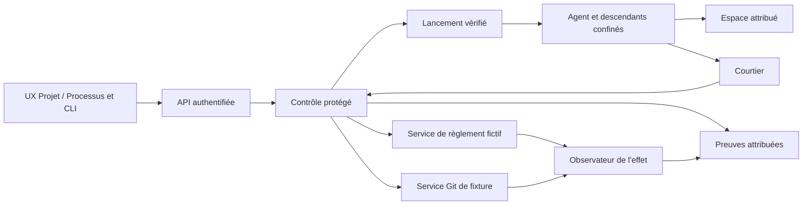

# PAEA — plan APEX adopté et suivi d’exécution

[English](../../en/plans/actions-confiance/PAEA-APEX.md) ·
File APEX (`../FILE-APEX.md`, suivi local hors de cette publication) · AC-02 (`securite-execution-apex.md`, suivi local hors de cette publication)

## Autorité et besoin

Actualisation du 26 octobre 2026 : « fini push compile » autorise la compilation,
le commit/push PAEA et la livraison locale selon l’accord permanent. Cette consigne
lève la restriction de compilation ; les droits métier et les prérequis protégés
restent inchangés. Voir [l’incrément 15](paea/INCREMENT-15.md).

Le 25 octobre 2026, l’utilisateur demande d’implémenter le plan PA-00…PA-13
préparé dans cette conversation. Codex racine possède l’intégration, sans
délégation ni exécution parallèle implicite. La priorité et les préconditions
de migration Rust restent applicables. Aucun commit, push, paiement réel,
déploiement externe ou reprise d’une mission suspendue n’est autorisé ici.

But : démontrer, pour la facturation fictive ET le développement logiciel,
que tout effet protégé observé correspond au contenu exact d’une autorisation
encore valide au point d’engagement. Activation par projet, refus si une
protection requise manque. Cible finale : évaluation E3 expérimentale avec
évaluateur indépendant, seconde implémentation et comparaison préenregistrée.
Cette cible n’est ni une certification ni une autorisation C3/C4.

Source historique conservée sans modification :
`docs/security/PAEA_v0.2_Profil_Assurance_Execution_Agentique_Revision_Scientifique.docx`.
Le [guide opérationnel fourni ensuite](../../security/PAEA_v0.2_Guide_Operationnel.docx)
est une référence de mise en œuvre, avec [correspondance et clarifications](paea/GUIDE-INTEGRATION.md).
Ses exemples ne remplacent ni les schémas versionnés ni l’autorité de session.
Le PDF voisin est également historique. Le registre d’exécution ci-dessous
distingue contrat, code, test local, installation et évaluation indépendante.

## Architecture et décisions

Le noyau Trust actuel reste compatible. Son stockage local et ses preuves HMAC
ne constituent pas une frontière contre un agent du même UID. Ajouter seulement
des contrôles dans ce processus ne suffit donc pas. Choix : réemployer les noyaux
et séparer agents, contrôle protégé, services d’effet et observation.



Architecture cible, non démontrée par ce document. Le contrôle et ses clés sont
hors du domaine agent, sous compte distinct. Le premier profil reste Linux :
espaces, montages, privilèges, descripteurs, processus et réseau. Le canal local
authentifie le pair mais ne déduit aucun mandat de sa seule UID. Root/projet,
principal, instance, périmètre et droits sont liés aux observations du contrôle.

Les politiques suivent les mécanismes existants. Les politiques AC-02 utilisent
SQLite et un échange YAML, sans déplacer implicitement les réglages globaux JSON.
Admin, API et CLI partagent validation et valeur effective. Aucune activation de
protection ni valeur de politique n’est introduite par le contrat de données PA-01.

## Contrats communs

- Proposition non autorisante ; contexte d’admission attribué par le contrôle.
- Schémas et canonicalisation versionnés, doublons et ambiguïtés refusés.
- Intention métier distincte de la clé de transport ; identité métier dérivée
  de la ressource, jamais d’une nouvelle clé libre choisie par l’agent.
- Paiement : facture identifiée, version, devise, montant entier exact,
  bénéficiaire résolu. Git : dépôt attribué, référence directe, ancien OID attendu,
  candidat immuable, contrôles/revue/décision conservés.
- Empreinte d’action liée au contenu, aux sources ordonnées et au contexte de
  contrôle ; changement pertinent rend l’accord antérieur incompatible.
- Autorité courante et effet ordonnés au point d’engagement. Git et SQLite ne
  deviennent pas atomiques : intention durable, mise à jour conditionnelle et
  réconciliation couvrent la frontière.
- `UNKNOWN` n’est ni échec sans effet ni succès. Aucun nouvel engagement pouvant
  dupliquer l’effet avant une réconciliation compatible. Les effets antérieurs
  et consommations restent conservés.
- Ancienne voie Trust : passage par le contrôle commun ou refus pour un projet
  protégé ; jamais un accès parallèle permissif.
- Erreur : code sûr, cause conservée, effet connu/incertain, identifiant et
  prochaine opération autorisée ; aucun succès vide après refus.

```text
PROPOSED → ADMITTED → APPROVAL_PENDING → AUTHORIZED → COMMIT_REQUESTED
COMMIT_REQUESTED → COMMITTED | DENIED | UNKNOWN
UNKNOWN → RECONCILED_COMMITTED | RECONCILED_NOT_COMMITTED
```

### Erratum PAEA-ERR-01

Origine : §6.2 option (b) de PAEA v0.2. Un jeton lié à une action et à usage
unique peut encore être consommé UNE première fois après une révocation locale
si le service d’effet ne consulte pas cette révocation. L’unicité ne démontre
donc pas I17. Exiger en plus l’état courant/epoch sous l’ordre d’engagement, ou
déclarer et prouver la limite de propagation ; suspendre l’usage critique non
couvert. Propriétaire : auteur PAEA/contrôle d’effet. Critère : jeton émis →
révocation effective → première consommation refusée, sans effet. État :
erratum spécifié ; preuve distribuée restant à produire dans PA-03/PA-12.

## Lots, dépendances et sorties

Chaque lot conserve ses entrées exactes, son propriétaire, ses contrôles et sa
reprise. Une anomalie déclenche replan : cause, original, précondition modifiée,
action autorisée, vérification, retour au besoin. Pas de retry inchangé.

| Lot | Responsable et dépendance | Actions et livrable | Sortie observable |
|---|---|---|---|
| PA-00 Référence | Codex ; plans et sources actuels | État Git/runtime, réservations, inventaire des 17 invariants, preuves et ressources ; erratum et témoins des deux domaines. | Référence liée aux octets, limites et propriétaires ; aucune qualification Rust déduite de Go. |
| PA-01 Contrats | Codex ; PA-00 | Schémas, canonicalisation, vecteurs, intentions métier, ordre d’engagement, erreurs, API/CLI, migration et diagrammes FR/EN. | Contrats testables pour les deux domaines ; aucune permission ni effet émis par la bibliothèque de données. |
| PA-02 Autorité | Identité/intégration ; PA-01 + sorties IA3 requises | Réemploi enrôlement/instances ; séparation contrôle/clés ; liaison projet ouvert ; mandats, accords, révocations ; Admin/API/CLI et stockage unique. | Demande légitime admise, usurpation/mauvais projet/mandat périmé refusés ; protection manquante ferme l’usage. |
| PA-03 Deux services | Trust/dépôt géré ; PA-01 + PA-02 | Grand livre fictif séparé, promotion Git conditionnelle, candidat/revue existants, autorité au commit, unicité métier, intention durable et réconciliation. | T04/T05/T06 sur les deux parcours ; ancien effet conservé, aucune duplication par nouvelle clé. |
| PA-04 Confinement | AC-02/A3 ; PA-02 + conditions AC-02 | Tous départs/reprises et descendants ; montages, FS, FD, environnement, signaux, processus détachés ; vérification avant code non fiable. | Témoin puis contournement pour chaque chemin inventorié ; protection requise indisponible refuse. |
| PA-05 Réseau/secrets | AC-02/A4 ; PA-04 + AC-02/A2 | Passage obligatoire ; IPv4/6, DNS, redirections, sockets, connexions persistantes ; secrets côté contrôle ; labels/destination réels ; outils/modèles/dépendances. | Flux légitime réussi et aucun octet sensible observé à une destination interdite dans le périmètre fermé. |
| PA-06 Composition | Identité/Mémoire ; PA-02 + PA-05 + MEM-P2…P4 requis | Instructions/données séparées ; provenance, intégrité/confidentialité et versions à lecture/résumé/transmission/compaction ; droits descendants bornés et pairs authentifiés. | Pas de promotion d’instruction ni de droit par mémoire, A2A, retrait ou reprise dans les scénarios retenus. |
| PA-07 Outils/temps | Lancement/catalogue ; PA-01/02/04 | Exécutable/schéma/config effectifs, admission et invalidation ; temps monotone, generations/epochs, baux après restart ; inventaire et correspondance ACS. | Substitution, ancien bail ou horloge agent ne donnent aucun effet supplémentaire ; pas de conformité ACS déduite d’un export. |
| PA-08 UX/accords | UX/intégration ; interfaces PA-02…07 | Réglages dès chaque politique ; effet/contenu/approbateur lisibles, refus/UNKNOWN visibles ; configuré/appliqué/observé distingués ; UX séparables ; vigilance mesurée. | Parcours CLI/API et navigateur FR/EN, thèmes, mobile, clavier/focus et états erreur/reprise sur les deux domaines. |
| PA-09 Preuves | Vérification ; PA-02…08, collecte dès le début | Lier proposition/admission/accord/engagement/observation ; originaux ; clés externes au seul export ; altération/omission/rejeu/rollback détectés. | Vérificateur rapproche décision et effet sans croire le rapport agent ; dossier de revue indépendant recevable. |
| PA-10 E2 local | Codex + revue autre contexte ; PA-03…09 | Matrice même candidat, profils sans fixture, CLI/API/browser isolés, anciennes voies, build/install supportés, version/empreinte/assets/notes FR/EN. | Deux parcours installés, déclaration E2 bornée et critères ouverts explicites ; pas clôture E3. |
| PA-11 Préparer E3 | Commanditaire + équipe tierce + évaluateur | Désignation indépendante, seconde frontière sans moteur Swarm, schémas/vecteurs communs, protocole préenregistré, B2/ablations et corpus réservé. | Moyens et responsabilités acceptés, protocole figé avant campagnes ; aucun rôle inventé. |
| PA-12 Campagnes E3 | Évaluateur ; PA-10 + PA-11 | T01…22/adaptatif, oracles des deux domaines, Swarm/B2/seconde implémentation, ablations et essais humains autorisés, rapport complet et remise des défauts. | Résultats et contre-exemples indépendants, coûts/limites conservés ; chaque défaut a un destinataire vérifié. |
| PA-13 Corrections/RETEX | Codex + évaluateur ; PA-12 | Reproduire, corriger contrat commun, requalifier lots affectés et verdicts invalidés, livrer candidat vérifié, RETEX final et transmission. | Dossier E3 expérimental dans le périmètre démontré ; tout critère bloquant garde le programme ouvert. |

Les profils critiques AC-02 restent conditionnés à la qualification Rust. La
préparation indépendante des contrats et du protocole E3 n’attend pas une
activation publique. IA3 → usages mémoire → IA4 conserve les remises de phase
existantes ; ni IA5 entière ni MEM-P5 entière ne deviennent une dépendance ajoutée.

## Matrice d’assurance et tests

| Invariant | Lots | Tests | Source/consommateur et preuve à établir |
|---|---|---|---|
| I01 Non-autorité du modèle | 01/02/06 | T01/T02 | Proposition externe → contrôle attribué ; aucun champ agent n’accorde de droit. |
| I02 Identité/délégation | 02/06 | T03/T14 | Enrôlement/mandat courant → lancement/pair ; sous-ensemble des droits délégables. |
| I03 Provenance/flux | 05/06 | T02/T18 | Sources/version/labels → contenu réellement reçu, résumé et compaction compris. |
| I04 Accord exact | 01/03/08 | T04/T20 | Action canonique approuvée → octets et paramètres consommés au service d’effet. |
| I05 Dernier usage | 02/03 | T05/T17 | Autorité actuelle → engagement ordonné, pas décision préflight seule. |
| I06 Médiation | 04/05 | T07/T19 | Inventaire FS/processus/IPC/réseau → barrière réellement appliquée. |
| I07 Secrets | 02/05 | T08/T17 | Contrôle/clés → usages bornés ; aucun secret critique lisible par agent/descendants. |
| I08 Unicité métier | 01/03 | T06/T09 | Intention métier dérivée → grand livre/ref Git ; nouvelle clé ne réautorise pas l’effet. |
| I09 UNKNOWN/reprise | 03/09 | T06/T21 | Réponse perdue → observation du service, sans duplication ni succès inventé. |
| I10 Supervision humaine | 08/12 | T10/T22 | Approbateur authentifié/compétence/charge → accord exact ; attention non déduite d’un clic. |
| I11 Preuve indépendante | 09/12 | T12/T21 | Observateur et ancres séparés → dossier attribuable avec limites. |
| I12 Défaillance sûre | 03/04/05 | T10/T16 | Précondition indisponible → aucun nouvel effet sensible non démontré ; C4 exclu. |
| I13 Egress/confidentialité | 05/06 | T13/T19 | Labels/destination effective → octets reçus par oracle réseau. |
| I14 A2A | 06 | T14/T18 | Pair/mandat/audience → réception liée et pas d’intermédiaire privilégié. |
| I15 Outillage | 07 | T15/T20 | Manifeste admis → exécutable/schéma observés ; mutation force réadmission. |
| I16 Temps/ordre | 02/03/07 | T16/T05 | Horloge/epoch contrôle → ordre de décision, jamais l’heure déclarée par agent. |
| I17 Révocation au service | 02/03/05 | T17/T21 | Révocation effective → première consommation d’un jeton préémis refusée. |

T11 complète I04/I05/I11/I15 : mutation politique/source/candidat invalide la
preuve concernée. T09 couvre aussi le fractionnement et le cumul multi-agents.
Chaque injection exige un témoin valide sous les mêmes préconditions. L’oracle
lit l’état avant/après : HTTP200, sortie0 ou étiquette PASS ne suffisent pas.
Les cas locaux de PA-01 ne sont pas les campagnes T01…T22 exécutées.

Mesures séparées : effets interdits, réussite métier/logicielle, refus injustifiés,
reprises/UNKNOWN, latences p50/p95/p99, dépenses/consommation/charge et couverture.
Volumes et budgets sont préenregistrés avant campagne, sans nombre universel.
Les intervalles statistiques restent conditionnés à leurs hypothèses ; un gain
faible face à B2 doit être publié tel quel.

## Règles de livraison et clôture

Chaque incrément inclut revue des politiques, fonctions/docstrings, erreurs et
documentation FR/EN liée aux octets ; profils/features/compilateur/binaire/assets
effectifs ; recette permanente, preuves neuves et vérification d’intégrité.
Une modification invalide les preuves affectées. Pas de watchdog global arbitraire,
nettoyage de preuve, acceptation fabriquée ou hausse de budget implicite.

M0 référence ; M1 deux effets contrôlés ; M2 médiation ; M3 composition ; M4 E2
installé ; M5 campagnes indépendantes E3 ; M6 corrections réévaluées et RETEX.
Le programme reste ouvert après M4. La désactivation d’un projet protégé exige
une décision autorisée ; aucun repli permissif automatique.

## État réel et reprise

25 octobre 2026 : PA-00 et PA-01 sont partiellement réalisés. La bibliothèque
`swarm-protection-contract`, le schéma, quatorze vecteurs et la commande publique
hors ligne `protection canonicalize` couvrent les données des deux domaines.
Cette commande ne confère aucune autorité et n’active aucune protection.
Les contrats complets de mandat, d’autorité, d’approbation et de reçu authentifiés,
ainsi que leurs opérations API/CLI actives restent à figer avec leurs producteurs.
Le protocole [PA-11/E3](paea/E3-PROTOCOL.md) est préparé, non préenregistré.
L’utilisateur a confirmé ne disposer ni d’évaluateur indépendant ni d’équipe tierce.
Aucun appel GLM/SKYNET ni aucune délégation n’a été effectué dans cet incrément.

La [recette conservée](paea/evidence/20261025-contract-qekt2uwo/recipe-01/result.json)
a exécuté 5 tests Python, 17 tests Rust de contrat et 4 tests CLI : 26 réussites,
zéro échec. Son intégrité a été vérifiée. Clippy et Rustdoc ont aussi réussi sur
la bibliothèque seule. Ces preuves ne couvrent ni les 22 campagnes PAEA, ni un
service d’effet, ni le confinement, ni une qualification E2/E3. L’inventaire de
recette est déclaratif : ce n’est pas le graphe de compilation effectif complet.
La documentation corrigée ensuite est revue séparément ; les preuves originales
et les sources exécutables correspondantes sont conservées sans réécriture.

### Replan : session concurrente et absence de compilation

L’utilisateur indique travailler dans une autre session et demande d’éviter de
compiler. Aucun nouveau Cargo, Rustdoc, build, installation ou redémarrage ne sera
lancé dans cette conversation sous cette consigne. Le dernier contrôle Rustdoc
était terminé. La lecture a constaté le chantier concurrent SCALING-S2 dans le
plan Rust et des modifications effectives du dépôt géré ; elles sont laissées à
leur propriétaire. Aucun processus de l’autre session n’est interrompu.

L’instance observée avant cette consigne exécutait `v0.1.1-dev.65` ; aucune
installation de cette tranche PAEA n’est déclarée. Propriétaire de la livraison :
intégrateur local ; reprise après levée de la consigne et disponibilité du checkout
partagé, avec revue du candidat complet puis chemin de livraison supporté.
Migration globale et remises IA3 restent ouvertes dans les plans inspectés ;
AC-02 conserve ses préconditions. Les changements de droits, comptes, confinement
et services d’effet ne sont pas démarrés par le présent socle.

Réservation de ce travail : ce plan et le contrat FR/EN, la bibliothèque isolée,
schémas/vecteurs/tests/recette, module CLI `protection`, raccords ciblés dans
`swarm-cli/src/lib.rs`, dépendances Cargo, note FR/EN de `version_history.json`,
file APEX et preuves propres. Aucun fichier moteur Trust, lancement, supervision,
politique active ou mission n’est réservé ici. Les modifications étrangères des
fichiers partagés doivent être préservées.

La [revue de l’incrément](paea/INCREMENT-01.md) conserve le périmètre testé,
les trois axes de revue, les limites et les conditions de reprise. Le programme
PA-00…PA-13 et son RETEX final restent ouverts.

### Incrément 02 — suite autorisée avec GLM, sans compilation

La demande « go next avec glm » autorise une contribution GLM interne ciblée.
La consigne sans compilation reste active. La
[recette publique ajoutée](paea/INCREMENT-02.md) a exécuté quatre tests, 88 invocations
sur le binaire existant : 16 mutations refusées et un échec d’écriture, encadrés
par des témoins valides. Preuves PASS/VERIFIED, sans installation ni modification
Rust. L’avis GLM exploité porte seulement sur le décodeur brut ; premier appel
épuisé et première recette en échec conservés avec leur reprise vérifiée.
PA-00/01 et les conditions de suite précédentes restent ouverts.

### Incrément 03 — refus de routage avec GLM

[Deux tests ajoutés](paea/INCREMENT-03.md) : six tests publics au total, 248 invocations,
69 refus attendus et reprises exactes sur les deux domaines en FR/EN. Binaire
existant stable, sans compilation ni redémarrage. Proposition GLM corrigée avant
exécution ; preuves conservées. PA-00/01 partiels et dépendances IA3/Rust/AC-02/E3
inchangées ; aucun lot global clos.

### Incrément 04 — consommateur d’export et méthode GLM corrigée

[Outil de correspondance réalisé](paea/INCREMENT-04.md) : neuf tests nommés,
42 observations CLI sur les deux domaines, sans compilation ni installation.
Le résultat ne prouve ni admission ni autorité/effet ; PA-09 seulement amorcé.
Plafond client GLM supprimé par défaut après correction explicite utilisateur ;
neuf tests HTTP locaux et requête réelle sans champ de plafond conservés.
PA-00/01 et les prérequis Rust/IA3/AC-02/E3 restent ouverts.

### Incrément 05 — comparaison Rust non qualifiée

[Sources Rust et trois tests écrits](paea/INCREMENT-05.md), sans compilation ni
exécution des tests. Nouvelle extension Python retirée après correction explicite
de l’utilisateur ; originaux conservés. Aucun raccord CLI/API, installation ou
verdict d’autorité. PA-01/08/09 restent partiels ; qualification et IA3/AC-02 ouvertes.

### Incrément 06 — raccord CLI Rust non qualifié

[Commande compare et quatre tests CLI écrits](paea/INCREMENT-06.md), sans
compilation ni exécution. Lecteur existant, deux fichiers nommés, schéma de sortie
et aide FR/EN ; recette adaptée, non lancée. Aucun projet/effet/accord activé.
La consigne sans compilation persiste ; PA-01/08/09 et qualification restent ouverts.

### Incrément 07 — liaison reçu/action/cycle en sources

[Contrôle Rust et quatre tests écrits](paea/INCREMENT-07.md), non compilés/non
exécutés. Réemploi des digests d’action/intention, du service attendu et du cycle
UNKNOWN/réconciliation ; aucun reçu authentifié ni service d’effet livré.
PA-01/03/09 et dépendances PA-02/AC-02 restent ouverts. Aucun projet activé.

### Incrément 08 — consommateur CLI du contrôle de reçu

Reprise du programme et consigne **sans compilation ni redémarrage reconfirmée**
par l’utilisateur. [Raccord CLI Rust et quatre tests écrits](paea/INCREMENT-08.md),
non compilés/non exécutés : deux fichiers, service et état précédent explicites,
recalcul canonique et contrôle de liaison/cycle. Aide, schéma, recette et contrat
FR/EN actualisés ; autorité, authenticité et effet restent non établis. Aucun
appel GLM ni service démarré. Les tests d’erreur de sortie sont isolés hors du
checkout appelant ; leur effet reste à vérifier. PA-01/03/09, qualification,
installation, dépendances protégées et RETEX restent ouverts. Prochaine preuve :
targets affectés et recette sur candidat figé après levée explicite de la consigne.

### Incrément 09 — boucle de vérification sur candidat existant

[14 tests publics réussis, 618 invocations](paea/INCREMENT-09.md), 167 refus
attendus, recette PASS et intégrité VERIFIED. Le candidat existant dev75, construit
par une autre session, a été figé sans compiler/redémarrer ici. Archive des
432 entrées effectives vérifiée, huit entrées PAEA conformes aux sources observées.
Deux assertions Rust de 08 corrigées vers `failure.code`, non exécutées par Cargo.
Deuxième passage : features transitive `serde` d’Identité justifiée, statuts temporels
retirés des descriptions de schéma, lots antérieurs réexaminés sans réécriture.
PAEA-OBS-01 conserve la limite du rapport autonome et la mitigation par transcript.
Six invariants ont des observations structurelles locales ; **0/17 est démontré
de bout en bout**. PA-02/03/08/09 protégés, installation, E2/E3 et RETEX ouverts.
Consigne sans compilation/redémarrage active ; reprise des tests Rust sur levée
explicite, des effets sur sortie protégée IA3/PA-02, d’E3 avec les tiers requis.

### Incrément 10 — PAEA-OBS-01 réalisé en sources

[Rapport autonome v2 et sept tests écrits](paea/INCREMENT-10.md) : empreintes des
octets exacts du document/reçu, canonicalisation et même contrôle de liaison/cycle.
Nouvelle commande `receipt-report`, sortie `check-receipt` v1 conservée en sources ;
entrées v1 inchangées. Aucun nouveau droit, effet ou dépendance. Aide, schéma,
recette, notes locales et contrat FR/EN actualisés. **Non compilé/non exécuté/non
installé** sous la consigne active. Le témoin préexistant vérifie contrôle v1,
absence du nouveau parcours sur dev75 puis reprise, sans build. PAEA-OBS-01
reste non vérifié fonctionnellement ; preuves de 09 conservées sur leurs sources
archivées, sans qualification du nouveau code. PA-01/09 et programme global ouverts.


### Incrément 11 — demande explicite de parcours UX

Après la question « ces tests, comment les mettre en œuvre ? », l’utilisateur
précise « c’est à ajouter ». PA-08 inclut explicitement un accès depuis le menu.
[Premier parcours écrit](paea/INCREMENT-11.md) : **Vérifications PAEA** dans le
cockpit natif et Actions de confiance ; sélection document/reçu, service/état
explicites, contrôle de correspondance, refus/UNKNOWN visibles et rapport v2.
API authentifiée utilisant le contrôle pur commun, sans effet ni protection
activée. Composant navigateur vérifiable séparément ; route Rust, assets du
binaire et installation non qualifiés sous la consigne sans compilation/restart.
Deux tests HTTP Rust écrits, recette permanente navigateur ajoutée. PA-08 reste
partiel : accords protégés/configuré-appliqué-observé, deux UX et vigilance
nécessitent toujours les interfaces PA-02…07 et les essais prévus.


### Incrément 12 — qualification sur candidat existant

[Preuves publiques et écran relié à la vraie CLI](paea/INCREMENT-12.md) : candidat
dev77 construit par l’autre session, figé sans compilation/redémarrage ici.
434 entrées de l’archive effective vérifiées, sept sources PAEA identiques.
18 tests publics réussis, 973 invocations dont 268 refus attendus ; OBS-01 v2
vérifié localement (octets distincts, v1 conservé). Écran : 174 assertions et
48 appels réels par pont HTTP de fixture, FR/EN et deux domaines ; aucune réponse
du vérificateur fabriquée. Catalogue partagé modifié par une autre session :
composant rejoué, 219 assertions et 40 requêtes simulées PASS. Trois recettes PASS,
intégrité VERIFIED. Ce pont n’est
pas le service HTTP natif : ses deux tests Rust, assets servis, installation et
accords protégés restent ouverts. Les preuves historiques 09…11 sont conservées,
sans qualification générale des 17 invariants ni clôture E2/E3/RETEX.


### Incrément 13 — guide opérationnel et parcours UX

L’utilisateur fournit le guide opérationnel pour orienter l’implémentation.
[Correspondance complète](paea/GUIDE-INTEGRATION.md) : copie originale conservée,
chapitres vers lots/propriétaires/preuves, trois dossiers et parcours UX cible.
Le contrôle de fichiers existant reste partiel. Priorité fonctionnelle : fiche
d’effet, responsable, frontière, oracle et trois recettes sur les deux pilotes,
sans sauter PA-02/03 ou Rust/AC-02. ERR-01 s’applique aussi au §7.1 du guide ;
JSON/figures pédagogiques ne remplacent pas les schémas ; l’identité projet+facture
exige une résolution protégée unique de la dette avant le sink. IAM/industrie
restent hors exécution autorisée. [Suivi et vérifications](paea/INCREMENT-13.md)
conservent aussi le traitement borné du contraste PAEA-UX-02, avec tests de
repos/survol/clavier et distinction entre composant et binaire installé.

### Incrément 14 — deux effets de laboratoire et observation séparée

[Dossier opérationnel](paea/PILOTE-OPERATIONNEL.md) : fiches règlement fictif/Git,
autorités manquantes, carte d’accès et trois recettes exécutables sans build.
SQLite et transaction Git branche+marqueur canonique produisent des effets dans
26 racines isolées ; processus oracle séparé sans reçu/journal de décision.
**7 tests PASS, 132 processus, recette PASS/intégrité VERIFIED**. T04, réponse
perdue et révocation avant première utilisation exercés dans les deux domaines,
avec témoins/reprises ; ce sont des ordres de fixture, pas une preuve distribuée.
Contre-épreuve Git : garde ignorant le contexte fait échouer l’assertion attendue.
PAEA-GUIDE-03 reproduit deux écritures pour des aliases bruts sans registre métier :
contre-exemple conservé, résolution protégée de dette obligatoire avant PA-03.
[Suivi et limites](paea/INCREMENT-14.md). Même UID/autorité simulée : **0/17
invariants de bout en bout**, PA-02/03 protégés, menu de campagnes, qualification
native, installation/E2/E3/RETEX ouverts. Aucun build ni redémarrage.

### Incrément 15 — qualification native et livraison autorisée

La restriction de compilation est levée par l’utilisateur. Sur le checkout puis
un worktree limité au socle publié et à PAEA : **5 tests Python et 45 tests Rust
PASS**, dont les deux tests HTTP jusque-là non exécutés. Build normal dev79
préparé avant arrêt ; navigateur sur vrai exécutable et ressources embarquées :
**237 assertions/12 configurations**, 24 refus attendus, zéro diagnostic inattendu.
Huit assets protégés comparés aux sources ; FR/EN, thèmes, mobile, dialogue Version,
lien Git et focus vérifiés. Le retour PAEA va au cockpit, sans dépendance Biba.
[Preuves, périmètre de publication et livraison](paea/INCREMENT-15.md) ; le résultat
local généré conserve commit distant, version/PID/hash réellement activés.
Le menu de correspondance est qualifié ; les campagnes de laboratoire restent
hors UX. Cette livraison ne clôt ni PA-02/03 protégés, ni les **17 invariants**,
ni E2/E3/RETEX du programme.

### Incrément 16 — identité de dette explicite

[Décision et critères](paea/INCREMENT-16.md) : préserver le hash v1 et résoudre
fournisseur/référence vers un objet de dette stable avant admission. Bibliothèque
pure et CLI hors ligne, rejet des collisions et versions périmées ; observation
d’un seul effet de fixture pour deux aliases. Le registre fourni reste non
authentifié ; continuité inter-révisions et autorité protégée restent ouvertes.

Incrément 16 vérifié et installé **dev82** : 37 tests de contrat, 2 tests publics
(33 appels), 8 scénarios à effets de fixture et 26 contrôles de l’instance PASS ;
garde réseau de la recette vérifiée par échec attendu après témoin. Sources non
commitées ; aucune nouvelle garantie protégée ni clôture E2/E3.

### Incrément 17 — résolution de facture dans le menu

[Contrat, décision et preuves](paea/INCREMENT-17.md) : PA-08 expose le résolveur
commun depuis Vérifications PAEA, sur une page dédiée avec aide et téléchargement.
API native fermée, nombres i64 exacts, erreurs/reprises et marqueurs non autorisants.
Le parcours action/reçu est conservé ; aucune activation de registre protégé.

Incrément 17 livré sur **dev87** : 4 tests schéma/4 HTTP, 219 assertions composant,
452 assertions natives sur dev86 aux 448 entrées identiques, 30 contrôles de
l’instance dev87 PASS. Numéros/commit/date distingués ; rapport de réutilisation
conservé. Clippy/Rustdoc PASS ; gardes de perte de script vérifiées après témoins.
Sources PAEA non commitées ; registres/accords protégés et E2/E3 restent ouverts.

Publication demandée le 26 octobre : commit isolé des incréments 16/17, sans
push ni nouvelle livraison ; voir le suivi de publication en fin du rapport 17.
Les mentions précommit ci-dessus conservent leur portée historique.

### Incrément 18 — reprise GLM

« reprends glm » autorise une contribution interne ciblée sur les contrats
de résolution/API/UX livrés. [Suivi et critères](paea/INCREMENT-18.md) : chaque
constat doit être reproduit ou réfuté, puis corrigé/vérifié lorsqu’il est fondé.
Les remises protégées et les limites d’assurance restent ouvertes.

Reprise 18 vérifiée : une contribution GLM complète, deux nouvelles régressions
Rust exactes PASS sur instantané stable, 28 assertions d’encodage natif PASS.
Quatre inventaires de recettes corrigés ; aucun défaut produit établi, aucune
modification du produit ni nouvelle installation attribuée à cette tranche.
Les suites complètes et les garanties protégées ne sont pas déclarées closes.
