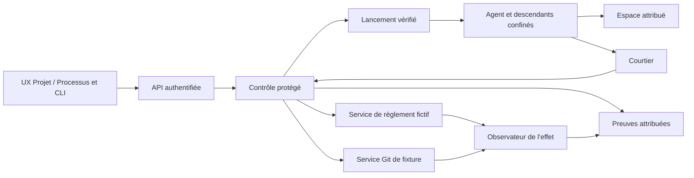

# PAEA — plan APEX adopté et suivi d’exécution

## Point courant P1/G1 — 3 novembre 2026

Première tranche locale [accord séparé exact du règlement](paea/P1-G1-20261103.md)
livrée en dev.322, image 3146c83791e9cd5e98f264d3d4af0bdf2fc6ee9fb246d145dcc88fd8c4cc313a.
Preuves noyau/CLI, recette sur image exacte, régression Git et revue des sept
entrées effectives ; métadonnées et dialogue Version FR/EN observés. G1 global,
enrôlement humain, services protégés et E3 restent ouverts. Les anciennes
déclarations E2 et leurs images gardent leur portée historique, sans requalification
globale de la nouvelle image par ces seuls tests.

[English](../../en/plans/actions-confiance/PAEA-APEX.md) ·
File APEX (`../FILE-APEX.md`, suivi local hors de cette publication) · AC-02 (`securite-execution-apex.md`, suivi local hors de cette publication)

## Autorité et besoin

Actualisation du 26 octobre 2026 : « fini push compile » autorise la compilation,
le commit/push PAEA et la livraison locale selon l’accord permanent. Cette consigne
lève la restriction de compilation ; les droits métier et les prérequis protégés
restent inchangés. Voir [l’incrément 15](paea/INCREMENT-15.md).

Le 25 octobre 2026, l’utilisateur demande d’implémenter le plan PA-00…PA-13
préparé dans cette conversation. Codex racine possède l’intégration, sans
délégation ni exécution parallèle implicite. La priorité et les préconditions
de migration Rust restent applicables. Aucun commit, push, paiement réel,
déploiement externe ou reprise d’une mission suspendue n’est autorisé ici.

But : démontrer, pour la facturation fictive ET le développement logiciel,
que tout effet protégé observé correspond au contenu exact d’une autorisation
encore valide au point d’engagement. Activation par projet, refus si une
protection requise manque. Cible finale : évaluation E3 expérimentale avec
évaluateur indépendant, seconde implémentation et comparaison préenregistrée.
Cette cible n’est ni une certification ni une autorisation C3/C4.

Source historique conservée sans modification :
`docs/security/PAEA_v0.2_Profil_Assurance_Execution_Agentique_Revision_Scientifique.docx`.
Le [guide opérationnel fourni ensuite](../../security/PAEA_v0.2_Guide_Operationnel.docx)
est une référence de mise en œuvre, avec [correspondance et clarifications](paea/GUIDE-INTEGRATION.md).
Ses exemples ne remplacent ni les schémas versionnés ni l’autorité de session.
Le PDF voisin est également historique. Le registre d’exécution ci-dessous
distingue contrat, code, test local, installation et évaluation indépendante.

## Architecture et décisions

Le noyau Trust actuel reste compatible. Son stockage local et ses preuves HMAC
ne constituent pas une frontière contre un agent du même UID. Ajouter seulement
des contrôles dans ce processus ne suffit donc pas. Choix : réemployer les noyaux
et séparer agents, contrôle protégé, services d’effet et observation.



Architecture cible, non démontrée par ce document. Le contrôle et ses clés sont
hors du domaine agent, sous compte distinct. Le premier profil reste Linux :
espaces, montages, privilèges, descripteurs, processus et réseau. Le canal local
authentifie le pair mais ne déduit aucun mandat de sa seule UID. Root/projet,
principal, instance, périmètre et droits sont liés aux observations du contrôle.

Les politiques suivent les mécanismes existants. Les politiques AC-02 utilisent
SQLite et un échange YAML, sans déplacer implicitement les réglages globaux JSON.
Admin, API et CLI partagent validation et valeur effective. Aucune activation de
protection ni valeur de politique n’est introduite par le contrat de données PA-01.

## Contrats communs

- Proposition non autorisante ; contexte d’admission attribué par le contrôle.
- Schémas et canonicalisation versionnés, doublons et ambiguïtés refusés.
- Intention métier distincte de la clé de transport ; identité métier dérivée
  de la ressource, jamais d’une nouvelle clé libre choisie par l’agent.
- Paiement : facture identifiée, version, devise, montant entier exact,
  bénéficiaire résolu. Git : dépôt attribué, référence directe, ancien OID attendu,
  candidat immuable, contrôles/revue/décision conservés.
- Empreinte d’action liée au contenu, aux sources ordonnées et au contexte de
  contrôle ; changement pertinent rend l’accord antérieur incompatible.
- Autorité courante et effet ordonnés au point d’engagement. Git et SQLite ne
  deviennent pas atomiques : intention durable, mise à jour conditionnelle et
  réconciliation couvrent la frontière.
- `UNKNOWN` n’est ni échec sans effet ni succès. Aucun nouvel engagement pouvant
  dupliquer l’effet avant une réconciliation compatible. Les effets antérieurs
  et consommations restent conservés.
- Ancienne voie Trust : passage par le contrôle commun ou refus pour un projet
  protégé ; jamais un accès parallèle permissif.
- Erreur : code sûr, cause conservée, effet connu/incertain, identifiant et
  prochaine opération autorisée ; aucun succès vide après refus.

```text
PROPOSED → ADMITTED → APPROVAL_PENDING → AUTHORIZED → COMMIT_REQUESTED
COMMIT_REQUESTED → COMMITTED | DENIED | UNKNOWN
UNKNOWN → RECONCILED_COMMITTED | RECONCILED_NOT_COMMITTED
```

### Erratum PAEA-ERR-01

Origine : §6.2 option (b) de PAEA v0.2. Un jeton lié à une action et à usage
unique peut encore être consommé UNE première fois après une révocation locale
si le service d’effet ne consulte pas cette révocation. L’unicité ne démontre
donc pas I17. Exiger en plus l’état courant/epoch sous l’ordre d’engagement, ou
déclarer et prouver la limite de propagation ; suspendre l’usage critique non
couvert. Propriétaire : auteur PAEA/contrôle d’effet. Critère : jeton émis →
révocation effective → première consommation refusée, sans effet. État :
erratum spécifié ; preuve distribuée restant à produire dans PA-03/PA-12.

## Lots, dépendances et sorties

Chaque lot conserve ses entrées exactes, son propriétaire, ses contrôles et sa
reprise. Une anomalie déclenche replan : cause, original, précondition modifiée,
action autorisée, vérification, retour au besoin. Pas de retry inchangé.

| Lot | Responsable et dépendance | Actions et livrable | Sortie observable |
|---|---|---|---|
| PA-00 Référence | Codex ; plans et sources actuels | État Git/runtime, réservations, inventaire des 17 invariants, preuves et ressources ; erratum et témoins des deux domaines. | Référence liée aux octets, limites et propriétaires ; aucune qualification Rust déduite de Go. |
| PA-01 Contrats | Codex ; PA-00 | Schémas, canonicalisation, vecteurs, intentions métier, ordre d’engagement, erreurs, API/CLI, migration et diagrammes FR/EN. | Contrats testables pour les deux domaines ; aucune permission ni effet émis par la bibliothèque de données. |
| PA-02 Autorité | Identité/intégration ; PA-01 + sorties IA3 requises | Réemploi enrôlement/instances ; séparation contrôle/clés ; liaison projet ouvert ; mandats, accords, révocations ; Admin/API/CLI et stockage unique. | Demande légitime admise, usurpation/mauvais projet/mandat périmé refusés ; protection manquante ferme l’usage. |
| PA-03 Deux services | Trust/dépôt géré ; PA-01 + PA-02 | Grand livre fictif séparé, promotion Git conditionnelle, candidat/revue existants, autorité au commit, unicité métier, intention durable et réconciliation. | T04/T05/T06 sur les deux parcours ; ancien effet conservé, aucune duplication par nouvelle clé. |
| PA-04 Confinement | AC-02/A3 ; PA-02 + conditions AC-02 | Tous départs/reprises et descendants ; montages, FS, FD, environnement, signaux, processus détachés ; vérification avant code non fiable. | Témoin puis contournement pour chaque chemin inventorié ; protection requise indisponible refuse. |
| PA-05 Réseau/secrets | AC-02/A4 ; PA-04 + AC-02/A2 | Passage obligatoire ; IPv4/6, DNS, redirections, sockets, connexions persistantes ; secrets côté contrôle ; labels/destination réels ; outils/modèles/dépendances. | Flux légitime réussi et aucun octet sensible observé à une destination interdite dans le périmètre fermé. |
| PA-06 Composition | Identité/Mémoire ; PA-02 + PA-05 + MEM-P2…P4 requis | Instructions/données séparées ; provenance, intégrité/confidentialité et versions à lecture/résumé/transmission/compaction ; droits descendants bornés et pairs authentifiés. | Pas de promotion d’instruction ni de droit par mémoire, A2A, retrait ou reprise dans les scénarios retenus. |
| PA-07 Outils/temps | Lancement/catalogue ; PA-01/02/04 | Exécutable/schéma/config effectifs, admission et invalidation ; temps monotone, generations/epochs, baux après restart ; inventaire et correspondance ACS. | Substitution, ancien bail ou horloge agent ne donnent aucun effet supplémentaire ; pas de conformité ACS déduite d’un export. |
| PA-08 UX/accords | UX/intégration ; interfaces PA-02…07 | Réglages dès chaque politique ; effet/contenu/approbateur lisibles, refus/UNKNOWN visibles ; configuré/appliqué/observé distingués ; UX séparables ; vigilance mesurée. | Parcours CLI/API et navigateur FR/EN, thèmes, mobile, clavier/focus et états erreur/reprise sur les deux domaines. |
| PA-09 Preuves | Vérification ; PA-02…08, collecte dès le début | Lier proposition/admission/accord/engagement/observation ; originaux ; clés externes au seul export ; altération/omission/rejeu/rollback détectés. | Vérificateur rapproche décision et effet sans croire le rapport agent ; dossier de revue indépendant recevable. |
| PA-10 E2 local | Codex + revue autre contexte ; PA-03…09 | Matrice même candidat, profils sans fixture, CLI/API/browser isolés, anciennes voies, build/install supportés, version/empreinte/assets/notes FR/EN. | Deux parcours installés, déclaration E2 bornée et critères ouverts explicites ; pas clôture E3. |
| PA-11 Préparer E3 | Commanditaire + équipe tierce + évaluateur | Désignation indépendante, seconde frontière sans moteur Swarm, schémas/vecteurs communs, protocole préenregistré, B2/ablations et corpus réservé. | Moyens et responsabilités acceptés, protocole figé avant campagnes ; aucun rôle inventé. |
| PA-12 Campagnes E3 | Évaluateur ; PA-10 + PA-11 | T01…22/adaptatif, oracles des deux domaines, Swarm/B2/seconde implémentation, ablations et essais humains autorisés, rapport complet et remise des défauts. | Résultats et contre-exemples indépendants, coûts/limites conservés ; chaque défaut a un destinataire vérifié. |
| PA-13 Corrections/RETEX | Codex + évaluateur ; PA-12 | Reproduire, corriger contrat commun, requalifier lots affectés et verdicts invalidés, livrer candidat vérifié, RETEX final et transmission. | Dossier E3 expérimental dans le périmètre démontré ; tout critère bloquant garde le programme ouvert. |

Les profils critiques AC-02 restent conditionnés à la qualification Rust. La
préparation indépendante des contrats et du protocole E3 n’attend pas une
activation publique. IA3 → usages mémoire → IA4 conserve les remises de phase
existantes ; ni IA5 entière ni MEM-P5 entière ne deviennent une dépendance ajoutée.

## Rattachement Bell-LaPadula — 31 octobre 2026

Bell-LaPadula précise le contrôle de confidentialité attendu par PAEA, en
complément de Biba pour l'intégrité. Le [plan BLP](BLP-APEX.md) constitue la
décomposition technique de ces lots PAEA, pas un programme d'assurance parallèle.
PAEA conserve les invariants I01–I17, les campagnes T01–T22, les critères de
clôture et le registre d'assurance existants ; aucun identifiant ni dénominateur
n'est modifié par ce rattachement documentaire.

| Sous-lot technique | Lots PAEA de rattachement | Invariants concernés | Scénarios à compléter dans les tests existants |
|---|---|---|---|
| BLP-01 Inventaire/frontières | PA-00/01 | I03/I06/I13 | T02/T07/T13 : sources, lecteurs et sorties réels, voies directes comprises |
| BLP-02 Moniteur commun | PA-01/02/06 | I01/I02/I03/I13 | T01/T02/T13 : dominance, compartiments incomparables, source inconnue et absence d'auto-autorisation |
| BLP-03 Politique/migration/Admin | PA-02/08 | I02/I05/I17 | T03/T05/T11/T17 : attribution autorisée, aperçu sans mutation, persistance, conflit et révocation |
| BLP-04 Contexte/mémoire/sorties | PA-06 | I03/I13/I14 | T02/T13/T14/T18 : propagation aux résumés, compactions, reprises, caches et échanges A2A |
| BLP-05 Barrières effectives | PA-04/05 | I06/I07/I12/I13 | T07/T08/T13/T19 : fichiers, fournisseurs, outils, descendants, destinations et voies alternatives |
| BLP-06 Déclassification humaine | PA-02/08/09 | I04/I05/I10/I11/I13/I17 | T04/T05/T10/T11/T13/T17/T22 : accord exact, identité humaine, changement de contenu/destination et retrait |
| BLP-07 Qualification/livraison/RETEX | PA-09/10/11/12/13 | Invariants applicables de la matrice existante, dont I11 | Reprendre les scénarios concernés sur le même candidat ; T12/T21 pour les preuves et reprises ; E3 reste sous évaluateur indépendant |

### Reprise obligatoire des actions déjà réalisées

Le rattachement s'applique aussi aux actions PAEA déjà implémentées, testées,
livrées ou déclarées terminées. À la reprise, Codex racine et le responsable BLP
doivent les réexaminer au regard de **chacun des sept sous-lots BLP-01–07**.
Pour chaque action antérieure, consigner dans le suivi existant les sous-lots
applicables (ou le motif vérifiable de non-applicabilité), le producteur et le
consommateur réels, le candidat/profil concerné, les preuves réutilisables,
l'écart restant, son propriétaire et la condition de reprise/clôture.

Un résultat antérieur sur l'intégrité, l'accord exact ou un effet simulé ne
démontre pas la confidentialité. Conserver son historique et sa portée ; rouvrir
le critère concerné si la confidentialité n'était pas couverte ou si ses entrées
ont changé. Réutiliser une preuve inchangée seulement dans sa portée établie ;
reprendre les contrôles affectés avec témoins, refus et récupération, sans
réexécuter aveuglément toutes les campagnes. La clôture BLP-07 exige cette revue
des acquis et le traitement des écarts applicables ; une ligne non examinée ou
un critère bloquant non vérifié reste ouvert.

**Réexamen d'applicabilité effectué le 31 octobre** :
[rapport et écarts assignés](paea/BLP-REASSESSMENT-20261031.md),
[relevé par action](paea/BLP-REASSESSMENT-20261031-ANNEX.md),
[sources et empreintes](paea/BLP-REASSESSMENT-20261031.json).
115 actions documentées ont été réexaminées au regard des sept lots (805 décisions),
sur leurs contrats et des frontières courantes représentatives ; huit écarts
BLP-RET-01–08 restent ouverts. Les critères de confidentialité applicables sont
rouverts ou maintenus ouverts, notamment I03/I06/I13 et la déclassification liée
à I04/I05/I10/I17. Les anciens PASS gardent leur portée historique, sans nouvel
accord de confidentialité. Les preuves locales du socle BLP, y compris la
livraison/UI consignées par la session concurrente, restent distinctes des flux
réels non qualifiés. Les originaux E2 référencés n'ont pas été retrouvés dans le
checkout ; la déclaration historique n'est pas réacceptée par cette revue.
BLP-07 reste ouvert ; la réception de cette revue par la session de reprise et
les corrections/vérifications de ces écarts restent à établir.

Critères de confidentialité à démontrer dans ces scénarios :

- Lecture seulement sous habilitation couvrant niveau et compartiments ; aucune
  écriture/transmission ordinaire vers une classification ne dominant pas le
  domaine exposé. Intégrité Biba et permissions métier restent exigées séparément.
- Classification inconnue bloquante pour les nouveaux usages protégés ; migration
  explicite conservant les originaux. Les restrictions se propagent à tout le
  contexte exposé, aux dérivés, journaux et preuves, sans baisse par résumé ou LLM.
- Contrôle de la destination effective avant le premier octet transmis au modèle
  ou à un tiers ; témoin légitime, puis oracle de réception vérifiant le refus,
  y compris par outil, processus descendant ou chemin alternatif inventorié.
- Déclassification exceptionnelle par création d'une copie, après accord humain
  authentifié lié aux octets exacts, à la classification cible, aux destinataires
  et à la politique courante. Changement pertinent ou révocation invalide l'accord
  avant engagement ; l'original garde sa classification et l'historique subsiste.
- Aperçu non mutant, application révisionnée, relecture Admin/API/CLI, refus et
  reprise après redémarrage ; politique configurée, contrôle appliqué, effet
  observé et acceptation indépendante restent des preuves distinctes.

Codex racine reste propriétaire de l'intégration PAEA ; la session GLM/SKYNET
choisie pour la reprise BLP reçoit ce rattachement dans son contexte et référence
les exigences/tests PAEA dans ses remises. L'enregistrement présent ne démontre
ni réception par une session déjà démarrée, ni application par le moteur.
Le sous-ensemble fichiers/réseau nécessaire à BLP conserve les préconditions
PA-04/05 ; il ne démarre pas le reste d'AC-02 différé et ne supprime aucune barrière
requise. Une protection manquante laisse le parcours concerné ouvert/refusé.

État : rattachement spécifié. Le commit BLP `0aa7335e1` est un instantané WIP,
pas une qualification transversale. Ses limites et défauts historiques restent
dans le plan BLP ; les corrections ultérieures exigent leurs propres preuves.
Aucun PASS de campagne, invariant accepté, installation ou score supplémentaire
ne se déduit de cette section. Le registre d'assurance ci-dessous conserve
l'autorité sur les états PAEA ; le suivi BLP conserve le détail technique et ses
preuves, sans réécrire les résultats antérieurs.

## Matrice d’assurance et tests

| Invariant | Lots | Tests | Source/consommateur et preuve à établir |
|---|---|---|---|
| I01 Non-autorité du modèle | 01/02/06 | T01/T02 | Proposition externe → contrôle attribué ; aucun champ agent n’accorde de droit. |
| I02 Identité/délégation | 02/06 | T03/T14 | Enrôlement/mandat courant → lancement/pair ; sous-ensemble des droits délégables. |
| I03 Provenance/flux | 05/06 | T02/T18 | Sources/version/labels → contenu réellement reçu, résumé et compaction compris. |
| I04 Accord exact | 01/03/08 | T04/T20 | Action canonique approuvée → octets et paramètres consommés au service d’effet. |
| I05 Dernier usage | 02/03 | T05/T17 | Autorité actuelle → engagement ordonné, pas décision préflight seule. |
| I06 Médiation | 04/05 | T07/T19 | Inventaire FS/processus/IPC/réseau → barrière réellement appliquée. |
| I07 Secrets | 02/05 | T08/T17 | Contrôle/clés → usages bornés ; aucun secret critique lisible par agent/descendants. |
| I08 Unicité métier | 01/03 | T06/T09 | Intention métier dérivée → grand livre/ref Git ; nouvelle clé ne réautorise pas l’effet. |
| I09 UNKNOWN/reprise | 03/09 | T06/T21 | Réponse perdue → observation du service, sans duplication ni succès inventé. |
| I10 Supervision humaine | 08/12 | T10/T22 | Approbateur authentifié/compétence/charge → accord exact ; attention non déduite d’un clic. |
| I11 Preuve indépendante | 09/12 | T12/T21 | Observateur et ancres séparés → dossier attribuable avec limites. |
| I12 Défaillance sûre | 03/04/05 | T10/T16 | Précondition indisponible → aucun nouvel effet sensible non démontré ; C4 exclu. |
| I13 Egress/confidentialité | 05/06 | T13/T19 | Labels/destination effective → octets reçus par oracle réseau. |
| I14 A2A | 06 | T14/T18 | Pair/mandat/audience → réception liée et pas d’intermédiaire privilégié. |
| I15 Outillage | 07 | T15/T20 | Manifeste admis → exécutable/schéma observés ; mutation force réadmission. |
| I16 Temps/ordre | 02/03/07 | T16/T05 | Horloge/epoch contrôle → ordre de décision, jamais l’heure déclarée par agent. |
| I17 Révocation au service | 02/03/05 | T17/T21 | Révocation effective → première consommation d’un jeton préémis refusée. |

Exigences opérationnelles abrégées du registre (chaque ligne doit être reliée à
un propriétaire, un point d’application, un oracle d’effet et des tests ; I06
couvre la médiation, I02/I04/I05 l’autorité, I12 la réaction sûre — ces
obligations ne sont pas interchangeables) : I01 aucun contenu d’agent, de
mémoire ou d’outil ne crée ni n’étend une permission · I02 principal authentifié
et droits du descendant inclus dans ceux effectivement délégables du parent ·
I03 tout contexte consommé conserve provenance/labels ; une donnée non fiable ne
peut piloter un flux de commande privilégié · I04 le digest d’une action
canonique/versionnée approuvée correspond à celui consommé au sink · I05 la
politique, le mandat et les révocations sont vérifiés au point d’engagement ·
I06 tous chemins protégés inventoriés passent par une barrière non contournable
dans le modèle déclaré · I07 agent/descendants ne détiennent ni clé maître ni
capacité d’effet non bornée · I08 pas d’effet doublé pour une même intention
métier quand l’unicité est requise · I09 UNKNOWN impose
consultation/réconciliation avant un nouvel engagement risquant duplication ·
I10 approbateur habilité, distinct si requis, décision liée à l’acte et charge
de vigilance contrôlée · I11 événement, candidat, décision et effet liés à une
preuve attribuable et à ses limites · I12 sur défaillance, pas de nouvel effet
sensible non autorisé ; sécurité physique selon analyse de sûreté · I13 toute
sortie de données sensible vers réseau, modèle ou canal tiers passe par contrôle
de destination/labels · I14 message/délégation A2A authentifiés, liés à mandat
réduit et provenance conservée ; canal mTLS ou signature selon le modèle · I15
outil et schéma effectifs liés à un manifeste admis ; changement pertinent
bloque jusqu’à réadmission · I16 durées locales fondées sur temps monotone ;
décisions de concurrence sur epochs/séquences transactionnelles, jamais heure
agent · I17 un jeton pré-émis ne peut engager après révocation effective ; sinon
limite de propagation déclarée et action critique suspendue.

État par invariant : la matrice de clôture par invariant (propriétaire, point
d’application, oracle, tests, état implémenté/vérifié localement/accepté
indépendamment, classe d’écart, autorité requise) est maintenue dans
[paea/evidence/20261028-acquisition81-mvfdts57/glm-closure-inventory-20261029T201336Z/invariant-matrix.json](paea/evidence/20261028-acquisition81-mvfdts57/glm-closure-inventory-20261029T201336Z/invariant-matrix.json),
source unique de l’état détaillé ; synthèse de reprise dans
[POINT-ETAPE-20261029.md](paea/POINT-ETAPE-20261029.md). Résumé d’état au
31 octobre 2026 : vérification locale partielle I01, I04, I05, I08, I09, I12,
I16, I17 ; candidats incomplets I06, I13 (BT02, egress non confiné) ; prérequis
humain/OS I02, I07, I10 ; conception manquante I14 (A2A — conception déposée
le 2 novembre 2026 dans [T14-A2A-DESIGN](paea/T14-A2A-DESIGN.md), non
implémentée, I14 reste NON ÉTABLI) ; provenance partielle
I03 ; acceptation indépendante 0/17 (I11).

T11 complète I04/I05/I11/I15 : mutation politique/source/candidat invalide la
preuve concernée. T09 couvre aussi le fractionnement et le cumul multi-agents.
Chaque injection exige un témoin valide sous les mêmes préconditions. L’oracle
lit l’état avant/après : HTTP200, sortie0 ou étiquette PASS ne suffisent pas.
Les cas locaux de PA-01 ne sont pas les campagnes T01…T22 exécutées.

Mesures séparées : effets interdits, réussite métier/logicielle, refus injustifiés,
reprises/UNKNOWN, latences p50/p95/p99, dépenses/consommation/charge et couverture.
Volumes et budgets sont préenregistrés avant campagne, sans nombre universel.
Les intervalles statistiques restent conditionnés à leurs hypothèses ; un gain
faible face à B2 doit être publié tel quel.

### Campagnes adaptatives T18–T22

Campagnes élargies ; les attaques adaptatives doivent être construites par une
équipe non auteure du système, puis répétées selon le [protocole E3](paea/E3-PROTOCOL.md)
(préenregistrement, témoin valide avant chaque faute, observateur séparé).

| Test | Méthode élargie | Résultat vérifiable |
|---|---|---|
| T18 — multi-agent | Multi-tour, renommage de l'outil, contexte source→cible, perte de labels, résumé/compaction. | Aucune promotion d'instruction et aucun effet hors mandat. |
| T19 — chemins | Fuzz des chemins FS, DNS, HTTP, symlinks, redirects, FDs, port-forward, IPC et canaux latéraux bornés. | Aucun chemin de conséquence non médiatisé dans l'inventaire. |
| T20 — canonicalisation | Mutation JSON, nombres, Unicode, ordre, alias métier, schéma MCP, encodages ambigus. | Même acte ⇒ même représentation, acte différent ⇒ digest distinct, ou rejet explicite. |
| T21 — chaos | Crash entre décision et commit, coupure avant/après effet, retries, redémarrage et rotations de clés. | Comptabilité des effets sans double engagement ni réussite inventée. |
| T22 — humain | Campagne autorisée avec faux positifs, actions-pièges non dangereuses, surcharge et contrôle quatre yeux. | Vigilance mesurée ; approbations invalides refusées au sink. |

Couverture par invariant (d'après la matrice ci-dessus) : T18 → I03/I14 ;
T19 → I06/I13 ; T20 → I04/I15 ; T21 → I09/I11/I17 ; T22 → I10. Ces campagnes
sont du périmètre E3 (PA-11/PA-12, évaluateur indépendant) ; aucun essai local
de PA-01…PA-10 ne les remplace.

## Règles de livraison et clôture

Chaque incrément inclut revue des politiques, fonctions/docstrings, erreurs et
documentation FR/EN liée aux octets ; profils/features/compilateur/binaire/assets
effectifs ; recette permanente, preuves neuves et vérification d’intégrité.
Une modification invalide les preuves affectées. Pas de watchdog global arbitraire,
nettoyage de preuve, acceptation fabriquée ou hausse de budget implicite.

M0 référence ; M1 deux effets contrôlés ; M2 médiation ; M3 composition ; M4 E2
installé ; M5 campagnes indépendantes E3 ; M6 corrections réévaluées et RETEX.
Le programme reste ouvert après M4. La désactivation d’un projet protégé exige
une décision autorisée ; aucun repli permissif automatique.

## État réel et reprise

### P0/G0 — 3 novembre 2026

Incrément base/statut/preuves autorisé : [bilan et limites](paea/P0-G0-20261103.md).
Séparation UID du démon cockpit distincte de l'autorité des effets PAEA. Les
observations suivantes restent datées ; aucun G1…G7 ni verdict indépendant revendiqué.

### État courant — 3 novembre 2026 (matin)

Candidat unique livré localement : `bin/swarm` SHA-256
`3146c83791e9cd5e98f264d3d4af0bdf2fc6ee9fb246d145dcc88fd8c4cc313a`
(v0.1.1-dev.322, commit 277e337cb4 — le lot de re-vérification 02-11 committé —,
modified=true, construit 2026-11-03T10:11:15Z, posé 2026-11-03 11:16:56 — 11e
remplacement). Porte de stabilité verte (3 sondes sha256 sur ~90 s). Recettes
settlement + chaîne re-épinglées sur ce livré depuis le `sha256sum` réel
(cross-check épine=réel, 8/8 puis 3/3 occurrences). L'arbre vivant recompile
(`cargo check -p swarm-web -p swarm-cli --tests` : 0 erreur) — exécution
directe, sans gel. **Résultat (03-11 matin) : re-vérification complète du
livré courant — settlement run-17 7/7 PASS puis chain-run-10 4/4 VERIFIED sur
l'arbre vivant, `source_stable: true` aux deux, refus de SHA erroné exercé**
(`i17-rerun/settlement-run-17/` : 23 spawns témoins `sha256=3146c837…` ;
`i17-rerun/chain-run-10/` : 15 spawns témoins, étape 4 = refus de SHA erroné).
Acceptation indépendante : 0/17, inchangée ; les sept critères ouverts E2
restent opérants. Le bloc « État courant — 2 novembre 2026 (soirée) »
ci-dessous est conservé comme historique (run-15/16 + chain-run-8/9 sur
e2f0039a…).

### État courant — 2 novembre 2026 (soirée)

Candidat unique livré localement : `bin/swarm` SHA-256
`e2f0039a1f3a34957c161e770c4e5efdd46f4e3a16fc82fe9cf5d9761dc94da3`
(v0.1.1-dev.316, HEAD 562953dba3, posé 2026-11-02 22:10:33 — 10e
remplacement). Recettes settlement + chaîne re-épinglées sur ce livré depuis
le `sha256sum` réel (cross-check épine=réel, 8/8 puis 3/3 occurrences).
Premier run settlement fail-closed à l'étape 1
(`i17-rerun/settlement-run-14/`, FAIL conservé) : le harnais ne compile pas
sur l'arbre vivant — le diff non commité d'une session concurrente
(`rust/crates/swarm-authority/src/audit.rs`, +178, enrichissement `Event`
ADM-05/ADM-10) casse le consommateur commité
`swarm-web/src/authority_ledger.rs:138` (E0063, 5 champs manquants) ; ces
sources ne sont pas miennes à corriger (portée d'autrui). Reprise par la
méthode des sources gelées (précédent LIVE-UX-01) : worktree détaché à HEAD
562953dba3 — le commit exact d'où le livré est construit — avec l'ELF e2f0039a
copié en `bin/swarm` (mode 500) ; le témoin `SWARM_PAEA_DELIVERED_BIN_SHA256`
du harnais re-prouve le livré à chaque spawn comme sur l'arbre vivant, le
refus de SHA erroné de la chaîne reste exercé. Settlement run-15 lancé sur ce
gel, chaîne ensuite ; l'état de complétion est consigné dans
[DASHBOARD-T20261101.md](paea/DASHBOARD-T20261101.md) (extension 02-11
soirée). **Résultat (02-11 soir) : re-vérification complète du livré courant
e2f0039a… — settlement run-15 7/7 PASS puis chain-run-8 4/4 VERIFIED sur le
worktree gelé 562953dba3, `source_stable: true` aux deux, refus de SHA erroné
exercé** (`i17-rerun/settlement-run-15/`, `i17-rerun/chain-run-8/` ; 23 spawns
témoins settlement + spawns témoins chaîne re-prouvés). Premier lancement de
la chaîne refusé `recipe-input-pattern-empty` : la fixture source déclarée
(`chain-fixture-regen-20261031b`, preuve locale gitignorée jamais commitée)
n'existait pas dans le gel ; copiée byte-identiquement (655 fichiers, diff
sha256 vide) avant relance. **Complément (02-11 fin de nuit) : la session
concurrente a posé la mise à jour consommateur (5 champs `None` à
`authority_ledger.rs:138`), l'arbre vivant recompile, et la re-vérification
a été répétée sur l'arbre vivant sans gel — settlement-run-16 7/7 PASS
VERIFIED `source_stable: true` (23 spawns témoins e2f0039a…) puis
chain-run-9 4/4 PASS VERIFIED `source_stable: true`, refus de SHA erroné
compris** (`i17-rerun/settlement-run-16/`, `i17-rerun/chain-run-9/`). Le
livré courant porte donc une preuve intégrale sur chacune des deux surfaces :
gel 562953dba3 (run-15 + chain-run-8) et arbre vivant (run-16 + chain-run-9).
Acceptation indépendante : 0/17, inchangée ; les sept critères ouverts E2
restent opérants. Le bloc « État courant — 2 novembre
2026 (midi) » ci-dessous est conservé comme historique (run-13 + chain-run-7
sur 186cc38b…).

### État courant — 2 novembre 2026 (midi)

Candidat unique livré localement : `bin/swarm` SHA-256
`186cc38b4dbbdf2d60406d22f7449c3ed848dd046ea26545beb2e97840157853`
(dev.315 du commit 5c9ca0fe8, livré 2026-11-02T10:51:30Z — 9e remplacement).
La recette settlement est étendue à sept étapes avec le nouveau scénario T09
fractionnement/cumul et re-épinglée sur ce livré : preuves fraîches
`.swarm-fixtures/i17-rerun/i17-run-13/` (7/7 étapes PASS, `source_stable`,
témoin binaire désigné = livré courant ; voir incrément 121). La recette
chaîne est re-épinglée sur ce livré depuis le `sha256sum` réel
(cross-check épine=réel, 3/3 tokens) et re-jouée :
`.swarm-fixtures/i17-rerun/chain-run-7/` (4/4 VERIFIED, `source_stable: true`,
témoins = livré courant, refus de SHA erroné compris). Le livré courant est
donc intégralement re-vérifié (settlement 7/7 + chaîne 4/4). T09 est désormais
complète localement pour la fraction agent-actionnable. Acceptation
indépendante : 0/17, inchangée ; les sept critères ouverts E2 restent opérants.
Les blocs « État courant » précédents ci-dessous sont conservés comme
historique (02-11 fin de matinée : run-12 + chain-run-6 sur cdde554a…).

### État courant — 31 octobre 2026

Candidat unique livré localement : `bin/swarm` SHA-256
`1d3f9da1408a82b14b5ae5d76328b58c52f1f92051824af52f1d413be8dd41fd`
(v0.1.1-dev.267). Déclaration E2 locale bornée **émise** le 31 octobre 2026 :
[DECLARATION-E2.md](paea/evidence/claude-e2-arbitrage-20261031T135859Z/DECLARATION-E2.md)
— règlement 6/6 et chaîne 4/4 PASS VERIFIED sur la fixture regen-5, elle clôt
seulement l'étape PA-10 ; ses sept critères ouverts explicites restent
opérants : aucune acceptation indépendante, aucun enrôlement humain réel,
aucune séparation UID distincte, aucun confinement egress, aucune clôture E3,
inventaire I15/ACS en attente, effets SQLite fictifs. Acceptation indépendante :
0/17 invariants, inchangée. Triage PAEA17 (5 volets) :
[TRIAGE-PAEA17.md](paea/evidence/claude-e2-arbitrage-20261031T135859Z/TRIAGE-PAEA17.md).
Blocages principaux = prérequis humain/OS (newuidmap/newgidmap, enrôlement
réel, évaluateur E3, arbitrage superviseur distinct) ; matrice détaillée
[invariant-matrix.json](paea/evidence/20261028-acquisition81-mvfdts57/glm-closure-inventory-20261029T201336Z/invariant-matrix.json).
Note : la ligne « binaire installé actuel : dev.263 90c3bf90… » du
[POINT-ETAPE-20261029.md](paea/POINT-ETAPE-20261029.md) est dépassée par le
candidat dev.267 ci-dessus. Tableau de bord de réalisation (instantané 1er
novembre 2026, T01–T22 et pourcentages sourcés) :
[DASHBOARD-T20261101.md](paea/DASHBOARD-T20261101.md).

### État courant — 2 novembre 2026 (fin de matinée)

Candidat unique livré localement : `bin/swarm` SHA-256
`cdde554aaa55420d7f1739cd4ff5052071f9c3dc6a51992c5a8c6c187659872d`
(8e remplacement en ~27 h, livré ~10:36, détecté 10:54 ; porte de stabilité
verte 10:44→10:54). Les deux recettes delivered sont re-pinnées depuis le
hash réel `sha256sum` (cross-check épine=réel, 10/10 tokens) et re-jouées sur
ce livré : settlement 6/6 VERIFIED
(`.swarm-fixtures/i17-rerun/i17-run-12/`, `source_stable: true`, témoins
`delivered-binary-witness` = livré courant) et chaîne 4/4 VERIFIED
(`.swarm-fixtures/i17-rerun/chain-run-6/`, y compris le refus de SHA erroné).
L'étape I17 (révocation du courant sur le chemin settlement-call → refus sans
effet puis récupération) reste localement prouvée sur le candidat courant.
Acceptation indépendante : 0/17, inchangée ; les sept critères ouverts E2
restent opérants. Les blocs « État courant » précédents ci-dessous sont
conservés comme historique (02-11 matin : 41f00bf9…, run-11 + chain-run-5).

### État courant — 2 novembre 2026 (matin, historique)

Candidat livré localement : `bin/swarm` SHA-256
`41f00bf96e568caaa0ef40cc26b758139acbb2133cddb4829dd0965dfa2ad061`
(7e remplacement en 24 h, 02-11 matin ; porte de stabilité verte 09:31→09:41).
Les deux recettes delivered sont re-pinnées depuis le hash réel `sha256sum`
(cross-check épine=réel) et re-jouées sur ce livré : settlement 6/6 VERIFIED
(`.swarm-fixtures/i17-rerun/i17-run-11/`, `source_stable: true`, témoins
`delivered-binary-witness` = livré courant) et chaîne 4/4 VERIFIED
(`.swarm-fixtures/i17-rerun/chain-run-5/`, y compris le refus de SHA erroné).
Conservé comme historique ; le livré courant est décrit dans le bloc
« 2 novembre 2026 (fin de matinée) ».

### État courant — 1er novembre 2026 (fin de soirée, historique)

Candidat livré de 21:34:15Z à la nuit : `bin/swarm` SHA-256
`280d01995c52475c5aaebe7588165cc0089a892f88e367c19dd2648a6f66011c`
(6e remplacement du jour, 2026-11-01T21:34:15Z ; porte de stabilité adaptative
verte 21:34→21:45 — les cinq remplacements précédents, dont dev.308/e54a1dd5…
commit 0eff289d1f et c12004bf…, restent dans l'historique du tableau de bord).
Les deux recettes delivered y ont été re-pinnées depuis le hash réel
`sha256sum`
(cross-check épine=réel) et re-jouées sur ce livré : settlement 6/6 VERIFIED
(`.swarm-fixtures/i17-rerun/i17-run-10/`, `source_stable: true`, témoins
`delivered-binary-witness` = livré courant) et chaîne 4/4 VERIFIED
(`.swarm-fixtures/i17-rerun/chain-run-4/`, y compris le refus de SHA erroné).
Incidents de reprise documentés, preuves conservées : run-6 (E0433 édition
concurrente pendant compilation), run-7 (témoin interne vs remplacement
binaire de 19:44:34Z) et run-9 (épingle tronquée posée par cette session lors
de la re-épingle manuelle — le témoin interne a refusé la divergence ; la
correction au contrat est la substitution depuis `sha256sum` réel plus
cross-check). Aucune régression produit établie. Conservé comme historique ;
le livré courant est décrit dans le bloc « 2 novembre 2026 (matin) ».

### État courant — 1er novembre 2026 (soir, historique)

Candidat livré de 19:44:34Z à ~20:15Z : `bin/swarm` SHA-256
`c12004bf64f1ac5371d78ebeb4ab2d852da9b0e83d3e4a692b8fb28268dbc69b`.
Les deux recettes delivered y avaient été re-pinnées et re-jouées :
settlement 6/6 VERIFIED (`.swarm-fixtures/i17-rerun/i17-run-8/`,
`source_stable: true`) et chaîne 4/4 VERIFIED
(`.swarm-fixtures/i17-rerun/chain-run-3/`, y compris le refus de SHA erroné),
après les échecs de reprise run-6 et run-7 documentés ci-dessus.
Conservé comme historique ; le livré courant est décrit dans le bloc
« fin de soirée ».

### État courant — 1er novembre 2026 (après-midi, historique)

### Point du 25 octobre 2026

25 octobre 2026 : PA-00 et PA-01 sont partiellement réalisés. La bibliothèque
`swarm-protection-contract`, le schéma, quatorze vecteurs et la commande publique
hors ligne `protection canonicalize` couvrent les données des deux domaines.
Cette commande ne confère aucune autorité et n’active aucune protection.
Les contrats complets de mandat, d’autorité, d’approbation et de reçu authentifiés,
ainsi que leurs opérations API/CLI actives restent à figer avec leurs producteurs.
Le protocole [PA-11/E3](paea/E3-PROTOCOL.md) est préparé, non préenregistré.
L’utilisateur a confirmé ne disposer ni d’évaluateur indépendant ni d’équipe tierce.
Aucun appel GLM/SKYNET ni aucune délégation n’a été effectué dans cet incrément.

La [recette conservée](paea/evidence/20261025-contract-qekt2uwo/recipe-01/result.json)
a exécuté 5 tests Python, 17 tests Rust de contrat et 4 tests CLI : 26 réussites,
zéro échec. Son intégrité a été vérifiée. Clippy et Rustdoc ont aussi réussi sur
la bibliothèque seule. Ces preuves ne couvrent ni les 22 campagnes PAEA, ni un
service d’effet, ni le confinement, ni une qualification E2/E3. L’inventaire de
recette est déclaratif : ce n’est pas le graphe de compilation effectif complet.
La documentation corrigée ensuite est revue séparément ; les preuves originales
et les sources exécutables correspondantes sont conservées sans réécriture.

### Replan : session concurrente et absence de compilation

L’utilisateur indique travailler dans une autre session et demande d’éviter de
compiler. Aucun nouveau Cargo, Rustdoc, build, installation ou redémarrage ne sera
lancé dans cette conversation sous cette consigne. Le dernier contrôle Rustdoc
était terminé. La lecture a constaté le chantier concurrent SCALING-S2 dans le
plan Rust et des modifications effectives du dépôt géré ; elles sont laissées à
leur propriétaire. Aucun processus de l’autre session n’est interrompu.

L’instance observée avant cette consigne exécutait `v0.1.1-dev.65` ; aucune
installation de cette tranche PAEA n’est déclarée. Propriétaire de la livraison :
intégrateur local ; reprise après levée de la consigne et disponibilité du checkout
partagé, avec revue du candidat complet puis chemin de livraison supporté.
Migration globale et remises IA3 restent ouvertes dans les plans inspectés ;
AC-02 conserve ses préconditions. Les changements de droits, comptes, confinement
et services d’effet ne sont pas démarrés par le présent socle.

Réservation de ce travail : ce plan et le contrat FR/EN, la bibliothèque isolée,
schémas/vecteurs/tests/recette, module CLI `protection`, raccords ciblés dans
`swarm-cli/src/lib.rs`, dépendances Cargo, note FR/EN de `version_history.json`,
file APEX et preuves propres. Aucun fichier moteur Trust, lancement, supervision,
politique active ou mission n’est réservé ici. Les modifications étrangères des
fichiers partagés doivent être préservées.

La [revue de l’incrément](paea/INCREMENT-01.md) conserve le périmètre testé,
les trois axes de revue, les limites et les conditions de reprise. Le programme
PA-00…PA-13 et son RETEX final restent ouverts.

### Incrément02 — suite autorisée avec GLM, sans compilation

La demande « go next avec glm » autorise une contribution GLM interne ciblée.
La consigne sans compilation reste active. La
[recette publique ajoutée](paea/INCREMENT-02.md) a exécuté quatre tests, 88 invocations
sur le binaire existant : 16 mutations refusées et un échec d’écriture, encadrés
par des témoins valides. Preuves PASS/VERIFIED, sans installation ni modification
Rust. L’avis GLM exploité porte seulement sur le décodeur brut ; premier appel
épuisé et première recette en échec conservés avec leur reprise vérifiée.
PA-00/01 et les conditions de suite précédentes restent ouverts.

### Incrément03 — refus de routage avec GLM

[Deux tests ajoutés](paea/INCREMENT-03.md) : six tests publics au total, 248 invocations,
69 refus attendus et reprises exactes sur les deux domaines en FR/EN. Binaire
existant stable, sans compilation ni redémarrage. Proposition GLM corrigée avant
exécution ; preuves conservées. PA-00/01 partiels et dépendances IA3/Rust/AC-02/E3
inchangées ; aucun lot global clos.

### Incrément04 — consommateur d’export et méthode GLM corrigée

[Outil de correspondance réalisé](paea/INCREMENT-04.md) : neuf tests nommés,
42 observations CLI sur les deux domaines, sans compilation ni installation.
Le résultat ne prouve ni admission ni autorité/effet ; PA-09 seulement amorcé.
Plafond client GLM supprimé par défaut après correction explicite utilisateur ;
neuf tests HTTP locaux et requête réelle sans champ de plafond conservés.
PA-00/01 et les prérequis Rust/IA3/AC-02/E3 restent ouverts.

### Incrément05 — comparaison Rust non qualifiée

[Sources Rust et trois tests écrits](paea/INCREMENT-05.md), sans compilation ni
exécution des tests. Nouvelle extension Python retirée après correction explicite
de l’utilisateur ; originaux conservés. Aucun raccord CLI/API, installation ou
verdict d’autorité. PA-01/08/09 restent partiels ; qualification et IA3/AC-02 ouvertes.

### Incrément06 — raccord CLI Rust non qualifié

[Commande compare et quatre tests CLI écrits](paea/INCREMENT-06.md), sans
compilation ni exécution. Lecteur existant, deux fichiers nommés, schéma de sortie
et aide FR/EN ; recette adaptée, non lancée. Aucun projet/effet/accord activé.
La consigne sans compilation persiste ; PA-01/08/09 et qualification restent ouverts.

### Incrément07 — liaison reçu/action/cycle en sources

[Contrôle Rust et quatre tests écrits](paea/INCREMENT-07.md), non compilés/non
exécutés. Réemploi des digests d’action/intention, du service attendu et du cycle
UNKNOWN/réconciliation ; aucun reçu authentifié ni service d’effet livré.
PA-01/03/09 et dépendances PA-02/AC-02 restent ouverts. Aucun projet activé.

### Incrément08 — consommateur CLI du contrôle de reçu

Reprise du programme et consigne **sans compilation ni redémarrage reconfirmée**
par l’utilisateur. [Raccord CLI Rust et quatre tests écrits](paea/INCREMENT-08.md),
non compilés/non exécutés : deux fichiers, service et état précédent explicites,
recalcul canonique et contrôle de liaison/cycle. Aide, schéma, recette et contrat
FR/EN actualisés ; autorité, authenticité et effet restent non établis. Aucun
appel GLM ni service démarré. Les tests d’erreur de sortie sont isolés hors du
checkout appelant ; leur effet reste à vérifier. PA-01/03/09, qualification,
installation, dépendances protégées et RETEX restent ouverts. Prochaine preuve :
targets affectés et recette sur candidat figé après levée explicite de la consigne.

### Incrément09 — boucle de vérification sur candidat existant

[14 tests publics réussis, 618 invocations](paea/INCREMENT-09.md), 167 refus
attendus, recette PASS et intégrité VERIFIED. Le candidat existant dev75, construit
par une autre session, a été figé sans compiler/redémarrer ici. Archive des
432 entrées effectives vérifiée, huit entrées PAEA conformes aux sources observées.
Deux assertions Rust de 08 corrigées vers `failure.code`, non exécutées par Cargo.
Deuxième passage : features transitive `serde` d’Identité justifiée, statuts temporels
retirés des descriptions de schéma, lots antérieurs réexaminés sans réécriture.
PAEA-OBS-01 conserve la limite du rapport autonome et la mitigation par transcript.
Six invariants ont des observations structurelles locales ; **0/17 est démontré
de bout en bout**. PA-02/03/08/09 protégés, installation, E2/E3 et RETEX ouverts.
Consigne sans compilation/redémarrage active ; reprise des tests Rust sur levée
explicite, des effets sur sortie protégée IA3/PA-02, d’E3 avec les tiers requis.

### Incrément10 — PAEA-OBS-01 réalisé en sources

[Rapport autonome v2 et sept tests écrits](paea/INCREMENT-10.md) : empreintes des
octets exacts du document/reçu, canonicalisation et même contrôle de liaison/cycle.
Nouvelle commande `receipt-report`, sortie `check-receipt` v1 conservée en sources ;
entrées v1 inchangées. Aucun nouveau droit, effet ou dépendance. Aide, schéma,
recette, notes locales et contrat FR/EN actualisés. **Non compilé/non exécuté/non
installé** sous la consigne active. Le témoin préexistant vérifie contrôle v1,
absence du nouveau parcours sur dev75 puis reprise, sans build. PAEA-OBS-01
reste non vérifié fonctionnellement ; preuves de 09 conservées sur leurs sources
archivées, sans qualification du nouveau code. PA-01/09 et programme global ouverts.


### Incrément11 — demande explicite de parcours UX

Après la question « ces tests, comment les mettre en œuvre ? », l’utilisateur
précise « c’est à ajouter ». PA-08 inclut explicitement un accès depuis le menu.
[Premier parcours écrit](paea/INCREMENT-11.md) : **Vérifications PAEA** dans le
cockpit natif et Actions de confiance ; sélection document/reçu, service/état
explicites, contrôle de correspondance, refus/UNKNOWN visibles et rapport v2.
API authentifiée utilisant le contrôle pur commun, sans effet ni protection
activée. Composant navigateur vérifiable séparément ; route Rust, assets du
binaire et installation non qualifiés sous la consigne sans compilation/restart.
Deux tests HTTP Rust écrits, recette permanente navigateur ajoutée. PA-08 reste
partiel : accords protégés/configuré-appliqué-observé, deux UX et vigilance
nécessitent toujours les interfaces PA-02…07 et les essais prévus.


### Incrément12 — qualification sur candidat existant

[Preuves publiques et écran relié à la vraie CLI](paea/INCREMENT-12.md) : candidat
dev77 construit par l’autre session, figé sans compilation/redémarrage ici.
434 entrées de l’archive effective vérifiées, sept sources PAEA identiques.
18 tests publics réussis, 973 invocations dont 268 refus attendus ; OBS-01 v2
vérifié localement (octets distincts, v1 conservé). Écran : 174 assertions et
48 appels réels par pont HTTP de fixture, FR/EN et deux domaines ; aucune réponse
du vérificateur fabriquée. Catalogue partagé modifié par une autre session :
composant rejoué, 219 assertions et 40 requêtes simulées PASS. Trois recettes PASS,
intégrité VERIFIED. Ce pont n’est
pas le service HTTP natif : ses deux tests Rust, assets servis, installation et
accords protégés restent ouverts. Les preuves historiques 09…11 sont conservées,
sans qualification générale des 17 invariants ni clôture E2/E3/RETEX.


### Incrément13 — guide opérationnel et parcours UX

L’utilisateur fournit le guide opérationnel pour orienter l’implémentation.
[Correspondance complète](paea/GUIDE-INTEGRATION.md) : copie originale conservée,
chapitres vers lots/propriétaires/preuves, trois dossiers et parcours UX cible.
Le contrôle de fichiers existant reste partiel. Priorité fonctionnelle : fiche
d’effet, responsable, frontière, oracle et trois recettes sur les deux pilotes,
sans sauter PA-02/03 ou Rust/AC-02. ERR-01 s’applique aussi au §7.1 du guide ;
JSON/figures pédagogiques ne remplacent pas les schémas ; l’identité projet+facture
exige une résolution protégée unique de la dette avant le sink. IAM/industrie
restent hors exécution autorisée. [Suivi et vérifications](paea/INCREMENT-13.md)
conservent aussi le traitement borné du contraste PAEA-UX-02, avec tests de
repos/survol/clavier et distinction entre composant et binaire installé.

### Incrément14 — deux effets de laboratoire et observation séparée

[Dossier opérationnel](paea/PILOTE-OPERATIONNEL.md) : fiches règlement fictif/Git,
autorités manquantes, carte d’accès et trois recettes exécutables sans build.
SQLite et transaction Git branche+marqueur canonique produisent des effets dans
26 racines isolées ; processus oracle séparé sans reçu/journal de décision.
**7 tests PASS, 132 processus, recette PASS/intégrité VERIFIED**. T04, réponse
perdue et révocation avant première utilisation exercés dans les deux domaines,
avec témoins/reprises ; ce sont des ordres de fixture, pas une preuve distribuée.
Contre-épreuve Git : garde ignorant le contexte fait échouer l’assertion attendue.
PAEA-GUIDE-03 reproduit deux écritures pour des aliases bruts sans registre métier :
contre-exemple conservé, résolution protégée de dette obligatoire avant PA-03.
[Suivi et limites](paea/INCREMENT-14.md). Même UID/autorité simulée : **0/17
invariants de bout en bout**, PA-02/03 protégés, menu de campagnes, qualification
native, installation/E2/E3/RETEX ouverts. Aucun build ni redémarrage.

### Incrément15 — qualification native et livraison autorisée

La restriction de compilation est levée par l’utilisateur. Sur le checkout puis
un worktree limité au socle publié et à PAEA : **5 tests Python et 45 tests Rust
PASS**, dont les deux tests HTTP jusque-là non exécutés. Build normal dev79
préparé avant arrêt ; navigateur sur vrai exécutable et ressources embarquées :
**237 assertions/12 configurations**, 24 refus attendus, zéro diagnostic inattendu.
Huit assets protégés comparés aux sources ; FR/EN, thèmes, mobile, dialogue Version,
lien Git et focus vérifiés. Le retour PAEA va au cockpit, sans dépendance Biba.
[Preuves, périmètre de publication et livraison](paea/INCREMENT-15.md) ; le résultat
local généré conserve commit distant, version/PID/hash réellement activés.
Le menu de correspondance est qualifié ; les campagnes de laboratoire restent
hors UX. Cette livraison ne clôt ni PA-02/03 protégés, ni les **17 invariants**,
ni E2/E3/RETEX du programme.

### Incrément16 — identité de dette explicite

[Décision et critères](paea/INCREMENT-16.md) : préserver le hash v1 et résoudre
fournisseur/référence vers un objet de dette stable avant admission. Bibliothèque
pure et CLI hors ligne, rejet des collisions et versions périmées ; observation
d’un seul effet de fixture pour deux aliases. Le registre fourni reste non
authentifié ; continuité inter-révisions et autorité protégée restent ouvertes.

Incrément 16 vérifié et installé **dev82** : 37 tests de contrat, 2 tests publics
(33 appels), 8 scénarios à effets de fixture et 26 contrôles de l’instance PASS ;
garde réseau de la recette vérifiée par échec attendu après témoin. Sources non
commitées ; aucune nouvelle garantie protégée ni clôture E2/E3.

### Incrément17 — résolution de facture dans le menu

[Contrat, décision et preuves](paea/INCREMENT-17.md) : PA-08 expose le résolveur
commun depuis Vérifications PAEA, sur une page dédiée avec aide et téléchargement.
API native fermée, nombres i64 exacts, erreurs/reprises et marqueurs non autorisants.
Le parcours action/reçu est conservé ; aucune activation de registre protégé.

Incrément 17 livré sur **dev87** : 4 tests schéma/4 HTTP, 219 assertions composant,
452 assertions natives sur dev86 aux 448 entrées identiques, 30 contrôles de
l’instance dev87 PASS. Numéros/commit/date distingués ; rapport de réutilisation
conservé. Clippy/Rustdoc PASS ; gardes de perte de script vérifiées après témoins.
Sources PAEA non commitées ; registres/accords protégés et E2/E3 restent ouverts.

Publication demandée le 26 octobre : commit isolé des incréments 16/17, sans
push ni nouvelle livraison ; voir le suivi de publication en fin du rapport 17.
Les mentions précommit ci-dessus conservent leur portée historique.

### Incrément18 — reprise GLM

« reprends glm » autorise une contribution interne ciblée sur les contrats
de résolution/API/UX livrés. [Suivi et critères](paea/INCREMENT-18.md) : chaque
constat doit être reproduit ou réfuté, puis corrigé/vérifié lorsqu’il est fondé.
Les remises protégées et les limites d’assurance restent ouvertes.

Reprise 18 vérifiée : une contribution GLM complète, deux nouvelles régressions
Rust exactes PASS sur instantané stable, 28 assertions d’encodage natif PASS.
Quatre inventaires de recettes corrigés ; aucun défaut produit établi, aucune
modification du produit ni nouvelle installation attribuée à cette tranche.
Les suites complètes et les garanties protégées ne sont pas déclarées closes.

### Incrément19 — comparaison depuis le menu avec GLM

[Tranche, critères et preuves](paea/INCREMENT-19.md) : exposer le comparateur
existant via API/page commune PAEA, deux domaines, rapport sans valeurs et export
exact. Contribution GLM au validateur/rendu ; Codex intègre et qualifie les
parcours existants/ajouté puis livre localement. Autorité protégée inchangée.


Tranche 19 livrée localement en **dev95** : comparaison accessible par le menu,
API/CLI communes, rapport sans valeurs. Deux tests de schéma et sept HTTP PASS,
1 310 assertions sur 12 configurations × trois vues PASS, 62 refus natifs/reprises,
puis 34 contrôles de livraison réels PASS. GLM a échoué HTTP 504, sans contribution
exploitable ; Codex a réalisé et vérifié le raccord. [Résultats et RETEX de la
tranche](paea/INCREMENT-19.md) conservent les refus de build, la réutilisation du
candidat normal, les empreintes et les limites. Aucun commit/push effectué.
IA3/AC-02/autorités humaines, E2/E3 et acceptation protégée restent ouverts.


Décision suivante : l'utilisateur autorise le commit de la tranche 19 puis la
continuation directe par Codex, **sans GLM**. Préserver les prérequis protégés,
les droits et les budgets ; choisir la prochaine tranche sur l'état réel du plan.


### Incrément20 — exemples prêts à télécharger

[Tranche directe sans GLM](paea/INCREMENT-20.md) : huit fichiers fictifs versionnés,
aide dans les trois vues et vérifications natives après téléchargement réel.
Aucune sélection ni exécution automatique ; garanties protégées inchangées.


Tranche 20 réalisée sans GLM et installée **dev96** : huit exemples depuis les
trois aides, 1 743 assertions natives, 36 parcours/120 téléchargements et 40 contrôles
locaux PASS. Commit19 `f41003488`, pas de commit20 ni push. L’activation ponctuelle
par le lanceur du candidat normal qualifié conserve la configuration source ; la
compilation du reviewer parallèle (`Capture::new`, tentative dev97) reste ouverte.
[Résultats, incident et reprise](paea/INCREMENT-20.md). Aucune assurance protégée ajoutée.


L’utilisateur demande ensuite le commit de la tranche20 livrée. Enregistrement
Git isolé, sans push ni nouvelle livraison ; les résultats dev96 et les limites
restent ceux du [suivi20](paea/INCREMENT-20.md).


### Incrément21 — inspection exacte d’une action

[Tranche directe](paea/INCREMENT-21.md) : rapport commun lié aux octets, CLI/API
et lecture des termes/contexte/sources depuis le menu. Aucun accord ni effet ;
contrats canoniques antérieurs conservés et quatre vues à qualifier.


Incrément21 installé en **dev101** : **Examiner une action** depuis le menu PAEA,
rapport CLI/API commun, termes/contexte/sources et révisions exactes. Neuf tests
ciblés, 2 265 assertions natives (quatre vues),48 parcours exemples/144 téléchargements,
87 refus natifs et46 contrôles réels/20 ressources PASS. [Résultats et RETEX du lot](paea/INCREMENT-21.md)
conservent refus de fraîcheur initial, profils/hashes dev100/dev101 et portée de la
revue. Sans GLM, commit ou push. IA3/AC-02/humains, E2/E3 et0/17 invariants protégés
restent ouverts.


L’utilisateur demande commit21 puis next. Commit `72e0e32dc`,40 fichiers,108
entrées préparées d’autrui préservées ; aucun push. [Incrément22](paea/INCREMENT-22.md) :
rapprochement d’un accord fourni avec action/politique exactes, sans activation protégée.


Incrément22 installé en **dev107** : **Rapprocher un accord** dans le menu, rapport
commun CLI/API lié aux deux fichiers, correspondance/différence/refus explicites.
11tests nommés,10générations,3 086assertions natives,60parcours/192téléchargements,
113refus et52contrôles réels/23assets PASS. Contraste primaire transitoire1,28:1
reproduit puis corrigé sur le composant commun aux cinq vues ;36observations
minimum9,096:1. [Résultats/RETEX](paea/INCREMENT-22.md) conservent échecs et reprises,
profils et hashes. Sans GLM/commit22/push. IA3/AC-02/humains,E2/E3 et0/17ouverts.


### Incrément23 — campagnes de laboratoire dans le menu

Commit22 `51a3ac828`,42fichiers,108entrées préparées d’autrui préservées, sans push.
[Tranche23](paea/INCREMENT-23.md) : commande de reproduction explicite et lecture
du rapport de campagne depuis le menu ; huit scénarios, contre-exemple conservé.
Aucune exécution web ni activation protégée attribuée à cette tranche.


Incrément23 installé en **dev109** : menu Campagnes de laboratoire,commande
explicite et lecture locale du rapport. Huit tests réels,506assertions natives,
12téléchargements et56contrôles réels/25assets PASS. Installation ponctuelle du
candidat normal exact,configuration source conservée ; compilation du moteur
concurrent reste ouverte. [RETEX/preuves](paea/INCREMENT-23.md). Aucun commit23/push ;
PA-02/03protégés,exécution web de campagnes,E2/E3 et0/17invariants ouverts.


### Incrément24 — contention de révocation/engagement

Commit23 `97933d8b7`, 27 fichiers, 108 entrées préparées étrangères préservées.
[Qualification 24](paea/INCREMENT-24.md) : étendre T05/T17 aux vrais processus
concurrents des deux fixtures, refus de contention et reprise explicite. Critères
et limites conservés ; aucune protection ou installation nouvelle prétendue.


Qualification24 vérifiée : quatre contentions réelles SQLite/Git, témoins,
quatre échecs attendus du verrou libéré trop tôt et campagne publique huit tests
PASS/VERIFIED. Sources de protection du dev109 exactes au profil effectif ;
service dev112 observé séparément, sans intervention de cette tranche. Défauts
de flux des recettes corrigés et originaux conservés ; inventaires dérivés
complétés, navigateur inchangé/non rejoué. [Revue/RETEX24](paea/INCREMENT-24.md).
0/17 invariants protégés, IA3/AC-02, humains, E2/E3 et programme final ouverts.


### Incrément25 — intégrité des originaux de laboratoire

Commit24 `079635b29`,14 fichiers,108 entrées préparées étrangères conservées.
[Tranche25](paea/INCREMENT-25.md) : PAEA-EVIDENCE-25 reproduit sur copie (oracle
supprimé, ancien export encore possible), index v2 et inventaire explicitement
épinglé avec vérification des originaux. Rapport v1 conservé, aucune authenticité
ou protection nouvelle déduite. Résultats après recette ; programme ouvert.


Tranche25 vérifiée : huit tests d'effets, onze régressions/68appels de vérificateur,
1020fichiers d'observation et10de recette liés, index197appels v2. Recettes finales
et garde de contention24 PASS/VERIFIED. Oracle manquant refusé avant export,
publication incertaine exposée UNKNOWN avec pin attendu et reprise vérifiée.
Contre-exemple nouveau pin forgé conservé ; autorité simulée/0sur17protégés,
IA3/AC-02/humains/E2/E3/RETEX global ouverts. [Revue/limites25](paea/INCREMENT-25.md).
Outillage du checkout, rapport v1/serveur inchangés ; aucun build/install/commit/push.


### Incrément26 — noyau natif de contrôle courant

Reprise PA-02 en Codex direct, sans GLM. [Tranche26](paea/INCREMENT-26.md) :
connexion retenue au journal existant, contrôle exact sous réservation jusqu'au
stockage réel configuration/témoin, refus de révocation et UNKNOWN après effet.
Noyau de bibliothèque, sans activation du service ni identité humaine déduite.
Transport/bootstrap protégé, PA-03, E2/E3 et 0/17 invariants globaux restent ouverts.


Tranche26 vérifiée :41tests nommés, recette PASS/VERIFIED,17sources locales du
build normal exactes et quatre crates sans test-fixtures ; Rustdoc PASS. Révocation
et usage ordonnés, UNKNOWN après effet, double cause et reprise exacte observés.
[Revue/RETEX26](paea/INCREMENT-26.md). Aucun consommateur dans la CLI normale,
donc aucun service installé par ce noyau ; transport/bootstrap/authentification
locale personnelle restent à raccorder. PA-02 partiel,0/17/E2/E3/RETEX global ouverts.


### Incrément27 — bootstrap épinglé et précontrôle natif

Commit26 `cbd6fecd7`,15fichiers,108chemins préparés étrangers préservés.
[Tranche27](paea/INCREMENT-27.md) : v2 fermé, checkpoint indépendant et vérification
du vrai enrôlement courant par CLI normale, sans démarrage de service. 42 tests nommés et Rustdoc vérifiés ; installation dev.123 puis observation dev.124,
profils normaux liés aux SHA servis, deux rejeux CLI et 56 contrôles navigateur ; authentification/transport protégés,
PA-03, E2/E3 et0/17invariants globaux restent ouverts.


### Incrément28 — connaissance du secret personnel

[Tranche28](paea/INCREMENT-28.md) : contrat Argon2id v19 lié au record/contexte
exact, paramètres explicites, allocation de travail gardée et preuve typée opaque.
Vérification et intégration en cours ; aucun compte/session/transport créé. Suite
technique : stockage à bootstrap unique puis service/authentification et UX réelles,
PA-03/04… ; ne pas transformer le secret connu en consentement ou droit implicite.
Boucle autonome autorisée ; enrôlement humain réel et rôles E3 restent indépendants.


### Incrément29 — consommation unique et compte courant

[Tranche29](paea/INCREMENT-29.md) : lot signé atomique dans le journal retenu,
révocation bootstrap/création du compte indivisibles, proposition exacte rejouable,
authentification courante gardée pendant l'usage et résultat conservé après erreur.
Recette/revue/livraison en cours. Les fixtures ne sont pas un enrôlement réel ;
le service/transport, réglages Admin et UX, compte séparé et confinement suivent.


### Incrément30 — codec exact de reprise personnelle

[Tranche30](paea/INCREMENT-30.md) : export/restore canonique d'un proposal privé,
vérification par racine indépendante/forme exacte, prévisualisation signée sans
état courant ni IO, erreurs base64 avec cause conservée.3tests initiaux puis
3tests renforcés passent ; recette39, revue et livraison à vérifier.29dispose de
35tests vérifiés, mais livraison28/29 reste ouverte après refus des entrées
étrangères changeantes. Le prochain coordinateur doit protéger intent/checkpoint
et fsync/reprise avant d'exposer le service. Humain/confinement/E2/E3 restent ouverts.


Qualification30 :39tests nommés/7étapes,6tests du harnais CLI figé,56assertions UI
en lecture seule et refus du script absent PASS ; profil normal495sources dev128
installé, dialogue Version FR/EN vérifié. [Détails](paea/INCREMENT-30.md). Limites
historiques28/29conservées.31fichiers privés suit, puis coordinateur intent/checkpoint.
PA-02partiel ;0/17invariants globaux ; humain/confinement/E2/E3/PA13restent ouverts.


31documents privés : IO commun par descripteurs, phase de publication, erreurs
de release conservées, CAS exact ; liaison du verrou de l’ancien Store aussi
examinée. [État31](paea/INCREMENT-31.md).43tests à qualifier ; aucun service activé.


31qualifié/installé dev129 :43tests nommés/5étapes,6tests du harnais CLI,56assertions
UI+refus du script, Rustdoc et profil normal497sources vérifiés. Régression de
substitution du verrou corrigée localement ; [détails](paea/INCREMENT-31.md).
Poursuivre [32](paea/INCREMENT-32.md), encore planifié ; humain/service/confinement/E2/E3ouverts.


[32](paea/INCREMENT-32.md) implémenté : intent exact protégé avant consommation,
checkpoint après acquittement, annulation des deux contextes, authentification
courante tenue après release FS.5premiers tests PASS ; recette31élargie, revue et
livraison à établir. Aucun endpoint/enrôlement humain ; PA-02partiel et0/17inchangés.


32bibliothèque qualifiée :32tests, Rustdoc, diagrammes FR/EN, profil normal499sources.
Installation OUVERTE après refus d’inventaire candidat concurrent ; dernière version
vérifiée dev129. [Détails32](paea/INCREMENT-32.md). Poursuivre [33](paea/INCREMENT-33.md)
indépendamment, livraison/PA-02/E2/E3 et0/17gardés ouverts.


[33](paea/INCREMENT-33.md) raccord typé implémenté : compte personnel et mandat
tenus, principal/installation exacts, résultats après effet conservés. Contre-exemple
Debug privé corrigé ;14tests+1ciblé double autorité PASS. Recette38tests et livraison
courante à établir. Aucun service/humain/confinement OS déduit.


[34](paea/INCREMENT-34.md) déclaration composite épinglée/chargeur physique partagé
et ouverture réelle des deux sources implémentés, sans init de compte/listener.
16bootstrap+4startup vérifiés ; recette59tests/revue/livraison à établir. Cleanup
partiel conservé ; routage réel/compte OS/confinement/E2/E3encore ouverts.


34APIs internes vérifiées/incluses dans dev136 installé :59tests nommés/10étapes,
Rustdoc courant, profil515sources sans fixture,6tests du harnais CLI,56contrôles
UI réels+garde. [Détails](paea/INCREMENT-34.md). Livraison32/33complétée par preuve
additive ; poursuivre35signer protégé/lifecycle, sans listener/humain/confinement
OS. PA-02partiel,0/17globaux,E2/E3/PA13restentouverts.


35ouvert : chargement privé de clé avant lifecycle, sans changement des critères globaux. [Plan35](paea/INCREMENT-35.md).


35chargeur privé vérifié/installé dev137 :12 tests nommés, Rustdoc, profil normal
516 sources, dalek zeroize,6 tests CLI,56 assertions UI+garde. [Preuves35](paea/INCREMENT-35.md). Poursuivre36lifecycle détenu ; aucune acceptation globale/humain/service.


36lifecycle personnel détenu ouvert ; [plan36](paea/INCREMENT-36.md), critères globaux inchangés.


36lifecycle détenu vérifié/installé v0.1.1-dev.142 :43 tests nommés,
profil normal519entrées,6 CLI,56 UI+garde et notes FR/EN consolidées.
[Preuves36](paea/INCREMENT-36.md). Poursuivre37parcours natif personnel ; transport/UX,
OS/rotation, E2/E3, PA-13 et0/17 invariants globaux restent ouverts.


37parcours natif personnel ouvert ; [plan37](paea/INCREMENT-37.md), critères globaux inchangés.


37agarde d’options livrée/vérifiée en comportement147,7figés145+garde147+56UI,
Rustdoc privé. Qualification globale13sources encore ouverte ; [détails37](paea/INCREMENT-37.md). Poursuivre37bCLI personnel ;0/17,E2/E3,PA-13ouverts.


37b CLI personnelle livrée/vérifiée154 :32 tests/7 étapes stables,7 parcours natifs du binaire normal et56 UI ; [preuves/limites37](paea/INCREMENT-37.md). Suite38 : provisionnement initial protégé puis transport/UX. PA-02partiel,0/17/E2/E3/PA-13ouverts.


38 commencé : matière initiale de provisionnement, séparée de publication/reprise ; [plan38](paea/INCREMENT-38.md). Aucun grant implicite/service/humain.


38matière initiale vérifiée/livrée156 :27 tests/4 étapes,1 parcours natif de matière générée et56 UI ; [preuves/limites38](paea/INCREMENT-38.md). Suite39lecture privée effaçable puis publication/reprise. Aucun installateur/service/humain/confinement ;0/17/E2/E3/PA-13ouverts.


39lecture privée effaçable commencée, prérequis à la publication des seeds ; [plan39](paea/INCREMENT-39.md). Contrat distinct du read non secret.


39lecture privée/précontrôle écritures livrés157 :51cas composés (21réutilisés+30frais),7CLI normaux,56UI ; [preuves/limites39](paea/INCREMENT-39.md). Ancien manifesteFAIL conservé. Suite40publication/reprise ;0/17/E2/E3/PA-13ouverts.


40paquet opérateur protégé commencé avant publication de service41 ; [plan40](paea/INCREMENT-40.md). Pin indépendant, aucun head adopté.


41durabilité explicite du paquet commencé ; livraison40 ouverte après refus normaux,157 dernier qualifié. [Plan41](paea/INCREMENT-41.md). Publication service42 ensuite,0/17 inchangés.


42artefact destiné au service commencé : clé personnelle/événements signés, secrets opérateur exclus ; [plan42](paea/INCREMENT-42.md). Publication43 et livraison actuelle40/41 ouvertes.


42 : remise limitée au service et livraison locale **v0.1.1-dev.165** vérifiées (18 bibliothèque,7 CLI,56 navigateur + refus script). Publication43 suivante, 0/17 inchangé. [Plan42](paea/INCREMENT-42.md).


43 publication privée des fichiers de service commencée. [Plan43](paea/INCREMENT-43.md).


44 raccord CLI public du publieur43 commencé, livraison commune à qualifier. [Plan44](paea/INCREMENT-44.md).


43/44livrés localement **dev168** :50tests bibliothèque (supplément6),8parcours CLI/59commandes,7anciens parcours personnels,56contrôles UI + refus script, profil/ELF/assets/Version vérifiés. Aucun compte humain/UID séparé/listener/E2/E3 ni invariant global acquis. [Plan44](paea/INCREMENT-44.md).


45 diagnostic Linux effectif commencé ;44livraison168 historique, requalification du lock/catalogue courant après dérive concurrente. [Plan45](paea/INCREMENT-45.md).

Requalification43/44 sur dev174 terminée :50bibliothèque fraîches,8CLI/59commandes,7régressions,56UI+garde, profil561entrées/sans fixture et ELF réel commun vérifiés. Preuves antérieures et refus concurrents conservés. [Détails44](paea/INCREMENT-44.md).45lecture Linux vérifiée ; installation de uidmap attend une authentification administrateur locale. Aucun invariant global ni séparation OS acquis.

46 messages privés et noyau de service personnel commencés, indépendamment des helpers Linux absents ; [plan46](paea/INCREMENT-46.md). Aucun endpoint/UID séparé/humain/global acquis.

46bibliothèque19cas qualifiée ;47liaison publique sans secrets, réponses/causes après effet24cas Rust et Rustdoc PASS, livraison publique encore à raccorder. [Plan47](paea/INCREMENT-47.md).

48 consommateur lié vérifié :29Rust+3schéma/5étapes, canonique/demande/pins/histoire/Change, contre-exemple AfterUse corrigé. [Plan48](paea/INCREMENT-48.md). Suite49 raccord opérateur natif/livraison groupée ; service UID/transport/humain/global toujours ouverts.

46…49 livrés et vérifiés localement **dev175** :39Rust+3schéma,5nouveaux parcours natifs/56commandes,8installation,7personnels,56UI+garde, profil571entrées/sans fixture et même ELF réel. [Preuves49](paea/INCREMENT-49.md). Suite50 canal attribué/client ; helpers UID/admin/humain/E2/E3/PA13 et0sur17 restent ouverts.

50 replan : risque de représentation PID0 dans getter Rustix,4consommateurs identifiés ; contre-exemple3gates175refusées mais errno0, aucun effet. Wrapper brut sûr et diagnostics implémentés, qualification/livraison en cours. [Plan50](paea/INCREMENT-50.md). Retour au canal après cette précondition commune ; globals inchangés.

Incrément 50 livré et vérifié dans **dev180** : 4 tests moteur + 6 CLI, Rustdoc strict, 5 parcours personnels / 56 commandes, 3 témoins + 3 refus PID invisible, 56 contrôles UI et garde de script ; profil normal de 581 entrées et même ELF effectif. [Preuves et limites](paea/INCREMENT-50.md). Retour au canal attribué ; UID, humain, E2/E3, PA-13 et 0/17 globaux restent ouverts.

51 : frontière Linux isolée vérifiée en bibliothèque, neuf cas Rust + deux parcours de fixture, Rustdoc strict et revue ABI/propriété ; aucun consommateur public encore. [Preuves51](paea/INCREMENT-51.md). Reprise 52 : admission/raccordement et livraison groupée ; dev180 demeure la dernière livraison qualifiée par cette tâche, UID/humain/globaux ouverts.

Fondations51–52 livrées/vérifiées dans **dev185** :41Rust +3schéma,2parcours fixture,5opérateur/56commandes,3gates,56UI+garde ; profil587entrées/57propres, nouvelle bibliothèque sans fixture et même ELF effectif. [Preuves52](paea/INCREMENT-52.md). Rôle protégé/paquet exact/précondition UID sont raccordés en bibliothèque ; admission complète/daemon/UID réel/humain/E2/E3/PA13/0sur17 restent ouverts. Suite53 : hypothèse UIDréservée puis retour au raccordement.

Reprise 53 en cours : [UID valides à la définition](paea/INCREMENT-53.md). Tests de contrat qualifiés ; driver, parcours natif et livraison restent à vérifier. Admission du canal et acceptation globale demeurent ouvertes.

Incrément53 vérifié localement dev189 :101Rust ciblés/8Go parents/3schéma,9installation/5opérateur/7personnel+3gardes,3gates,56UI+garde ; [preuves et limites](paea/INCREMENT-53.md). PA-02/0sur17 globaux restent ouverts ; préparation publique protégée puis canal à poursuivre.

[Incrément54](paea/INCREMENT-54.md) installé/vérifié dev192 : précontrôle privé canonique sans génération de matière ;8Rust+3schéma,5nouveaux parcours/84commandes,non-régressions9installation/5opérateur/7personnel+3gardes,2gardes de rôle fixture,56UI+garde et3gates. PA-02/0sur17 restent ouverts ; paquet opérateur public et export de service à poursuivre.

[Incrément55](paea/INCREMENT-55.md) installé/vérifié dev200 : lecture du paquet opérateur, export privé déterministe et reprise épinglée ;6 parcours/154commandes200,56UI+garde,3gates. Non-régressions199 réutilisées sur leurs octets PAEA/CLI inchangés, sans agrégat ELF200. PA-02/0sur17 ouverts ; création initiale protégée puis canal à poursuivre.

[Incrément56](paea/INCREMENT-56.md) commencé : ancrage privé immuable avant génération/publication publiques ; distinguer localisateur déjà protégé et pin indépendant, sans preuve circulaire. Aucun critère global ajouté comme vérifié.

[Incrément56](paea/INCREMENT-56.md) installé/vérifié dev201 : ancre privée immuable et contrôle CLI,5parcours/67commandes,non-régressions6export/5précontrôle/9installation/5appel/7personnel+3gardes,56UI+garde et3gates.37Rust ciblés/16méthodes Python de schéma, jamais pourcentage global. Suite57 : intention durable avant génération puis paquet épinglé/reprise. PA-02 et0sur17 globaux ouverts.

[Incrément57](paea/INCREMENT-57.md) commencé : intention durable avant toute génération, ancre avant paquet, réservations privées existantes et réconciliation sans régénération. Le pin de demande lie ses octets exacts ; aucun service/humain/mandat courant créé.


[Incrément57](paea/INCREMENT-57.md) installé/vérifié dev205 : intention durable avant génération, ancre avant paquet et reprise sans régénération ;46Rust ciblés/6méthodes schéma/12permutations,6nouveaux parcours/113commandes,non-régressions et56UI+garde sur le même ELF normal631/64. Remédiation orpheline et remise au domaine service ensuite ; PA-02/0sur17/E2/E3/PA13/RETEX ouverts.


[Incrément58](paea/INCREMENT-58.md) en cours : paquet noyau lié à UID retenue et objets namespace attendus avant décodage/dispatch, Reply et cleanup préservés ;49Rust ciblés/3schéma, livraison locale à qualifier. Approbation indépendante du domaine, daemon et deux UID réels ouverts.


[Incrément58](paea/INCREMENT-58.md) vérifié localement dev206 puis instance courante207 liée aux mêmes65sources PAEA :51Rust distincts/3schéma ; appel/personnel natifs206 conservés séparément, interface56+garde et peer207 frais ; profil normal636/65. Seul asset runtime-health étranger diffère. Pas de nouveau daemon ni succès métier deux UID ; lancement à moindre privilège et permission ptrace à qualifier ensuite. PA-02/0sur17/E2/E3/PA13/RETEX ouverts.


[Incrément59](paea/INCREMENT-59.md) commencé : lier le sujet du paquet à un Child créé indépendamment, sans PID fourni par requête ni adoption du créateur de connexion ; TOUS les contrôles58 restent requis. Pas de daemon/droits ptrace/UID réels acquis.


[Incrément59](paea/INCREMENT-59.md) vérifié localement dev208 : ancre Child conditionnelle, TOUS contrôles58 conservés ;27Rust, profil normal637/65,5call/7personal/3paires/56UI+gardes sur le même ELF. Création atomique native suivante ; garde du lanceur/daemon/UID réels/E2/E3/PA13/RETEX/0sur17 ouverts.


[Incrément60](paea/INCREMENT-60.md) bibliothèque atomique vérifiée :35Rust distincts,6sources/3pages Rustdoc, CLONE_PIDFD tracé. Livraison en attente : trois profils refusés pour modifications concurrentes de sources partagées ;208 conservée. Reprise après stabilisation du producteur, sans boucle de reconstruction. Consommateur/daemon/UID/humain/E2/E3/RETEX/0sur17 ouverts.


[Incrément60](paea/INCREMENT-60.md) bibliothèque atomique livrée/vérifiée v0.1.1-dev.209 :35Rust distincts,6sources/3pages Rustdoc, CLONE_PIDFD tracé, profil normal645/67 et parcours existants sur même ELF. Consommateur/daemon/UID réels/humain/E2/E3/PA13/RETEX/0sur17 ouverts.


[Incrément61](paea/INCREMENT-61.md) bibliothèque de réponse en un paquet vérifiée :27Rust distincts (9nouveaux),4sources/4pages Rustdoc ; vrais EPIPE/EMSGSIZE/EAGAIN et reprise. Livraison en attente après refus du profil pour25sources Web concurrentes ;209 conservée. Reprendre avec candidat commun qualifié/68entrées PAEA, sans rebuild en boucle. Daemon/UID/humain/E2/E3/PA13/RETEX/0sur17 ouverts.


[Incrément62](paea/INCREMENT-62.md) qualifie localement la permission du parent propriétaire : deux tests Rust, six phases, refus hors userns puis accès dans le userns enfant avec CapEff parent nul. Même UID externe : pas de séparation réelle acquise. Erreur native de fixture conservée, preuve figée et refus de copie altérée. Tests seulement, aucune version62 ;61 attend un candidat stable. PA02/0sur17/E2/E3/PA13/RETEX ouverts.


[Incrément61](paea/INCREMENT-61.md) réponse en un paquet livrée/vérifiée v0.1.1-dev.211 :27Rust distincts (9nouveaux),4sources/4pages Rustdoc, EPIPE et SIGPIPE isolé, profil normal650/68, parcours natifs existants et56UI+garde sur même ELF. Composition/daemon/UID réels/humain/E2/E3/PA13/RETEX/0sur17 ouverts.

[Incrément63](paea/INCREMENT-63.md) échange contrôlé unique livré/vérifié **v0.1.1-dev.215** :45Rust distincts/7nouveaux,3sources/4pages Rustdoc, profil normal653/69, parcours CLI existants et56UI+garde sur même ELF. Bibliothèque qualifiée ; daemon/UID réels/humain/confinement/E2/E3/PA13/RETEX/0sur17 ouverts.

[Incrément64](paea/INCREMENT-64.md) diagnosticLinux natif/CLI/API/page livré/vérifié **v0.1.1-dev.216** :10Rust,111composant/60pageinstallée/56Version+gardes,37natifs/52CLI/16HTTP, profilnormal665/81 et mêmeELF. Métadonnées observées seulement, UID/humain/confinement/daemon/E2/E3/PA13/RETEX/0sur17ouverts.

Reprise PA-03 : [décision de raccord des services](paea/PA03-SERVICE-INTEGRATION.md), sources observées et séquence conditionnelle. Analyse seulement ; aucun effet protégé ni livraison supplémentaire établi.

[Incrément65](paea/INCREMENT-65.md) : permission exacte PAEA distincte de Trust, bibliothèque vérifiée et compilée dans **v0.1.1-dev.218**, 8 tests PAEA + 3 Trust + 3 refus de compilation, Rustdoc strict et 56 contrôles Version/UX + garde. Profil normal 671 entrées, même ELF effectif. Aucun service d’effet protégé activé ; PA02/03, 0 sur 17, E2/E3/PA13/RETEX ouverts.

[Incrément66](paea/INCREMENT-66.md) : noyau de règlement fictif séparé installé/vérifié **v0.1.1-dev.220**, 12 tests Rust et Rustdoc strict, 56 contrôles Version/UX + garde ; profil normal 677 entrées, même ELF effectif. Admission attribuée manquante : séparation activée refusée ; aucune activation de service protégé. PA02/03 partiels, 0 sur 17 / E2/E3/PA13/RETEX ouverts.

[Incrément67](paea/INCREMENT-67.md) vérifié/installé **v0.1.1-dev.221** : quatre incohérences de reçu reproduites puis refusées, 13 Rust + Rustdoc strict, 56 Version/UX + garde, profil normal 677 et même ELF. Aucune signature/protection globale déduite ; PA02/03/0 sur 17/E2/E3/PA13/RETEX ouverts.

[Incrément68](paea/INCREMENT-68.md) : six essais Git réels qualifient prepare/type direct/commit-abort sous verrou, après contre-exemple no-deref. Tests/protocole seulement, pas de nouveau service ni version ; 221 conservée. Intention durable, runner natif et réconciliation à intégrer ; PA03/global ouverts.

[Incrément69](paea/INCREMENT-69.md) : primitive Git native en bibliothèque livrée/vérifiée **v0.1.1-dev.222**, 8 cas natifs/Rustdoc strict, 56 Version/UX + garde, profil normal 678 entrées et ELF effectif. Boucle Interrupted après annulation reproduite puis corrigée ; publication réelle sans ACK conservée incertaine. Aucun service Git/admission activé ; PA02/03/0 sur 17/E2/E3/PA13/RETEX ouverts.

### Incrément70 — intentions Git persistantes

Six tests natifs du journal et neuf cas du protocole Git réel PASS, Rustdoc strict
inclus ; preuves core04/protocol05 dans `paea/evidence/20261028-git-intent70-tjriu_vr`.
Provisioning explicite, unicité métier malgré aliases transport/contenu, reprise,
COMMIT incertain réel, course entre deux connexions et corruption/refus vérifiés.
Une fixture composée lit le SQL commité avant COMMIT Git, puis conserve l'intention
originale après ACK perdu et réouverture. Ce n'est ni admission protégée, ni service
activé, ni réconciliation terminale d'effet. Version223 source-managed installée par candidat préparé exact ; ELF
7143f8c23550d1e00d4ec89f7fb7bec40ed7a38ca3af209ad2dee704d388592f, PID3128318
vérifiés. Profil normal679entrées,479communes aux tests04 (notes seules différentes),
sansfixtures. Version08 :56assertions et garde de script PASS/VERIFIED,25assets
protégés/notes compilées, FRclair/ENsombre/commit/noncommité/focus vérifiés. Aucun
consommateur public installé n’appelle encore le journal ou ce parcours Git générique. PA02/03partiels,0/17,
E2/E3 et RETEX final restent ouverts.

### Incrément71 — candidat natif courant et originaux historiques

Le lecteur commun vérifie désormais chaque original antérieur même lors du rejeu
de la dernière publication. Contre-exemple public223 conservé : replay acceptait
un ancien certificat altéré alors que Work show refusait. Tests natifs05 PASS
(trois tests nommés, six assertions cumulatives et Rustdoc strict ; VERIFIED) sur
vraie fixture inerte à deux publications. CLI normale08 PASS/VERIFIED : ancien/dernier certificats refusent le rejeu latest,
restauration/reprise et Work/événements/workers/provider inchangés. Version225
installée via ELF préparé exact bba13470359ddfb0fecc17b958935ccab77dbc74ec40253c853288acab1aa8f5;
680entrées normales/480communes aux tests05, notes seules différentes, sansfixtures.
Version10 :56assertions/25assets protégés/notes compilées, FR/EN et garde de script
PASS/VERIFIED. [Incrément71](paea/INCREMENT-71.md) · [Continuité71](paea/CONTINUITE-71.md). Aucune autorité PAEA, association
repository_id, séparation UID ou clôture déduite ; PA02/03partiels,0/17,PA13/RETEX ouverts.

### Incrément72 — association privée du dépôt Git

Une déclaration explicite immuable lie les identités détenues service/projet/
dépôt bare privé, le pin opérateur du journal et l'empreinte réelle du cadrage
dépôt. L'id est attribué par le service, jamais un chemin de proposition.
Cinq tests natifs03 et Rustdoc strict PASS/VERIFIED : NOREPLACE/reprise, candidat
courant, mauvais contexte, substitution, symlink et corruption canonique/refus/
restauration. Version229 installée via ELF préparé exact 1e2384be40e0383520204fa86bad0cb56f578316330b44626e4ca2ae4a93285e;681entrées normales/481communes aux tests03, notes seules différentes, sansfixtures. Version06 :56assertions et garde de script PASS/VERIFIED,25assets protégés/notes compilées FR/EN. [Incrément72](paea/INCREMENT-72.md) · [Continuité72](paea/CONTINUITE-72.md). Aucun transfert,
mandat courant, OLD/type direct, COMMIT Git, daemon protégé ou réconciliation
finale déduit. PA02/03partiels,0/17 et PA13/RETEX final restent ouverts.

### Incrément73 — writer SQLite réel et format Git

Trois tests unitaires02 et six tests d'intégration03 bibliothèque normale PASS/
VERIFIED, Rustdoc strict inclus. Le lecteur interne exige main Write réel, refuse
deferred/read/absence de writer et conserve la transaction de l'appelant, sans
BEGIN imbriqué, pour le même candidat natif/dépôt. Le format bare privé SHA1/
SHA256 est contrôlé avant transfert ou intention ; incompatible refuse.
Version230 installée, ELF préparé exact 0b8cf6947596da380ed2f9ee862ed80597f949b2d3607d2147a787fd0d051287;681entrées normales/481communes avec intégration03, notes seules différentes, sansfixtures. Version06 :56assertions/garde de script PASS/VERIFIED,25assets/notes compilées FR/EN. Helpers de writer toujours sans consommateur normal public d’effet. [Incrément73](paea/INCREMENT-73.md) · [Continuité73](paea/CONTINUITE-73.md). Aucun transfert,
autorité courante, COMMIT de ref ou réconciliation terminale déduit ; PA02/03
partiels,0/17,PA13/RETEX final ouverts.


### Incrément74 — protocole réel de pack sans changement de ref

Six assertions Git réelles PASS/VERIFIED : export disque du candidat natif71
relu par CLI230 normale, import et connectivité, répétition sans mouvement de ref,
format incompatible, packs tronqué/corrompu et reprise valide, OID absent refusé.
Les écritures partielles après refus restent inventoriées. Expérience de protocole
uniquement ; transfert natif/service, autorité courante et engagement restent à
implémenter. Aucun octet produit modifié : pas de reconstruction ou installation
nouvelle ; preuves230 conservées séparément. [Incrément74](paea/INCREMENT-74.md) ·
[Continuité74](paea/CONTINUITE-74.md). PA02/03 partiels,0/17,PA13/RETEX ouverts.


### Incrément75 — primitive native pack sur disque livrée

Six tests d'intégration Git réels et six régressions association/format natifs
PASS/VERIFIED, Rustdoc strict inclus. Export/import fixes vers fichiers, aliasage
et écrasement refusés, effets partiels/erreurs et récupération de processus typés.
Construction/délai Git partagé identique octet pour octet. Version231 installée,
ELF préparé exact `ce4750b00da3e8ff7723b51f64b944bf3def76d0f8961eef5415c2e9bee7c387`;682entrées normales/482communes core02,
aucune différence, profil sansfixtures. Version06 :56assertions/garde de script
PASS/VERIFIED, assets/notes compilés FR/EN et captures inspectées.
[Incrément75](paea/INCREMENT-75.md) · [Continuité75](paea/CONTINUITE-75.md).
Transfert du service protégé/autorité courante/engagement de ref restent ouverts ;
PA02/03partiels,0/17,PA13/RETEX final ouverts.


### Incrément76 — canaux d'erreurs sync pack et primaire conservés

Contre-exemple normal réel FAIL/VERIFIED avant correction ;1test unitaire de
composition,2régressions de wrappers et7tests d'intégration natifs + Rustdoc strict
PASS/VERIFIED. Deux
erreurs sync noyau conservent stdout/stderr sous Box/IO, primaire/processus et
reprise préservés. Version232 installée, ELF exact `7cb94d74a30343d472f20e94f5786f9cfefff4b02415fb2afaf3f8733a0f52d7`;
682entrées normales/482communes tests, aucune différence, sansfixtures.
Version06 :56assertions/garde de script PASS/VERIFIED, assets/notes FR/EN compilés
et captures inspectées. [Incrément76](paea/INCREMENT-76.md) · [Continuité76](paea/CONTINUITE-76.md).
Transfert du service protégé/autorité courante/COMMIT de ref restent ouverts ;
PA02/03partiels,0/17,PA13/RETEX final ouverts.


### Incrément77 — garde possédée de source Git native

Garde opaque Root/parents/bare/lane partagée, contrôles d'ascendance/inode lock et
snapshot natif.7tests d'intégration normaux + Rustdoc strict PASS/VERIFIED, fixture
source77 neuve et71 immuable : vrai writer BUSY, fermeture capacité dépôt, mauvais
contextes, substitution bare/lock/refus/restauration, close/reprise et DB inchangée.
Build initial refusé pour raccordement CLI historique ; original conservé, build
normal corrigé par son propriétaire concurrent réutilisé sans double restart,
puis requalification fraîche core03. Version233 active, ELF exact `b11b4bafabff1d3bf5d216fdb44f5614fb69a41a61b3b72e8623bc2a80b385cf`;
687entrées normales/486communes, aucune différence, sansfixtures. Version06 :
56assertions/garde de script PASS/VERIFIED, assets/notes FR/EN compilés et captures.
[Incrément77](paea/INCREMENT-77.md) · [Continuité77](paea/CONTINUITE-77.md).
Cycle de vie fichiers/job, transfert protégé/admission/COMMIT et témoin de mutation
contexte restent ouverts ; PA02/03partiels,0/17,PA13/RETEX final ouverts.


### Incrément78 — source dans le writer réel et contexte renouvelé

1test unitaire writer et8SDK normaux PASS/VERIFIED, Rustdoc strict ; unit03 ciblé
reréussi sur contexte/helper actualisés. Pas/read de transaction refuse, vrai
WRITE même connexion accepte sans BEGIN imbriqué, writer indépendant BUSY/reprise.
Preview/apply publics de valeurs identiques gardent le candidat et incrémentent la
révision : ancienne source refusée, nouvelle garde/réouverture reprennent, histoire
préservée. Version234 installée, ELF exact `883cdb18c7f1574c4b3f6207791960062874721fe7a8e5848f55cc6c09192dc9`;
687entrées normales/486communes, aucune différence, sansfixtures. Version06 :
56assertions/garde de script PASS/VERIFIED, assets/notes FR/EN compilés et captures.
[Incrément78](paea/INCREMENT-78.md) · [Continuité78](paea/CONTINUITE-78.md).
Cycle fichiers/job, transfert protégé/admission/intention/COMMIT/réconciliation
restent ouverts ; PA02/03partiels,0/17,PA13/RETEX final ouverts.


### Incrément79 — fichiers privés de pack, job restant

Quatre tests unitaires nommés et Rustdoc strict PASS/VERIFIED : fichiers privés
exclusifs, liens refusés/reprise, vrai Git par parents détenus, substitution de
pack refusée/restauration. Objet commit exact, digest/taille et refs inchangées
vérifiés. v0.1.1-dev.236 installée, ELF `087df5a966e2c4d346505b11c0e4c01aa96c49a2a50516249150b80c4cf363e4` ;
688 entrées normales/487 communes,
zéro différence, sansfixtures. 56 assertions navigateur/garde d'échec script
PASS/VERIFIED, notes/assets FR/EN compilés et captures vérifiés. Les tests cfg(test)
restent distincts du profil normal et d'un service protégé encore absent.
[Incrément79](paea/INCREMENT-79.md) · [Continuité79](paea/CONTINUITE-79.md).
Job propriétaire, admission/intention/COMMIT/réconciliation restent ouverts ;
PA02/03 partiels, 0/17 invariants globaux, PA13/RETEX final ouverts.


### Incrément80 — job propriétaire de préparation, acquisition protégée restante

7unités distinctes/Rustdoc strict PASS/VERIFIED : candidat natif réellement importé,
objet/PACK/digest/refs vérifiés, refus/nouveau job/reprise/lane, close rend le job
avant reap réel, enveloppes metadata/pack, ECHILD réel reste bloqué, wrapper mutable
inconnu protégé. Échec core01 de témoin concurrent conservé ;3jobs séquentiels.
v0.1.1-dev.237 installée, ELF `9d3346aebb56f76fdb1d58415475aef500e7f569d01258081afcb00f8e7fb272` ; 690 entrées
normales/489 communes, deux deltas documentaires : en-tête module2lignes et précision d’une note
Conducteur concurrente, autres champs/corps identiques et Rustdoc actuel séparé, sansfixtures.56assertions
navigateur/garde d'échec script PASS/VERIFIED, assets/notes FR/EN compilés.
[Incrément80](paea/INCREMENT-80.md) · [Continuité80](paea/CONTINUITE-80.md).
Job interne/preuves cfg(test), pas de consommateur protégé normal. Acquisition
Source avant remise et staging lié à la Root service exigent encore un constructeur
protégé ; admission/intention/COMMIT/réconciliation,0/17,PA13/RETEX final ouverts.

### Incrément81 — acquisition source dans le propriétaire et staging service (candidat non livré)

Lot enregistré dans [Incrément81](paea/INCREMENT-81.md) ·
[Continuité81](paea/CONTINUITE-81.md), preuves
`paea/evidence/20261028-acquisition81-mvfdts57` : garde FS extraite en fabrique
Root interne (déclaration existante vérifiée, job créé Pending), staging ancré à
la vraie Root service, gardes read-only reproduites en rouge puis vert sur un
composant, collecteur de recette borné aux entrées réellement compilées (depfiles
gelés avant `--no-run`). Qualification globale refusée : des sources d'une autre
session (dépendance moteur `swarm-biba-linux`/`kernel.rs`, fichiers Cockpit de
`root_store.rs`) sont apparues après les gels déclarés ; aucune installation81 —
v237 reste le dernier livré, installée pendant le lot 80. Ce lot ne doit pas être
présenté comme terminé ; condition de reprise inchangée (fenêtre de sources
stables + recette complète + raccordement service protégé + prérequis
administrateur/UID).

**Numéro 82** : aucun lot attribué — aucun fichier `INCREMENT-82.md` ni
`CONTINUITE-82.md` sous `paea/`, aucune mention d'un exercice numéroté 82 dans
ce journal ou les dossiers d'évidence au 31 octobre 2026 ; la numérotation
conservée passe de 81 à 83. Constat enregistré tel quel, sans reconstruction.

> **Erratum attribué (02-11-2026, auteur PAEA/qualification — BLP-RET-07)** :
> la mention « incrément 82 qualifié le matin (recette reconcile-82 PASS 4/4) »
> dans INCREMENT-83.md a une source primaire localisée. La session du 29-10
> (transcript `79e0b89a`, ce dépôt, même branche) a lancé la recette
> `paea-owned-git-transfer-reconcile` le 29-10 05:52:59Z vers
> `evidence/20261029-fixture-regen-mvfdts57/reconcile-82`, lu `status: PASS`
> sur 4 étapes exit 0 à 05:53:19Z, et a elle-même étiqueté cet exercice
> « incrément 82 » (annonce 05:52:53Z), avant d'écrire INCREMENT-83.md à
> 06:17:54Z reprenant cet étiquetage. Aucun `INCREMENT-82.md` n'a jamais été
> écrit : le numéro 82 est un étiquetage de session, pas un lot numéroté. Le
> constat « aucun lot attribué » ci-dessus reste exact sur son périmètre et
> n'est pas réécrit. Limites : `result.json` n'est conservé que fragmentaire
> (lecture tronquée à 1 500 caractères + résumé sémantique 4/4) ; le payload
> d'évidence `reconcile-82` a disparu le 31-10 (archive manifest-only, tarball
> jamais persistée). Extraction intégrale et empreintes :
> `.swarm-fixtures/recovery-20261102/RECONCILE-82-EXTRACTION.json` (SHA-256
> `1bcc57b8b40900dba668ab3e7d557c9741455f610e7d67676533573212a6fd30`) et
> `.swarm-fixtures/recovery-20261102/RECOVERY-NOTE.md`. La numérotation des
> incréments reste au propriétaire du journal.


### Incrément83 — promotion de référence Git sous autorité courante

Raccordement protégé CONTINUITE-80 : journal d'effets service (intents préexigés),
préparation Commit/Reconcile miroir settlement (policy attribuée à la Trust réelle
au Commit, contexte historique au Reconcile), consommation sous `with_paea_action`
(plan d'identité courant, rôle d'effet sous tx IMMEDIATE + Trust, Biba I2,
séparations refusées au Commit). Commit : intention durable réservée AVANT tout
Git, OLD exact sous verrou via `run_git_reference_transaction`, récupération de
crash (ref déjà au candidat → enregistrement), OID réellement observé, COMMIT
incertain conservé. Reconcile : lecture pure, `ReconciledNotCommitted` explicite.
4 tests d'intégration PASS sur fixture native vivante writer78b, ordre métier réel
transfert82→promotion exercé ; recette permanente `paea-owned-git-promote` PASS/
VERIFIED ; doc FR/EN ; note FR/EN en tête de version_history. **v0.1.1-dev.246
installée**, ELF réel `b23ac01e6644b70de4d1619dedc5358871ea77fd93ea793faead9172f0637235`
(/proc/exe vérifié), version + notes FR/EN servies vérifiées via endpoint protégé
authentifié. Aucun service accepté : séparation UID, enrôlement humain, approbation
indépendante, raccordement parcours public restent requis ; PA02/03 partiels,
0/17, PA13/RETEX final ouverts.
[Incrément83](paea/INCREMENT-83.md).

### Incrément84 — vérificateur PA-09 de rapprochement des journaux d'effets réels

`RootStore::paea_reconcile_effect_journals(&ledger)` (lecture seule, module
`paea_effect_reconcile.rs`) : rapprochement par recomputation des journaux
durables RÉELS des deux domaines (settlement sur ledger séparé, git-promote +
intentions sur le service). Schéma vérifié avec DDL exacts du producteur
(`Uninitialized` explicite / `Corrupt{codes}` sans réparation), canonisation
indépendante des octets d'intention stockés, binding digest/intent_id/domaine,
pour settlement en plus dette provisionnée + forme autorité + horodatage, pour
git en plus jointure intention-durable-avant-Git + colonnes reçu. Rapport v1
`Uninitialized | Consistent{effect_count, findings} | Corrupt{codes}`, codes de
refus exacts. 3 tests d'intégration PASS sur fixture native vivante writer78b
(journaux cohérents + Uninitialized ; digest altéré détecté dans les 2 domaines ;
intention manquante détectée) ; recette permanente `paea-effect-reconcile` ;
doc FR/EN PAEA-GIT-TRANSACTION. `verified=true` = correspondance recalculée, pas
authenticité (écrivain même-UID cohérent reste indétectable : prérequis ouverts).
Aucun service accepté, aucune autorité ; PA-09 complet (ancres externes, revue
indépendante) reste ouvert ; PA02/03 partiels, 0/17, PA13/RETEX final ouverts.
[Incrément84](paea/INCREMENT-84.md).

### Incrément85 — consommateur CLI public du vérificateur PA-09

Premier parcours public réel du vérificateur 84 : `swarm-rust paea
reconcile-effects LEDGER --root RACINE --json` (lecture seule, aucun effet, aucune
autorité). Garde de séparation dans le vérificateur lui-même : deux racines
physiquement distinctes exigées via identité d'instance (répertoire + base),
sinon `paea-effect-reconcile-separate-ledger-required` — un même stockage ne peut
pas fournir les deux côtés du rapprochement. Binding ajouté
`expected_old_oid` intention durable ↔ `old_oid` du reçu git
(`paea-effect-reconcile-git-old-oid`, défaut de couverture 84). CLI strict :
options d'exécution refusées sans ouverture, fermetures appariées
(`RootCleanup`), rapport retenu si une fermeture échoue. 4 tests engine + 3
tests CLI PASS ; recette `paea-effect-reconcile` étendue (inputs CLI, étape CLI)
; doc FR/EN PAEA-GIT-TRANSACTION à jour. Qualification locale : n'établit ni
authenticité, ni raccordement web/UX, ni PA-09 complet ; prérequis ouverts
inchangés. [Incrément85](paea/INCREMENT-85.md).

### Incrément86 — consommateur web public du vérificateur PA-09

Second parcours public du vérificateur 85 : `GET /api/v1/paea/reconcile-effects`
(swarm-web, session authentifiée, lecture seule, aucun effet, aucune autorité).
La racine du grand livre séparé devient une configuration d'opérateur persistée
— réglage versionné v49 `paea_settlement_ledger_root` (motif v48 : module de
politique de forme de chemin absolu canonique, adoption explicite exigée,
catalogue v6, défauts portant le champ), consommée par l'endpoint : 501 sans
réglage adopté, 409 racine partagée, rapport explicite `uninitialized` pour un
grand livre désigné non initialisé, refus POST/corps/requête sans ouverture.
Admin : champ dans « Stockage et Git » + étiquettes d'erreur FR. Revue de
couverture i18n : lacunes réelles corrigées dans `locales/en.json` (étiquettes
v49 + deux couples catalogue préexistants manquants). Défaut préexistant
corrigé : `swarm-web/tests/live.rs` macro `assert_eq!` malformée bloquant la
compilation des tests web. 17 tests lib settings + 3 tests web + 3 tests CLI +
4 tests engine PASS ; recette étendue (étapes web et settings). Qualification
locale : n'établit ni authenticité, ni PA-09 complet ; prérequis ouverts
inchangés. [Incrément86](paea/INCREMENT-86.md).

### Incrément87 — inspection Admin réelle, révision Trust et sérialisation des tests d'acquisition

Limite 86 levée : inspection visuelle navigateur réelle du modal Admin sur le
service v250 (login/parcours réels, champ v49 rendu dans « Stockage et Git (5) »,
capture PNG + DOM authentifiés, `admin-visual-86/`). Deux défauts de test
corrigés au contrat (aucun code src/) : `tests/paea_git_transfer_call.rs`
codait en dur la révision Trust signée 1 au lieu de la révision réelle du
fixture retenu (47) — `paea-git-transfer-trust-revision` ; motif
promote/reconcile appliqué (révision lue après config-apply), 2/2 PASS.
`tests/paea_git_repository.rs` en parallèle : `apply_settings` (réservation
exclusive non-bloquante, produit correct) contre lecteurs partagés du même
fixture → `local-storage` ; sérialisation `SOURCE_FIXTURE_MUTEX` des deux
tests mutateurs + event_id lié à la révision observée (un event_id statique
provoquait `settings-event-conflict` au second run), 7/7 PASS stables en
parallèle. Régression manifeste corrigée : `paea-native-git-source-context.json`
ne déclarait plus les fixtures `SWARM_PAEA_*` que la preuve core02
historique passait par l'environnement ; recette 6 étapes PASS/VERIFIED.
Recette `paea-owned-git-transfer-reconcile` : 4 étapes PASS/VERIFIED.
Aucun binaire installé (v250 inchangée) ; PA-09 complet, revue indépendante,
acceptation globale restent ouverts. [Incrément87](paea/INCREMENT-87.md).

### Incrément88 — consommateur CLI gardé du transfer call (deux phases interactives)

Raccord consommateur du `paea_git_transfer_call` : nouvelle commande CLI
`swarm-rust paea transfer-call SERVICE PROJECT WORK CHILD PIN STAGING
DECLARATION --input REQUESTFILE`, motif deux phases de `trust enrollment-call`
(témoins mémoire vivants pendant le provisionnement hors bande de la
permission exacte, frame privée stdin `swarm-trust-source-v1` pin+password,
déclaration enrôlée de l'opérateur, opération Reconcile sans effet de ref).
Fermetures explicites et causes retenues sur toute issue ; aucun auto-grant,
compte ou adoption à distance. Variante `CliError::PaeaTransfer`, dispatch,
USAGE + help FR/EN. Deux défauts de vérification corrigés au contrat :
indices de grammaire 9 positions dans `run()` (échec `path` NotFound établi
par instrumentation puis corrigé) et longueur de frame (password toujours
présent après le séparateur pour le call, refus `paea-transfer-call-frame`
avant consommation sinon). 2 tests CLI réels PASS (consommation exacte une
fois ; refus frame sans consommation ni mutation Trust) ; nouvelle recette
`paea-transfer-call-cli-rust.json` 2 étapes PASS/VERIFIED (08:38 UTC).
Docs FR/EN § consommateur CLI gardé. Aucune installation de service, aucun
commit/push ; raccord web/API, Commit réel (CONTINUITE-80), PA-09 complet,
revue indépendante et acceptation globale restent ouverts.
[Incrément88](paea/INCREMENT-88.md).

### Incrément89 — consommateur CLI gardé de promotion de référence (raccord CONTINUITE-80)

Limite 83 levée pour la partie CLI : nouvelle commande
`swarm-rust paea promote-call commit|reconcile SERVICE PROJECT WORK CHILD PIN
DECLARATION --input REQUESTFILE`, même motif deux phases que l'incrément 88
(provisionnement hors bande de la permission exacte, frame privée stdin,
déclaration enrôlée). Opération protocolaire explicite ; résultat différencié
`recorded`/`reconciled_not_committed` (négatif explicite, jamais un succès
vide). Pour Commit, transaction de ref réelle avec OLD exact ; l'ordre métier
transfert qualifié préalable → promotion est reproduit par le harnais (le
transfer consomme la permission signée courante avant la promotion CLI).
Variante `CliError::PaeaPromote`, dispatch, USAGE + help FR/EN. Deux défauts
d'indices de grammaire corrigés (opération pos[2], racines pos[3]/pos[4]),
établis par reproduction binaire directe sans instrumentation. 3 tests CLI
réels PASS (commit une fois avec rev-parse du ref réel ; réconciliation
négative ; refus frame sans consommation ni mutation Trust) ; recette étendue
5 étapes PASS/VERIFIED (08:45 UTC). Docs FR/EN § consommateur CLI de
promotion. Aucun commit/push ; raccord web/API, séparation UID, enrôlement
humain, approbation indépendante, PA-09 complet et acceptation globale
restent ouverts. [Incrément89](paea/INCREMENT-89.md).

### Incrément90 — consommateur web gardé du transfer/promote call

Limite « CLI d'abord, web ensuite » des incréments 85/86/89 levée : le
transfer call et la promotion sont joints au parcours web enrôlé par
extension du mécanisme single-intent (`TrustEnrollmentSource`), pas un champ
de réglage. La racine projet, absente du préparé (seuls témoins `RootBinding`
d'inode), est une entrée startup de confiance fournie à
`PaeaGitCallSource::new_transfer|new_promote`, jamais un champ de requête ;
le bind (`open_git_call`/`bind_git_call`) compare les DEUX témoins préparés
(`binding_matches`, nouveau sur les deux appels préparés — transport
uniquement) aux racines réellement ouvertes avant toute publication de
session, sans jamais remplacer le recheck moteur sous l'autorité maintenue.
Route `POST /api/v1/paea/git-call?call=transfer|promote` (header
`Authorization: Enrollment <base64url>`, corps = octets canoniques exacts
comparés à `action_digest`), consommation one-shot
`call_paea_git_transfer|promote` avec recheck des deux racines writables,
fermetures appariées sans perte de cause (variante
`HttpServiceError::GitCallSource`, `close()` joignant git_call + enrollment +
binding), variantes `RootStoreError::PaeaGitTransferCall|PromoteCall`. Un
défaut corrigé par replan : TempDir service non retenu dans le harnais (bind
refusé « path » après suppression du répertoire), établi par sonde directe.
3 tests web réels PASS (refus sans source, refus de bind sur mauvaise racine
avant publication, consommation exacte complète one-shot) ; recette
`paea-git-call-web-rust` PASS 3/3 VERIFIED, preuves
`evidence/20261029-git-call-web-mvfdts57`. Docs FR/EN § consommateur web
gardé. Aucun commit/push ; surface UX de `capability()`, séparation UID,
enrôlement humain, approbation indépendante, PA-09 complet, PA-11/12 (E3) et
acceptation globale restent ouverts. [Incrément90](paea/INCREMENT-90.md).

### Incrément91 — observation de capacité web du git-call

Limite 90 levée : `GET /api/v1/paea/git-call`, sous la même garde
session/Host/CSRF, retourne la vue JSON v1 `paea-git-call-status` —
`bound:false` + capability nulle sans source liée (200 explicite, jamais un
refus), sinon la capacité publique de démarrage (scope, call, service,
opération, root_digest, action_digest). Aucun IO de racine, aucune
consommation, aucun secret : l'opérateur distingue configuré/appliqué/observé
sans dépenser l'appel préparé one-shot, sur le motif
`identity_authentication.held_enrollment` de la vue show trust.
`#[allow(dead_code)]` de `capability()` supprimé. Tests : sans source →
`bound:false` ; avec source → capacité exacte (action_digest capturé avant le
move de la source) ; one-shot inchangé. 3/3 PASS ; recette réexécutée
PASS/VERIFIED, preuves `evidence/20261029-git-call-status-mvfdts57`. Docs
FR/EN § observation. Aucun commit/push ; surface navigateur, séparation UID,
enrôlement humain, approbation indépendante, PA-09 complet, PA-11/12 (E3) et
acceptation globale restent ouverts. [Incrément91](paea/INCREMENT-91.md).

### Incrément92 — consommateur CLI gardé du settlement call

Limite 91 levée : le settlement call était le troisième appel gardé PAEA sans
consommateur public. Nouveau module CLI deux phases `paea settlement-call
commit|reconcile PROJECT LEDGER DECLARATION --input REQUESTFILE` (motif
transfer/promote) : PROJECT ouvert en premier (fence IMMEDIATE du plan
courant), LEDGER en second (racine consommatrice), témoins tenus pendant la
préparation, événement public `paea-settlement-prepared` (service
payment.settle, authority:false, restart_reusable:false), trame privée stdin
`swarm-trust-source-v1` (grammaire partagée, secret jamais émis), puis
consommation réelle `ledger.call_paea_settlement` sous autorité tenue —
commit = un effet de grand livre exact (recorded/replayed), reconcile =
lecture pure (reconciled_not_committed). Fermetures appariées, causes
chaînées RootCleanup ; `paea-settlement-action` porte les refus de préparation
(dont separate-ledger-required), `paea-settlement-call-frame/-input/-startup`
refusent avant toute consommation. Tests : 3/3 PASS (commit une fois avec
effet durable, réconciliation négative sans ligne, trame erronée sans
consommation ni mutation Trust) ; recette
`paea-settlement-call-cli-rust.json` PASS/VERIFIED, preuves
`evidence/20261029-settlement-call-cli-mvfdts57`. Docs FR/EN § consommateur
CLI settlement. Aucun commit/push ; séparation UID, enrôlement humain,
approbation indépendante, PA-09 complet, PA-11/12 (E3) et acceptation globale
restent ouverts. [Incrément92](paea/INCREMENT-92.md).

### Incrément93 — surface navigateur des états d'effets (PA-08)

Limite 92 levée : capacité git-call (91) et rapprochement PA-09 (86)
n'étaient lisibles que par HTTP brut. Nouvelle page
`/paea-effects.html` + `/paea-effects.js` dans la famille « Vérifications
PAEA » (décision de conception réversible argumentée, conformément à
PRODUCT-ARCHITECTURE/UI-DESIGN : cohérence produit, contrat UI qualifié
réutilisé, surface lecture seule) — consommation lecture seule des deux GET
d'observation, capacité détaillée quand préparée (bound, scope, reason,
service, opération, digests), rapport PA-09 par domaine
(uninitialized/consistent/corrupt, findings par intent_id avec verified et
codes de refus), rapport brut replié en `details` natif, refus réels affichés
avec code exact (jamais un faux succès), aucun POST ni bouton d'effet, hub
`paea.html` lié, FR/EN (24 clés), thèmes, clavier, mobile. Tests : 2/2 page
Rust (servi sous session, 403 sans session, aucun POST, clés EN) ;
qualification navigateur réelle 5 contrôles (états vides explicites FR/EN,
refus visible exact, thème commuté, clavier ≥ 44 px, 1280/390 px sans
débordement, refus anonyme page+API `web-access-refused`, tri
`expected_denials=8` / `unexpected_diagnostics=0`). Recette permanente
`paea-effects-ui.json` 4 étapes PASS/VERIFIED (i18n --check, tests page,
binaire frais avec re-touch des assets embarqués, navigateur réel), preuves
`evidence/20261029-paea-effects-ui-recipe-mvfdts57`. Défaut corrigé par
replan : tri des refus attendus du test (fixture sans grand livre → refus
« path » du RootStore) établi comme comportement réel, pas un défaut produit.
Docs FR/EN § surface navigateur. Aucun commit/push ; séparation UID, enrôlement
humain, approbation indépendante, PA-09 complet, PA-11/12 (E3) et acceptation
globale restent ouverts. [Incrément93](paea/INCREMENT-93.md). Installation
locale v257 (ELF vérifié, « Entrées compilées modifiées : 0 ») ; service réel :
page + deux endpoints servis sous session, rapport réel `uninitialized` dans
les deux domaines, navigateur réel hub→page avec états explicites FR/EN
(preuves `evidence/20261029-paea-effects-live-mvfdts57`).

### Incrément94 — liaison de portée PA10 des tests chaîne/révocation au profil livré (qualification, partiel)

Inventaire borné lié aux empreintes (aucune compilation, aucun rebuild) : les harnais
chaîne/révocation invoquent `CARGO_BIN_EXE_swarm-rust` ; ELF test exercé
`.cache/paea-verification-target/debug/swarm-rust` sha256
`a3a1785e64407ede7b16bb8da7d9e3550c201aa4cd1a644683e977fc4407cede` (métadonnées
version `devel`, injectées seulement dans la chaîne de livraison), ELF harnais séparés
`paea_promote-90473ecaf0852c19` = `48691c12fdedb37a…` (identique au FINAL du lot
précédent, pas de rebuild) et `paea_transfer-ada84372b954e684` =
`8af31d4275a965052242b31e9471607cf27fae0f795ed1a6f314c05d74eaaf67`. Features observées
par cargo-json `[]` pour le harnais et la CLI recompilée dans le même graphe dev ; la
feature `test-fixtures` de swarm-cli ne gate que des `[[example]]` authority — aucun
profil alternatif à qualifier. Service actif : PID226484, `/proc/226484/exe → bin/swarm`
sha256 `47d317460026727498a1b93a0b752f1a06c21247e9a11e96842f0c53ad28907a` =
`binary_sha256` de deploy/local-build.json = re-hash du candidat
`bin/swarm.candidate-qym11ckf` (v0.1.1-dev.257/86c5ab2f3) — correspondance par
empreinte, pas par nom/version. Comparaison des sources (union de 755 chemins re-hashés,
0 manquant) : sources communes record↔recette 512/512 identiques ; record↔worktree frais
713/713 identiques (aucun rebuild justifié par des changements de tests seuls) ;
recette↔frais 554/554 identiques. Les chemins record-only (swarm-web, swarm-wire-json,
biba, configs) n'entrent pas dans le graphe de compilation test ; les entrées
recette-seules sont des tests/outils absents des effective_inputs de production par
construction. Reste ouvert pour PA10 : aucun profil qualifié indépendant (conventions
`verify_native_profile`) ne correspond à l'ELF installé — build04 = `b11b4bafabff…`
(43 diffs sources), profile-current = `37c681a88c2a…` (21 diffs, sans métadonnées
injected) ; l'ELF installé n'a que le record auto-déclaré de la chaîne de livraison.
Prochaine étape bornée : exécuter l'outil maintenu
`tools/verification/verify_native_profile.py` sur le graphe du build installé. Les tests
ne prouvent pas le comportement du binaire installé (aucun test n'a exécuté `bin/swarm`),
ni E2/E3, l'indépendance, l'enrôlement/confinement réels ou un service accepté. Preuves
`evidence/20261028-acquisition81-mvfdts57/glm-profile-binding-20261029T175501Z`
(inventory.json + fresh-sources.json + FINAL). Aucun commit/push ; limites de portée des
harnais (autorité fixture, pas de séparation UID/présence humaine) inchangées.

### Incrément95 — PA10 : profil qualifié lié à l'ELF livré (qualification, vérifiée)

Résolution de l'écart nommé de l'Incrément94, sans nouvelle collecte ni compilation :
l'évidence de livraison `deploy/local-build.json` → `.cache/local-delivery/rust-udnrqsq4/build/`
contient déjà `profile/result.json` status `VERIFIED_DEFAULT_NATIVE_PROFILE` associé à l'ELF
livré `47d317460026727498a1b93a0b752f1a06c21247e9a11e96842f0c53ad28907a` (`bin/swarm`,
v0.1.1-dev.257/86c5ab2f3, service géré PID226484 vérifié par `/proc/exe` et re-hash), avec le
candidat producteur `VERIFIED_NATIVE_CANDIDATE` (git stable, forgery ignoré, cold root non créé).
Authenticité établie par empreintes : `profile/method.py` ≡ outil maintenu courant
(`a64a2135…`, hash inscrit dans `effective_inputs` du record) ; archive effective-sources
conforme (405f6342…) et 713/713 inputs re-hashés contre le worktree actuel (0 écart) ;
`.cargo/config.toml`/`rust/Cargo.toml`/`Cargo.lock` identiques au record. Écart suspecté puis
résolu : le hash de métadonnées déclaré (7a5a8b22…) porte sur les octets exacts de
`SWARM_NATIVE_BUILD_METADATA`, le fichier persisté ajoutant un `\n` final (723fcb50…) —
aucune édition de result.json. Re-vérification indépendante depuis les données brutes :
204 unités `compiler-artifact` relues — aucune feature `test-fixtures`/`test-util`, aucune
unité test/example, 4 unités cœur `features=[]`/`test=false`, fingerprints `rustflags=[]` ;
les dev-deps (tempfile, nix, rusqlite+functions, `swarm-enrollment-config/test-fixtures`
via `[dev-dependencies]` de swarm-enrollment-authority) sont absents des 204 unités — la
conclusion « même graphe » de l'Incrément94 est établie, plus supposée. Limites conservées :
preuve de non-inclusion des dev-deps fondée sur le contrat `cargo build` plus l'absence
d'unité (pas une lecture du resolve Cargo) ; flags C finaux hors périmètre déclaré de
l'outil ; l'outil n'est pas une revue indépendante humaine. Écart PA10 résolu ; PAEA17
(invariants, identité, UID, enrôlement, indépendance) reste ouvert. Preuves
`evidence/20261028-acquisition81-mvfdts57/glm-native-profile-20261029T181332Z`
(evidence.json + FINAL.md) et evidence root de livraison citée, non altérée. Aucun
commit/push ; aucun redémarrage (service déjà conforme) ; processus d'autrui préservés.

### Incrément96 — Inventaire de clôture : matrice exacte des 17 invariants (décision, GLM)

Tâche bornée de décision (GLM seul, dossier
`evidence/20261028-acquisition81-mvfdts57/glm-closure-inventory-20261029T201336Z`) :
rapprochement des 17 invariants du registre (matrice ci-dessus, lignes I01–I17) avec les
preuves réellement retenues. La matrice complète 17 lignes
(`invariant-matrix.json` dans le dossier, validée 17 IDs uniques) réutilise les IDs et
libellés exacts du registre et distingue pour chaque invariant : état implémenté,
vérification locale (preuves + empreintes + portée), acceptation indépendante,
lacune/action précise, propriétaire, autorité requise, tâche indépendante possible.

Résumé par classes d'écart (les nombres de tests/incréments ne sont pas un %) :
- **Vérification locale partielle réelle** (auth simulée, same-UID, ELF désigné
  `47d31746…`) : I01, I04, I05 (lab), I08, I09 (recalcul), I12, I16 (lab),
  I17 (promote) ; profil qualifié lié à l'ELF (Incrément95) pour la provenance
  de construction (I03 partiel).
- **Candidat non complet** : I06/I13 (BT02 candidat, egress internet NON confiné,
  écrivain same-UID hors processus NON figé ; session Biba transverse propriétaire).
- **NOT TESTED au sens du libellé / prérequis réel** : I02, I07, I10 (enrôlement,
  secrets, approbateur humain), I03 (flux d'exécution), I14 (A2A).
- **Acceptation externe** : I11 — évaluateur/équipe absents (constat commanditaire),
  E3 non préenregistré, ancres externes PA-09 ouvertes. Aucun invariant n'est
  indépendamment accepté : NON ÉTABLI partout.
- Prérequis humains/OS pendants : newuidmap/newgidmap (administrateur local),
  décision launcher distinct-UID/ptrace (`followup-cross-uid-namespace.json`, OPEN),
  enrôlement réel/sorties IA3, évaluateur E3, arbitrage superviseur E2 PA-10/PAEA17.

Prochaine tâche bornée recommandée (dans les droits, sans compilation) : répliquer le
test de révocation à la consommation prouvé sur promote
(`promote_call_cli_revoked_current_authority_refuses_without_effect_then_recovers`,
dossier revocation-check 2789aff3…) sur le chemin **settlement-call** du même ELF
désigné : révocation via `config-apply` public avant la frame privée, refus avant
consommation, dette intacte, recette VERIFIED. Entrée/résultat/preuve/fin précisés
dans la matrice. Ce rapprochement ne clôt pas PAEA ; PAEA17 reste ouvert ; remise au
superviseur. Aucun commit/push.

### Incrément97 — I17 : révocation courante à la consommation settlement-call du binaire livré (vérification, GLM)

Tâche bornée recommandée par la matrice 96 réalisée (GLM seul, dossier
`evidence/20261028-acquisition81-mvfdts57/glm-settlement-revocation-20261029T204333Z`) :
répliquer la fenêtre de révocation à la consommation prouvée sur promote (Incrément
revocation-check) sur le chemin **settlement-call** du même ELF désigné
`bin/swarm` SHA-256 `47d31746…` (re-hashé à chaque spawn). Modifications
confinées au harnais de test `rust/crates/swarm-cli/tests/paea_settlement_delivered.rs` :
nouveau `invoke_between` (motif promote : fenêtre ouverte entre l'événement
public `paea-settlement-prepared` et la trame privée, grant lié à la révision
explicite fournie) et test nommé
`delivered_settlement_revoked_current_authority_refuses_without_effect_then_recovers`.
Les deux consommateurs existants d'`invoke` sont inchangés (3/3 PASS sur l'ELF).

Un cas réel en trois fenêtres sur racines neuves possédées : (1) révocation via
l'opération publique `config-apply` sur le projet entre préparation et
consommation — le grant encore signé refuse avec le code exact
`paea-settlement-trust-revision` (le CLI settlement expose le refus backend
exact en `failure.code`, sans enveloppe promote-style, témoin JSON conservé) ;
(2) même état révoqué avec un grant ré-émis à la révision révoquée — refus
exact `paea-settlement-effect-role` ; aucune ligne d'effet, dette provisionnée
intacte (v2, 420000, EUR, account-17), révision courant inchangée au-delà de la
révocation explicite elle-même ; (3) restauration publique puis une
consommation légitime fraîche exactement une fois : `recorded`, replayed=false,
un effet durable lié aux termes, rapprochement `reconcile-effects` public
`consistent` avec exactement une ligne vérifiée. Compilation TEST seule requise
(hypothèse « aucune compilation » de la matrice non acquise) : le binaire livré
`47d31746…` et les entrées de production sont inchangés, aucun
rebuild/redémarrage de production. Recette permanente
`paea-delivered-settlement-cli-rust.json` étendue au troisième step
`settlement-cli-delivered-revoked-current-authority-refuses-then-recovers`,
PASS/VERIFIED, preuves fraîches `recipe-run` dans le dossier. Portée : autorité
fixture simulée, same-UID ; ni enrôlement humain réel, ni séparation UID, ni
paiement réel, ni acceptation indépendante — I17 reste « vérification locale
partielle » au sens de la matrice, désormais exercé sur promote ET
settlement-call ; PAEA17 reste ouvert ; remise au superviseur, aucun commit/push.

### Incrément98 — I08 : unicité métier du grand livre sous contention de deux instances CLI settlement (vérification, GLM)

Tâche bornée recommandée par le reçu superviseur I17 (GLM seul, dossier
`evidence/20261028-acquisition81-mvfdts57/glm-settlement-contention-20261029T211341Z`) :
prouver que deux processus publics `settlement-call` normaux du même ELF désigné
`bin/swarm` SHA-256 `47d31746…` (re-hashé à chaque spawn et après le run :
inchangé) consommant LA MÊME dette/facture/grand livre fictif ne produisent
jamais plus d'un effet métier. Aucun changement produit : le contrat moteur déjà
livré (réservation IMMEDIATE du grand livre, `invoice_id UNIQUE`, rejeu du même
intent canonique, refus explicite `paea-settlement-business-intent-conflict`
sur termes incompatibles) est exercé, pas modifié ; la compilation TEST seule
était requise, sans rebuild de production. Test nommé
`delivered_settlement_two_cli_instances_same_business_terms_single_effect`
(`rust/crates/swarm-cli/tests/paea_settlement_delivered.rs`, `#[ignore]`,
exécution explicite par recette) : un seul jeu de racines projet/grand livre
possédées avec la dette provisionée documentée ; les DEUX processus CLI
préparent simultanément (préparations vivantes simultanées, mêmes termes et
même document de requête, `action_digest` canonique identique et `root_digest`
distincts par préparation — witnesses de nonce) puis consomment leurs trames
privées après une barrière de harnais explicite `std::sync::Barrier` (aucune
temporisation, aucun ordre supposé) ; aucun config-apply ni révocation dans la
fenêtre de contention (pas un test de grant périmé). Témoin de validité
préalable : le cas séquentiel existant
`delivered_settlement_commit_replay_reconcile_once` (mêmes grants fixture, même
provision, racines séparées fraîches) reste le premier step de la même recette.
Verdict observé (test réel PASS, preuves `recipe-run` fraîches dans le
dossier) : exactement un effet durable (`effectCount` 1), dettes provisionnées
exactes (v7, 420000, EUR, account-17) réglées une seule fois ; le processus
perdant rejoue le même `intent_id` durable (`replayed=true`, même
`action_digest`) ou garde son refus explicite comme preuve terminale (un
`paea-settlement-business-intent-conflict` après rejeu gagnant est admissible ;
deux effets distincts ou zéro effet échouent) ; rapprochement
`reconcile-effects` public `consistent`, `verified=true`, plus relectures SQL
lecture seule distinctes du CLI. Refus/busy conservés avec leur cause exacte,
jamais convertis en PASS vide. Recette
`paea-delivered-settlement-cli-rust.json` étendue au quatrième step
`settlement-cli-delivered-two-instance-contention-single-effect`,
PASS/VERIFIED. Défaut de harnais corrigé dans le même incrément (aucun défaut
produit) : la première version du verdict supposait l'ordre de spawn — elle
échouait de façon intermittente (1 run sur 5 environ) quand cli-2 gagnait la
course alors que le produit respectait le contrat (1 effet, gagnant
`replayed=false`, perdant `replayed=true`, même `intent_id`) ; le verdict
identifie désormais le gagnant par son reçu et non par l'ordre, et 8 exécutions
consécutives sont PASS, avec les deux ordres de course observés. Découverte
annexe du diagnostic : la fixture de déclaration v3 doit rester vivante jusqu'à
la sortie du processus CLI (les répertoires de layout référencés disparaissent
avec son `_root`, sinon refus déterministe `paea-settlement-call-startup`) —
contrat documenté dans `provision`. Portée : autorité fixture explicitement
simulée, same-UID, données fictives ; aucune preuve de séparation UID,
d'enrôlement humain, de paiement réel, de contention OS inter-UID ou
d'acceptation indépendante — I08 reste « vérification locale partielle » au
sens de la matrice ; PAEA17 reste ouvert ; remise au superviseur, aucun
commit/push.

### Incrément99 — I04 : accord signé exact pour une AUTRE préparation refusé à la consommation settlement-call, sans effet (vérification, GLM)

Tâche bornée recommandée par le superviseur (GLM seul, dossier
`evidence/20261028-acquisition81-mvfdts57/glm-exact-agreement-20261029T214031Z`,
prérequis I17 et I08 non rouverts) : prouver qu'un accord signé valide, courant
(pas périmé, pas de révision obsolète, trame et démarrage corrects, bon
projet/Trust) émis pour UNE AUTRE préparation est refusé à la consommation du
même ELF livré `bin/swarm` SHA-256 `47d31746…` (re-hashé avant/après le run :
inchangé) et ne produit AUCUN effet, puis que la reprise avec l'accord exact de
la préparation produit exactement un effet légitime. Aucun changement produit :
la chaîne d'autorité livrée (`exact_action` compare la permission exacte
signée — root/service/opération/action digest — à la permission de la
préparation tenue ; un `Error::Permission` refuse AVANT tout callback métier)
est exercée, pas modifiée ; compilation TEST seule, pas de rebuild de
production. Test nommé
`delivered_settlement_wrong_agreement_refuses_without_effect_then_recovers`
(`rust/crates/swarm-cli/tests/paea_settlement_delivered.rs`, `#[ignore]`,
exécution explicite par recette) : DEUX préparations légitimes individuelles,
même projet/même Trust/même révision — préparation A sur le grand livre 1
(document d'origine, dette provisionnée invoice-17/v7/420000/EUR/account-17) et
préparation B sur un second grand livre dédié du même projet (document
alternatif reconstruit par re-sérialisation puis re-décodage via
`swarm_protection_contract` : invoice-18/v8/420001/EUR/account-18, dette
provisionnée séparément car l'initialisation documentée refuse un grand livre
déjà initialisé et les dettes ne sont jamais réécrites — contrainte réelle
respectée, aucun champ/protocole inventé). La préparation A est consommée avec
l'accord signé exact de B provisionné à sa déclaration : refus exact observé
`paea-settlement-authority` avec cause sûre `enrollment-control:permission`
(bloc de permission, pas un grant périmé ni `paea-settlement-trust-revision`,
ni root/password/format), effet 0 sur les DEUX grand livres, dettes intacts.
Témoin de validité préalable sur données séparées : step 1 de la même recette
(`delivered_settlement_commit_replay_reconcile_once`). Reprise : nouvelle
préparation conforme A (même action canonique que A, root_digest frais) avec
son propre accord exact → `recorded`, `replayed=false`, exactement un effet
durable sur le grand livre 1 lié aux termes provisionnés d'origine, grand livre
B reste à zéro effet, dettes inchangées, rapprochement public
`reconcile-effects` `consistent`, `effectCount` 1, `verified=true`.
Recette `paea-delivered-settlement-cli-rust.json` étendue au cinquième step
`settlement-cli-delivered-wrong-agreement-refuses-then-recovers` (assertions
obligatoires : témoin binaire, `agreement-mismatch-refusal`,
`enrollment-control:permission`), 5 étapes PASS, `recipe.py verify` →
VERIFIED, preuves fraîches `recipe-run/` dans le dossier. Défauts de harnais
corrigés dans l'incrément (aucun défaut produit) : (1) la première version
consommait la reprise avec les termes alternatifs contre la dette provisionnée
d'origine — refus produit légitime `paea-settlement-debt-incompatible` (une
dette par facture, termes jamais réécrits) reproduit puis le scénario a été
restructuré en deux grands livres conformes au contrat ; (2) la permission de
reprise ne peut pas égaler celle de la fenêtre de refus (nonce `root_digest`
distinct par préparation) — l'assertion lie le digest d'action canonique, pas
la ressource. 4 exécutions consécutives PASS. Portée : autorité fixture
explicitement simulée, same-UID, données fictives ; aucune preuve de séparation
UID, d'enrôlement humain, de paiement réel ou d'acceptation indépendante — I04
reste « vérification locale partielle » ; PAEA17 reste ouvert ; remise au
superviseur, aucun commit/push.

### Incrément100 — I09 : réponse perdue après commit (canal stdout réellement cassé par le harnais), reprise sans second effet (vérification, GLM)

Tâche bornée recommandée par le superviseur (GLM seul, dossier
`evidence/20261028-acquisition81-mvfdts57/glm-fix-pipe-handshake-20261029T220620Z`,
prérequis I17/I08/I99 non rouverts) : exercer l'invariant I09 « Réponse perdue →
observation du service, sans duplication ni succès inventé » sur le chemin
settlement-call du même ELF livré `bin/swarm` SHA-256 `47d31746…` (re-hashé à
chaque spawn et après le run : inchangé). Aucun changement produit : le contrat
déjà livré (l'écriture finale du reçu sur stdout cassé retourne l'erreur
explicite `paea-settlement-call-output`, l'effet durable est conservé et le
rejeu d'un nouveau `paea settlement-call commit` avec les mêmes termes retourne
`recorded`, `replayed=true`, sans second effet ni mutation de dette) est
exercé, pas modifié ; compilation TEST seule, pas de rebuild de production.

Défaut de harnais corrigé dans le même incrément (aucun défaut produit, cause
prouvée par deux observations /proc et conservée dans
`glm-lost-response-20261029T215241Z/HANDSHAKE-REPRODUCER.json`) : le bloc
« drained » du test appelait `read_to_string` sur le lecteur stdout détenu
AVANT d'envoyer la trame stdin — l'enfant CLI attendait cette trame et le
harnais attendait EOF stdout : attente croisée sans progression possible. La
fermeture du canal est désormais réelle sans drain (prise puis drop du lecteur
stdout détenu par le harnais, l'enfant garde son extrémité d'écriture), et la
consommation passe par le nouveau chemin test-only
`Prepared::consume_without_stdout` (trame → fermeture stdin explicite pour EOF →
wait/récolte de l'enfant avec stderr exact conservé, aucune lecture stdout ;
`Prepared::consume` normal inchangé et refusant un lecteur déjà pris).
Reproducteur visant l'ordre réel des canaux, sans sleep ni timeout arbitraire ;
les exécutions bloquées précédentes ont été terminées via pidfd (fixtures/tmp
seulement), aucune exécution en place.

Test nommé `delivered_settlement_lost_stdout_after_commit_replays_without_second_effect`
(`rust/crates/swarm-cli/tests/paea_settlement_delivered.rs`, `#[ignore]`,
exécution explicite par recette) : préparation légitime vivante validée, aucun
effet préalable, le harnais casse son propre canal stdout (drop sans drain),
répond la trame exacte de la préparation et ferme stdin : le CLI récolte le
commit (un effet durable observé indépendamment par SQL lecture seule séparée,
dette provisionnée intacte) mais son écriture finale du reçu échoue sur le
canal réellement cassé — stderr JSON exact `paea-settlement-call-output` avec
exit 2 (aucun succès caché), aucune ligne après l'événement préparé ;
`paea reconcile-effects` public : journal `consistent`, `effectCount` 1,
`verified=true`. Reprise : nouvelle préparation (nonce `root_digest` frais, pid
différent) consommée normalement avec son accord exact → `recorded`,
`replayed=true`, même `intent_id`/`action_digest`/reçu, grand livre inchangé (1
effet), dette inchangée. Recette permanente
`paea-delivered-settlement-cli-rust.json` étendue au sixième step
`settlement-cli-delivered-lost-stdout-after-commit-replays-without-second-effect`
(assertions obligatoires : témoin binaire désigné,
`lost-response-code paea-settlement-call-output durable-effects 1`, argv
settlement-call commit), exécution PASS, `recipe.py verify` → VERIFIED, preuves
fraîches `recipe-run/` dans le dossier. Portée : autorité fixture explicitement
simulée, same-UID, données fictives ; aucune preuve de séparation UID,
d'enrôlement humain, de paiement réel ou d'acceptation indépendante — I09 passe
de « recalcul » à « vérification locale partielle réelle » au sens de la
matrice (I1x restant ouvert) ; PAEA17 reste ouvert ; remise au superviseur,
aucun commit/push.

### Incrément101 — I15/PA07 : substitution réelle d'un outil admis à sa consommation (vérification, GLM)

Tâche bornée (GLM seul, dossier
`evidence/20261028-acquisition81-mvfdts57/glm-tool-substitution-20261029T221416Z`)
: exercer l'invariant I15 « Manifeste admis → exécutable/schéma observés ;
mutation force réadmission » sur la barrière PRODUIT réelle, pas un SHA de
harnais de test. Barrière qualifiée dans les sources : l'admission
(`agent_launch_preflight::observe`, `rust/crates/swarm-engine/src/agent_launch_preflight.rs`)
hache en SHA-256 l'exécutable provider (fichier absolu, exécutable, identité
(dev,ino,len,mtime) comparée avant/après/chemin →
`agent-provider-changed-during-observation`) et l'inscrit dans le scope admis ;
la consommation rejoue le contrôle — au seuil en file
(`agent_execution_preflight::inspect`, stage Queued/Child, appelée par
`RootStore::prepare_agent_gate`) comme avant exécution
(`agent_execution_gate::fresh`) — via `agent_launch_preflight::recheck` qui
refuse `agent-preflight-input-changed` si le digest de l'exécutable a changé ;
l'inspecteur de seuil re-hache d'abord le scope observé et refuse
`agent-execution-preflight-changed`. Autres consommateurs du même reçu : revue
(`review-guard-preparation-changed`) et planification
(`planning-gate-preparation-changed`). Aucun artefact live/installé modifié.

Test nommé
`preflight_admitted_provider_artifact_mutation_refuses_before_consumption_and_recovers`
(`rust/crates/swarm-engine/src/agent_execution_preflight.rs`) : témoin valide =
copie provider test-owned sous la racine de fixture (`fixture-provider`, jamais
un binaire partagé), `providers.json` publié, `prepare_agent_launch` admis avec
reçu `preflight` verdict « compatible », contrôle `inspect`/Queued OK avant
mutation ; puis mutation in place des octets exacts de l'artefact RÉELLEMENT
admis (digest vérifié différent) ; la consommation suivante est refusée avec le
code exact `agent-execution-preflight-changed` (barrière produit du moteur),
snapshot SQL admission (agents, reservations, events, agent_logs, works)
identique avant/après le refus — aucun effet, aucune mutation — ; restauration
octets exacts → le même `inspect`/Queued revalide (reprise légitime, pas une
réadmission forcée). Aucune modification produit : le contrat existait, il est
désormais prouvé sur l'artefact vivant admis. Recette permanente dédiée
`tools/verification/recipes/paea-i15-tool-substitution-rust.json` (test nommé,
`--exact`), exécution fraîche PASS, `recipe.py verify` → VERIFIED, preuves
`fresh-recipe-run/` dans le dossier. Portée : fixture test-owned, same-UID,
données fictives ; aucune preuve d'enrôlement humain, de séparation UID, de
paiement réel ou d'acceptation indépendante ; I15 passe de « constat de
harnais » à « vérification locale réelle sur la barrière produit » (I1x restant
ouvert) ; PAEA17 reste ouvert ; remise au superviseur, aucun commit/push.

### Incrément102 — I15/PA07 : contrat effectif de `tool_manifest_digest` (cadrage borné, GLM)

Tâche bornée (GLM seul, dossier
`evidence/20261028-acquisition81-mvfdts57/glm-tool-manifest-contract-20261029T223044Z`)
: déterminer le contrat minimal producteur→validation→persisté→admission→
consommateur du champ `tool_manifest_digest` (`AdmissionContext`,
swarm-protection-contract) et livrer une correction assignable au prochain
paquet. Constat qualifié : le champ est **dormant** — validation de forme
seulement (64 hex minuscules, `swarm-identity-contract::digest`, appliquée par
`AdmissionContext::validate`), aucun producteur moteur, aucun contrôle
d'admission ni d'invalidation ; consommateurs réels = canonicalisation
paea-json-v1 (le champ change `action_digest`, jamais `intent_id`),
comparaison (`/context/tool_manifest_digest`), inspection, affichage web.
Aucun registre de manifestes d'outils dynamiques n'existe dans ce parcours ;
les outils réellement admis restent couverts par la barrière preflight de
l'Incrément101 (exécutable + configuration + scope modèle). Preuve locale hors
ligne (oracle Python `tools/paea/make_contract_vectors.py`) : mutation du
manifeste `b`×64 → `c`×64 change `action_digest`
(`d09b83…` → `3733c3…`) sans changer `intent_id` (`a1dcd5…`) — la règle
métier « Existing retains the original bytes » reste donc la barrière de
réautorisation. Suite `swarm-protection-contract --test contract` : 17
passed. Correction retenue (Route A, la plus petite qui couvre le vrai
appel) : attribuer le champ à la préparation depuis les octets de la
configuration provider effective non secrète déjà admise par la barrière I15
(`providers.json`, `ai-connections.json`, scope `native_model_sources`, flags
d'adaptateur statiques), préimage `paea-tool-manifest-v1` + JSON canonique,
propriétaire = moteur (miroir de `policy::attribute`, jamais une assertion du
modèle) ; refus si source absente/invalide ; Reconcile conserve le champ
historique déclaré. Route de repli bornée : documentation « déclaratif non
vérifié » sans producteur. Contrat complet, préimage exacte, test nommé
exigé et liste minimale de fichiers dans
`CONTRAT-BORNE.md` + `SOURCE-BINDING.json` du dossier. Portée : cadrage
nécessaire au correctif I15, aucune modification produit, aucun refactor ;
PAEA17 et I1x restent ouverts ; aucun commit/push.

### Incrément103 — I15/PA07 : liaison réelle du `tool_manifest_digest` settlement, préparation ET consommation (vérification, GLM)

Tâche bornée (GLM seul, dossier
`evidence/20261028-acquisition81-mvfdts57/glm-manifest-binding-20261029T224756Z`)
: lier autoritairement le contexte outil pour settlement — préparation ET
consommation — sans fausse barrière. **Refus structurel qualifié de la Route A
du lot précédent (non adoptée, confirmé par sources réelles)** : settlement ne
consomme aucun outil — `paea_settle` → `settlement_locked` est un enregistrement
SQL du ledger, sans lancement de provider ni lecture `providers.json`/
`ai-connections.json` (celles-ci appartiennent au parcours agent-launch, barrière
admis→consommation déjà prouvée Incrément101) ; le seul candidat « outils
déclarés » côté Trust (`data_policy.tools/providers`) est dormant et refusé à
l'activation (`trust-active-extension-not-ported`, `trust/state.rs:196`) ;
`context.sources` n'a aucun consommateur moteur. Hacher la configuration
provider ambiante aurait rempli un champ dormant d'une dépendance jamais
consommée par cet effet : aucune implémentation de producteur fictif.

**Liaison réelle prouvée** (test nommé
`settlement_declared_tool_manifest_binding_and_existing_intent_refusal`,
`rust/crates/swarm-engine/tests/paea_settlement.rs`, 1 passed) : le champ
déclaré entre dans les octets canoniques paea-json-v1 (`canonicalize:84` →
`action_digest`) ; le digest d'action exact est lié dans la ressource de
permission signée `paea-action-v1/…/{operation}/{action_digest}`
(`paea_action.rs Request::permission:72`) ; la demande préparée est figée en
mémoire seule (restart-destroyed) : toute mutation post-préparation du
document exige une re-préparation ; le manifeste muté donne un `action_digest`
différent pour le même `intent_id` et la consommation refuse avec
`paea-settlement-business-intent-conflict` (observation `Known` conservée,
**zéro nouvel effet**), puis Reconcile rejoue avec le champ historique. Le
recheck de consommation des champs attribués moteur (`policy_revision/
policy_digest`) existe et reste prouvé (`current_actor:73` →
`paea-settlement-policy-stale`). **Limite honnête** : `tool_manifest_digest`
reste une déclaration de forme validée (64 hex) transportée, sans producteur
moteur — le raccord manquant est précisément l'absence de tout consommateur
d'outils dans settlement, pas un hook manquant.

Recette permanente dédiée `tools/verification/recipes/paea-i15-manifest-binding-rust.json`
(schéma v1, test nommé `--exact`) : run frais **PASS** (`source_stable=true`),
`recipe.py verify` → **VERIFIED** ; archive des entrées déclarées SHA-256
`9dada4b0847500c886cab96b9562d2d7954d2e3e2b789030580597d9b3841358`. Suite :
`paea_settlement` 14 passed (0 failed), `swarm-protection-contract --test
contract` 17 passed (0 régression). Incident ENOSPC tmpfs (`/tmp` saturé) :
uniquement notre cache identifié supprimé, run échoué conservé
(`failed-run-tmpfs-enospc/`), recette relocalisée sur `/home`. Liaison sources
`SOURCE-BINDING.json` du dossier. Portée : settlement seulement, aucune
copie du motif dans Git avant preuve propre ; PAEA17 et I1x restent ouverts ;
aucun commit/push/installation.

### Incrément104 — I16/PA-07 : ordre logique d'engagement deux domaines, remise probante (vérification, GLM)

Tâche bornée (GLM seul, dossier
`evidence/20261028-acquisition81-mvfdts57/glm-order-receipt-20261030T075024Z`)
: terminer la remise I16 interrompue après preuve PASS, sans refaire les tests
ni ouvrir un autre front. Scénario et recette déjà livrés par le lot précédent
(`glm-order-check-20261029T231755Z`) ; ce paquet en établit la remise
vérifiable : relecture des assertions réelles, comparaison des entrées
actuelles aux entrées retenues, SHA du binaire réellement exercé comparé à son
profil retenu, FINAL/SOURCE-BINDING et documentation même incrément.

**Preuve** : recette permanente `paea-delivered-chain-cli-rust.json`, 4 étapes
exit 0, `recipe.py verify` → **VERIFIED**, `source_stable=true` ; étape nommée
`promote-cli-composed-git-settlement-order` (test composé
`composed_git_settlement_stale_preparations_refuse_then_fresh_recover`,
`tests/paea_promote.rs:1259`) : «1 passed; 0 failed». Deux préparations
vivantes (promotion Git + règlement) à la MÊME révision Trust, changement
public `config-apply` entre préparations et consommations ; refus exacts
`paea-git-promote-trust-revision` (`paea_git_promote_call.rs:628`, avant toute
publication, référence inchangée) et `paea-settlement-trust-revision`
(`paea_settlement/policy.rs:81`, avant tout effet, dette inchangée) ; reprises
fraîches, cardinalité exacte (1 effet Git = candidat exact, 1 effet
settlement lié aux termes provisionnés) ; `paea reconcile-effects` lecture
seule : les deux journaux `consistent`, 1 vérifié chacun, liés aux intents.

**Liaison** : binaire exercé `bin/swarm` SHA-256
`47d317460026727498a1b93a0b752f1a06c21247e9a11e96842f0c53ad28907a` — épingle
de recette, témoin `delivered-binary-witness` à chaque spawn, empreinte
re-vérifiée à la remise : identique. **Aucune nouvelle compilation** :
`inputs.before.json` == `inputs.after.json` (550 clés) et sources courantes
identiques aux entrées gelées. Sorties préservées : `p16-run.log` copié
(SHA identique aux deux chemins), `recipe-evidence/` complet.

**Limites exactes** : autorité fixture, même UID, SQLite fictif et Git de
fixture ; ordre local ≠ distribué — chaque refus décidé par l'état courant à
sa propre consommation, aucune atomicité inter-services prétendue. Non
prouvé : enrôlement réel, indépendance/UID, acceptation globale. I16 reste
ouvert sur générations/epochs et anciens baux après reprise (prochaine tâche
technique indépendante proposée, non commencée). I15 manifest settlement
reste déclaré sans consommateur d'outil réel, non rouvert. Aucun
commit/push/installation.

### Incrément105 — I16/PA-07 : ancien bail/génération après reprise du porteur, un cas vérifié (vérification, GLM)

Tâche bornée (GLM seul, dossier
`evidence/20261028-acquisition81-mvfdts57/glm-lease-case-20261030T090908Z`,
reprise après l'incident DNS 500 du lot précédent, incident conservé dans
`status.json`, aucune recherche historique refaite) : terminer UN test
d'ancien bail/génération après reprise du porteur, sur les entrées établies
(live()/check()/fence de `planning_native.rs` et `planning_decision.rs`,
pause/resume publics de `planning_control.rs` incrémentant chaque génération
de portée d'un et vidant holder/until), périmètre planificateur/cycle de vie
seulement, distinct des effets Git/règlement (l'ordre composé deux domaines
reste l'Incrément104, non rejoué).

**Preuve** (test nommé `lease_reopen_case`,
`tests/rust_planning_lease_reopen.py`, PASS run13 ; recette permanente
`paea-i16-lease-reopen-rust.json`, 1 étape exit 0, `recipe.py verify` →
**VERIFIED**, `source_stable=true`) : binaire natif figé qualifié
`.cache/rust-migration-binaries/swarm-rust-1a021b7e…` (sha256
`1a021b7e…e3e1`) avec témoin de profil `no_fixture_feature` lié ; une Root
inactive possédée, un fournisseur inerte retenu à une barrière socket UNIX
possédée (SO_PEERCRED, ligne `permitted` persistée aux pids exacts), opérations
CLI publiques seulement. Ordre dicté par le contrat produit, cause établie au
run8 : le porteur d'un run se refuse lui-même à son propre fence `live()`
(`planning-provider-process … stale_lease`) dès que pause/resume vide son
bail, et une portée rouverte ne garde aucun bail à faire expirer — donc :
porteur gelé (SIGSTOP) → dépassement réel du bail initial observé via
`expiry_ns` (aucun sleep, aucune horloge agent) → rejeux périmés refusés avant
tout nouvel effet durable (`planning-run-already-recorded` pour le rejeu exact
du run, `stale_lease` pour preview/renew portant révision courante + ancien
holder/génération ; la garde de révision `mutation_guard` précède le fence) →
pause/resume publics (génération témoin 1 → 3, holder/until vidés et omis du
JSON public) → refus stale à nouveau (`stale_lease` sur la génération
rouverte) → libération du porteur, disposition terminale `refused` de son
propre fence, attente bornée par la cadence sauvegardée
`agent_supervision_poll_interval_ms` (pas un watchdog), le registre
`require_claim_available` libérant la propriété d'exécution seulement à
disposition terminale → acquisition légitime exactement une fois (génération
4), second claim → `lease_busy`. Cause et état avant/après vérifiés à chaque
refus (work/snapshot/ledger, marqueur fournisseur inchangé) ; ledger d'origine
comparé exactement, le nouveau claim ajoutant une réservation exactement.

**Limites exactes** : autorité fixture, même UID, SQLite fictif, fournisseur
inerte ; preuve planificateur/cycle de vie (baux/générations après reprise),
pas d'effet Git/règlement, pas d'identité authentifiée, pas d'installation,
pas d'acceptation indépendante ; limites distribuées restent séparées. Test
seulement : aucune modification produit, aucune compilation, aucune
installation. Documentation FR/EN même incrément (README recettes,
POINT-ETAPE, APEX FR/EN). Aucun commit/push.

### Incrément106 — I04/PA-08 : aperçu protégé de l'action préparée, destiné à l'approbateur (production, GLM)

Premier raccord réel du parcours d'approbation exacte : une route de lecture
GET/HEAD `/api/v1/paea/git-call/preview` (gate session/Host/CSRF ordinaire)
présente l'action préparée exacte détenue par le moteur (`PaeaGitCallAuthority`,
source liée au démarrage), adressée à un approbateur futur — sans créer de
droit, sans consommer l'appel one-shot, sans capturer de consentement, sans
simuler un humain. Contenu : `capability` publique existante ; `proposal` et
`context` déclarés verbatim (aucun modèle parallèle — mêmes structures
`swarm-protection-contract`) ; identité canonique recalculée sur place par
`canonicalize(proposal, context)` avec la canonicalisation même de la
préparation, comparée à l'action_digest lié (`digest_matches`, un écart reste
signalé, jamais normalisé) ; état courant des témoins physiques des deux racines
(`roots_bound`) ; révision de confiance observée du projet (`trust_revision`,
nouvelle lecture présentation-only `RootStore::trust_revision()` distinguant
journal absent de révision lisible) à côté de la révision déclarée
(`trust_revision_current`). Sans source liée : 200 explicite
`available:false` + `reason:paea-git-call-preview-source-unavailable` (pas un
succès vide). Limites explicites dans la réponse : `consent:none-captured`,
`consumption:none`, `human_presence:not-established`. Aucun secret affiché ;
un hash/proposition n'est jamais présenté comme un accord.

**Preuve** (recette permanente `paea-git-call-preview-rust.json`, 4 étapes,
PASS frais puis `recipe.py verify` → **VERIFIED**, `source_stable=true` ;
dossier `evidence/20261028-acquisition81-mvfdts57/glm-approval-preview-20261030T094105Z/recipe-preview-run`) :
- `preview_route_reports_explicit_absence_without_source` : absence explicite
  sans source + refus typés (POST sans source, GET avec corps, GET avec query).
- `preview_route_presents_exact_bound_action_with_current_state` (--ignored,
  fixture source native retenue `/tmp/swarm-model83-lne5t7vx`, PASS de
  `source-fixture-regen`, work `w-971652946e893cc0092551fc`) : aperçu exact
  complet, digest_matches, révisions courantes égales, et POST
  `/api/v1/paea/git-call` encore `bound:true` après (l'aperçu n'a rien
  consommé). Note de replan : la même fixture a d'abord rendu NotFound sur le
  helper `current_managed_git_publication` ; preuve nouvelle — le test livré
  `composed_git_settlement_stale_preparations_refuse_then_fresh_recover`
  passe sur la même fixture (5,5 s) puis le test aperçu passe à préconditions
  identiques ; échec antérieur non reproductible, aucune modification produit
  sur cette cause.
- `paea_effects_page` : page `paea-effects.html` étendue (section « Aperçu de
  l'action préparée — destiné à l'approbateur », deux thèmes etat/sombre,
  FR/EN via catalogue `locales/en.json` + `i18n:build`, aucun bouton de
  consentement) ; qualification navigateur réelle
  `tests/paea_effects_ui_recipe.py` → `PAEA_EFFECTS_UI_BROWSER_VERIFIED 7`
  (7 contrôles : aperçu explicitement indisponible sans source dans les deux
  langues, aucun contrôle de consentement, refus 403 sans session).

**Limites exactes** : aperçu de présentation seulement — aucun consentement
capturé, aucun grant, aucune identité créée, aucune identité humaine fixture
sur base live, l'appel one-shot reste consommable uniquement par le parcours
gardé existant ; la révision de confiance est lue sans réservation flock du
journal (observation documentée) ; la fixture source vit en tmpfs (chemin
persisté dans `source-fixture/` du dossier, régénérable par la voie documentée
`tests/rust_native_first_publication.py`). Le consentement réel sur cette
même action (tranche suivante) n'est pas commencé. Aucun commit/push ;
PA08/PAEA restent ouverts.

### Incrément114 — I04/PA08 : qualification navigateur de l'aperçu lié, fraîche puis périmée, et dialogue Version du profil livré (reprise, GLM)

> Erratum de numérotation (2026-10-31) : cette entrée était dupliquée sous le
> numéro 104 — le premier Incrément104 (I16/PA-07) reste inchangé. Exécution
> chronologique entre les Incréments106 et 107 ; dossiers de preuve inchangés.

Reprise factuelle du lot interrompu
`glm-preview-bound-browser-20261030T102610Z` (client et superviseur disparus
sans exit/FINAL ; cause d'arrêt non établie). **Cause du blocage établie** :
la dernière action du lot était `cargo build -p swarm-web --tests` ; dix
fichiers linker orphelins de ~270 Mo datés 12:30:48 prouvent une liaison
interrompue en masse sur disque plein (empreintes SHA-256 conservées dans le
lot de reprise, fichiers supprimés après conservation). Le binaire de test
servant le serveur fixture n'avait donc jamais été relié au
`web/paea-effects.js` corrigé — relancer le navigateur sur l'ancien binaire
n'aurait prouvé que l'ancien asset.

**Frontière n°1 reconstruite** : build borné aux deux binaires de test requis
(`--test paea_git_call --test paea_effects_page --no-run`, environnement de
recette, offline/locked) ; le binaire frais `paea_git_call-f9e094d8c7f76673`
(sha256 `bdb9ed6b0121dfea2096b01f8cb5a4fe2da53a860e1316f952c1b5dab153b8aa`)
contient l'asset corrigé (vérification octets : message FR « Aperçu exact »,
route `git-call/preview`, ids DOM preview). Qualification navigateur réelle
`tests/paea_preview_bound_ui_recipe.py` sur ce binaire exact : **PASS**
(2 contrôles : fraîche — digest/termes déclarés exacts présentés FR/EN, deux
thèmes, aucun contrôle de consentement, pas de débordement 1280/390 px ;
périmée — erreur visible FR/EN après `config-apply` Trust public réel
révision 60→61, sans normalisation, appel one-shot jamais consommé) ;
`preview_bound_serves_real_browser_session ... ok`, zéro diagnostic inattendu,
captures `preview-{fresh,stale}-{fr,en}.png`.

**Deux défauts de harnais corrigés** (ni produit ni protection) :
`tests/paea_preview_bound_ui_recipe.py` lançait le harnais Node avant le test
Rust qui publie `server.json` (ENOENT garanti, reproduit) — ordre inversé et
sortie Rust archivée sur tous les chemins ; `tests/paea_preview_bound_ui.cjs`
aligné sur le catalogue EN livré (« engine-held ») et sur la classification
des refus attendus du GET `/api/v1/paea/reconcile-effects` (500 sans racine
ledger utilisable + doublons console sans URL), même classification que le
harnais non lié `tests/paea_effects_ui.cjs`. Tentatives conservées :
`browser-run-attempt1-en-assert/`, `browser-run-attempt2-reconcile-500-classification/`.

**Recette permanente** `paea-git-call-preview-rust.json` : 4 étapes **PASS**
fresh (`source_stable=true`), `recipe.py verify` → **VERIFIED**
(`recipe-run/`). **Dialogue Version du profil livré** : serveur géré local
(`swarm.sh start`, binaire exercé vérifié `bin/swarm` =
`25ee2f54b42ebb388f2306a7ad691afeb25931ec0b9f00ac50c6c0e0ed2519dc`,
**v0.1.1-dev.259**, commit 6706e201, modified=true) — parcours réel
`/api/v1/native-version` (403 sans session, 200 avec) et vraie boîte de
dialogue navigateur FR et EN : numéro, commit + marqueur dirty `*`, date de
build, liens GitHub (commit, release, commits de release), notes FR/EN
embarquées (336 items, incrément PA08 aperçu inclus), zéro erreur page ;
captures `version-dialog-dev259-{fr,en}.png`, charge archivée
`native-version-dev259.json`.

**Limites exactes** : l'ELF de référence historique dev.257
(`47d31746…`) est remplacé par dev.258 puis dev.259 livrés localement — la
référence du dialogue Version est dev.259, les preuves dev.257 restent
historiques valides pour leur lot ; la qualification navigateur s'exécute sur
le binaire de test debug `bdb9ed6b…` (recette, pas le binaire installé) ;
aucun consentement réel, PA08/PAEA restent ouverts ; aucun commit/push.

### Incrément115 — I04/PA08 : garde de consommation par accord exact capturé — approbateur Trust authentifié lié aux octets canoniques de l'action Git (production, GLM)

> Erratum de numérotation (2026-10-31) : cette entrée était dupliquée sous le
> numéro 105 — le premier Incrément105 (I16/PA-07) reste inchangé. Exécution
> chronologique entre les Incréments106 et 107 ; dossiers de preuve inchangés.

Lot borné PA08/I04-I10
(`glm-consent-binding-20261030T133845Z`) : le consommateur d'accord lie
l'identité/mandat exact d'un approbateur Trust authentifié et l'action
canonique détenue moteur (digest/intention/termes/portée), contrôle la
fraîcheur (révision courante) au dernier usage, avant toute ouverture de
racine. **Aucun système d'approbation parallèle, aucun fallback
absence→permission, aucun auto-grant** : le garde réutilise uniquement les
producteurs Trust existants (mandate-create avec admin porteur I3,
request exigé sujet porteur, approve exigé rôle approver + séparation des
devoirs + termes exacts — refus conservés), et l'absence d'accord refuse
typé `paea-git-call-agreement` (la capture d'accord n'est pas une exécution
Git ; l'effet exige l'autorité existante inchangée, témoin/plan/politique).
**L'authentification fixture est étiquetée simulée** — une session locale ou
un mot de passe fixture ne prouve pas de consentement humain ; l'enrôlement
humain réel et l'approbation par cette personne restent requis pour toute
exécution live et l'acceptation.

**Moteur** (`rust/crates/swarm-engine/src/root_store/paea_git_agreement.rs`,
nouveau, Linux) : observation `RootStore::paea_git_agreement_match(action_bytes)`
sous flock partagé — un match exige une preuve `approve`/`approved` courante
en révision (fraîcheur atomique dans la même lecture verrouillée), le digest
de l'original conservé qui rehash vers `original_digest` (sinon
`paea-git-agreement-original-altered`), la même `content_digest` et le même
approbateur que la preuve, et la liaison aux octets exacts via P1
(originaux == action_bytes) ou la recette P2 figée
`paea-git-agreement-v1` (canonique `repository.promote` :
resource `{projet}/{dépôt}/{ref}/{candidat}` grammar `name`, montant 1,
devise `OID`, bénéficiaire = ancien OID). Rejeu et refus (mauvais rôle,
mauvais termes) ne matchent jamais. 5 tests nommés verts
(`root_store::paea_git_agreement`, `--test-threads=1`).

**Web** (`rust/crates/swarm-web/src/service/paea_git_call.rs`) : garde dans
`call()` après le contrôle de digest, avant tout `RootStore::open` — le
navigateur ne fournit ni autorité ni action de remplacement. 3 tests nommés
nouveau + 2 adaptés, séquentiels (fixture partagée, exécution parallèle
bannie des preuves) : absence → refus typé sans effet ; refus mauvais rôle
et mauvais termes entre producteurs → aucun accord ; rejeu de l'approbation
→ état Trust inchangé ; consommation unique avec accord ; changement de
révision Trust (`config-apply` réel) → accord nul, refus typé, reprise
fraîche conforme. `git_call_http_consumes_exact_transfer_once` adapté à la
garde (capture d'accord réelle avant le POST réussi).

**Recette permanente** `paea-git-call-agreement-rust.json` : 6 étapes
**PASS** fresh (`source_stable=true`), `recipe.py verify` → **VERIFIED**
(`recipe-agreement/`). Disque : diagnostic avant build (~2,5 Go libres),
nettoyage restreint à notre cache régénérable (`debug/incremental`,
artefacts >40 Mo périmés >30 min, empreintes conservées), plus de 3 Go
libres après.

**Limites exactes** : exécution fixture isolée étiquetée auth simulée —
aucun enrôlement humain réel, aucune approbation par une personne réelle,
aucune base live, aucune acceptation indépendante ; la liaison d'approbateur
authentifié reste à prouver sur un enrôlement réel pour l'exécution live ;
PA08/PAEA restent ouverts ; aucun commit/push.

### Incrément116 — I05/PA08 : fraîcheur de l'accord exact au dernier usage — révocation publique entre lookup et effet Git refuse sans publication (production, GLM)

> Erratum de numérotation (2026-10-31) : cette entrée était dupliquée sous le
> numéro 106 — le premier Incrément106 (I04/PA-08) reste inchangé. Exécution
> chronologique entre les Incréments106 et 107 ; dossiers de preuve inchangés.

Lot borné PA08/I05 (`glm-last-use-network-20261030T164710Z`, reprise après
panne réseau) : la fenêtre restante entre le lookup d'accord côté transport
(flock partagé relâché, `paea-git-call-agreement`) et la consommation moteur
était ouverte — une révocation de mandat pouvait s'intercaler, le recheck
`current_actor` au commit ne revalidant que révision+digest policy, pas l'état
du mandat.

**Moteur** (`rust/crates/swarm-engine/src/root_store/paea_git_promote_call.rs`)
: `Operation::Commit` revalide désormais l'accord exact
(`paea_git_agreement_match` sur les octets canoniques de l'appel préparé)
**sous la réservation Trust partagée déjà tenue** au point de consommation,
avant `effect::commit`. L'exclusion est par construction : toute écriture
Trust (révocation) exige le flock exclusif, impossible pendant la réservation
partagée tenue par le promote — aucun sleep, aucune seconde synchronisation.
Refus typé durable `paea-git-promote-agreement-stale`, sans publication de
réf ni ligne d'effet ; `Reconcile` observe le journal et n'exige pas d'accord.
La revalidation consulte les mêmes octets canoniques et la même révision
d'état Trust que le lookup consulté — le lien révision consultée/révision
revalidée est le même verrou, la même lecture bornée
(`trust::operations::active` : révoqué, bornes temporelles, révision courante).

**Contre-ordre nommé** `promote_call_refuses_mandate_revoked_after_agreement_then_readmits_once`
(`rust/crates/swarm-engine/tests/paea_git_promote_call.rs`, `--ignored`,
fixture native retenue regénérée par le producteur documenté — zéro
compilation) : chaîne d'accord réelle (mandate-create/request/approve,
bénéficiaire = OLD semé) → match Some → révocation publique **sans** changement
de révision → commit refuse `paea-git-promote-agreement-stale`, ref nu du bare
inchangé (aucune publication) → réadmission + accord fraîchement lié →
`Recorded replayed:false`, ref `refs/heads/release` au candidat → replay
identique `replayed:true` (exactement une fois). Harnais : `seed_agreement`
général (chaîne Trust réelle, ids uniques par run), `effect_config_agreement`
idempotent regimes frais/repris (révision 0 + id stable / révision courante +
id par run — précédent CLI INCREMENT-87) ; les deux tests Commit préexistants
sèment désormais un accord valide — le contrat produit exige un accord à
chaque commit, aucune exception par id, garde non contournée.

**Régressions ciblées vertes** : suite `paea_git_promote_call --ignored`
5 passed (22,79 s) ; lib `root_store::paea_git_agreement` 6 passed (1,86 s).

**Recette permanente** `paea-git-call-agreement-last-use-rust.json`
(fresh-verify attendu `source_stable=true`) : 3 étapes — contre-ordre exact,
régressions promote, tests lib accord ; `paea-git-call-agreement-rust.json`
mis à jour (5→6 tests lib). `SOURCE-BINDING.json` du lot lie les preuves
originales du lot consent-binding (`recipe-agreement/result.json/`,
historique inchangé) aux sources courantes (empreintes à l'heure du liage).

**Limites exactes** : autorité fixture étiquetée auth simulée (jetons porteurs
isolés), same UID, aucune enrôlement humain réel ni approbation par une
personne réelle — requis pour toute exécution live, ne bloque pas ce check
indépendant ; fixture isolée via opérations publiques supportées, aucune base
live ; pas d'acceptation globale ; aucun commit/push.

### Incrément107 — I04/PA-08 : termes d'accord exacts du moteur exposés dans l'aperçu protégé (implémentation, GLM)

Deuxième tranche du parcours d'approbation exacte : le champ `agreement_terms`
de `GET /api/v1/paea/git-call/preview` expose, pour LES octets canoniques de
l'action préparée (les mêmes que l'aperçu recalcule déjà et compare à
l'empreinte liée), les termes que la garde d'accord existante
(`paea_git_agreement_match`) reconnaît — dérivés côté moteur par la recette
fixe `paea-git-agreement-v1` via `RootStore::paea_git_agreement_terms`
(lecture seule, même réservation partagée et état validé que la garde ; type
public `PaeaGitAgreementTerms` exporté par swarm-engine), jamais calculés,
amendés ou sélectionnés par le navigateur. Contenu : `binding:"recipe"` quand
l'action est un `repository.promote` canonique dont l'identité tient dans la
grammaire de ressource Trust (`resource={projet}/{dépôt}/{réf}/{candidat}`,
`amount_minor=1`, `currency="OID"`, `beneficiary=expected_old_oid`,
`revision` courante, `action_id`/`content_digest` vides placeholders) ;
absence explicite `null` quand aucune recette ne dérive (liaison P1 par
octets exacts seulement) — l'état honnête, jamais un fallback synthétisé ;
erreur typée `paea-git-call-preview-terms` si le moteur refuse
(intégrité), jamais convertie en succès vide.

**Parcours prouvé** (`approver_ux_preview_terms_then_existing_trust_channel_captures_agreement`,
`--ignored`, fixture native liée) : l'approbateur lit les termes du preview →
refus réel mauvais rôle par la garde approve existante (`denied`) → refus
termes dérivés (montant dérivé du preview) → approbation exacte avec les
termes du preview verbatim via les producteurs Trust réels du root PROJET →
`paea_git_agreement_match` reconnaît l'accord sur ces octets canoniques
exactement ; autre candidat (`e`×40) jamais reconnu ; aucun effet Git, aucune
consommation, aucun consentement capturé par l'aperçu.

**Frontière observée et routée (non implémentée ici)** : la route HTTP
`/api/v1/trust-actions` sert le root SERVICE (`self.root` du service web) et
refuse un bearer métier avant toute résolution d'identité
(`authorization_required`) ; le routage du canal approbateur authentifié vers
le root projet de l'action préparée est la tranche suivante (intégration
consentement). Aucun formulaire UI, aucune route approve nouvelle, aucun
changement de politique.

**Preuves** : fixture native régénérée par la voie documentée
`tests/rust_native_first_publication.py` (binaire retenu
b11b4baf… empreinte vérifiée, profil qualifié c7a5f1a1… vérifié, 35 helpers
gelés intacts, 0 compilation, naissance `owned_inert_fixture_birth` prouvée,
`result.json` PASS/task_accepted/paid_provider=false) — les racines tmpfs des
lots antérieurs (approval-preview, last-use-network) disparues de /tmp sont
conservées en archives sans aucune édition de `result.json` historique.
Recette permanente `paea-git-call-agreement-terms-rust.json` (5 étapes :
moteur accord+termes 7/7, absence explicite, aperçu termes exacts, parcours
termes→capture→garde, catalogue i18n) **PASS fresh puis VERIFIED**
(`source_stable=true`) ; régressions cibles vertes : suite accord web 4/4
(refus sans accord, consommation avec accord, vide après changement de
révision, transfert exact une fois). Documentation FR/EN même incrément
(README recettes, POINT-ETAPE n°12, APEX FR/EN).

**Limites exactes** : auth simulée étiquetée (bearers fixture isolés), aucune
présence humaine, aucun enrôlement réel, aucune acceptation indépendante ;
l'aperçu reste une présentation — il ne capture pas le consentement ; aucun
commit/push ; backend262 reste preuve historique valide mais ne prouve pas ce
helper (tests de ce lot sur sources courantes).

### Incrément108 — I04/PA-08 : livraison locale installée des termes d'accord exacts (livraison, GLM)

Correction d'une limite fausse de l'Increment107 : « aucun binaire produit
modifié » ne signifiait pas « rien à livrer » — l'audit des 715 entrées
effectives du profil v262 (PID 714638, `1bd71fb5…`) a montré que les 4
fichiers termes (`paea_git_agreement.rs`, `paea_git_call_preview.rs`,
`root_store.rs`, `lib.rs`) y différaient des octets testés par Codex
(`v262-gap-audit.json` dans glm-terms-delivery-20261030T200154Z) : le helper
et le champ API n'étaient pas dans la livraison active.

**Livraison par le chemin supporté** : `./swarm.sh build` →
`v0.1.1-dev.263` qualifié sans fixture (`VERIFIED_NATIVE_CANDIDATE` +
`VERIFIED_DEFAULT_NATIVE_PROFILE`, flags no_fixture/features vides, 715
sources effectives archivées et vérifiées membre à membre, octets termes
`a039a2d5…`/`29c75597…` liés au profil et à l'archive, `native_build_metadata`
présent), build achevé AVANT tout arrêt ; puis
`./swarm.sh restart --prepared-build 90c3bf90…` → service actif PID 1052200,
version servie v263, ELF en exécution = fichier livré (SHA vérifié).
`version_history.json` : item FR/EN honnête n°339 (périmètre + limites de
l'exposition), servi octet-égal par `/api/v1/native-version`.

**Surface réellement servie** (session locale possédée via
`session_request`, même UID, aucun faux UID) : `/api/v1/native-version` 200
v263 avec 339 notes FR/EN ; `/api/v1/paea/git-call/preview` 200
`{available:false, reason:paea-git-call-preview-source-unavailable}` sur la
base live sans source liée — indisponibilité explicite, aucune fixture
injectée pour afficher des termes ; `/api/v1/paea/git-call` 200 `bound:false` ;
login FR/EN corps distincts ; actifs allowlist 200 ; le reste 403. Parcours
public Version PASS (12 assertions, `version-public/`), dialogue texte
`Swarm v0.1.1-dev.263 (commit 6706e201…; modified=true; built=…; provenance=injected)`.

**Preuves réutilisées, pas rejouées** : les 5 étapes de la recette terms
(PASS/VERIFIED, `source_stable=true`, rerun Codex 195927Z) ne sont pas
re-exécutées ; les 536 entrées déclarées de ce rerun sont re-hachées toutes
octet-identiques à la livraison — la preuve reste liée aux mêmes octets.

**Limites exactes** : profil livré dev/debug (contrat du chemin supporté),
pas de build release ; le champ `agreement_terms` avec valeurs réelles reste
prouvé par les tests source-liés Codex et les tests moteur/web debug sur ces
octets, PAS par la surface HTTP live (sans source liée) ; aucune capture HTTP
de consentement (trust-actions sert toujours le root SERVICE) ; la route
approbateur vers le root PROJET n'est pas commencée ; aucune présence
humaine, aucun commit/push, aucune acceptation globale.

### Incrément109 — I04/PA-08 : route d'approbation liée (retex de la tranche GLM, dette de journal réglée)

Retex de la tranche précédente (implémentation GLM, preuves retenues dans
`evidence/20261028-acquisition81-mvfdts57/glm-approval-fresh-fixture-20261030T204930Z/`
et `claude-verify-recipe-20261031T0715Z/`), absente de ce journal à son incrément :
route protégée unique `POST /api/v1/paea/git-call/approval` (octets figés
comparés sha256 avant toute ouverture de racine, identifiant Enrollment,
réponse médiée Biba `trust-status-ack-v1`), observation
`GET …/approval` (capability digest-only), préparation
`PaeaGitCallSource::prepare_approval`, recette permanente
`paea-git-call-approval-rust.json` (5 étapes) passée fraîche puis VERIFIED
(`source_stable=true`) par vérification indépendante Claude. Le point de
l'incrément est la dette : toute tranche livrée reçoit son entrée APEX dans
le même incrément ; les entrées manquantes sont réglées au plus tôt, sans
réécriture de l'historique.

### Incrément110 — I04/PA-08 : surface navigateur du consentement approbateur (implémentation, Claude)

Le canal d'approbation reçoit sa surface opérateur réelle :
`/paea-consent.html` + `/paea-consent.js`, lien hub, entrées d'actifs
embarqués (`native_admin.rs`), catalogue i18n (`web/i18n-en.js` +
`locales/en.json` synchronisés), test d'actifs embarqués
`rust/crates/swarm-web/tests/paea_consent_page.rs` (2 tests verts, exit 0 :
présence sous session, POST unique à corps vide + identifiant Enrollment
exigés dans le script — l'opposé délibéré du garde no-POST de la page
effets ; absence d'entrée fichier imposée ; refus sans session 403 ;
catalogue EN), bind serveur réel avec approbation
`NativeHttpServer::bind_git_call_with_approval` (miroir de
`open_git_call_with_approval`, fermetures chaînées conservées), harnais
navigateur réel `paea_consent_browser.rs` + `tests/paea_consent_ui.cjs` +
driver `tests/paea_consent_ui_recipe.py` + recette permanente
`tools/verification/recipes/paea-consent-ui-rust.json` — **PASS puis
VERIFIED** (source_stable=true, preuves `/tmp/paea-consent-recipe-run8`,
vérification indépendante Claude) : serveur réellement lié, capability +
action préparée exacte + formulaire FR/EN deux thèmes sans débordement ;
corps non vide (octets dérivés, bon mot de passe) → refus typé visible
`paea-git-call-approval-request` via fetch d'origine page ; corps vide +
mot de passe erroné → `authorization_required`, FR/EN ; journal Trust
projet octet-identique après chaque refus ; approbation jamais consommée ;
échos console Chrome des refus attendus comptés un pour un.

**Décision de conception qualifiée (contrat route authoritative)** : la
route `POST /api/v1/paea/git-call/approval` exige un corps VIDE — la
commande figée est détenue côté service par l'approbation liée
(`paea_git_call_approval.rs` : tout corps non vide refuse
`paea-git-call-approval-request` avant toute ouverture de racine). Le
formulaire ne transporte donc aucun octet de commande (aucune entrée
fichier) : il envoie uniquement le mot de passe enrôlé personnel
(`Authorization: Enrollment <base64url>`) sur corps vide. Le comparatif
hors bande reste l'empreinte `request_digest` affichée par la capability :
l'humain vérifie hors canal que l'empreinte correspond à la commande qu'il
accepte — la route ne peut pas comparer à sa place un octet qu'elle ne
reçoit pas. Le mot de passe correct consomme l'approbation one-shot ;
la qualification navigateur s'arrête donc volontairement aux deux refus
typés, sans jamais consommer.

**Limites exactes** : fixture tmpfs régénérée via
`tests/rust_native_first_publication.py` (la racine retenue du lot
approval-preview a purgé au redémarrage) ; auth simulée étiquetée, aucune
présence humaine, aucun enrôlement réel, aucun appel Git, aucune
acceptation globale ; aucun commit/push. Redécouverte de contrat en
qualification : la page construite d'abord sur transport d'octets (entrée
fichier) a été reprise sur le contrat réel à corps vide détenu par le
service — un seul incrément, page + harnais + test d'actifs corrigés
ensemble (aucune trace d'octets transmis restante).

### Incrément111 — I04/PA-08 : qualification navigateur du formulaire d'approbation consommé, fraîche puis périmée (qualification, GLM)

Le formulaire déjà implémenté
(`web/paea-approval-form.js`, section « Approbation » de `paea-effects.html`,
route `POST /api/v1/paea/git-call/approval` de `paea_git_call_approval.rs`)
est qualifié de bout en bout sur le contrat conservé (corps vide, commande
figée détenue côté service, aucun octet de commande transporté) — sans
redesign, sans code produit modifié. Test `--ignored` réel
`approval_form_serves_real_browser_session` (`paea_git_call.rs`) : serveur
natif réellement lié (fixture source retenue, session persistée ordinaire),
vrai Chrome sur les ressources servies, une consommation explicite à corps
vide via le formulaire avec le mot de passe fixture étiqueté (auth simulée),
puis `config-apply` Trust public réel (révision 62 → 63) et observation de la
péremption. Quatre contrôles harnais exacts : projection autorisée FR/EN
sans champs privés (aucun champ de commande exposé), rejeu à révision
courante = ack enregistré 200 `trust-status-ack-v1` (réponse retenue du même
appel d'origine, jamais une seconde approbation fraîche), péremption réelle
= erreur visible FR/EN sans confirmation sollicitée ni normalisation, et
refus post-péremption typé 403 par le même canal réel (l'autorité enrôlée
détenue est liée à la révision consommée — contrat moteur prouvé par
`authentication.rs` et le test route voisin : le chemin rejeu est inatteignable
après la mutation périmée, jamais de re-consommation ni de re-approbation).
Cinq refus attendus classés, zéro diagnostic inattendu, arrêt owned propre
(`phase2.done` → marqueur stop → `serve_until` drainé et fermé vérifié).

**Premières causes corrigées (chaîne d'échecs observés, une à la fois)** :
(1) la reconstruction d'identités du test navigateur omettait le porteur
`agreement-admin` → jeton vide → refus `format` par `prepare_identities` —
aligné sur les deux reconstructions voisines déjà prouvées ; (2) le harnais
tentait un rejeu APRÈS la mutation périmée en attendant 200, contredisant le
contrat moteur prouvé — le rejeu est déplacé avant la phase périmée et le
refus post-péremption est classé refus attendu typé (drapeau armé, réponse +
écho console classés un pour un) ; (3) l'écriture de marqueur non atomique
(`writeFileSync`, fenêtre tronquer-écrire) a couru contre le sondage Rust à
100 ms (« marker present but not ours » avec octets finaux corrects) —
publication atomique tmp+rename et attente `phase2.ready` tolérante ; (4)
quatrième contrôle jamais poussé et `phase2.done` jamais publié — le protocole
possédé ne pouvait pas se terminer même en succès harnais (dette latente
découverte à la qualification) ; (5) le driver traitait la sortie Rust 0
pendant la fermeture du navigateur comme une mort (fail-fast sur sortie
quelconque) — fail-fast restreint à la sortie non nulle (l'ordre de succès
réel : arrêt owned terminé dès `phase2.done` consommé, fermeture navigateur
encore en cours) et drainage complet des deux canaux avant tout verdict.

**Recette permanente** `paea-approval-form-rust.json` : 6 étapes PASS fraîches
(preuves `qualif-20261031T103528Z`, `evidence/20261028-acquisition81-mvfdts57/`),
intégrité **VERIFIED** par `recipe.py verify`, `inputs.before == inputs.after`
(stabilité des sources), binaire exercé résolu par flux CargoJSON
`compiler-artifact` (`paea_git_call-f9e094d8c7f76673`, sha256
`ee27866310e65c462b4bdd47d0578c13a25b2600619bf8ba72541ecd67508562`, digest
avant/après identiques). Tentatives intermédiaires conservées intactes
(091848/101406 incluses, aucune suppression ni écrasement). **Limites
exactes** : auth simulée étiquetée, aucune présence humaine, aucun enrôlement
réel, aucun appel Git, aucune acceptation globale ; code produit inchangé —
aucune livraison `./swarm.sh` requise (l'actif et la route qualifiés sont déjà
embarqués dans le binaire installé `bin/swarm` daté du 31 octobre 10:25, service
local actif dessus) ; aucun commit/push.

### Incrément112 — I15/PA-07 : la mutation force la réadmission — fin de voie de l'admission retenue, réadmission lie l'empreinte mutée (vérification, Claude)

Tâche 3 bornée (Claude seul, dossier
`evidence/claude-i15-readmission-20261031T100227Z/`, reprise du parcours
« mutation force réadmission » laissé ouvert par l'Incrément101) : prouver au
niveau produit que, après la mutation réelle d'un artefact de fournisseur
admis, l'admission retenue est une **fin de voie** — les seules continuations
légitimes sont l'annulation (règlement de l'intention périmée) ou une
**nouvelle admission** qui re-observe les octets courants et lie la nouvelle
empreinte. L'Incrément101 prouvait mutation → refus typé → récupération par
restauration ; il ne prouvait pas la réadmission forcée.

Test nommé
`preflight_admitted_artifact_mutation_forces_fresh_admission_binding_mutated_digest`
(`rust/crates/swarm-engine/src/agent_execution_preflight.rs`, module `tests`,
fixture identique à l'Incrément101 : copie provider test-owned `fixture-provider`,
`providers.json` publié, admission `session` → work révision 3) — séquence en
7 contrôles : (1) après mutation in place (digest vérifié différent),
`inspect`/Queued refuse `agent-execution-preflight-changed`, snapshot SQL
admission inchangé ; (2) le rejeu du MÊME event id retourne `created:false`
avec l'agent toujours `queued` et la portée retenue inchangée — le rejeu ne
ré-observe jamais (`agent_launch::existing` : octets de requête identiques →
rangée rejouée, aucune observation fraîche), donc l'admission retenue ne
peut pas se guérir elle-même ; (3) une admission parallèle à nouvel event id
sur le même espace est refusée `agent-launch-workspace-busy` tant que la
rangée périmée est en file — la voie est occupée, aucun contournement
parallèle ; (4) `RootStore::cancel_queued_agent("session")` règle l'intention
périmée : agent `interrupted`/`stop_kind operateur`/`desired stop`/`ended`
non vide, activité « Démarrage annulé avant prise en charge », tâche bloquée,
révision work 4, toutes réservations `released` ; (5) la réadmission à nouvel
event id `readmit` + `expected_revision 4` réussit (`created:true`), la tâche
passe `running` avec une tentative fraîche enregistrée, et la nouvelle
portée preflight **diffère** de la portée d'origine — l'empreinte mutée est
désormais l'observation liée ; (6) fermeture de symétrie : restauration des
octets d'origine puis `inspect`/Queued sur le NOUVEL agent refuse
`agent-execution-preflight-changed` — la réadmission a bien lié les octets
mutés, pas les originaux ; (7) la rangée annulée n'est plus jamais
consommable (`inspect` refuse : état terminal / desired stop).

**Recette permanente** `tools/verification/recipes/paea-i15-tool-substitution-rust.json`
étendue à 2 étapes (les deux tests nommés `--exact`, entrées étendues à
`agent_store.rs` et `root_store.rs`) : run frais **PASS** (2/2 étapes,
`source_stable=true`), `recipe.py verify` → **VERIFIED**, preuves brutes
(stdout/stderr/exit réels, tar des entrées déclarées) dans `recipe-run/`.
**Limites exactes** : fixture test-owned, same-UID, données fictives ;
aucun enrôlement humain, aucune séparation UID, aucun paiement réel, aucune
acceptation indépendante ; preuve locale de la barrière produit — les
critères I15 restants (inventaire/correspondance ACS) et PAEA17 restent
ouverts ; aucun commit/push.

### Incrément113 — PA-10 arbitrage E2 : deux domaines re-prouvés sur le candidat courant, déclaration E2 bornée émise (vérification, Claude)

**Candidat unique** : `bin/swarm` SHA-256 `1d3f9da1408a82b14b5ae5d76328b58c52f1f92051824af52f1d413be8dd41fd`
(v0.1.1-dev.267, 6706e201b + travail local 31-10, construit 2026-10-31T11:57Z), profil
`VERIFIED_DEFAULT_NATIVE_PROFILE` lié au même SHA, octets `bin/swarm` cmp-identiques à l'archivé du
profil, service natif PID 358364 exécutant exactement ce fichier (chaîne d'identité complète dans
`claude-e2-arbitrage-20261031T135859Z/IDENTITY.md`). Les preuves de domaines Increment94–97 portaient
sur l'ELF `47d31746…` (dev.257) ; PA-10 exige le même candidat — les deux recettes ont été re-pinnées
et re-jouées sur `1d3f9da1…`.

**Domaine settlement** : `paea-delivered-settlement-cli-rust` re-pinnée (témoin binaire + 6 fragments
`required_stdout`), run frais 6/6 PASS, `source_stable=true`, 18/18 spawns témoins re-hashés
`1d3f9da1…`, `recipe.py verify` → **VERIFIED** (`recipe-settlement-run/`).

**Domaine Git/chaîne — blocage fixture et cause racine établie** : le fixture source du 29-10 pointait
sur une racine tmpfs `/tmp` disparue (cycle de vie connu) ; échec initial conservé (`recipe-chain-run/`,
panic `paea_promote.rs:209` `Err value: path`). La régénération documentée
(`rust_native_first_publication.py`) sur le candidat courant échoue systématiquement : les deux agents
de surveillance du scénario managed-auto meurent en ~0,3 s, tâches bloquées, scénario suspendu
(`awaiting-managed-auto-provider-0`) — reproduit 2 fois (regen-2, regen-4), échecs et artefacts
conservés. Capture native-completion : `PermissionError: [Errno 1] Operation not permitted` à
`socket.socket(socket.AF_UNIX,…)` dans le programme fournisseur. Cause : le bac à sable Biba rendu
obligatoire aux fournisseurs par 6706e201b (`native_provider_exec.rs` prepare+enforce inconditionnels ;
b11b4baf du 28-10 n'avait **aucun** symbole `swarm_biba_linux`) refuse par conception
`socket`/`socketpair` AF_UNIX (`swarm-biba-linux/src/kernel.rs:62-66`, « an outside Unix service must
not become a same-UID authority bypass ») alors que le scénario `rust_managed_auto_worker.py` exige que
le fournisseur joigne `watch-provider.sock`. Isolement causal confirmé : regen-5 avec le binaire retenu
`b11b4baf…` (sans bac à sable fournisseur) + son profil vérifié (`rust-4ptnbjhy`, sha256 profil
`c7a5f1a1…` — combinaison exacte du fixture d'origine, hash vérifiés dans ses inputs) exécute le même
scénario jusqu'à `NATIVE_MANAGED_AUTO_PASS`. **Constat à transmettre** : le durcissement produit
(légitime) rend le canal de contrôle du scénario de fixture impossible pour un fournisseur confiné ; le
scénario devra soit renoncer à la socket fournisseur, soit documenter explicitement cette limite.

**Domaine Git/chaîne — preuve sur le candidat courant** : fixture régénéré `source-fixture-regen-5/`
(PASS complet), recette re-pinnée et re-pointée (`recipe-chain-repointed-regen5.json`, entrée + env
`SWARM_PAEA_SOURCE_FIXTURE`), run frais 4/4 PASS (`source_stable=true`, témoins de spawn
`1d3f9da1…`), `recipe.py verify` → **VERIFIED** (`recipe-chain-run-2/`).

**Déclaration E2 bornée émise** (`DECLARATION-E2.md`) : conformément à PA-10 « deux parcours installés,
déclaration E2 bornée et critères ouverts explicites ; pas clôture E3 ». Portée : candidat unique
`1d3f9da1…`, deux parcours installés (service web natif PID 358364 + CLI métier), deux domaines
PASS + VERIFIED. Critères ouverts explicites : aucune acceptation indépendante (E3/équipe tierce
absents, constat 25-10), aucun enrôlement humain réel (fixtures simulés), pas de séparation distinct-UID
(newuidmap absent), pas de confinement egress, M5/M6 ouverts, inventaire I15/ACS en attente d'entrées
externes. **Triage PAEA17** séparé (`TRIAGE-PAEA17.md`, 5 volets avec états et suites). L'incident
d'interférence du 31-10 (exécution du fournisseur d'un fixture vivant contre sa socket de contrôle,
collapse de regen-2) est documenté et conservé ; règle enregistrée : ne jamais exécuter le fournisseur
d'un fixture vivant contre sa socket de contrôle.

**Limites exactes** : fixtures isolés, same-UID, données fictives, aucun paiement réel, aucune base
vivante, aucune acceptation indépendante ; le binaire de régénération du fixture diffère du candidat
prouvé par les recettes (précédent du 29-10, combinaison identique à l'original) ; aucun commit/push ;
PAEA17 (0/17 invariants acceptés indépendamment) et PAEA restent ouverts.

**Additif durabilité (même incrément, 31-10)** : balayage systématique — les 16
recettes permanentes pinant `SWARM_PAEA_SOURCE_FIXTURE` (7 dossiers fixtures)
pointaient toutes des racines `/tmp` mortes ; les recettes canoniques
`paea-delivered-chain-cli-rust.json` et `paea-transfer-call-cli-rust.json` sont
re-pointées vers `source-fixture-regen-5/`, run canonique frais 4/4 PASS +
verify VERIFIED (`recipe-chain-run-3-canonical/`) ; règle de cycle de vie
régénération/never-copy écrite dans `tools/verification/README.md` ; 14 autres
recettes restent à re-pointer (conditions enregistrées).

**Correction (même journée, suite interdiction opérateur)** : les racines de
fixtures ne doivent pas vivre dans `/tmp` — création désormais routée par
`rust_agent_model_route.fixture_root()` sous `<repo>/.swarm-fixtures/`
(gitignored, 0700, socket AF_UNIX interne 95 octets < limite noyau), consommée
par `Fixture.__init__` (227 scripts) et `rust_native_http_cli.py`. Fixture
durable `source-fixture-regen-6-repo-root/` (PASS complet, socket de contrôle
liée dans la racine) ; les deux recettes canoniques re-pointées sur ce fixture :
chaîne 4/4 PASS + VERIFIED (`recipe-chain-run-4-durable/`), transfert 8/8 PASS +
VERIFIED (`recipe-transfer-run-durable/`). ~120 autres scripts de test restent
à migrer hors de `/tmp` (suivi enregistré). Preuves : dossier
`claude-e2-arbitrage-20261031T135859Z`.

**Migration complète (même journée, finalisation)** : la phrase « ~120 autres
scripts restent à migrer » est closes — la totalité du périmètre est migrée.
Contrat unique `tests/fixture_area.py` (`fixture_root`, `fixture_area`) + miroir
Node `tests/fixture_area.cjs` ; `rust_agent_model_route.fixture_root` délègue
(identité vérifiée). 145 fichiers Python / 219 appels `mkdtemp`/`TemporaryDirectory`
sans `dir=` corrigés (import nu côté `tests/`, shim borné côté `tools/`,
`swarm_version.py` embarqué portant sa propre aire autonome), ~95 fichiers `.cjs`
écartés de `os.tmpdir()`, `recipe.py` épingle désormais `TMPDIR` sous
`.swarm-fixtures/runner-tmp` (couverture Python/Rust/Node/Go pour les runs de
recettes, preuve par recette `env` PASS ; depuis le 2026-10-31, bascule
automatique sur `~/.local/state/swarm-recipe-fallback-fixtures/runner-tmp`
quand un ancêtre de l'aire configurée est inscriptible groupe/autres — les
contrats de répertoire privé, p. ex. `open_private_directory` dans
swarm-enrollment-config, refusent un ancêtre inscriptible groupe — jamais
`/tmp` ; voir `tools/verification/README.md`),
`test_swarm_local.py` re-pointé du
défaut `/tmp/swarm-stable-site-candidate` vers `bin/swarm`. Garde de non-récidive
permanente : `tools/check_tmp_interdiction.py` (scan AST, exit 1 s'il reste une
allocation sans `dir=` — état final 0 violation ; `mkstemp(dir=destination.parent)`
exempté comme échafaudage d'écriture atomique adjacente). Exemptions documentées :
`mission_status_runtime.rs` (lecture capacité, pas d'allocation) ; production
Rust `preparation_worker_run_cli` alloue toujours son espace de travail sous
`env::temp_dir()` — transmis au propriétaire (binaire installé épinglé E2
`1d3f9da1…`, modification non autorisée unilatéralement). Racines `/tmp` restantes :
travaux de sessions parallèles vivantes, non touchés. Documentation :
`tools/verification/README.md` (section interdiction), exemples commandes
PRODUCT-WORKFLOW/T4/T6 FR+EN re-pointés.

### Incrément117 — BLP-RET-05 : fermeture de la frontière lecteur des routes preview/presentation PAEA (production, GLM)

Objectif unique observé : sur `GET /api/v1/paea/git-call/preview` et
`GET /api/v1/paea/git-call/approval/presentation`, une session application
seule ne lit PLUS proposition/contexte/termes classifiés. La vraie identité de
lecteur, la permission et la catégorisation sont reprises depuis le
contrôle/projet réellement liés ; les labels `SourceRefJSON`, le cookie
navigateur et toute déclaration du client ne font PAS autorité.

**Garde `paea_reader_verdict`** (swarm-engine, `root_store/reader_guard.rs`,
appelée par les DEUX routes avant TOUTE construction de projection) : jeton
porteur `Authorization: Bearer` optionnel validé en forme AVANT toute ouverture
de racine (`reader_bearer_token`, refus typé `paea-reader-credential` /
`trust-authentication-header` ; absent = session seule, jamais un downgrade
silencieux) ; journal BLP absent → `paea-reader-policy-required` ; politique
hors support → `paea-reader-policy-required` ; révision politique ≠ révision
Trust courante → `paea-reader-policy-stale` ; AUCUNE attribution courante liée
au digest canonique EXACT + chemin projet → `paea-reader-attribution-required`
— refus sans données MÊME pour un lecteur enrôlé de sommet de catalogue :
session seule et lecteur enrôlé ne constituent jamais une autorisation
implicite ; attribution présente → `policy.check_read` du lecteur réel
(l'habilitation doit dominer le label attribué) sinon
`paea-reader-access-denied`. Chaque refus répond `200
{available:false, reason:paea-reader-*}` SANS aucun octet classifié (payload,
identifiant, digest, erreur, header, log) — absence observée côté client réel.

**Attribution produite par le contrôle autorisé** (jamais codée en constante
ni déduite d'un bool) : opération Trust `blp-object-attribute` (I3+admin,
l'attribuant doit lui-même dominer le label via `check_read`), liée au digest
canonique exact des octets (`swarm-protection-contract::canonicalize(...).digest()`),
au chemin projet et à la révision politique courante ; persistée dans l'historique
validé, RELUE à chaque consommation par la garde (une attribution périmée par
changement de révision refuse). `blp-object-attribute` est routée dans
`trust_scoped` vers `trust::confidentiality::execute` (writable) ; l'ordre des
routes reste : absence de source (`paea-git-call-preview-source-unavailable` /
`paea-git-call-approval-unavailable`) répond AVANT la garde — aucun champ
classifié n'existe alors à servir.

**Témoins** : échec pré-patch conservé (`witness-fail-20261031T213410Z`, panic
« served a classified marker without any reader attribution ») ; garde verte
(`reader-guard-pass-20261031T215030Z`). Test `preview_reader_guard_enforces_produced_attribution`
: session seule → `paea-reader-authentication-required` exact ; lecteur enrôlé
non habilité → `paea-reader-access-denied` exact, aucun marqueur privé dans la
réponse brute ; lecteur autorisé (attribution produite par les producteurs
soutenus) → projection exacte permise avec marqueur PRÉSENT observé côté client ;
politique périmée via `config-apply` réel → `paea-reader-policy-stale` sans
marqueur. Sonde moteur `object_attribute_produces_binds_and_replays_under_current_policy`
: refus d'abord (`blp-access-denied`, attribuant sans clearance dominante, état
inchangé), production, rejeu idempotent. Baselines
`preview_route_presents_exact_bound_action_with_current_state` et
`approval_presentation_serves_frozen_command_and_terms` mis à jour : politique +
attribution produites avant lecture, lecture avec `Bearer` autorisé ; le POST
d'approbation reste inchangé (schéma Enrollment distinct).

**Seam marqué** : la réponse positive porte `runtime_enforced:false` — la
provenance d'octets côté prompt reste le travail de l'autre acteur ; la garde
ne prétend pas l'établir. Aucune modification de politique par JSON arbitraire :
tout passe par les validations Admin/API/CLI existantes (`blp-policy-apply`,
`blp-object-attribute`).

**Preuves** : recettes permanentes mises à jour et PASS frais
(`paea-git-call-preview-rust.json` 5 étapes dont le step
`preview-route-reader-guard-refuses-unknown-provenance` ;
`paea-git-call-agreement-rust.json` 7 étapes dont
`web-reader-guard-refuses-unknown-provenance` ; `blp-confidentiality-rust.json`
recalé sur 6 tests engine ; `paea-git-call-approval-rust.json`,
`paea-git-call-web-rust.json`, `paea-git-call-agreement-last-use-rust.json`,
`paea-git-call-agreement-terms-rust.json`, `blp-preparation-provenance.json`,
`blp-preparation-provenance-public.json` — ce dernier exigeant
`SWARM_PREPARATION_UI_BINARY`) — dossiers
`recipe-*-run-*` sous
`docs/plans/actions-confiance/paea/evidence/20261028-acquisition81-mvfdts57/glm-reader-provenance-contract-20261031T211820Z/`.
UI FR/EN : la page effects distingue désormais un refus de lecteur
(`paea-reader-*` → « Lecture refusée : {code}. L'action préparée est liée, mais
son contenu classifié n'est présenté qu'à un lecteur autorisé… ») de
l'indisponibilité sans source ; catalogue `locales/en.json` régénéré
(`scripts/i18n/build.cjs --check` PASS).

**Livraison locale** : `tools/swarm_local.py build` → `v0.1.1-dev.285`
qualifié ; `restart` → service actif, ELF en exécution =
`/home/fpizzi/Documents/ChatGPT/swarm/bin/swarm` (sha256
`ce55d8a65b1eae26ca9f96a2f41f2ba5c947c4c251ce78a6a42f8e9521f4aa2e`, version
réelle v0.1.1-dev.285) ; garde, codes `paea-reader-*`, chaînes FR et EN et
`paea-effects.js` corrigé vérifiés EMBARQUÉS dans le binaire servi (octets).

**Limites exactes** : auth simulée étiquetée (bearers fixture isolés), même
UID, aucune présence humaine ni enrôlement réel — requis pour toute exécution
live ; `runtime_enforced:false` assumé (provenance prompt hors celot) ; la
frontière externe complète (autre acteur) n'est pas prouvée ici — la garde
unknown reste fermée, la provenance indépendante reste à produire par son
propriétaire ; échec inter-tests préexistant sur HEAD conservé sans correction
hors celot (`git_call_http_consumes_exact_transfer_once` →
`git_call_http_consumes_with_captured_agreement` dans le MÊME processus :
event_ids dérivés du PID déjà appliqués + révision avancée par la première
consommation ; les recettes exécutent chaque test dans sa propre invocation,
voie soutenue verte) ; aucune acceptation indépendante ; aucun commit/push.

**Témoin positif deux routes avec approval réellement liée**
(lot `glm-bound-reader-positive-20261031T233304Z`, 2026-10-31) : le test
`preview_reader_guard_enforces_produced_attribution` ne monte plus la garde
sur une approval absente — il construit le VRAI enchaînement
mandate/request/prepare_approval (montage copié de
`approval_presentation_serves_frozen_command_and_terms`) et lie
l'approbation gelée via `open_git_call_with_approval`. Preuve positive sur
les DEUX routes avec `Bearer fixture-admin-token` sous l'attribution I3
produite : preview `available:true` + marqueur classifié + `digest_matches` ;
presentation `available:true` avec projection complète (opération, digest de
requête, identité canonique, termes engine, `current`, `limits`) et AUCUN
champ de commande privé. Aucun `paea-git-call-approval-unavailable` n'est
accepté comme succès ; les refus de session seule et de lecteur non habilité
sont EXACTS (`paea-reader-authentication-required`,
`paea-reader-access-denied`) sur les deux routes, et le stale
(`paea-reader-policy-stale`) est vérifié sur les deux routes. Exécution
brute (stdout/stderr fichiers neufs, exit réel, sans pipeline) : `1 passed;
0 failed`, EXIT=0 ; dossier
`docs/plans/actions-confiance/paea/evidence/20261028-acquisition81-mvfdts57/glm-bound-reader-positive-20261031T233304Z/`
(FINAL.md, status.json, 4 runs bruts empreintés, ENV-NOTES). TMPDIR de run
hors dépôt (`~/.local/state/swarm-fixtures/…/enginetmp`, 0700) : le contrôle
enrôlement exige des ancêtres sans group-write, impossibles sous le chemin du
dépôt (0775). **Encore PENDING après ce lot** (ne closent ni BLP-RET05 ni
PAEA) : matrice de refus complémentaire exacte (token désactivé, attribution
de mauvais digest/projet, formes d'erreur typées), qualification de
livraison, acceptation indépendante — lot Codex.

### Incrément118 — BLP-RET-05 : matrice de refus lecteur complémentaire sur les deux routes avec approval réellement liée (CODE/TEST, GLM)

Lot borné (`glm-reader-refusal-matrix-20261031T234828Z`, 2026-11-01) : le
nouveau test `reader_refusal_matrix_on_bound_approval_both_routes`
(rust/crates/swarm-web/tests/paea_git_call.rs, montage copié du rig accepté
`preview_reader_guard_enforces_produced_attribution`, aucune reconstruction
d'architecture, aucune modification de garde ou de route) complète la matrice
lecteur sur `GET /api/v1/paea/git-call/preview` ET
`GET /api/v1/paea/git-call/approval/presentation` avec l'approbation réellement
liée. Chaque variante de refus est précédée, sur les MÊMES préconditions, d'un
témoin positif autorisé (`available:true`, `digest_matches:true`, marqueur
classifié seulement sur preview) — un refus ne peut donc s'expliquer ni par une
approval absente ni par la vacuité sans source de la route presentation, et
aucun `paea-git-call-approval-unavailable` n'est accepté nulle part.

**Variantes observées** (code exact affiché, aucune fuite de marqueur, digest,
id d'action, mandate id ou content digest dans corps ou erreur) :
identifiant inconnu → refus typé 403 `authorization_required` (canal `failure`
ET corps `error`, zéro champ de projection) sur les deux routes ; identité
désactivée par opération soutenue (vrai `config-apply` reconstruisant les
identités avec `disabled` sur l'approver seulement, puis renouvellement
`blp-policy-apply` SANS la clearance approver et re-attribution
`blp-object-attribute` au digest exact) : la staleness `paea-reader-policy-stale`
est d'abord OBSERVÉE sur les deux routes (précondition que le renouvellement
était nécessaire pour lever), puis le refus direct `authorization_required`
prouve que l'authentification précède la monnaie — `paea-reader-policy-stale`
ne masque jamais une identité désactivée ; attribution ABSENTE à la révision
courante (second renouvellement sans re-attribution) → `available:false`
`paea-reader-attribution-required` MÊME pour le lecteur de clearance maximale ;
attribution liée à un MAUVAIS digest (producteur réel accepté, digest canonique
du même action/contexte NON classifié) puis à un MAUVAIS projet (chemin de la
racine service) → toujours `paea-reader-attribution-required` — le contrat
servi est asserté tel qu'il existe (le code défini-mais-non-utilisé
`paea-reader-attribution-mismatch` n'est PAS attendu) ; récupération : la
re-attribution correcte restaure le témoin positif sur les deux routes. Aucune
mutation : chaque lot de refus est encadré par l'égalité d'octets des journaux
Trust des DEUX racines (`service_trust_state`), les refs Git managées sont
identiques sur toute la matrice.

**Exécution brute** (stdout/stderr fichiers neufs, exit réel lu immédiatement,
aucun pipeline/rtk/grep d'attente) : runs 1-3 sur octets bb1f3b12… puis run 4
final sur octets c648a37c… (correction doc-comment du test de référence qui
déclarait la matrice PENDING) — chaque run `1 passed; 0 failed; 17 filtered
out`, EXIT=0. Recette permanente étendue : 6ᵉ étape
`preview-route-reader-refusal-matrix-bound-approval` dans
`tools/verification/recipes/paea-git-call-preview-rust.json` (même forme que le
step garde ; TMPDIR épinglé `~/.local/state/swarm-fixtures/runner-tmp` par le
runner, jamais /tmp ; interdiction /tmp verte) ; passage complet PASS 6/6 sur
les octets finaux (inputs frozen tar.gz, empreintes exécutable consignées).
Dossier preuve :
`docs/plans/actions-confiance/paea/evidence/20261028-acquisition81-mvfdts57/glm-reader-refusal-matrix-20261031T234828Z/`
(status.json empreintés, 4 runs bruts, deux passages recette).

**Toujours PENDING après ce lot** (ne closent ni BLP-RET05 ni PAEA) :
qualification de livraison (ELF/actifs/Version FR/EN, qualification
navigateur/formulaire — un simple fetch de session sans bearer peut désormais
refuser, à vérifier et non présumer), installation autorisée, acceptation
indépendante — lot Codex.

### Incrément119 — BLP-RET-05 : raccordement réel du formulaire public à la frontière lecteur (CODE/TEST, GLM)

Lot borné IMPLEMENTATION/RÉGRESSION (`glm-form-reader-integration-20261101T001854Z/`,
2026-11-01) : l'Incrément111 avait qualifié le formulaire d'approbation SANS la
garde lecteur ; l'Incrément117 a fermé la frontière. Reproduction navigateur
réelle (run 5, fixture déclaré `source-fixture-fresh-regen-20261031`) : la
première assertion refuse exactement (`paea-approval-form-ui.cjs:88`
« fresh approval presentation must be the explicit success state »,
`'empty' !== 'success'`) ; première cause vraie : `read()` du formulaire charge
la présentation gardée par session seule (aucun `Authorization: Bearer`) → la
garde répond `available:false paea-reader-authentication-required` → l'état
`empty` visible. Un fetch de session seul ne peut plus lire — regression
confirmée, non un faux positif de harnais.

**Correction produit (raccordement, jamais contournement)** :
`web/paea-approval-form.js` — l'entrée éphémère `#approval-reader-credential`
(`paea-effects.html`, type password, FR source) est lue À L'APPEL de `load()`,
effacée immédiatement après la lecture gardée (aucune variable au-delà de
l'appel, aucun storage/URL/log — témoin harnais : la valeur n'existe nulle
part dans la page après lecture) ; `read()` porte `Authorization: Bearer`
SEULEMENT sur ce GET gardé (le POST d'approbation reste Enrollment, distinct :
l'autorité d'enrôlement n'est jamais réinterprétée comme clearance) ;
`unavailable()` distingue les refus `paea-reader-*` (« Lecture refusée : {code}… »)
de l'indisponibilité sans source, et `paea-reader-policy-stale` garde le
libellé périmé exact (jamais présenté comme confirmable) ; bouton
`#approval-reload` « Relire la présentation » : un refus lecteur reste visible,
le lecteur corrige l'identifiant éphémère et relit par la MÊME endpoint gardée.
`locales/en.json` : 2 clés (étiquette + bouton), `i18n:build` + `--check` PASS.

**Fixtures producteurs réels** : le test `approval_form_serves_real_browser_session`
produit l'autorisation BLP RÉELLE avant toute lecture gardée —
`blp-policy-apply` (3 niveaux, clearances des 4 identités fixture) puis
`blp-object-attribute` lié au digest canonique EXACT de l'action préparée, aux
deux phases (après le `config-apply` réel qui déplace la révision, le
re-scellement par les MÊMES producteurs à la NOUVELLE révision + re-attribution
laisse la garde atteindre la projection pour observer le vrai état périmé
`trust_revision_current:false` ; un refus stale-policy réel reste le
comportement de phase 1 d'un état non re-scellé) ; `reader_token`
(`fixture-admin-token`) publié dans `server.json` — le harnais le SAISIT dans
l'input éphémère du vrai formulaire (aucun `setExtraHTTPHeaders`).

**Harnais** (`tests/paea-approval-form-ui.cjs`) : AVANT chaque observation
FR/EN fraîche et périmée, le refus de session seule est EXIGÉ avec le code
exact (`empty` + `paea-reader-authentication-required`, aucune projection),
puis saisie lecteur + `#approval-reload` → succès/stale réel ; cross-check API
directe corrigé (session seule → `available:false` exact, puis Bearer porté
explicitement) ; effacement lecteur témoin à chaque lecture. 4 contrôles,
zéro diagnostic inattendu.

**Défaut d'infrastructure corrigé en passant** : l'étape recette
qualification refusait `FileExistsError` (chemin de sortie saturé par une
preuve antérieure — le driver n'avait pas la convention d'archivage) ; le
driver `paea_approval_form_ui_recipe.py` est aligné sur la convention consent
établie : preuve résiduelle archivée de côté `*-superseded-UTC`, chemin de
sortie recette STABLE (plus de suffixe à incrémenter) ; l'ancienne preuve PASS
`09d6fbc8…` reste conservée intacte à
`.cache/paea-approval-form-browser-evidence-20261031g/` (hors dépôt, git
ignoré).

**Preuves** : run 6 driver PASS
(`browser-correction-run6/`, binaire `paea_git_call-460ea6e2a8fa6747`, sha256
`5ea34f7173e239393b5fe6eb2156be99f114c423e3fa8c2fac017a121bf238c1`) ; run 8
recette permanente `paea-approval-form-rust.json` PASS 8/8 étapes,
`source_stable:true`, `recipe.py verify` integrity VERIFIED, binaire identique
avant/après (bind + verify-stable). Diagnostic d'unité cargo consigné :
`CARGO_INCREMENTAL` et `CARGO_PROFILE_*_DEBUG` font partie de la clé d'unité
(chaque variable change le hash de l'artefact) — la résolution du binder est
déterministe sous l'environnement recette. Racines fixtures hors /tmp
(runner-tmp privé 0700 + `.swarm-fixtures/`) ; aucun résidu /tmp de nos runs.

**Limites exactes** : auth simulée étiquetée, aucune présence humaine, aucun
enrôlement réel, aucun effet Git, aucune seconde consommation ; le jeton
lecteur fixture vit le temps de la saisie harnais, jamais dans la page après
lecture ; aucune installation (`./swarm.sh`) ni commit/push — remise à Codex
pour qualification de livraison et acceptation indépendante.

### Incrément120 — BLP-RET-05 : effacement du credential lecteur sur toutes les sorties du load + borne frontend supprimée (CODE/TEST, GLM)

Reprise même session GLM, dossier neuf `glm-form-reader-erasure-20261101T011849Z/`
(2026-11-01), après réception Codex **NOT_ACCEPTED_CORRECTION_REQUIRED**
(`supervisor-reception-20261101T0117Z.json`) : contre-exemple navigateur réel
sur les octets finaux du lot précédent (source `37e0d89e…` stable,
`supervisor-reader-erasure/verify.cjs`) — l'effacement du credential lecteur
ne couvrait que la sortie `native-session` + `read` de capacité réussies ;
l'erreur HTTP `native-session` (503), l'erreur HTTP de capacité (503) et la
capacité non liée (`bound:false`) laissaient le jeton saisi dans le DOM
(`inputEmpty:false` sur les trois variantes, `normal` correct).

**Cause générale corrigée** (`web/paea-approval-form.js`, `load()`) : l'entrée
est désormais effacée sur TOUTES les sorties du chargement — succès, erreur
HTTP ou réseau, capacité non liée, présentation refusée, réponse illisible —
par un effacement en position équivalente-`finally` avant le rendu du
résultat ; le jeton vit dans une seule variable de portée du chargement, ne
part nulle part ailleurs (aucun storage/URL/log, aucune closure persistante,
aucun envoi aux endpoints préalables). La garde, l'authentification, les
endpoints et le schéma des refus sont inchangés ; aucun test supprimé, aucune
rétention acceptée.

**Borne frontend arbitraire supprimée** : `maxlength=128` sur l'entrée lecteur
(avant les deux points de réception) n'a AUCUNE source autoritaire — la forme
producteur réelle (`credential_valid`, `rust/crates/swarm-engine/src/trust_types.rs`)
impose un MINIMUM de 16 octets, interdit les espacements (espace/tab/CR/LF) et
les préfixes réservés `remplacer-`/`replace-`, SANS maximum ; les seules
bornes existantes sont agrégées (document de commande 16 MiB
`COMMAND_INPUT_MAX_BYTES`, état persisté 8 MiB `MAX_STATE`). La coupure est
ENLEVÉE (pas de politique backend inventée) ; les formes trop courtes ou à
espacement atteignent le service et reçoivent le refus typé exact
(`paea-reader-credential`/verdict garde), jamais pré-coupées côté client. Le
`maxlength=128` de l'input d'enrôlement est préexistant (commit `f9ff58214`,
hors périmètre de ce lot borné) et N'est PAS touché ici — même règle à
appliquer par le lot qui le déclare.

**Contre-exemple maintenu dans le dépôt** (`tests/paea-reader-credential-erasure.cjs`,
réutilisation de la méthode du script Codex sous contrat maintenu) : frontend
réel du dépôt dans Chrome réel, endpoints préalables en fixtures synthétiques
explicites ; 6 contrôles — jeton de 400 octets accepté non coupé dans la
lecture gardée (aucune borne frontend) et effacé sur les 5 sorties d'erreur
erreur session 503, erreur capacité 503, non lié, réponse illisible, présentation
refusée — de l'input, du HTML et des storages ; reprise authentifiée (jeton
court < 16 octets ENVOYÉ verbatim en Bearer — pas de rejet frontend — et
effacé après lecture). Les trois 404 des sections voisines de la page hôte
(preview/git-call/reconcile, hors périmètre du serveur de fixture) sont
classés un pour un, tout autre diagnostic reste inattendu. **Résultats** :
6 contrôles, `unexpected_diagnostics:[]`, EXIT 0 (preuves
`.cache/reader-erasure-evidence-run1` AVANT correction non classée — 3
diagnostics de sections voisines — puis `-run2` sur octets corrigés, propre).

**Recette permanente** `paea-approval-form-rust.json` : nouvelle entrée
`tests/paea-reader-credential-erasure.cjs` + nouvelle étape
`approval-form-reader-credential-erasure` (exige `"checks":6` et
`"unexpected_diagnostics":0`) ; 26 inputs, 9 étapes. Rejoue navigateur réel
complet après octets stables consigné au statut du lot.

**Limites exactes** : fixtures API synthétiques sur frontend réel (aucune
identité simulée, aucun enrôlement réel, aucune approbation produit) ; le
rejoue complet garde/session-refus/lecture/accord/stale reste exigé avant
toute remise acceptée ; aucun build/install/serveur ; aucun commit/push.

## Raccord BLP — quarantaine de préparation livrée, 1er novembre 2026

BLP-05 progresse partiellement : verrou dédié sur admission, worker et transport
API/CLI, politique persistée éditable Admin/API/CLI, refus sans émission et reprise
explicite. Version locale299, profil normal sans fixture, actualisée et vérifiée.
[28 assertions publiques et59 Admin](verification-blp/20261101-preparation-quarantine-public-02/result.json),
[preuve de livraison](verification-blp/20261101-preparation-quarantine-installed-01/delivery-scope.json),
[revue de l’incrément](verification-blp/20261101-preparation-quarantine-source-review.json).
Ces témoins utilisent des récepteurs inertes : aucune migration/classification de
données réelles, aucun fournisseur réel ni identité humaine de déclassification.
Ils ne clôturent aucun invariant transversal, scénario T07/T08/T13/T19 complet,
revue indépendante ou BLP-04/05/06. `runtime_enforced:false` reste maintenu.
Le [plan technique BLP](BLP-APEX.md) conserve les refus originaux et la suite :
producteurs/principal/domaine fixe → destinataire/compte → héritage du résultat,
puis médiation OS/descendants, migration et déclassification humaine exacte.

BLP — producteur de sources capturées livré304 : attribution I3/admin habilitée
depuis les octets du tour vérifié,103 assertions publiques,2+1 tests Rust et56
contrôles navigateur. Preuves et limites dans BLP-APEX.md, livraison du1er novembre.
Aucun invariant PAEA, T07/T08/T13/T19 ou chantier Bell-LaPadula global clôturé.

BLP309 : domaine du prompt fixé sous principal Trust authentifié dans une
capsule privée sans transport/tour/réservation.74 assertions publiques et103
régressions passent ; activation et22 sources vérifiées,56 contrôles UI sur
fixture de la même image. UI réelle Authority encore OPEN, sans clôture globale
PAEA/BLP ; preuves/limites dans BLP-APEX.md (admission pré-transport).

### Incrément121 — T09/I08 : fractionnement de dette et cumul par re-clé refusés sur l'ELF livré (vérification, Claude)

Tâche bornée (dossier de preuves `.swarm-fixtures/i17-rerun/i17-run-13/`,
recette permanente `paea-delivered-settlement-cli-rust.json`) : exercer la
partie « fractionnement et cumul multi-agents » de T09 (PAEA-APEX :287,
invariant I08 « nouvelle clé ne réautorise pas l'effet ») sur le chemin
settlement-call du même ELF livré `bin/swarm` SHA-256
`cdde554aaa55420d7f1739cd4ff5052071f9c3dc6a51992c5a8c6c187659872d` (re-hashé à
chaque spawn, témoin `delivered-binary-witness` = livré courant). Aucun
changement produit : les refus déjà livrés sont exercés, pas modifiés ;
compilation TEST seule, pas de rebuild de production.

Test nommé `delivered_settlement_split_and_rekey_refuse_without_second_effect`
(`rust/crates/swarm-cli/tests/paea_settlement_delivered.rs`, `#[ignore]`,
exécution explicite par recette), quatre préparations légitimes successives sur
UNE seule dette provisionnée (invoice-17/v7/420000/EUR/account-17), même
projet/Trust/révision courante, aucune config-apply dans la fenêtre :
1. préparation S portant LA MOITIÉ du montant provisionné pour la MÊME facture
   (210000, `request-split-terms`) → refus `paea-settlement-debt-incompatible`
   (la ligne de dette garde ses termes provisionnés, jamais réécrits —
   `paea_settlement.rs` :595), zéro effet (fractionnement avant règlement) ;
2. préparation aux termes exacts (témoin) → `recorded`, `replayed=false`, un
   effet durable unique lié aux termes provisionnés ;
3. préparation S2 (mêmes termes scindés, nonce racine frais) → refus
   `paea-settlement-business-intent-conflict` : l'action scindée partage
   l'intention dérivée du domaine (projet+facture, `canonical.rs` :91) avec
   l'effet enregistré mais son `action_digest` diffère — ni nouvel effet, ni
   rejeu de l'effet enregistré (fractionnement après règlement) ;
4. préparation à clé de transport renommée (`request-renamed-transport-key`,
   mêmes termes canoniques, `request_id` seul modifié) → `recorded`,
   `replayed=true`, mêmes `intent_id`/`action_digest` : une nouvelle clé de
   transport ne réautorise jamais l'effet réglé (cumul par re-clé).
L'état final du grand livre : exactement un effet, dette inchangée
(v7/420000/EUR/account-17), `paea reconcile-effects` public `consistent`,
`effectCount` 1, `verified=true`. Recette permanente étendue au septième step
`settlement-cli-delivered-split-and-rekey-refuse-without-second-effect`
(assertions obligatoires : témoin binaire désigné, `split-refusal`,
`paea-settlement-debt-incompatible`, `split-after-settlement-refusal`,
`paea-settlement-business-intent-conflict`, argv settlement-call commit) ;
premier run FAIL à l'étape 1 : le livré a encore changé sous le run
(cdde554a… → 186cc38b…, 9e remplacement, dev.315 du commit 5c9ca0fe8, refusé
par le témoin interne ; dossier FAIL supprimé, recréé net). Re-épingle depuis
le hash réel `sha256sum` (cross-check épine=réel, 8/8 occurrences) puis
run-13 : 7/7 étapes PASS, `recipe.py verify` → VERIFIED
(`.swarm-fixtures/i17-rerun/i17-run-13/`, `source_stable: true`, 5 spawns
témoin = livré courant à l'étape T09). Portée : autorité fixture
explicitement simulée, same-UID, données fictives SQLite ; aucune preuve de
séparation UID, d'enrôlement humain, de paiement réel ou d'acceptation
indépendante — T09 passe de « partielle » à « complète localement » pour la
fraction agent-actionnable (fraction humaine/OS inchangée) ; PAEA17 et
l'acceptation indépendante 0/17 restent ouverts.

### Réception de supervision PA09 — 3 novembre 2026

État borné, pas une clôture de PA-00…PA-13 ni du RETEX final. Le lecteur du
rapport PA09 a été codé uniquement par GLM. Codex a personnellement exécuté
93 assertions du composant sur doubles HTTP étiquetés, puis 19 contrôles
navigateur sur l'ELF natif normal v316 et quatre gardes Python de préservation.
La recette native permanente comporte désormais i18n → quatre gardes →
navigateur ; les trois étapes ont de vraies sorties 0 et son archive a été
vérifiée. [Réception directe](paea/evidence/20261028-acquisition81-mvfdts57/glm-pa09-native-guard-recipe-20261102T230553Z/supervisor-receipt.json).

L'image gérée v316, SHA256
e2f0039a1f3a34957c161e770c4e5efdd46f4e3a16fc82fe9cf5d9761dc94da3,
a été activée par restart --prepared-build après contrôle personnel du profil,
des 754 entrées archivées, du véritable ELF et des huit assets servis en fixture.
Les notes FR/EN de l'API native égalent l'archive ; cela ne prouve pas le dialogue
Version au frontal d'autorité, toujours soumis à la connexion humaine déjà
demandée. Les sept entrées plus récentes signalées par le lanceur ne sont pas
déclarées installées. Les refus bare/inconnu de la fixture vierge ne prouvent
pas une lecture positive sous Trust configuré. Celle-ci reste la prochaine
frontière native, sans fabriquer d'enrôlement humain, d'UID ou d'indépendance.

Les échecs originaux restent dans les dossiers de session : mauvais chemin
d'assets, attente de succès sans témoin positif, baselines de compteurs
différentes, fermeture HTTP incomplète, écrasement d'une ancienne preuve sur
refus. Les corrections ont été recontrôlées directement ; les erreurs de suivi,
les coupures DNS et la compaction répétée n'ont pas été transformées en PASS.
PA-10…PA-13, E3, confinement, provenance externe, acceptation humaine et RETEX
final gardent leurs critères et leurs preuves antérieures ; aucune acceptation
globale n'est déduite de ces recettes.

English — bounded supervisor receipt, not programme completion: GLM authored
the report-reader code; Codex directly verified 93 component assertions,
19 native browser checks and four Python preservation guards. The permanent
three-step native recipe and its retained archive pass. Managed v316 was
activated with the exact prepared image above; native fixture assets and FR/EN
API notes match the build archive. Protected authority Version-dialog reception,
a positive configured-reader native witness and the existing PA00–PA13/final
RETEX acceptance criteria remain open. Historical failures and scope limits are
preserved; no human enrollment, UID separation or independent acceptance is
claimed.


### Réception directe PA09 — 3 novembre 2026, 01:50 UTC

Codex a personnellement exécuté le témoin API natif reconcile_effects_native_binary_positive_reader_frontier_empty_ledger : 1 exécuté PASS, 0 ignoré, puis les 6 tests par défaut PASS (le natif séparément reçu est ignoré dans ce second run). Sources stables avant/après. ELF316 qualifié e2f0039a1f3a34957c161e770c4e5efdd46f4e3a16fc82fe9cf5d9761dc94da3 : deux Roots privés distincts, refus lecteur, attribution publique du rapport exact vide, positif, inconnu, récupération, snapshots par phase, arrêt propre observé. Identités fixture same-UID seulement : aucun enrôlement, confinement ou accord humain établi.

Preuve : paea/evidence/20261028-acquisition81-mvfdts57/glm-pa09-native-signal-type-20261103T013508Z/supervisor-receipt.json. Refus initiaux (requête settings mal typée, puis deux E0308) conservés. Conservation complète durable des flux enfant ouverte, tâche GLM bornée en cours avant le témoin UI natif positif. Dialogue Version protégé, PA00–PA13 et RETEX ouverts. Aucune nouvelle installation revendiquée pour ces ajouts de tests.

Codex personally ran the exact native API witness (1 executed PASS, 0 ignored), then six default regression tests (6 PASS), with stable source inventories. This proves the empty-report reader frontier against qualified ELF316 in private distinct fixture Roots. Human enrollment, OS confinement, native positive browser behavior and global acceptance remain unproven. Complete durable child output retention is assigned to the next bounded GLM task; protected Version dialog and PA00–PA13/RETEX remain open.

### Correction stockage capture brute PA09 — 3 novembre 2026 (édition GLM bornée, NON TESTÉE)

Correction bornée du stockage de `RawCapture` dans
`rust/crates/swarm-web/tests/paea_reconcile.rs` (témoin natif), après la
réception E0308 de 01:50 : l'appel `store("exit.json", …)` emprunte désormais
la sérialisation (`&`), et le stockage devient exclusif et durable —
réservation par `from_env` d'un dossier NEUF 0700 par `create_dir` unique
(parent existant exigé, jamais `create_dir_all` : un dossier créé
concurrentement par autrui ne peut être ni revendiqué ni chmodé ; réutilisation
ou revendication concurrente refusées sans écriture) AVANT le spawn ; fichier
temporaire privé `.name.partial` 0600 en création exclusive (jamais d'écrasement
ni de suivi de symlink), fsync fichier, publication par `hard_link` EXCLUSIF
(un nom déjà publié reste intact, jamais de rename par-dessus), fsync dossier,
puis retrait du temporaire resynchronisé ; chemin effectif sous `/tmp` refusé
via le parent canonique, sans écriture ; écriture partielle ou échec de
conservation : fichier publié conservé et cause préservée (panique chemin
nominal, `eprintln` au Drop chemin d'échec) ; `SWARM_PAEA_NATIVE_EVIDENCE_DIR`
reste REQUISE pour le témoin natif — aucun PASS sans preuve, aucun état produit
créé. drains/lifecycle (`split_drain`, joins, nettoyage enfant) NON modifiés :
résidus explicites de la tâche suivante. Contrats documentés dans les
docstrings et le bloc de séquence du témoin (étape 8). Édition Read/Edit seule,
sans compilation ni exécution : statut NOT TESTED ; compile, run exact
(1 natif + 6 default contre ELF316 e2f0039a…) et refus de réutilisation
appartiennent à Codex. Aucune acceptation déduite.

English — bounded GLM edit, NOT TESTED: fixed `RawCapture` storage in the
native witness — E0308 borrow at the `exit.json` store call; `from_env` now
EXCLUSIVELY reserves a FRESH 0700 directory with a single `create_dir`
(pre-existing parent required, never `create_dir_all`, so a concurrently
created foreign directory can neither be claimed nor chmod'ed; reuse and
concurrent claims refused with nothing written) BEFORE the spawn; files are
published through an exclusive-create 0600 private temp (no overwrite, no
symlink follow), file fsync, EXCLUSIVE `hard_link` publication (an already
published name is never replaced by a rename), directory fsync and resync'ed
temp removal; `/tmp` paths refused through the canonicalized parent with no
write; partial writes keep the original file and the real cause (panic on the
success path, `eprintln` at Drop on the failure path);
`SWARM_PAEA_NATIVE_EVIDENCE_DIR` stays REQUIRED — no PASS without evidence, no
product state created. Drains/lifecycle (`split_drain`, joins, child cleanup)
are intentionally untouched: explicit residual for the next task. Function
contracts documented in docstrings and the witness sequence block (step 8).
Read/Edit-only edit without compile or run: NOT TESTED; compile, the exact
native run (1 native + 6 default against ELF316 e2f0039a…) and the
reuse-refusal check belong to Codex. No acceptance is derived.


### Réception directe PA09 navigateur natif — 3 novembre 2026, 04:08 UTC

Codex a personnellement exécuté le témoin sur ELF316 : 1 test natif PASS, sortie réelle 0 et sources stables ; navigateur réel, 14 contrôles nommés, 0 diagnostic inattendu, 4 refus attendus, 7 GET de rapprochement. Le même écran FR affiche le rapport vide exact attribué, puis purge tous les états/JSON au refus lecteur inconnu et récupère le rapport avec le lecteur reconnu. EN mobile, clavier et changement de thème sont contrôlés. Les deux captures ont été inspectées ; la capture EN était prise après changement vers etat, donc aucune conformité visuelle complète du thème sombre n'est revendiquée. La capture brute nominale et l'échec volontaire après S1 ont aussi été reçus : sorties enfant complètes, vrai exit 0 après récolte, refus de valeur invalide avant capture, six régressions PASS.

Preuves : paea/evidence/20261028-acquisition81-mvfdts57/glm-pa09-browser-final-privacy-20261103T040513Z/supervisor-receipt.json et glm-pa09-native-fault-witness-20261103T030550Z/supervisor-receipt.json. Nouvelle tâche GLM bornée : recette pérenne avec vérification stricte des artefacts natifs et des assertions réellement exécutées. Aucun changement produit ou installation nouvelle revendiqué. Rapport vide et identités fixture same-UID uniquement ; Version protégée, acceptation globale PA00–PA13 et RETEX restent ouverts.

Codex personally received the real native browser witness: one executed PASS, real exit zero, stable sources, 14 named browser checks, no unexpected diagnostic, same-page positive/denial/purge/recovery, FR/EN and keyboard coverage. Empty-report fixture scope only. The permanent recipe is the next bounded GLM task; protected live Version dialog and global PA00–PA13/RETEX acceptance remain open.


### Réception recette native lecteur — 3 novembre 2026, 04:36 UTC

Codex a exécuté personnellement la recette pérenne paea-native-reader-ui : deux étapes PASS, entrées déclarées stables, puis recipe.py verify = VERIFIED/PASS. Le wrapper conserve le vrai run exact (1 PASS, 0 ignoré, 9 autres filtrés), les deux exits enfant, 14 contrôles navigateur nommés, les sorties natives complètes et les images FR/EN/EN sombre. La capture EN sombre a été inspectée personnellement. Trois refus du wrapper (sortie préexistante, parent absent, /tmp) ont été exercés sans modifier le témoin préexistant. git diff --check ciblé = 0.

Preuves : paea/evidence/20261028-acquisition81-mvfdts57/glm-pa09-native-recipe-contract-20261103T042028Z/supervisor-receipt.json ; 17 fichiers de run retenus et re-hashés dans supervisor-retained-native-browser, hors cache ; le profil Chrome régénérable seul est exclu de cette copie. Les échecs précédents restent intacts. Ce résultat porte sur le rapport VIDE de deux Roots fixture ; la prochaine tâche GLM bornée vise le témoin API natif NON VIDE par le producteur public existant. Aucun code produit ni nouvelle installation revendiquée. Version protégée, identités humaines, séparation OS, acceptation indépendante PA00–PA13 et RETEX restent ouverts.

The canonical native reader browser recipe and retained evidence integrity were personally verified. This remains empty-report fixture coverage, not global acceptance. A bounded nonempty native API witness is next, using the existing public fixture producer and preserving the received empty-case behavior.


### Réception superviseur — 3 novembre 2026, contrôle 06:06–06:18 UTC

Le correctif de retour à la ligne PA-09 est construit dans le candidat local317
(ELF SHA256 `2eb7519fc924aeb398aa65936f2e80c18f4a31407e6792b919c7a14955b3dba3`).
Le témoin316 échoue à390px sur les identifiants non vides ;317 passe les14 assertions
fonctionnelles et les gardes horizontales, sans couper le texte canonique. Les8
ressources HTTP et les métadonnées natives FR/EN sont reçues sur fixture ; ce n’est
pas le dialogue Version protégé du compte humain. L’instance gérée reste316 prête.

La comparaison des29 entrées de production avec316 a révélé des dépendances de
qualification. Codex a exécuté personnellement les2 tests de lecteurs de dialogue,
le test de transport worker et les2 tests du ledger web :5 tests nommés passent,
inventaire Rust avant/après identique. La recette worker passe ses3 étapes et sa
vérification de preuves. La recette de dialogue échoue réellement dès le cœur,
après8 assertions, sur `dialogue-active-pending-refuses` : le binaire retourne une
observation legacy alors que l’ancienne recette attend501/unported. Le producteur
`active_history` autorise explicitement ces observations sans adoption ni mutation.
Il faut rapprocher le contrat livré, ses tests et sa documentation avant de corriger
l’oracle ou le produit ; aucun PASS hérité ni activation pendant ce refus requis.
Les étapes navigateur dépendantes n’ont pas été exécutées.

L’inventaire BLP comporte67 références/25 flux, et non65 comme annoncé par GLM ;
5 références donnent9 diagnostics source/ancre. Un lot GLM borné répare cet
inventaire après revue sémantique, sans écrire les sources testées ni clôturer BF-16.
Une reprise a écrit son suivi dans l’ancien dossier : client propre interrompu
après contrôle PID/boot/start/session, écritures conservées, ancien status restauré
depuis son stream original ; ancien PROGRESS non récupérable comme original, donc
non utilisé comme preuve. Nouveau paquet avec chemin absolu explicite ; réception
au bon chemin à contrôler. Cet incident de transmission reste distingué du produit.

Les politiques et erreurs du nouveau diagnostic Authority ne sont pas acceptées
par la formule GLM « borne technique » : rétention8MiB et lecture interrompue
silencieusement restent à qualifier. Ce daemon possède un exécutable et une
installation séparés ; le build moteur317 ne prouve pas sa livraison. Ne pas
étendre implicitement PAEA à son développement ; contrôler les consommateurs
moteur/ressources et leur compatibilité avec le daemon réellement installé.

Preuves : `paea/evidence/20261028-acquisition81-mvfdts57/`
`glm-pa09-candidate-delta-qualification-20261103T054910Z/supervisor-reception-v2.json`,
`supervisor-native-targeted/`, `supervisor-native-recipes/`,
`supervisor-dialogue-diagnostic.json`, `supervisor-dialogue-failure-retained/` ;
repère courant `paea/evidence/CURRENT-GLM.json`. Propriétaire : Codex supervision et
vérification, GLM corrections bornées. PA00–PA13 et RETEX global restent ouverts.


### Réception superviseur — inventaire BLP, 3 novembre 2026 06:23 UTC

Le lot GLM `glm-pa09-inventory-path-recovery-20261103T061619Z` est reçu sur son
périmètre déclaré : les cinq références relues correspondent personnellement aux
empreintes et lignes courantes ; la recette déclare67 références/25 flux et passe
ses2 étapes, dont5 tests nommés de refus/reprise, puis `verify` retourne
`VERIFIED/PASS`. Sorties brutes lues par Codex ; aucun droit runtime ni clôtureBF-16
n’en découle. Le schéma du suivi a de nouveau fourni `next_evidence` comme tableau :
original conservé puis normalisé en chaîne par le superviseur ; le paquet suivant
impose explicitement les types attendus pour prévenir la récidive.

Lot suivant unique : `glm-pa09-dialogue-recipe-recovery-20261103T062304Z`.
GLM doit rapprocher les assertions legacy actives de la recette dialogue du
producteur `active_history` et de sa régression existante, puis corriger l’oracle
si son obsolescence est établie, en conservant les refus réels et les assertions
sans mutation/adoption. Pas de changement produit Rust autorisé dans ce lot ;
une cause produit établie sera remise pour décision bornée. Codex réexécutera la
recette complète après remise stable. Le candidat317 reste non activé ; aucune
acceptation globale ni installation vérifiée n’est annoncée.

Preuves de réception : `paea/evidence/20261028-acquisition81-mvfdts57/`
`glm-pa09-inventory-path-recovery-20261103T061619Z/supervisor-receipt.json`,
`supervisor-inventory-recipe/`, `supervisor-run-results.json` et sorties `run/verify`.


### Replan de supervision — 3 novembre 2026 06:39 UTC

Le paquet dialogue complet a produit plus de240 lectures/recherches, aucun
correctif et un suivi non actualisé ; il a aussi créé un placeholder hors
périmètre et tenté Bash, effectivement désactivé. Le superviseur a interrompu
son client après vérification propriétaire/boot/start/session, conservé les
preuves et retiré seulement le placeholder identifié après conservation des
octets et de leur empreinte. Pas de processus d’autrui arrêté. Le lot est
redécoupé au seul oracle Python core ; navigateur dépendant remis après sa
réception. La première relance contenait un mauvais chemin documentaire donné
par Codex : client propre arrêté, original conservé, paquet corrigé vers les
pages PAEA FR/EN existantes. Aucun correctif produit n’est revendiqué par ces
mesures de supervision.

Le lot unique `glm-pa09-dialogue-core-input-fixed-20261103T063906Z` a reçu la
consigne correcte et commencé les éditions de `tests/rust_preparation_dialogue.py`.
Pas de test Codex sur sources en modification. Remise stable et réexécution core
restent requises, puis navigateur complet ; candidat317 toujours suspendu.
Preuves d’incident : lots `glm-pa09-dialogue-recipe-recovery-20261103T062304Z/`
`supervisor-replan-diagnostic.json`, `supervisor-stray-preservation.json` et
`glm-pa09-dialogue-core-oracle-20261103T063816Z/supervisor-prompt-path-correction.json`.


### Réception directe et dépendance suivante — 3 novembre 2026 06:55 UTC

Core dialogue corrigé par GLM, personnellement rejoué par Codex sur ELF317 exact :
41 assertions nommées PASS, sortie0, empreintes des entrées avant/après identiques.
La recette complète conservée passe core, puis échoue réellement au navigateur
sur `fr-etat-history-no-send-adopt-controls`, après3 assertions. La sortie Node et
son erreur sont conservées hors cache, avec la sortie1 réelle du wrapper ; étape
native-preparation non exécutée. Le produit expose les contrôles si un provider
éligible existe, même appels désactivés ; la fixture historique hérite justement
un provider du constructeur partagé. Lot suivant borné : établir explicitement
l’absence de capacités sur cette seule fixture, affirmer le vrai endpoint puis
rejouer les contrôles historiques. Ne pas supprimer leur assertion. Une lacune
du core reçu (dump non comparé après HTTP avant restauration) est confiée à GLM
dans ce même lot de fixture pour compléter la preuve sans changer le compteur41.

Preuves : `glm-pa09-dialogue-core-input-fixed-20261103T063906Z/`
`supervisor-core-run/`, `supervisor-full-recipe/`,
`supervisor-browser-failure-retained/`, `supervisor-receipt.json` sous le dossier
commun `paea/evidence/20261028-acquisition81-mvfdts57/`. Lot actif unique :
`glm-pa09-dialogue-browser-fixture-20261103T065518Z`. Instance316 prête ;317
candidat non activé ; aucune installation vérifiée ni clôture globale.

Découvertes transmises par FINAL du lot core, conservées pour suites bornées :
docs/en/REFERENCE.md et PREPARATION-UX.md décrivent encore le refus legacy501 ;
Rustdoc de PreparationTurn::active() le reconduit ; deux anciennes recettes
preparation-calls-rust/preparation-legacy-replay-rust attendent un ancien nom de
test ; mappings service.rs et preparation-native-dialogue.js du codeunported
n’ont plus de producteur ; rust_installed_preparation_sources.py contient une
ancienne branche501 ; note historique version_history indisponibilité à qualifier
sans réécrire l’histoire. Origine : FINAL core ; valeur : éviter refus de recette
périmés et documentation fausse ; propriétaire : Codex découpe, GLM modifications ;
état : candidats à revue sémantique, non corrigés/non vérifiés. Reprise après
réception de la recette dialogue courante ; critère : contrats/docstrings et
recettes nommées concordent avec vrais producteurs et refus conservés. Ne pas
confondre cet inventaire de suites avec leur effet réalisé.


### Réception directe recette dialogue complète — 2026-11-03T08:12:07.065726+00:00

Codex a personnellement relancé la recette maintenue sur l’ELF317 exact après
remise stable GLM : core41 assertions PASS, historique navigateur45 PASS,
préparation native105 PASS ;3étapes PASS, `verify` VERIFIED/PASS, entrées stables.
L’assertion HTTP core compare désormais le dumpSQL avant restauration ; la fixture
historique publie providers{} avant serveur et exige le vrai capabilities
`enabled=false/providers=[]` avant navigateur. Les refus/corruptions/reprises sont
conservés. Sorties brutes réellement lues ;75artefacts de parcours conservés hors
cache avec inventaireSHA. Deux images390px inspectées personnellement (historique
EN sombre ; préparationFR état après injection volontaire métadonnées indisponibles).
Le dialogue Version du compte humain reste distinct et non reçu.

Preuves : `paea/evidence/20261028-acquisition81-mvfdts57/`
`glm-pa09-dialogue-browser-fixture-20261103T065518Z/supervisor-full-recipe/`,
`supervisor-retained-journeys/`, `supervisor-receipt.json`. Limite : le wrapper
historique conserve sortiesNode et exige rc0, mais ne persiste pas séparément le
code numériqueNode ; amélioration utile conservée, propriétaireGLM après lotcourant,
critère fichier d’issue réelle avant assertions sans modifier helperpartagé.

Lot suivant unique : `glm-pa09-dialogue-http-refusals-20261103T081140Z` : régression
test-only des quatre classificationsHTTP403 dialogue dans le module existant
service/status_tests.rs, avec codeexact et contrôle erreursinternes/cleanup500.
Il ne prouvera ni GET réel ni admissionproducteur ; ne pas convertir cette limite
en acceptationglobale. Pas de modificationruntime autorisée. Les preuves précédentes
restent réutilisables sur leurs entrées exactes ;317 n’est pas encore activé.
PA00–PA13 et RETEX restent ouverts, suivi15minutes conservé.


### Frontière de conversion réelle — 3 novembre 2026 08:28 UTC

Le lot test-only HTTP est encore actif ; il a ajouté le test de conversion via
`root("preparation-read", RootStoreError::Refused(code))`, sans test lancé sur les
sources en modification. Lecture personnelle du superviseur : root() produit le
variant HttpServiceError::Root alors que les quatre codes blp-dialogue figurent
seulement dans le bras HttpServiceError::Refused. Leur présence dans ce dernier
ne démontre donc pas la classification403 du parcours réel. Hypothèse ciblée :
le nouveau test doit révéler500 ; attendre la remise stable pour la reproduire
personnellement, puis confier le correctif du vrai consommateur à GLM si confirmé.
Ne pas valider cette lacuneC7 sur l’ancienne déclaration de matrice.317 reste
suspendu. Preuve de lecture et décision : lotcourant
`glm-pa09-dialogue-http-refusals-20261103T081140Z/supervisor-mapping-boundary.json`.
Propriétaire : Codex réception/test, GLM correction bornée ; aucun PASS déclaré.


### Régression C7 reproduite personnellement — 3 novembre 2026 08:44 UTC

Codex a arrêté son clientGLM vérifié : après les éditions ciblées, il recherchait
répétitivement des horodatages dans son historique complet au lieu de remettre le
lot. Cause et écritures conservées ; pas de test sur sources en modification.
Après issue réelle du client, le test exact ajouté a été personnellement lancé :
1testFAILED, sortie101, sourcesstables. Premier refus
`blp-dialogue-authentication-required` :500 observé,403 attendu. Les contrôles de
cleanup500 antérieurs dans le test sont franchis. La cause de conversion prévue
est donc reproduite : les quatre codes sont dans le mauvais variant de statut,
alors que la route réelle transmet HttpServiceError::Root.

317 reste impropre à cette revendication et non activé. Lotcorrectif unique
`glm-pa09-dialogue-root-http-fix-20261103T084449Z` autorise GLM à corriger ce vrai
consommateur sous opération/type exacts, conserver erreursinternes et causes,
renforcer les contrôles voisins, docFR/EN et évolutionlocal_changesFR/EN. Pas de
recherche d’historique ou d’horodatage : date de déclaration fournie explicitement.
Codex reprendra red→green et voisinages après remise stable, puis qualification
de nouvelleimage ; le succès du test ne prouvera pas encore un GET réel ni
l’installation. Preuvesoriginales : lotHTTP081140Z/supervisor-targeted-red/ et
supervisor-receipt.json ; supervision de dérive supervisor-replan-history-search.json.


### Réception personnelle red→green et préparation livraison — 3 novembre 2026 09:00 UTC

Correction GLM du vrai wrapper Root reçue sur son périmètre : Codex a relancé le
même test exact (précédemment101/500vs403), maintenant1PASS0FAIL, puis3voisins
nommés PASS ; sorties réelles0 et entrées avant/après stables. Les4codes403 sont
préservés, cleanup500 conserve réellement ses2causes, opération étrangère et code
voisin restent500. Test de conversion pur, aucun GET classifié réel revendiqué.
Diffcheckciblé0. Anciennes preuves317 restent valables sur leurs entrées ; son
seul delta de production actuel est service.rs + version_history.json, conservé
par comparaison des755 entréesarchivées.

Preuves : `glm-pa09-dialogue-root-http-fix-20261103T084449Z/`
`supervisor-targeted-green/`, `supervisor-receipt.json`,
`supervisor-candidate317-current-delta.json` sous preuvecommunePAEA. LotGLMsuivant
unique : `glm-pa09-dialogue-map-inventory-20261103T090020Z` corrige2empreintes
inventaire avec SHA réellement calculé par Codex, après vérification des ancres.
Aucune modificationRustautorisée pendant le build de qualification.

Codex a lancé le chemin soutenu `./swarm.sh build`, sans arrêt du serveur316.
Preuves du processus et sortiesbrutes : lot090020Z/supervisor-managed-build/.
Ne pas supposer numéro, SHA, réussite ou activation tant que sa vraie issue et
son profil n’ont pas été lus. Après build : vérifierprofil/ELF/entrées exactes,
retour recettes PA09/dialogue sur la nouvelleimage, puis activationgérée du
candidat reçu. Le dialogue Version protégé du comptehumain reste un critère de
réception distinct ; aucun « installé et vérifié » ne peut en être déduit.


### Replan du lancement de vérification — 3 novembre 2026 09:21 UTC

Le build318 lancé en session d’outil a disparu sans résultat : PID absent,
session52364 inconnue, collector incomplet sans événement build-finished. Boot
inchangé ; nouvelle génération app/Codex observée vers09:18, interruption liée au
redémarrage de l’app probable mais non démontrée causalement. Aucun signalOOM trouvé
au journal noyau consultable. L’issue originale reste inconnue, aucun exit0 inventé ;
preuves et compilation partielle conservées. Serveur316 toujours prêt.

Aucun cargo/rustc restant : Codex reprend le même build soutenu dans une preuve
neuve, avec runner autonome en nouvelle session, stdin fermé, fichiers stdout/stderr
propres et vrai wait() persistant l’issue atomiquement. Précondition changée : la
survie du build ne dépend plus de la sessionPTY de l’app. Pas de retry inchangé,
aucun timeout ajouté, aucun processus d’autrui interrompu. Lire
`glm-pa09-dialogue-map-inventory-20261103T090020Z/supervisor-current-build.json`
pour le dossier courant, puis son result.json ; original explicite dans
supervisor-build-disappearance-diagnostic.json. Le build incomplet ne qualifie ni
318 ni installation. Le contrôle15minutes et les prochaines recettes restent requis.


### Reboot établi et disponibilité restaurée — 3 novembre 2026 09:37 UTC

Le deuxième build a disparu sans issue persistée à cause d’un reboot établi :
boot06037215… remplacé parbd578744… ; tous anciensPID invalides, serveur local
arrêté. Les deux compilations partielles et leurs issues inconnues sont conservées,
pas transformées en succès. DNS SKYNET10.202.26.231 et proxy4010 de nouveau
accessibles sans modification partagée. Ce fait ne rétroprouve pas la cause du
premier incident d’app, qui reste hypothèse.

Codex a restauré la disponibilité par le chemin soutenu `start --binary` sur
l’ELF immuable316 précédemment actif, sans `configure` ni changement des réglages
persistants : sortie0, PID40692, readytrue, vraie empreinteproc/exe
e2f0039a1f3a34957c161e770c4e5efdd46f4e3a16fc82fe9cf5d9761dc94da3.
C’est une restauration provisoire de l’ancienne image, pas une livraison318 ni
une validation du dialogueVersion humain.

La constructionsource reprend en preuve neuve avec le même runnerwait via une
unité utilisateur transitoire dédiée `swarm-paea-build-20261103t093728z.service`,
indépendante du processus de l’app, sans retry/watchdog global. Aucune unité
partagée modifiée ; RuntimeMaxSec=infinity explicite. Un nouveau reboot reste
une interruption à diagnostiquer, pas une réussite. Lire `supervisor-current-build.json`
puis result.json et le journal de cette seule unité. L’état runtime/profil/tests
et l’activation318 restent à recevoir. Origine/preuves : lot090020Z,
supervisor-reboot-diagnostic.json, supervisor-restore316-after-reboot/,
supervisor-managed-build-systemd-20261103T093728Z/. Continuité15minutes conservée.


### Build reçu et image active d’un autre propriétaire — 3 novembre 2026 09:52 UTC

Notre unité dédiée a terminé le build318 à09:38:27, vraie sortie0 et canauxbruts
complets conservés. Candidat318 : SHA397081843b8f4b1d3f0f43b83615086b3a9c9fc4d63bbc4c53d1449947038395,
preuve `.cache/local-delivery/rust-lh_yherd/build/`. Entretemps un autre propriétaire
a construit/activé319 puis320 et changé HEAD à277e337c… : aucune de ces actions
n’a été effectuée par ce superviseur. Ne pas écraser son état ni redémarrer/dégrader
son serveur. Actuel320 prêt, PID90472, vraie empreinte/proc/exe
fbf41a82cace631588f6849979731b081951c16f705ac813b204ebdebd8949c0.

Codex a personnellement comparé les archives318→320 : seuls accounts.rs,
authority/lib.rs, policy.rs et version_history.json diffèrent ; service.rs contient
exactement notre correctif dcb9daea…050. Les755 entrées archivées320 correspondent
aux sources courantes ; profil natif4core sans features/test/fixture, dépendances
stables et commande/environment relus. Ces preuves établissent image/profil,
pas les fonctionnalités ni l’acceptation du travail d’autrui.

La prochaine action utile est la vérification de l’ELF réellement actif320 sur
fixtures privées, sans toucher au serveur : recettesdialogue3étapes+verify,
PA09vide14assertions+verify (recette dérivée au seul argumentbinary), puis PA09
nonvide avec témoinnavigateur. Exécution séquentielle sous unité dédiée
`swarm-paea-verify320-20261103t095209z.service`, vrais canaux/états/issue et inventaire
avant/après. Aucun test concurrent avec GLM en édition. Lire le repère secondaire
`glm-pa09-dialogue-map-inventory-20261103T090020Z/supervisor-current-verification.json`
pour la preuve courante. Observations/profil/delta : supervisor-other-delivery-observation.json
et supervisor-active320-profile-receipt.json. Le dialogueVersion humain et l’acceptation
globalePA00–PA13+RETEX restent ouverts ; ne pas attribuer cette installation à Codex.


### Réception personnelle de l’ELF320 — 3 novembre 2026 10:07 UTC

Vérification séquentielle terminée : dialogue41/45/105 assertions, recettevide14,
chacune run+verifyPASS ; testnonvide natifignoredexact1PASS0FAIL0ignored, navigateur
14 assertions surfindingréel1, purge/reprisemêmepage, 7GET/4Bearer/4refus attendus,
0diagnostic inattendu. Codex a lu sortiesbrutes et assertions, spawn et vraies
issuesNode/natif0, contrôlé les755 entréesproductionstables, et vu personnellement
l’imageENsombre390px avec identifiants complets enveloppés. Artefacts de cache
retenus92fichiers avecsha ; limitesfixture/identitéhumaine/OSinchangées.
Preuve : lot090020Z/supervisor-active320-validation/supervisor-receipt.json et
retained-cache-evidence/inventory.json. Ni la pureconversionBF16a ni ces parcours
PA09 ne constituent une recetteGETdialogueclassifié réelle ; nepasétendrele verdict.
Le dialogueVersion du comptehumain reste nonreçu et demandéantérieurement.

LotGLMsuivant unique : `glm-pa09-nonempty-permanent-recipe-20261103T100729Z`.
Objectif : wrappermaintenu à portéeexplicitevide/nonvide et recettenonvide
permanente, réutilisant les vrais schémas et invariants de la preuve reçue. Aucun
changementRust/JSproduit/browserdriver autorisé ; aucune exécutionpendantédition.
Codex réceptionnera lesdeuxportées et refusparamètreinvalide aprèsstabilité.
PA00–PA13+RETEXglobaux encoreouverts ; aucunetransformation desfixturesen
indépendance/enrôlement/acceptation, aucunenouvelleinterventionhumaine nécessaire.


### Replan de compaction GLM — 3 novembre 2026 10:22 UTC

Le lotnonvide n’a produit aucune édition de régression : après lecture du wrapper,
le client a répété17+étatscompacting sans compact_boundary ni nouvelle sortie
modèle. Diagnostic ciblé : DNS/proxy disponibles, CountTokens403 repli local traité,
HTTPmessages200 ne prouvant pas la compaction ; métadonnées seules du dernier1MiB
de la session exacte montrent128317tokenshérités, aucun historique réinjecté.
Le superviseur a arrêté uniquement son client après contrôleUID/boot/start/session,
conservé le journal et la session6d2b4bbb… inchangés et son issue réelle.

Même tâche bornée relancée en contexteGLM neuf via l’option locale documentée
--session-id, pas de hausse de plafond/effort/timeout et aucune modificationproxy.
Nouvelle précondition : suppression du contextehistorique sans dépendance utile,
paquet minimal conservant chemins de preuves et contrats nécessaires. Lotactif
unique `glm-pa09-nonempty-recipe-fresh-20261103T102240Z`, transitiond’UUID tracée dans
session-transition.json ; ancienincident et preuve de décision dans
lot100729Z/supervisor-compaction-replan-decision.json. Les résultats320 restent
liés à320 ;321 actifobservé séparément et nonqualifié ici. Réception de la recette
maintenue, puis vérificationpersonnelle des2portées restent à faire.


### Redécoupage au wrapper seul — 3 novembre 2026 11:07 UTC

Le lotnonvide neuf n’a écrit aucun artefact après ses lectures ; une recherche
récursive dans l’ancienne preuve a expiré à la borne technique du toolGlob20s.
Les lectures ont aussi débordé vers un ancienstatus non requis. Diagnostic et
client propre conservés ; arrêt après vérificationUID/boot/start/session, pas de
seuil arbitraire de test. Précondition corrigée : paquet anglais court avec cinq
fichiers exacts, dont le JSONnavigateur nonvide précis ; pas de découverte de
répertoires ni d’historique. Outils réduits àRead/Edit/Write.

Lotactif unique `glm-pa09-scope-wrapper-20261103T110700Z` : wrapper àportéeexplicite
et contratFR/EN seulement ; nouvelle recettenonvide reportée comme tâche dépendante
après réception personnelle des2portées et refusvaleurinvalide. Le statut est
préinitialisé par le superviseur avec attribution explicite, nonPASS ; GLM doit
l’actualiser. Ancien diagnostic : lot102240Z/supervisor-scope-replan.json.
Le delta de l’ELF322 livré par autrui inclut désormais settlement (7entrées),
conservé dans supervisor-runtime-profile-observation.json du même ancienlot ;
les résultats320 ne sont pas transférés implicitement. Aucune modification du
produit/source d’autrui ni test concurrent de sources en édition.


### Réception personnelle wrapper à deux portées — 3 novembre 2026 11:54 UTC

GLM a livré le wrapper stable, sans nouvelle recette. Codex a vérifié la syntaxe,
le vrai refus argparse2 d’une portéeinvalide avant allocation, et la qualification
pure des deux témoins320 conservés : portée correcteacceptée, portée croiséerefusée.
Puis deux vraies exécutions séquentielles sur l’ELF322 courant épinglé
3146c83791e9cd5e98f264d3d4af0bdf2fc6ee9fb246d145dcc88fd8c4cc313a :
vide pardéfaut1testPASS et nonvideexplicite1testPASS,0FAIL/0ignored chacun,
14contrôlesnavigateur chacun,4refus/7GET, vraisNode/natif0,drainssans erreur,
sourceproduction+tests+wrapper+docs avant/après identiques. Sorties et métadonnées
relues personnellement. Cela reçoit ce contratPA09sur322, pas l’ensemble du travail
settlement d’autrui ni une identitéhumaine/OSséparation/acceptationindépendante.

Preuves : lot `glm-pa09-scope-wrapper-20261103T110700Z/` supervisor-preflight/,
supervisor-current-target.json, supervisor-two-scope-run/ et
supervisor-wrapper-receipt.json. Les erreursoutilanciennes sont conservées et
leur reprise est maintenant liée à ces résultats, pas déclarée sur simpleactivité.
La recommandation FINAL « bin/swarm doitavoirlehash320 » est périmée : Codex a
utilisé l’ELFimmuable322 fourni explicitement, jamais supposé le binairecourant.

LotGLMsuivant unique `glm-pa09-nonempty-recipe-manifest-20261103T115459Z` : créer le
seul manifeste maintenunonvide et actualiser le contratFR/EN existant, sansmodifier
wrapper/produit. Codex exécute ensuite run+verify sur un ELF explicitement lié ;
GLM reste propriétaire de touteéditionPAEA/tests, ycompris lemanifeste. Le dialogue
Version humain reste nonreçu et aucune clôtureglobalePA00–PA13+RETEX n’est annoncée.


### Recette nonvide reçue et inventaires legacy périmés — 3 novembre 2026 12:09 UTC

Codex a personnellement reçu le manifeste nonvide GLM :2étapesPASS puis verify
VERIFIED/PASS, entréesstables, marqueurNONEMPTY14, vraie image3223146c837…313a,
natif/Node0observés.17artefacts horscache retenus avecSHA. Recette dérivée au seul
argumentbinary ; le conseil FINAL de repointer bin/swarm n’a pas été exécuté.
Aucune modification du serveur partagé. Preuves : lot115459Z/supervisor-recipe-run/,
supervisor-retained-nonempty/ et supervisor-receipt.json.

La suite déjà conservée des recetteslegacy a été discriminée personnellement :
le target preparation_calls actuel exécute7testsnommésPASS/0FAIL/0ignored etsort0.
Les deux recettes preparation-calls-rust et preparation-legacy-replay-rust attendent
encore6tests/6passed et l’anciennom legacy_active_replay_remains_explicitly_unported :
3assertionsrequisesabsentes chacune. Ce contrôle montre l’oraclepérimé, sans
prétendre à un runcomplet de ces recettes. Preuvebrute : lot115459Z/
supervisor-legacy-marker-control/.

LotGLMactif unique `glm-preparation-legacy-recipe-markers-20261103T120909Z` :
réconcilier seulement ces2inventaires et le contratFR/EN, sans modifier les tests
ni affaiblir les refus ; conserver les5autres tests et ajouter le7e garde d’admission.
Codex exécute ensuite lesrecettes aprèsstabilité. VérificationglobalePA00–PA13,
identités/indépendance et dialogueVersionhumain restentouverts ; aucunPASSglobal.


### Première précondition manquante des recettes préparation — 3 novembre 2026 12:40 UTC

Les deux inventairesGLM réconciliés ont été relus. Codex a ensuite lancé les
recettes séquentielles sur l’ELF322 réellement actif épinglé, sourcesproduction
identiques àson archive. La première étape publicCLI/HTTP de preparation-calls-rust
échoue1 après des assertions réelles sur endpointfactice local : KeyError
SWARM_PROJECT_MEMORY_SEEDER dans seed_work appelé par seed_lesson. Navigateur non
atteint ; étapes suivantes et deuxième recette non exécutées ; sourcesstables.
Ni un PASS des marqueurs ni un provider réel en panne ne sont déduits de ce run.
Preuvesoriginales : lot120909Z/supervisor-full-recipes/preparation-calls-rust/,
supervisor-reception-diagnostic.json. Issues vraies conservées avant filtrage.

Diagnostic : helpermémoire utilise déjà un writerfixture natif gardé, mais ces
deux consommateurs ne câblent ni son guard/build ni son environnement. La recette
existante blp-preparation-provenance-public documente ce chemin soutenu. LotGLM
unique suivant `glm-preparation-memory-fixture-wiring-20261103T124003Z` : ajouter
prérequisguard/build, pathenvcohérent et inputssource aux deuxrecettes, dans un
cachefixture/test séparé de la production, sans toucherhelper/produit et sans
court-circuiterlegarde. Codex reprend les recettes complètes après remise stable.
Aucunebase live utilisée et aucuneinstallation/acceptationglobale annoncée.


### Contrôle du 3 novembre 2026, 13:06 UTC — prérequis mémoire reçu, vérification personnelle lancée

GLM a terminé le lot `glm-preparation-memory-fixture-wiring-20261103T124003Z` (vrai exit 0). Codex a comparé les deux prérequis de chaque recette au modèle provenance : identiques ; cible de fixture dédiée, environnement seeder cohérent, inventaire fixture_area ajouté, assertions métier conservées. Réception de code/documentation uniquement : aucun PASS repris du rapport GLM. Les deux recettes complètes sont lancées séquentiellement, avec run puis verify et arrêt au premier échec, sans watchdog global, sous unité propre `swarm-preparation-recipes-20261103t1307z`. Preuves brutes et vrais exits : dossier `supervisor-full-recipes/` de ce lot.

Replan du précontrôle : un input de production étranger (`web/native-authority-admin.js`) diffère de l’archive322 ; première assertion refusée, aucune exécution alors lancée. Cet input est absent des deux inventaires de recettes et ne change pas le véritable ELF322 épinglé, personnellement comparé à `/proc/185354/exe` (SHA3146c837…c313a). Vérification ciblée poursuivie sur cet ELF, inventaires avant/après conservés ; aucune équivalence sources actuelles/livraison revendiquée et aucune modification du travail étranger. Le dialogue Version protégé reste inaccessible avant connexion humaine (CUA direct, observation conservée), demande antérieure non répétée. PA00–PA13 et RETEX restent ouverts.


### Contrôle du 3 novembre 2026, 13:20 UTC — première frontière suivante traitée

Sorties brutes personnellement relues : le prérequis mémoire passe (garde nommée 1/1, sidecar construit exit0), le parcours public CLI/HTTP/navigateur finit réellement exit0 avec 35 assertions et 48 assertions navigateur. La recette globale refuse pourtant exit1 : seul marqueur manquant `PREPARATION_CALLS_PASS 34`, producteur observé `35`, dont `browser-public-journey`. Sources déclarées et inventaire de production stables pendant le run. Aucun PASS global ni exécution des étapes aval/recette legacy revendiqué. Les 245 artefacts du parcours ont été préservés hors cache dans `glm-preparation-memory-fixture-wiring-20261103T124003Z/supervisor-retained-calls35/` ; revue politiques/fonctions/erreurs liée aux empreintes dans le même lot.

Replan : nouvelle tâche unique `glm-preparation-calls-count-20261103T132200Z`, même session GLM reprise, DNS/proxy et absence de client de la session contrôlés. Éditions limitées aux deux marqueurs consommateurs et documentation FR/EN correspondante ; tous tests, assertions et prérequis préservés. Codex reprendra personnellement les deux recettes complètes après remise stable. Aucun développement PAEA par Codex, aucune modification du service partagé.


### Contrôle du 3 novembre 2026, 13:51 UTC — compteur reçu, recettes complètes relancées

Lot GLM `glm-preparation-calls-count-20261103T132200Z` terminé, vrai exit0 et FINAL relus. Comparaison personnelle du manifeste courant au manifeste exact du précédent run : seul marqueur public34→35 ; documentation FR/EN cohérente, fonctions inchangées, assertions conservées et diffcheck0. Nouveau run séquentiel personnel des deux recettes avec verify sous unité propre `swarm-preparation-recipes-20261103t1352z` ; aucune source modifiée par GLM pendant ces tests. ELF322 toujours épinglé et comparé à `/proc/185354/exe` ; seule divergence archive/source constatée demeure `web/native-authority-admin.js`, hors inventaires des recettes et préservée. Sources, sorties brutes et vrais exits retenus dans `supervisor-full-recipes/` du lot courant. Vérification complète encore attendue ; PA00–PA13/RETEX ouverts.


### Contrôle du 3 novembre 2026, 14:07 UTC — inventaire moteur supplémentaire révélé

Deuxième run complet personnel : garde1, sidecar, public35/navigateur48, transport4 passent réellement. Le stade `engine-budget-policy` exécute 18 tests nommés, tous PASS0failed0ignored, et conserve les sept noms attendus ; le filtre `preparation_call` collecte désormais aussi niveaux, legacy et confidentialité. La recette entière refuse exit1 car ses deux compteurs attendent encore7. Sorties stdout/stderr complètes examinées, sources déclarées et production stables pendant le run ; pas de résultat aval ni de recette legacy inventé. Témoin public conservé horscache dans `glm-preparation-calls-count-20261103T132200Z/supervisor-retained-calls35/`.

Replan immédiatement transmis à une tâche GLM unique `glm-preparation-engine-count-20261103T140800Z` : corriger seulement l’inventaire attendu du stade moteur et documentation FR/EN, conserver commandes, tests, sept gardes et toutes assertions. DNS/proxy et absence de client de la même session vérifiés avant reprise. Codex ne développe pas PAEA et reprendra les recettes après remise stable ; ce nouveau compteur n’est pas un PASS global.


### Contrôle du 3 novembre 2026, 14:22 UTC — inventaire18 reçu, diagnostic outil traité

GLM terminé exit0 ; status.py exit3 exige diagnostic : un Read avait un ancien dossier inventé `...140800Z`, absent. Le journal montre ensuite la lecture du bon `...132200Z/step-0005.json`. Codex a directement comparé les vingt attentes (deux compteurs et dix-huit noms) à stdout brut : toutes présentes ; seul required_stdout du stade moteur diffère du manifeste exact précédent. Correction de notre propre prompt : ancien stade moteur contenait deux compteurs uniquement, les sept noms appartenaient au stade retained-root-faults ; cette distinction est conservée dans la réception. Documentation FR/EN, revue liée aux hashes et diffcheck examinés.

Nouvelle vérification personnelle des deux recettes, run+verify séquentiels sous unité `swarm-preparation-recipes-20261103t1423z`, sans watchdogglobal, ELF322 personnellement rehashé contre processus185354. Divergence étrangère authority-adminJS horsinventaires préservée. Aucune acceptation globale : attente des vrais exits et sorties complètes avant prochain lot.


### Réception personnelle du 3 novembre 2026, 14:37 UTC — deux recettes complètes vérifiées

Codex a examiné les résultats, sorties brutes et vrais exits du lot `glm-preparation-engine-count-20261103T140800Z/supervisor-full-recipes/` : preparation-calls6étapesPASS puis verifyVERIFIED/PASS ; legacy5étapesPASS puis verifyVERIFIED/PASS, quatreexits0. Garde1, public35/navigateur48 dans chaqueparcours, transport4, moteur18 et gardes7, legacy33 ycompris observationlectureseulepending/running/stopping×reserved/estimated avec refusconflit/nonmutation/absenceprovider. Sourcesdéclarées et productionstables durantlerun ; ELF322 épinglé. Troisjourneysconservés horscache avecinventaireSHA. Le status.py3 reste dû au Read historique mal adressé, déjà diagnostiqué puis corrigé avantrun ; aucunclientactif n’attendcesrésultats.

Réceptionciblée honnête dans supervisor-receipt.json, pasacceptationglobalePAEA, ni enrôlementhumain/confinement/Versionprotégée. LotGLMsuivantunique `glm-preparation-received-docs-20261103T144000Z` pour actualiserlesmentionscourantesUNVERIFIED et501legacy danslesseulsdocuments ciblés, sans réécrireleséchecshistoriques. ContrôlesDNS/proxy/clientsfaitsavantreprise ; aucunredémarrage/commit/autresourceproduitparCodex.


### Contrôle du 3 novembre 2026, 14:52 UTC — diagnostic de supervision traité

status.py3 pour deux lectures et contratprérempli : GLM avait omis le segment `supervisor-full-recipes/` des chemins verify.stdout ; le flux atteste ensuite les lectures aux bons chemins, puis producteur/testlegacy/docFR. Aucune erreur de tests ni attente sur sortie textuelle ; pas de raison de dupliquer ou interrompre le client. Codex avait omis updated_utc du statusprérempli : réparé atomiquement avec attribution explicite, sans attribuer cette écriture à un progrèsGLM. Réception de documentation encoreattendue ; prochain paquet fournira les chemins complets de chaque preuve, sans raccourci ambigu. Détaildans `glm-preparation-received-docs-20261103T144000Z/supervisor-diagnostic.json`. AucunPASSglobalajouté.


### Replan du 3 novembre 2026, 15:08 UTC — corriger le paquet documentaire invalide

Le diagnostic obligatoire status.py3 révèle dernierRead enéchec sur `docs/plans/migration-rust/PREPARATION-UX-20261027.md`, chemin fourni à tort par Codex ; emplacement réel `docs/en/PREPARATION-UX.md`. Pasdéditionlivrée, lectureinutileslongues de documentscomplets. Codex a conservéflux etidentité, puis interrompu le seul clientpropre après UID/boot/start/sessioncontrôlés (pasuntimer/arrêtd’autrui). Le runner a conservé son exit réel0, distinct d’une remise documentaire absente.

Préconditioncorrigée : nouveaupaquet limité aux deuxsectionsFR/EN (plageslignesvérifiées) et unseulreceipt existant, même sessionGLM--resume, dossierneuf `glm-preparation-receipt-docs-20261103T151000Z`, DNS/proxy etabsenceclients vérifiés. PropriétaireCodex du défautdeprompt ; suite501restanteGLM distincte aprèsréception, vraicheminconfirmé. Pasdenouvellepreuveglobaleacceptation ; résultatsrecettesprécédentsconservés.


### Réception documentaire du 3 novembre 2026, 15:23 UTC

Le paquet corrigé `glm-preparation-receipt-docs-20261103T151000Z` a livré les deux sectionsFR/EN et FINAL, exitréel0. Codex a comparé les retouches et leurs revendications au propre reçu14:23:45 : chiffres, profils/ELF, sources stables, limitesetpreuvesconcordent ; les échecsantérieurs restentéchecs. Diffcheck0 et reçu lié auxSHA ; aucune réexécutioninutile pour proseuniquement.

Prochaintâcheunique `glm-legacy-readonly-reference-20261103T152500Z` : deuxparagraphesanglais toujours501/refusactif dans les fichiers effectivementexistants `docs/en/REFERENCE.md` et `docs/en/PREPARATION-UX.md`. Les homologues docs/REFERENCE.md et docs/PREPARATION-UX.md sontabsents, nepaslesinventer ; contratFR déjàdocumenté/reçu. Paquetneuf etplagesréduites, preuvescomplètes exactesfournies ; restelectureseulelegacy, aucunsuperviseur/habilitationfabriqué. Prérequisréseau/clientsvérifiés. PA00–13/RETEXouverts.


### Réception du 3 novembre 2026, 15:55 UTC — références legacy puis frontière HTTP BF16a

GLM a livré deuxcorrectifsEN (`REFERENCE.md`, `PREPARATION-UX.md`) exit0, FINALetdiffexaminés : lectureseuleactive/replayexact409conflit/no mutation cohérentsavecles33contrôlespublicsreçus. Gardesmémoire501horsscopepréservées, aucunecontrepartieFRinexistantecréée. ReçuliéauxSHAetdiffcheck0 ; pasdererunpourprose.

Prochainlotunique `glm-bf16-dialogue-http-regression-20261103T155600Z` implémente le témoinmanquant réelproducteur→admission→GET/HEADdialogueclassifié : nouveautestpublicPython+recette+docsFR/EN, aucunproduitmodifiéparCodex. Réutilisationdesfixtures/publicsource/admissionexistants, vraieimagequalifiée, controlevraipositifnonvidepuisrefus/nonmutation/reprise ; pasdefabricationSQL/capsule/identité, pasdepaidprovider ni protectiondésactivée. L’ancienstatusadapter et dialoguelegacy ne suffisentpas ; aucunefinBF16annoncée. Codex examineraetexécuteralecontrôleaprèsstabilité, etappliquerareplanàlapremièrefrontièreréellementmanquante. Clients/réseauvérifiésavantreprise. PA00–13/RETEXouverts.


### Replan du 3 novembre 2026, 17:08 UTC — premier témoin HTTP au lieu de paquet trop large

Le lotBF16 initial n’a produitaucuneédition après lecturesdesproducteurs puis modulesentiers ; lacompactionréussie neconstituaitpas unprogrès. Codex prend enchargeledéfautdedécoupage : préserverleslogs, vérifierUID/boot/start/sessionetinterrompre leseulclientpropre, vrai exitrunner0 conservé (sansremise, donc pasunsuccèsmétier). NouveaumêmeGLM--resume, dossierneuf `glm-bf16-first-http-boundary-20261103T171000Z`, paquetréduitauscriptuniquepremiercontrôle : publicsendréelanswered→publicadmissioncorrespondante→GETbare403/lecteur200exact, témoinsnonmutation, docsFR/ENcourtes. MatriceHEAD/stale/revocation/recettedifféréeaveccause etpropriétaireGLM jusqu’à laréceptionpersonnelle dupremierparcours ; aucune exigenceglobaleeffacée. DNS/proxyetabsenceclientssamesessioncontrôlésavantreprise. CodexaucundéveloppementPAEA.
