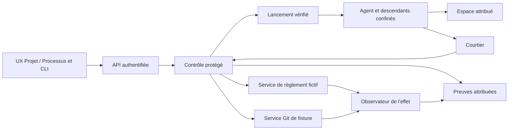

# PAEA — plan APEX adopté et suivi d’exécution

[English](../../en/plans/actions-confiance/PAEA-APEX.md) ·
File APEX (`../FILE-APEX.md`, suivi local hors de cette publication) · AC-02 (`securite-execution-apex.md`, suivi local hors de cette publication)

## Autorité et besoin

Actualisation du 26 octobre 2026 : « fini push compile » autorise la compilation,
le commit/push PAEA et la livraison locale selon l’accord permanent. Cette consigne
lève la restriction de compilation ; les droits métier et les prérequis protégés
restent inchangés. Voir [l’incrément 15](paea/INCREMENT-15.md).

Le 25 octobre 2026, l’utilisateur demande d’implémenter le plan PA-00…PA-13
préparé dans cette conversation. Codex racine possède l’intégration, sans
délégation ni exécution parallèle implicite. La priorité et les préconditions
de migration Rust restent applicables. Aucun commit, push, paiement réel,
déploiement externe ou reprise d’une mission suspendue n’est autorisé ici.

But : démontrer, pour la facturation fictive ET le développement logiciel,
que tout effet protégé observé correspond au contenu exact d’une autorisation
encore valide au point d’engagement. Activation par projet, refus si une
protection requise manque. Cible finale : évaluation E3 expérimentale avec
évaluateur indépendant, seconde implémentation et comparaison préenregistrée.
Cette cible n’est ni une certification ni une autorisation C3/C4.

Source historique conservée sans modification :
`docs/security/PAEA_v0.2_Profil_Assurance_Execution_Agentique_Revision_Scientifique.docx`.
Le [guide opérationnel fourni ensuite](../../security/PAEA_v0.2_Guide_Operationnel.docx)
est une référence de mise en œuvre, avec [correspondance et clarifications](paea/GUIDE-INTEGRATION.md).
Ses exemples ne remplacent ni les schémas versionnés ni l’autorité de session.
Le PDF voisin est également historique. Le registre d’exécution ci-dessous
distingue contrat, code, test local, installation et évaluation indépendante.

## Architecture et décisions

Le noyau Trust actuel reste compatible. Son stockage local et ses preuves HMAC
ne constituent pas une frontière contre un agent du même UID. Ajouter seulement
des contrôles dans ce processus ne suffit donc pas. Choix : réemployer les noyaux
et séparer agents, contrôle protégé, services d’effet et observation.



Architecture cible, non démontrée par ce document. Le contrôle et ses clés sont
hors du domaine agent, sous compte distinct. Le premier profil reste Linux :
espaces, montages, privilèges, descripteurs, processus et réseau. Le canal local
authentifie le pair mais ne déduit aucun mandat de sa seule UID. Root/projet,
principal, instance, périmètre et droits sont liés aux observations du contrôle.

Les politiques suivent les mécanismes existants. Les politiques AC-02 utilisent
SQLite et un échange YAML, sans déplacer implicitement les réglages globaux JSON.
Admin, API et CLI partagent validation et valeur effective. Aucune activation de
protection ni valeur de politique n’est introduite par le contrat de données PA-01.

## Contrats communs

- Proposition non autorisante ; contexte d’admission attribué par le contrôle.
- Schémas et canonicalisation versionnés, doublons et ambiguïtés refusés.
- Intention métier distincte de la clé de transport ; identité métier dérivée
  de la ressource, jamais d’une nouvelle clé libre choisie par l’agent.
- Paiement : facture identifiée, version, devise, montant entier exact,
  bénéficiaire résolu. Git : dépôt attribué, référence directe, ancien OID attendu,
  candidat immuable, contrôles/revue/décision conservés.
- Empreinte d’action liée au contenu, aux sources ordonnées et au contexte de
  contrôle ; changement pertinent rend l’accord antérieur incompatible.
- Autorité courante et effet ordonnés au point d’engagement. Git et SQLite ne
  deviennent pas atomiques : intention durable, mise à jour conditionnelle et
  réconciliation couvrent la frontière.
- `UNKNOWN` n’est ni échec sans effet ni succès. Aucun nouvel engagement pouvant
  dupliquer l’effet avant une réconciliation compatible. Les effets antérieurs
  et consommations restent conservés.
- Ancienne voie Trust : passage par le contrôle commun ou refus pour un projet
  protégé ; jamais un accès parallèle permissif.
- Erreur : code sûr, cause conservée, effet connu/incertain, identifiant et
  prochaine opération autorisée ; aucun succès vide après refus.

```text
PROPOSED → ADMITTED → APPROVAL_PENDING → AUTHORIZED → COMMIT_REQUESTED
COMMIT_REQUESTED → COMMITTED | DENIED | UNKNOWN
UNKNOWN → RECONCILED_COMMITTED | RECONCILED_NOT_COMMITTED
```

### Erratum PAEA-ERR-01

Origine : §6.2 option (b) de PAEA v0.2. Un jeton lié à une action et à usage
unique peut encore être consommé UNE première fois après une révocation locale
si le service d’effet ne consulte pas cette révocation. L’unicité ne démontre
donc pas I17. Exiger en plus l’état courant/epoch sous l’ordre d’engagement, ou
déclarer et prouver la limite de propagation ; suspendre l’usage critique non
couvert. Propriétaire : auteur PAEA/contrôle d’effet. Critère : jeton émis →
révocation effective → première consommation refusée, sans effet. État :
erratum spécifié ; preuve distribuée restant à produire dans PA-03/PA-12.

## Lots, dépendances et sorties

Chaque lot conserve ses entrées exactes, son propriétaire, ses contrôles et sa
reprise. Une anomalie déclenche replan : cause, original, précondition modifiée,
action autorisée, vérification, retour au besoin. Pas de retry inchangé.

| Lot | Responsable et dépendance | Actions et livrable | Sortie observable |
|---|---|---|---|
| PA-00 Référence | Codex ; plans et sources actuels | État Git/runtime, réservations, inventaire des 17 invariants, preuves et ressources ; erratum et témoins des deux domaines. | Référence liée aux octets, limites et propriétaires ; aucune qualification Rust déduite de Go. |
| PA-01 Contrats | Codex ; PA-00 | Schémas, canonicalisation, vecteurs, intentions métier, ordre d’engagement, erreurs, API/CLI, migration et diagrammes FR/EN. | Contrats testables pour les deux domaines ; aucune permission ni effet émis par la bibliothèque de données. |
| PA-02 Autorité | Identité/intégration ; PA-01 + sorties IA3 requises | Réemploi enrôlement/instances ; séparation contrôle/clés ; liaison projet ouvert ; mandats, accords, révocations ; Admin/API/CLI et stockage unique. | Demande légitime admise, usurpation/mauvais projet/mandat périmé refusés ; protection manquante ferme l’usage. |
| PA-03 Deux services | Trust/dépôt géré ; PA-01 + PA-02 | Grand livre fictif séparé, promotion Git conditionnelle, candidat/revue existants, autorité au commit, unicité métier, intention durable et réconciliation. | T04/T05/T06 sur les deux parcours ; ancien effet conservé, aucune duplication par nouvelle clé. |
| PA-04 Confinement | AC-02/A3 ; PA-02 + conditions AC-02 | Tous départs/reprises et descendants ; montages, FS, FD, environnement, signaux, processus détachés ; vérification avant code non fiable. | Témoin puis contournement pour chaque chemin inventorié ; protection requise indisponible refuse. |
| PA-05 Réseau/secrets | AC-02/A4 ; PA-04 + AC-02/A2 | Passage obligatoire ; IPv4/6, DNS, redirections, sockets, connexions persistantes ; secrets côté contrôle ; labels/destination réels ; outils/modèles/dépendances. | Flux légitime réussi et aucun octet sensible observé à une destination interdite dans le périmètre fermé. |
| PA-06 Composition | Identité/Mémoire ; PA-02 + PA-05 + MEM-P2…P4 requis | Instructions/données séparées ; provenance, intégrité/confidentialité et versions à lecture/résumé/transmission/compaction ; droits descendants bornés et pairs authentifiés. | Pas de promotion d’instruction ni de droit par mémoire, A2A, retrait ou reprise dans les scénarios retenus. |
| PA-07 Outils/temps | Lancement/catalogue ; PA-01/02/04 | Exécutable/schéma/config effectifs, admission et invalidation ; temps monotone, generations/epochs, baux après restart ; inventaire et correspondance ACS. | Substitution, ancien bail ou horloge agent ne donnent aucun effet supplémentaire ; pas de conformité ACS déduite d’un export. |
| PA-08 UX/accords | UX/intégration ; interfaces PA-02…07 | Réglages dès chaque politique ; effet/contenu/approbateur lisibles, refus/UNKNOWN visibles ; configuré/appliqué/observé distingués ; UX séparables ; vigilance mesurée. | Parcours CLI/API et navigateur FR/EN, thèmes, mobile, clavier/focus et états erreur/reprise sur les deux domaines. |
| PA-09 Preuves | Vérification ; PA-02…08, collecte dès le début | Lier proposition/admission/accord/engagement/observation ; originaux ; clés externes au seul export ; altération/omission/rejeu/rollback détectés. | Vérificateur rapproche décision et effet sans croire le rapport agent ; dossier de revue indépendant recevable. |
| PA-10 E2 local | Codex + revue autre contexte ; PA-03…09 | Matrice même candidat, profils sans fixture, CLI/API/browser isolés, anciennes voies, build/install supportés, version/empreinte/assets/notes FR/EN. | Deux parcours installés, déclaration E2 bornée et critères ouverts explicites ; pas clôture E3. |
| PA-11 Préparer E3 | Commanditaire + équipe tierce + évaluateur | Désignation indépendante, seconde frontière sans moteur Swarm, schémas/vecteurs communs, protocole préenregistré, B2/ablations et corpus réservé. | Moyens et responsabilités acceptés, protocole figé avant campagnes ; aucun rôle inventé. |
| PA-12 Campagnes E3 | Évaluateur ; PA-10 + PA-11 | T01…22/adaptatif, oracles des deux domaines, Swarm/B2/seconde implémentation, ablations et essais humains autorisés, rapport complet et remise des défauts. | Résultats et contre-exemples indépendants, coûts/limites conservés ; chaque défaut a un destinataire vérifié. |
| PA-13 Corrections/RETEX | Codex + évaluateur ; PA-12 | Reproduire, corriger contrat commun, requalifier lots affectés et verdicts invalidés, livrer candidat vérifié, RETEX final et transmission. | Dossier E3 expérimental dans le périmètre démontré ; tout critère bloquant garde le programme ouvert. |

Les profils critiques AC-02 restent conditionnés à la qualification Rust. La
préparation indépendante des contrats et du protocole E3 n’attend pas une
activation publique. IA3 → usages mémoire → IA4 conserve les remises de phase
existantes ; ni IA5 entière ni MEM-P5 entière ne deviennent une dépendance ajoutée.

## Matrice d’assurance et tests

| Invariant | Lots | Tests | Source/consommateur et preuve à établir |
|---|---|---|---|
| I01 Non-autorité du modèle | 01/02/06 | T01/T02 | Proposition externe → contrôle attribué ; aucun champ agent n’accorde de droit. |
| I02 Identité/délégation | 02/06 | T03/T14 | Enrôlement/mandat courant → lancement/pair ; sous-ensemble des droits délégables. |
| I03 Provenance/flux | 05/06 | T02/T18 | Sources/version/labels → contenu réellement reçu, résumé et compaction compris. |
| I04 Accord exact | 01/03/08 | T04/T20 | Action canonique approuvée → octets et paramètres consommés au service d’effet. |
| I05 Dernier usage | 02/03 | T05/T17 | Autorité actuelle → engagement ordonné, pas décision préflight seule. |
| I06 Médiation | 04/05 | T07/T19 | Inventaire FS/processus/IPC/réseau → barrière réellement appliquée. |
| I07 Secrets | 02/05 | T08/T17 | Contrôle/clés → usages bornés ; aucun secret critique lisible par agent/descendants. |
| I08 Unicité métier | 01/03 | T06/T09 | Intention métier dérivée → grand livre/ref Git ; nouvelle clé ne réautorise pas l’effet. |
| I09 UNKNOWN/reprise | 03/09 | T06/T21 | Réponse perdue → observation du service, sans duplication ni succès inventé. |
| I10 Supervision humaine | 08/12 | T10/T22 | Approbateur authentifié/compétence/charge → accord exact ; attention non déduite d’un clic. |
| I11 Preuve indépendante | 09/12 | T12/T21 | Observateur et ancres séparés → dossier attribuable avec limites. |
| I12 Défaillance sûre | 03/04/05 | T10/T16 | Précondition indisponible → aucun nouvel effet sensible non démontré ; C4 exclu. |
| I13 Egress/confidentialité | 05/06 | T13/T19 | Labels/destination effective → octets reçus par oracle réseau. |
| I14 A2A | 06 | T14/T18 | Pair/mandat/audience → réception liée et pas d’intermédiaire privilégié. |
| I15 Outillage | 07 | T15/T20 | Manifeste admis → exécutable/schéma observés ; mutation force réadmission. |
| I16 Temps/ordre | 02/03/07 | T16/T05 | Horloge/epoch contrôle → ordre de décision, jamais l’heure déclarée par agent. |
| I17 Révocation au service | 02/03/05 | T17/T21 | Révocation effective → première consommation d’un jeton préémis refusée. |

T11 complète I04/I05/I11/I15 : mutation politique/source/candidat invalide la
preuve concernée. T09 couvre aussi le fractionnement et le cumul multi-agents.
Chaque injection exige un témoin valide sous les mêmes préconditions. L’oracle
lit l’état avant/après : HTTP200, sortie0 ou étiquette PASS ne suffisent pas.
Les cas locaux de PA-01 ne sont pas les campagnes T01…T22 exécutées.

Mesures séparées : effets interdits, réussite métier/logicielle, refus injustifiés,
reprises/UNKNOWN, latences p50/p95/p99, dépenses/consommation/charge et couverture.
Volumes et budgets sont préenregistrés avant campagne, sans nombre universel.
Les intervalles statistiques restent conditionnés à leurs hypothèses ; un gain
faible face à B2 doit être publié tel quel.

## Règles de livraison et clôture

Chaque incrément inclut revue des politiques, fonctions/docstrings, erreurs et
documentation FR/EN liée aux octets ; profils/features/compilateur/binaire/assets
effectifs ; recette permanente, preuves neuves et vérification d’intégrité.
Une modification invalide les preuves affectées. Pas de watchdog global arbitraire,
nettoyage de preuve, acceptation fabriquée ou hausse de budget implicite.

M0 référence ; M1 deux effets contrôlés ; M2 médiation ; M3 composition ; M4 E2
installé ; M5 campagnes indépendantes E3 ; M6 corrections réévaluées et RETEX.
Le programme reste ouvert après M4. La désactivation d’un projet protégé exige
une décision autorisée ; aucun repli permissif automatique.

## État réel et reprise

25 octobre 2026 : PA-00 et PA-01 sont partiellement réalisés. La bibliothèque
`swarm-protection-contract`, le schéma, quatorze vecteurs et la commande publique
hors ligne `protection canonicalize` couvrent les données des deux domaines.
Cette commande ne confère aucune autorité et n’active aucune protection.
Les contrats complets de mandat, d’autorité, d’approbation et de reçu authentifiés,
ainsi que leurs opérations API/CLI actives restent à figer avec leurs producteurs.
Le protocole [PA-11/E3](paea/E3-PROTOCOL.md) est préparé, non préenregistré.
L’utilisateur a confirmé ne disposer ni d’évaluateur indépendant ni d’équipe tierce.
Aucun appel GLM/SKYNET ni aucune délégation n’a été effectué dans cet incrément.

La [recette conservée](paea/evidence/20261025-contract-qekt2uwo/recipe-01/result.json)
a exécuté 5 tests Python, 17 tests Rust de contrat et 4 tests CLI : 26 réussites,
zéro échec. Son intégrité a été vérifiée. Clippy et Rustdoc ont aussi réussi sur
la bibliothèque seule. Ces preuves ne couvrent ni les 22 campagnes PAEA, ni un
service d’effet, ni le confinement, ni une qualification E2/E3. L’inventaire de
recette est déclaratif : ce n’est pas le graphe de compilation effectif complet.
La documentation corrigée ensuite est revue séparément ; les preuves originales
et les sources exécutables correspondantes sont conservées sans réécriture.

### Replan : session concurrente et absence de compilation

L’utilisateur indique travailler dans une autre session et demande d’éviter de
compiler. Aucun nouveau Cargo, Rustdoc, build, installation ou redémarrage ne sera
lancé dans cette conversation sous cette consigne. Le dernier contrôle Rustdoc
était terminé. La lecture a constaté le chantier concurrent SCALING-S2 dans le
plan Rust et des modifications effectives du dépôt géré ; elles sont laissées à
leur propriétaire. Aucun processus de l’autre session n’est interrompu.

L’instance observée avant cette consigne exécutait `v0.1.1-dev.65` ; aucune
installation de cette tranche PAEA n’est déclarée. Propriétaire de la livraison :
intégrateur local ; reprise après levée de la consigne et disponibilité du checkout
partagé, avec revue du candidat complet puis chemin de livraison supporté.
Migration globale et remises IA3 restent ouvertes dans les plans inspectés ;
AC-02 conserve ses préconditions. Les changements de droits, comptes, confinement
et services d’effet ne sont pas démarrés par le présent socle.

Réservation de ce travail : ce plan et le contrat FR/EN, la bibliothèque isolée,
schémas/vecteurs/tests/recette, module CLI `protection`, raccords ciblés dans
`swarm-cli/src/lib.rs`, dépendances Cargo, note FR/EN de `version_history.json`,
file APEX et preuves propres. Aucun fichier moteur Trust, lancement, supervision,
politique active ou mission n’est réservé ici. Les modifications étrangères des
fichiers partagés doivent être préservées.

La [revue de l’incrément](paea/INCREMENT-01.md) conserve le périmètre testé,
les trois axes de revue, les limites et les conditions de reprise. Le programme
PA-00…PA-13 et son RETEX final restent ouverts.

### Incrément 02 — suite autorisée avec GLM, sans compilation

La demande « go next avec glm » autorise une contribution GLM interne ciblée.
La consigne sans compilation reste active. La
[recette publique ajoutée](paea/INCREMENT-02.md) a exécuté quatre tests, 88 invocations
sur le binaire existant : 16 mutations refusées et un échec d’écriture, encadrés
par des témoins valides. Preuves PASS/VERIFIED, sans installation ni modification
Rust. L’avis GLM exploité porte seulement sur le décodeur brut ; premier appel
épuisé et première recette en échec conservés avec leur reprise vérifiée.
PA-00/01 et les conditions de suite précédentes restent ouverts.

### Incrément 03 — refus de routage avec GLM

[Deux tests ajoutés](paea/INCREMENT-03.md) : six tests publics au total, 248 invocations,
69 refus attendus et reprises exactes sur les deux domaines en FR/EN. Binaire
existant stable, sans compilation ni redémarrage. Proposition GLM corrigée avant
exécution ; preuves conservées. PA-00/01 partiels et dépendances IA3/Rust/AC-02/E3
inchangées ; aucun lot global clos.

### Incrément 04 — consommateur d’export et méthode GLM corrigée

[Outil de correspondance réalisé](paea/INCREMENT-04.md) : neuf tests nommés,
42 observations CLI sur les deux domaines, sans compilation ni installation.
Le résultat ne prouve ni admission ni autorité/effet ; PA-09 seulement amorcé.
Plafond client GLM supprimé par défaut après correction explicite utilisateur ;
neuf tests HTTP locaux et requête réelle sans champ de plafond conservés.
PA-00/01 et les prérequis Rust/IA3/AC-02/E3 restent ouverts.

### Incrément 05 — comparaison Rust non qualifiée

[Sources Rust et trois tests écrits](paea/INCREMENT-05.md), sans compilation ni
exécution des tests. Nouvelle extension Python retirée après correction explicite
de l’utilisateur ; originaux conservés. Aucun raccord CLI/API, installation ou
verdict d’autorité. PA-01/08/09 restent partiels ; qualification et IA3/AC-02 ouvertes.

### Incrément 06 — raccord CLI Rust non qualifié

[Commande compare et quatre tests CLI écrits](paea/INCREMENT-06.md), sans
compilation ni exécution. Lecteur existant, deux fichiers nommés, schéma de sortie
et aide FR/EN ; recette adaptée, non lancée. Aucun projet/effet/accord activé.
La consigne sans compilation persiste ; PA-01/08/09 et qualification restent ouverts.

### Incrément 07 — liaison reçu/action/cycle en sources

[Contrôle Rust et quatre tests écrits](paea/INCREMENT-07.md), non compilés/non
exécutés. Réemploi des digests d’action/intention, du service attendu et du cycle
UNKNOWN/réconciliation ; aucun reçu authentifié ni service d’effet livré.
PA-01/03/09 et dépendances PA-02/AC-02 restent ouverts. Aucun projet activé.

### Incrément 08 — consommateur CLI du contrôle de reçu

Reprise du programme et consigne **sans compilation ni redémarrage reconfirmée**
par l’utilisateur. [Raccord CLI Rust et quatre tests écrits](paea/INCREMENT-08.md),
non compilés/non exécutés : deux fichiers, service et état précédent explicites,
recalcul canonique et contrôle de liaison/cycle. Aide, schéma, recette et contrat
FR/EN actualisés ; autorité, authenticité et effet restent non établis. Aucun
appel GLM ni service démarré. Les tests d’erreur de sortie sont isolés hors du
checkout appelant ; leur effet reste à vérifier. PA-01/03/09, qualification,
installation, dépendances protégées et RETEX restent ouverts. Prochaine preuve :
targets affectés et recette sur candidat figé après levée explicite de la consigne.

### Incrément 09 — boucle de vérification sur candidat existant

[14 tests publics réussis, 618 invocations](paea/INCREMENT-09.md), 167 refus
attendus, recette PASS et intégrité VERIFIED. Le candidat existant dev75, construit
par une autre session, a été figé sans compiler/redémarrer ici. Archive des
432 entrées effectives vérifiée, huit entrées PAEA conformes aux sources observées.
Deux assertions Rust de 08 corrigées vers `failure.code`, non exécutées par Cargo.
Deuxième passage : features transitive `serde` d’Identité justifiée, statuts temporels
retirés des descriptions de schéma, lots antérieurs réexaminés sans réécriture.
PAEA-OBS-01 conserve la limite du rapport autonome et la mitigation par transcript.
Six invariants ont des observations structurelles locales ; **0/17 est démontré
de bout en bout**. PA-02/03/08/09 protégés, installation, E2/E3 et RETEX ouverts.
Consigne sans compilation/redémarrage active ; reprise des tests Rust sur levée
explicite, des effets sur sortie protégée IA3/PA-02, d’E3 avec les tiers requis.

### Incrément 10 — PAEA-OBS-01 réalisé en sources

[Rapport autonome v2 et sept tests écrits](paea/INCREMENT-10.md) : empreintes des
octets exacts du document/reçu, canonicalisation et même contrôle de liaison/cycle.
Nouvelle commande `receipt-report`, sortie `check-receipt` v1 conservée en sources ;
entrées v1 inchangées. Aucun nouveau droit, effet ou dépendance. Aide, schéma,
recette, notes locales et contrat FR/EN actualisés. **Non compilé/non exécuté/non
installé** sous la consigne active. Le témoin préexistant vérifie contrôle v1,
absence du nouveau parcours sur dev75 puis reprise, sans build. PAEA-OBS-01
reste non vérifié fonctionnellement ; preuves de 09 conservées sur leurs sources
archivées, sans qualification du nouveau code. PA-01/09 et programme global ouverts.


### Incrément 11 — demande explicite de parcours UX

Après la question « ces tests, comment les mettre en œuvre ? », l’utilisateur
précise « c’est à ajouter ». PA-08 inclut explicitement un accès depuis le menu.
[Premier parcours écrit](paea/INCREMENT-11.md) : **Vérifications PAEA** dans le
cockpit natif et Actions de confiance ; sélection document/reçu, service/état
explicites, contrôle de correspondance, refus/UNKNOWN visibles et rapport v2.
API authentifiée utilisant le contrôle pur commun, sans effet ni protection
activée. Composant navigateur vérifiable séparément ; route Rust, assets du
binaire et installation non qualifiés sous la consigne sans compilation/restart.
Deux tests HTTP Rust écrits, recette permanente navigateur ajoutée. PA-08 reste
partiel : accords protégés/configuré-appliqué-observé, deux UX et vigilance
nécessitent toujours les interfaces PA-02…07 et les essais prévus.


### Incrément 12 — qualification sur candidat existant

[Preuves publiques et écran relié à la vraie CLI](paea/INCREMENT-12.md) : candidat
dev77 construit par l’autre session, figé sans compilation/redémarrage ici.
434 entrées de l’archive effective vérifiées, sept sources PAEA identiques.
18 tests publics réussis, 973 invocations dont 268 refus attendus ; OBS-01 v2
vérifié localement (octets distincts, v1 conservé). Écran : 174 assertions et
48 appels réels par pont HTTP de fixture, FR/EN et deux domaines ; aucune réponse
du vérificateur fabriquée. Catalogue partagé modifié par une autre session :
composant rejoué, 219 assertions et 40 requêtes simulées PASS. Trois recettes PASS,
intégrité VERIFIED. Ce pont n’est
pas le service HTTP natif : ses deux tests Rust, assets servis, installation et
accords protégés restent ouverts. Les preuves historiques 09…11 sont conservées,
sans qualification générale des 17 invariants ni clôture E2/E3/RETEX.


### Incrément 13 — guide opérationnel et parcours UX

L’utilisateur fournit le guide opérationnel pour orienter l’implémentation.
[Correspondance complète](paea/GUIDE-INTEGRATION.md) : copie originale conservée,
chapitres vers lots/propriétaires/preuves, trois dossiers et parcours UX cible.
Le contrôle de fichiers existant reste partiel. Priorité fonctionnelle : fiche
d’effet, responsable, frontière, oracle et trois recettes sur les deux pilotes,
sans sauter PA-02/03 ou Rust/AC-02. ERR-01 s’applique aussi au §7.1 du guide ;
JSON/figures pédagogiques ne remplacent pas les schémas ; l’identité projet+facture
exige une résolution protégée unique de la dette avant le sink. IAM/industrie
restent hors exécution autorisée. [Suivi et vérifications](paea/INCREMENT-13.md)
conservent aussi le traitement borné du contraste PAEA-UX-02, avec tests de
repos/survol/clavier et distinction entre composant et binaire installé.

### Incrément 14 — deux effets de laboratoire et observation séparée

[Dossier opérationnel](paea/PILOTE-OPERATIONNEL.md) : fiches règlement fictif/Git,
autorités manquantes, carte d’accès et trois recettes exécutables sans build.
SQLite et transaction Git branche+marqueur canonique produisent des effets dans
26 racines isolées ; processus oracle séparé sans reçu/journal de décision.
**7 tests PASS, 132 processus, recette PASS/intégrité VERIFIED**. T04, réponse
perdue et révocation avant première utilisation exercés dans les deux domaines,
avec témoins/reprises ; ce sont des ordres de fixture, pas une preuve distribuée.
Contre-épreuve Git : garde ignorant le contexte fait échouer l’assertion attendue.
PAEA-GUIDE-03 reproduit deux écritures pour des aliases bruts sans registre métier :
contre-exemple conservé, résolution protégée de dette obligatoire avant PA-03.
[Suivi et limites](paea/INCREMENT-14.md). Même UID/autorité simulée : **0/17
invariants de bout en bout**, PA-02/03 protégés, menu de campagnes, qualification
native, installation/E2/E3/RETEX ouverts. Aucun build ni redémarrage.

### Incrément 15 — qualification native et livraison autorisée

La restriction de compilation est levée par l’utilisateur. Sur le checkout puis
un worktree limité au socle publié et à PAEA : **5 tests Python et 45 tests Rust
PASS**, dont les deux tests HTTP jusque-là non exécutés. Build normal dev79
préparé avant arrêt ; navigateur sur vrai exécutable et ressources embarquées :
**237 assertions/12 configurations**, 24 refus attendus, zéro diagnostic inattendu.
Huit assets protégés comparés aux sources ; FR/EN, thèmes, mobile, dialogue Version,
lien Git et focus vérifiés. Le retour PAEA va au cockpit, sans dépendance Biba.
[Preuves, périmètre de publication et livraison](paea/INCREMENT-15.md) ; le résultat
local généré conserve commit distant, version/PID/hash réellement activés.
Le menu de correspondance est qualifié ; les campagnes de laboratoire restent
hors UX. Cette livraison ne clôt ni PA-02/03 protégés, ni les **17 invariants**,
ni E2/E3/RETEX du programme.

### Incrément 16 — identité de dette explicite

[Décision et critères](paea/INCREMENT-16.md) : préserver le hash v1 et résoudre
fournisseur/référence vers un objet de dette stable avant admission. Bibliothèque
pure et CLI hors ligne, rejet des collisions et versions périmées ; observation
d’un seul effet de fixture pour deux aliases. Le registre fourni reste non
authentifié ; continuité inter-révisions et autorité protégée restent ouvertes.

Incrément 16 vérifié et installé **dev82** : 37 tests de contrat, 2 tests publics
(33 appels), 8 scénarios à effets de fixture et 26 contrôles de l’instance PASS ;
garde réseau de la recette vérifiée par échec attendu après témoin. Sources non
commitées ; aucune nouvelle garantie protégée ni clôture E2/E3.

### Incrément 17 — résolution de facture dans le menu

[Contrat, décision et preuves](paea/INCREMENT-17.md) : PA-08 expose le résolveur
commun depuis Vérifications PAEA, sur une page dédiée avec aide et téléchargement.
API native fermée, nombres i64 exacts, erreurs/reprises et marqueurs non autorisants.
Le parcours action/reçu est conservé ; aucune activation de registre protégé.

Incrément 17 livré sur **dev87** : 4 tests schéma/4 HTTP, 219 assertions composant,
452 assertions natives sur dev86 aux 448 entrées identiques, 30 contrôles de
l’instance dev87 PASS. Numéros/commit/date distingués ; rapport de réutilisation
conservé. Clippy/Rustdoc PASS ; gardes de perte de script vérifiées après témoins.
Sources PAEA non commitées ; registres/accords protégés et E2/E3 restent ouverts.

Publication demandée le 26 octobre : commit isolé des incréments 16/17, sans
push ni nouvelle livraison ; voir le suivi de publication en fin du rapport 17.
Les mentions précommit ci-dessus conservent leur portée historique.

### Incrément 18 — reprise GLM

« reprends glm » autorise une contribution interne ciblée sur les contrats
de résolution/API/UX livrés. [Suivi et critères](paea/INCREMENT-18.md) : chaque
constat doit être reproduit ou réfuté, puis corrigé/vérifié lorsqu’il est fondé.
Les remises protégées et les limites d’assurance restent ouvertes.

Reprise 18 vérifiée : une contribution GLM complète, deux nouvelles régressions
Rust exactes PASS sur instantané stable, 28 assertions d’encodage natif PASS.
Quatre inventaires de recettes corrigés ; aucun défaut produit établi, aucune
modification du produit ni nouvelle installation attribuée à cette tranche.
Les suites complètes et les garanties protégées ne sont pas déclarées closes.

### Incrément 19 — comparaison depuis le menu avec GLM

[Tranche, critères et preuves](paea/INCREMENT-19.md) : exposer le comparateur
existant via API/page commune PAEA, deux domaines, rapport sans valeurs et export
exact. Contribution GLM au validateur/rendu ; Codex intègre et qualifie les
parcours existants/ajouté puis livre localement. Autorité protégée inchangée.


Tranche 19 livrée localement en **dev95** : comparaison accessible par le menu,
API/CLI communes, rapport sans valeurs. Deux tests de schéma et sept HTTP PASS,
1 310 assertions sur 12 configurations × trois vues PASS, 62 refus natifs/reprises,
puis 34 contrôles de livraison réels PASS. GLM a échoué HTTP 504, sans contribution
exploitable ; Codex a réalisé et vérifié le raccord. [Résultats et RETEX de la
tranche](paea/INCREMENT-19.md) conservent les refus de build, la réutilisation du
candidat normal, les empreintes et les limites. Aucun commit/push effectué.
IA3/AC-02/autorités humaines, E2/E3 et acceptation protégée restent ouverts.


Décision suivante : l'utilisateur autorise le commit de la tranche 19 puis la
continuation directe par Codex, **sans GLM**. Préserver les prérequis protégés,
les droits et les budgets ; choisir la prochaine tranche sur l'état réel du plan.


### Incrément 20 — exemples prêts à télécharger

[Tranche directe sans GLM](paea/INCREMENT-20.md) : huit fichiers fictifs versionnés,
aide dans les trois vues et vérifications natives après téléchargement réel.
Aucune sélection ni exécution automatique ; garanties protégées inchangées.


Tranche 20 réalisée sans GLM et installée **dev96** : huit exemples depuis les
trois aides, 1 743 assertions natives, 36 parcours/120 téléchargements et 40 contrôles
locaux PASS. Commit19 `f41003488`, pas de commit20 ni push. L’activation ponctuelle
par le lanceur du candidat normal qualifié conserve la configuration source ; la
compilation du reviewer parallèle (`Capture::new`, tentative dev97) reste ouverte.
[Résultats, incident et reprise](paea/INCREMENT-20.md). Aucune assurance protégée ajoutée.


L’utilisateur demande ensuite le commit de la tranche20 livrée. Enregistrement
Git isolé, sans push ni nouvelle livraison ; les résultats dev96 et les limites
restent ceux du [suivi20](paea/INCREMENT-20.md).


### Incrément 21 — inspection exacte d’une action

[Tranche directe](paea/INCREMENT-21.md) : rapport commun lié aux octets, CLI/API
et lecture des termes/contexte/sources depuis le menu. Aucun accord ni effet ;
contrats canoniques antérieurs conservés et quatre vues à qualifier.


Incrément21 installé en **dev101** : **Examiner une action** depuis le menu PAEA,
rapport CLI/API commun, termes/contexte/sources et révisions exactes. Neuf tests
ciblés, 2 265 assertions natives (quatre vues),48 parcours exemples/144 téléchargements,
87 refus natifs et46 contrôles réels/20 ressources PASS. [Résultats et RETEX du lot](paea/INCREMENT-21.md)
conservent refus de fraîcheur initial, profils/hashes dev100/dev101 et portée de la
revue. Sans GLM, commit ou push. IA3/AC-02/humains, E2/E3 et0/17 invariants protégés
restent ouverts.


L’utilisateur demande commit21 puis next. Commit `72e0e32dc`,40 fichiers,108
entrées préparées d’autrui préservées ; aucun push. [Incrément22](paea/INCREMENT-22.md) :
rapprochement d’un accord fourni avec action/politique exactes, sans activation protégée.


Incrément22 installé en **dev107** : **Rapprocher un accord** dans le menu, rapport
commun CLI/API lié aux deux fichiers, correspondance/différence/refus explicites.
11tests nommés,10générations,3 086assertions natives,60parcours/192téléchargements,
113refus et52contrôles réels/23assets PASS. Contraste primaire transitoire1,28:1
reproduit puis corrigé sur le composant commun aux cinq vues ;36observations
minimum9,096:1. [Résultats/RETEX](paea/INCREMENT-22.md) conservent échecs et reprises,
profils et hashes. Sans GLM/commit22/push. IA3/AC-02/humains,E2/E3 et0/17ouverts.


### Incrément23 — campagnes de laboratoire dans le menu

Commit22 `51a3ac828`,42fichiers,108entrées préparées d’autrui préservées, sans push.
[Tranche23](paea/INCREMENT-23.md) : commande de reproduction explicite et lecture
du rapport de campagne depuis le menu ; huit scénarios, contre-exemple conservé.
Aucune exécution web ni activation protégée attribuée à cette tranche.


Incrément23 installé en **dev109** : menu Campagnes de laboratoire,commande
explicite et lecture locale du rapport. Huit tests réels,506assertions natives,
12téléchargements et56contrôles réels/25assets PASS. Installation ponctuelle du
candidat normal exact,configuration source conservée ; compilation du moteur
concurrent reste ouverte. [RETEX/preuves](paea/INCREMENT-23.md). Aucun commit23/push ;
PA-02/03protégés,exécution web de campagnes,E2/E3 et0/17invariants ouverts.


### Incrément 24 — contention de révocation/engagement

Commit23 `97933d8b7`, 27 fichiers, 108 entrées préparées étrangères préservées.
[Qualification 24](paea/INCREMENT-24.md) : étendre T05/T17 aux vrais processus
concurrents des deux fixtures, refus de contention et reprise explicite. Critères
et limites conservés ; aucune protection ou installation nouvelle prétendue.


Qualification24 vérifiée : quatre contentions réelles SQLite/Git, témoins,
quatre échecs attendus du verrou libéré trop tôt et campagne publique huit tests
PASS/VERIFIED. Sources de protection du dev109 exactes au profil effectif ;
service dev112 observé séparément, sans intervention de cette tranche. Défauts
de flux des recettes corrigés et originaux conservés ; inventaires dérivés
complétés, navigateur inchangé/non rejoué. [Revue/RETEX24](paea/INCREMENT-24.md).
0/17 invariants protégés, IA3/AC-02, humains, E2/E3 et programme final ouverts.


### Incrément25 — intégrité des originaux de laboratoire

Commit24 `079635b29`,14 fichiers,108 entrées préparées étrangères conservées.
[Tranche25](paea/INCREMENT-25.md) : PAEA-EVIDENCE-25 reproduit sur copie (oracle
supprimé, ancien export encore possible), index v2 et inventaire explicitement
épinglé avec vérification des originaux. Rapport v1 conservé, aucune authenticité
ou protection nouvelle déduite. Résultats après recette ; programme ouvert.


Tranche25 vérifiée : huit tests d'effets, onze régressions/68appels de vérificateur,
1020fichiers d'observation et10de recette liés, index197appels v2. Recettes finales
et garde de contention24 PASS/VERIFIED. Oracle manquant refusé avant export,
publication incertaine exposée UNKNOWN avec pin attendu et reprise vérifiée.
Contre-exemple nouveau pin forgé conservé ; autorité simulée/0sur17protégés,
IA3/AC-02/humains/E2/E3/RETEX global ouverts. [Revue/limites25](paea/INCREMENT-25.md).
Outillage du checkout, rapport v1/serveur inchangés ; aucun build/install/commit/push.


### Incrément26 — noyau natif de contrôle courant

Reprise PA-02 en Codex direct, sans GLM. [Tranche26](paea/INCREMENT-26.md) :
connexion retenue au journal existant, contrôle exact sous réservation jusqu'au
stockage réel configuration/témoin, refus de révocation et UNKNOWN après effet.
Noyau de bibliothèque, sans activation du service ni identité humaine déduite.
Transport/bootstrap protégé, PA-03, E2/E3 et 0/17 invariants globaux restent ouverts.


Tranche26 vérifiée :41tests nommés, recette PASS/VERIFIED,17sources locales du
build normal exactes et quatre crates sans test-fixtures ; Rustdoc PASS. Révocation
et usage ordonnés, UNKNOWN après effet, double cause et reprise exacte observés.
[Revue/RETEX26](paea/INCREMENT-26.md). Aucun consommateur dans la CLI normale,
donc aucun service installé par ce noyau ; transport/bootstrap/authentification
locale personnelle restent à raccorder. PA-02 partiel,0/17/E2/E3/RETEX global ouverts.


### Incrément27 — bootstrap épinglé et précontrôle natif

Commit26 `cbd6fecd7`,15fichiers,108chemins préparés étrangers préservés.
[Tranche27](paea/INCREMENT-27.md) : v2 fermé, checkpoint indépendant et vérification
du vrai enrôlement courant par CLI normale, sans démarrage de service. 42 tests nommés et Rustdoc vérifiés ; installation dev.123 puis observation dev.124,
profils normaux liés aux SHA servis, deux rejeux CLI et 56 contrôles navigateur ; authentification/transport protégés,
PA-03, E2/E3 et0/17invariants globaux restent ouverts.


### Incrément28 — connaissance du secret personnel

[Tranche28](paea/INCREMENT-28.md) : contrat Argon2id v19 lié au record/contexte
exact, paramètres explicites, allocation de travail gardée et preuve typée opaque.
Vérification et intégration en cours ; aucun compte/session/transport créé. Suite
technique : stockage à bootstrap unique puis service/authentification et UX réelles,
PA-03/04… ; ne pas transformer le secret connu en consentement ou droit implicite.
Boucle autonome autorisée ; enrôlement humain réel et rôles E3 restent indépendants.


### Incrément29 — consommation unique et compte courant

[Tranche29](paea/INCREMENT-29.md) : lot signé atomique dans le journal retenu,
révocation bootstrap/création du compte indivisibles, proposition exacte rejouable,
authentification courante gardée pendant l'usage et résultat conservé après erreur.
Recette/revue/livraison en cours. Les fixtures ne sont pas un enrôlement réel ;
le service/transport, réglages Admin et UX, compte séparé et confinement suivent.


### Incrément30 — codec exact de reprise personnelle

[Tranche30](paea/INCREMENT-30.md) : export/restore canonique d'un proposal privé,
vérification par racine indépendante/forme exacte, prévisualisation signée sans
état courant ni IO, erreurs base64 avec cause conservée.3tests initiaux puis
3tests renforcés passent ; recette39, revue et livraison à vérifier.29dispose de
35tests vérifiés, mais livraison28/29 reste ouverte après refus des entrées
étrangères changeantes. Le prochain coordinateur doit protéger intent/checkpoint
et fsync/reprise avant d'exposer le service. Humain/confinement/E2/E3 restent ouverts.


Qualification30 :39tests nommés/7étapes,6tests du harnais CLI figé,56assertions UI
en lecture seule et refus du script absent PASS ; profil normal495sources dev128
installé, dialogue Version FR/EN vérifié. [Détails](paea/INCREMENT-30.md). Limites
historiques28/29conservées.31fichiers privés suit, puis coordinateur intent/checkpoint.
PA-02partiel ;0/17invariants globaux ; humain/confinement/E2/E3/PA13restent ouverts.


31documents privés : IO commun par descripteurs, phase de publication, erreurs
de release conservées, CAS exact ; liaison du verrou de l’ancien Store aussi
examinée. [État31](paea/INCREMENT-31.md).43tests à qualifier ; aucun service activé.


31qualifié/installé dev129 :43tests nommés/5étapes,6tests du harnais CLI,56assertions
UI+refus du script, Rustdoc et profil normal497sources vérifiés. Régression de
substitution du verrou corrigée localement ; [détails](paea/INCREMENT-31.md).
Poursuivre [32](paea/INCREMENT-32.md), encore planifié ; humain/service/confinement/E2/E3ouverts.


[32](paea/INCREMENT-32.md) implémenté : intent exact protégé avant consommation,
checkpoint après acquittement, annulation des deux contextes, authentification
courante tenue après release FS.5premiers tests PASS ; recette31élargie, revue et
livraison à établir. Aucun endpoint/enrôlement humain ; PA-02partiel et0/17inchangés.


32bibliothèque qualifiée :32tests, Rustdoc, diagrammes FR/EN, profil normal499sources.
Installation OUVERTE après refus d’inventaire candidat concurrent ; dernière version
vérifiée dev129. [Détails32](paea/INCREMENT-32.md). Poursuivre [33](paea/INCREMENT-33.md)
indépendamment, livraison/PA-02/E2/E3 et0/17gardés ouverts.


[33](paea/INCREMENT-33.md) raccord typé implémenté : compte personnel et mandat
tenus, principal/installation exacts, résultats après effet conservés. Contre-exemple
Debug privé corrigé ;14tests+1ciblé double autorité PASS. Recette38tests et livraison
courante à établir. Aucun service/humain/confinement OS déduit.


[34](paea/INCREMENT-34.md) déclaration composite épinglée/chargeur physique partagé
et ouverture réelle des deux sources implémentés, sans init de compte/listener.
16bootstrap+4startup vérifiés ; recette59tests/revue/livraison à établir. Cleanup
partiel conservé ; routage réel/compte OS/confinement/E2/E3encore ouverts.


34APIs internes vérifiées/incluses dans dev136 installé :59tests nommés/10étapes,
Rustdoc courant, profil515sources sans fixture,6tests du harnais CLI,56contrôles
UI réels+garde. [Détails](paea/INCREMENT-34.md). Livraison32/33complétée par preuve
additive ; poursuivre35signer protégé/lifecycle, sans listener/humain/confinement
OS. PA-02partiel,0/17globaux,E2/E3/PA13restentouverts.


35ouvert : chargement privé de clé avant lifecycle, sans changement des critères globaux. [Plan35](paea/INCREMENT-35.md).


35chargeur privé vérifié/installé dev137 :12 tests nommés, Rustdoc, profil normal
516 sources, dalek zeroize,6 tests CLI,56 assertions UI+garde. [Preuves35](paea/INCREMENT-35.md). Poursuivre36lifecycle détenu ; aucune acceptation globale/humain/service.


36lifecycle personnel détenu ouvert ; [plan36](paea/INCREMENT-36.md), critères globaux inchangés.


36lifecycle détenu vérifié/installé v0.1.1-dev.142 :43 tests nommés,
profil normal519entrées,6 CLI,56 UI+garde et notes FR/EN consolidées.
[Preuves36](paea/INCREMENT-36.md). Poursuivre37parcours natif personnel ; transport/UX,
OS/rotation, E2/E3, PA-13 et0/17 invariants globaux restent ouverts.


37parcours natif personnel ouvert ; [plan37](paea/INCREMENT-37.md), critères globaux inchangés.


37agarde d’options livrée/vérifiée en comportement147,7figés145+garde147+56UI,
Rustdoc privé. Qualification globale13sources encore ouverte ; [détails37](paea/INCREMENT-37.md). Poursuivre37bCLI personnel ;0/17,E2/E3,PA-13ouverts.


37b CLI personnelle livrée/vérifiée154 :32 tests/7 étapes stables,7 parcours natifs du binaire normal et56 UI ; [preuves/limites37](paea/INCREMENT-37.md). Suite38 : provisionnement initial protégé puis transport/UX. PA-02partiel,0/17/E2/E3/PA-13ouverts.


38 commencé : matière initiale de provisionnement, séparée de publication/reprise ; [plan38](paea/INCREMENT-38.md). Aucun grant implicite/service/humain.


38matière initiale vérifiée/livrée156 :27 tests/4 étapes,1 parcours natif de matière générée et56 UI ; [preuves/limites38](paea/INCREMENT-38.md). Suite39lecture privée effaçable puis publication/reprise. Aucun installateur/service/humain/confinement ;0/17/E2/E3/PA-13ouverts.


39lecture privée effaçable commencée, prérequis à la publication des seeds ; [plan39](paea/INCREMENT-39.md). Contrat distinct du read non secret.


39lecture privée/précontrôle écritures livrés157 :51cas composés (21réutilisés+30frais),7CLI normaux,56UI ; [preuves/limites39](paea/INCREMENT-39.md). Ancien manifesteFAIL conservé. Suite40publication/reprise ;0/17/E2/E3/PA-13ouverts.


40paquet opérateur protégé commencé avant publication de service41 ; [plan40](paea/INCREMENT-40.md). Pin indépendant, aucun head adopté.


41durabilité explicite du paquet commencé ; livraison40 ouverte après refus normaux,157 dernier qualifié. [Plan41](paea/INCREMENT-41.md). Publication service42 ensuite,0/17 inchangés.


42artefact destiné au service commencé : clé personnelle/événements signés, secrets opérateur exclus ; [plan42](paea/INCREMENT-42.md). Publication43 et livraison actuelle40/41 ouvertes.


42 : remise limitée au service et livraison locale **v0.1.1-dev.165** vérifiées (18 bibliothèque,7 CLI,56 navigateur + refus script). Publication43 suivante, 0/17 inchangé. [Plan42](paea/INCREMENT-42.md).


43 publication privée des fichiers de service commencée. [Plan43](paea/INCREMENT-43.md).


44 raccord CLI public du publieur43 commencé, livraison commune à qualifier. [Plan44](paea/INCREMENT-44.md).


43/44livrés localement **dev168** :50tests bibliothèque (supplément6),8parcours CLI/59commandes,7anciens parcours personnels,56contrôles UI + refus script, profil/ELF/assets/Version vérifiés. Aucun compte humain/UID séparé/listener/E2/E3 ni invariant global acquis. [Plan44](paea/INCREMENT-44.md).


45 diagnostic Linux effectif commencé ;44livraison168 historique, requalification du lock/catalogue courant après dérive concurrente. [Plan45](paea/INCREMENT-45.md).

Requalification43/44 sur dev174 terminée :50bibliothèque fraîches,8CLI/59commandes,7régressions,56UI+garde, profil561entrées/sans fixture et ELF réel commun vérifiés. Preuves antérieures et refus concurrents conservés. [Détails44](paea/INCREMENT-44.md).45lecture Linux vérifiée ; installation de uidmap attend une authentification administrateur locale. Aucun invariant global ni séparation OS acquis.

46 messages privés et noyau de service personnel commencés, indépendamment des helpers Linux absents ; [plan46](paea/INCREMENT-46.md). Aucun endpoint/UID séparé/humain/global acquis.

46bibliothèque19cas qualifiée ;47liaison publique sans secrets, réponses/causes après effet24cas Rust et Rustdoc PASS, livraison publique encore à raccorder. [Plan47](paea/INCREMENT-47.md).

48 consommateur lié vérifié :29Rust+3schéma/5étapes, canonique/demande/pins/histoire/Change, contre-exemple AfterUse corrigé. [Plan48](paea/INCREMENT-48.md). Suite49 raccord opérateur natif/livraison groupée ; service UID/transport/humain/global toujours ouverts.

46…49 livrés et vérifiés localement **dev175** :39Rust+3schéma,5nouveaux parcours natifs/56commandes,8installation,7personnels,56UI+garde, profil571entrées/sans fixture et même ELF réel. [Preuves49](paea/INCREMENT-49.md). Suite50 canal attribué/client ; helpers UID/admin/humain/E2/E3/PA13 et0sur17 restent ouverts.

50 replan : risque de représentation PID0 dans getter Rustix,4consommateurs identifiés ; contre-exemple3gates175refusées mais errno0, aucun effet. Wrapper brut sûr et diagnostics implémentés, qualification/livraison en cours. [Plan50](paea/INCREMENT-50.md). Retour au canal après cette précondition commune ; globals inchangés.

Incrément 50 livré et vérifié dans **dev180** : 4 tests moteur + 6 CLI, Rustdoc strict, 5 parcours personnels / 56 commandes, 3 témoins + 3 refus PID invisible, 56 contrôles UI et garde de script ; profil normal de 581 entrées et même ELF effectif. [Preuves et limites](paea/INCREMENT-50.md). Retour au canal attribué ; UID, humain, E2/E3, PA-13 et 0/17 globaux restent ouverts.

51 : frontière Linux isolée vérifiée en bibliothèque, neuf cas Rust + deux parcours de fixture, Rustdoc strict et revue ABI/propriété ; aucun consommateur public encore. [Preuves51](paea/INCREMENT-51.md). Reprise 52 : admission/raccordement et livraison groupée ; dev180 demeure la dernière livraison qualifiée par cette tâche, UID/humain/globaux ouverts.

Fondations51–52 livrées/vérifiées dans **dev185** :41Rust +3schéma,2parcours fixture,5opérateur/56commandes,3gates,56UI+garde ; profil587entrées/57propres, nouvelle bibliothèque sans fixture et même ELF effectif. [Preuves52](paea/INCREMENT-52.md). Rôle protégé/paquet exact/précondition UID sont raccordés en bibliothèque ; admission complète/daemon/UID réel/humain/E2/E3/PA13/0sur17 restent ouverts. Suite53 : hypothèse UIDréservée puis retour au raccordement.

Reprise 53 en cours : [UID valides à la définition](paea/INCREMENT-53.md). Tests de contrat qualifiés ; driver, parcours natif et livraison restent à vérifier. Admission du canal et acceptation globale demeurent ouvertes.

Incrément53 vérifié localement dev189 :101Rust ciblés/8Go parents/3schéma,9installation/5opérateur/7personnel+3gardes,3gates,56UI+garde ; [preuves et limites](paea/INCREMENT-53.md). PA-02/0sur17 globaux restent ouverts ; préparation publique protégée puis canal à poursuivre.

[Incrément54](paea/INCREMENT-54.md) installé/vérifié dev192 : précontrôle privé canonique sans génération de matière ;8Rust+3schéma,5nouveaux parcours/84commandes,non-régressions9installation/5opérateur/7personnel+3gardes,2gardes de rôle fixture,56UI+garde et3gates. PA-02/0sur17 restent ouverts ; paquet opérateur public et export de service à poursuivre.

[Incrément55](paea/INCREMENT-55.md) installé/vérifié dev200 : lecture du paquet opérateur, export privé déterministe et reprise épinglée ;6 parcours/154commandes200,56UI+garde,3gates. Non-régressions199 réutilisées sur leurs octets PAEA/CLI inchangés, sans agrégat ELF200. PA-02/0sur17 ouverts ; création initiale protégée puis canal à poursuivre.

[Incrément56](paea/INCREMENT-56.md) commencé : ancrage privé immuable avant génération/publication publiques ; distinguer localisateur déjà protégé et pin indépendant, sans preuve circulaire. Aucun critère global ajouté comme vérifié.

[Incrément56](paea/INCREMENT-56.md) installé/vérifié dev201 : ancre privée immuable et contrôle CLI,5parcours/67commandes,non-régressions6export/5précontrôle/9installation/5appel/7personnel+3gardes,56UI+garde et3gates.37Rust ciblés/16méthodes Python de schéma, jamais pourcentage global. Suite57 : intention durable avant génération puis paquet épinglé/reprise. PA-02 et0sur17 globaux ouverts.

[Incrément57](paea/INCREMENT-57.md) commencé : intention durable avant toute génération, ancre avant paquet, réservations privées existantes et réconciliation sans régénération. Le pin de demande lie ses octets exacts ; aucun service/humain/mandat courant créé.


[Incrément57](paea/INCREMENT-57.md) installé/vérifié dev205 : intention durable avant génération, ancre avant paquet et reprise sans régénération ;46Rust ciblés/6méthodes schéma/12permutations,6nouveaux parcours/113commandes,non-régressions et56UI+garde sur le même ELF normal631/64. Remédiation orpheline et remise au domaine service ensuite ; PA-02/0sur17/E2/E3/PA13/RETEX ouverts.


[Incrément58](paea/INCREMENT-58.md) en cours : paquet noyau lié à UID retenue et objets namespace attendus avant décodage/dispatch, Reply et cleanup préservés ;49Rust ciblés/3schéma, livraison locale à qualifier. Approbation indépendante du domaine, daemon et deux UID réels ouverts.


[Incrément58](paea/INCREMENT-58.md) vérifié localement dev206 puis instance courante207 liée aux mêmes65sources PAEA :51Rust distincts/3schéma ; appel/personnel natifs206 conservés séparément, interface56+garde et peer207 frais ; profil normal636/65. Seul asset runtime-health étranger diffère. Pas de nouveau daemon ni succès métier deux UID ; lancement à moindre privilège et permission ptrace à qualifier ensuite. PA-02/0sur17/E2/E3/PA13/RETEX ouverts.


[Incrément59](paea/INCREMENT-59.md) commencé : lier le sujet du paquet à un Child créé indépendamment, sans PID fourni par requête ni adoption du créateur de connexion ; TOUS les contrôles58 restent requis. Pas de daemon/droits ptrace/UID réels acquis.


[Incrément59](paea/INCREMENT-59.md) vérifié localement dev208 : ancre Child conditionnelle, TOUS contrôles58 conservés ;27Rust, profil normal637/65,5call/7personal/3paires/56UI+gardes sur le même ELF. Création atomique native suivante ; garde du lanceur/daemon/UID réels/E2/E3/PA13/RETEX/0sur17 ouverts.


[Incrément60](paea/INCREMENT-60.md) bibliothèque atomique vérifiée :35Rust distincts,6sources/3pages Rustdoc, CLONE_PIDFD tracé. Livraison en attente : trois profils refusés pour modifications concurrentes de sources partagées ;208 conservée. Reprise après stabilisation du producteur, sans boucle de reconstruction. Consommateur/daemon/UID/humain/E2/E3/RETEX/0sur17 ouverts.


[Incrément60](paea/INCREMENT-60.md) bibliothèque atomique livrée/vérifiée v0.1.1-dev.209 :35Rust distincts,6sources/3pages Rustdoc, CLONE_PIDFD tracé, profil normal645/67 et parcours existants sur même ELF. Consommateur/daemon/UID réels/humain/E2/E3/PA13/RETEX/0sur17 ouverts.


[Incrément61](paea/INCREMENT-61.md) bibliothèque de réponse en un paquet vérifiée :27Rust distincts (9nouveaux),4sources/4pages Rustdoc ; vrais EPIPE/EMSGSIZE/EAGAIN et reprise. Livraison en attente après refus du profil pour25sources Web concurrentes ;209 conservée. Reprendre avec candidat commun qualifié/68entrées PAEA, sans rebuild en boucle. Daemon/UID/humain/E2/E3/PA13/RETEX/0sur17 ouverts.


[Incrément62](paea/INCREMENT-62.md) qualifie localement la permission du parent propriétaire : deux tests Rust, six phases, refus hors userns puis accès dans le userns enfant avec CapEff parent nul. Même UID externe : pas de séparation réelle acquise. Erreur native de fixture conservée, preuve figée et refus de copie altérée. Tests seulement, aucune version62 ;61 attend un candidat stable. PA02/0sur17/E2/E3/PA13/RETEX ouverts.


[Incrément61](paea/INCREMENT-61.md) réponse en un paquet livrée/vérifiée v0.1.1-dev.211 :27Rust distincts (9nouveaux),4sources/4pages Rustdoc, EPIPE et SIGPIPE isolé, profil normal650/68, parcours natifs existants et56UI+garde sur même ELF. Composition/daemon/UID réels/humain/E2/E3/PA13/RETEX/0sur17 ouverts.

[Incrément63](paea/INCREMENT-63.md) échange contrôlé unique livré/vérifié **v0.1.1-dev.215** :45Rust distincts/7nouveaux,3sources/4pages Rustdoc, profil normal653/69, parcours CLI existants et56UI+garde sur même ELF. Bibliothèque qualifiée ; daemon/UID réels/humain/confinement/E2/E3/PA13/RETEX/0sur17 ouverts.

[Incrément64](paea/INCREMENT-64.md) diagnosticLinux natif/CLI/API/page livré/vérifié **v0.1.1-dev.216** :10Rust,111composant/60pageinstallée/56Version+gardes,37natifs/52CLI/16HTTP, profilnormal665/81 et mêmeELF. Métadonnées observées seulement, UID/humain/confinement/daemon/E2/E3/PA13/RETEX/0sur17ouverts.

Reprise PA-03 : [décision de raccord des services](paea/PA03-SERVICE-INTEGRATION.md), sources observées et séquence conditionnelle. Analyse seulement ; aucun effet protégé ni livraison supplémentaire établi.

[Incrément65](paea/INCREMENT-65.md) : permission exacte PAEA distincte de Trust, bibliothèque vérifiée et compilée dans **v0.1.1-dev.218**, 8tests PAEA+3Trust+3refus de compilation, Rustdoc strict et56contrôles Version/UX+garde. Profil normal671entrées, même ELF effectif. Aucun service d’effet protégé activé ; PA02/03, 0sur17, E2/E3/PA13/RETEX ouverts.

[Incrément66](paea/INCREMENT-66.md) : noyau de règlement fictif séparé installé/vérifié **v0.1.1-dev.220**,12tests Rust et Rustdoc strict,56contrôles Version/UX+garde ; profil normal677entrées, même ELF effectif. Admission attribuée manquante : séparation activée refusée ; aucune activation de service protégé. PA02/03 partiels,0sur17/E2/E3/PA13/RETEX ouverts.

[Incrément67](paea/INCREMENT-67.md) vérifié/installé **v0.1.1-dev.221** : quatre incohérences de reçu reproduites puis refusées,13Rust+Rustdoc strict,56Version/UX+garde, profil normal677 et mêmeELF. Aucune signature/protection globale déduite ; PA02/03/0sur17/E2/E3/PA13/RETEX ouverts.

[Incrément68](paea/INCREMENT-68.md) : six essais Git réels qualifient prepare/type direct/commit-abort sous verrou, après contre-exemple no-deref. Tests/protocole seulement, pas de nouveau service ni version ;221 conservée. Intention durable, runner natif et réconciliation à intégrer ; PA03/global ouverts.

[Incrément69](paea/INCREMENT-69.md) : primitive Git native en bibliothèque livrée/vérifiée **v0.1.1-dev.222**,8cas natifs/Rustdoc strict,56Version/UX+garde, profil normal678entrées et ELF effectif. Boucle Interrupted après annulation reproduite puis corrigée ; publication réelle sans ACK conservée incertaine. Aucun service Git/admission activé ; PA02/03/0sur17/E2/E3/PA13/RETEX ouverts.

### Incrément70 — intentions Git persistantes

Six tests natifs du journal et neuf cas du protocole Git réel PASS, Rustdoc strict
inclus ; preuves core04/protocol05 dans `paea/evidence/20261028-git-intent70-tjriu_vr`.
Provisioning explicite, unicité métier malgré aliases transport/contenu, reprise,
COMMIT incertain réel, course entre deux connexions et corruption/refus vérifiés.
Une fixture composée lit le SQL commité avant COMMIT Git, puis conserve l'intention
originale après ACK perdu et réouverture. Ce n'est ni admission protégée, ni service
activé, ni réconciliation terminale d'effet. Version223 source-managed installée par candidat préparé exact ; ELF
7143f8c23550d1e00d4ec89f7fb7bec40ed7a38ca3af209ad2dee704d388592f, PID3128318
vérifiés. Profil normal679entrées,479communes aux tests04 (notes seules différentes),
sansfixtures. Version08 :56assertions et garde de script PASS/VERIFIED,25assets
protégés/notes compilées, FRclair/ENsombre/commit/noncommité/focus vérifiés. Aucun
consommateur public installé n’appelle encore le journal ou ce parcours Git générique. PA02/03partiels,0/17,
E2/E3 et RETEX final restent ouverts.

### Incrément71 — candidat natif courant et originaux historiques

Le lecteur commun vérifie désormais chaque original antérieur même lors du rejeu
de la dernière publication. Contre-exemple public223 conservé : replay acceptait
un ancien certificat altéré alors que Work show refusait. Tests natifs05 PASS
(trois tests nommés, six assertions cumulatives et Rustdoc strict ; VERIFIED) sur
vraie fixture inerte à deux publications. CLI normale08 PASS/VERIFIED : ancien/dernier certificats refusent le rejeu latest,
restauration/reprise et Work/événements/workers/provider inchangés. Version225
installée via ELF préparé exact bba13470359ddfb0fecc17b958935ccab77dbc74ec40253c853288acab1aa8f5;
680entrées normales/480communes aux tests05, notes seules différentes, sansfixtures.
Version10 :56assertions/25assets protégés/notes compilées, FR/EN et garde de script
PASS/VERIFIED. [Incrément71](paea/INCREMENT-71.md) · [Continuité71](paea/CONTINUITE-71.md). Aucune autorité PAEA, association
repository_id, séparation UID ou clôture déduite ; PA02/03partiels,0/17,PA13/RETEX ouverts.

### Incrément72 — association privée du dépôt Git

Une déclaration explicite immuable lie les identités détenues service/projet/
dépôt bare privé, le pin opérateur du journal et l'empreinte réelle du cadrage
dépôt. L'id est attribué par le service, jamais un chemin de proposition.
Cinq tests natifs03 et Rustdoc strict PASS/VERIFIED : NOREPLACE/reprise, candidat
courant, mauvais contexte, substitution, symlink et corruption canonique/refus/
restauration. Version229 installée via ELF préparé exact 1e2384be40e0383520204fa86bad0cb56f578316330b44626e4ca2ae4a93285e;681entrées normales/481communes aux tests03, notes seules différentes, sansfixtures. Version06 :56assertions et garde de script PASS/VERIFIED,25assets protégés/notes compilées FR/EN. [Incrément72](paea/INCREMENT-72.md) · [Continuité72](paea/CONTINUITE-72.md). Aucun transfert,
mandat courant, OLD/type direct, COMMIT Git, daemon protégé ou réconciliation
finale déduit. PA02/03partiels,0/17 et PA13/RETEX final restent ouverts.

### Incrément73 — writer SQLite réel et format Git

Trois tests unitaires02 et six tests d'intégration03 bibliothèque normale PASS/
VERIFIED, Rustdoc strict inclus. Le lecteur interne exige main Write réel, refuse
deferred/read/absence de writer et conserve la transaction de l'appelant, sans
BEGIN imbriqué, pour le même candidat natif/dépôt. Le format bare privé SHA1/
SHA256 est contrôlé avant transfert ou intention ; incompatible refuse.
Version230 installée, ELF préparé exact 0b8cf6947596da380ed2f9ee862ed80597f949b2d3607d2147a787fd0d051287;681entrées normales/481communes avec intégration03, notes seules différentes, sansfixtures. Version06 :56assertions/garde de script PASS/VERIFIED,25assets/notes compilées FR/EN. Helpers de writer toujours sans consommateur normal public d’effet. [Incrément73](paea/INCREMENT-73.md) · [Continuité73](paea/CONTINUITE-73.md). Aucun transfert,
autorité courante, COMMIT de ref ou réconciliation terminale déduit ; PA02/03
partiels,0/17,PA13/RETEX final ouverts.


### Incrément74 — protocole réel de pack sans changement de ref

Six assertions Git réelles PASS/VERIFIED : export disque du candidat natif71
relu par CLI230 normale, import et connectivité, répétition sans mouvement de ref,
format incompatible, packs tronqué/corrompu et reprise valide, OID absent refusé.
Les écritures partielles après refus restent inventoriées. Expérience de protocole
uniquement ; transfert natif/service, autorité courante et engagement restent à
implémenter. Aucun octet produit modifié : pas de reconstruction ou installation
nouvelle ; preuves230 conservées séparément. [Incrément74](paea/INCREMENT-74.md) ·
[Continuité74](paea/CONTINUITE-74.md). PA02/03 partiels,0/17,PA13/RETEX ouverts.


### Incrément75 — primitive native pack sur disque livrée

Six tests d'intégration Git réels et six régressions association/format natifs
PASS/VERIFIED, Rustdoc strict inclus. Export/import fixes vers fichiers, aliasage
et écrasement refusés, effets partiels/erreurs et récupération de processus typés.
Construction/délai Git partagé identique octet pour octet. Version231 installée,
ELF préparé exact `ce4750b00da3e8ff7723b51f64b944bf3def76d0f8961eef5415c2e9bee7c387`;682entrées normales/482communes core02,
aucune différence, profil sansfixtures. Version06 :56assertions/garde de script
PASS/VERIFIED, assets/notes compilés FR/EN et captures inspectées.
[Incrément75](paea/INCREMENT-75.md) · [Continuité75](paea/CONTINUITE-75.md).
Transfert du service protégé/autorité courante/engagement de ref restent ouverts ;
PA02/03partiels,0/17,PA13/RETEX final ouverts.


### Incrément76 — canaux d'erreurs sync pack et primaire conservés

Contre-exemple normal réel FAIL/VERIFIED avant correction ;1test unitaire de
composition,2régressions de wrappers et7tests d'intégration natifs + Rustdoc strict
PASS/VERIFIED. Deux
erreurs sync noyau conservent stdout/stderr sous Box/IO, primaire/processus et
reprise préservés. Version232 installée, ELF exact `7cb94d74a30343d472f20e94f5786f9cfefff4b02415fb2afaf3f8733a0f52d7`;
682entrées normales/482communes tests, aucune différence, sansfixtures.
Version06 :56assertions/garde de script PASS/VERIFIED, assets/notes FR/EN compilés
et captures inspectées. [Incrément76](paea/INCREMENT-76.md) · [Continuité76](paea/CONTINUITE-76.md).
Transfert du service protégé/autorité courante/COMMIT de ref restent ouverts ;
PA02/03partiels,0/17,PA13/RETEX final ouverts.
