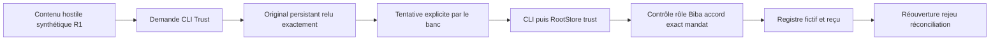

# Qualification du parcours CLI Trust — 8 novembre 2026

Demande : qualifier un parcours réel de bout en bout en réutilisant R1 et les
PoC. Méthodes : replan et verify-fix. Propriétaire : Codex ; aucune délégation.

## Contrat du lot avant exécution

Parcours retenu : CLI publique du binaire installé → adaptateur `trust.rs` →
`RootStore::trust` → approbation/engagement Trust → registre persistant fictif →
lecture publique après réouverture. L’effet est une écriture simulée, jamais un
paiement ou une émission réseau. Tokens et identités de fixture seulement ;
pas d’authentification humaine, de modèle réel ou de contexte natif tâche/tentative.

Option retenue : exercer les octets installés sur racines isolées, copiés et
figés avant le premier appel ; comparer au registre de livraison. Alternative :
compiler le checkout courant ; non retenue car des modifications GIETH non liées
sont en cours. Aucun build du checkout courant ni livraison de ces changements
n’est revendiqué. L’état du serveur web reste hors de ce parcours CLI.

Réemploi : trois contenus R1 de `trust_biba.rs`, configuration/commandes de
`tests/rust_trust_biba.py`, fixture_area et publication atomique existantes.
POC-01 : cible substituée après accord ; POC-03 : réponse perdue,
réconciliation et rejeu. POC-06 tâche/tentative reste hors qualification.

| Critère | Observation attendue | État initial |
| --- | --- | --- |
| TP-01 | Empreinte installée = record = copie exercée ; version conservée. | NOT TESTED |
| TP-02 | Pour chaque faute, témoin frère autorisé de mêmes termes/politique : un effet exact. | NOT TESTED |
| TP-03 | Trois originaux R1 relus octet pour octet ; fausse autorité et engagement sans accord refusés, état métier inchangé. | NOT TESTED |
| TP-04 | Mauvaise cible à l’approbation et après accord refusée avant effet ; registre inchangé. | NOT TESTED |
| TP-05 | Accord exact séparé puis effet inconnu après perte simulée ; rejeux sans duplication, réconciliation et lecture publique après réouverture. | NOT TESTED |
| TP-06 | Recette et preuves cohérentes ; limitations et RETEX conservés. | NOT TESTED |

Faute discriminante : si l’approbation pouvait être accordée depuis le rôle
demandeur ou si l’engagement ignorait l’accord, TP-03 ne retrouverait ni le refus
attendu ni le registre vide. Si les paramètres approuvés n’étaient pas liés,
TP-04 perdrait son refus/son état inchangé. Aucun retrait de garde du produit
n’est nécessaire pour exercer ces contre-exemples.

Commandes :

```sh
python3 tools/verification/recipe.py run --recipe tools/verification/recipes/trust-action-path-cli.json --output CHEMIN_NEUF
python3 tools/verification/recipe.py verify --evidence CHEMIN_NEUF
```

Le banc crée ses racines et preuves détaillées dans l’aire de fixture configurée
et imprime `TRUST_ACTION_PATH_EVIDENCE`. Sans watchdog global, retry ou accès à une
mission active. Les erreurs interrompent le banc en conservant IO, cause et
racines ; une réponse métier `denied` avec exit zéro doit être explicitement
contrôlée. Les seuls secrets conservés sont des tokens synthétiques déclarés.

## Revue préalable du banc

Politiques : aucun nouveau choix opérateur ; valeurs 3600/0/365, 1000/450,
niveaux/rôles et noms de cible repris comme entrées de fixture, sans toucher les
réglages actifs. Trois variantes = couverture R1, pas plafond du produit. Aucun
timeout/retry ajouté. Fonctions non triviales documentées dans le même incrément.
Erreurs IO/processus/JSON/assertion propagées ; zéro ou état vide ne vaut pas PASS.
Lecture brute de la cible seulement, aucune mutation privée. Les refus peuvent
ajouter des éléments d’audit/rejeu ; comparaison métier selon le périmètre R1.

Pas de modification du moteur ou UI ; pas de build, installation, notes de version
ou contrôle visuel applicable. Les docs FR/EN de suivi recevront le résultat réel.
Cette qualification n’est pas une revue indépendante ni une acceptation globale.

## Résultats et reprise

Exécution `run-01` : **PASS**, 118 appels CLI, 67 assertions nommées,
trois variantes R1 et douze témoins autorisés (un avant chacune des quatre
tentatives interdites par variante). Stderr vide pour chaque appel. La recette
`verify` retourne `integrity: VERIFIED`, `recorded_status: PASS`.

TP-01 à TP-05 : **PASS dans ce périmètre CLI/registre simulé**. TP-06 : recette
vérifiée et rapport/RETEX conservés ; archive externe suivie dans `LOCATION.json`.
Version observée : `v0.1.1-dev.347`, commit embarqué
`9d64cb33d09a0285abae8975aa6fcdd2268e8e4d`, dirty annoncé ; SHA256
`3512fdaed47a9f111959de2cfd8186276d1d32d073da510e0dd8e86913b0735f`.
Il s’agit du binaire installé avant cette tâche, pas d’un build des sources
non liées en cours de modification dans le checkout.

Preuves locales : `.cache/trust-action-path-20261108/run-01/` (recette originale,
sources déclarées, commandes, sorties et empreintes) et
`.swarm-fixtures/tn-public-vjrs1xbx/flow/` (copie figée, version, record,
118 entrées/sorties, assertions, résultats, trois observations cible, quinze
racines référencées). Emplacement/restauration externe :
`.cache/trust-action-path-20261108/LOCATION.json` ; inventaire local
`inventory.json`. Originaux conservés.

Contrôle complémentaire après exécution : `supplementary-checks.json` rapproche
22 fichiers Trust lus avec `effective_inputs` du record installé, tous égaux ;
les sept champs action/cible/montant/devise/bénéficiaire/empreinte/idempotence
des trois écritures de reprise correspondent aux actions officielles.
Les observations de profil historiques de ce même SHA sont recopiées :
`profile-result.json` rapporte profil natif par défaut, core sans feature fixture
et hors test. **Ces observations de build ne sont pas réexécutées ici** ; le test
courant exerce exactement leurs octets, pas un exécutable Cargo de fixture.

### Carte de couverture réellement qualifiée



Le banc transporte volontairement la tentative interdite : il ne demande pas à
un modèle de décider s’il doit obéir. Le faux accord en contenu ne peut pas
remplacer le rôle authentifié du banc ni l’approbation exacte sur ce parcours.
La cible B reste absente du registre. Chaque refus a son témoin frère fonctionnel ;
ce n’est pas une panne commune. Les écritures d’audit/rejeu restent permises et
ne sont pas assimilées à une mutation métier interdite.

Après approbation séparée, la perte de réponse est injectée par le mécanisme
de simulation existant `lose_response` : état `unknown`, une écriture/une receipt,
même événement puis nouvel événement sans double effet, `reconcile` puis lecture
publique confirmant le registre unique après réouverture du Root à chaque appel.
Ce n’est pas une panne de réseau réelle ni une preuve sur un connecteur distant.

### RETEX et suites conservées

Le raccord CLI suffit à étendre la portée du R1 de bibliothèque jusqu’à un
exécutable installé et à son consommateur persistant fictif. Il ne qualifie pas
un modèle, un outil natif lancé par un agent, un shell, l’egress réseau, le
confinement OS ou un approbateur humain. L’état/identité du serveur web et ses
ressources FR/EN n’ont pas été exercés : aucun changement d’UI n’est livré.

TN-01 : carte qualifiée pour ce chemin ; inventaire des autres chemins vers une
cible extérieure **ouvert**. TN-02 : **PARTIAL**, moniteur CLI éprouvé mais
médiation d’un outil natif et contenu reçu par modèle non testés. TN-03 : cible
substituée **PASS**, contexte tâche/tentative, changement de politique ou autres
dépendances non testés. TN-04 : perte de réponse/rejeu/réconciliation **PASS** en
simulation, révocation pendant effet non testée. TN-05 : consentement UI **NOT
TESTED**. Les propositions de l’étude ne sont donc pas globalement clôturées.

Amélioration transférée à la recette maintenue : toujours observer le consommateur
et ses paramètres après refus/reprise, en conservant un témoin par faute ; un
exit zéro ou un message de refus seul ne prouve pas le résultat. Propriétaire
Codex. Effet de cette méthode observé sur ce lot seulement ; aucune adoption
automatique par les agents embarqués ni garantie future.

Suite concrète : sélectionner un outil natif et son consommateur d’effet, puis
lier la tentative au contexte reçu et au mandat courant. Précondition : producteur
et point de médiation disponibles et inventoriés ; autorité d’élargissement au
connecteur choisi. Fabrice décide cette extension ; Codex porte le diagnostic.
Aucun raccord natif ajouté pour transformer les limites en PASS. Aucun défaut
produit n’a été observé sur les cas exercés ; aucune correction moteur nécessaire.

Revue finale du banc : toutes ses fonctions non triviales ont un contrat ; les
valeurs de politique proviennent du helper de fixture existant, sans réglage actif
changé. Les termes R1 sont des entrées de test. Aucun fallback d’autorisation,
erreur ignorée, retry ou watchdog ajouté. Le lecteur de snapshot exige les champs
métier ; seul `access_ledger` vide est facultatif selon le schéma persistant R1.
Auto-revue seulement. Les liens de suivi FR/EN transmettent le résultat aux prochains
lecteurs ; pas de contexte d’agent déjà démarré modifié.

## English handoff

The installed `v0.1.1-dev.347` binary was frozen and exercised through public CLI
commands on fifteen private synthetic roots. One recipe passed with 118 CLI calls,
67 named assertions, three R1 payload variants and twelve successful sibling
controls. Forged approval, missing approval and target substitution were refused
without changing protected business state. Exact fixture approval enabled one
simulated ledger effect; lost-response replay did not duplicate it and public
reconciliation/readback succeeded across Root reopens. Recipe integrity verified.
This qualifies the CLI-to-synthetic-ledger path only. No actual model, native agent
tool mediation, external connector, human enrollment, task/attempt binding, OS
containment, revocation-in-flight or browser consent was qualified. No product
change, build, restart or new delivery occurred. Evidence and restoration index:
`.cache/trust-action-path-20261108/LOCATION.json`.
