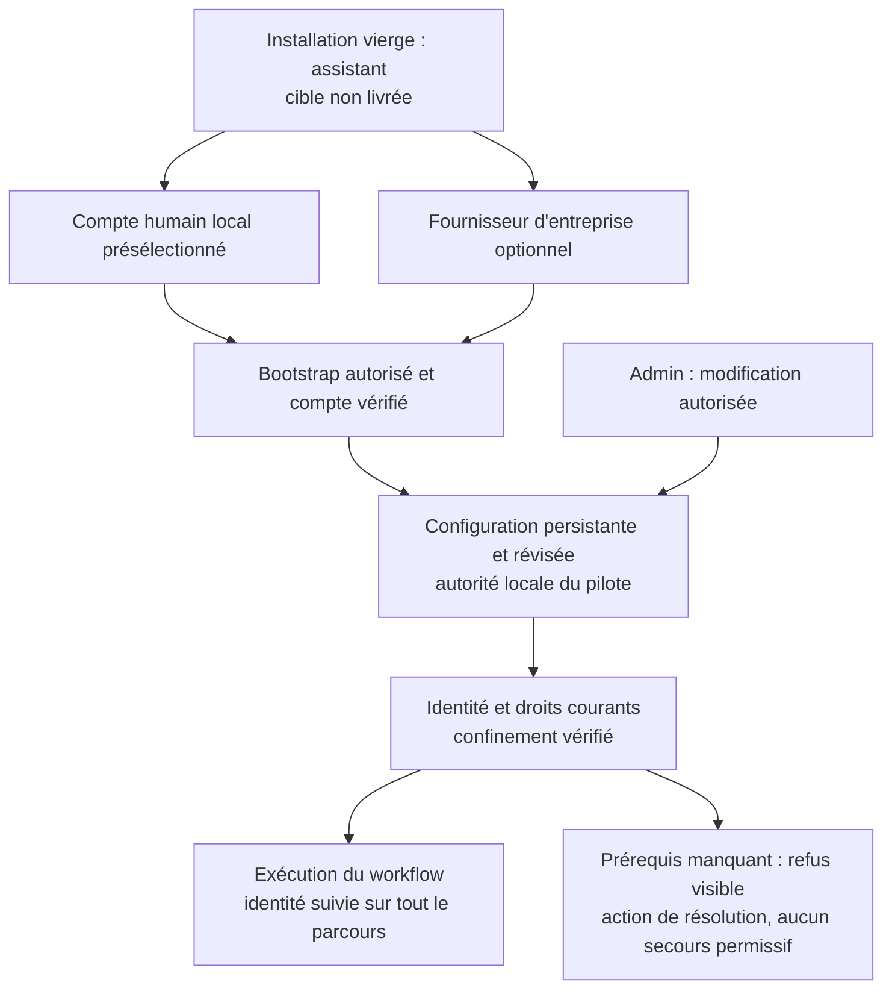
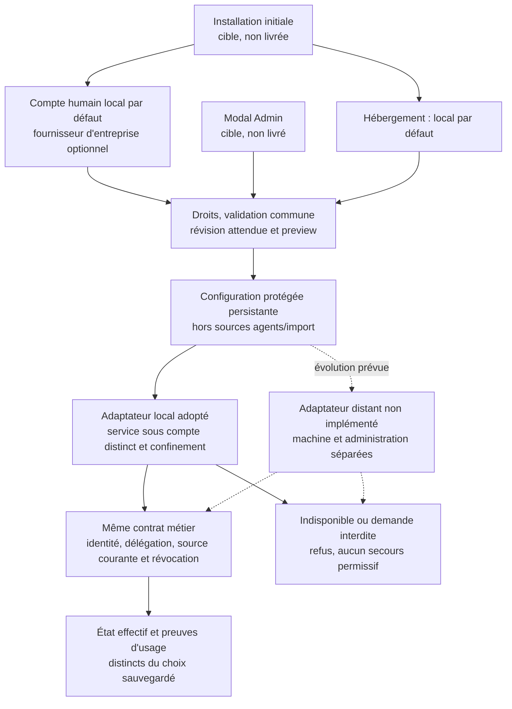

# IA3c.2 — source d’enrôlement et frontière de contrôle

17 octobre 2026 — protocole d’authenticité IA3c.2a, journal IA3c.2b, schéma
d’autorité IA3c.2c, demande complète IA3c.2d, lecture versionnée IA3c.2e
et noyau de configuration IA3c.2f-02a/02b vérifiés en fixtures ; adaptateur
interne IA3c.2f-03a vérifié en fixtures ; client IA3c.2f-03b et remise privée
IA3c.2f-03c vérifiés en fixtures ; service protégé,
bootstrap et consommateur moteur
**non réalisés**. Frontière adoptée le 17 octobre : service local isolé pour
développement/pilote ; autorité distante prévue pour une évolution. Principal
humain initial et activation encore ouverts.

## IA3c.2f-03c — remise avant contenu et collecte du processus

Le lanceur privé de l’image courante utilise deux socketpairs et un pidfd enfant
obtenu atomiquement lors du clone. Un canal de démarrage V1 hello/ready/release
compare challenge, empreinte des pins, processus noyau et UID avant la demande
métier V2 ; le helper vérifie aussi son parent à partir du pidfd hérité. La
demande exacte reste soumise au contrôle d’autorité indépendant du service.
L’environnement doit être explicite ; les copies héritées sont fermées, les
sockets adoptés CLOEXEC et l’enfant recueilli sur toutes les issues lancées.
Annulation signalée au seul enfant via pidfd, sans délai ou retry ajouté.

Un retour valide suivi d’une fin non nulle ne vaut pas succès ; pour une mutation,
l’erreur originale et l’incertitude sont conservées sans effacer l’état durable.
La reprise exacte reste autorisée à nouveau et ne duplique pas l’historique.
Voir le [rapport 03c](verification-identites-agents-20261016/ia3-local-launch-20261017/RAPPORT-IA3c2f03c.md)
et les schémas FR/EN du contrat. Ce raccord interne ne crée aucune commande
publique, compte ou source humaine : I2f03b-05 progresse en fixtures seulement.
Le service protégé réel exige encore la source indépendante des pins et du
principal humain, les chemins protégés et le confinement. Le choix humain initial
et l’autorisation d’installer le compte/service appartiennent à l’opérateur.

Le précontrôle public 03d ajoute `swarm identity bootstrap-check` avant ouverture
de projet : manifeste V1 exact, empreinte attendue indépendante, UID service
effectif et répertoires privés distincts sans mutation. Il réutilise le parcours
de chemins du stockage. Les UID sont une déclaration de frontière, pas une
preuve de confinement ; le principal reste déclaré, pas authentifié. Ce contrôle
ne crée aucun compte/service/lock, ne modifie pas la configuration métier et ne
constitue pas son activation. Le service et sa source humaine restent à raccorder.

## Besoin et état observé

IA3b reçoit encore un objet privé d’autorité fourni par son appelant. Sa référence
d’enrôlement est une empreinte syntaxiquement valide, pas une source courante.
IA3c.1 conserve le reçu de cette décision dans le journal. Aucun de ces mécanismes
ne prouve que l’autorité existe encore ou n’a pas été révoquée.

Le paquet `internal/enrollmentproof` fournit désormais l’authenticité d’une réponse
opaque liée à un challenge. Il n’est importé par aucun consommateur moteur.
Le contrat [IA2](identites-agents-contrat-IA2.md) et ses exigences de révocation,
descendants, arrêt observé et protection hôte restent inchangés.

## Décision de protocole et alternatives

Réutiliser l’émetteur de preuves Trust actuel ferait dépendre la nouvelle racine
de la configuration et de l’isolation dont la protection reste à établir.
Une racine distincte est retenue : clé publique épinglée hors réponse/import,
signature Ed25519, contexte projet et demande, nonce aléatoire, séparation de
domaine et une consommation locale. La clé privée reste à un service protégé ;
les tests ne génèrent que des clés éphémères de fixture. Le module ne crée,
ne configure et ne persiste aucune clé réelle.

Le protocole `swarm-enrollment-statement-v1` a deux cadres :

| Cadre | Champs exacts | Contrôle |
| --- | --- | --- |
| Requête publique `Request` | `protocol`, `authority_key_id`, `project_context_digest`, `request_digest`, `nonce` | SHA-256 en hex minuscule, nonce 32 octets base64url canonique, clé attendue par le signataire |
| Réponse signée | `protocol`, `challenge_digest`, `payload`, `signature` | Quatre chaînes exactes, doublons/casse/champs inconnus/types erronés/trailing refusés ; signature Ed25519 et base64url canonique |

Le challenge digest est SHA-256 du JSON à champs fixes de `Request`. Les octets
signés sont le préfixe `swarm-enrollment-statement-v1`, NUL, `response`, NUL,
puis le JSON de réponse à ordre fixe avec `signature` vide. Le payload est une
chaîne base64url d’octets opaques. Une clé publique reçue dans une réponse ne
peut pas devenir une racine. Aucune durée ou limite d’exécution n’est définie ici.
Les longueurs 32/64 octets viennent des formats SHA-256/Ed25519.

L’état mutable du challenge est partagé derrière un pointeur privé : copier
la valeur Go du handle ne duplique ni son verrou ni sa consommation. Une réponse
incorrecte ne consomme rien. Un challenge ne se reconstruit pas par JSON et n’est
pas durable. Un nouveau processus doit en obtenir un nouveau ; le protocole
ne fournit aucune réservation ou déduplication d’effet métier.

## Conditions du futur raccord — état par frontière

| ID | Condition observable exigée | État réel / propriétaire |
| --- | --- | --- |
| EP-01 | Bootstrap explicitement autorisé, principal humain exact et clé publique épinglée hors canal agent ; aucune inférence premier appelant/Admin/cockpit | Ouvert ; opérateur + Codex |
| EP-02 | Le digest de demande couvre principal vérifié, référence de session, projet, plan/génération, événement, instantané complet, racines et checkpoint précédent | Partiel : cadre complet et projection privée IA3c.2d vérifiés ; résolution courante protégée et raccord final ouverts |
| EP-03 | Le payload a un schéma métier strict : identité d’enrôlement et génération, état courant, principal, portée, droits/délégation, dates et tête d’autorité | Partiel : schéma strict et producteur/consommateur locaux IA3c.2c ; aucune capacité moteur ni admission publique |
| EP-04 | La source courante est relue et sérialisée avec la décision finale ; un message signé « actif » reçu après révocation ne suffit pas | Partiel : relecture et sérialisation locales dans IA3c.2b ; fraîcheur finale moteur ouverte |
| EP-05 | Révocation et usage ont un point de linéarisation prouvé sous concurrence ; descendants couverts, arrêt effectif suivi séparément | Ouvert ; même contrat IA2-C06, aucune instantanéité distante déduite |
| EP-06 | Journal durable, témoin indépendant couvrant aussi le plan, rollback/import détectés ; les générations révoquées ne revivent pas par réactivation | Partiel : journal signé, CAS, réouverture et révocation irréversible IA3c.2b ; témoin durable indépendant et plan ouverts |
| EP-07 | Service, clés, sessions et autorité inaccessibles depuis fournisseur/outils/proc/montages/descripteurs ; même UID + 0600 insuffisant | Ouvert ; déploiement/confinement, F07 non clos |
| EP-08 | Signature/erreur/absence/indisponibilité refusées sans autorité vide de succès ; absence d’autorité n’ouvre aucun secours | Signature locale contrôlée ; décision métier et indisponibilité réelles non raccordées |
| EP-09 | Droits, éventuels délais/leases/budgets et limites de transport ont une source documentée et un réglage Admin partagé si politique nouvelle | Aucune nouvelle politique ici ; aucun TTL inventé pour combler EP-04 |
| EP-10 | Publication/création exactes, réservation/départ/reprise incertaine et preuve publique avant requalification des risques | Ouvert ; IA3 puis IA4/IA5 |

Une signature ne fournit pas de confidentialité. Le service devra produire un
payload sans jeton brut ni clé privée, avec un transport protégé et une politique
d’accès cohérente. Un payload vide authentique ne constitue pas un enrôlement.

## Frontière de déploiement adoptée — local pilote, distant prévu

L’utilisateur choisit le 17 octobre 2026 un service local sous compte système
distinct et avec confinement vérifié pour le développement et le pilote.
L’autorité sur une machine et une administration séparées reste une cible
prévue pour les installations futures, notamment clientes ; son besoin commercial
reste une hypothèse utilisateur, pas une validation de marché. La configuration
initiale et l’UX Admin doivent gérer cette distinction et son état réel.
Le choix est adopté ; les services et écrans ne sont pas encore livrés.
Les deux modes doivent protéger leur administration et ne peuvent reconstruire
leur racine depuis une base importée ou une réponse reçue.

| Option et décision, aucune activation | Valeur attendue et preuves nécessaires | Risques résiduels et conséquences |
| --- | --- | --- |
| **Local adopté pour développement/pilote** : compte distinct et confinement vérifié | Pas de nouvelle machine ; séparer clés, journal et témoin des agents ; vérifier permissions, processus, montages, descripteurs et accès au canal | Même noyau et administration hôte : une compromission root peut atteindre les deux. Le compte distinct seul ne confine pas les agents. Installer, maintenir et vérifier le service et le confinement restent nécessaires. |
| **Distant prévu, non implémenté** : machine et administration séparées | Viser la résistance à une compromission de l’hôte Swarm ; protéger clés et témoin ailleurs, avec administration réellement distincte et contrôles propres de chaque demande | Infrastructure et exploitation supplémentaires : authentification mutuelle, certificats/rotation/révocation, sauvegarde/reprise, disponibilité réseau. Des accès administrateurs, montages ou sauvegardes partagés peuvent annuler la séparation. Un contrôleur compromis peut encore demander une opération interdite si l’autorité lui fait confiance sans contrôle métier. |
| Préparation sans activation : état transitoire, pas la cible retenue | Préparer et tester sans nouvelle infrastructure ni changement de service réel | Les risques des lanceurs publics et F01–F07 restent ouverts ; aucune garantie d’isolation réelle, d’admission ou de révocation appliquée ne découle des fixtures. Cette étape reporte la protection opérationnelle. |

Dans les deux architectures de service, identifier le pair ne suffit pas :
l’autorité doit contrôler elle-même principal, portée, délégation, état courant
et droit de la demande exacte. SO_PEERCRED rapporte les credentials du processus
pair au moment de la connexion ; ce n’est pas une attestation de son rôle dans
le workflow ([Linux unix(7)](https://man7.org/linux/man-pages/man7/unix.7.html)).
Un agent et le contrôleur partageant un UID peuvent donc rester indiscernables
pour une politique limitée à cet UID. Les options de confinement doivent être
vérifiées sur le système réel, avec leurs interactions et limites, plutôt que
déduites du nom d’un compte ([documentation systemd](https://github.com/systemd/systemd/blob/main/man/systemd.exec.xml)).

Une panne ou partition du service ne doit pas ouvrir de secours permissif pour
une opération exigeant son autorité courante. La linéarisation de l’usage et de
la révocation reste à prouver ; aucune révocation instantanée distante ni aucun
TTL ou lease n’est fixé par ce choix d’hébergement.

La base de confiance du pilote inclut le noyau et l’administration hôte.
Le contrat métier reste commun ; seuls le transport et les preuves d’hébergement
diffèrent. Cette portabilité et une éventuelle migration ne sont pas encore
démontrées entre services réels. La frontière est désormais décidée ; désignation
du principal initial, configuration protégée, service vérifié et autorité de
déploiement restent des préconditions d’activation. Le contexte pilote n’autorise
aucune dérogation aux contrôles d’identité, de délégation ou de révocation.

Le principal humain initial doit être enrôlé explicitement avant activation réelle.
Précision utilisateur du 17 octobre : aucun fournisseur d’identité disponible ;
le parcours par défaut crée un compte humain local personnel, configurable dans
l’UX initiale puis Admin. Un fournisseur externe devient une option, pas un
prérequis. L’autorité locale produit alors son émetteur propre à l’installation
et un sujet stable après vérification du compte. Un nom de compte système, un
rôle ou un champ `human` ne remplace pas cette vérification. Le compte humain
local authentifié est distinct de la catégorie technique `local` non attestée.

## Installation initiale et UX Admin — contrat cible IA3c.2f

**Service, installation et UX encore cibles ; noyau de configuration vérifié
en fixtures (IA3c.2f-02a ci-dessous).** install.sh propose actuellement Docker ou
natif ; compose.yaml contient un seul service sous l’UID/GID opérateur. Aucun
de ces choix n’installe l’autorité d’enrôlement séparée. Le client Trust dit
« remote » exige aujourd’hui une origine HTTP de boucle locale ; il ne constitue
pas le futur adaptateur d’autorité distante. Docker/natif désigne le déploiement
de Swarm ; local/distant désigne celui de l’autorité : deux choix distincts.

La configuration initiale prépare le mode local adopté. Elle devra aussi pouvoir
sélectionner le mode distant lorsque son adaptateur et ses preuves seront livrés ;
avant cela, l’UX le présente comme prévu et ne permet pas une fausse activation.
L’état affiché distingue choix enregistré, configuration appliquée et dernière
vérification effective, avec sa portée. Un enregistrement ou un service joignable
ne prouve pas l’isolation des agents ni l’autorisation de leurs demandes.

| Élément de configuration prévu | Source et validation autoritaires attendues | Présentation et refus attendus |
| --- | --- | --- |
| Mode et canal de l’autorité | Configuration d’installation protégée et révisée, hors projet importable ; chemin local explicite ou origine distante validée selon l’adaptateur | Local pilote ou distant ; capacité non livrée signalée et refusée, jamais convertie en accès direct au journal |
| Racine publique, contexte et témoin | Épinglage approuvé indépendamment de la réponse ; projet et checkpoints explicitement liés ; clé privée détenue par le service | Empreinte et portée affichables ; aucun secret dans le navigateur, l’environnement fournisseur ou les exports de projet |
| Authentification humaine et principal initial | Compte humain local par défaut ; fournisseur d’entreprise optionnel. Émetteur et sujet stables produits après enrôlement vérifié ; bootstrap autorisé indépendant | Assistant initial et modal Admin ; aucun premier appelant, UID, localhost, rôle Admin ou cookie cockpit transformé implicitement en autorité humaine |
| Configuration souhaitée et effective | Même validation dans setup, API, CLI et modal Admin ; révision attendue et état réel lu au service | Prévisualisation sans mutation, refus des écritures périmées, sauvegarde/réouverture et erreurs visibles ; sauvegarder ne marque pas « protégé » |
| Changement de mode ou de racine | Opération autorisée conservant preuves, consommation, réservations et continuité des checkpoints ; revalidation avant usage | Effets et prérequis montrés avant application ; aucun effacement/réenrôlement implicite, aucune clé apprise automatiquement du pair |

Le modal Admin est le point de gestion après installation, partagé au niveau du
contrat par les UX Projet et Processus sans imposer le déploiement de l’autre UX.
Il affiche mode demandé/effectif, état de vérification et prochaine action utile.
Les détails techniques restent dans une aide explicite ; le choix, ses effets et
les causes de refus restent visibles. FR/EN, thèmes et navigation clavier doivent
être vérifiés. Aucun écran n’est modifié dans cette tranche documentaire.

### Démarrage sans fournisseur externe — décision UX adoptée

Deux réglages distincts sont présentés : **Authentification humaine** (« Compte
local », présélectionné ; « Fournisseur d’entreprise », optionnel) et
**Hébergement de l’autorité** (local pour le pilote ; distant signalé comme
prévu tant que non livré). Changer l’un ne modifie pas automatiquement l’autre.
Le fournisseur de modèle IA reste une configuration distincte.

Au premier lancement d’une installation vierge, l’assistant propose le compte
local personnel et guide sa création et la vérification du bootstrap. Aucun
compte ou mot de passe partagé n’est préinstallé. Le premier visiteur ne devient
pas administrateur : l’amorçage doit être lié à une preuve d’installation remise
hors du canal accessible aux agents, puis consommée une seule fois. Le secret
personnel est saisi uniquement dans le parcours de l’autorité ; il n’est ni
conservé dans le navigateur ni remis au modèle. Stockage dérivé du mot de passe,
protection des sessions et réauthentification des opérations sensibles restent
à implémenter et à vérifier, avec une bibliothèque éprouvée. Aucune politique
de durée ou de tentatives arbitraire n’est fixée par cette décision.

L’absence de fournisseur externe ne doit donc pas empêcher la préparation d’un
modèle de workflow ni son démarrage après cet enrôlement local. L’exécution
protégée exige toujours identité, droits, état courant et confinement vérifiés.
L’assistant affiche le prérequis manquant et son action de résolution ; il ne
présente jamais un démarrage sans ces contrôles comme une exécution protégée.
Une erreur de lecture, une configuration invalide ou une installation déjà
enrôlée ne déclenche jamais de retour automatique au mode initial.

Admin doit afficher le mode demandé, le mode effectif et les vérifications
manquantes. La configuration est persistante et révisée ; setup, API, CLI et
UX partagent validation et refus. Prévisualiser ne crée ni compte ni droit.
Un changement de fournisseur nécessite l’autorité déjà vérifiée, une liaison
explicite des comptes et la revalidation des sessions ; ni nom ni adresse email
communs ne fusionnent les identités ou leurs droits. L’historique est conservé.
La révocation et la récupération d’un compte local ne réouvrent pas le bootstrap.

Critères IA3c.2f-04-UX1 à UX7, propriétaire Codex : (1) parcours neuf sans IdP
externe, défaut local visible et vérification avant lancement ; (2) amorçage
concurrent, rejoué ou présenté par un agent refusé sans création de droit ;
(3) sauvegarde, réouverture et redémarrage conservant valeurs et historique ;
(4) défaut appliqué uniquement à une installation vierge, jamais après erreur
ou perte de configuration ; (5) preview sans mutation, refus d’écriture périmée
et parité API/CLI/Go/UX ; (6) migration/révocation/récupération sans usurpation
par nom/email, sans réactivation implicite ni perte de filiation ; (7) FR/EN,
thèmes, clavier, erreurs et parcours public complet jusqu’au workflow.
Ces critères sont définis, non exécutés. Le schéma de configuration actuel ne
contient pas encore ce choix d’authentification : ne pas y injecter un défaut
silencieux ou réinterpréter ses anciens pins. Le raccord produit reste ouvert.

La configuration de l’autorité ne peut pas se créer ses propres droits : son
initialisation passe par le bootstrap autorisé et ses modifications par des
droits d’administration déjà vérifiés. La requête métier complète, ses contrôles
et ses preuves restent les mêmes dans les deux modes. L’accès réseau futur à
l’autorité ne change pas l’écoute de boucle locale du cockpit actuel.

Pour le local, vérifier aussi le refus depuis un fournisseur confiné qui connaît
le chemin du canal ; la confidentialité du chemin ne fait pas autorisation.
Pour le distant, authentification mutuelle, rotation/révocation, partitions et
reprise sont des critères supplémentaires ; aucune bascule automatique vers
local ne doit contourner une indisponibilité ou une révocation. Le passage
local → distant est une migration explicite avec historique conservé et preuves
à produire, pas une portabilité déjà acquise ni une copie implicite de clés.

Les critères EP-01 à EP-10 restent inchangés. IA3c.2f-01 formalise la décision ;
-02 à -06 dans le plan canonique couvrent configuration, service, UX, admission
et migration. Leur documentation ne vaut pas livraison. Le noyau de configuration est désormais réalisé et vérifié en fixtures ;
les opérations publiques et le témoin protégé, puis le service local et ses
contre-exemples OS, restent à réaliser. L’activation attend encore
le principal humain exact et les preuves de ces frontières.

## Vérification et portée scientifique

Le [rapport IA3c.2a](verification-identites-agents-20261016/ia3-enrollment-proof-20261017/RAPPORT-IA3c2a.md)
conserve les deux contre-exemples du candidat (null accepté et copie du challenge),
les sources, les contrôles normal/race et le schéma FR/EN. L’exécution locale
ne qualifie pas un service réel, un humain OIDC externe, la fraîcheur, la
révocation appliquée ou la sécurité des lanceurs. L’authentification de messages
par signature/challenge est une brique classique ; aucune originalité ou
supériorité comparative n’est démontrée. F01–F07, IDA et RETEX global restent ouverts.

## IA3c.2b — état local durable, pas encore service protégé

Le [contrat opérationnel](../../architecture/AGENT-IDENTITY-CONTRACT.md)
décrit désormais `internal/enrollmentstate` : chaîne signée sous clé/projet
épinglés, WAL, `BEGIN IMMEDIATE`, événement et tête atomiques, identifiants
non réutilisables après révocation, retry exact uniquement à la tête courante.
Le [rapport IA3c.2b](verification-identites-agents-20261016/ia3-enrollment-state-20261017/RAPPORT-IA3c2b.md)
lie les sources et tests. Ce journal dédié n’emploie aucune base de mission.

`WithActive` sérialise une lecture avec les révocations du journal ; `SignActive`
produit un `ActiveReply` sous cette réservation. Le corps reste opaque dans le journal ; IA3c.2c ajoute ensuite sa validation
locale, sans capacité moteur implicite. Une signature déjà retournée peut devenir historique
avant usage : EP-04/05 ne sont pas clos. Le caller fournit le témoin ; le paquet
ne protège ni ne persiste ce témoin hors du journal. Le test de rollback restaure
un journal cohérent et conserve aussi la limite où restaurer le témoin retire
la détection. Aucune indépendance OS ne découle de l’API Go.

L’erreur concurrente du premier candidat est conservée. La correction emploie
la réservation immédiate du pilote et WAL sans timer, plafond ou retry caché.
Une annulation ou une erreur de mise à jour de tête est refusée sans événement
partiel. Les tests de réouverture et de faute SQL ne prouvent pas une reprise
après panne matérielle, une disponibilité sous verrou hostile ou la cohérence
d’un témoin externe mis à jour séparément.

Le schéma strict de l’autorité d’enrôlement (principal OIDC complet, portée,
permissions, délégation, dates et génération) est désormais vérifié localement
en IA3c.2c ci-dessous. La frontière locale est adoptée en IA3c.2f ; principal
initial, racine réelle et activation restent ouverts. Le raccord ne doit pas
accepter un simple booléen actif ni un payload signé sans ces contrôles.

## IA3c.2c — document strict, génération dérivée de l’histoire

`internal/enrollmentauthority` vérifie désormais le document humain complet,
les droits/délégables et les dates explicites, avec primitives communes extraites
sans modifier les règles/JSON du moteur. `SignEnrollment` valide avant signature ;
`DecodeActive` exige un Statement authentifié et tous les attendus indépendants.
La génération doit égaler `Record.EnrolledSequence`, dérivée de l’événement de
création vérifié et stable quand la tête avance. Ce champ est ajouté au cadre
ActiveReply ; le schéma SQLite et les événements signés existants sont inchangés.
L’ancien cadre sans séquence ne satisfait pas le nouveau consommateur strict.

Le [contrat opérationnel](../../architecture/AGENT-IDENTITY-CONTRACT.md) décrit
les onze champs et les erreurs ; le [rapport IA3c.2c](verification-identites-agents-20261016/ia3-enrollment-authority-20261017/RAPPORT-IA3c2c.md)
conserve les preuves. Le corps générique reste opaque dans le journal, mais le
nouvel adaptateur de données n’accepte plus un booléen actif ou un JSON partiel.
EP-03 est partiellement réalisé localement ; le schéma de demande complète EP-02
et la conversion autorisée vers une capacité privée moteur restent ouverts.

Une ancienne tête fournie comme attendue peut encore authentifier son ancienne
réponse ; aucun test ne prétend prouver une fraîcheur finale ou un enrôlement
réel. La frontière locale est désormais adoptée ; le principal initial, le témoin
externe durable et le point de linéarisation d’usage restent des préconditions
explicites à réaliser et vérifier.

## IA3c.2d — demande complète et référence exacte de session

`internal/enrollmentrequest` définit le cadre complet de publication, son digest
avec domaine/version, ses copies immuables, son lien au challenge et la projection
d’attendus d’autorité. Le cadre couvre les octets complets du snapshot, les racines
exactes, l’humain, l’empreinte/dates de session, la portée, l’événement, les deux
checkpoints et le document d’enrôlement attendu. `CheckActive` compare aussi ce
dernier digest, pas seulement l’ID et la génération.

La projection privée moteur vérifie des frames déjà résolues, avec les validateurs
existants ; le résolveur conserve le `TokenDigest` réellement produit par Trust.
Il n’existe aucun second argument token que la projection pourrait associer à
un autre caller. La projection pure ne prouve pas l’actualité de la session,
du plan ou des checkpoints, ne lit pas leur source et ne crée pas de permis.
Le [rapport IA3c.2d](verification-identites-agents-20261016/ia3-enrollment-request-20261017/RAPPORT-IA3c2d.md)
conserve résultats et limites. EP-02 reste partiel tant que le raccord ne produit
pas ce cadre depuis l’état courant protégé et ne revalide pas son usage final.

## IA3c.2e — lecture versionnée et décodage commun

Le cadre ActiveReply exige désormais `schema_version: 1`. SignActive l’émet et
DecodeActiveReply le vérifie avant les contrôles d’autorité. Les anciens cadres
sans version et les versions inconnues, même authentiques, sont refusés sans
fallback. Le test original reproduit l’acceptation de l’ancien cadre sans version ;
sa correction et ses limites sont dans le [rapport IA3c.2e](verification-identites-agents-20261016/ia3-enrollment-reply-20261017/RAPPORT-IA3c2e.md).
Les signatures historiques, événements et schéma SQLite restent inchangés.
I2c-06 est réalisé pour le format et le refus locaux ; sélection et interopérabilité
entre vrais pairs restent à vérifier avant client externe. Aucun service activé,
aucune preuve d’actualité ou d’autorité ne découle du numéro de version.

## IA3c.2f-02a — stockage de configuration souhaitée vérifié en fixtures

Le paquet internal/enrollmentconfig fournit le codec commun, pins indépendants,
historique lié au contexte d’installation, checkpoint attendu, Open/Preview/
Create/Apply/Read, persistance atomique Linux et erreurs explicites. Il reste
interne : aucun réglage dans l’installateur ou l’Admin, aucun endpoint ou service
activé. La validation commune est disponible pour les futurs adaptateurs, pas
encore utilisée par eux. Le [contrat FR](../../architecture/AGENT-IDENTITY-CONTRACT.md)
et son équivalent EN décrivent champs, limites, erreurs et reprise.

70 noms PASS normal/race ; vet/build ciblés PASS, 8 entrées stables. Trois
contre-exemples du candidat sont reproduits puis corrigés ; la faute fsync après
rename rend le résultat durable incertain et se reprend sans second événement.
[Rapport et preuves](verification-identites-agents-20261016/ia3-installation-config-20261017/RAPPORT-IA3c2f02a.md).
La sonde de fixture mesure 0775, corrigé explicitement en 0700 sans relâcher le
produit. Les tests de callback ne prouvent pas l’identité d’un humain réel.

Le Head fourni reste à conserver dans un témoin durable indépendant ; restauration
des deux retire la détection. Un répertoire privé sous l’UID du test ne prouve
pas l’isolement d’un fournisseur. Le bootstrap réel, les opérations publiques,
la configuration UX et le raccord d’usage restent ouverts. Le proposed Head de
Preview n’est jamais un checkpoint sauvegardé. Le futur mode distant est refusé
par le codec courant ; son évolution devra préserver les versions historiques.

## IA3c.2f-02b — témoin local coordonné, protection réelle encore ouverte

Coordinator ajoute un témoin durable local dans un répertoire distinct non
imbriqué. Intention exacte avant config, puis confirmation ; jamais de témoin
appris d’une config importée. Pending bloque Read/Preview ; Recover ou demande
pendante exacte réautorise et n’accepte que la base ou la cible exactes. Les
contrôles fichiers sont partagés avec Store, dont les 70 gardes sont rejouées.
101 noms PASS normal/race, vet/build ciblés PASS, 12 entrées stables. Reprise
après sortie d’un processus enfant vérifiée ; pas de panne matérielle ni
confinement fournisseur. [Rapport et preuves](verification-identites-agents-20261016/ia3-config-witness-20261017/RAPPORT-IA3c2f02b.md).

Les mentions antérieures de témoin manquant désignent l’état avant ce noyau ou
sa protection réelle non livrée. Le maintien durable existe en fixtures ; la
protection contre restauration conjointe, la séparation OS, les sauvegardes, le
service, les opérations publiques et Admin restent ouverts. Restaurer les deux
stockages retire encore la détection : EP-06/F07 restent partiels/ouverts.
Pas de reset ni abandon automatique d’intention. Le principal humain initial
reste à désigner avant activation ; callbacks de test ne prouvent aucun humain.

## IA3c.2f-03a — raccord de contrôle local

Adaptateur interne du moteur : canal Linux IA2 par message/pidfd réutilisé,
requêtes canoniques read/preview/create/apply, contrôle d’autorité indépendant
maintenu pendant l’opération et consommation exclusive de Coordinator. Apply
reprend la demande pendante exacte ; pas de réparation libre ou de témoin appris.
La lecture est elle aussi autorisée ; aucune identité déclarée ou UID de connexion
ne confère un droit. Une réponse perdue ne remet pas à zéro l’état : retry exact
et réautorisation, sans événement supplémentaire. Les causes détaillées restent
au service, codes limités sur le canal.

Voir le contrat FR/EN pour les données et la gestion des connexions. Le
[rapport](verification-identites-agents-20261016/ia3-local-service-20261017/RAPPORT-IA3c2f03a.md)
conserve résultats, sources et limites ; ce raccord n’installe aucun listener,
compte, principal humain ou contrôle réel de fournisseur. Le client public doit
encore authentifier le service. EP-01/04/05/07 et F01–F07 restent ouverts ; le
service système, ses commandes et Admin ne sont pas livrés par cet adaptateur.

## IA3c.2f-03b — client privé et format de contrôle version 2

Le client reçoit du bootstrap un pidfd serveur indépendant et les pins ; il
compare l’UID et l’objet processus pidfs de chaque réponse, sans apprendre cette
référence depuis le paquet. Linux 64 bits/pidfs exigé, refus sans repli numérique.
Une connexion à usage unique, challenge aléatoire 32 octets et empreinte de la
demande complète lient réponse et contexte ; le service compare les pins avant
contrôle d’autorité. La version transport 1 est explicitement refusée ; config
persistée et historique restent en version 1.

ValidateView/ValidateProjection partagent l’algorithme de tête/historique du
stockage ; le client compare aussi dernier Change et pins. Pas de succès partiel,
réponse tronquée ou mélange preview/sauvegarde. Une annulation ferme la connexion
propre au client ; absence d’acquittement après tentative de mutation = résultat
nul et issue incertaine, retry métier exact sur un nouveau canal réautorisé.
La taille SO_SNDBUF est observée en fixture pour provoquer EMSGSIZE après effet,
pas choisie comme plafond produit ; transport d’historique arbitraire reste ouvert.

Le [rapport](verification-identites-agents-20261016/ia3-local-client-20261017/RAPPORT-IA3c2f03b.md)
conserve résultats et limites. Aucun lanceur/service public ou compte créé, aucun
humain authentifié réellement, aucun déploiement ou revue indépendante. Les
préconditions d’activation, EP-01/04/05/07 et F01–F07 ne sont pas closes.
