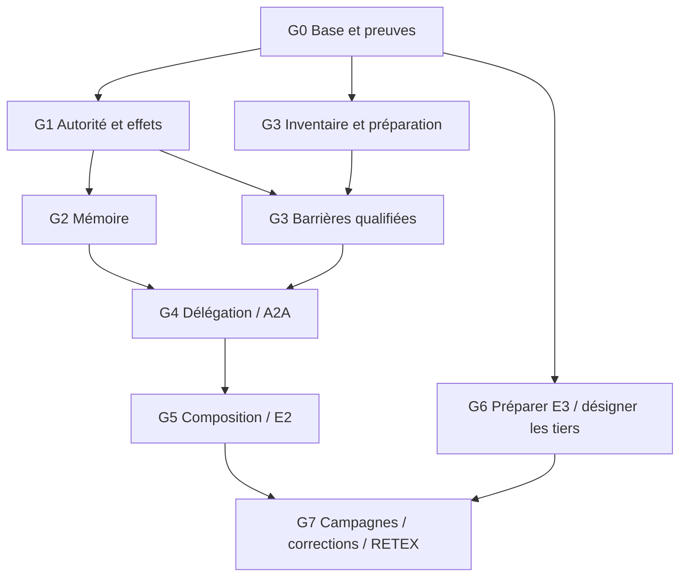

# Plan priorisé — écarts entre articles, produit et preuves

**P1/G1 autorisé puis première tranche locale livrée le 3 novembre 2026** :
[accord exact du règlement, dev.322 et preuves](P1-G1-20261103.md).
G1 reste partiel aux frontières humaines/OS ; G2…G7 ne sont pas lancés par cette tranche.

**P0/G0 autorisé le 3 novembre 2026** : réalisation et preuves suivies dans
[P0-G0-20261103.md](P0-G0-20261103.md). La proposition et les mentions « non exécuté »
ci-dessous restent le plan initial historique ; G1…G7 ne sont pas démarrés par ce lot.

3 novembre 2026 · [English](../../../en/plans/actions-confiance/paea/GAP-CLOSURE-PLAN-20261103.md)
· [Audit C01…C11](ARTICLES-REALITY-20261103.md)
· [Plan PAEA canonique](../PAEA-APEX.md)

**Proposition de séquencement, non exécutée et non adoptée dans le moteur.**
Méthodes : spec-builder et replan ; revue de cohérence spec-audit par le même
auteur. Ce plan ne lance ni développement, délégation, campagne, appel fournisseur,
opération privilégiée ou publication. Les autorisations antérieures restent dans
leur périmètre ; cette proposition ne les élargit pas.

## Objectif et base conservée

Fermer la chaîne principal → mandat → contexte → proposition → accord exact →
engagement → observation → reprise, pour logiciel et facturation fictive.
Distinguer implémentation, preuve locale, installation, preuve humaine et verdict
indépendant. Aucun paiement réel ou processus critique de production inclus.

HEAD repris : 277e337cb400b81ed3d0beb620006a6ee7bdbcb9 ; arbre modifié.
Le fichier bin/swarm et l'image /proc/1426548/exe ont été comparés à la préparation :
SHA256 e2f0039a1f3a34957c161e770c4e5efdd46f4e3a16fc82fe9cf5d9761dc94da3,
dev.316 identifié par l'audit. Le démon cockpit sous UID distinct existe déjà.
newuidmap/newgidmap restent absents du PATH observé ; ce constat doit être refait
avant installation. Les PASS antérieurs restent historiques ; aucun rejeu fonctionnel
nouveau n'est revendiqué par ce plan.

Choix : terminer les raccords existants plutôt que reconstruire une plateforme.
Attendre tous les intervenants avant de coder bloquerait inutilement les travaux
sur fixtures ; développer seulement des fixtures ne permettrait pas la clôture
protégée. La stratégie combine préparation locale et portes humaines explicites.

## Lots ordonnés

« Maintenant » signifie techniquement réalisable par Codex sur sources et fixtures,
dès le développement de ce lot autorisé ; aucun lot n'est exécuté par cette demande.
Priorités fondées sur risque et dépendances, sans date ou durée inventée.

| Lot / priorité | Écarts et plan existant | Ce que Codex peut implémenter et vérifier localement | Porte humaine ou indépendante | Critère de sortie |
|---|---|---|---|---|
| G0 — P0 Base et diagnostic | C01/C09/C11 ; PA-00/09 | Matrice source/preuve/image/limite ; résumés et docstrings périmés ; conservation des FAIL ; statut concurrent explicite | Session humaine si nécessaire pour l'interface connectée | Deux images identifiées séparément ; statut sans attente silencieuse ; historique conservé, pertes déclarées |
| G1 — P1 Autorité et effets | C02/03/04/08 ; PA-02/03/08/09 | Raccord autorité courante → accord exact → engagement des deux effets ; tests identité/projet/mandat/révocation/UNKNOWN sur fixtures | Opérateur : identités réelles et services protégés ; approbateur distinct si exigé | Le service d'effet consomme l'autorité exacte au dernier usage ; refus sans effet ou issue incertaine explicitement conservée |
| G2 — P1 Mémoire Rust | C05 ; PA-06, FPA02A, MEM-P2…P4/M20, BLP-04 | Admission/version, sélection/contexte, retrait/remplacement puis droits lire/résumer/transmettre/compacter ; tous chargeurs recensés | G1 pour identité réelle ; décision opérateur seulement pour une portée non définie | Retrait bloque les nouveaux usages, contextes déjà reçus conservés ; aucune élévation de droit ou budget par mémoire |
| G3 — P1 Confinement/secrets | C07 ; PA-04/05/07, AC-02, BLP-05 | Inventaire des voies ; tests synthétiques ; barrières fichiers/FD/processus/réseau/descendants et politiques partagées ; respecter les prérequis AC-02 | Administrateur : helpers/mappings/comptes ; propriétaire métier : accès nécessaires ; services protégés déployés | Témoin valide puis contournements refusés ; aucun octet synthétique sensible reçu à destination interdite ; pas de repli non confiné |
| G4 — P2 Délégation/A2A | C06 ; PA-06/07, T14/I02/I14 | Porter T14 par sous-ensembles : mandats enfants, audience, provenance, révocation et rejeu ; garder les refus pour le non porté | Intégration réelle après G1 ; composition qualifiée après G2/G3 ; droits délégables fixés par politique | L'enfant ne dépasse jamais mandat/audience du parent ; message et UID ne créent aucun droit |
| G5 — P2 Supervision/E2 composée | C01/02/03/08/10 ; PA-07…10 | Incident reçu → décision → application → effet ; deux domaines sur un candidat ; reprise, preuve fraîche, CLI/API/browser | Humains pour approbations/vigilance ; fournisseur réel seulement avec moyens et droits établis ; revue autre contexte à organiser | Reprise causale sans doublon ni acceptation périmée ; mode human bloque la suite ; preuves fixture et agents réels séparées |
| G6 — P1 organisationnel, dès G0 | C09/11 ; PA-11 | Paquet de revue, contrats/vecteurs, collecte et comparateur B2 avec mêmes protections métier | Commanditaire désigne évaluateur et équipe tierce ; ils acceptent mission, corpus réservé et protocole | Préenregistrement avant campagnes ; seconde frontière d'exécution sans dépendre du moteur Swarm |
| G7 — P3 Évaluation/RETEX | C09/11 ; PA-12/13 | Reproduire les défauts reçus, corriger le contrat commun, livrer, préparer RETEX | Évaluateur mène T01…T22 et réévalue les corrections ; participants habilités | Verdict indépendant borné, défauts et exclusions conservés, puis RETEX final |

## Dépendances de qualification

Le graphe porte sur la qualification, pas sur la préparation indépendante du code
ou des tests. PA-06 conserve PA-02 + PA-05 + MEM-P2…P4 : G2 ne devient pas une
garantie globale avant G3. PA-07 (outillage/baux) et PA-09 (preuves) accompagnent
chaque incrément. PA-10 historique conserve sa clôture E2 bornée ; G5 étend la
qualification à un nouveau périmètre sans réécrire cette décision.

Un intégrateur Codex ; aucune délégation ni exécution parallèle implicite.
Préparer G6 pendant les lots locaux n'autorise pas à contacter les tiers.

## Exigences et recette de sortie

| ID / lots | Précondition et déclencheur | Observable, refus et reprise |
|---|---|---|
| R0 / G0 | Statut demandé pendant opération détenant le verrou de cycle de vie | État concurrent explicite, sans bloquer sur le verrou exclusif des mutations ni inventer « prêt » ; lecture normale après libération |
| R1 / G1 | Témoin admis puis montant/bénéficiaire/dépôt/candidat/identité/politique modifié après accord | Accord incompatible refusé au dernier usage ; registre/référence avant-après inchangé ; nouvel accord exact requis |
| R2 / G1/G5 | Révocation concurrente, crash ou sortie perdue après engagement | Ordre établi ; effet unique ou UNKNOWN ; réconciliation avant répétition ; consommation et historique conservés |
| R3 / G2 | Version retirée/remplacée ; alias ou résumé utilisé pour contourner | Nouveau contexte contrôlé refuse l'ancien usage ; contexte déjà reçu reste attribué ; erreur d'inventaire jamais transformée en catalogue vide |
| R4 / G3 | Accès par descendant/FD/env/connexion existante, secret ou destination interdite | Refus préventif mesuré à la ressource et octets reçus observés ; panne refuse ; politique légitime rétablit le témoin |
| R5 / G4 | Mandat enfant trop large, audience différente, message rejoué/révoqué | Refus avant capacité/effet ; cas légitime reste utilisable ; aucun droit dérivé du seul contenu |
| R6 / G5 | Service indisponible, budget épuisé, preuve périmée ou superviseur repris | Réception attribuée, décision courante appliquée et effet constaté ; aucun retry inchangé ni reset de consommation |
| R7 / G1/G5 | Mode human et revue IA favorable | Suite bloquée jusqu'à décision humaine authentifiée liée au contenu exact ; session/droit révoqué ou contenu modifié refusé |
| R8 / G6/G7 | Candidat/protocole gelés, Swarm/B2/seconde implémentation | Mesures complètes et inconnus conservés ; mêmes protections métier B2 ; un invariant requis en échec reste bloquant |

Avant toute faute, témoin valide sous mêmes préconditions. Vérifier échec sans
mutation, persistance/réouverture, annulation, fin des processus et effet réel.
Toute nouvelle politique : source persistée → validation commune → Admin/API/CLI
→ consommateur effectif, sans plafond caché. Toute modification inclut fonctions
documentées, erreurs propagées, docs FR/EN et schémas concernés dans le même lot.

Recettes permanentes en dossier neuf, tests ciblés effectivement exécutés, sources
et sorties originales conservées puis verify. Sans borne justifiée, watchdog global
désactivé et progression suivie ; aucune limite arbitraire pour masquer un blocage.
Profil produit distinct des fixtures, image et entrées identifiées. Après
développement autorisé, livraison locale gérée par défaut, vérification image
exécutée/Version/notes FR/EN/assets protégés et parcours public. L'installation
système du démon garde son intervention privilégiée opérateur ; pas de redémarrage
de services d'autrui. Une auto-revue ou un build vert ne vaut pas verdict indépendant.

## Interventions à organiser

- H1 — **Opérateur système, G1/G3** : relever les prérequis, préparer procédure
  réversible, installer les helpers et services effectivement nécessaires.
  Installer uidmap seul ne prouve pas les UID externes distinctes, mappings,
  groupes/capacités et droits des services. Aucun secret dans le chat.
- H2 — **Commanditaire/approbateur, G1/G5** : enrôlement et approbation réels,
  mandats et séparation des rôles selon politique. Les fixtures ne les remplacent pas.
- H3 — **Commanditaire puis tiers, G6** : désignation et acceptation de mission
  de l'évaluateur et de l'équipe de seconde implémentation. Codex prépare le dossier
  mais ne tient pas leur rôle et ne fabrique pas leur réception.
- H4 — **Responsable métier/participants, G6/G7** : critères de risque, réussite,
  faux refus et essais humains ; l'évaluateur fixe volumes, ordre et arrêts avant
  campagne. Aucun coût, budget ou seuil de performance inventé.

Ces dépendances ne bloquent pas les travaux locaux indépendants. La première
tranche proposée est G0, puis un raccord G1 sur règlement fictif, réemploi du contrat
commun côté Git et requalification des dépendances. G6 commence en préparation dès
G0 ; les contrats/tests G2/G3 peuvent être préparés pendant l'attente humaine.

## Découverte D01 et continuité

Origine : préparation du plan. ./swarm.sh status sans sortie ; notre lecteur
PID3641689 observé en locks_lock_inode_wait, FD3 vers lifecycle.lock.
SIGINT de ce seul lecteur : traceback sur fcntl.flock(lock, LOCK_EX), ligne155
de tools/swarm_local.py. Aucun verrou supprimé, service arrêté ou détenteur
interrompu. Le détenteur n'a pas été attribué ; ce n'est pas une preuve de
deadlock moteur. Le lecteur n'existe plus à la reprise.

Valeur : statut disponible pendant build/restart. Propriétaire : mainteneur du
lanceur ; G0/R0 ; état découvert, correction proposée, non réalisée.
Comparer lecture cohérente sans verrou exclusif et acquisition non bloquante avec
statut « opération concurrente ». Préserver l'exclusion des mutations ; pas de
timeout arbitraire. Clôture : verrou détenu, diagnostic explicite puis lecture
normale après libération, sans agir sur le détenteur.

Conservation des preuves : examiner le FAIL run-13 rapporté supprimé dans l'audit,
retrouver un original si disponible, sinon déclarer la perte sans reconstituer de
fausse preuve. Les PASS actuels ne deviennent pas faux par cette seule réserve.

L'enregistrement initial de ce plan a refusé un patch mal formé avant création.
À la reprise, absence du fichier vérifiée ; nouvelle génération du patch avec
préfixage systématique de chaque ligne. Ce défaut de méthode n'est pas un défaut
produit et n'invalide pas l'audit conservé.

## Revue et état de clôture

Revue de cohérence par le même auteur : C01…C11 rattachés, PA existants conservés,
graphe acyclique, prérequis de composition et propriétaires H1…H4 explicites.
Plan prêt à sélectionner pour travail local ; garantie protégée conditionnée à
H1/H2/G3 ; E3 à H3/H4/G5. Aucune validation moteur ou revue indépendante prétendue.
État de tous les lots : proposés, non exécutés par cette demande.
Cette modification est documentaire ; aucune fonction ou politique exécutable
modifiée, aucun build/redémarrage nécessaire pour livrer un plan.
