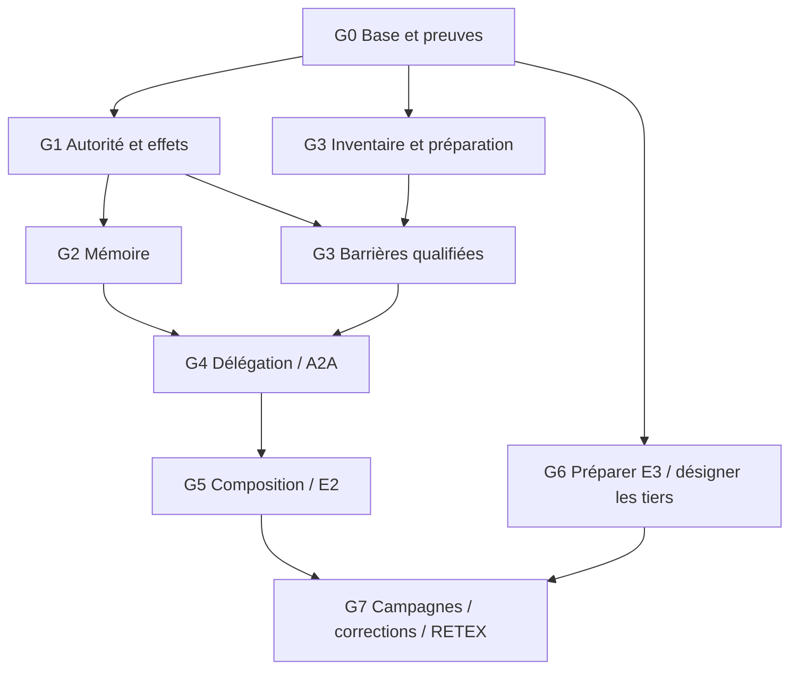

# Plan priorisé — écarts entre articles, produit et preuves

**P1/G1 autorisé puis première tranche locale livrée le 3 novembre 2026** :
[accord exact du règlement, dev.322 et preuves](P1-G1-20261103.md).
G1 reste partiel aux frontières humaines/OS ; G2…G7 ne sont pas lancés par cette tranche.

**P0/G0 autorisé le 3 novembre 2026** : réalisation et preuves suivies dans
[P0-G0-20261103.md](P0-G0-20261103.md). La proposition et les mentions « non exécuté »
ci-dessous restent le plan initial historique ; G1…G7 ne sont pas démarrés par ce lot.

3 novembre 2026 · [English](../../../en/plans/actions-confiance/paea/GAP-CLOSURE-PLAN-20261103.md)
· [Audit C01…C11](ARTICLES-REALITY-20261103.md)
· [Plan PAEA canonique](../PAEA-APEX.md)

**Proposition de séquencement, non exécutée et non adoptée dans le moteur.**
Méthodes : spec-builder et replan ; revue de cohérence spec-audit par le même
auteur. Ce plan ne lance ni développement, délégation, campagne, appel fournisseur,
opération privilégiée ou publication. Les autorisations antérieures restent dans
leur périmètre ; cette proposition ne les élargit pas.

## Objectif et base conservée

Fermer la chaîne principal → mandat → contexte → proposition → accord exact →
engagement → observation → reprise, pour logiciel et facturation fictive.
Distinguer implémentation, preuve locale, installation, preuve humaine et verdict
indépendant. Aucun paiement réel ou processus critique de production inclus.

HEAD repris : 277e337cb400b81ed3d0beb620006a6ee7bdbcb9 ; arbre modifié.
Le fichier bin/swarm et l'image /proc/1426548/exe ont été comparés à la préparation :
SHA256 e2f0039a1f3a34957c161e770c4e5efdd46f4e3a16fc82fe9cf5d9761dc94da3,
dev.316 identifié par l'audit. Le démon cockpit sous UID distinct existe déjà.
newuidmap/newgidmap restent absents du PATH observé ; ce constat doit être refait
avant installation. Les PASS antérieurs restent historiques ; aucun rejeu fonctionnel
nouveau n'est revendiqué par ce plan.

Choix : terminer les raccords existants plutôt que reconstruire une plateforme.
Attendre tous les intervenants avant de coder bloquerait inutilement les travaux
sur fixtures ; développer seulement des fixtures ne permettrait pas la clôture
protégée. La stratégie combine préparation locale et portes humaines explicites.

## Lots ordonnés

« Maintenant » signifie techniquement réalisable par Codex sur sources et fixtures,
dès le développement de ce lot autorisé ; aucun lot n'est exécuté par cette demande.
Priorités fondées sur risque et dépendances, sans date ou durée inventée.

| Lot / priorité | Écarts et plan existant | Ce que Codex peut implémenter et vérifier localement | Porte humaine ou indépendante | Critère de sortie |
|---|---|---|---|---|
| G0 — P0 Base et diagnostic | C01/C09/C11 ; PA-00/09 | Matrice source/preuve/image/limite ; résumés et docstrings périmés ; conservation des FAIL ; statut concurrent explicite | Session humaine si nécessaire pour l'interface connectée | Deux images identifiées séparément ; statut sans attente silencieuse ; historique conservé, pertes déclarées |
| G1 — P1 Autorité et effets | C02/03/04/08 ; PA-02/03/08/09 | Raccord autorité courante → accord exact → engagement des deux effets ; tests identité/projet/mandat/révocation/UNKNOWN sur fixtures | Opérateur : identités réelles et services protégés ; approbateur distinct si exigé | Le service d'effet consomme l'autorité exacte au dernier usage ; refus sans effet ou issue incertaine explicitement conservée |
| G2 — P1 Mémoire Rust | C05 ; PA-06, FPA02A, MEM-P2…P4/M20, BLP-04 | Admission/version, sélection/contexte, retrait/remplacement puis droits lire/résumer/transmettre/compacter ; tous chargeurs recensés | G1 pour identité réelle ; décision opérateur seulement pour une portée non définie | Retrait bloque les nouveaux usages, contextes déjà reçus conservés ; aucune élévation de droit ou budget par mémoire |
| G3 — P1 Confinement/secrets | C07 ; PA-04/05/07, AC-02, BLP-05 | Inventaire des voies ; tests synthétiques ; barrières fichiers/FD/processus/réseau/descendants et politiques partagées ; respecter les prérequis AC-02 | Administrateur : helpers/mappings/comptes ; propriétaire métier : accès nécessaires ; services protégés déployés | Témoin valide puis contournements refusés ; aucun octet synthétique sensible reçu à destination interdite ; pas de repli non confiné |
| G4 — P2 Délégation/A2A | C06 ; PA-06/07, T14/I02/I14 | Porter T14 par sous-ensembles : mandats enfants, audience, provenance, révocation et rejeu ; garder les refus pour le non porté | Intégration réelle après G1 ; composition qualifiée après G2/G3 ; droits délégables fixés par politique | L'enfant ne dépasse jamais mandat/audience du parent ; message et UID ne créent aucun droit |
| G5 — P2 Supervision/E2 composée | C01/02/03/08/10 ; PA-07…10 | Incident reçu → décision → application → effet ; deux domaines sur un candidat ; reprise, preuve fraîche, CLI/API/browser | Humains pour approbations/vigilance ; fournisseur réel seulement avec moyens et droits établis ; revue autre contexte à organiser | Reprise causale sans doublon ni acceptation périmée ; mode human bloque la suite ; preuves fixture et agents réels séparées |
| G6 — P1 organisationnel, dès G0 | C09/11 ; PA-11 | Paquet de revue, contrats/vecteurs, collecte et comparateur B2 avec mêmes protections métier | Commanditaire désigne évaluateur et équipe tierce ; ils acceptent mission, corpus réservé et protocole | Préenregistrement avant campagnes ; seconde frontière d'exécution sans dépendre du moteur Swarm |
| G7 — P3 Évaluation/RETEX | C09/11 ; PA-12/13 | Reproduire les défauts reçus, corriger le contrat commun, livrer, préparer RETEX | Évaluateur mène T01…T22 et réévalue les corrections ; participants habilités | Verdict indépendant borné, défauts et exclusions conservés, puis RETEX final |

## Dépendances de qualification

Le graphe porte sur la qualification, pas sur la préparation indépendante du code
ou des tests. PA-06 conserve PA-02 + PA-05 + MEM-P2…P4 : G2 ne devient pas une
garantie globale avant G3. PA-07 (outillage/baux) et PA-09 (preuves) accompagnent
chaque incrément. PA-10 historique conserve sa clôture E2 bornée ; G5 étend la
qualification à un nouveau périmètre sans réécrire cette décision.

Un intégrateur Codex ; aucune délégation ni exécution parallèle implicite.
Préparer G6 pendant les lots locaux n'autorise pas à contacter les tiers.

## Exigences et recette de sortie

| ID / lots | Précondition et déclencheur | Observable, refus et reprise |
|---|---|---|
| R0 / G0 | Statut demandé pendant opération détenant le verrou de cycle de vie | État concurrent explicite, sans bloquer sur le verrou exclusif des mutations ni inventer « prêt » ; lecture normale après libération |
| R1 / G1 | Témoin admis puis montant/bénéficiaire/dépôt/candidat/identité/politique modifié après accord | Accord incompatible refusé au dernier usage ; registre/référence avant-après inchangé ; nouvel accord exact requis |
| R2 / G1/G5 | Révocation concurrente, crash ou sortie perdue après engagement | Ordre établi ; effet unique ou UNKNOWN ; réconciliation avant répétition ; consommation et historique conservés |
| R3 / G2 | Version retirée/remplacée ; alias ou résumé utilisé pour contourner | Nouveau contexte contrôlé refuse l'ancien usage ; contexte déjà reçu reste attribué ; erreur d'inventaire jamais transformée en catalogue vide |
| R4 / G3 | Accès par descendant/FD/env/connexion existante, secret ou destination interdite | Refus préventif mesuré à la ressource et octets reçus observés ; panne refuse ; politique légitime rétablit le témoin |
| R5 / G4 | Mandat enfant trop large, audience différente, message rejoué/révoqué | Refus avant capacité/effet ; cas légitime reste utilisable ; aucun droit dérivé du seul contenu |
| R6 / G5 | Service indisponible, budget épuisé, preuve périmée ou superviseur repris | Réception attribuée, décision courante appliquée et effet constaté ; aucun retry inchangé ni reset de consommation |
| R7 / G1/G5 | Mode human et revue IA favorable | Suite bloquée jusqu'à décision humaine authentifiée liée au contenu exact ; session/droit révoqué ou contenu modifié refusé |
| R8 / G6/G7 | Candidat/protocole gelés, Swarm/B2/seconde implémentation | Mesures complètes et inconnus conservés ; mêmes protections métier B2 ; un invariant requis en échec reste bloquant |

Avant toute faute, témoin valide sous mêmes préconditions. Vérifier échec sans
mutation, persistance/réouverture, annulation, fin des processus et effet réel.
Toute nouvelle politique : source persistée → validation commune → Admin/API/CLI
→ consommateur effectif, sans plafond caché. Toute modification inclut fonctions
documentées, erreurs propagées, docs FR/EN et schémas concernés dans le même lot.

Recettes permanentes en dossier neuf, tests ciblés effectivement exécutés, sources
et sorties originales conservées puis verify. Sans borne justifiée, watchdog global
désactivé et progression suivie ; aucune limite arbitraire pour masquer un blocage.
Profil produit distinct des fixtures, image et entrées identifiées. Après
développement autorisé, livraison locale gérée par défaut, vérification image
exécutée/Version/notes FR/EN/assets protégés et parcours public. L'installation
système du démon garde son intervention privilégiée opérateur ; pas de redémarrage
de services d'autrui. Une auto-revue ou un build vert ne vaut pas verdict indépendant.

## Interventions à organiser

- H1 — **Opérateur système, G1/G3** : relever les prérequis, préparer procédure
  réversible, installer les helpers et services effectivement nécessaires.
  Installer uidmap seul ne prouve pas les UID externes distinctes, mappings,
  groupes/capacités et droits des services. Aucun secret dans le chat.
- H2 — **Commanditaire/approbateur, G1/G5** : enrôlement et approbation réels,
  mandats et séparation des rôles selon politique. Les fixtures ne les remplacent pas.
- H3 — **Commanditaire puis tiers, G6** : désignation et acceptation de mission
  de l'évaluateur et de l'équipe de seconde implémentation. Codex prépare le dossier
  mais ne tient pas leur rôle et ne fabrique pas leur réception.
- H4 — **Responsable métier/participants, G6/G7** : critères de risque, réussite,
  faux refus et essais humains ; l'évaluateur fixe volumes, ordre et arrêts avant
  campagne. Aucun coût, budget ou seuil de performance inventé.

Ces dépendances ne bloquent pas les travaux locaux indépendants. La première
tranche proposée est G0, puis un raccord G1 sur règlement fictif, réemploi du contrat
commun côté Git et requalification des dépendances. G6 commence en préparation dès
G0 ; les contrats/tests G2/G3 peuvent être préparés pendant l'attente humaine.

## Découverte D01 et continuité

Origine : préparation du plan. ./swarm.sh status sans sortie ; notre lecteur
PID3641689 observé en locks_lock_inode_wait, FD3 vers lifecycle.lock.
SIGINT de ce seul lecteur : traceback sur fcntl.flock(lock, LOCK_EX), ligne155
de tools/swarm_local.py. Aucun verrou supprimé, service arrêté ou détenteur
interrompu. Le détenteur n'a pas été attribué ; ce n'est pas une preuve de
deadlock moteur. Le lecteur n'existe plus à la reprise.

Valeur : statut disponible pendant build/restart. Propriétaire : mainteneur du
lanceur ; G0/R0 ; état découvert, correction proposée, non réalisée.
Comparer lecture cohérente sans verrou exclusif et acquisition non bloquante avec
statut « opération concurrente ». Préserver l'exclusion des mutations ; pas de
timeout arbitraire. Clôture : verrou détenu, diagnostic explicite puis lecture
normale après libération, sans agir sur le détenteur.

Conservation des preuves : examiner le FAIL run-13 rapporté supprimé dans l'audit,
retrouver un original si disponible, sinon déclarer la perte sans reconstituer de
fausse preuve. Les PASS actuels ne deviennent pas faux par cette seule réserve.

L'enregistrement initial de ce plan a refusé un patch mal formé avant création.
À la reprise, absence du fichier vérifiée ; nouvelle génération du patch avec
préfixage systématique de chaque ligne. Ce défaut de méthode n'est pas un défaut
produit et n'invalide pas l'audit conservé.

## Découverte D02 — garde de source mémoire déjà porté, appelants obsolètes

Origine : tranche G2 « mémoire versionnée — moteur » (5 novembre 2026). En
câblant le cycle `memory.*` dans le moteur Rust, constat que le garde de source
versionnée attend par `project_context.rs:294` est déjà porté :
`rust/crates/swarm-engine/src/project_memory_source.rs` (commit `2496c031be`,
vague Biba) refuse `project-memory-source-inventory` /
`project-source-memory-managed`. Preuve : `cargo test -p swarm-engine --test
project_context` — `review_document_cap_and_managed_memory_alias_refusals_are_explicit`
échoue en attendant l'ancien code `versioned-memory-source-guard-not-ported`
(`tests/project_context.rs:134,153`) ; le mapping HTTP 501 de
`rust/crates/swarm-web/src/service.rs:401-402` filtre ce même code devenu
inobservable. Valeur : la bascule 501 devient une simplification (le parcours
est porté) et deux obsolences appellent une mise à jour. Propriétaire : vague
BF-16b active sur `service.rs` au moment du constat (diff concurrent visible) ;
test concerné modifiable après accord de la vague. **Corrigé le 6 novembre 2026**
(ordre utilisateur « corrigés ») : attentes du test mises à jour vers les codes
réels du garde porté (`project-memory-source-inventory`, refus causé explicite
sur fixture nue — commentaire prouvant le portage, pas un affaiblissement des
assertions), filtre 501 retiré au profit de `caller_invalid` (400 pour les
entrées d'appelant invalides : `project-source-memory-managed` inclus ;
les défaillances d'inventaire racine/SQL restent des erreurs serveur par défaut).
Preuves : `cargo test -p swarm-engine --test project_context` 4/4 vert ;
`cargo test -p swarm-web --test service` 10/10 ; `--lib -- project` 31/31 ;
`--test root_project_context` 3/3 ; `cargo check -p swarm-web` 0 erreur.
Clé UX morte remplacée dans `web/project-profile.js` (motifs français réels).
Doc FR/EN REFERENCE.md mise à jour (garde porté, frontière 501 retirée).

Tranche G2 moteur (même date) : cycle complet porté et vérifié — module
`project_memory.rs` (10 tests), câblage `work_engine.rs` + aperçu
`root_store.rs`, intégration `tests/project_memory_engine.rs` (6 tests),
recette permanente `tools/verification/recipes/versioned-memory-engine-rust.json`
(PASS, preuve `.swarm-fixtures/versioned-memory-engine-evidence/run-20261105-1`),
doc FR/EN `docs/actions-confiance-rust.md`. Restent fermés : surface HTTP/CLI
dédiée, résumé extractif M20, droits lire/résumer/transmettre/compacter.

Tranche G2 filiation (même date) : `agentMemoryReferences`
(`project_memory_dialogue.go`) porté — `memoryUses` parcourt la chaîne
`dialogue_restore` (reçus valides, source recontrôlée contre son empreinte,
racine et tours strictement décroissants), alimente l'inventaire des usages
actifs avec les sélections d'ancêtres, refuse les filiations brisées par codes
stables `project-memory-lineage-*` ; le garde cyclique est documenté comme
défense en profondeur sans cas constructible (empreinte couvrant le reçu
suivant à chaque hop, tours strictement décroissants), aligné sur le test Go
qui n'affirme que le refus. Preuve : test
`lineage_walk_reads_ancestors_and_refuses_broken_chains` (11 tests lib au
total), recette mise à jour 10→11 et
rejouée, preuve `.swarm-fixtures/versioned-memory-engine-evidence/run-20261105-3`.
Restent fermés : surface HTTP/CLI dédiée, résumé extractif M20, droits
lire/résumer/transmettre/compacter.

Tranche G2 catalogue (7 novembre 2026) : la lecture du catalogue est portée —
`projectMemoryCatalog` (`project_memory_public.go`) → `memory_catalog.rs`
(assemblage pur + entrée connexion), `RootStore::memory_catalog`,
HTTP `GET /api/v1/project-memory` (lecture seule, `q` unique) et CLI
`swarm-rust memory list --root ROOT [--json]`. Contrats Go conservés : requête
repliée avant filtre et renvoyée repliée, statuts/reasons exacts (`active`/
`historical`/`unavailable` avec textes Go, import « Mémoire importée ou d’un
autre projet : admission locale requise »), R3 refus global sans catalogue
partiel (corruption externe `{"x":1}` en fixture). Preuve : tests moteur 5 lib
+ 3 racine, web 1, CLI 4 ; recette permanente
`tools/verification/recipes/versioned-memory-catalog-rust.json` ; doc FR/EN
`docs/actions-confiance-rust.md`.

Tranche G2 mutation HTTP/CLI (même jour) : les huit sous-commandes
aperçu/commit (admit, replace, withdraw, select et leurs `-preview`) sont
exposées en CLI (`swarm-rust memory … WORK --root ROOT --input FILE`) et en
HTTP (`POST /api/v1/project-memory?action=…`). L'aperçu lit le candidat via
le même `next_memory` (refus identiques au commit, notamment
`project-memory-source-unfresh` et le conflit de révision) ; le commit passe
par `execute_external("memory.<action>")` (transaction, rejeu, jeton
d'aperçu, gardes) et rapporte l'état enregistré. La sélection exige le jeton
d'aperçu (`preview_stale` sinon). `summary-source` reste refusé unported
(M20, incrément séparé). Preuve : CLI 7 tests (aperçu+commit sélection avec
décision marquée, refus unfresh identiques aperçu/commit, conflit typé,
usage), web 2 tests (POST sélection preview+commit, refus unfresh sans
entrée ajoutée, unported, état inchangé) ; recette mise à jour 4→7 CLI et
1→2 web. Restent fermés : résumé extractif M20, droits
lire/résumer/transmettre/compacter.

Tranche G2 résumé extractif M20 (7 novembre 2026) : `memorySummarySource`
(`internal/engine/memory_summary_source.go`) est porté et servi sur les trois
surfaces — `rust/crates/swarm-engine/src/memory_summary_source.rs`,
`RootStore::memory_summary_source` (lecture seule), CLI
`swarm-rust memory summary-source --root ROOT --input FILE [--json]` (corps =
demande, pas d'argument Work positionnel) et HTTP
`POST /api/v1/project-memory?action=summary-source` avec le refus 405 du
pairage `GET ?action=summary-source` avant tout décodage (ordre Go). Contrat
Go conservé octet près : plafond transport 1 Mio avant décodage strict, refus
stables (schéma/révision/nom/dialogues vides, identité, conflit
`project-memory-work-changed`, tâche inconnue, cible brainstorm, doublon,
échange absent/vide), paquet `swarm_summary_source_v1` à payload **chaîne**
avec son empreinte (vérification inter-runtime possible), source snapshot =
contrat de travail sérialisé par `encode_model`, question/réponse par dialogue
avec identifiant dérivé de l'empreinte de la référence. Preuve : moteur 6
tests lib, CLI 8 tests (paquet exact, refus brainstorm et révision périmée),
web 3 tests (POST paquet exact sans mutation, GET pairage 405) ; recette mise
à jour (5 étapes, entrées Go+Rust M20 ajoutées) et rejouée, preuve
`.swarm-fixtures/versioned-memory-catalog-evidence/run-20261107-4` (PASS,
verify VERIFIED). Restent fermés : droits lire/résumer/transmettre/compacter
(décision opérateur, incréments distincts).

Tranche G2 consommateur extractif (7 novembre 2026) : la sélection est
désormais **consommée** par la chaîne de lancement Rust —
`memorySummarySelection`/`memorySummaryReceipt` portés dans
`rust/crates/swarm-engine/src/memory_summary_selection.rs`, admission
`memory_summary_attachment` dans `agent_launch.rs` (texte reconstruit depuis
le Work persisté, jamais d'entrée externe ; refus typés
`agent-launch-summary-branch-unported/-selection-incomplete/
-context-hash-required/-sources-changed/-selection-invalid`), rattachement en
dernière pièce du prompt, reçu tamponné dans `context.summary`, champs de file
d'attente au stage, contrôle avant démarrage `checked_memory_summary_receipt`
dans `record_permission` (`agent_execution_store.rs` : `agent-execution-
summary-receipt-invalid/-sources-stale/-sources-changed-before-start/
-reconstruction-failed` — le provider ne démarre pas). Codes portés par
`RootStoreError::Launch(AgentLaunchError)` (emballage `agent_supervision.rs`) ;
HTTP mappe 400 (Refused admission) / 409 (sources modifiées et contrôle avant
démarrage) et garde 500 ailleurs (2 tests de garde dans
`rust/crates/swarm-web/src/service.rs`), états mémoire project conservés
(400/409/404, Row/Sql 500). Preuve : moteur `--lib memory_summary` 9 tests,
`--test agent_launch` 31 tests (dont 5 intégrations), web `--lib` 51 tests ;
recette permanente
`tools/verification/recipes/versioned-memory-summary-selection-rust.json`
(3 étapes), preuve
`.swarm-fixtures/versioned-memory-summary-selection-evidence/run-20261107-1`.
Restent fermés : droits lire/résumer/transmettre/compacter (décision
opérateur, incréments distincts).

Tranche G2 liaison d'usage M25 (8 novembre 2026) : la proposition d'usage est
portée — `memorySummaryUsageBinding` (`internal/engine/memory_usage_binding.go`)
dans `rust/crates/swarm-engine/src/memory_usage_binding.rs`. Construction
pure : pas de SQL, pas d'évaluation d'identité, pas de réservation, pas
d'engagement, pas de transmission ; le digest lie des demandes, jamais des
droits. La projection `swarm-memory-usage-v2` porte la cible (scope, tâche,
destinataire), les digests paquet/sélection/pièce jointe et une source exacte
par source sélectionnée (`memory:v2:<digest>`, dérivé du contrat
`swarm-memory-resource-v2`) ; seules les sources reçues portent `transmit`
(l'instantané opérateur n'est jamais transmissible). `requests()` émet par
source `memory.read` et `memory.summarize` (+ `memory.transmit` si reçue)
liées au digest complet, avec ids d'événement dérivés du contrat
`swarm-memory-usage-event-v1` ; ces demandes ne confèrent aucun droit sans le
noyau d'identité. Refus typés `memory-usage-binding-invalid` (contrat
appelant : racine non absolue ou non nettoyée, Work hors schéma 1, noms
dangereux, sélection absente, cible hors tâche ou hors Work, destinataire
sans instance) et `memory-usage-sources-invalid` (ids reçus dupliqués ou
inconnus, texte non UTF-8 ou divergent, id reçu absent des sources). Parité
canonique Go prouvée par digest croisé : la projection et un id d'événement
fixés retrouvent les digests de référence du programme Go (test
`projection_digest_matches_go_reference`). Aucun chemin public ne consomme la
liaison — comme en Go (M24/M25, bibliothèque seule) : `evaluateMemorySummaryUsage`
reste à porter en attente du noyau d'identité (`evaluateAgentIdentity`),
la préparation isolée reste le seul usage soutenu, aucune activation
publique (M20-U01..U10 ouverts, critères P4 requis). Preuve : moteur
`--lib memory_usage` 6 tests, référence Go `TestMemoryUsageBinding*` +
`TestMemoryUsageRequests*` (32) verte ; recette permanente
`tools/verification/recipes/versioned-memory-usage-binding-rust.json`
(3 étapes), preuve
`.swarm-fixtures/versioned-memory-usage-binding-evidence/run-20261108-1`
(PASS, verify VERIFIED). Restent fermés : les droits lire/résumer/transmettre/
compacter (décision opérateur, incréments distincts), tout câblage public.

Tranche G2 noyau d'identité IA2.2 + décision d'usage M25 (8 novembre 2026) :
le noyau pur d'IA2.2 est porté — `agent_identity_contract.go` +
`agent_identity_authority.go` (~520 lignes) dans
`rust/crates/swarm-engine/src/agent_identity_kernel.rs`. Types (Principal,
Actor, Grant, Instance, Snapshot, Request, Decision) avec encodage Go
canonique, évaluateur `evaluate_agent_identity` (horloge, demande valide,
appelant frais — `verified_at == at`, révision trust courante —, trame
d'autorité indépendante non sérialisable en JSON, snapshot ancré par digest,
chaîne de délégation avec bornes temporelles héritées, droits/délégables
décroissants, racine ancrée et instance non révoquée, droits exacts,
expiration agrégée au minimum), `reuse_agent_identity_decision` (re-évaluation complète
puis comparaison intégrale, refus `agent-identity-decision-stale`) et
`validate_agent_identity_transition` (révision +1, révocations préservées,
historique inchangé). Codes de refus kebab-case `agent-identity-*` miroir des
codes Go snake_case ; snapshot `deny_unknown_fields` (miroir du décodage
strict Go). Correction du constat M25 : la dépendance réelle du nœud de
décision est le noyau pur IA2.2 (~520 lignes), pas les 32 fichiers
d'admission/runtime IA2 — le décodage d'admission JSON, la résolution Trust
(`resolveAgentIdentityCaller`) et le consommateur applicatif Store restent au
raccord Go/IA2.3-IA3 ; les tests Go Trust restent Go-only. Huit tests noyau
portés avec trames fournies par fixtures pures (18+ cas d'autorité invalide
sans mutation, rejeu exact, snapshot=données, révocation multi-niveaux,
transition, opacity issuer/subject) : 9/9 verts.
`evaluateMemorySummaryUsage` (`memory_usage_decision.go`) est porté dans
`rust/crates/swarm-engine/src/memory_usage_decision.rs` : reconstruction de
la liaison, contrôles racine/destinataire de la trame, demandes requêteur +
destinataire (domaine `swarm-memory-receive-event-v1`, ids
`memory-receive-<hash>`, un `memory.read` par source transmise), expiration
agrégée au minimum des deux acteurs, preuve précédente comparée intégralement
avant réutilisation (`memory-usage-decision-stale`), aucun verdict partiel.
Cinq tests décision portés (13+3 décisions, 19 autorités incomplètes refusées
sans mutation, preuve éditée/partielle refusée, reconstruction avant
réutilisation) : 5/5 verts ; liaison M25 inchangée (6/6). Aucun chemin public
ne consomme le noyau ni la décision (bibliothèque seule, comme en Go) ;
droits lire/résumer/transmettre/compacter fermés (M20-U01..U10, critères P4).
Recette permanente
`tools/verification/recipes/versioned-agent-identity-kernel-rust.json`
(4 étapes), preuve
`.swarm-fixtures/evidence/run-20261108-identity-kernel` (PASS, verify
VERIFIED). Reste fermé : tout câblage public, droits opérateur, raccord
Trust/admission IA3.

Tranche G2 inventaire des chargeurs mémoire (8 novembre 2026) : la clause G2
« tous chargeurs recensés » est vérifiée par construction et documentée. Côté
Go, la lecture des travaux enregistrés passe par `internal/engine/memory_work.go`
(`scanMemoryWork`, `memoryWork`, `memoryWorks`, contextes d'erreur
« Source mémoire » / « Sources du catalogue mémoire inaccessibles »). Côté Rust,
un unique lecteur partagé, `rust/crates/swarm-engine/src/recorded_work.rs`
(`read_recorded_work`, `list_recorded_works` — qualifié en R3e), satisfait les
cinq chemins de lecture mémoire : `memory_catalog.rs`, `memory_files.rs`
(`list_recorded_works`), `memory_summary_source.rs` et
`memory_summary_selection.rs` (`read_recorded_work`),
`memory_usage_binding.rs` (via `summary_sources`). Aucun chargeur par chemin,
aucune transformation d'erreur d'inventaire en catalogue vide (R3) : le
raccord Go↔Rust est sans divergence de chargeur. Incrément documentaire seul,
aucun code modifié.

Tranche G3a inventaire des voies (8 novembre 2026) :
[G3-INVENTAIRE-VOIES-20261108.md](G3-INVENTAIRE-VOIES-20261108.md) établit
l'inventaire exigé en tête de G3 — point d'exécution commun des cinq lanceurs
(`PreparedExec::execute`, frontière I0 committée `6706e201b`), titulaires de
secrets et leurs voies d'accès, voies résiduelles réelles du helper confiné
(réseau sortant non médié, descripteurs hérités, `/proc` cmdline, lectures
générales hors `.swarm`, descendants), worker API `_prepare_turn` hors
frontière I0 avec clé de connexion en mémoire, transport moteur loopback
local. Chaque voie de l'inventaire est une cible nommée pour la campagne
PA-04 « témoin puis contournement » ; aucune n'est déclarée fermée. Le refus
Internet additif (`provider_internet_denied`/`deny_internet`) est observé
comme flux concurrent non commité, propriétaire flux G3 barrières — décrit,
pas repris. Incrément d'analyse seul, aucun code modifié, aucune barrière
posée ; les tests synthétiques par voie et la qualification restent à venir
derrière G1+G3a.

Tranche G4 audience — portion locale de T14 (8 novembre 2026) : le lot G4
demande « mandats enfants, audience, provenance, révocation et rejeu ». Le
bilan : mandats enfants portés (`75c35fa278`), provenance/data_policy portés
(5 novembre), révocation d'ancêtre et rejeu couverts par la recette existante
; la réception A2A en réseau (D3 à l'arrivée, refus `a2a-*`, reçus liés D5,
canal D6) reste entière, bloquée sur l'enrôlement humain IA3 et l'intégration
G1 réelle. La portion locale restante est l'audience côté usage : la recette
`trust_delegation.rs::delegation_audience_binds_mandate_to_named_subject`
épingle qu'un pair autre que le sujet du mandat est refusé à l'admission de
lecture avec « mauvais sujet » (ordre historique Go : sujet avant bornes),
sans mutation, pendant que l'audience légitime conserve le parcours complet
(`request`→`approve`→`commit`) et le rejeu — sur le mandat enfant comme sur
la racine. Le garde du design est conservé : la réception A2A future devra
réutiliser ce refus, pas en inventer un second. Incrément de recette seul ;
`trust_delegation.rs` passe à 10 tests, 10 verts.

Tranche G6 comparateur B2 (9 novembre 2026) : le lot G6 demande « paquet de
revue, contrats/vecteurs, collecte et comparateur B2 avec mêmes protections
métier ». Le comparateur est livré :
[B2-COMPARATOR-20261109.md](B2-COMPARATOR-20261109.md) +
[`tools/paea/b2_comparator.py`](../../../../../tools/paea/b2_comparator.py) +
recette `tools/verification/recipes/paea-b2-comparator.json`. B2 importe le
fichier pilote qualifié sans modification (canonicalisation CLI épinglée
avant/après, autorité d'époque, puits à intent stable, oracle séparé en
lecture seule, réconciliation déclarée, témoin avant chaque faute) et scripte
le workflow déterministe : trois familles de scénarios (T04-substitution,
T06-T21-crash-recovery, T05-T17-revocation-order) × deux domaines (payment,
git), ordre fixe, un puits neuf par essai, enregistrements comparables
(décision, code de sortie, durée mesurée), rapport fermé avec les étiquettes
honnêtes du protocole (`authority='simulated'`, `isolation='same-uid'`,
`independent_evaluation='not-established'`). La garde de non-affaiblissement
est structurelle : aucun chemin d'admission n'est réimplémenté, donc rien ne
peut être affaibli ; toute modification du pilote change le comparateur.
Publication refusée à la première déviation (jamais notée, cause conservée).
Exécution réelle par la voie publique (recette PASS, vérification
indépendante VERIFIED) sur le binaire livré épinglé (sha256 `a166e2b8…`) :
six essais, 0 déviation, p50 1,976 s / p95 2,350 s ; variantes de refus
(dossier existant, hash faux, binaire manquant) et chemin de déviation
(hash `setUpClass` remplacé) vérifiés ; evidence sous `.swarm-fixtures/`.
Restent pour G6 : le paquet de revue (dernier objet local) et le
préenregistrement (porte humaine H3 — évaluateur, corpus réservé, volumes et
ordre désignés par le commanditaire avant toute campagne comparée).

Tranche G6 paquet de revue (9 novembre 2026) : le dernier objet local du lot
G6 est livré — [REVIEW-PACKAGE-20261109.md](REVIEW-PACKAGE-20261109.md) +
[`tools/paea/review_package.py`](../../../../../tools/paea/review_package.py) +
recette `tools/verification/recipes/paea-review-package.json`. L'assembleur
inventorie les livrables de préparation E3 en trois dossiers (conception 7 /
réalisation 21 / qualification 5 = 33 entrées), chaque entrée avec SHA256
exact et taille, publiés atomiquement via `recipe.py::publish`. Contrat :
livrable manquant ou vide → refus (`review-package-deliverable-missing`/
`-empty`, un glob vide est le même refus) ; double collecte — toute source
modifiée pendant l'assemblage refuse avec les chemins divergents
(`review-package-source-changed-during-assembly`) ; paquet reproductible
(manifestes byte-identiques entre exécutions). Étiquettes honnêtes portées
dans le manifeste : prouve existence + identité octets au moment de
l'assemblage ; ne prouve ni qualité, ni acceptation, ni évaluation
indépendante, ni préenregistrement, ni corpus réservé ; portes de remise H3/H4
explicites. Exécution réelle : trois manifestes byte-identiques (sha256
`f981d9b7…`), dont la voie publique (recette PASS, vérification indépendante
VERIFIED) ; refus sans variable d'evidence conservé comme preuve
(`rp-recipe-evidence/`). Les quatre objets locaux de G6 sont livrés ;
restent les portes humaines : préenregistrement (H3/H4) puis campagne
comparée PA-12.

## Découverte D03 — fixtures de tests Rust sous /tmp (interdiction opérateur)

Origine : reprise tranche G2 filiation (6 novembre 2026). Après l'interdiction
opérateur du 31 octobre 2026 (aucune écriture projet sous /tmp, tmpfs effacé au
redémarrage), deux producteurs de tests Rust du dépôt créent encore leurs
fixtures sous `std::env::temp_dir()` : `project_context.rs:593`
(`swarm-profile-document-{label}-{pid}-{nanos}`, module
`supplied_document_tests`) et `root_store/mission_status_review.rs:369`
(`swarm-status-review-{pid}-{nanos}`, fixture diagnostique retenue volontairement
par `current_review_report_and_artifact_staleness_recover` en échec). Un
chacun laisse des répertoires résiduels sous /tmp après chaque exécution de la
suite lib. Valeur : conformité à l'interdiction et survie des fixtures de
diagnostic à un redémarrage (tmpfs) — la fixture retenue d'un échec est perdue
au reboot. Propriétaire : vague BF-16b (fichiers en modification concurrente au
moment du constat). **Corrigé le 6 novembre 2026** (ordre utilisateur
« corrigés », avec accord implicite des propriétaires vagues puisque l'utilisateur
a ordonné la correction) : les deux producteurs déplacés vers
`.swarm-fixtures/` avec l'idiome du dépôt (`CARGO_MANIFEST_DIR` + base 0700
récursive + répertoire de fixture 0700) ; canonisation de la base pour les
chemins de fixture (le test exerce `clean()` qui refuse les `..` lexicaux —
même piège qu'un TMPDIR non canonique, précédent : `runtime_temporary.rs:10`) ;
le `Fixture` de `tests/project_context.rs:5-7` déplacé aussi (troisième
producteur repéré à la reprise, même classe). Preuves : producteur 1 — test
`supplied_document_matches_reader_without_profile_writes` vert, répertoires
vérifiés sous `.swarm-fixtures/swarm-profile-document-*`, zéro sous /tmp ;
producteur 2 — fixture créée sous `.swarm-fixtures/swarm-status-review-*`
(le test reste rouge uniquement à cause de l'échec préexistant de la vague
BF-16b `gate-evidence-invalid` à `mission_status_review.rs:412`, non une
régression du déplacement — diff purement localisateur) ; producteur 3 —
`cargo test --test project_context` 4/4 vert après canonisation. `check_tmp_interdiction.py` :
0 violation (au 6 novembre le garde ne scannait pas les sources Rust —
l'exclusion Rust était couverte par le filet TMPDIR de recipe.py et la règle
source documentée ; extension retenue puis exécutée le 7 novembre en même
temps que la migration D04, voir la section de clôture ci-dessous).
Reste sous /tmp : la fixture diagnostique de la vague BF-16b
`swarm-status-review-536028-1793974459868644663` est préservée telle quelle
(suppression refusée à raison par le classificateur : preuve de la vague, non
propriété de cette correction) — décision de suppression à son propriétaire.

## Découverte D04 — allocations de fixtures Rust via `env::temp_dir()` (systémique)

Découverte de reprise (6 novembre 2026) pendant la correction de D03 : environ
130 sites de tests Rust du dépôt allouent leurs fixtures via
`std::env::temp_dir()` (grep `env::temp_dir` sous `rust/crates`). Ce n'est pas
une violation des octets sous /tmp tant que l'exécution passe par
`tools/verification/recipe.py`, qui épingle TMPDIR vers la zone de fixtures —
le filet documenté du garde `check_tmp_interdiction.py` (qui scanne
volontairement `.py/.cjs/.js` seulement). Mais toute exécution cargo nue
(TMPDIR par défaut) écrit sous /tmp : la conformité à l'interdiction du
31 octobre repose alors sur la discipline de lancement, pas sur les octets.
Valeur : déplacer ces sites vers l'idiome `.swarm-fixtures/` rendrait la
conformité structurelle.

### Migration D04 exécutée (7 novembre 2026) — classe `env::temp_dir()` fermée

La classe 1 (`std::env::temp_dir()`) est migrée vers l'idiome
`fixture_root()` livré dans `rust/crates/swarm-engine/src/fixture_area.rs`
(aire réglée par l'Admin `runtime_temporary_directory`, défaut
`<repo>/.swarm-fixtures/`, 0700 ; défaut embarqué pris en compte — le
comportement suit le réglage sauvegardé comme le modal Admin). Portée réelle :
**~95 sites** (pas ≈130 — le premier scan comptait les classes 2/3), tous
remplacés par des remplacements littéraux exacts site par site :
swarm-engine src/ (~33 sites), swarm-engine tests/ (~52),
swarm-web src/service.rs + tests/ (~17), swarm-cli tests/ (4). Vérification :
lib + 55 cibles de tests swarm-engine recompilées et relancées (les suites
migrées au vert ; les échecs restants sont tous préexistants, chacun revérifié
identique sur la version HEAD du fichier — familles v52 compteur de réglages
6≠4, agent_workflow corps de prompt, git_report `format`, planning_enable
portage `agent-provider-catalogue-read`), 18 cibles swarm-web et swarm-cli au
vert (0 échec). Une seule régression de la migration, corrigée :
`git_metadata::unavailable_fields...` contractait « aucun dépôt git ancêtre »
— précondition vraie implicitement sous /tmp, fausse sous l'aire dépôt (git
découvre le dépôt Swarm) ; correction au niveau du contrat : ce test alloue
désormais son root dans l'aire repli opérateur
`~/.local/state/swarm-fixtures/` (hors de tout dépôt, prévue par la consigne
du 31 octobre pour ce que l'aire dépôt ne peut pas héberger). Leçons de
migration : (a) après chaque remplacement de `join`, scanner les lignes
suivantes pour les `create_dir`/`set_permissions` orphelins (3 régressions de
cette classe attrapées avant compilation) ; (b) le retrait d'un import
`PermissionsExt` peut casser un usage `from_mode` restant ailleurs dans le
fichier — balayer `from_mode` sans import après retrait ; (c) exécuter la
version HEAD d'un test qui échoue après migration avant d'incriminer la
migration (5 faux positifs évités).

**Garde étendu en même temps que la migration** (condition de reprise
enregistrée) : `tools/check_tmp_interdiction.py` scanne désormais `.rs` — tout
`env::temp_dir()` hors carte d'exemptions documentée `RUST_EXEMPT` est une
violation (exit 1) ; les exemptions (7 lignes : sondes lecture-seule du volume
système `mission_status_runtime.rs:57/:584`, chemins assertés inexistants
`:538/:586`, assertions de composition `preparation_call_cli.rs:682-683`,
assertion du pinning TMPDIR lui-même `runtime_temporary.rs:29`) apparaissent
en revue, jamais en violation ; les mentions dans commentaires/doc sont
ignorées. Test négatif vérifié (site injecté → violation ; mention en doc →
ignorée). Gardes coexécutés : 0 violation (Python, JS et Rust).

Reste ouvert (classe 2, non traitée ici) : ~153 sites `tempfile::tempdir()` /
`TempDir::new()` sous `rust/crates` (famille enrollment pour l'essentiel),
découverte consignée pour une vague suivante — même idiome cible
(`fixture_root`), producteur à rattacher au lot enrollment. La fixture
diagnostique BF-16b sous /tmp reste préservée pour son propriétaire.
Correction dans nos propres lots (7 novembre 2026) : le test CLI
`rust/crates/swarm-cli/tests/memory.rs` né de la tranche catalogue utilisait
`TempDir::new()` (idiome classe 2) et créait des `.tmpXXXX` sous /tmp à chaque
exécution — constaté par balayage des répertoires /tmp postérieurs à la
fenêtre de test, orphelins retirés après identification des horodatages.
Migration faite sur place : `swarm_engine::fixture_root("cli-memcat-")` +
nettoyage `remove_dir_all` en fin de test (échec conservé pour diagnostic,
convention `settings_output.rs`) ; les tests web du même lot utilisaient déjà
`fixture_root`. Re-vérifié : 7/7 au vert, aucun nouveau `.tmp` sous /tmp
pendant une exécution complète.

### Leçons vérifiées de la reprise (6 novembre 2026, portée D03)

1. **TMPDIR à la main ≠ filet de recipe.py** : épingler TMPDIR vers un
   répertoire sous le dépôt (ex. `.swarm-fixtures/runner-tmp`) casse les tests
   de contrats ancêtres-privés (`open_private_directory`,
   swarm-enrollment-config/src/store.rs:105) — les ancêtres `ChatGPT`/`swarm`
   sont 775 inscriptibles au groupe. Le filet de `tools/verification/recipe.py`
   (repli `~/.local/state/swarm-fixtures/runner-tmp`, chaîne 700 vérifiée par
   `namei`) est le mode contractuel : 11/11 suites swarm-enrollment-config au
   vert sous ce repli. Ne pas réinventer ce TMPDIR à la main.
2. **Tests mutateurs BLP sur fixture partagée** : les tests `paea_git_call`
   mutent la révision BLP d'une racine commune (chaque appel `owned()` →
   config-apply → blp-policy-apply) ; une exécution groupée perd des courses de
   révision (`blp-revision-conflict` en 2625/3677). Le mode contractuel
   délivré (recettes) est un test par pas avec `--exact` — 3/3 au vert
   individuellement, y compris avec la fixture restaurée depuis l'archive USB.
3. **Concurrence cargo, deux flocons observés** (non reproductibles
   individuellement, fichiers jamais touchés par D02/D03) :
   `agent_supervision.rs:662` (assertion heartbeat de passage — re-flou sous
   charge) et `managed_repository_candidate_store.rs:1257`
   (`ExecutableFileBusy` « Text file busy » sur la fixture de garde-fou).
   Ré-exécution complète sous le même TMPDIR : 736/4 (ensemble exact
   préexistant BF-16b), soit la ligne de base d'avant corrections — aucun
   élément de D02/D03 ne rougit. Le diagnostic a coûté 2 minutes ; la re-run
   complète valant la dissection, qualifier par re-run avant d'ouvrir un sujet.
4. **Rupture d'archive USB → recettes déclarant des fixtures déplacées** :
   l'archivage USB du 4 novembre a déplacé
   `source-fixture-writer78b-regen/result.json` (input déclaré ligne 19 de
   `tools/verification/recipes/paea-git-call-web-rust.json`), ce qui aurait
   fait refuser la recette (exit 2, input vide). Le 7 novembre, les deux
   chemins déclarés sont restaurés depuis l'archive Lexar (extraction
   `tar -xOf` d'un seul membre, JSON validé, dir 0700), et la recette
   contractuelle complète repasse : PASS 3/3 pas, `verify` integrity
   VERIFIED. Preuve sur clé : `preuves/swarm/20261107-paea-git-call-web-rust/`
   (index local `.swarm-fixtures/INDEX-USB-PREUVES.md`). Leçon : après tout
   déplacement de preuves vers la clé, relancer les recettes touchées — un
   input déclaré manquant est un refus au lancement, pas un échec de test ;
   ne pas déduire la santé d'une recette d'une fixture restaurée à moitié.
5. **Portée réelle de la restauration après archivage USB** : un balayage des
   391 recettes a trouvé 163 chemins déclarés absents (dont beaucoup
   préexistants hors du déplacement USB : globs `tests/rust_*.py`, preuves
   migration-rust 20261022) ; 15 déclarations relevaient du déplacement USB,
   réparties sur 8 recettes et 3 fixtures supplémentaires
   (`consent-fixture-regen-20261031c`, `chain-fixture-regen-20261031b`,
   `source-fixture-current-pub-regen-20261031`). Contrat de restauration
   établi par échec : `result.json` seul ne suffit pas — les tests
   `born()` exigent aussi le témoin `native/inspection/workers/planning/
   setup/owned-root-*.json` (extraction de l'arborescence `native/`
   complète, 572-932 fichiers par fixture). Les 8 recettes réparées ont
   toutes repassé (promote 2/2, payment-agreement 4/4, effect-reconcile 5/5,
   consent-ui 10/10 avec navigateur réel, transfer-call-cli 8/8,
   transfer-reconcile 4/4, source-acquisition 5/5, source-context 6/6,
   current-managed-git-publication 4/4 — celle-ci attend son fixture par env
   explicite au lancement, README:2341, non déclaré dans le JSON).
   Par ailleurs la recette `paea-delivered-chain-cli-rust` épingle le SHA du
   binaire livré : après l'installation v341 (8704ab44…), re-pin des 3
   occurrences (env + témoins required_stdout), motif du commit 8a946aafd.
   Enfin la rédaction D02 avait introduit deux liens intra-doc vers
   `MemoryError::Refused`/`Row` dans une docstring publique
   (`decode_project_memory_request`) qui échouaient au pas rustdoc
   `-D warnings` de 18 recettes — liens convertis en texte (project_memory.rs),
   rustdoc à nouveau vert, prouvé par les pas rustdoc des recettes ci-dessus.

## Revue et état de clôture

Revue de cohérence par le même auteur : C01…C11 rattachés, PA existants conservés,
graphe acyclique, prérequis de composition et propriétaires H1…H4 explicites.
Plan prêt à sélectionner pour travail local ; garantie protégée conditionnée à
H1/H2/G3 ; E3 à H3/H4/G5. Aucune validation moteur ou revue indépendante prétendue.
État de tous les lots : proposés, non exécutés par cette demande.
Cette modification est documentaire ; aucune fonction ou politique exécutable
modifiée, aucun build/redémarrage nécessaire pour livrer un plan.

## Suivi du 7 novembre — G1 séparation avancée exécutée localement

Le lot G1 (séparation avancée au règlement fictif, suivi `P1-G1-20261103.md`)
a été exécuté localement par la session Claude de relais : conflits
admin/requester/approver↔effect vérifiés au point d'engagement via le moniteur
Trust existant, refus typés sans insertion, rétablissement prouvé. Critère
« matrice avec require_separation=true » couvert ; « matrice seule » reste
explicitement refusée. Recette `paea-payment-agreement` étendue, PASS 5/5
VERIFIED. G1 global reste partiel : enrôlement humain, services d'effet
protégés, parcours opérateur et revue indépendante restent ouverts.

Livraison locale (même jour) : `./swarm.sh restart` a requalifié et installé
le candidat dev.342 (SHA `9f268e0e…`, profil normal vérifié
`VERIFIED_DEFAULT_NATIVE_PROFILE`) portant le changement moteur G1, avec
identité vérifiée en chaîne (build record = disque = `/proc/<pid>/exe`,
digest effectif = octets modifiés de `policy.rs`). Un avertissement
compilation dans le code nouveau du lot, corrigé pendant un run de recette
(éditer une source déclarée pendant un run : run invalidé, conservé comme
témoin — défaut de méthode reconnu, leçon : geler les sources avant run),
a exigé une re-livraison. La re-livraison dev.343 a d'abord été **refusée
par le lanceur** (`profile-effective-input-changed`) : la session
concurrente swarm-3d éditait ses fichiers fixture_area pendant le build ;
serveur resté dev.342, échec conservé. Reprise à 13:55 sur demande
opérateur : arbre moteur stable, restart réussi — **dev.343 installée et
vérifiée en chaîne** (SHA `a0721124…` = build record `VERIFIED_DEFAULT_
NATIVE_PROFILE` = disque = `/proc/<pid>/exe`), embarquant les deux lots
(G1 + fixture_area). Re-épinglage des recettes livrées depuis le hash
réel (chain 3 occ., settlement 8 occ.) puis rejeu sur le livré réel :
**settlement-run-19 PASS 7/7** (23 spawns témoins) et **chain-run-11 PASS
4/4** (10 spawns témoins, refus de mauvais SHA exercé), les deux `verify`
VERIFIED. `paea-payment-agreement` inchangé (archive historique fixe).
Le lot G1 a été committé (6261e0fb8, 10 fichiers) ; push attend son
instruction explicite.

## Suivi du 7 novembre (suite) — État courant APEX mis à jour, examen G7

L'entrée « État courant — 7 novembre 2026 » de
[PAEA-APEX.md](../PAEA-APEX.md) remplace celle du 3 novembre (conservée
comme historique) : livré dev.343 `a0721124…`, re-vérification
settlement-run-19 + chain-run-11, G1 séparation avancée committé 6261e0fb8,
acceptation indépendante inchangée 0/17.

Examen du lot **G7 — P3 Évaluation/RETEX** (table des lots, ligne 56) :
contenu local — « reproduire les défauts reçus, corriger le contrat commun,
livrer, préparer RETEX » ; porte humaine — « l'évaluateur mène T01…T22 et
réévalue les corrections ; participants habilités » (H4) ; critère de
sortie — « verdict indépendant borné, défauts et exclusions conservés, puis
RETEX final » (R8). **Le lot n'est pas démarrable localement** : ses
dépendances de qualification sont G5 → G7 et G6 → G7 (graphe, lignes 71-72),
et G5 (supervision/E2 composée) comme G6 (désignation des tiers) ne sont
pas qualifiés — G5 requiert des humains pour approbations et un fournisseur
réel avec moyens établis, G6 requiert la désignation d'un évaluateur et
d'une équipe tierce par le commanditaire (H3). La préparation locale
indépendante que le graphe n'interdit pas (dossier de revue G6, contrats
T01…T22) appartient au lot G6 « préparer E3 » et reste ouverte à la
désignation des tiers ; aucun travail G7 n'est entrepris sans elle.

## Suivi du 7 novembre (fin) — Matrice d'invariants du 29 octobre : I15 et I17 refermés depuis génération

La matrice
[`invariant-matrix.json`](../paea/evidence/20261028-acquisition81-mvfdts57/glm-closure-inventory-20261029T201336Z/invariant-matrix.json)
(générée 2026-10-29T20:31:00Z, désignée par APEX « source unique de l'état
détaillé ») est antérieure aux preuves des 3-7 novembre. Le fichier historique
n'est pas réécrit (préservation des preuves) ; la présente note fait foi comme
delta vérifié, rattaché à des preuves existantes :

- **I17 — Révocation au service : l'écart local est refermé.** La
  `recommended_next_bounded_task` de la matrice (« répliquer le test de
  révocation promote sur le chemin settlement-call du même ELF désigné ») est
  réalisée : settlement-run-19 étape 3
  `settlement-cli-delivered-revoked-current-authority-refuses-then-recovers`
  PASS sur le binaire livré dev.343 `a0721124…` (recette
  `paea-delivered-settlement-cli-rust`, 7/7 PASS, `recipe.py verify` →
  VERIFIED, preuve `.swarm-fixtures/g1-livraison-20261107/settlement-run-19/`).
- **I15 — Outillage : l'écart local est refermé, sur deux voies.** La
  `gap_action` de la matrice (« substitution réelle d'outil → réadmission
  forcée, PA-07/T15/T20 ») est couverte par (a) l'Incrément101 : mutation
  d'un artefact fournisseur réellement admis refusée avant consommation
  (`agent-execution-preflight-changed`), recette permanente
  `paea-i15-tool-substitution-rust.json` VERIFIED ; (b) l'Incrément103 :
  liaison réelle `tool_manifest_digest` settlement — mutation d'un outil
  déclaré après publication refusée `paea-settlement-business-intent-conflict`
  (observation Known conservée, zéro nouvel effet), recette permanente
  `paea-i15-manifest-binding-rust.json` VERIFIED ; la voie A (consommation
  d'outils dans settlement) est structurellement refusée — settlement ne
  consomme aucun outil, le raccord manquant est l'absence de consommateur,
  pas un hook manquant.

Classement résiduel après ces refermetures (aucune classe ni `gap_action`
d'origine modifiée dans le fichier historique) :

- **verification_manquante restante (I01, I03, I04, I05, I08, I09, I12, I16)**
  : chaque invariant garde sa preuve locale de recette, mais l'écart résiduel
  exige un prérequis non local — identité authentifiée réelle (IA3) et
  approbateur réel (PA-08) pour I01/I04/I05/I12 ; provenance d'exécution
  (raccord mémoire G2 + IA3) pour I03 ; cumul distribué (T09) pour I08 et
  scénario composé deux domaines pour I16, hors portée locale. La partie
  unicité au niveau fixture de I08 est déjà prouvée (run-19 étape 4,
  contention deux instances à termes identiques → effet unique).
- **prerequis_humain_os_reel (I02, I06, I07, I10, I13)** inchangées — IA3,
  approbateur humain réel, secrets réels, oracle egress.
- **I11 (acceptation_externe, 0/17) et I14 (conception_code_manquant)**
  inchangées.

Conséquence de préparation G6 : une matrice régénérée datée sera un livrable
du dossier de revue G6 (au moment de la désignation des tiers) ; en attendant,
la présente note tient le rôle de delta entre la matrice du 29 octobre et
l'état courant, et APEX doit être lu avec ce delta.

## Suivi du 8 novembre — requalification du livré après le merge 197d663f6

Le merge de `origin/main` (8532ce05d, arrivé par `197d663f6`) changeait 33
entrées déclarées hors tests de la recette settlement livrée depuis son
épinglage run-19 du 7/11 — le PASS run-19 restait valide sur son candidat
gelé `a0721124…` mais ne qualifiait plus l'arbre courant (delta consigné
dans BLP-APEX.md, « Delta de requalification des recettes après le merge »).
Requalification exécutée le même jour :

1. **Candidat reconstruit** : `build_native.py --install-candidate` sur le
   HEAD courant `77f5a7b37` — `VERIFIED_NATIVE_CANDIDATE`, profil
   `VERIFIED_DEFAULT_NATIVE_PROFILE` (preuves
   `.swarm-fixtures/requal-merge-20261108/` et
   `.cache/local-delivery/rust-z1haax4r/`).
2. **Livraison par le chemin supporté** : `swarm_local.py start` a reconstruit
   et livré `v0.1.1-dev.346`, sha256 `84b1e78c…` (même commit `77f5a7b37`,
   profil `VERIFIED_DEFAULT_NATIVE_PROFILE`) en `bin/swarm`, service moteur
   38434 redémarré sous le même contrat (PID vérifié par sha256 de
   `/proc/<pid>/exe` = sha du livré). Un premier arrêt de l'ancienne instance
   (a166e2b8…) a été fait par kill direct hors opération publique — défaut de
   méthode corrigé par la reprise via `start` ; l'ancien livré est archivé
   (`.swarm-fixtures/bin-archives/swarm-a166e2b8-pre-requal-20261108`).
3. **Repins** : `SWARM_PAEA_DELIVERED_BIN_SHA256` + témoins `required_stdout`
   mis à jour vers `84b1e78c…` dans les deux recettes (8 + 3 occurrences).
4. **Rejeux** : **settlement-run-20 PASS 7/7, source_stable:true, VERIFIED**
   (23 spawns témoins, étape 3 = révocation à la consommation toujours
   exercée) et **chain-run-12 PASS 4/4, source_stable:true, VERIFIED**
   (étape 4 = refus de SHA erroné exercé) — preuves
   `.swarm-fixtures/requal-merge-20261108/{settlement-run-20,chain-run-12}/`,
   intégrité externe `recipe.py verify` VERIFIED pour les deux.

T17 reste PASS sur le livré courant ; l'écart I17 (révocation à la
consommation) reste fermé sur le nouveau livré. Le candidat `f8184922…`
(étape 1, version « devel ») reste en preuve d'arbre ; le livré en service
est `84b1e78c…` — les deux mêmes sources, deux compilations distinctes.
Pas de commit/push sans autorisation explicite ; requalification ≠
acceptation indépendante (I11 0/17 inchangé).

### Objets G6 requalifiés sur le livré courant — 8 novembre 2026

Les deux autres objets G6 (comparateur B2, paquet de revue) étaient
verrouillés sur l'époque `a166e2b8…` (9 novembre) avec des entrées
déclarées devenues fausses sur l'arbre courant (2 pour B2 : sa propre doc
FR/EN ; 5 pour le paquet de revue : les docs de requalification du jour).
Requalifiés par rejeu sur le livré `84b1e78c…` :

- **Comparateur B2** — `b2-run3` (evidence `b2-run3-obs/`) : PASS
  6 essais / 0 déviation, `source_stable:true`, six témoins
  `PAEA_PILOT_BINARY_STABLE 84b1e78c…`, décisions inchangées (T04,
  T06-T21, T05-T17 × payment/git), publication
  `PAEA_B2_REPORT_PUBLISHED trials=6 p50=2.384s p95=2.853s`, vérification
  externe VERIFIED. Un premier lancement FAIL (variable
  `SWARM_PAEA_PILOT_EVIDENCE` manquante — contrat à 3 variables) est
  conservé comme témoin du refus d'usage.
- **Paquet de revue** — `rp-run3` (evidence `rp-run3-obs/`) : PASS, 33
  livrables / 330 442 octets, manifeste sha256 `a29de65b…` (l'offre
  historique reste `f981d9b7…` de son époque), `source_stable:true`,
  vérification externe VERIFIED. Un lancement intermédiaire FAIL
  (`rp-run2`, dossier d'evidence pré-créé par erreur de préparation) est
  conservé : la variante « dossier déjà existant → refus » reste exercée
  sur la voie publique.
- Détails et limites dans
  [B2-COMPARATOR-20261109.md](B2-COMPARATOR-20261109.md) (« 4 bis ») et
  [REVIEW-PACKAGE-20261109.md](REVIEW-PACKAGE-20261109.md)
  (requalification) ; preuves sous
  `.swarm-fixtures/requal-merge-20261108/{b2-run3,rp-run3}/`.

Le préenregistrement G6 et la campagne comparée restent bloqués sur les
désignations humaines (H3/H4) — la requalification ne les débloque pas.
