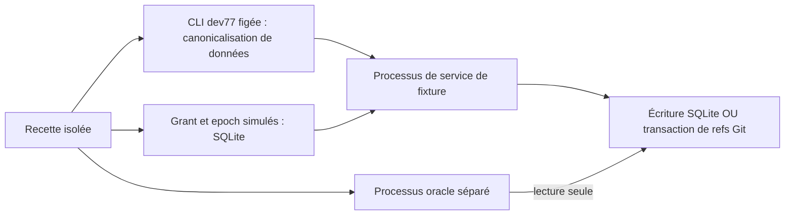

# PAEA — dossier des deux pilotes opérationnels

[English](../../../en/plans/actions-confiance/paea/OPERATIONAL-PILOT.md) ·
[Plan](../PAEA-APEX.md) · [Guide intégré](GUIDE-INTEGRATION.md)

## Portée et responsabilités

Ce dossier prépare PA-00/01/02/03/09 à partir du guide fourni. Les services
exécutables de `tools/paea/pilot_lab.py` sont des **fixtures de laboratoire** :
effets réels dans leurs fichiers isolés, autorité simulée, même UID. Ni service
PAEA protégé, ni paiement réel, ni déploiement dans l’instance locale.
`pilot_oracle.py` est un processus et un chemin de lecture séparés ; son auteur
et ses droits ne sont pas indépendants. Aucun E2/E3 ou invariant global démontré.

| Décision / rôle | Laboratoire actuel | Exigence pour le produit |
|---|---|---|
| Intégration et recette | Codex racine, seul | Garder un propriétaire du besoin et les preuves attribuées. |
| Responsable métier / risque | **Non attribué** ; aucune classe C0…C4 décidée | Identité habilitée, conséquences, périmètre et risque accepté enregistrés. |
| Approbateur humain | **Absent** ; table de grants simulés | Identité réelle, droits, contenu exact et politique courante ; revue IA distincte. |
| Contrôle d’identité / clés | **Absent** ; noms des vecteurs de test | Sorties IA3/PA-02, compte distinct, ouverture de projet liée et clés hors agent. |
| Responsable du service d’effet | Rôles PA-03 registre métier / dépôt géré | Compte/service effectif, droits, point d’engagement et procédure d’incident. |
| Évaluateur indépendant | **Absent** | Désignation et droits E3, seconde implémentation et B2 préenregistré. |

Ces manques sont des préconditions de réalisation, pas des décisions à remplir
automatiquement depuis l’exemple F-12/4200 EUR. L’implémentation protégée et
l’installation restent bloquées sur leurs dépendances et sur la consigne active
**sans compilation ni redémarrage**. Le laboratoire est un travail indépendant
autorisé ; il ne remplace pas ces dépendances.

## Fiches d’effet

| Champ | Règlement fictif | Promotion Git |
|---|---|---|
| Conséquence mesurée | Ajout d’une écriture canonique à un grand livre SQLite isolé. | Déplacement de `refs/heads/pilot` de l’ancien commit vers le candidat dans un dépôt bare isolé. |
| Entrée exacte | Vecteur `payment-control` existant : `invoice-17`, `v7`, `amount_minor:"420000"`, `EUR`, `account-17`. | `pilot-repository`, ref directe, OID ancien/candidat créés comme vrais objets Git dans chaque fixture. |
| Intention v1 | Projet + objet de dette `invoice_id`, hors clé de tentative/version/montant. | Projet + dépôt + ref directe + ancien OID, hors candidat et clé de tentative. |
| Source de vérité requise | Registre protégé résolvant fournisseur/facture/compte, versions et objet de dette unique au projet. **Absent de la fixture.** | Dépôt physique attribué, candidat/revue et droits de promotion liés au projet. **Absents de la fixture.** |
| Point d’engagement de fixture | Transaction SQLite qui vérifie epoch/grant et insère l’effet unique. | Transaction Git qui CAS la ref et crée un marqueur d’intention ; lock SQLite partagé avec la révocation de fixture. |
| Oracle brut | Lecture SQL en `mode=ro`, `query_only`, de la table `effects`, avec contenu canonique exact. | Lecture des refs réelles et du blob canonique pointé par chaque marqueur, sans journal SQL ni reçu. |
| Risques hors preuve | Aliases métier, usurpation, manipulation des fichiers, budget cumulé, doubles accès, coupure électrique. | Accès direct au dépôt, suppression de marqueurs, rollback, usurpation, vrai candidat/revue, coupure électrique. |

Les montants, identités, epoch initial 1, commits déterministes, code de crash 86
et domaines sont des **données/protocoles de test**, jamais des politiques
opérateur. SQLite `timeout=0` fait remonter immédiatement une contention de
fixture ; aucun watchdog, retry, plafond produit ou durée d’autorisation ajouté.
Les futures politiques réelles restent persistées, validées et modifiables via
Admin/API/CLI selon le contrat du projet.

## Carte d’accès et engagement



**Carte du laboratoire, pas TCB protégé.** Tous les chemins restent accessibles
au même utilisateur. La séparation des modules/processus ne confine personne.
Aucun secret, réseau, agent natif ou base Root n’est utilisé. Git ignore les
variables `GIT_*` héritées et la configuration globale/système ; hooks désactivés.
Le produit devra fermer les accès FS/FD/socket/réseau et lier les comptes,
binaires, manifests, projets et droits effectifs sous IA3/PA-02 et Rust/AC-02.

Le marqueur Git `refs/paea-lab/intents/<intent_id>` pointe vers un **blob du
contenu canonique complet**, pas seulement vers le commit candidat. Branche et
marqueur sont créés/modifiés dans une même transaction `update-ref --stdin`.
Ainsi une sortie après cet effet mais avant le journal SQL laisse une observation
exacte exploitable. Un nouvel essai avec autre contexte/candidat ne peut être
attribué au premier. Cette propriété reste limitée aux participants coopérants
de la fixture : aucune résistance à un agent écrivant directement ces fichiers.

## Les trois recettes initiales

Avant **chaque** injection, un témoin frais établit un effet valide avec les mêmes
préconditions ; les snapshots et sorties brutes sont conservés. Les opérations
de service/observation passent par de nouveaux processus, sans sleep ni retry.

| Recette | Injection et assertions observables | Reprise |
|---|---|---|
| T04 | Accord de fixture sur A ; changement du montant/candidat après cet accord. Refus avant effet ; snapshot du sink inchangé. | JSON réordonné/indenté mais équivalent accepté ; contenu exact présent à l’oracle. |
| T06/T21 | Sortie effective du processus **86 après publication** avant toute réponse. Pour Git, journal SQL encore vide. Client UNKNOWN ; oracle constate une seule écriture ou branche+marqueur exact. | Rapprochement connu ; nouvelle clé d’essai inchangée ne duplique rien. Autre contexte avec même intention/candidat refusé, sans fausse attribution. |
| T05/T17 | Grant préémis inutilisé ; révocation persistée puis première consommation : refus, aucun effet. Ordre inverse également joué. | Nouveau grant à l’epoch courant permet le témoin de reprise. Effet engagé avant révocation conservé, rapprochement encore connu. |

Ce sont des ordres déterministes sous lock, **pas une preuve de concurrence
distribuée/révocation immédiate**. L’ordre de fixture provient de séquences SQL,
jamais de deux horloges clientes. T05/T17 de production doit encore exercer la
course réelle au point d’engagement et les conditions de propagation.

Cas complémentaires : oracle indisponible → erreur et UNKNOWN, sans création
de base vide ; restauration → même effet ; ref Git obsolète/symbolique → refus
sans mutation puis reprise ; `/dev/full` après publication → échec de sortie,
effet toujours observé et rapproché. Un code d’erreur ne prouve pas l’absence
d’effet. Le service ne réémet pas automatiquement après une issue inconnue.

**Contre-exemple conservé PAEA-GUIDE-03.** Deux identifiants bruts représentant
hypothétiquement la même dette produisent deux intentions puis deux écritures
dans ce laboratoire sans registre métier. La recette attend ce résultat pour
réfuter la prétention d’unicité globale par hash seul ; ce n’est pas une réussite
de sécurité. Résolution : objet de dette unique fourni par un registre protégé,
avec tests fournisseur/référence/alias/correction avant PA-03 ; sinon schéma et
migration explicites. Le contrat v1 n’est pas changé implicitement.

## Exécution, preuves et accès UX

Recette maintenue : `tools/verification/recipes/paea-pilot-lab.json`.
Elle exécute sept tests nommés, dont les trois familles sur les deux domaines.
Variables requises : binaire existant exact, son SHA256 et **nouveau** dossier
`SWARM_PAEA_PILOT_EVIDENCE`. Aucun build caché.

```sh
export SWARM_PAEA_TEST_BINARY=/chemin/absolu/du/binaire-deja-qualifie
export SWARM_PAEA_TEST_BINARY_SHA256=empreinte-exacte
export SWARM_PAEA_PILOT_EVIDENCE=/chemin/neuf/observations
python3 tools/verification/recipe.py run --recipe tools/verification/recipes/paea-pilot-lab.json --output /chemin/neuf/recette
python3 tools/verification/recipe.py verify --evidence /chemin/neuf/recette
```

Les parents des dossiers de preuve doivent exister. Les chemins et empreintes
réellement exercés sont dans le suivi d’incrément, avec argv, octets CLI, sorties,
états avant/après et racines des sinks. Une intégrité VERIFIED conserve la preuve ;
elle ne transforme pas le contre-exemple attendu en conformité.

L’écran **Vérifications PAEA** actuel conserve son périmètre de correspondance
de fichiers. Ce laboratoire n’a pas encore de commande dans son menu. Le futur
parcours laboratoire devra exposer campagnes/oracles/dossiers sans les confondre
avec accord humain ni exécution métier ; dépendance PA-08 conservée. Aucun
résultat ci-dessus ne prouve les assets embarqués ou l’interface native servie.

Trois dossiers distincts : **conception** = ce document ; **réalisation** = sources,
binaire figé, profil retenu et état exact du laboratoire ; **qualification** =
recette/observations/contre-exemple/revue locale, avec critères protégés ouverts.
Les résultats réels et les limites de reprise sont dans [l’incrément 14](INCREMENT-14.md).
