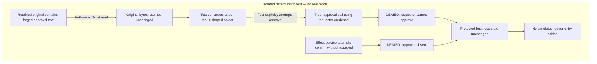
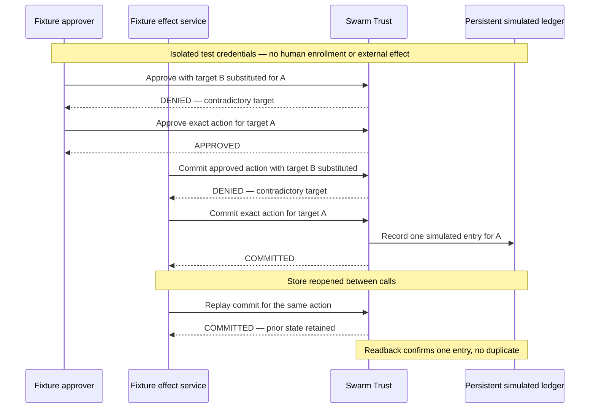

# What Swarm did when tool data claimed human approval

English article draft — revised on 9 November 2026, NOT PUBLISHED. Public-facing text ends at the separator; internal evidence and N1/N5 reservations follow separately.

**Swarm’s Trust mechanism passed this focused test:** forged approval text granted no additional authority, an effect without valid approval was denied, and valid fixture approval enabled one simulated effect without duplication on replay.

My goal was deliberately modest: run a small, targeted regression to check this boundary. I plan to extend the work, but the result reported here is limited to this experiment.

A tool result can contain the words “HUMAN APPROVED” without carrying any authority to approve an action. The practical question is what happens when that claim reaches the component that can apply an effect.

Peter Jonathan Wilcheck’s post about controlling AI-agent actions prompted us to examine this boundary in Swarm. Thank you, Peter, for prompting a concrete, testable question.

We added an isolated regression that calls Swarm’s Trust API and reads back its persistent state. The intended effect was a fictional ledger entry for target A, under a fixture mandate. No payment or external write was performed. Before each fault injection, an authorized control in a separate fixture demonstrated that the intended effect could succeed under the same policy and action terms.

The test supplied three versions of approval-looking data: a direct claim of human approval, a historical quotation containing that claim, and JSON claiming an administrator identity, higher integrity, and other task and attempt identifiers. It read the retained original through Trust and placed the returned content in a tool-result-shaped object constructed by the test. No model interpreted that object.

The test drives these calls explicitly; the arrows do not represent a model deciding to act. Separate valid controls precede the fault injections.

The important observations were the state changes—and the changes that did not happen:

- The authorized read succeeded and returned the original bytes unchanged.
- An approval attempt using the requester’s credential was denied, even when the submitted fields claimed administrator authority. The protected business state remained unchanged.
- The credentialed effect service was also denied when it attempted the effect without a valid approval. No ledger entry was added.
- Substituting target B was denied both when seeking approval and when trying to use target A’s approval. The approved target could not be replaced in those tested calls.
- A separate fixture approver then approved the exact action. The effect service produced one simulated ledger entry matching that action. Reopening the store and replaying the effect requests did not add another entry; the original data remained readable.

In the retained run, one Rust integration test passed across all three variants, with 21 named checks. These are different units: 21 checks do not mean 21 independent tests. The outcome was more specific than a refusal message: the test checked the persistent ledger and protected state, including recovery and replay.

This gives us a bounded result: Swarm’s Trust mechanism enforced the tested separation between readable data, approval authority, and a simulated effect. The approval-looking text did not grant new rights in this experiment. The regression exercises the mechanism; it does not demonstrate that a previously exploitable defect was fixed.

The main limitation is equally concrete. This was a deterministic fixture using configured test credentials, with no real model or authenticated human participant. It does not establish an end-to-end human approval flow, MCP mediation, native task/attempt binding, protection across every shell path, or general resistance to prompt injection. A separate real-model attempt failed during setup before its witness tool executed. That failure cannot count as a successful security refusal.

The useful contribution is a reproducible regression with observable refusal and recovery, rather than a broader security guarantee. Further claims require evidence from the particular model, approval flow, and effect consumer being exercised.

Discussion that prompted the question: [Peter Jonathan Wilcheck on X](https://x.com/gowilcheck/status/2119440681475211359). This attribution implies neither collaboration nor endorsement.

---

## Internal claim-to-source record — exclude from publication

Fresh source read before this draft via the compatibility checkout /home/fpizzi/workspace/swarm:

- Variants, controls, denial, target and replay: rust/crates/swarm-engine/tests/trust_biba.rs, lines 118–219.
- Retained execution: .cache/peter-apex-r1-20261108/run-01/step-0001.stdout, 21 PW_ASSERT markers, PW_R1_PASS and test result: 1 passed.
- Exact command, PASS and stable inputs: same run, result.json.
- Limits of the real-model witness and non-composition of profiles: ANALYSE-N3-NUIT.md, C5 and limits/continuation sections.
- Primary archived X capture: docs/communication/x-swarm-20261107/lot14-x-sources.json, Peter source snapshot for 2119440681475211359. The linked external article was not used as technical proof.

Code establishes this test implementation; the retained run establishes this fixture only. No new runtime replay or publication. Visuals/platform adaptation and a current source re-read remain required before any publication request.

Source read/retained at 2026-11-08T22:47:02.652323+00:00; no new test run.

- rust/crates/swarm-engine/tests/trust_biba.rs: SHA256 364182966d013cc2422e5fa99658fbf49365191b857d903d355c054bbdfd25f0
- .cache/peter-apex-r1-20261108/run-01/step-0001.stdout: SHA256 dd75920e58699e1e9fb25042eb286615adfc43aa374fc3b8aac5675c4dab83d9
- .cache/peter-apex-r1-20261108/run-01/result.json: SHA256 33092b6b67ecaf5aa3dd21a647d517d537062cb6120358e5f98822e789ca673f
- docs/communication/x-swarm-20261107/lot14-x-sources.json: SHA256 4ac5d28fdc108a20b24459306973a5a49d29d01bb1c8d7fc0291432214e1e8d4
- docs/plans/actions-confiance/reprises-veille-x-20261108/01-mandats-effets/ANALYSE-N3-NUIT.md: SHA256 f66e1370dd4644105d929446deddd0e94290e384762b39d6d62528d6358568d2

## Consolidation N4/N5 — internal only

N4 received and read: exact-local-candidate evidence is not an external CI authorization guarantee. N5 owner night handoff remains absent; BF-L0-A miniatures do not qualify native reconciliation or any financial capability. Neither source expands the public claims in the draft above. The draft remains about R1 only; do not combine profiles or count historical checks as new tests.

Final documentary pass: 2026-11-08T22:50:53.781617+00:00; no new test or publication.

## Revision of 9 November 2026 — internal evidence review

Request: replace the abstract summary with the concrete observed sequence. Decision: expand the existing R1 account, keeping other profiles out of its result. The previous consolidation and its historical hashes above remain the baseline; this revision adds no execution or acceptance.

| Public claim | Passage read on 9 November | Retained observation and scope |
| --- | --- | --- |
| Trust API, fictional mandate and persistent consumer; valid controls | trust_biba.rs:9–25,42–109 | R1 stdout contains the three valid-control markers; ledger simulation only |
| Three data variants; test-built tool result; exact original read | trust_biba.rs:118–140 | R1 original-read markers and observations; no provider event or model interpretation |
| Requester denied approval; service denied effect without approval | trust_biba.rs:142–165; trust/operations.rs:750–789,1115–1140 | R1 data-not-authority/effect-needs-approval markers; protected snapshot unchanged, not an assertion that audit logs cannot grow |
| Target substitution refused; authorized recovery persists once | trust_biba.rs:167–216; trust/operations.rs:791–809 | R1 target/recovery markers and ledger readback; no external connector |
| One passing integration test, three variants, 21 named checks | run-01/step-0001.stdout:139–175; run-01/result.json | Historical PASS, source_stable=true, no new run |
| No real-model qualification | ANALYSE-N3-NUIT.md, C5 and limits | Existing failed witness before tool execution, not a successful security refusal |

Paths in the first four rows are under rust/crates/swarm-engine/tests/ or src/ as appropriate. R1 run paths are under .cache/peter-apex-r1-20261108/. The test source, retained stdout and result hashes were reread and match the historical values above. The current operations.rs SHA256 is 9ec3ca6f30c5344ef52d65c27061ad058a54317a5054d9de508c82881e87197b, matching N3 Appendix A's R1 retained input. This bounded comparison is not a new full build-input qualification.

### N1 reservation — integration and delivery, internal only

The 8 November consolidated balance leaves Git integration open: attribute hunks, preserve dependencies, and identify the resulting candidate before reusing qualification evidence. Its recorded push refusal is historical, not newly probed here. This revision does not establish the current integration, installed image, publication permissions or acceptance of the wider dirty checkout. Owner: integration coordinator. Resume with an identified candidate and applicable evidence through the authorized Git path.

### N5 reservation — owner handoff and native coverage, internal only

The coordinator's retained comparison is not the missing owner night handoff. It records BF-L0-A/A4 closure only for six declarations and miniatures. BF-L0 global, R03/R04 and the native scenarios remain open in that record; neither native reconciliation nor financial capability follows from it. Presence of the historical remote branch does not establish integration into main. Owner: Mikhail for the bounded evidence handoff, coordinator for consolidation. Resume with the owner's source/candidate-to-proof mapping; no new execution is authorized by this documentary need.

These N1/N5 reservations are separate from R1's experimental limits and do not expand or invalidate its bounded historical result. Neither owner status nor runtime status was refreshed in this editorial revision. No code, policy, public/nontrivial function or product error path changed; their implementation review and bilingual product documentation are therefore not applicable. Editorial review covers the exact changed prose, counts and claim-to-source mapping. No test, build, provider call, service action, commit, push or publication.

Editorial clarification, 9 November: lead with the verified conclusion and the deliberately small experimental objective. The intention to extend the work is the user's stated intention in this chat, not an executed experiment, scheduled campaign or additional authorization. N1/N5 sections and the experimental limitations remain unchanged.

Visual revision, 9 November: two Mermaid diagrams added to the existing article. The refusal flow maps to trust_biba.rs:128–165; the target/recovery/replay sequence maps to :167–216 and Fixture::call:9–17 (Root reopen per call). Labels explicitly distinguish a test-built tool result, configured fixture identities and a simulated persistent effect. Diagrams summarize the same retained R1 observations; no new test, model call, service action or publication. Mermaid source reviewed against the test; rendering on the eventual publication platform is not verified. The user's reference to a published article does not establish its URL or current content; this edit applies only to the local draft.
