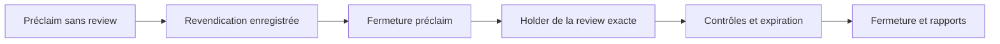

# WIP — transition du candidat du producteur Gi.eth

Source revue et compilation SDK réussie ; vérification fonctionnelle encore ouverte : ne pas fusionner comme validée.

Le contre-exemple R09-CUSTODY-1 de la première sauvegarde7088121 est résolu à la source par deux détenteurs distincts. sources::request acquiert/rafraîchit le candidat préclaim hors SQL ; son callback garde les transactions de préparation/revendication et renseigne Work/claim connus avant sa fermeture. sources::job acquiert ensuite le détenteur de la review réellement enregistrée/running hors SQL ; son callback garde owner/fraîcheur/horloge/expiration/historique. Aucune égalité, protection I0, politique de budget/TTL ou limite supprimée. Les erreurs après claim ne signifient pas rollback.

Revue09 APPROVE_SOURCE_ONLY : SHA6b3d83798f27900c0c035197cf96ef41e870693c99adeef52a15b554e0fc9263. Source5c0e1ab29b4eb87673b126f2314c34d5c8ef343d5ca957894d8a8b567f1ff14a ; preuves privées /run/media/fpizzi/SWARM/swarm-evidence/root00-gi-custody-transition-u41ymcya. Une ligne blanche séparatrice supprimée, aucun autre corps de fonction changé.

Restent requis : vrai témoin managed valide avant mauvais/nonrunning review et cleanup conservant knownWork, puis reprise contrôlée. Aucun test fonctionnel/W/SDK/F/installation/acceptation réalisé pour ce candidat. Le Work refusé w-83e055eae3e47c27a0f5043c, dernière lecture rev14/calls0, n’est pas modifié. Les anciens scénarios ne sont pas rejoués.

## Observation de compilation seule —16novembre2026

Un build engine offline/locked `--lib --no-run` terminé avec code0 ; aucun corps de test exécuté. Artefact engine réel test=true/features=[],558entrées workspace effectives conformes aux947candidats archivés avant Cargo et relus. ELF temporaire figé9b1d5baae0f4f20a305527dcbce611681a243632f367db41cf603a4df2e43f1c, commit source86c29e91f28dc3df016b8bdcf4d7a4ef01be6b8a. Reçu racine82046168701a3ca30654254617955bc5ad2b9cdcd77f9e8335dfede4aba73dae dans `/run/media/fpizzi/SWARM/swarm-evidence/root00-sdk5c-build-3l38zm8u`. Portée compilation/emprunts et profil test workspace, pas authentification complète par unité/compilateur/registry/générés, témoin managed, W/F, production ou version installée. La documentation ne reconstruit ni ne rebaptise le SDK source.
