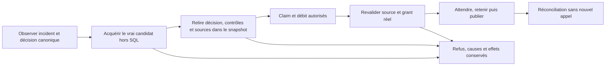

# GI-MR-RECOVERY-01 — reprise contrôlée d’une revue native gérée

État au 2026-11-16T16:34:57.759745+00:00 : plan proposé, non implémenté, non testé, soumis à audit indépendant. Propriétaire : Swarm00 ; production déléguée à un seul paquet GLM borné à la fois. Autorisation : plans Swarm humains en cours, aucune extension vers X, facturation/cloud ou DB live.

## Besoin et origine

Réutiliser la tentative, le candidat et les contrôles du Work synthétique actuel après une erreur de réponse du reviewer, au moyen d’une décision explicite du planificateur. Conserver l’erreur et sa consommation. Le W réel a échoué parce que le principal avait utilisé le protocole ordinaire sur une revue gérée ; ce n’est pas un défaut démontré du décodeur. Work `w-091168d1977007fbe4807a52`, révision19, appels1sur2 ; aucun second appel. Les entrées précédemment réussies ne sont pas rejouées à l’identique.

Sources primaires lues le16novembre : `root_store/review_preview.rs` (with_prepared_review et prepare_review_snapshot_using), `task_validation/review_candidate.rs`, `task_validation/managed_execution.rs` (review_source/inputs_using/acquire/prepare_for_review), `task_validation/observation.rs`, `root_store/review_recovery.rs`, `planning_decision.rs` (retry_review), `planning_scope_context.rs`, `root_store/native_review_context.rs` (lecteur original et acquittement canonique), `reviewer_native/claim.rs`. Base du checkout : branche `codex/wip-gi-candidate-custody-20261116` ; aucune source Rust modifiée pour ce plan. Les extraits/hash réellement remis sont conservés dans `/run/media/fpizzi/SWARM/swarm-evidence/root00-managed-preparer-cq1joyiy/managed-recovery-contract-glm/context.txt` SHA42e7a0a347a221ec3c790150572b7c3bb9e37167e83ca88b4012016cd677f10c.

## Faits et limites

- Exécuté : préparation gérée, un worker et un contrôle réussis ; première revue refusée pour `review-reply-noncanonical-field`, puis état/ledger lus. Originaux : `/run/media/fpizzi/SWARM/swarm-evidence/root00-managed-preparer-cq1joyiy/managed-W-adapter-glm/FAILED-W-ORIGINALS`. Reçu de préparation SHA f8da5f816643a0a516c1bc022f503df3891708c139f2ce124a384351b828d644.
- Source seulement : l’acquisition du candidat utilise Fresh et refuse un review existant en erreur ; plus loin, review_recovery exclut repositorySome, puis prepare_review_snapshot_using refuse recovery+candidate. Les gardes ne sont pas retirées pour faire passer le scénario. Aucun chemin de reprise équivalent établi dans le parcours examiné ; ce n’est pas un audit de toutes les opérations publiques.
- La décision planning review-retry doit consommer/acquitter le vrai incident et être relue canoniquement ; reconcile, nouvel événement ou programme corrigé ne confèrent aucun droit.
- Correction de fixture conservée en WIP9ee825966e5ca226ee02e72509426a6c3c41f415, pas fusionnée ni exécutée après REQUEST_CHANGES09. Le script persistant est explicitement bloqué.

## Contrats requis

MRR-01 — conserver original privé, certificat, capture, code d’échec typé et historique ; un non-verdict ne devient ni PASS ni acceptation.

MRR-02 — observer le vrai Root/instance DB, tentative/producteur, contrat et décision/acquittement sous snapshots autoritaires ; aucune permission dérivée d’un JSON, hash, UID commun ou texte d’erreur. Une première phase ne transporte que des coordonnées relues, pas une autorité de source.

MRR-03 — acquérir/rafraîchir/fermer le véritable propriétaire du candidat en dehors des verrous SQL/settings. L’observation de reprise doit être explicite et interne ; ne pas convertir simplement tout Some(error) en autorisation ReviewerRetry. Revalider ensuite la décision et les mêmes sources dans la transaction consommatrice.

MRR-04 — lier candidat/commit, mapping du plan de contrôles, receipt/job/source et protocole géré de l’original au candidat actuel complet. Ne pas relire les artefacts gérés par un chemin Root ordinaire avant leur custody. Fraîcheur, funding, grant, wait, close, annulation, publication et causes restent contrôlés par leurs vrais producteurs.

MRR-05 — conserver appels1→2 au maximum pour le Work actuel, aucun reset/relèvement, aucune nouvelle mission de substitution. Le worker, rapport et contrôle actuels ne sont pas réexécutés si leurs entrées pertinentes restent inchangées ; nouvelle validation seulement sur dérive justifiée.

MRR-06 — préserver les voies Fresh, Claimed, RecordedOpinion et ordinaires : aucun fallback, aucun mode request-supplied. La matrice de refus couvre absence de décision, mauvais acquittement/original/tentative/candidat/contrôle/instance/source/policy, owner ou nettoyage incertain, et quota épuisé.

MRR-07 — toute issue après claim garde l’effet connu ou incertain : Work/révision/débit, commit non confirmé, grant/wait/fermeture/publication et causes secondaires. Un Err ne prouve pas l’absence de mutation. Avant claim, un refus ne débite aucun appel et ne modifie pas le Work ; diagnostics et éventuels artéfacts préparés immuables restent conservés avec leur état réel, sans prétendre à une absence globale d’effet.

Flux proposé, non implémenté :

## Prochain lot et preuves

1. Lire les fonctions complémentaires signalées SOURCE_MISSING par GLM et leurs consommateurs ; compléter les empreintes et l’effet de task.next sur le binding. Le premier plan GLM n’est pas adopté comme code.
2. Comparer un port de purpose interne avec observation préalable vérifiée + custody/contre-vérification, à la réutilisation des sources de job existantes ; choisir seulement une route qui préserve les droits. Aucune suppression isolée des trois gardes. Auditer le plan avant patch.
3. Un seul paquet GLM de production sur fonctions réservées, puis intégration principale et revue indépendante des octets,3axes politiques/docstrings/erreurs. Documentation FR/EN et recette permanente dans le même incrément.
4. Régression déclarée avant lancement : témoin valide avant faute. Préciser les Roots et compteurs : soit témoins et faute/reprise séparés avec préconditions comparées et max_calls2 dès naissance, soit même fixture avec budget3 explicitement initial ; jamais remettre le compteur à zéro entre témoin/faute/reprise ni augmenter le Work existant. Données inertes, aucun vrai provider.
5. Prouver décision réellement reçue, application autorisée, source-custody et effet : original conservé, reprise applicable, même contrôle/candidat et un seul nouveau débit ; tester refus et reprise après correction. Ne rejouer ni campagnes historiques ni suites PASS inchangées.
6. Seulement après source/Rust réels modifiés : compilation/contrôles ciblés justifiés, profils SDK/CLI séparés, métadonnées et archives source avant exécution, garde20Gio+allocation et volume externe détenu jusqu’aux publications. Les anciens PASS compilés restent historiques.
7. Reprendre le Work actuel seulement après protocole réellement porté et décision publique vérifiée. Commit/PR/checks/main et livraison locale vérifiée restent des étapes distinctes ; aucun merge de WIP ni acceptation fabriquée. RETEX puis prochain lot indépendant.

Condition de reprise : audit de spécification recevable, sources manquantes effectivement lues, fichiers/graphes réservés et réserve disque fraîche. Aucune demande humaine supplémentaire identifiée à ce stade ; une nouvelle décision réellement manquante serait explicitée avec preuve.

### Revue de conception du 16 novembre — MRR-D01 à D03 ouverts

La remise GLM `7d9395f620c8968b054cce3ce233763f413fd8b78336ae6d4ac22577737e6b6f` a été lue entièrement puis revue par09 (tour01a1e549-078d-7500-8e80-ed0ec154d46a). La route données vérifiées → custody hors SQL → recheck transactionnel est recevable, mais le design proposé ne suffit pas pour un patch complet. MRR-D01 : couvrir le job running après claim, son erreur immédiatement archivée et la reconstruction identique du contexte. MRR-D02 : transmettre la directive corrective dans le prompt géré, hors des citations. MRR-D03 : conserver le purpose explicite du holder lors du refresh avant claim, puis utiliser le holder running propre aux rechecks sans nouvelle admission après mutation.

Premier incrément de production délégué : seulement l’assemblage du contexte dans `review_preview/inputs.rs`, mutualisé avec le parcours ordinaire, avec tests inertes de contenu/absence/refus. Il ne lève aucune garde et ne prouve pas la reprise gérée. Le portage custody/après-claim reste ouvert. Work courant19, compteur1/2 inchangés ; aucun second W, aucun replay des campagnes historiques.

### Incrément préalable MRR-D02 — source et helper vérifiés, reprise non portée

Le helper `append_recovery_context` dans `review_preview/inputs.rs` mutualise le contexte correctif ordinaire et géré. La directive reste hors des matériaux citables/catalogue et précède l’encodage et la limite totale du prompt. Sources `9a8cebf74b4c6cfdb380fd45a3148152d78e096bf9267dbe56b4baafc658d93f`, revue indépendante09 APPROVE_SOURCE_ONLY (tour01a1e550-c91b-7451-8583-e2c2adf6cc83). Trois nouveaux tests inertes PASS (absence inchangée ; directive complète et matériaux préservés ; refus non-objet après témoin valide) via Cargo `--lib` et filtre `root_store::review_preview::inputs::tests::recovery_`. Preuves et inventaire effectif dans `/run/media/fpizzi/SWARM/swarm-evidence/root00-managed-preparer-cq1joyiy/prompt-prerequisite-check-01/`. Profil bibliothèque de test, sources stables ; aucune compilation production, installation, admission de reprise ou validation du parcours géré complet.

Suppléance principale bornée car GLM produisait encore du raisonnement sans patch final ; aucun appel doublé ou plafond ajouté. Sa remise finale après531.299s  propose la même mutualisation, lue entièrement et comparée ; sa docstring « exactement une fois » ne serait pas une garantie d’idempotence et n’a pas été reprise. Usage déclaré exact67451tokens, dont59693sortie ; aucun tarif/quota Codex déduit. Version principale relue/testée conservée, pas de remplacement post-PASS. MRR-D01/D03, MRR-D02 parcours complet et P2 restent ouverts. Work19/calls1/2 inchangé. Aucun rejeu historique, second W, service, provider ou acceptation.

### 2026-11-16T19:58:13.549186+00:00 — support externe absent et remise GLM non disponible

Incident STORAGE-EXT-DISCONNECTED-GLM-20261116 : point SWARM absent, aucun disque correspondant à UUID144f255c-3c71-43aa-9ae6-c46a6e5b8a9f dans l’inventaire actuel. Client GLM2840506 encore dormant, flux1065528octets sans nouveau fragment depuis9391s observées. La lecture de son FD conservé renvoie EIO ; aucune copie des fragments n’a pu être sauvée. Client exact arrêté via pidfd/SIGTERM, parent2840493 et client ensuite absents. Wrapper39927 terminé1 car sa publication CHILD.json sous le montage absent refuse ; aucun répertoire de remplacement créé. Résultat/consommation serveur inconnus, pas de relance. La cause du gel SSE et celle de la disparition du support ne sont pas établies ni assimilées.

Diagnostic local `.cache/glm-detached-storage-20261116-sjobqe_z/DIAGNOSIS.json` SHA256`0ecb452f039f359194c5c1dd47814cef372042db9207c3ec02dcc46c9dfbd8f0`. Checkpoint source565880c6b7debe8ed4da4f6e63ea82dec5be6e16 et checkout CI propre revérifiés ; aucun nouveau test/build/provider/Git. Les anciens PASS et transferts restent historiques, leur intégrité externe doit être relue après reconnexion. Aucun constat de perte de code/données déduit. Reprise : Fabrice reconnecte le disque, root vérifie identité/montage/rw puis lisibilité/hashes des preuves et issue partielle avant un nouveau paquet borné. Pas de nouvel accès sous point absent, ni retrait de garde20Gio. Intervalle sans supervision observée ici17h11→19h54 ; configuration active ne prouve pas son exécution, cause réseau/ordonnanceur inconnue.

### 2026-11-16T21:31:51.903182+00:00 — support revenu, réserve rétablie ; accès SKYNET indisponible

Le même support SWARM est remonté ext4/rw avec UUID attendu. Contexte primaire SHAa883e775… et anciens relevés3PASS/558sources relus conformes ;16sources du paquet local inchangées. Ancien flux récupéré1019904octets contre1065528observés avant disparition (45624octets de différence), sans DONE ni contenu final : preuve partielle conservée, aucune réponse GLM complète ni consommation établie. [Relevé externe](/run/media/fpizzi/SWARM/swarm-evidence/root00-managed-preparer-cq1joyiy/VOLUME-RETURN-READBACK-20261116.json). Ce contrôle ciblé ne requalifie pas tout le corpus externe et ne ferme pas Lexar.

Réserve hôte restaurée à25.54Gio par la seule purge autorisée du cache inutilisé builderdefault, commande exacte sans--all. Docker rapporte7.098GB ; identifiants images/volumes et états/StartedAt des conteneurs conservés. [Avant/après](/run/media/fpizzi/SWARM/swarm-evidence/root00-returned-volume-cache-tyeks6tm/result.json). Aucun code, donnée, image, conteneur ou volume supprimé par cette opération.

Nouveau paquet GLM réduit2fichiers, distinct de l’appel figé, arrêté naturellement2/URLError DNS en0.038s. `chat.skynet.cossi.internet` ne se résout pas (getent2), témoin `openai.com` se résout (0), Wi-Fi connecté/Ethernet indisponible ; cause réseau/VPN/DNS précise non établie. Aucun retry, changement réseau/hosts/VPN, test/build ou mutation Git. [Diagnostic](/run/media/fpizzi/SWARM/swarm-evidence/root00-managed-preparer-cq1joyiy/managed-review-purpose-glm/DNS-DIAGNOSIS.json). Fabrice/opérateur réseau : rétablir résolution/accès interne ; root recontrôle la précondition et les hashes avant un seul paquet borné. Aucun patch reçu ; MRR-D01/D03 et parcours complet ouverts.

### 2026-11-16T22:17:46.225443+00:00 — préalable MRR-D03 possédé : source revue, compilation seulement

Deux fichiers intégrés dans le checkout CI : `task_validation/review_candidate.rs` SHA256`2c4e9e72aaa63ee96f628431f6c218252609a161584b98f79618bbcb3a783918` et `managed_execution.rs` SHA256`e98ca58abb3c9f94f052930e9ac7c89edfe9baf82d980039617b579220fc5b56`. GLM a produit une proposition complète après495.539s, usage déclaré122240tokens ; ni tarif ni quota Codex déduit. Root a reconstruit les hunks aux anciens blocs exacts (un contexte de doc inexact corrigé), refusé toute construction implicite de ReviewerRetry par le mapping historique, dérivé le purpose avant acquisition et refusé explicitement le preview historique sur holderRetry. Revue indépendante09 APPROVE_SOURCE_ONLY, tour01a1e66b-2350-73f2-9b48-fa159ded1571, primaire `/run/media/fpizzi/SWARM/swarm-evidence/root00-managed-preparer-cq1joyiy/managed-review-purpose-glm/REVIEW09-PURPOSE-PRIMARY.json`.

Purpose/record sont possédés et projetés par emprunt vers ReviewSource ; les helpers explicites préservent ce purpose lors d’acquisition, préparation et refresh. Les hooks privés acquire_for_retry/preview_for_retry restent non câblés aux opérations publiques/claim. Recovery reste une observation, pas un permis ; vérification Root originale/décision canonique et contre-vérification consommateur restent nécessaires. Aucun changement de politique, compteurs, autorité, digest source ou binding contrôle/candidat. Fonctions nouvelles/modifiées documentées ; causes typées et paires rollback/fermeture revues.

Cargo `--lib --no-run --offline --locked` terminé0, profil de test bibliothèque par défaut sans features supplémentaires, 558entrées effectives archivées/relues ; sources avant/après stables. ELF de test`738db0f581eb36080c77d8eccfa208c8cb0084720ebb428baedb6cd36791221e` conservé comme preuve0400nonexécutable dans `/run/media/fpizzi/SWARM/swarm-evidence/root00-managed-preparer-cq1joyiy/purpose-prerequisite-compile-01`. **Zéro corps de test exécuté**, aucun PASS fonctionnel déduit. Les3tests helper précédents sont historiques et réutilisés dans leur portée inchangée, pas rejoués. Aucune installation/acceptation : paquet préparatoire incomplet, aucun binaire de production actuel qualifié pour ce contrat. MRR-D01, MRR-D03 comportemental, W/SDK/F et P2 restent ouverts.

Limite de recette : le runner dérivé a gardé dans sa docstring une mention « missing tests » alors que son argv/compteur/summary indiquent explicitement --no-run/0. Cette prose ne constitue pas un contrôle exécuté. Script réellement employé et copie archivés inchangés ; corriger la documentation d’une prochaine recette avant usage, pas de rejeu pour remplacer cette preuve.
