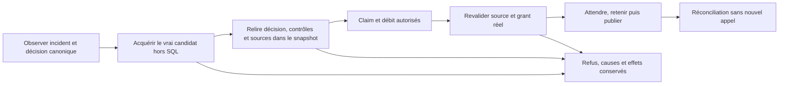

# GI-MR-RECOVERY-01 — reprise contrôlée d’une revue native gérée

État au 2026-11-16T16:34:57.759745+00:00 : plan proposé, non implémenté, non testé, soumis à audit indépendant. Propriétaire : Swarm00 ; production déléguée à un seul paquet GLM borné à la fois. Autorisation : plans Swarm humains en cours, aucune extension vers X, facturation/cloud ou DB live.

## Besoin et origine

Réutiliser la tentative, le candidat et les contrôles du Work synthétique actuel après une erreur de réponse du reviewer, au moyen d’une décision explicite du planificateur. Conserver l’erreur et sa consommation. Le W réel a échoué parce que le principal avait utilisé le protocole ordinaire sur une revue gérée ; ce n’est pas un défaut démontré du décodeur. Work `w-091168d1977007fbe4807a52`, révision19, appels1sur2 ; aucun second appel. Les entrées précédemment réussies ne sont pas rejouées à l’identique.

Sources primaires lues le16novembre : `root_store/review_preview.rs` (with_prepared_review et prepare_review_snapshot_using), `task_validation/review_candidate.rs`, `task_validation/managed_execution.rs` (review_source/inputs_using/acquire/prepare_for_review), `task_validation/observation.rs`, `root_store/review_recovery.rs`, `planning_decision.rs` (retry_review), `planning_scope_context.rs`, `root_store/native_review_context.rs` (lecteur original et acquittement canonique), `reviewer_native/claim.rs`. Base du checkout : branche `codex/wip-gi-candidate-custody-20261116` ; aucune source Rust modifiée pour ce plan. Les extraits/hash réellement remis sont conservés dans `/run/media/fpizzi/SWARM/swarm-evidence/root00-managed-preparer-cq1joyiy/managed-recovery-contract-glm/context.txt` SHA42e7a0a347a221ec3c790150572b7c3bb9e37167e83ca88b4012016cd677f10c.

## Faits et limites

- Exécuté : préparation gérée, un worker et un contrôle réussis ; première revue refusée pour `review-reply-noncanonical-field`, puis état/ledger lus. Originaux : `/run/media/fpizzi/SWARM/swarm-evidence/root00-managed-preparer-cq1joyiy/managed-W-adapter-glm/FAILED-W-ORIGINALS`. Reçu de préparation SHA f8da5f816643a0a516c1bc022f503df3891708c139f2ce124a384351b828d644.
- Source seulement : l’acquisition du candidat utilise Fresh et refuse un review existant en erreur ; plus loin, review_recovery exclut repositorySome, puis prepare_review_snapshot_using refuse recovery+candidate. Les gardes ne sont pas retirées pour faire passer le scénario. Aucun chemin de reprise équivalent établi dans le parcours examiné ; ce n’est pas un audit de toutes les opérations publiques.
- La décision planning review-retry doit consommer/acquitter le vrai incident et être relue canoniquement ; reconcile, nouvel événement ou programme corrigé ne confèrent aucun droit.
- Correction de fixture conservée en WIP9ee825966e5ca226ee02e72509426a6c3c41f415, pas fusionnée ni exécutée après REQUEST_CHANGES09. Le script persistant est explicitement bloqué.

## Contrats requis

MRR-01 — conserver original privé, certificat, capture, code d’échec typé et historique ; un non-verdict ne devient ni PASS ni acceptation.

MRR-02 — observer le vrai Root/instance DB, tentative/producteur, contrat et décision/acquittement sous snapshots autoritaires ; aucune permission dérivée d’un JSON, hash, UID commun ou texte d’erreur. Une première phase ne transporte que des coordonnées relues, pas une autorité de source.

MRR-03 — acquérir/rafraîchir/fermer le véritable propriétaire du candidat en dehors des verrous SQL/settings. L’observation de reprise doit être explicite et interne ; ne pas convertir simplement tout Some(error) en autorisation ReviewerRetry. Revalider ensuite la décision et les mêmes sources dans la transaction consommatrice.

MRR-04 — lier candidat/commit, mapping du plan de contrôles, receipt/job/source et protocole géré de l’original au candidat actuel complet. Ne pas relire les artefacts gérés par un chemin Root ordinaire avant leur custody. Fraîcheur, funding, grant, wait, close, annulation, publication et causes restent contrôlés par leurs vrais producteurs.

MRR-05 — conserver appels1→2 au maximum pour le Work actuel, aucun reset/relèvement, aucune nouvelle mission de substitution. Le worker, rapport et contrôle actuels ne sont pas réexécutés si leurs entrées pertinentes restent inchangées ; nouvelle validation seulement sur dérive justifiée.

MRR-06 — préserver les voies Fresh, Claimed, RecordedOpinion et ordinaires : aucun fallback, aucun mode request-supplied. La matrice de refus couvre absence de décision, mauvais acquittement/original/tentative/candidat/contrôle/instance/source/policy, owner ou nettoyage incertain, et quota épuisé.

MRR-07 — toute issue après claim garde l’effet connu ou incertain : Work/révision/débit, commit non confirmé, grant/wait/fermeture/publication et causes secondaires. Un Err ne prouve pas l’absence de mutation. Avant claim, un refus ne débite aucun appel et ne modifie pas le Work ; diagnostics et éventuels artéfacts préparés immuables restent conservés avec leur état réel, sans prétendre à une absence globale d’effet.

Flux proposé, non implémenté :

## Prochain lot et preuves

1. Lire les fonctions complémentaires signalées SOURCE_MISSING par GLM et leurs consommateurs ; compléter les empreintes et l’effet de task.next sur le binding. Le premier plan GLM n’est pas adopté comme code.
2. Comparer un port de purpose interne avec observation préalable vérifiée + custody/contre-vérification, à la réutilisation des sources de job existantes ; choisir seulement une route qui préserve les droits. Aucune suppression isolée des trois gardes. Auditer le plan avant patch.
3. Un seul paquet GLM de production sur fonctions réservées, puis intégration principale et revue indépendante des octets,3axes politiques/docstrings/erreurs. Documentation FR/EN et recette permanente dans le même incrément.
4. Régression déclarée avant lancement : témoin valide avant faute. Préciser les Roots et compteurs : soit témoins et faute/reprise séparés avec préconditions comparées et max_calls2 dès naissance, soit même fixture avec budget3 explicitement initial ; jamais remettre le compteur à zéro entre témoin/faute/reprise ni augmenter le Work existant. Données inertes, aucun vrai provider.
5. Prouver décision réellement reçue, application autorisée, source-custody et effet : original conservé, reprise applicable, même contrôle/candidat et un seul nouveau débit ; tester refus et reprise après correction. Ne rejouer ni campagnes historiques ni suites PASS inchangées.
6. Seulement après source/Rust réels modifiés : compilation/contrôles ciblés justifiés, profils SDK/CLI séparés, métadonnées et archives source avant exécution, garde20Gio+allocation et volume externe détenu jusqu’aux publications. Les anciens PASS compilés restent historiques.
7. Reprendre le Work actuel seulement après protocole réellement porté et décision publique vérifiée. Commit/PR/checks/main et livraison locale vérifiée restent des étapes distinctes ; aucun merge de WIP ni acceptation fabriquée. RETEX puis prochain lot indépendant.

Condition de reprise : audit de spécification recevable, sources manquantes effectivement lues, fichiers/graphes réservés et réserve disque fraîche. Aucune demande humaine supplémentaire identifiée à ce stade ; une nouvelle décision réellement manquante serait explicitée avec preuve.
