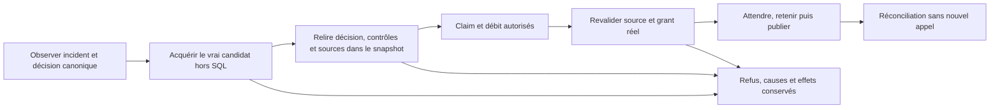

# GI-MR-RECOVERY-01 — reprise contrôlée d’une revue native gérée

État au 2026-11-16T16:34:57.759745+00:00 : plan proposé, non implémenté, non testé, soumis à audit indépendant. Propriétaire : Swarm00 ; production déléguée à un seul paquet GLM borné à la fois. Autorisation : plans Swarm humains en cours, aucune extension vers X, facturation/cloud ou DB live.

## Besoin et origine

Réutiliser la tentative, le candidat et les contrôles du Work synthétique actuel après une erreur de réponse du reviewer, au moyen d’une décision explicite du planificateur. Conserver l’erreur et sa consommation. Le W réel a échoué parce que le principal avait utilisé le protocole ordinaire sur une revue gérée ; ce n’est pas un défaut démontré du décodeur. Work `w-091168d1977007fbe4807a52`, révision19, appels1sur2 ; aucun second appel. Les entrées précédemment réussies ne sont pas rejouées à l’identique.

Sources primaires lues le16novembre : `root_store/review_preview.rs` (with_prepared_review et prepare_review_snapshot_using), `task_validation/review_candidate.rs`, `task_validation/managed_execution.rs` (review_source/inputs_using/acquire/prepare_for_review), `task_validation/observation.rs`, `root_store/review_recovery.rs`, `planning_decision.rs` (retry_review), `planning_scope_context.rs`, `root_store/native_review_context.rs` (lecteur original et acquittement canonique), `reviewer_native/claim.rs`. Base du checkout : branche `codex/wip-gi-candidate-custody-20261116` ; aucune source Rust modifiée pour ce plan. Les extraits/hash réellement remis sont conservés dans `/run/media/fpizzi/SWARM/swarm-evidence/root00-managed-preparer-cq1joyiy/managed-recovery-contract-glm/context.txt` SHA42e7a0a347a221ec3c790150572b7c3bb9e37167e83ca88b4012016cd677f10c.

## Faits et limites

- Exécuté : préparation gérée, un worker et un contrôle réussis ; première revue refusée pour `review-reply-noncanonical-field`, puis état/ledger lus. Originaux : `/run/media/fpizzi/SWARM/swarm-evidence/root00-managed-preparer-cq1joyiy/managed-W-adapter-glm/FAILED-W-ORIGINALS`. Reçu de préparation SHA f8da5f816643a0a516c1bc022f503df3891708c139f2ce124a384351b828d644.
- Source seulement : l’acquisition du candidat utilise Fresh et refuse un review existant en erreur ; plus loin, review_recovery exclut repositorySome, puis prepare_review_snapshot_using refuse recovery+candidate. Les gardes ne sont pas retirées pour faire passer le scénario. Aucun chemin de reprise équivalent établi dans le parcours examiné ; ce n’est pas un audit de toutes les opérations publiques.
- La décision planning review-retry doit consommer/acquitter le vrai incident et être relue canoniquement ; reconcile, nouvel événement ou programme corrigé ne confèrent aucun droit.
- Correction de fixture conservée en WIP9ee825966e5ca226ee02e72509426a6c3c41f415, pas fusionnée ni exécutée après REQUEST_CHANGES09. Le script persistant est explicitement bloqué.

## Contrats requis

MRR-01 — conserver original privé, certificat, capture, code d’échec typé et historique ; un non-verdict ne devient ni PASS ni acceptation.

MRR-02 — observer le vrai Root/instance DB, tentative/producteur, contrat et décision/acquittement sous snapshots autoritaires ; aucune permission dérivée d’un JSON, hash, UID commun ou texte d’erreur. Une première phase ne transporte que des coordonnées relues, pas une autorité de source.

MRR-03 — acquérir/rafraîchir/fermer le véritable propriétaire du candidat en dehors des verrous SQL/settings. L’observation de reprise doit être explicite et interne ; ne pas convertir simplement tout Some(error) en autorisation ReviewerRetry. Revalider ensuite la décision et les mêmes sources dans la transaction consommatrice.

MRR-04 — lier candidat/commit, mapping du plan de contrôles, receipt/job/source et protocole géré de l’original au candidat actuel complet. Ne pas relire les artefacts gérés par un chemin Root ordinaire avant leur custody. Fraîcheur, funding, grant, wait, close, annulation, publication et causes restent contrôlés par leurs vrais producteurs.

MRR-05 — conserver appels1→2 au maximum pour le Work actuel, aucun reset/relèvement, aucune nouvelle mission de substitution. Le worker, rapport et contrôle actuels ne sont pas réexécutés si leurs entrées pertinentes restent inchangées ; nouvelle validation seulement sur dérive justifiée.

MRR-06 — préserver les voies Fresh, Claimed, RecordedOpinion et ordinaires : aucun fallback, aucun mode request-supplied. La matrice de refus couvre absence de décision, mauvais acquittement/original/tentative/candidat/contrôle/instance/source/policy, owner ou nettoyage incertain, et quota épuisé.

MRR-07 — toute issue après claim garde l’effet connu ou incertain : Work/révision/débit, commit non confirmé, grant/wait/fermeture/publication et causes secondaires. Un Err ne prouve pas l’absence de mutation. Avant claim, un refus ne débite aucun appel et ne modifie pas le Work ; diagnostics et éventuels artéfacts préparés immuables restent conservés avec leur état réel, sans prétendre à une absence globale d’effet.

Flux proposé, non implémenté :

## Prochain lot et preuves

1. Lire les fonctions complémentaires signalées SOURCE_MISSING par GLM et leurs consommateurs ; compléter les empreintes et l’effet de task.next sur le binding. Le premier plan GLM n’est pas adopté comme code.
2. Comparer un port de purpose interne avec observation préalable vérifiée + custody/contre-vérification, à la réutilisation des sources de job existantes ; choisir seulement une route qui préserve les droits. Aucune suppression isolée des trois gardes. Auditer le plan avant patch.
3. Un seul paquet GLM de production sur fonctions réservées, puis intégration principale et revue indépendante des octets,3axes politiques/docstrings/erreurs. Documentation FR/EN et recette permanente dans le même incrément.
4. Régression déclarée avant lancement : témoin valide avant faute. Préciser les Roots et compteurs : soit témoins et faute/reprise séparés avec préconditions comparées et max_calls2 dès naissance, soit même fixture avec budget3 explicitement initial ; jamais remettre le compteur à zéro entre témoin/faute/reprise ni augmenter le Work existant. Données inertes, aucun vrai provider.
5. Prouver décision réellement reçue, application autorisée, source-custody et effet : original conservé, reprise applicable, même contrôle/candidat et un seul nouveau débit ; tester refus et reprise après correction. Ne rejouer ni campagnes historiques ni suites PASS inchangées.
6. Seulement après source/Rust réels modifiés : compilation/contrôles ciblés justifiés, profils SDK/CLI séparés, métadonnées et archives source avant exécution, garde20Gio+allocation et volume externe détenu jusqu’aux publications. Les anciens PASS compilés restent historiques.
7. Reprendre le Work actuel seulement après protocole réellement porté et décision publique vérifiée. Commit/PR/checks/main et livraison locale vérifiée restent des étapes distinctes ; aucun merge de WIP ni acceptation fabriquée. RETEX puis prochain lot indépendant.

Condition de reprise : audit de spécification recevable, sources manquantes effectivement lues, fichiers/graphes réservés et réserve disque fraîche. Aucune demande humaine supplémentaire identifiée à ce stade ; une nouvelle décision réellement manquante serait explicitée avec preuve.

### Revue de conception du 16 novembre — MRR-D01 à D03 ouverts

La remise GLM `7d9395f620c8968b054cce3ce233763f413fd8b78336ae6d4ac22577737e6b6f` a été lue entièrement puis revue par09 (tour01a1e549-078d-7500-8e80-ed0ec154d46a). La route données vérifiées → custody hors SQL → recheck transactionnel est recevable, mais le design proposé ne suffit pas pour un patch complet. MRR-D01 : couvrir le job running après claim, son erreur immédiatement archivée et la reconstruction identique du contexte. MRR-D02 : transmettre la directive corrective dans le prompt géré, hors des citations. MRR-D03 : conserver le purpose explicite du holder lors du refresh avant claim, puis utiliser le holder running propre aux rechecks sans nouvelle admission après mutation.

Premier incrément de production délégué : seulement l’assemblage du contexte dans `review_preview/inputs.rs`, mutualisé avec le parcours ordinaire, avec tests inertes de contenu/absence/refus. Il ne lève aucune garde et ne prouve pas la reprise gérée. Le portage custody/après-claim reste ouvert. Work courant19, compteur1/2 inchangés ; aucun second W, aucun replay des campagnes historiques.

### Incrément préalable MRR-D02 — source et helper vérifiés, reprise non portée

Le helper `append_recovery_context` dans `review_preview/inputs.rs` mutualise le contexte correctif ordinaire et géré. La directive reste hors des matériaux citables/catalogue et précède l’encodage et la limite totale du prompt. Sources `9a8cebf74b4c6cfdb380fd45a3148152d78e096bf9267dbe56b4baafc658d93f`, revue indépendante09 APPROVE_SOURCE_ONLY (tour01a1e550-c91b-7451-8583-e2c2adf6cc83). Trois nouveaux tests inertes PASS (absence inchangée ; directive complète et matériaux préservés ; refus non-objet après témoin valide) via Cargo `--lib` et filtre `root_store::review_preview::inputs::tests::recovery_`. Preuves et inventaire effectif dans `/run/media/fpizzi/SWARM/swarm-evidence/root00-managed-preparer-cq1joyiy/prompt-prerequisite-check-01/`. Profil bibliothèque de test, sources stables ; aucune compilation production, installation, admission de reprise ou validation du parcours géré complet.

Suppléance principale bornée car GLM produisait encore du raisonnement sans patch final ; aucun appel doublé ou plafond ajouté. Sa remise finale après531.299s  propose la même mutualisation, lue entièrement et comparée ; sa docstring « exactement une fois » ne serait pas une garantie d’idempotence et n’a pas été reprise. Usage déclaré exact67451tokens, dont59693sortie ; aucun tarif/quota Codex déduit. Version principale relue/testée conservée, pas de remplacement post-PASS. MRR-D01/D03, MRR-D02 parcours complet et P2 restent ouverts. Work19/calls1/2 inchangé. Aucun rejeu historique, second W, service, provider ou acceptation.

### 2026-11-16T19:58:13.549186+00:00 — support externe absent et remise GLM non disponible

Incident STORAGE-EXT-DISCONNECTED-GLM-20261116 : point SWARM absent, aucun disque correspondant à UUID144f255c-3c71-43aa-9ae6-c46a6e5b8a9f dans l’inventaire actuel. Client GLM2840506 encore dormant, flux1065528octets sans nouveau fragment depuis9391s observées. La lecture de son FD conservé renvoie EIO ; aucune copie des fragments n’a pu être sauvée. Client exact arrêté via pidfd/SIGTERM, parent2840493 et client ensuite absents. Wrapper39927 terminé1 car sa publication CHILD.json sous le montage absent refuse ; aucun répertoire de remplacement créé. Résultat/consommation serveur inconnus, pas de relance. La cause du gel SSE et celle de la disparition du support ne sont pas établies ni assimilées.

Diagnostic local `.cache/glm-detached-storage-20261116-sjobqe_z/DIAGNOSIS.json` SHA256`0ecb452f039f359194c5c1dd47814cef372042db9207c3ec02dcc46c9dfbd8f0`. Checkpoint source565880c6b7debe8ed4da4f6e63ea82dec5be6e16 et checkout CI propre revérifiés ; aucun nouveau test/build/provider/Git. Les anciens PASS et transferts restent historiques, leur intégrité externe doit être relue après reconnexion. Aucun constat de perte de code/données déduit. Reprise : Fabrice reconnecte le disque, root vérifie identité/montage/rw puis lisibilité/hashes des preuves et issue partielle avant un nouveau paquet borné. Pas de nouvel accès sous point absent, ni retrait de garde20Gio. Intervalle sans supervision observée ici17h11→19h54 ; configuration active ne prouve pas son exécution, cause réseau/ordonnanceur inconnue.

### 2026-11-16T21:31:51.903182+00:00 — support revenu, réserve rétablie ; accès SKYNET indisponible

Le même support SWARM est remonté ext4/rw avec UUID attendu. Contexte primaire SHAa883e775… et anciens relevés3PASS/558sources relus conformes ;16sources du paquet local inchangées. Ancien flux récupéré1019904octets contre1065528observés avant disparition (45624octets de différence), sans DONE ni contenu final : preuve partielle conservée, aucune réponse GLM complète ni consommation établie. [Relevé externe](/run/media/fpizzi/SWARM/swarm-evidence/root00-managed-preparer-cq1joyiy/VOLUME-RETURN-READBACK-20261116.json). Ce contrôle ciblé ne requalifie pas tout le corpus externe et ne ferme pas Lexar.

Réserve hôte restaurée à25.54Gio par la seule purge autorisée du cache inutilisé builderdefault, commande exacte sans--all. Docker rapporte7.098GB ; identifiants images/volumes et états/StartedAt des conteneurs conservés. [Avant/après](/run/media/fpizzi/SWARM/swarm-evidence/root00-returned-volume-cache-tyeks6tm/result.json). Aucun code, donnée, image, conteneur ou volume supprimé par cette opération.

Nouveau paquet GLM réduit2fichiers, distinct de l’appel figé, arrêté naturellement2/URLError DNS en0.038s. `chat.skynet.cossi.internet` ne se résout pas (getent2), témoin `openai.com` se résout (0), Wi-Fi connecté/Ethernet indisponible ; cause réseau/VPN/DNS précise non établie. Aucun retry, changement réseau/hosts/VPN, test/build ou mutation Git. [Diagnostic](/run/media/fpizzi/SWARM/swarm-evidence/root00-managed-preparer-cq1joyiy/managed-review-purpose-glm/DNS-DIAGNOSIS.json). Fabrice/opérateur réseau : rétablir résolution/accès interne ; root recontrôle la précondition et les hashes avant un seul paquet borné. Aucun patch reçu ; MRR-D01/D03 et parcours complet ouverts.

### 2026-11-16T22:17:46.225443+00:00 — préalable MRR-D03 possédé : source revue, compilation seulement

Deux fichiers intégrés dans le checkout CI : `task_validation/review_candidate.rs` SHA256`2c4e9e72aaa63ee96f628431f6c218252609a161584b98f79618bbcb3a783918` et `managed_execution.rs` SHA256`e98ca58abb3c9f94f052930e9ac7c89edfe9baf82d980039617b579220fc5b56`. GLM a produit une proposition complète après495.539s, usage déclaré122240tokens ; ni tarif ni quota Codex déduit. Root a reconstruit les hunks aux anciens blocs exacts (un contexte de doc inexact corrigé), refusé toute construction implicite de ReviewerRetry par le mapping historique, dérivé le purpose avant acquisition et refusé explicitement le preview historique sur holderRetry. Revue indépendante09 APPROVE_SOURCE_ONLY, tour01a1e66b-2350-73f2-9b48-fa159ded1571, primaire `/run/media/fpizzi/SWARM/swarm-evidence/root00-managed-preparer-cq1joyiy/managed-review-purpose-glm/REVIEW09-PURPOSE-PRIMARY.json`.

Purpose/record sont possédés et projetés par emprunt vers ReviewSource ; les helpers explicites préservent ce purpose lors d’acquisition, préparation et refresh. Les hooks privés acquire_for_retry/preview_for_retry restent non câblés aux opérations publiques/claim. Recovery reste une observation, pas un permis ; vérification Root originale/décision canonique et contre-vérification consommateur restent nécessaires. Aucun changement de politique, compteurs, autorité, digest source ou binding contrôle/candidat. Fonctions nouvelles/modifiées documentées ; causes typées et paires rollback/fermeture revues.

Cargo `--lib --no-run --offline --locked` terminé0, profil de test bibliothèque par défaut sans features supplémentaires, 558entrées effectives archivées/relues ; sources avant/après stables. ELF de test`738db0f581eb36080c77d8eccfa208c8cb0084720ebb428baedb6cd36791221e` conservé comme preuve0400nonexécutable dans `/run/media/fpizzi/SWARM/swarm-evidence/root00-managed-preparer-cq1joyiy/purpose-prerequisite-compile-01`. **Zéro corps de test exécuté**, aucun PASS fonctionnel déduit. Les3tests helper précédents sont historiques et réutilisés dans leur portée inchangée, pas rejoués. Aucune installation/acceptation : paquet préparatoire incomplet, aucun binaire de production actuel qualifié pour ce contrat. MRR-D01, MRR-D03 comportemental, W/SDK/F et P2 restent ouverts.

Limite de recette : le runner dérivé a gardé dans sa docstring une mention « missing tests » alors que son argv/compteur/summary indiquent explicitement --no-run/0. Cette prose ne constitue pas un contrôle exécuté. Script réellement employé et copie archivés inchangés ; corriger la documentation d’une prochaine recette avant usage, pas de rejeu pour remplacer cette preuve.

### 2026-11-16T22:46:04.660216+00:00 — core Root proposé, intégré en source et en revue

Remise GLM complète lue :489.927s, usage déclaré116659tokens (18283entrée,98376sortie), aucune déduction de quota ou tarif. Core commun ordinaire/géré et consommateur du holder dans deux fichiers, empreintes `37e2336e638c269b2e8201e68ad1de53bfc10d5491337c8a24ebe2197803bd5f` / `2fcd4ec52cf8b5c8a14f44d840a14d912e8528a2024bcbf27f2f4b06830bb2d1`. Les aliases Material sont comparés en mémoire avec la map complète effectivement assemblée ; les lectures légitimes du receipt Root restent inchangées. Acquisition publique toujours Fresh/non raccordée : aucune reprise gérée fonctionnelle ni permission nouvelle établie.

Root a conservé le diff original malformé : première reconstruction refusée avant édition, puis correction du contexte manquant et du backtick ; type réel Option<BTreeMap> relu dans models.rs:886 et égalité exacte retenue. Voir `/run/media/fpizzi/SWARM/swarm-evidence/root00-managed-preparer-cq1joyiy/managed-recovery-core-glm/ROOT-CURATION.json`. Revue indépendante09 demandée sur ces octets, trois axes et consommateurs. Aucun nouveau test/build/service/provider, Work19/calls1/2 inchangé ; anciens PASS non rejoués. Compilation et vérification comportementale restent nécessaires avant toute annonce de correction/installation.

### 2026-11-16T22:48:44.350543+00:00 — core Root revu, compilation ciblée seulement

Revue09 APPROVE_SOURCE_ONLY tour01a1e689-669e-7651-9d0d-2d508059c20c, primaire `/run/media/fpizzi/SWARM/swarm-evidence/root00-managed-preparer-cq1joyiy/managed-recovery-core-glm/REVIEW09-CORE-PRIMARY.json`. Core ordinaire conservé ; voie gérée avec original/décision/inbox/receipt et map assemblée exacte. Cargo --lib --no-run terminé0 en1m10s ;558entrées effectives stables, ELF test `b8b23d37703f6dae761fe6cb25afbc00a60b085c801003990e099815fd866d72`, preuve0400nonexécutable `/run/media/fpizzi/SWARM/swarm-evidence/root00-managed-preparer-cq1joyiy/root-core-compile-01`. **0corps de test**, aucune reprise publique, installation ou acceptation. Acquisition Fresh encore non raccordée. Prochain paquet : observer la reprise Root dans un snapshot court, fermer ce snapshot avant custody, sélectionner le purpose explicite puis revalider transactionnellement dans le consommateur ; pas de refresh de nouvelle admission après mutation.

### 2026-11-16T22:55:23.720079+00:00 — MRR-T01 : recette W encore bloquée

Lecture ciblée du brouillon `tests/rust_managed_review_w.py` SHA256`8be2ddaefa446076b44891bf109afb05c8498853f4d37da4caa9ce4068666b4a` : la docstring annonce un acquittement, mais le corps ne fait que review-reconcile avant review-inputs/review ; aucune décision planning.step/claim/decide. Préparer sa correction avec le vrai helper de proposition/frozen_program et le parcours public du planner, pas une modification SQL ni un ACK fabriqué. Le Work d'échec19/calls1/2 n'a pas de champs managed_tasks/candidate_commit de verdict ; le refus conditionnel native-managed-current-review-unported n'est donc pas déclaré bloquant pour ce cas sans observation.

Recette future : témoin géré distinct valide sous préconditions comparées avant faute ; sur l'ancien échec, refus preview avant ACK avec état inchangé, vraie décision corrective reçue/appliquée et next présent hors preuves, refus de source changée puis restauration, reprise débit1→2 sans rejouer les contrôles, rechecks running/gate/process/publication et fermetures observés, réconciliation sans nouveau débit. Admission, compteurs planner/scope et profil production à vérifier avant lancement. Aucun test, nouvelle fixture, planner/provider/review exécuté à ce stade.

### 2026-11-16T22:57:30.874336+00:00 — sélection initiale de reprise intégrée, non exécutée

Proposition GLM lue intégralement (200.709s, usage déclaré59723tokens) ; `review_candidate.rs` SHA256`aa7e287de65743ad49685afd5ce0e4914556634498c5605e25061f71ad581744`. L'observateur privé vérifie le Work géré actuel, sa révision et le core Root original/décision dans un snapshot court ; rollback/close terminés avant custody, Some seul choisit ReviewerRetry, aucune erreur transformée en fallback Fresh. Le consommateur revalide core et map assemblée. Revue09 APPROVE_SOURCE_ONLY tour01a1e693-2ecd-7c72-a858-aa4ddbea1e8e ; nouveaux refus de lecture/fermeture possibles, aucune équivalence runtime supposée.

Aucun build/test/parcours encore sur ce sélecteur, aucun nouvel appel reviewer, Work19/calls1/2 inchangé. Prochaines étapes : sauvegarde WIP, profil normal de production qualifié et recette MRR-T01 corrigée/revue avant lancement. Ni correction globale ni installation/acceptation ; aucun merge de WIP.

### 2026-11-16T23:03:33.384875+00:00 — candidat normal qualifié, ancien Work relu sans mutation

Sélecteur sauvegardé+poussé WIP`1e4713cfbcc5db1e37ea61a93292d4281f0085d2`. Build normal sans features fixture : SHA256`30910bc926edb286d3315a850a1198a8cfa010cd1df70dce53b1cde4baddc96d`,787entrées effectives, commit et modified=false observés, sources avant archivées/relues puis stables, métadonnées version vérifiées via vrai CLI local. Preuves `/run/media/fpizzi/SWARM/swarm-evidence/root00-managed-preparer-cq1joyiy/managed-retry-normal-build-01`. Ni installation/service ni validation fonctionnelle de reprise.

Notre prévol01 a refusé car le vérificateur de chemins relatifs était lancé depuis le checkout principal (56différences) plutôt que CI (0différence réelle) ; diagnostic original conservé. Précondition corrigée dans02, même build réutilisé sans rebuild ni garde contournée. Deux lectures publiques attendues/fermées0 : Work identique à l'échec original, révision19, reviewer1/2 ; planning2/3activations,2/3décisions, scopechild1/2, prêt/non pausé/sanslease. Pas de champ enabled inventé : présence de planning et parcours existant restent les sources à lire.

Un seul paquet GLM sur la recette W témoin/reprise est actif (`/run/media/fpizzi/SWARM/swarm-evidence/root00-managed-preparer-cq1joyiy/managed-w-retry-recipe-glm`), aucune nouvelle revue/planning/provider de fixture exécutée. MRR-T01, preuves de reprise/erreurs/fermetures, SDK/F et livraison restent ouverts ; aucun merge WIP.

### 2026-11-16T23:26:28.117389+00:00 — témoin natif réussi ; reprise arrêtée par le dispatcher géré

Recette W source`6e3811f4c246a590c8d2f0b70b9c5a40b388f62ccc80cf7648a9c56e0a9d6a73`, revue09 après corrections du principal et du canal stderr. Témoin distinct réellement réussi : revue`review-ae0631ee471aeddcbdaf3688`, compteur0→1, tâche submitted non acceptée,15fichiers de preuve relus et8commandes CLI reaped/fermées0. Reçu SHA256`a180991a04064687579193e80ae0c132c33dd8e48d850d0f385384227828a06e`. Nouveau normal30910bc9… ; aucun SDK/F ni installation.

Sur l'ancien Work, refus avant correction native-retry-decision-required constaté sans changement Work/ledger. Le vrai planning.step a ensuite appelé l'inert provider mais `planning_decision.rs::decide` refuse encore review-retry pour repositorySome : planning-decision-managed-operation-unported. Résultat réel Work21, reviewer1/2 inchangé, planner3/3activations et2/3décisions ; appel planning-claim-9da3d9c4e37f597ec10aca8f terminal **Refused** (lecture seule du registre native). Sources/canaux/owners dans `/run/media/fpizzi/SWARM/swarm-evidence/root00-managed-preparer-cq1joyiy/managed-retry-original-failure-01` ; aucun second reviewer ni contrôle rejoué.

MRR-D04 : le port du leaf retry_review n'établit pas son admission par le dispatcher. Corriger l'entrée commune en conservant originales, contrôle/copie, décision et garde de custody avant revue ; examiner le dispatcher entier et ses appelants. `apply_planning_receipt` conserve un refus métier terminal : pas de réinterprétation via reconcile après correctif. L'ancien Work épuisé reste ouvert avec son historique ; reprise exige une voie prise en charge et l'autorité budgétaire réellement manquante, sans reset/refund ni nouveau Root présenté comme récupération. Travaux correctifs indépendants restent autorisés.

### 2026-11-16T23:37:37.308213+00:00 — MRR-D04 : entrée de dispatcher portée en source et revue

GLM (195.124s, usage déclaré66895tokens) propose un fichier : `planning_decision.rs` SHA256`ee8bf54a7eacc0dc4404d0a69781253eaf75ceb1ef08c608f143e6fdf1b4c51e`. Seul changement fonctionnel : review-retry rejoint la liste des capacités gérées ; les autres opérations restent refusées. Observation repository, budgets/fences, entrées pending/livrées, vérification native originale et leaf retry_review restent en place. Portée : instruction+ACK sur candidat Work, pas de grant/process/retry de production ni lease de source. Root a gardé la chronologie dans le plan et un commentaire opérationnel en source. Revue09 APPROVE_SOURCE_ONLY tour01a1e6b7-368c-7583-b56f-6d1188ed52b2. Aucun build/test après ce changement à ce stade.

Voie publique de quota préparée et preview réellement valide : planningactivations3→4, child2→3 ; reviewermax2 et toutes consommations identiques, Work21 inchangé. Dossier `managed-retry-quota-preview-01` sur SWARM. **Non autorisée/non appliquée** : accord humain explicite manque pour toute hausse. Après éventuelle application, lire sa révision réelle puis planning.resume scopedchild avec raison du code corrigé (nouvelle génération/input, pas de remise à zéro) ; ne pas réinterpréter le Refused terminal. Préparer ensuite une reprise bornée de l'étape réelle, sans rejouer le témoin PASS à entrées de revue inchangées.

### MRR-D05 — précontrôle de preuves fermées, 17 novembre 2026

Le pilote complet GLM (121281jetons déclarés,542.911s) est refusé/non appliqué pour schémas incorrects et terminal sans conservation des owners. Suppléance bornée root00 : tests/rust_managed_resume_evidence.py, tests/test_rust_managed_resume_evidence.py. Ce module lit seulement des fichiers fermés : aucune CLI, DB Root, quota, provider, activation ou permission. Lecture positive64fichiers/15preuves/43helpers/787sources, seul dispatcher différent ; ancien témoin30910bc9 conserve sa portée historique, normalfec4 n’a pas exécuté la reprise.

Sept gardes healthy_witness PASS initialement ; revue09 REQUEST_CHANGES P2 compteur Workfinal non lié au reçu. Cas ciblé FAIL avant correction puis1PASS après correction, sans rejeu des7gardes non concernées. Source6143b0ada8f21412788dd35dee3875997c7459a9adb644120397fdb78f11b912, testbf3d5649292c47ff21828d2d7f2c998d0f5228911fab17e1a2f5af6573107cac. Revue09 delta01a1e6e0-487f-74d2-9f71-c65a47f7bf19 APPROVE_SOURCE_ONLY. Les tests ne couvrent pas tous les chemins closed_failure/profile_bridge ; lecturepositive n’est pas preuve de refus exhaustive.

Trois axes : oracles de reçus/protocole, pas politique configurable ; fonctions non triviales documentées ; causes IO/JSON/refus propagées sans succès vide. Pas de confinement d’écrivain concurrent ou qualification runtime. Première erreur principale work_final pris pour Work corrigée d’après son producteur (pin), original refus conservé dans registre canonique. Preuves SWARM : swarm-evidence/root00-managed-preparer-cq1joyiy/managed-resume-evidence-preflight-01.

Correction du plan de reprise antérieur, AVANT toute mutation : ne PAS émettre planning.resume. La génération enfant7 est déjà postérieure au refus natif6 ; resume changerait l’époque source et invaliderait les contrôles. Quota public préparé3→4/child2→3 toujours NON AUTORISÉ/NON APPLIQUÉ, consommations conservées. Question humaine déjà en attente ; heartbeat/délai ne vaut pas réponse. Work initial dernierobservé21/reviewer1sur2/planner3sur3, Refused terminal conservé. Pilote supervisé de continuation reste à préparer/revoir après ces préconditions ; aucun runtime, merge main, installation ou acceptation globale déclaré.

### D05 — types exacts des compteurs, 17 novembre 2026

Compteur bool True accepté comme1 reproduit FAILf51251, puis type(x)is int appliqué aux deux compteurs du reçu et au compteur Workfinal. Deux tests ciblés PASS040f2f,7gardes antérieures réutilisées, aucun runtime/CLI/provider. Revue09 delta01a1e6ea-afb4-7253-a055-1332ce9f19ee APPROVE_SOURCE_ONLY ; le cas bool atteint le reçu, branche Workbool non couverte séparément. Source0dc1e8f4…,test71177b19…. Validation de schéma, pas politique opérateur ; docstrings/erreurs inchangées et cohérentes. Le pilote/runtime/quota restent ouverts et non autorisés. WIP borné, pas merge main ou installation.
