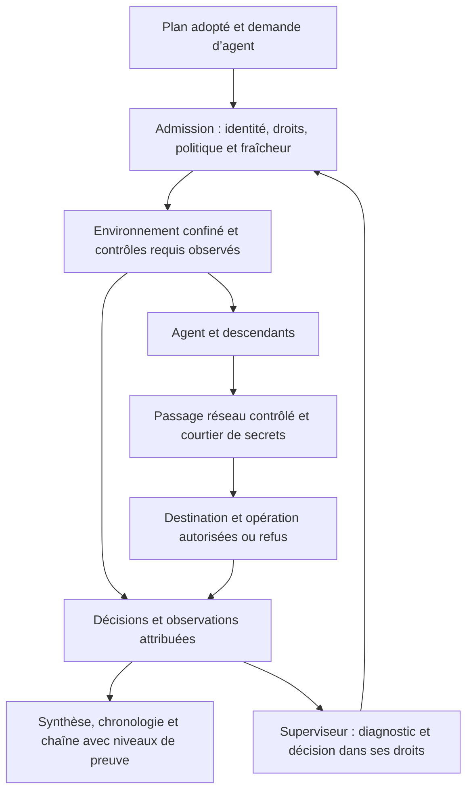
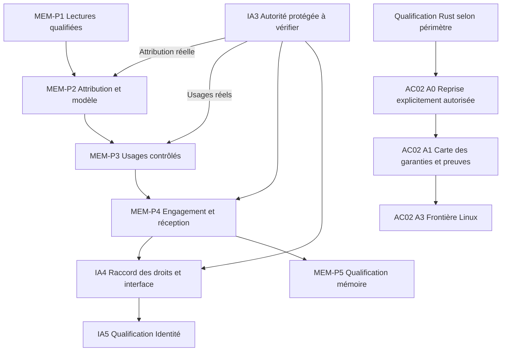

# AC-02 — Plan APEX consolidé avec spécification des menus de sécurité

23 octobre 2026 — [English](../../en/plans/actions-confiance/securite-execution-apex.md).

**État : plan enregistré, chantier non démarré.** Instruction finale de
l’utilisateur : « enregistre le plan », « pas le démarrer ». Propriétaire :
Codex racine. Aucun lot A0–A7, développement, installation, appel fournisseur,
agent délégué ou déploiement n’est lancé par cet enregistrement.

La reprise de l’implémentation reste conditionnée à la migration et à la
qualification Rust, puis à une demande de démarrage. Le
[plan de migration](../migration-rust/PLAN.md) conserve les critères ouverts ;
[AFTER-CUTOVER](../migration-rust/AFTER-CUTOVER.md) référence ce chantier.
Enregistrer une spécification ne prouve ni son implémentation, ni son
acceptation, ni l’application d’une protection.

## 1. Périmètre et références

Les menus n’étaient pas suffisamment spécifiés dans la première proposition.
Cette version conserve leurs destinations, comportements, droits et critères
de vérification, ainsi que les précisions de l’audit discuté avec l’utilisateur.

Décisions conservées :

- Moteur Swarm propre, compatible avec un sous-ensemble explicite d’OpenShell.
- Premier périmètre : agent non privilégié, Linux et service de contrôle sous
  compte système distinct. Hôte, noyau et administrateur restent de confiance.
- Fichiers/processus et TCP/HTTP-REST d’abord ; MCP, GraphQL, WebSocket et
  JSON-RPC restent des extensions identifiées.
- Métadonnées par défaut ; traces détaillées locales sur activation explicite.
- Menus de sécurité et réglages uniquement : conserver les groupes de
  navigation actuels de Swarm et la séparation des UX Projet/Processus métier.
- Réutiliser les acquis après vérification sur le Rust final : confinement du
  helper fixe, courtier de secrets, identité/délégation, contrôles de lancement,
  télémétrie Live et attribution eBPF. Un acquis historique Go n’est pas une
  capacité Rust intégrée et qualifiée ; le helper fixe ne confine pas les
  fournisseurs généraux ; la collecte noyau positive historique reste ouverte.

### Sources et état de leur lecture

| Source | Usage et limite |
|---|---|
| [Article Bromure du 21 octobre 2026](https://bromure.io/en/blog/openshell-policies-and-network-lineage) | Renaud Deraison présente Bromure 5.4 et son usage des politiques NVIDIA ; les affirmations du produit ne constituent pas des résultats Swarm. |
| [Manuel Agentic Coding](https://bromure.io/en/docs/agentic-coding) | Réglages, secrets, traces et timeline ; l’accueil annonce 5.0.0, à distinguer de l’article 5.4. |
| [Réglages](https://bromure.io/en/docs/agentic-coding/07-settings) et [menus contextuels](https://bromure.io/en/docs/agentic-coding/05-sessions-home) | Rubriques regroupées, recherche, accès contextuels et gestion des brouillons ; reprendre les principes dans les composants Swarm. |
| [Timeline et actions](https://bromure.io/en/docs/agentic-coding/11a-security-timeline) | Séparer décisions de sécurité, traces détaillées, état historique, état actuel, masquage et suppression. |
| [Secrets](https://bromure.io/en/docs/agentic-coding/08-credentials) et [traces](https://bromure.io/en/docs/agentic-coding/11-tracing) | Courtier, TLS, confidentialité, rétention et rotation ; ne pas reprendre implicitement les valeurs opérateur de Bromure. |
| [Schéma NVIDIA v0.1.5](https://docs.nvidia.com/openshell/v0.1.5/how-it-works/policies/schema) et [règles réseau](https://docs.nvidia.com/openshell/v0.1.5/how-it-works/policies/network-rules) | Référence initiale de sémantique et du banc différentiel ; figer les sources exactes au démarrage du chantier. |
| [Prover NVIDIA](https://docs.nvidia.com/openshell/v0.1.5/how-it-works/policies/prover) | Contrôle complémentaire limité aux domaines représentés ; ne prouve pas l’application du confinement. |
| [The Secure Software Factory, version 1 du 13 octobre 2026](https://github.com/agentbaseline/agentbaseline/blob/d842a1bb34a42e9d7c0d54a1b12ead9e0e59e283/software-factory/software-factory.md) | Texte intégral relu le 23 octobre, annexes comprises : quatre frontières, trois niveaux d’autonomie, profils et séparation planification/autorisation/exécution. Complément en section 6. |
| [controls.yaml](https://github.com/agentbaseline/agentbaseline/blob/d842a1bb34a42e9d7c0d54a1b12ead9e0e59e283/whitepaper/controls.yaml), [boundaries.yaml](https://github.com/agentbaseline/agentbaseline/blob/d842a1bb34a42e9d7c0d54a1b12ead9e0e59e283/software-factory/boundaries.yaml) et [levels.yaml](https://github.com/agentbaseline/agentbaseline/blob/d842a1bb34a42e9d7c0d54a1b12ead9e0e59e283/software-factory/levels.yaml) | Lus et conservés comme références documentaires : catalogue de contrôles et données de présentation ; ces fichiers ne fournissent pas de moteur de confinement. |

Les quatre références visuelles sont **l’éditeur de politique, le panneau des
refus, la chaîne d’une connexion et la timeline de sécurité**. Elles sont
conservées en clair et sombre dans le
[dossier de références](securite-execution-references/README.md), avec
[provenance et empreintes](securite-execution-references/manifest.json).
La quatrième référence est une image à 0,5 seconde de la vidéo de l’article,
pas son affiche, qui montre déjà une chaîne. Les vidéos originales ne sont
pas recopiées dans le dépôt ; leurs URL et empreintes sont conservées.

Ces images attribuées à Bromure sont des références documentaires, pas des
ressources à embarquer dans l’interface Swarm. Au démarrage, réexaminer versions,
sources, hypothèses et couverture avant toute réutilisation.

## 2. Spécification des menus et des parcours

### UX-01 — Points d’entrée

| Emplacement Swarm | Entrée proposée | Résultat attendu |
|---|---|---|
| Suivi | Sécurité | Ouvre la synthèse et le journal du contexte sélectionné. |
| Configuration → Administration | Sécurité et confinement | Ouvre l’éditeur commun des réglages. |
| Menu `⋯` d’un agent | Protections effectives ; Journal de sécurité ; Examiner les refus | Ouvre les mêmes vues, filtrées sur cet agent et sa tentative. |
| Détail d’un refus | Voir la chaîne ; Voir la règle ; Examiner une autorisation | Affiche les preuves ou prépare une modification autorisée. |
| Synthèse de sécurité | Ouvrir les réglages concernés | Ouvre directement la rubrique pertinente, avec sa portée visible. |

Ces accès partagent les mêmes composants et opérations publiques. Un raccourci
ne dispose pas de droits supplémentaires. Reprendre les composants,
jetons sémantiques, dialogues et traductions de [UI-DESIGN](../../UI-DESIGN.md).

### UX-02 — Éditeur regroupé des réglages

```text
Sécurité et confinement
  Portée et objet concernés
  Rechercher un réglage…

  Protection
    Fichiers et processus
    Réseau et requêtes
    Secrets et autorisations d’usage

  Observation
    Collecte système
    Journal de sécurité
    Traces et confidentialité

  Politiques
    Politique OpenShell
    Historique et reprise
```

| Rubrique | Contenu |
|---|---|
| Fichiers et processus | Chemins autorisés, identité d’exécution, protections requises, disponibilité et effet sur les prochains départs. |
| Réseau et requêtes | Destinations, exécutables, TCP/REST, restrictions de requêtes, observation/blocage et révision réellement appliquée. |
| Secrets et autorisations | Références, consommateurs et destinations autorisés, révocation ; aucune restitution du secret brut. |
| Collecte système | Disponibilité, activation, sondes, attribution, pertes et diagnostic. |
| Journal de sécurité | Conservation, accès et export des décisions ; distinct de l’enregistrement détaillé du trafic. |
| Traces et confidentialité | Niveau de collecte, expurgation, accès, chiffrement, rétention et purge. |
| Politique OpenShell | YAML, compatibilité annoncée, validation, aperçu et politique effective. |
| Historique et reprise | Révisions, auteurs, motifs, application observée et préparation d’un retour à une révision antérieure. |

Les formulaires et le YAML représentent une même politique, sans configurations
parallèles divergentes. YAML est le format d’échange ; SQLite reste le stockage
interne prévu pour ces politiques et leur historique, selon SE-01 ci-dessous.
La synthèse doit distinguer configuré, appliqué,
observé, indisponible et inconnu ; la configuration seule ne prouve pas une
protection effective.

Les fonctions différées — détection d’injection, protection des données
personnelles, analyse avancée des dépendances — restent dans le suivi futur.
Elles n’apparaissent pas comme protections disponibles. L’étude d’une navigation
globale ou d’une palette de commandes générale est hors du choix retenu.

### UX-03 — Recherche et navigation dans les réglages

- Recherche sur noms de rubriques, descriptions et synonymes FR/EN ; jamais
  sur les secrets ou contenus privés des traces.
- Tous les termes saisis doivent correspondre, sans distinction de casse ou
  d’accents ; afficher les résultats par groupe, leur portée et un extrait
  explicatif.
- Ouvrir un résultat place le focus sur le réglage concerné sans le modifier.
- Aucun résultat : message explicite et action pour effacer la recherche.
- Changer de rubrique conserve le brouillon du même contexte.
- Changer de portée ou fermer avec un brouillon exige de choisir entre rester
  et abandonner les modifications.
- Aucun enregistrement automatique ni changement de sécurité provoqué par la
  navigation ; les recherches n’introduisent aucun appel fournisseur.

### UX-04 — Portée, héritage et droits

L’en-tête affiche toujours projet et objet concernés ; portée éditée, source
des valeurs héritées et valeur effective ; révision enregistrée et révision
appliquée ; droits de consultation et de modification.

Les portées proposées proviennent des contrats pris en charge par le moteur.
Les portées disponibles pour les limites d’exécution ne deviennent pas
automatiquement valides pour chaque nouvelle politique de sécurité.

| Situation | Présentation et action |
|---|---|
| Fonctionnalité future | Absente des commandes actives. |
| Capacité indisponible | Visible avec diagnostic. |
| Consultation autorisée, modification interdite | Lecture seule avec raison visible. |
| État courant inconnu | Actions dépendantes désactivées jusqu’à relecture. |

### UX-05 — Prévisualiser et appliquer

**Modifier → Prévisualiser → Examiner les différences et conséquences →
Appliquer → Vérifier l’application.**

L’aperçu présente valeurs avant/après, périmètre, nouvelles permissions,
restrictions, besoin éventuel de recréer l’environnement et droits nécessaires.

- Une modification ultérieure invalide l’aperçu.
- Une révision concurrente impose une nouvelle lecture ; aucun écrasement
  silencieux. Préserver les éditions non sauvegardées ; un conflit demande
  une décision explicite au lieu d’une fusion supposée sûre.
- Un retour historique crée une nouvelle révision et conserve l’historique.
- Ne pas proposer « Tout enregistrer » si les opérations sous-jacentes ne
  garantissent pas une application commune.
- Un accusé de réception ne suffit pas à afficher « appliqué ».
- Les erreurs conservent brouillon, cause sûre et condition de reprise.

### UX-06 — Synthèse, timeline et menus d’événements

La destination Suivi → Sécurité comporte Synthèse (protections effectives,
indisponibilités et refus récents) et Chronologie (événements filtrables,
compteurs, pagination et export).

Selon son type et les droits, le menu d’un événement permet d’ouvrir la chaîne,
consulter la règle et la révision au moment de l’événement, consulter la règle
actuelle, préparer une modification et copier les références techniques
expurgées. Une décision ancienne reste historique ; afficher séparément
l’état actuel si la situation a changé.

Les compteurs suivent les filtres et distinguent événements, regroupements,
pagination et pertes. L’export CSV correspond au résultat filtré et indique
son périmètre et toute limite de restitution. Masquer des événements ne
supprime pas leurs preuves. Droits et expurgation restent applicables à l’export.

La chaîne expose objectif autorisé, intention déclarée, appel d’outil,
processus, flux, politique et décision. Chaque lien indique son niveau de
preuve : établi, corrélé ou inconnu. Une proximité temporelle, une commande
identique ou un texte fournisseur ne prouvent pas l’identité de l’auteur.

## 3. Contrats de sécurité conservés et précisés

| Exigence | Contrat attendu |
|---|---|
| SE-01 — Compatibilité | YAML original conservé ; sous-ensemble publié ; champs, doublons et formes non qualifiées refusés ; banc différentiel sur référence NVIDIA figée. |
| SE-02 — Contrôle protégé | Autorité, politiques, secrets et preuves séparés de l’agent ; inventaire de tous les départs et reprises. |
| SE-03 — Confinement | Protection des véritables agents et descendants ; fichiers, identité, environnement, descripteurs et appels système vérifiés avant exécution. |
| SE-04 — Réseau et secrets | Passage réseau obligatoire, restrictions TCP/REST, secrets limités au destinataire, révocation et connexions persistantes vérifiées. |
| SE-05 — Traçabilité | Mission, tentative, autorisation, outil, processus, flux et décision reliés selon les preuves ; déclarations et corrélations distinguées. |
| SE-06 — Reprise | Refus structuré remis au superviseur ; aucun contournement automatique ; effets incertains réconciliés avant rejeu. |

### SE-01 — Format YAML et persistance SQLite

Clarification demandée par l’utilisateur : choisir YAML pour l’interopérabilité
avec OpenShell ne signifie pas remplacer SQLite dans Swarm.

- **YAML** : écriture, import et export des règles selon le sous-ensemble
  OpenShell retenu ; le fichier importé original conserve sa provenance.
- **SQLite** : persistance interne prévue des politiques validées, de leurs
  révisions, auteurs et historique. Les formulaires et l’éditeur YAML accèdent
  à cette même politique ; aucun fichier YAML parallèle ne devient une seconde
  source de vérité pour le moteur.
- **Moteur Rust** : vérification et application de la révision autorisée. Lire,
  importer ou exporter un YAML ne déclenche pas son application et n’accorde
  aucun droit. Le parcours aperçu, autorisation, application et effet observé
  reste celui d’UX-05.

**Parcours prévu : YAML → validation et aperçu → enregistrement autorisé dans
SQLite → application par le moteur Rust → vérification de l’effet.**

A0 cartographie les stockages réels du Rust final. Cette décision sur les futures
politiques AC-02 ne déplace pas les réglages globaux déjà persistés en JSON.
A1 spécifie la représentation et les révisions ; A2 réalise l’échange YAML et
sa persistance. Ces capacités restent spécifiées, non implémentées et non testées
dans AC-02 ; aucun changement de stockage n’est exécuté par cet ajout au plan.

### Obligations à détailler au cadrage, sans les présenter comme réalisées

- SE-01 : tester sections absentes, valeurs héritées, `include_workdir`,
  `audit`/`enforce`, `best_effort`/`hard_requirement`, listes de binaires vides,
  ancêtres et priorités des règles. Ne pas transposer la priorité d’un
  pare-feu Bromure à la sémantique OpenShell. Séparer politique importée,
  contributions des fournisseurs et politique effectivement appliquée.
- SE-01/02 : l’autorisation Swarm demeure une condition supplémentaire
  explicite ; importer un YAML n’accorde ni droit métier ni secret.
  L’enfant ne peut élargir les droits délégués. Toute divergence du banc
  conserve un contre-exemple ; un volume de cas ne prouve pas l’exhaustivité.
- SE-02/03 : inventorier workers, planners, reviewers, validations,
  assistants, terminaux, reprises et descendants. La vue de travail ne doit
  pas exposer le stockage privé de contrôle. Vérifier symlinks, montages,
  descripteurs hérités, accès mémoire, processus détachés et environnement.
  Préserver le bootstrap de confiance et les entrées scellées existantes.
- SE-03 : protection requise indisponible signifie refus, sans mode sensible
  dégradé silencieux. Afficher les changements nécessitant un nouvel
  environnement et ne pas promettre un élargissement Landlock à chaud.
- SE-04 : établir un témoin npm valide tenant compte des requêtes d’audit et
  des chemins encodés ; une erreur préalable ne doit pas masquer l’attaque.
- SE-04 : spécifier TLS, validation distante, protection et rotation des clés
  du proxy, confiance limitée aux environnements concernés et refus des
  contournements non qualifiés. Contrôler IPv4/IPv6, DNS, redirections,
  adresses privées, sorties directes et changements d’image exécutable.
- SE-04 : une variable de proxy n’est pas une barrière. Ne déclarer une
  révision appliquée qu’après observation du consommateur, y compris pour
  les connexions persistantes. Tout mécanisme de secret/signature non
  qualifié reste explicitement non pris en charge.
- SE-05 : distinguer trace non capturée, purgée ou indéchiffrable ; une
  désactivation future ne supprime pas implicitement l’historique. Définir
  chiffrement, accès, rétention, purge et rotation des clés avant activation.
- SE-05 : vérifier authentification du collecteur, reconnexions, démarrage,
  boot/hôte et PID réutilisés, attribution au périmètre et sondes réellement
  déclenchées ; un heartbeat ou une sonde enregistrée ne suffit pas.
- SE-04/05 : vérifier les transports effectifs de chaque fournisseur ; un
  protocole différé ne reçoit aucun contournement implicite.
- SE-01…06 : persister les politiques opérateur, leurs unités, héritage,
  défauts et sens du zéro ; exposer les mêmes validations et valeurs dans
  Admin/API/CLI. Ne reprendre aucun délai, score, plafond ou rétention de
  l’article comme politique implicite ; mesurer avant de fixer une borne.
- SE-06 : remettre le refus à l’agent et au superviseur avec cause sûre,
  politique/révision, effet connu et action permise suivante. Préserver
  consommation, réservations et historique ; réconcilier un effet incertain
  avant toute reprise. La perte d’une protection requise interdit les nouveaux
  engagements concernés et déclenche `replan`.
- Limite conservée : autoriser une destination ou une méthode HTTP ne garantit
  pas à lui seul l’absence d’exfiltration ou d’effet métier.

### Flux cible — non implémenté par cet enregistrement



## 4. Séquence APEX — tous les lots sont non démarrés

| Lot | Livrable | Dépendances et sortie attendue |
|---|---|---|
| A0 — Reprise | Cartographie du Rust final, acquis historiques et références durables. | Migration qualifiée et demande de démarrage ; état réel documenté. |
| A1 — Spécifications et design | Contrats SE/UX, quatre parcours illustrés, catalogue des menus et matrice droits/états. | A0 ; chaque entrée possède destination, effet, refus et critère. |
| A2 — Politique compatible | Import/export YAML, politiques versionnées dans SQLite, interprétation et banc différentiel NVIDIA. | A1 ; divergences traitées, fonctions non supportées explicites ; une seule politique persistée. |
| A3 — Frontière Linux | Séparation du contrôle et premier parcours confiné complet. | A1 ; témoins, contournements et reprise vérifiés. |
| A4 — Réseau et secrets | Contrôle obligatoire et application observée des révisions. | A2+A3 ; refus et révocation réels. |
| A5 — Observation | Attribution, journal, pertes et remise au superviseur. | A3+A4 ; faits et incertitudes distincts. |
| A6 — Menus et intégration | Entrées UX-01…06 raccordées aux mêmes opérations publiques. | A2…A5 ; navigation, droits et effet réel cohérents. |
| A7 — Qualification et RETEX | Recette consolidée, revue indépendante et documentation. | Critères requis satisfaits sur le même candidat. |

Codex racine conserve l’objectif et l’intégration ; les rôles d’implémentation
et de revue indépendante restent distincts. Aucun agent n’est délégué par ce
document. Au démarrage, rattacher les fichiers réellement concernés à leurs
propriétaires, permissions et budgets ; l’état incomplet de Rust interdit de
figer aujourd’hui des chemins de code, commandes ou endpoints supposés.

Chaque incrément comprend documentation FR/EN, documentation des fonctions et
revue explicite des politiques, erreurs et entrées effectives du build. Un échec
conserve sa preuve originale, déclenche `replan` et bloque les étapes dépendantes.

## 5. Vérification et conservation

La recette principale autorise l’installation d’une dépendance de fixture puis
refuse son script lorsqu’il tente de lire une clé factice, modifier le contrôle
ou joindre une destination interdite. Établir un témoin valide avant chaque
injection de défaut, sous les mêmes préconditions.

Elle vérifie le parcours complet :

**Timeline → événement → chaîne → refus → réglage concerné → aperçu →
application autorisée → effet observé → révocation.**

Contrôles complémentaires à prévoir :

- Même résultat depuis chaque point d’entrée ; mauvais droit, mauvaise
  portée, contexte périmé et révision concurrente refusés.
- Conservation des brouillons, absence d’écriture lors d’une recherche,
  état historique et état actuel distincts ; filtres, compteurs, pagination,
  regroupements et export cohérents.
- Import YAML invalide refusé sans modifier la politique enregistrée ; un aperçu
  ne modifie aucune révision. Vérifier l’équivalence sémantique du sous-ensemble
  lors d’un import/export, la même politique depuis formulaire et YAML, puis
  sa révision et son historique après réouverture du stockage SQLite. La révision
  enregistrée reste distincte de celle effectivement appliquée par le moteur.
- Symlinks sortants, traversée, montages et descripteurs hérités ; processus
  détachés, remplacement d’image et réutilisation de PID.
- Sortie réseau directe, DNS changeant, redirection interdite, requête REST
  interdite et connexion persistante après révocation.
- Sondes inactives, collecteur indisponible, pertes, interruption, parent mort,
  nettoyage et reprise visibles ; exclusion des processus étrangers.
- Échec de stockage ou de publication après effet : conserver connu/inconnu
  sans double application ; aucune réussite reconstruite après interruption.
- Absence de secrets dans recherche, journaux, arguments, références et exports.
- FR/EN, `etat`/`sombre`, clavier, Escape, focus et largeurs de UI-DESIGN ;
  chargement, vide, refus, erreur, succès et reprise.
- Ressources réellement servies par le binaire prévu, console et requêtes
  réseau ; pas seulement les sources du workspace.

Utiliser les [recettes permanentes](../../../tools/verification/README.md), des
preuves neuves, des tests nommés et une revue indépendante liée au candidat.
Vérifier les preuves conservées, le profil, les features, dépendances, entrées
effectives et le binaire exercé. Un résultat zéro sans assertion ou sans test
collecté ne vaut pas réussite. Mesurer le surcoût avant de proposer des limites ;
sans borne justifiée, aucun watchdog global ajouté par commodité.

Le prover NVIDIA complète seulement les domaines qu’il couvre. Un résultat non
pris en charge ou indéterminé ne devient pas une réussite et ne prouve pas
l’application du confinement. La revue documentaire ne qualifie aucun runtime.

Activation future : fixtures isolées, puis projet pilote explicitement choisi,
avec version identifiable et retour arrière conservant les preuves. Ni restart,
installation, création de compte, élévation de privilèges, consommation payante,
commit, push, publication ou surveillance récurrente ne sont autorisés par ce
plan. La qualification requise et le RETEX restent des critères de clôture.

### Matrice de traçabilité initiale

| Exigences | Observable futur | Contrôle prévu | État réel |
|---|---|---|---|
| UX-01…06 | Même objet, droits et résultat depuis chaque accès ; quatre parcours et brouillons cohérents. | Parcours navigateur/API/CLI, FR/EN et deux thèmes. | Spécifié ; non implémenté/non testé dans AC-02. |
| SE-01 | Décisions conformes au sous-ensemble publié ; YAML d’échange et politique SQLite unique, refus explicites hors couverture. | Banc différentiel versionné, import/export, refus sans mutation et réouverture des révisions/historique. | Spécifié ; non implémenté/non testé dans AC-02. |
| SE-02/03 | Contrôle hors portée de l’agent ; descendants réellement confinés. | Fixture autorisée, contournements, panne et reprise. | Spécifié ; acquis historiques à requalifier. |
| SE-04 | Réseau obligatoire et secret remis uniquement au consommateur prévu. | Fixture de dépendance, TLS, DNS, accès direct et révocation. | Spécifié ; non implémenté/non testé dans AC-02. |
| SE-05 | Attribution, niveaux de preuve, pertes et conservation explicites. | Producteurs réels, sonde effectivement déclenchée et contrôle d’intégrité. | Spécifié ; positif noyau non acquis ici. |
| SE-06 | Réception du refus, décision autorisée, application et effet observé. | Chaîne distribuée et réconciliation sans double effet. | Spécifié ; aucune autonomie runtime établie. |

### Améliorations conservées, sans extension implicite du premier périmètre

La lecture demandée d’[Agent Baseline](https://github.com/agentbaseline/agentbaseline)
est conservée comme référence complémentaire : `v1.0-draft`, commit
`d842a1bb34a42e9d7c0d54a1b12ead9e0e59e283`, 35 contrôles, identifiants encore
non figés, sans certification. Ce brouillon ne remplace ni les droits Swarm ni
le choix métadonnées par défaut ; il ne déclare aucun contrôle satisfait.

| Origine | Valeur/périmètre proposés | Propriétaire et critère futur | État et reprise |
|---|---|---|---|
| DIS-04…07 | Registre des composants et rapprochement approuvé/chargé. | Codex racine ; retrouver modèles, instructions, skills, outils et versions de chaque exécution. | Proposition conservée ; examiner avec A0/A1, sans scanner lancé. |
| CON-02/04 | Profils versionnés et combinaisons dangereuses de capacités. | Contrat d’autorité ; démontrer que la composition ne crée pas un droit implicite. | Proposition à cadrer ; aucune politique ajoutée. |
| AUT-05/07/08/09 | Distinguer accord indépendant, vérification humaine renforcée, extension temporaire et liaison au détenteur. | Identité/autorité ; refus et décisions exactes vérifiés avec les exigences humaines Swarm conservées. | Proposition à rattacher au chantier identité existant. |
| RES-01…05 | Révocation, quarantaine et carte des impacts, y compris changement non approuvé d’un composant. | Supervision/contrôle ; nouveaux départs et droits délégués refusés, preuves et impacts conservés. | Proposition à cadrer avant adoption ; aucune action runtime lancée. |
| VAL-01…04 / OBS-01…06 | Matrice des 35 contrôles et requalification après changement. | Qualification ; applicabilité, propriétaire, test, preuve, état et limite renseignés. | Proposition conservée ; pas un audit de conformité réalisé. |

La résistance à root dans une VM, les protocoles supplémentaires et les autres
fonctions Bromure restent différés : Codex racine en conserve la provenance et
le périmètre ; reprise sur besoin produit et autorité explicites, après
qualification du premier périmètre. La mémoire persistante reste dans les
contrats Swarm même si l’architecture Agent Baseline étudiée l’exclut.

## 6. Software Factory et YAML — complément futur

La liste des 35 contrôles ne suffisait pas à conserver cette architecture.
Cette annexe complète la lecture Bromure/OpenShell, sans adopter toute la factory
ni déclarer un niveau d’autonomie acquis. Le texte et les YAML sont conservés au
commit précisé dans les sources et le manifeste local.

### SF-01 — Frontières et responsabilités

| Frontière/composant | Précision pour Swarm | Lot et critère futur |
|---|---|---|
| Sandbox | Isolation par tâche/agent, descendants et tests ; inventorier montages, volumes partagés, IPC et interfaces de gestion. Aucun socket Docker de l’hôte offert comme raccourci de test. | A0/A1/A3 : refus d’accès aux autres contextes. La microVM reste une extension ; ne pas lui assimiler le premier confinement Linux. |
| Réseau | Inclure inférence, registres, services internes et communications entre agents. Refuser accès implicites au VPN, métadonnées cloud, DNS non approuvé et IP directe ; exceptions par hôte/opération. | A1/A4 : chaque transport réel est médiatisé ou refusé, identité et révision attribuées. |
| Chaîne de dépendances | Distinguer admission des composants et validation des entrées ; rapprocher image, harness, skills, outils, modèles et versions résolues à l’exécution du profil approuvé. Provenance ne signifie pas innocuité. | A0/A1 : inventaire des acquis/manques. Admission générale, quarantaine et attestations de sortie restent à cadrer ; la fixture npm seule ne prouve pas cette frontière entière. |
| Identité et accès | Vérifier le droit d’utiliser Swarm puis les droits de chaque tâche ; conserver initiateur et sauts de délégation. Profil, tâche et délégation bornent conjointement l’autorité. | A1/A3/A4 : rattacher au chantier identité. Un plan du superviseur reste une demande, jamais un droit accordé. |
| Exécution | L’orchestrateur propose ; le moteur démarre/arrête sous droits vérifiés. Un contrôle requis indisponible interdit le départ concerné. | A0/A3/SE-06 : inventorier tous les départs/reprises. Révocation, arrêt et réconciliation sont des effets distincts. |
| Observation | Définir les événements obligatoires de chaque frontière, leurs liens à l’exécution et leur protection contre l’agent. Distinguer événement absent, perte déclarée et trace facultative désactivée. | A1/A5 : préciser le refus/repli si une preuve requise ne peut être produite ; aucune capture détaillée obligatoire cachée. |

### SF-02 — Profils et autorisation avant départ

Spécifier en A1 un profil versionné : composants/contexte, outils,
image/isolement et bornes d’accès/actions/réseau. Vérifier authenticité et
intégrité au départ ; un digest seul n’authentifie pas l’approbateur. Conserver
profil exact, composants réellement chargés et décisions d’autorité. Instructions
et hooks guident l’agent, même signés ils ne deviennent pas une barrière.

L’autorité effective respecte conjointement profil, initiateur, tâche,
délégation, politique, cible, durée et approbations. Un signal authentifié peut
contenir un texte hostile ; ce texte ne donne aucun droit. L’article ne fournit
pas d’algorithme universel pour déduire les permissions d’un objectif : ce point
reste à spécifier dans Swarm. Toute extension exige une nouvelle décision
attribuée ; aucun agent n’approuve une modification de ses propres protections.

### SF-03 — Qualité, autonomie et écarts explicites

- Conserver les deux boucles : réaliser/vérifier, puis RETEX/amélioration. A7
  distingue qualité du résultat et preuve des droits réellement respectés.
- Les trois niveaux décrivent qui choisit la suite : humain, workflow ou agent.
  Ils ne constituent ni score de conformité ni commande d’élévation. La présence
  d’un superviseur ne démontre pas un « niveau 3 qualifié ».
- L’article recommande la capture des prompts/réponses. Swarm conserve les
  métadonnées par défaut et l’activation explicite des traces sensibles ; afficher
  cet écart dans toute future correspondance.
- L’article fige la factory pendant une exécution. Swarm prévoit révisions et
  révocations autorisées : distinguer code/image/profil figés et règles dynamiques
  du contrôle protégé, avec révision et effet observé. Équivalence non prouvée.
- Ne pas importer de seuil, budget, rétention ou délai d’admission implicite.
  Arrêt n’annule pas un effet engagé ; quarantaine, retour arrière et diagnostic
  d’impact demandent chacun droits et preuves. Les incidents cités par la source
  ne sont pas des preuves Swarm vérifiées.

### SF-04 — Usage proposé des YAML

| Source lue | Rôle réel en amont | Inspiration Swarm |
|---|---|---|
| `whitepaper/controls.yaml` | Source de vérité du catalogue : version/statut, six outcomes, 35 contrôles avec ID, famille, titre, type, statut et exigence. Les attentes de preuve sont au niveau des outcomes dans cette version. | Catalogue de référence traçable ; ne pas inventer un champ de preuve par contrôle amont. Garder les preuves Swarm dans une correspondance distincte. |
| `software-factory/boundaries.yaml` | Noms/descriptions des quatre frontières et légende de figure, alignés sur le texte. | Synthèse de sécurité par frontière, dans les groupes de navigation existants. |
| `software-factory/levels.yaml` | Noms, descriptions et figures des trois niveaux pour la page. | Expliquer l’orchestration observée et ses limites, sans accorder de droits. |
| Autres YAML | Métadonnées d’auteurs ou workflows du site : autre rôle que le catalogue et les données de présentation. | Aucune copie ni exécution de workflow dans Swarm. |

Ces fichiers ne sont pas des profils de confinement exécutables. Le YAML
OpenShell reste un contrat distinct, SE-01/A2. Le profil Swarm est une
spécification future, pas un schéma déjà adopté.

Proposition de livrable documentaire A1, à confirmer avant développement :

1. Figer catalogue amont, version, commit et empreinte ; préserver statut draft,
   retraits/remplacements et historique, avec des IDs distincts des IDs Swarm.
2. Définir la correspondance : ID amont, exigence SE/UX/SF, portée,
   applicabilité/motif, propriétaire, critère observable, contrôles prévus,
   preuves liées au candidat/entrées, état réel et condition de reprise.
   Aucun contrôle satisfait par défaut ; documenté ne vaut pas vérifié.
3. Spécifier les validations : version supportée, types/champs requis,
   identifiants uniques, références existantes, statuts explicites et refus des
   doublons/formes ambiguës. Une erreur ne donne pas une page vide dite complète.
4. Étudier la génération des matrices FR/EN et aides depuis cette même source,
   puis vérifier leurs consommateurs et ressources servies. Garder UX-01…06 et
   une seule politique effective, sans réglage parallèle.
5. Séparer catalogue externe, preuve Swarm et politique exécutable. L’import
   ou l’ouverture d’un YAML ne change ni droit ni mission. Une actualisation
   réexamine les correspondances sans écraser les preuves historiques.

Propriétaire : Codex racine ; responsable de contrat et revue à désigner lors
d’une reprise autorisée. État SF-01…04 : **spécifié/proposé, non implémenté,
non testé**. A0 inventorie ; A1 arbitre périmètre initial et extensions ; cette
annexe ne démarre aucun lot.

### Conservation de cet incrément documentaire

Clarification YAML/SQLite du 23 octobre 2026, propriétaire Codex racine :
l’ambiguïté portait sur format d’échange et stockage, pas sur un remplacement
nécessaire de SQLite. Décision conservée dans SE-01, A2 et la recette future ;
critère observable : une même politique versionnée survit à l’import/export et
à la réouverture du stockage, sans application implicite. Seule la cohérence
documentaire FR/EN est vérifiée ici ; les contrôles fonctionnels restent futurs.
Aucun code, fonction, politique d’exécution, build, version runtime, Word ou média
n’est modifié par cette clarification du plan.

Plan, traduction et références sont enregistrés ; A0–A7 restent non démarrés.
Les liens FR/EN d’architecture et le suivi après bascule transmettent ce plan
aux prochains contextes. Un processus déjà démarré ou un contexte natif embarqué
ne reçoit pas automatiquement cette mise à jour. Aucun numéro de version runtime
ni note annonçant une protection livrée n’est créé pour cet enregistrement.

## 7. Relecture après clarification du stockage et des vues d’architecture

23 octobre 2026 — Codex racine, méthode `spec-audit`. Relecture du plan et des
contrats liés après les échanges sur YAML/SQLite, les cinq vues, le moteur Rust,
l’identité, la mémoire et la validation humaine. Cette section conserve le
rapport de relecture ; elle ne modifie pas les contrats du moteur et ne démarre
aucun lot. La revue est réalisée par l’auteur, pas par un vérificateur indépendant.

**Verdict : le cap est conservé.** La clarification YAML/SQLite est intégrée.
Trois raccords documentaires restent à expliciter au cadrage A0/A1 puis dans la
recette A7 ; aucune refonte du stockage ou du moteur n’est déduite des schémas.
Les préconditions de reprise en tête du plan restent applicables.

| ID et priorité | Constat vérifié dans les documents | Suite minimale et critère observable | État |
|---|---|---|---|
| AC02-RV-01 — Vérifié documentaire | SE-01, UX-02 et A2 distinguent YAML d’échange, politiques SQLite et application Rust. SE-02/03 protège déjà le stockage privé du contrôle. | A0 confirme le stockage réel et sa protection contre l’agent ; A2/A7 vérifient la réouverture, les révisions, l’absence de seconde source de vérité et les refus sans mutation. Ne pas déplacer les réglages globaux JSON par déduction. | Clarification intégrée ; aucun résultat fonctionnel établi par cette revue. |
| AC02-RV-02 — Mineur | Le plan conserve quatre références de sécurité ; les cinq vues complètes sont dans l’architecture, sans rattachement explicite dans les livrables A0/A1. | Rattacher les cinq vues comme référence de l’existant et des raccords : moteur, identité, mémoire, supervision, logs. Conserver séparément les quatre parcours de sécurité futurs. Une correspondance vue → contrat → lot → preuve doit permettre de suivre chaque raccord. | Précision proposée pour A0/A1, à reprendre en A7 ; aucun écran supplémentaire décidé. |
| AC02-RV-03 — Majeur | UX-05 et SF-02/03 conservent les droits et les exigences humaines, mais la recette AC-02 ne cite pas explicitement le contrat du résultat en mode `human`. | Reporter en A1/A7 que succès du confinement, contrôle automatique et revue IA ne remplacent pas une validation humaine exigée. Témoin futur : résultat en attente humaine, aval toujours bloqué tant que la décision requise manque ; distinguer autorisation de changer une protection et acceptation du résultat. | Raccord de non-régression à expliciter ; le contrat humain existant n’est pas modifié. |
| AC02-RV-04 — Majeur | SE-05/SF-02 attribuent les décisions et le contexte ; ils ne détaillent pas le raccord aux versions de mémoire et de consigne reçues par une instance, défini dans les contrats liés. | En A1/A5/A7, relier l’événement à la tâche, l’agent logique, l’instance attestée lorsque disponible, l’autorité, la tentative et les références de contexte/version effectivement établies. Garder inconnu ce qui n’est pas prouvé et respecter les droits d’accès ; aucune capture de contenu sensible par défaut. Distinguer les trois usages mémoire et les révisions de consigne décrits ci-dessous. | Raccord documentaire proposé ; droits mémoire et détection d’injection ne deviennent pas des capacités AC-02 livrées. |

Sources et limites des raccords proposés :

- Les [cinq vues d’architecture](../../architecture/OVERVIEW.md) représentent les
  contrats et leurs raccords ouverts. Le moteur déterministe Rust existe déjà ;
  A0 doit réutiliser le Rust final qualifié, sans déduire une qualification du
  dessin ni reconstruire un autre moteur. Les quatre vues inspirées de Bromure
  restent celles conservées dans les références de sécurité de la section 1.
- La [validation des résultats](../../ENGINE-ACCEPTANCE.md) conserve la décision
  humaine exigée par la politique. Sa disponibilité fonctionnelle et
  l’authentification protégée de l’humain sont deux preuves distinctes.
- Le [contrat d’identité](../../architecture/AGENT-IDENTITY-CONTRACT.md) et le
  [contrat d’usage mémoire](../deepagents-integration/CONTRAT-USAGES-MEMOIRE.md)
  distinguent principal, instance, auteur et propriétaire, ainsi que lecture,
  résumé et transmission. Une signature ne prouve pas la vérité du contenu ;
  mémoire, nom d’agent et fichier importé ne créent pas d’autorité. Les raccords
  publics encore ouverts restent sous la responsabilité des chantiers concernés.
- Les [révisions de consigne](../../architecture/INSTRUCTION-LEARNING.md)
  conservent la base initiale et une histoire attribuée ; elles n’interdisent pas
  toute évolution. Les ajouts du superviseur sont actifs par défaut et rejetables
  avant réservation. Un rejet ou un retrait ne purge pas un contexte déjà reçu.
  Ce parcours ne remplace pas la validation humaine d’un résultat et ne décide
  aucune nouvelle autorisation ou réécriture silencieuse dans AC-02.

Propriétaire des suites : Codex racine pour le cadrage et l’intégration, avec
rattachement aux propriétaires des contrats identité, mémoire et validation.
AC02-RV-02…04 sont des précisions recommandées, non des changements du moteur
adoptés ou exécutés par cette relecture. A0/A1 doivent en fixer la correspondance
avant les réalisations concernées ; A7 doit vérifier les critères sur le même
candidat. Les dépendances A0–A7, les quatre parcours de sécurité, les groupes de
navigation et les fonctions différées restent conservés. Les vérifications de
cet incrément portent seulement sur les liens, la cohérence FR/EN et le diff ;
aucun test fonctionnel, appel fournisseur ou processus natif n’est lancé.

## 8. Cohérence croisée avec le plan Identité et la file APEX

État de la relecture initiale conservé ci-dessous ; la section 9 précise
désormais les dépendances documentaires AC02-RV-05/06, sans preuve fonctionnelle.

23 octobre 2026 — demande utilisateur de vérifier l’homogénéité du plan Identité
et du dernier plan. Codex racine, `spec-audit` ; constat documentaire, sans revue
indépendante ni lancement. Sources : [plan Identité](identites-agents-replan.md),
[frontière IA3c.2](identites-agents-enrolement-IA3c2.md),
[suite mémoire](../deepagents-integration/PLAN.md),
[classement de migration](../migration-rust/CHEMIN-CRITIQUE-SPEC.md) et
[file APEX](../FILE-APEX.md).

**Verdict : principes homogènes ; deux dépendances restent à préciser avant
exécution.** Les textes conservent compte humain local par défaut, fournisseur
d’entreprise optionnel, service local sous compte distinct pour le pilote et
noyau/administrateur hôte de confiance. Identifier un pair, signer des octets ou
enregistrer une politique ne donne pas d’autorité. YAML/SQLite concerne les
politiques AC-02 : cela ne remplace ni la configuration d’installation protégée
ni l’ancre Trust indépendante du journal et des données importées.

| ID et priorité | Écart documentaire et impact | Clarification minimale et critère de sortie | État |
|---|---|---|---|
| AC02-RV-05 — Majeur | La file rapproche le chantier Identité de G7 ; la migration qualifie des contrats de parité, alors que IA3–IA5 portent aussi des raccords cibles non livrés. IA3 exige une frontière protégée ; AC-02/A3 est prévu après qualification Rust. Assimiler ces clôtures ou faire attendre cette frontière uniquement à AC-02 pourrait créer une dépendance circulaire. | Avant de fermer un critère G7 ou d’activer un usage, nommer le contrat concerné, la protection nécessaire, son propriétaire et sa preuve. Distinguer parité Rust, livraison fonctionnelle Identité et extension AC-02 ; une qualification de langage ne clôt pas F01–F07/IDA/EP. Une protection requise manquante garde l’usage refusé. | Ambiguïté de raccord confirmée ; cycle seulement potentiel, aucun cycle obligatoire ni défaut runtime démontré. Propriétaires : intégration migration et Identité ; à reporter dans A0/A1. |
| AC02-RV-06 — Majeur | IA4 dépend de IA3 et M20 ; MEM-P2…P4 dépendent de l’autorité/du raccord identité protégé. La mention générale « dépend de l’identité » ne dit pas quel livrable est attendu : exiger toute IA5 avant M20 ferait attendre réciproquement les deux chantiers. | Nommer la sortie protégée d’IA3 consommée par M20/P2–P4, puis le résultat mémoire consommé par IA4, avant IA5 et MEM-P5 selon leurs critères. Conserver la préparation isolée et MEM-P1 ; ne pas imposer une exécution strictement série des deux plans entiers. Attribuer une seule réalisation et une seule preuve à chaque raccord partagé. | Dépendances de phase à expliciter ; aucune boucle effective constatée. Propriétaires : Identité, mémoire et intégration racine. |

Les recettes croisées à cadrer doivent conserver les deux décisions : une règle
réseau permissive n’autorise pas un agent révoqué ; une identité habilitée ne
contourne pas un refus de confinement. Importer un YAML ou modifier une politique
ne doit pas fabriquer l’accord humain exact exigé pour une création hors plan,
ni valider un résultat en attente humaine. SQLite ne doit pas exposer le contrôle
aux agents ni permettre de reconstruire l’autorité depuis l’état à vérifier.
Ces précisions réutilisent IDA, EP, SE-01…04 et AC02-RV-01/03/04 ; leurs preuves
fonctionnelles restent à produire, sans fermer les constats précédents.

L’authentification humaine, l’hébergement de l’autorité et le fournisseur de modèle
restent trois choix distincts. Le service distant reste une évolution prévue ;
aucune exigence d’IdP externe ou de résistance à root n’est ajoutée au pilote.
Les droits mémoire, les révisions de consigne et les validations humaines gardent
leurs contrats et leurs propriétaires. AC02-RV-02…04 restent ouverts au cadrage.

Ce rapport ne réordonne pas les lots, ne reporte pas une protection requise et
n’adopte aucun nouveau mécanisme. Le plan Identité reste partiellement réalisé,
AC-02 non démarré et la file documentaire. Les propriétaires doivent fixer les
frontières ci-dessus avant les réalisations concernées ; les vérifications de
cet ajout portent sur cohérence, provenance, liens et conservation des textes.

## 9. Dépendances et livrables partagés précisés

23 octobre 2026 — suite documentaire autorisée par « next ». Codex racine
conserve l’intégration. Deux options ont été comparées : attendre la clôture
de chaque plan entier, ou nommer les sorties de phase effectivement consommées.
La seconde est retenue : elle préserve les critères existants et évite une attente
réciproque entre IA4 et M20. Les IDs, preuves historiques et lots sont conservés.
Les libellés ci-dessous décrivent des livrables à réaliser, pas de nouvelles API.

| Livrable / propriétaire | Entrées et dépendances | Sortie et critère de remise |
|---|---|---|
| Parité G7 / intégration migration | Référence de migration et contrats de chaque parcours concerné. | Matrice parcours → garantie requise → preuve liée au candidat → limite/refus. Une garantie requise manquante interdit de qualifier le parcours concerné ; une branche non couverte reste explicitement refusée et ouverte. Cette qualification ne clôt pas par déduction IA3–IA5, F01–F07, IDA ou EP. |
| Autorité protégée IA3 / Identité | IA2, bootstrap humain indépendant, configuration protégée et frontière requise ; exigences EP/IDA applicables. | Appelant et instance attribués, demande liée au projet/périmètre, opération, ressource et contenu exacts ; autorité, délégation et révocation courantes contrôlées à l’engagement. Le producteur conserve les preuves de frontière, refus et reprise. Aucun octroi ni processus attesté n’est déduit d’un reçu de fixture. |
| Usages mémoire M20, MEM-P2…P4 / mémoire | MEM-P1 selon le plan mémoire, données P2 puis contrôles P3 et engagement P4 ; sortie protégée IA3 pour les usages réels concernés. | Consommateur fermé sur les sources/versions et destinataires réels ; attribution propriétaire/auteur, lecture/résumé/transmission distinctes, engagement et réception reliés. Produire les preuves M20-U01…U10 applicables. La préparation isolée reste possible ; aucune activation publique avant les critères P4 requis. |
| Raccord IA4 / Identité et intégration | Sortie IA3 et résultat M20/P2…P4 requis pour les usages exposés. | Raccorder droits et interface au consommateur mémoire, avec parité CLI/API/UX et refus visibles ; ne pas réimplémenter ailleurs le contrôle des mêmes usages. Une fonction dont le consommateur protégé manque reste indisponible. |
| IA5 et MEM-P5 / propriétaires de chaque plan | IA3/IA4 pour IA5 ; P1–P4 pour MEM-P5, avec leurs autres critères existants. | Recettes, revue requise, preuves et RETEX propres à chaque périmètre. La clôture entière d’IA5 n’est pas une entrée de M20 ; celle de MEM-P5 n’est pas ajoutée comme entrée d’IA4. Une preuve partagée n’est réalisée qu’une fois et réutilisée tant que ses entrées restent valides. |
| AC-02 A0/A1/A3 / intégration sécurité | Qualification Rust et demande explicite de démarrage, puis dépendances A0–A7 existantes. | A0 inventorie les frontières effectivement qualifiées ; A1 mappe garantie, propriétaire et preuve ; A3 réutilise la frontière protégée disponible et traite les exigences de confinement restantes. Les raccords Identité non prouvés restent ouverts ; aucun succès AC-02 ne les remplace. |

La protection nécessaire à une opération Identité appartient déjà à son contrat
IA3/EP-07/F07. Elle ne doit pas être reportée uniquement parce qu’AC-02 est futur.
Son mécanisme reste à établir et vérifier dans le périmètre concerné ; ce cadrage
ne choisit ni nouvelle infrastructure ni exception. La carte de G7 doit montrer
si une exigence relève de la parité à livrer ou d’un raccord cible non disponible,
avec son effet réel sur l’admissibilité. Aucun contrôle requis ne devient optionnel.

Le graphe suivant est un sous-ensemble des dépendances de livraison à venir.
Il conserve les autres conditions des plans, dont la préparation isolée de P2/P3,
et ne représente ni l’ordre de lancement de missions ni un moteur déjà raccordé.



Pour chaque remise, conserver périmètre et exigences, versions/empreintes des
entrées et du candidat, preuve originale, limites, propriétaire producteur et
consommateur, contrôle de fraîcheur et décision d’intégration. Le consommateur
vérifie les pièces reçues ; un chemin de rapport seul ne suffit pas. Une entrée
modifiée invalide la réutilisation concernée ; refus ou effet incertain revient
au propriétaire avec cause et condition de reprise, sans accepter un résultat vide.
Les recettes croisées de la section 8 restent requises ; elles ne sont pas exécutées.

**AC02-RV-05/06 : clarification documentaire réalisée ; effets et qualification
fonctionnels non vérifiés.** AC02-RV-02…04 restent au cadrage. Aucun lot de code,
compte, service, migration de données, appel fournisseur ou mission n’est lancé.
La documentation FR/EN et la file sont mises à jour ensemble ; le plan actif de
migration et ses fichiers réservés restent inchangés.
