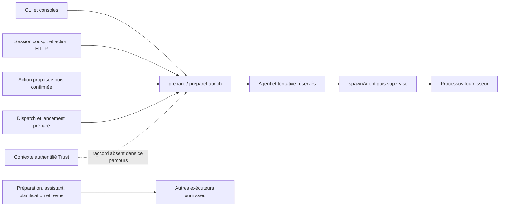

# IA1 — audit initial des identités et de l'autorité de création

16 octobre 2026. Codex seul ; `replan` puis `audit-pdca`, mode audit.
**Diagnostic reproduit : FAIL pour les protections nouvelles attendues.**
L'audit n'a corrigé aucun code applicatif et ne ferme pas IA2–IA5.

## Périmètre, version et coordination

Le passage de relais vient du chat « Comparer Deep Agents à Swarm » ; ce chat
traite l'identité. La première interprétation « poursuivre la mémoire ici » a
été corrigée après consultation en lecture seule des deux derniers échanges de
ce chat. Aucun nouveau chat, message inter-chat, sous-agent, modèle réel ou
orchestrateur natif n'a été lancé.

Checkout direct : `/home/fpizzi/Documents/ChatGPT/swarm`, branche
`codex/clear-product-method-names`, HEAD
`4e58f7cbf8200a58f69f1f4d03d657c3313fb642`, avec les changements existants conservés.
Le SHA Git seul ne décrit donc pas le candidat. Les 1 038 entrées Go, tests du
moteur et ressources embarquées inventoriées dans `inputs-before.json` sont
inchangées après compilation et vérification (`inputs-verification.json`).
Toolchain observée : Go 1.24.3, Linux/amd64.

Le binaire de test porte l'empreinte
`026fcf377d64cd43951e5c7fc3a6d20ee5ea42c9323e3ffeaf65b1566895f7e2`.
La commande, ses dates, ses sorties et le manifeste associé sont dans
`build.json`, `build.stdout` et `build.stderr`. Ce binaire temporaire n'a pas
remplacé le serveur installé ou un processus existant.

Seuls le plan d'identité et le présent dossier sont modifiés par IA1. Les
sources communes `agents_store.go`, `agents_process.go`, `web_server.go`, les
fichiers Trust et tous les fichiers mémoire restent en lecture seule. Le chat
mémoire conserve son plan M20 et ses sources. Cette séparation est enregistrée
dans le plan commun ; aucun accusé de réception inter-chat n'est revendiqué.

## Frontières effectivement observées

Les refus de Trust fonctionnent dans leur propre parcours. Le contrat de
lancement d'un agent ne consomme pas ce contexte authentifié : `Launch` porte
notamment un identifiant d'événement, un rôle, un parent et un fournisseur,
mais aucun principal d'agent attesté ni autorisation de création liée à celui-ci.
Les contrôles de révision, dépendances, réservation et précontrôle fournisseur
ne remplacent pas cette autorisation.



Le graphe décrit les sources actuelles. Il ne prouve pas l'exécution de chaque
voie. Les contrôles de chaque famille restent explicités ci-dessous.

## Inventaire des producteurs et consommateurs

Les chemins ci-dessous sont relatifs à la racine du dépôt. `call-sites.txt`
conserve la recherche complète des appels de préparation, reprise et processus,
sans troncature terminal. L'existence d'un symbole n'est pas comptée comme un
test de son comportement.

| Famille / producteur | Contrôle réellement lu | Couverture IA1 |
| --- | --- | --- |
| `console_cli.go`, `agent start` et `context-preview` | Décodage strict de `Launch`, puis `prepare` / `prepareLaunch` ; le jeton de Trust n'est pas transmis. | CLI réelle, processus scriptés et aperçu exercés. |
| `console.go`, `console_dialog.go` | Préparation commune puis `spawnAgent`, notamment après choix interactif. | Sources lues ; interaction des deux consoles non exécutée. |
| `web_server.go`, `/api/v1/action`, `start`, `brainstorm`, `retry` | Session cockpit, hôte, Origin et CSRF ; conversion vers `Launch`. `retry` reprend la tâche, le fournisseur et la filiation stockés. | `start` exercé avec et sans session ; autres actions inventoriées seulement. |
| `dialogue_restore.go`, CLI et routes HTTP de reprise du dialogue | Fraîcheur de la conversation/tentative et capacités fournisseur ; aperçu ou préparation commune. | Source lue ; reprise du dialogue non exécutée. |
| `managed_preparation.go`, `resumePreparedLaunchAs` | Correspondance du manifeste, tâche, tentative, chemin et contrat préparé ; nouvelle préparation commune. Une branche retrouve aussi l'agent déjà lié. | Source lue ; reprise préparée non exécutée. |
| `dispatcher.go` | Gardes du conducteur et de la mission, reprise automatique préparée ou préparation, puis départ. | Source lue ; dispatch non lancé. |
| `assist_action.go` | Action disponible, aperçu et confirmation du contenu, puis préparation et départ. | Source lue ; aucune autorité humaine individuelle d'identité d'agent déduite de la confirmation. |
| `pilotage.go`, `mission_status.go` | Appels d'aperçu à `prepareLaunch`. `missionLaunchIdentity` décrit rôle, fournisseur, modèle et contexte. | Source lue ; ce nom de structure ne prouve pas un principal authentifié. |
| `agents_store.go`, `prepareLaunch` | Schéma, rôle, révision, tâches, dépendances, contraintes hiérarchiques, quotas, précontrôle, espace exclusif, idempotence et réservation transactionnelle. Le parent doit appartenir à la même mission. | Effet d'admission, filiation déclarée et rejeu exercés. Contraintes hiérarchiques préservées, sans prétendre les contourner. |
| `agents_process.go`, `spawnAgent` / `supervise` ; entrée CLI `_supervise` | Prise de la ligne `queued`, arrêt demandé, cooldown, skills, contexte, mémoire et préparation de l'environnement avant départ. | Départ et effet du fournisseur scripté exercés. Aucun principal d'agent revalidé par ce parcours observé. |
| `agent_terminal_process.go`, `agent_dialogue.go` ; `_dialogue_agent` | Adaptateur terminal ou dialogue, contrôle de processus/socket, environnement de travail et args fournisseur. | Sources lues ; terminal, socket et dialogue non exercés. PID et identité métier restent deux notions distinctes. |
| `planning_runner.go` | Bail, génération, détenteur, pause, contenu livré, workflow et fournisseur ; `runStructuredProvider*` exécute le fournisseur. | Source lue ; ne passe pas par `Launch` pour chaque activation de responsable. Aucun appel réel. |
| `managed_review.go`, `independent_review_runtime.go`, `managed_review_fragment_runtime.go`, `managed_review_batch_runtime.go`, `managed_review_diagnostic.go` | Contrats et fraîcheur des revues, puis exécuteur structuré partagé. | Inventoriés pour le contrat transversal ; revues non exécutées. |
| `prephase_runtime.go`, `assist_run.go` | Identifiants de tours, statut/réservation, configuration fournisseur, adaptation sans outils et répertoire temporaire. | Sources lues ; leurs restrictions natives ne sont ni supprimées ni qualifiées par la fixture de travail. |
| `preflight.go`, `managed_review_input_provider.go` | Le précontrôle et les métadonnées peuvent invoquer le fournisseur hors du départ d'un agent de tâche. | Inventoriés ; à inclure dans la frontière d'exécution, pas seulement le processus final. |
| `agents_store.go`, `ai_connections.go`, `_api_chat` | Fournisseur API synthétique, empreinte de connexion et modèle ; sous-processus de complétion textuelle. `prepareLaunch` refuse son usage comme agent de travail avec outils. | Sources lues ; aucune requête vers un fournisseur distant. |
| `archive.go`, `importBundle` | Validation des événements, graphe, pièces et chemins ; sélections mémoire importées marquées historiques. | Source lue ; aucun droit d'identité locale déduit de l'archive. Import identité non reproduit. |
| `trust_identity_context.go`, CLI/HTTP Trust | Identités locales, sessions humaines et services ; refus d'une identité inconnue ou suspendue. | Refus CLI et tests existants exercés. La fixture utilise des identités locales, pas des humains OIDC. |

Les commandes Git, éditeurs externes, validateurs et helpers Trust figurant dans
la recherche de processus ne sont pas assimilés à des agents. Leur lancement
peut néanmoins être concerné par la protection du plan de contrôle. IA1 n'a
pas qualifié tout leur confinement.

## Contre-exemples reproductibles avant correction
 ;
Preuves principales : `exit-contract/results.json`, `commands.json`, `pivot.json`,
`work-before.json`, `work-after.json`, `fixture.json` et `cleanup.json` dans
`exit-contract/`. Chaque commande CLI conserve arguments, entrée expurgée des
identifiants secrets, stdout, stderr, dates et code de sortie. Les requêtes API
conservent le chemin, le contenu et le statut ; session et jetons sont expurgés.

| ID | Précondition et action | Effet observé | Protection attendue / impact |
| --- | --- | --- | --- |
| IA1-F01 | Processus local disposant du répertoire, sans `SWARM_TRUST_TOKEN`, appelle `agent start`. | Agent enregistré et fournisseur scripté exécuté jusqu'à `completed`. | Un accès au même compte système suffit actuellement au parcours de création ; aucune identité individuelle attestée. Ce n'est pas un accès HTTP anonyme distant. |
| IA1-F02 | Le même jeton inventé est présenté à `trust identity-context`, puis à `agent start`. | Trust refuse avec `authorization_required` / sortie 4 ; le lancement réussit. | La validité d'identité ne gouverne pas l'admission d'agent. |
| IA1-F03 | Identité locale valide, aperçu, suspension par `trust config-apply`, puis départ avec cette identité suspendue. | L'aperçu ne change pas le travail ; Trust refuse ensuite l'identité, mais l'agent part et termine. | Raccorder puis revalider l'autorité courante au point d'engagement et au départ. Le travail ne change pas durant l'aperçu ; les sous-processus de précontrôle ne sont pas inclus dans le compteur des agents de travail. |
| IA1-F04 | Un appelant local distinct déclare comme `parent` l'identifiant d'un agent déjà terminé dans la même mission. | Filiation persistée, processus exécuté ; aucune preuve de demande par ce parent. | Une relation de mission ne prouve pas une délégation. L'agent parent d'origine n'est pas remplacé. |
| merci je suis volontaire de touts amelioration notes ca dans ta mmoire pourles prochaines fois
IA1-F05 | Session cockpit acquise pour la fixture, sans principal individuel, puis avec un bearer Trust suspendu. | Les deux `POST /api/v1/action` créent et exécutent un agent. | La session cockpit protège l'accès HTTP mais n'atteste pas une personne ou un agent autorisé à créer. |
| IA1-F06 | Un fournisseur scripté déjà admis, sans jeton hérité, utilise le vrai CLI depuis son processus. | Il ajoute une tâche absente, puis crée et lance un enfant avec sa propre filiation ; l'enfant termine. | Il manque l'admission motivée hors plan et la décision humaine attestée avant lancement. La fixture est non hiérarchique ; aucun contournement du refus hiérarchique `Parent` n'est revendiqué. |
| IA1-F07 | Le même fournisseur s'exécute sous le compte système du contrôle. | Lecture du registre Trust et de sa clé, ouverture effective des deux en lecture/écriture, modification d'une sentinelle privée en mode 0600. | Frontière hôte manquante dans ce chemin de fournisseur configuré. Aucun octet du registre ou de la clé n'a été modifié ; aucune corruption de base, fausse signature ou attaque d'un fournisseur natif réel n'a été testée. |

Ces sept constats sont des manifestations de trois contrats manquants :
principal authentifié relié au lancement, autorité de création/délégation, et
séparation entre processus fournisseur et plan de contrôle. Ils ne sont pas
sept corrections indépendantes déjà livrées.

## Contrôles existants et limites

La recette vérifie aussi deux contrôles positifs, avec absence de nouvel agent
et de changement du travail : rejeu de contenu identique à effet unique et refus
d'un événement réutilisé avec un autre contenu ; requête HTTP dépourvue de
session cockpit refusée en 403. Le rejeu identique retourne néanmoins l'agent
sans vérifier le bearer Trust ; il n'authentifie donc pas le demandeur.

Les tests Go suivants ont été exécutés, sans modification de leurs sources :

- `TestLaunchAtomicIdempotentAndWorkspaceExclusive` ;
- `TestLaunchRejectsEscapeAndUnsatisfiedDependencies` ;
- `TestActionsConfianceT3IdentityContextPublicReadOnly`, avec cinq sous-cas ;
- `TestActionsConfianceT3IdentitySuspensionPersistsAndRejectsWithoutMutation`,
  avec quatre sous-cas et réouverture du stockage.

Résultat : **4 tests de premier niveau et 9 sous-tests, tous PASS**, soit 13 noms
RUN/PASS effectivement appariés. Commande et originaux : `existing-controls.json`,
`existing-controls.stdout`, `existing-controls.stderr`. La validation des noms est
dans `existing-controls-validation.json`. Ce résultat ne qualifie pas le nouveau
contrat d'identité des agents.

`scripted_processes: 8` compte huit invocations de travail des fournisseurs
scriptés, pas tous les sous-processus de précontrôle. Aucun appel de modèle,
aucun jeton réel, aucune mission existante et aucun serveur déployé n'ont été
utilisés. Les huit agents sont vérifiés terminés, le serveur propre à la fixture
est arrêté, et `cleanup.json` ne contient aucune erreur. Les racines temporaires
sont conservées ; elles ne constituent pas une autorité ou une preuve déployée.

| Scénario du plan | Résultat IA1 | Preuve / limite |
| --- | --- | --- |
| IDA-01 | FAIL | F01/F02, appelant local et jeton inventé ; l'anonymat HTTP est refusé. |
| IDA-02 | PARTIAL | F04 pour la filiation déclarée ; C01 contrôle les collisions de contenu. Autres usurpations non testées. |
| IDA-03 | FAIL | F06, enfant non prévu et absence de décision humaine dans la fixture non hiérarchique. |
| IDA-04 | NOT TESTED | Aucun contrat d'autorisation individuelle de création appliqué par cette tranche. |
| IDA-05 | NOT TESTED | Extension de droits et non-délégabilité non reproduites. |
| IDA-06 | NOT TESTED | Aucune injection de document, mémoire ou template exécutée. |
| IDA-07 | NOT TESTED | Aucun parcours d'exception de création humaine qualifié. |
| IDA-08 | PARTIAL | Rejeu de contenu différent refusé ; accord humain exact non disponible dans ce parcours. |
| IDA-09 | PARTIAL | Effet unique sur rejeu exact observé ; concurrence et autorisation consommée/expirée non testées. |
| IDA-10 | FAIL | F03, suspension après aperçu sans empêcher le nouveau départ. |
| IDA-11 | NOT TESTED | Pas de panne ou réponse perdue de cette nouvelle chaîne. |
| IDA-12 | PARTIAL | CLI et API `start` exercés ; autres consommateurs inventoriés, sans exécution. |
| IDA-13 | NOT TESTED | Le contrat mémoire demeure au chantier mémoire et dépend d'IA2/IA3. |
| IDA-14 | FAIL | F07 ; clé/registre accessibles au fournisseur scripté. Les autres variantes restent ouvertes. |
| IDA-15 | NOT TESTED | Import lu seulement ; aucun droit importé exercé. |
| IDA-16 | NOT TESTED | Attente, refus humain et service d'identité indisponible non qualifiés. |
| IDA-17 | NOT TESTED | Pas de rafale, budget changé ou nouvelle politique. |
| IDA-18 | NOT TESTED | Aucune falsification du journal ou vérification d'une ancre compromise. |

## Incidents de méthode, originaux et reprise

| Observation conservée | Cause / propriétaire | Action et preuve nouvelle |
| --- | --- | --- |
| `initial/failure.json` | Fixture Trust à deux identités, en dessous de son schéma réel ; Codex. Aucun test de protection effectué. | Lecture de `validateTrustIdentities`, quatre identités distinctes ; `configured/` passe ce prérequis. |
| `configured/failure.json` | La recette attendait la sortie 3 pour un refus d'autorité, alors que `main.go` attribue 4 à `authorization_required` ; Codex. | Lecture de `main.go` et `cockpit_service.go`, correction de la recette, puis `exit-contract/results.json`. Le binaire reste inchangé. |
| `existing-controls-validation.json` | Le wrapper supposait huit noms de test, alors que Go a exécuté treize noms avec sous-tests ; Codex. | Analyse des originaux : quatre noms de premier niveau attendus, ensembles RUN/PASS identiques. Aucun test vert relancé. |
| `final-checks-initial.json` | Le wrapper traitait la sortie 1 de `git diff --no-index --check` comme une erreur d'espaces, alors que les fichiers diffèrent de `/dev/null` sans diagnostic ; Codex. | Séparer le code de comparaison et les diagnostics, vérifier aussi les fins de ligne ; aucune sonde runtime ni test Go relancé. |
| Lectures terminal tronquées et quelques chemins supposés absents pendant l'inspection | Méthode de lecture trop large et découverte de chemins insuffisante ; Codex. Aucun état applicatif affecté. | Recherche des producteurs réels avec `rg`, inventaire conservé dans `call-sites.txt`, preuves runtime conservées intégralement dans les artefacts. Ne pas utiliser une sortie terminal tronquée comme preuve complète. |

Les deux versions initiales de la recette sont conservées avec leurs échecs
(`initial/recipe.py`, `configured/recipe.py`). L'empreinte de la recette de la
troisième exécution est dans `exit-contract/fixture.json`. Les sorties 1 des deux
premiers essais sont des **échecs de recette** ; celle de la troisième est un
**échec des invariants de protection**, avec exécution des sondes PASS. Ces états
ne sont pas interchangeables.

## Décision de reprise et relais mémoire

Une correction limitée à l'écran ou à l'ajout d'un champ auteur laisse les
voies CLI, les rôles structurés et l'accès hôte aux secrets. Une admission
commune sans frontière hôte laisserait un fournisseur capable de modifier son
registre ou d'en lire la clé. La voie retenue pour IA2/IA3 combine donc :

1. Contrat de principal/instance et autorisation exacte, produit par les chemins
   authentifiés existants et consommé par toutes les familles d'exécution.
2. Admission de création et d'exception humaine, distincte du plan proposé et de
   l'identité du fournisseur ; revalidation, consommation et reprise durables.
3. Séparation vérifiée du plan de contrôle, de ses clés et de ses états par
   rapport aux processus fournisseurs, y compris les précontrôles. Comparer les
   mécanismes hôte disponibles avant de promettre une protection portable.

Ce sont les travaux du contrat cible, pas des opérations publiques déjà créées.
Le bootstrap humain ne doit pas être inventé à partir du premier appelant ou
du cookie du cockpit. Aucun endpoint, rôle d'approbation ou droit d'agent nouveau
n'est déclaré disponible par ce rapport.

Propriétaire technique des défauts : Codex, IA2/IA3. Risque résiduel : le code
actuel n'applique pas les protections nouvelles de création ; les preuves Trust
antérieures gardent leur périmètre. Le chantier mémoire peut continuer son
inventaire, la provenance et la propriété logique ; **l'application de droits
de lecture, résumé et transmission reste dépendante du contrat vérifié IA2/IA3**.
Avant toute modification des sources communes, annoncer les fichiers concernés
et recontrôler leurs empreintes pour coordonner les deux chats.

Leçon pour la suite : inventorier aussi les activations sans ligne `Agent` et
les sondes fournisseur ; vérifier le refus effectif au consommateur ; séparer
un identifiant idempotent, un bail, un PID, une filiation, une session cockpit et
un principal authentifié. Cette note s'adresse aux prochains travaux IA2/IA3 ;
elle n'a pas modifié les contextes embarqués des agents.

## Recette de reproduction

Depuis le checkout, sans utiliser une mission courante :

```sh
swarm_ia1_build="$(mktemp -d -t swarm-ia1-build-XXXXXX)"
go build -o "$swarm_ia1_build/swarm" ./cmd/swarm
python3 docs/plans/actions-confiance/verification-identites-agents-20261016/ia1_audit.py \
  "$swarm_ia1_build/swarm" "$swarm_ia1_build/evidence" --require-protection
```

Sur le candidat audité : sortie 1, avec `execution_result: PASS` et
`security_result: FAIL` dans `results.json`. La recette conserve les
contre-exemples ; leur conversion en tests d'acceptation des nouvelles
opérations appartient à IA2/IA3. L'audit initial est livré ; la conformité des
18 scénarios, la revue indépendante, les fournisseurs réels, le déploiement et
le RETEX final restent ouverts.
