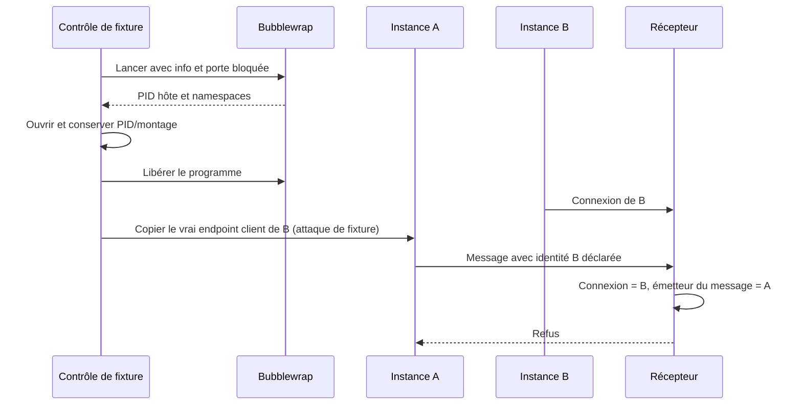

# IA2.3 — identité du canal d'instance Linux, 17 octobre 2026

**PASS sur une expérience isolée ; lanceurs Swarm non raccordés.** Codex seul,
deux programmes Python sous Bubblewrap, aucun modèle réel ni compte distant,
aucune mission existante touchée. Le [noyau IA2.2](../ia2-contract-kernel-20261017/RAPPORT-IA2.2.md)
reste distinct : aucun message de cette expérience ne lui est transmis.

## Question et mécanisme

Deux approches sont comparées : conserver le PID de la connexion (`SO_PEERCRED`),
ou vérifier les credentials de chaque message (`SO_PASSCRED`/`SCM_CREDENTIALS`)
avec des namespaces épinglés par le contrôle. La recette transmet un **vrai
descripteur de connexion de B** à l'hôte puis à A. Le pair de connexion reste B ;
le message envoyé par A porte le PID de A. L'identification par connexion seule
attribuerait ce message au mauvais acteur.

Le contrôleur lance Bubblewrap avec `--info-fd` et `--block-fd`, reçoit le PID
vu de l'hôte et les namespaces, ouvre les objets PID/montage via `/proc`, puis
libère le programme. Les descripteurs restent ouverts pendant l'expérience.
L'agent ne choisit pas sa référence par son premier message.

La [sonde initiale](namespace-bootstrap-initial.json) montre que le namespace
**utilisateur change** entre bootstrap et programme final. Le supposer stable
aurait refusé le programme légitime. Le prototype retient seulement PID/montage,
observés stables ici, sans généralisation aux autres attributs.

Le récepteur exige credentials et paquet complets, rattache le PID du message
aux objets épinglés, puis vérifie déclaration d'instance et état actif dans le
registre de fixture. Les métadonnées de connexion servent de comparaison.



[Schéma SVG rendu](channel.svg), [aperçu PNG](channel.png) ; rendu final réussi
et aperçu inspecté, avec les journaux conservés ci-dessous.

## Observations et originaux

[Recette actuelle](../ia2_runtime_binding.py), [copie figée](with-setns/recipe.py),
[commande/dates/sorties](with-setns-run.json), [résultats](with-setns/results.json),
[messages et credentials](with-setns/observations.json).
**13 contrôles PASS / 13 exécutés**, dont les contrôles positifs et confirmations
de fin des sous-cas : ce ne sont pas 13 scénarios IDA entièrement qualifiés.

| Cas | Observation |
| --- | --- |
| A et B légitimes | Reconnues ; namespaces épinglés distincts. |
| A déclare B | Refus ; émetteur attribué à A. |
| Sous-processus d'outil de A | PID différent, même périmètre ; attribution à A et terminaison confirmée. Aucun nouvel agent Swarm créé. |
| Endpoint B transféré | Copie réelle du descripteur confirmée, pas d'un libellé. |
| Endpoint B utilisé par l'hôte | Refus : aucun namespace d'instance pour le message ; pair de connexion toujours B. |
| Endpoint B utilisé par A | Refus : émetteur A malgré le pair B ; fin de l'attaque confirmée avant de libérer le lecteur B. |
| Faux credentials visant le PID de B | Tentative refusée par le système ; résultat normal attribué à A. |
| Descripteurs user/PID/montage de B copiés à A | Trois tentatives `setns` refusées avec `EPERM`. |
| A révoquée dans le registre de fixture | Le message suivant est refusé alors que le processus existe encore : refus de canal, pas preuve d'arrêt. |

Le [premier passage à 12 contrôles](initial/results.json) est conservé ; la
variante `setns` en ajoute un. Ne pas compter ces passages comme 25 cas distincts.
Les deux programmes terminent avec code zéro, sans nettoyage forcé.

Pour une réplication locale depuis la racine du dépôt, utiliser un **nouveau**
répertoire de preuve, sans remplacer les originaux :

```sh
preuve_identite=$(mktemp -d /tmp/swarm-ia2-canal-XXXXXX)
python3 docs/plans/actions-confiance/verification-identites-agents-20261016/ia2_runtime_binding.py "$preuve_identite/resultats"
```

Le sous-répertoire `resultats` doit être absent : la recette refuse de remplacer
une preuve existante. Cette recette nécessite Linux, Bubblewrap, Python avec `os.setns` et la création
de namespaces autorisée. L'[environnement observé](environment.json) est daté
après l'exécution, pas présenté comme un relevé préalable. La recette ci-dessus
a été exécutée depuis le rapport dans un nouveau sous-répertoire :
[commande et sorties](documentation-replay-run.json), [résultats figés](documentation-replay/results.json).
Treize contrôles réussis à nouveau, avec deux terminaisons zéro ; il s'agit
d'une répétition des mêmes cas, pas de treize scénarios supplémentaires.

## Limites et suite

Cette preuve concerne cette machine Linux, les commandes observées et deux
cages scriptées. Credentials/descripteurs sont réels ; noms A/B, registre et
révocation sont des fixtures en mémoire. Le protocole borné est expérimental.

Source d'autorité et bootstrap humains, vrai plan, admission atomique,
persistance de révocation, redémarrage, concurrence/expiration des octrois,
effets métier et sortie réseau fournisseur restent **non démontrés**. Le réseau
est isolé ; cela ne remplace pas l'intégration ou la recette F07 complète.
Administrateur hôte et compromis du compte contrôleur non confiné sont hors
garantie. Autres voies d'évasion et plateformes non qualifiées.

Un outil demeure dans son instance ; un sandbox imbriqué changeant de namespaces
exige un rattachement contrôlé, pas une exception au test. PID/namespaces ne
remplacent pas l'histoire des droits. Après perte des descripteurs au restart,
le premier message reçu ne doit pas rétablir l'autorité.

Propriétaire : Codex. Intégrer l'attribution à un courtier Go protégé, au registre
courant et à IA2.2, puis vérifier engagement Trust/SQLite et révocation/effets.
Les connexions copiées et namespaces instables deviennent des régressions à
conserver. Cette documentation et la recette ne ferment ni F01–F07 ni IA2/IA3.

## Replan documentaire et traçabilité

Le premier rendu Mermaid échoue : un point-virgule dans le texte d'un message
est interprété comme séparateur de syntaxe. Le [source initial](channel-initial.mmd),
le [rapport avant correction](report-before-diagram-correction.md.txt) et le
[refus du moteur de rendu](diagram.json) restent conservés. Remplacement par une
virgule, puis rendus SVG et PNG réussis : [commandes et sorties](diagram-final.json).
Le schéma ne modifie ni la recette ni ses 13 résultats.

Le premier pilote de rendu renvoyait zéro malgré l'échec de sa sous-commande ;
une lecture d'image tentée ensuite a échoué car le fichier était absent. Le
pilote corrigé propage l'échec avant toute lecture dépendante. Le succès du
pilote ne remplace donc pas celui de chaque rendu : contrôler code, sortie,
artefact et contenu. Propriétaire Codex ; vérification finale documentaire dans
[l'index final](checks-documentation-final.json), distincte de la qualification
du moteur.
