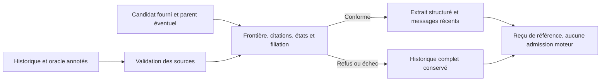

# M17 — contrat et référence exécutable de résumé progressif

16 octobre 2026, reprise « suite ». Codex seul ; `replan`, cadrage
`spec-builder`, puis APEX pour la recette de référence. MEM-U07/U09/U13,
cas MEM-C16 et MEM-C17 ; acquis et appels M6–M16 conservés.

## Décision et portée

Swarm ne produit pas encore de résumé progressif. Ses dialogues, checkpoints,
sélections mémoire et projections de reprise sont des contrats distincts.
Ajouter immédiatement un appel de synthèse et remplacer le contexte demanderait
une politique persistée/Admin, une conservation vérifiable et une qualification
de fidélité. Une simple instruction demandant un bon résumé ne les prouverait pas.

L'autre voie est une référence extractive exécutable avant raccordement : mêmes
sources et mêmes assertions pour un résumé fourni, frontières explicites,
progression chaînée et récupération sur refus. Elle est retenue pour M17.
L'outil vit dans `tools/memory-evaluation/`, hors du moteur. Aucun résumé n'est
admis, aucun agent lancé, aucune politique produit ajoutée. Le contrat de sources
annotées sert d'oracle de test ; une citation exacte ne prouve pas à elle seule
une bonne paraphrase, et les annotations ne constituent pas une vérité métier.

## Contrat testable

| ID | Quand / précondition | Effet exigé dans la référence |
| --- | --- | --- |
| SUM-01 | Historique fourni | Identités uniques, portée explicite, messages et annotations liés par SHA-256 ; aucune entrée invalide transformée en historique vide. |
| SUM-02 | Frontière proposée | Entier strict, préfixe non vide et messages récents conservés ; aucun appel/résultat coupé ou résultat orphelin. |
| SUM-03 | Éléments protégés dans le préfixe | Exigences ouvertes, intention future, preuve historique et incident ouvert présents avec citation/source/état exacts. Pas de prose libre qualifiée implicitement. |
| SUM-04 | Deuxième résumé | Reçu parent lié à son contenu et aux sources, préfixe d'origine inchangé, frontière strictement avancée et même portée ; protections du préfixe cumulées. |
| SUM-05 | Échec, vide, contradiction ou source périmée | Candidat refusé, contexte effectif revenu aux originaux complets, sans modification du fichier d'historique ni faux succès. |
| SUM-06 | Publication d'un résultat de recette | Fichier nouveau, contenu vérifié ; évaluation locale distincte d'une sortie de modèle, d'une admission et de l'acceptation du produit. |

La représentation de référence distingue `intention/future`, `evidence/historical`,
`incident/open` et `requirement/open`. Les fixtures ne prétendent pas couvrir
tous les états d'une future synthèse métier. Les messages d'outil sont opaques
et conservés tels quels ; le validateur contrôle leurs liaisons, sans les exécuter.
Une frontière exprime un nombre de messages couverts, pas un budget de tokens.

## Lots et preuves

| Lot | Propriétaire / dépendance | Livrable et preuve |
| --- | --- | --- |
| M17.1 | Codex ; M16 | Sources amont à SHA fixe, contrat ci-dessus, cas avant réalisation de la référence. |
| M17.2 | Codex ; M17.1 | Outil pur, schémas stricts et fichiers exclusifs ; tests des cas normaux, progression, refus et originaux conservés. |
| M17.3 | Codex ; M17.2 | Vraie CLI Python : deux synthèses successives, refus contradictoire, empreintes des originaux et sortie existante refusée ; aucun modèle. |
| M17.4 | Codex ; preuves précédentes | Revue locale, docs FR/EN, évaluation ajoutée sans renotation et RETEX. |

La future intégration doit lire des sources Swarm autorisées, lier le contrat
courant, réserver et comptabiliser les appels, proposer un aperçu inspectable et
persister tout déclenchement éventuel dans Admin/API/CLI/Go. Raccorder ensuite
le consommateur réel et comparer les mêmes cas avec un modèle sous autorisation
distincte. Ces travaux ne sont pas assimilés à la présente référence locale.

## Résultat local

M17.1 à M17.4 réalisés : contrat et outil de référence, quatre sondes de méthode
amont à SHA fixe, 24 tests Python distincts, 14 invocations de la vraie CLI de
l'outil et dix refus restituant les originaux. Un refus erroné d'outils vides est
reproduit puis corrigé. Documentation FR/EN, revue locale et RETEX conservés dans
[RESULTATS-MEMOIRE-13.md](RESULTATS-MEMOIRE-13.md).
Le raccordement au moteur, le résumé automatique, la politique Admin et la
qualité LLM restent ouverts ; aucun fournisseur ou serveur réel modifié.
