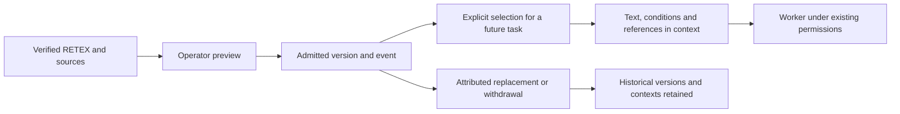
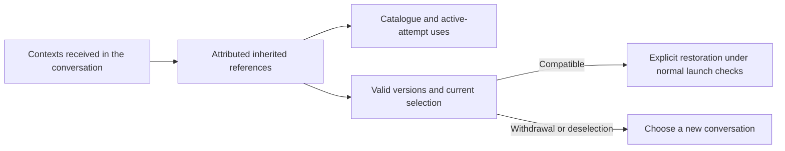
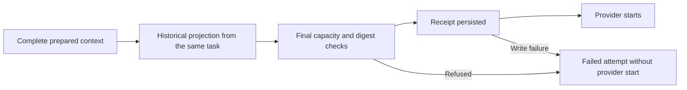
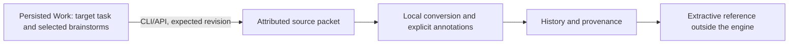
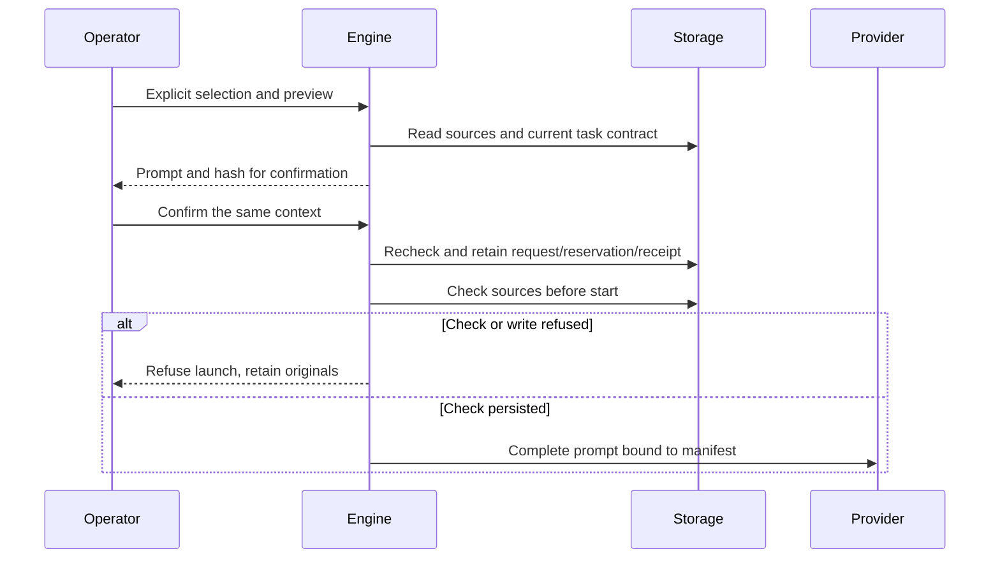
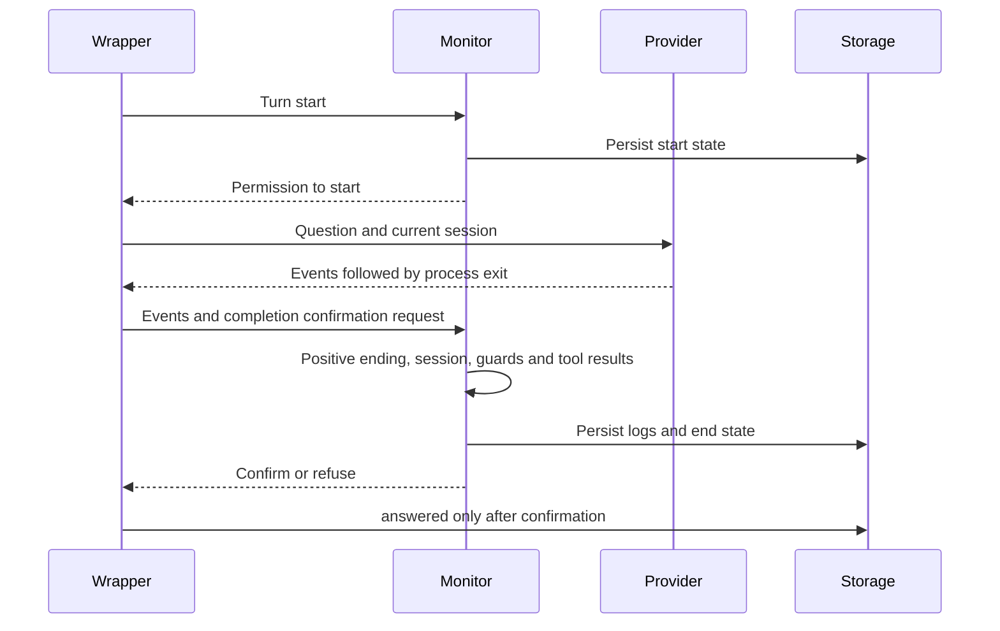
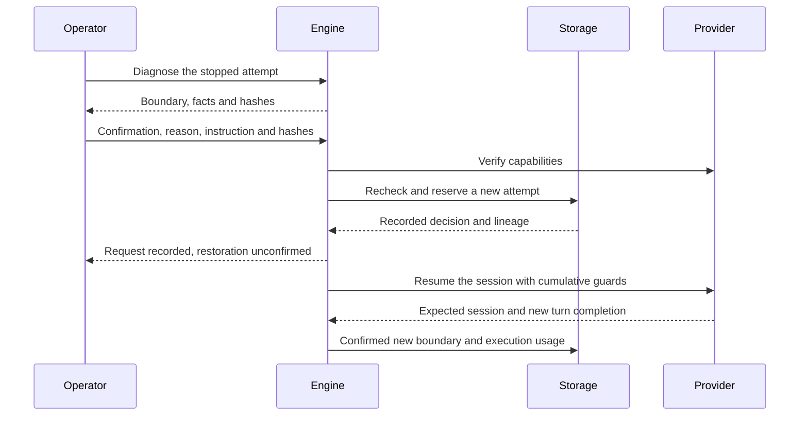

# Project memory

Project memory retains an experience or procedure from a verified RETEX. The
local operator explicitly selects a version for a future worker task. Stored
content changes neither engine methods nor permissions, budgets, criteria or
acceptance evidence.

Open **Project memory** from the RETEX view. `/project-memory.html`, the CLI and
the authenticated local API share the same engine contract. Admission requires a
`verifie` RETEX of nature `fait`, its original dialogue or acceptance reference,
and an accepted task with fresh evidence. Sources are checked again on selection
and before the attempt's first provider invocation.



## Operator workflow

1. Select the source mission, verified RETEX and `experience` or `procedure` type.
   Provide reusable content, applicability conditions and the decision reason.
2. Preview and apply admission. Preview changes neither storage nor revision.
3. Choose the destination mission, a future `todo` worker task and useful active
   versions. Explain the selection, inspect its actual text and save it.
4. Launch through the existing task workflow. Context includes exact text,
   conditions, source work/RETEX, version and hashes.
5. Replace or withdraw a lesson when needed. Historical text remains available;
   stale task selections must be refreshed or cleared before another launch.

Search is initially literal text matching over content and conditions. The
operator selects relevant results. Automatic extraction, vector search and real
LLM improvements are not implied. A remembered procedure is conditional knowledge;
it does not freely rewrite shared engine instructions or model weights.

## CLI and API

`swarm memory list --json` returns versions, provenance and availability. Other
operations read `--input request.json`: `admit-preview`, `admit`,
`replace-preview`, `replace`, `withdraw-preview`, `withdraw`, `select-preview`,
`select`.

Use `GET /api/v1/project-memory?q=text` or
`POST /api/v1/project-memory?action=OPERATION`. HTTP writes use the existing
authenticated session and origin/CSRF checks. CLI, HTTP and Go share validation.
No new role authority is granted by these operations.

Admission payload fields are `schema_version: 1`, `event_id`, `expected_revision`,
`work`, lesson `id`, `source_retex`, `kind`, `body`, `conditions` and `reason`.
For example, after substituting actual work, RETEX and revision values:

```json
{
  "schema_version": 1,
  "event_id": "memory-admission-1",
  "expected_revision": 12,
  "work": "w-source",
  "id": "verify-affected-flow",
  "source_retex": "r-source",
  "kind": "procedure",
  "body": "Verify the observable result after a correction.",
  "conditions": "Check the affected flow, current sources and evidence.",
  "reason": "Reuse verified feedback."
}
```

Call `admit-preview`, add its `preview_token` to the same payload, then call
`admit`. Tokens bind the decision, revision and sources; stale previews fail.
Identical event replay does not write twice. Reusing an event for different
content fails.

Replacement additionally requires the latest version's `expected_sha256` and
all new content/source fields. Withdrawal accepts only schema, event, work,
lesson ID, expected revision/hash and reason; it can retire a lesson whose source
evidence is no longer available.

Selection takes destination `work`, `task`, expected revision, event, reason and
`selections`, an array of `{work, id, version, sha256}` references from the
catalogue. Use `select-preview`, then `select` with its token. An empty array
clears future selection. Active tasks, retired/superseded versions, changed
sources and stale evidence fail without partial updates. Storage failures are
not converted to successful empty catalogues. User text is rendered without
executing HTML.

## Persistence, recovery and limits

Versions are appended to the source work in SQLite alongside its event history.
Versioned memory introduced storage 33 and dialogue boundary snapshots storage
34. Explicit conversation restoration raises the current version to 35, backing
up existing storage before migration. This fence prevents older supervisors from
interpreting restoration as a fresh conversation.
Stop older programs before upgrading; observation commands do not silently migrate an old
workspace. Building a binary does not update a running server.

Archives retain versions and received contexts. Import marks lessons as imported
and never imports local admission authority. A distinct new admission with fresh
sources is required. Existing attempt contexts are immutable. Knowledge is bound
to the canonical project root; relocation also requires new local admission.

The catalogue identifies active attempts holding each version; replacement and
withdrawal previews also list them. An ongoing conversation retains its context:
withdrawal neither stops it nor revalidates each turn. Its owner decides whether
to continue or restart through existing public operations.

Explicit restoration also follows contexts received by ancestors in the same
conversation through versioned `context.memory` references and `dialogue_restore`
links. The catalogue and previews attribute their references to the active
attempt, even when its latest manifest no longer contains them. Repeated receipt
of the same version counts as one use per agent. Missing, changed or inconsistent
lineage produces an explicit error, not an empty catalogue claiming no affected
agents.

All inherited versions must remain valid **and present in the current selection**
to resume the session. Clearing the selection does not remove a lesson from
provider history. The diagnosis becomes blocking and hides the restoration form;
choose a new conversation if that lesson must be excluded. If the version remains
valid and wanted, the operator can select it again before refreshing the diagnosis.
The engine rechecks lineage inside the transaction after the probe and before
the new process starts.



Withdrawal appends a historical version; deselection changes future launches.
Neither purges prompts, checkpoints, evidence or provider-retained copies.
Received contexts and their hashes remain available. This increment introduces
no retention or erasure policy. The reader does not detect free text copies or
past tool reads that were not attributed to these versioned references.

A legacy Field Guide lesson now managed by project memory is filtered out of the
implicit index. Direct profile or recovery-piece references are refused: remove
the legacy reference through existing configuration operations and select the
version. This does not promise erasure of arbitrary text copies.

Recovery-piece paths and local index links are normalized for this check,
including link fragments and encodings. When a lesson is managed, an explicit
recovery piece pointing to the whole index is also refused; the filtered implicit
index remains available. Withdrawal does not delete source evidence.

The shared JSON request transport capacity is 1 MiB. Complete context must fit
the existing launch transport capacity; lessons are never silently truncated to
fit. These capacities are not retention or learning-budget policies. New policies
must persist and be editable through Admin with shared API/CLI/Go validation.

## Prepared context and launch input

For a worker attempt, the `context` manifest describes the complete `prompt`,
including managed delivery instructions. Before starting a non-interactive worker,
the engine may append attributed recovery metadata from the preceding attempt of
the same task. It retains the initial manifest in `prepared_context`, checks the
complete input and saves its new `context` before starting the provider. Memory
references, selection and conditions are retained.



The SHA-256 and byte count in `context` cover the complete `prompt`.
`prepared_context` distinguishes the prepared preview from the addition made at
launch. A missing field on an older record does not prove that its context was
empty. Recovery metadata does not restore the provider conversation. Its
operations remain historical and require checking before repeating effects.

The projection identifies `work`, `task`, `agent` and `attempt`.
`task_focus.work_revision` dates the current task focus, separately from the
attempt's historical status. `bounded_excerpt` is true when a representation
bound shortens the focus or activities. `task_focus.truncated_fields` names
shortened fields; `omitted_criteria_count` counts criteria not included.
Every included criterion remains `verification_required`, even with a historical
verdict. A missing task causes an error and prevents this launch.

`activity_projection.sources` aligns with `observed_operations`: each entry
contains the activity log `seq` and a `truncated` flag. Counters distinguish
retained activity rows, scanned rows, older rows outside the window, excluded
tool-result announcements, duplicates after masking, and rows omitted for space.
`omitted_budget_rows` concerns excerpt space, never the execution budget.
Distinct texts are not merged because their shortened excerpts happen to match.
Sensitive-text masking and raw-result exclusion still apply; these filters do
not establish that complete history is included.
A false `bounded_excerpt` means no bound of this excerpt was reached; it does
not claim that the complete conversation has been copied.

Existing bounds inspect the latest 160 activities, retaining at most 24 operations
and 4,500 bytes of activity text, with at most 240 display cells per operation.
Task focus includes at most 12 criteria, 300 cells per criterion, 600 for the next
action and blocker, and 240 for the report pointer. These are metadata excerpts
inside a bounded launch input, not execution limits or a summarization policy.
The complete input capacity refusal below still applies after appending them.

To retrieve available sources, `swarm --json agent logs AGENT -1` starts with the
first 200 retained rows. Paginate using the last returned sequence as the next
argument, then locate the cited `seq`. Reading leaves logs unchanged. Existing
retention keeps at most 2,000 rows per agent across all kinds, and messages are
already bounded when recorded; source references promise no unlimited history.
The isolated recipe is `python3 tests/worker_recovery_projection.py BINARY NEW_OUTPUT`.
It uses only a scripted provider, comparing received text, CLI/API receipts,
source records and their counters before and after recovery.

The existing launch capacity is 128,000 bytes, also enforced after appending
recovery. Overflow or a failed receipt write prevents launch without silently
truncating input. A persisted receipt describes intended provider input; by
itself it proves neither process receipt nor successful execution.

`swarm --json agent show ID` and the authenticated local API
`GET /api/v1/agent-detail?work=WORK&agent=ID` expose these fields under `agent`.
Earlier attempts and consumption are retained, completed contexts are not
rewritten and no acceptance is created. Implicit restart of an already-started
dialogue wrapper remains refused.

This projection alone does not restore a provider conversation after wrapper
shutdown; explicit restoration is described below. It does not automatically
summarize history or establish that a real LLM correctly applies a procedure.
Verification evidence and limits are retained under
`docs/plans/deepagents-integration/`.

## Progressive summary reference outside the engine

`tools/memory-evaluation/summarization.py` checks an extractive projection against
annotated fixture history. It retains full quotes for open requirements, future
intentions, historical evidence and open incidents, with source hashes, a cutoff
and a parent receipt. Recent messages remain unchanged; a tool-call/result group
cannot be split. Empty tool content remains valid within a complete group.

An empty, contradictory, stale or group-splitting candidate produces a FALLBACK
containing all original messages. Invalid source history is an explicit error.
The recipe writes only new files, changing no mission database or agent context.
A PASS covers this extractive reference, not paraphrase fidelity or business
acceptance. Annotations and scope labels grant no access authority. See the
[recipe and formats](../../tools/memory-evaluation/README.md#référence-extractive-de-résumé-progressif).

Automatic summarization, any persisted Admin/API/CLI/Go policy and its actual
consumer still require integration and qualification. This reference calls no
model, purges no history and restores no provider session.

Use `swarm --json memory summary-source --input request.json`, or authenticated
POST `/api/v1/project-memory?action=summary-source`, to prepare the reference
from project sources. Supply work, target task, expected revision and explicit
same-work brainstorm references. Changed sources and stale revisions are refused;
inspection never upgrades old storage implicitly. The packet attributes the task
snapshot and selected stored texts without sibling reports or reconstructed
provider history.

`tools/memory-evaluation/swarm_source.py` checks the packet and explicit
annotations, then creates private reference and provenance files in a new
directory. The task snapshot must remain protected. It infers no business state
and admits no summary; freshness must be rechecked before future engine use.
See the [converter and isolated recipe](../../tools/memory-evaluation/README.md#préparer-la-référence-depuis-des-sources-swarm).

The converter also checks that question/answer IDs match the Go producer's
derivation from their `task`, `attempt`, `sha256` reference. Renaming a citation
or repeating the same exchange under different IDs is refused even after
recomputing hashes and annotations. `admission.py` shares this check before
creating output. Recover from the original Swarm packet and its source IDs;
do not rewrite historical receipts. Legacy references with an empty `attempt`
remain compatible. This content binding proves neither author identity,
ownership nor usage permission; enforcement remains in the M20 and identity
workstreams.



## Extractive selection for an explicit launch

A first manually requested automated worker launch outside a hierarchical
mission may include `summary_selection`: schema 1, M18 packet hash, dialogue
references, cutoff, protected annotations and reason. The engine rebuilds quotes
from persisted texts; it accepts neither free paraphrases nor a Python receipt
as authority. The full operator snapshot is checked but never injected: the
normal engine path still produces the task contract.

Inspect `swarm --json agent context-preview WORK --input launch.json`, then
submit the exact request with its `context_hash` to `agent start`. Authenticated
API action `agent-context-preview` returns the same prompt; `start` requires the
same confirmation for this selection. Reason and annotations are also bound to
the prompt by hash. Preview reserves nothing and never upgrades old storage.
Malformed, changed, stale or incompatible selections refuse launch while
preserving originals.

`context.summary` retains the choice, received/omitted source IDs and attachment
hash. Queue admission binds the state after normal launch transitions. Immediately
before starting the subprocess, the supervisor rechecks that state and persists
`checked_before_start_at` / `checked_source_sha256`. Drift or write failure prevents
the provider call. This is a dated check, not continuous freshness after the
observation. The full prompt, including engine recovery context, remains bound to
`context.sha256`; `prepared_context` retains the original prepared receipt.

The choice is not saved in the reusable profile. Brainstorming, hierarchy,
conductor, parent, previous attempts, terminal, dialogue/restoration and concurrent
full dialogue attachments are unsupported for this feature and explicitly refused.
Provider completion does not accept the task. Annotation states remain declared,
LLM quality unqualified; no automatic policy or purge is added. See
[local preparation and recipe](../../tools/memory-evaluation/README.md#sélection-extractive-admise-par-le-moteur).



## Confirmed dialogue turn completion

In `dialogue` mode, the wrapper asks the monitor to authorize the start of each
exchange and then confirm its completion. A successful provider process exit is
insufficient to store `answered` in `agent_dialogue_turns`. The monitor requires
one positive terminal event: `turn.completed` for Codex, or a `result` with subtype
`success` for Claude and no error flag. Conversation identity must be present and
remain the same across turns.



A provider failure, an event after the positive ending, unsupported activity,
a missing tool result or an already-triggered limit prevents confirmation.
A failed log or status write also prevents the next exchange. The supervisor
finalizes turns still marked `running` as `interrupted`; observed tool calls and
usage remain accounted for. Missing provider usage remains unknown rather than
being replaced with an invented value.

Confirmed exchanges reuse the configured session and permissions. Counters
accumulate throughout the attempt; tool identifiers are namespaced by turn even
when the provider reuses an identifier. `answered` qualifies this technical
boundary. It establishes neither answer correctness, task acceptance nor a full
restoration checkpoint. Implicit restart of an already-started wrapper remains
refused: cumulative guards still need restoring and uncertain effects require
verification.

The local recipe uses fixture provider processes without calling a model:

```sh
go test ./internal/engine -run '^(TestDialogueIncompleteTurnCannotBeAnswered|TestDialogueActualSupervisorConfirmsTurnReceipts)$' -count=1 -v
```

It checks turn statuses, invocation counts and cumulative counters, then reads
the agent through the built CLI. Evidence, failure variants and limitations are
in `docs/plans/deepagents-integration/RESULTATS-MEMOIRE-06.md`.

## Durable dialogue boundary state

The monitor saves a version 1 state in the turn's `checkpoint` column before
authorizing its start and before confirming its completion. It retains cumulative
guards: limits, signatures and repetition, errors, calls/results, pending tools
and known observations, together with reported usage. Its digest binds these
values to the project, attempt, turn and recorded launch. It detects inconsistent
data; it is neither an authority signature nor proof of current provider-side
permissions or conversation state.

`swarm --json agent show ID` and the authenticated API
`GET /api/v1/agent-detail?work=WORK&agent=ID` add a `dialogue` object for this mode.
It contains `available`, `phase`, `status`, `boundary_confirmed`,
`restart_supported`, session identity, digest, date, `progress`, `usage` and the
scope of these observations. Internal guard signatures and details remain in
private storage. The API checks work ownership before reading this state.

| Stored state | Meaning |
| --- | --- |
| `running` | State at turn start; later effects and usage are unknown. |
| `confirmed` with status `answered` | Confirmed end boundary, including cumulative usage known at that boundary. |
| `confirmed` without status `answered` | Status confirmation is unproven, for example after wrapper interruption. |
| `interrupted` | Last observed interruption boundary; effects require review before recovery. |
| `available: false` | No state or a legacy turn without a checkpoint; no invented zero or restoration success. |

A failed state write at the start prevents the provider call; at completion it
prevents `answered` and the next exchange. An observed channel closure retains
interrupted state if storage is available. Abrupt loss of both processes can
leave only the start snapshot: later effects remain unknown. The end snapshot
and turn status are successive writes; `boundary_confirmed` requires both.
The `agent` object retains periodically saved supervision counters, while
`dialogue.usage` provides durable usage at this boundary without waiting for the
heartbeat. Unreported usage remains absent.
Waiting durations and states in this projection are computed at the boundary's
`at` timestamp; inspecting interrupted state later does not make them grow.

The shared reader also validates the turn status (`running`, `answered`, or
`interrupted`). For an `answered` turn, the session stored in its row must exactly
match the confirmed checkpoint session. A nonempty session must follow the same
format accepted by the resume adapter. Retained usage and cache counts must be
nonnegative; a reported cost must be finite and nonnegative. A correct digest
does not replace these consistency checks.

Confirmation writes `answered` only while the row remains `running` and its
starting session is unchanged. If another write replaces that session, the
wrapper refuses confirmation and the next exchange instead of silently repairing
the discrepancy. A transient `confirmed` snapshot whose row is still `running`
or already `interrupted` remains readable and unconfirmed: the row can still
carry the previous session before answer confirmation.

Inconsistent state produces an explicit error in `agent show`, `agent-detail`,
and `recovery-preview` (HTTP 400 for both APIs), without returning a session or
modifying history. The panel displays the error and offers no confirmation.
Examine retained sources before deciding what comes next; reads never rewrite
a session or reconstruct assumed counters.

Reproducible verification using isolated test fixtures:

```sh
go test ./internal/engine -run '^TestDialogue(BoundaryRejectsInconsistentTurnAcrossConsumers|CheckpointRejectsUnresumableSessionAndInvalidUsage|ConfirmationDoesNotOverwriteChangedSession|BoundaryAllowsUnconfirmedEndBeforeAnswer)$' -count=1 -v
node tests/dialogue_recovery_ui.cjs /absolute/path/to/binary /evidence/directory --integrity
```

The browser recipe creates its own project and local scripted provider. State
corruption and repair affect only that fixture, never a user's mission database.
No real model is called.

Turns remain retained when logs are purged. Their state is included in local
recoverable deletion and restoration; a standard historical export does not
thereby become an executable checkpoint. Legacy state is not reconstructed from
truncated logs. Nonempty corrupted state, incompatible state or a snapshot bound
to another launch is explicitly refused.

`restart_supported` remains `false`: neither inspection nor technical guard
reconstruction authorizes restarting this wrapper. Explicit restoration below
creates a new attempt. Before a real upgrade to storage 35,
stop older processes through the installation procedure; inspection commands do
not migrate storage.

Local recipe without a model:

```sh
go test ./internal/engine -run '^(TestDialogueBoundaryHasDurableStateBeforeHeartbeat|TestDialogueCheckpointRestoresCumulativeGuardsWithoutAliasing|TestDialogueCheckpointWriteFailureStopsBeforeNextProvider)$' -count=1 -v
```

## Diagnosis before conversation recovery

`swarm --json mission recovery WORK TASK [AGENT]`, its plain-text output and
`GET /api/v1/recovery-preview?work=WORK&task=TASK&agent=AGENT` now inspect dialogue
boundaries. **Before restarting** presents the same read-only diagnosis under
**Conversation recovery**. An explicit selection addresses the retained identity;
without an ID, the engine reads the latest attempt of that task, even beyond the
200 recent agents displayed in history. A selected older attempt is identified.

The preview's `dialogue` object contains `boundary`, `checks`, `recommended_path`,
`recommendation`, `observed_at`, `facts_sha256`, `decision_owner`,
`decision_recorded` and `resume_supported`. Each check has a code, a `pass`,
`fail` or `unknown` status and an explanation. The responsible supervisor or local
operator receives this diagnosis; it records no decision.

| Recommended path | Meaning |
| --- | --- |
| `select_latest_attempt` | The selection does not match the current latest attempt. |
| `wait_for_stop` | Provider process termination has not been confirmed. |
| `inspect_history` | No usable checkpoint; historical guards and effects need qualification. |
| `reconcile_effects` | The last turn lacks a confirmed end boundary; verify effects before replay. |
| `review_current_contract` | A guard, configuration, limits, memory or provider cooldown needs review. |
| `review_boundary` | A confirmed boundary to examine; preflight and decision remain unknown. |

Checks re-read program, model and allowed environment-name configuration,
compatibility of historical limits with current settings, selected memory sources
and recorded provider cooldown. They execute neither a provider nor preflight.
An available executable and unchanged configuration establish neither
authentication, effective permissions nor provider session availability. Access,
reservations, the complete launch contract and a fresh decision still require
verification at launch.

`facts_sha256` attributes the exposed facts, excluding the observation clock;
it is not an approval token and no mutation accepts it as one. A failed read of
nonempty checkpoint state is refused rather than returned as empty success.
Unavailable configuration remains unknown. An absent web session is refused
under the existing contract; attempts from another work or task are not exposed.

`decision_recorded` remains `false` for the next restoration: a read makes no
decision. `resume_supported` indicates an explicit request is available for a
confirmed boundary outside managed Git workspaces; it establishes neither
preflight nor reservations. Existing new-attempt and corrective-recovery operations retain
their rules and do not implicitly restore a conversation. The preview creates
no agent, reservation, counter reset or acceptance. Explicit restoration repeats
launch checks using examined facts and current conditions.

## Explicit restoration of a stopped conversation

Restoration creates a **new execution attempt** in the **same provider
conversation**. The previous identity, evidence and costs remain retained.
Normal launch checks enforce permissions, dependencies, attempt limits, workspace
and reservations. Managed Git workspaces requiring another checkout are refused:
use production recovery. The authenticated local operator decides; a diagnosis
never implicitly authorizes a supervisor.



A refusal stops this flow at its check boundary; the request receipt never
replaces confirmation of the new turn.

Read `mission recovery`, then copy its reviewed hashes into this request:

```json
{
  "schema_version": 1,
  "event_id": "conversation-restore-1",
  "expected_revision": 8,
  "checkpoint_sha256": "hash-read-from-checkpoint",
  "facts_sha256": "hash-read-from-facts",
  "confirm": true,
  "reason": "Reviewed the boundary and restoration conditions.",
  "instruction": "Continue the task with its current contract and retained conversation."
}
```

Replace revision and hashes with actual read values. The reason is 8–2000 bytes;
the instruction is 20–16000 bytes. Replaying the same event returns the same
execution; different content under that event is refused.

```sh
swarm --json agent resume-dialogue-preview SOURCE_AGENT --input restore.json
swarm --json agent resume-dialogue SOURCE_AGENT --input restore.json
```

The APIs are `POST /api/v1/dialogue-resume-preview` and
`POST /api/v1/dialogue-resume`, with `work` and `agent` query parameters, the same
JSON, and the usual web session, origin and CSRF protection. **Before restarting
→ Conversation recovery → Request conversation restoration** collects reason,
instruction and explicit confirmation. Errors preserve entered values.

HTTP transport accepts at most 128000 bytes of raw JSON, separately from decoded
field limits. This covers escaped field encoding; it is not a consumption or
attempt policy. Diagnosis, changes, spending and restoration-preview commands
are inspections: older storage must fail with `storage_upgrade_required`, without
implicit migration or a backup created by the read. Stop older processes before
explicitly upgrading with the new program.

Preview may execute the configured provider probe; it creates no agent,
reservation or recorded decision. The receipt must verify provider capabilities
(`verified`); a legacy compatible probe is insufficient. The transaction rechecks
the source after the probe, then records the decision, new attempt and
reservation. Preflight and contract are checked again before the process starts.
An incompatible revision, source, configuration, memory selection, reservation
or capability produces an explicit refusal.

`agent.dialogue_restore` attributes source, source attempt, hashes, conversation
root, prior exchange count, reason, actor and time. The request response says
`restoration_confirmed: false`: registration is not yet successful restoration.
The new turn must confirm the expected session and its completion. A different
session, missing result or interruption remains failed or subject to review,
without automatic retry or refund.

The checkpoint retains **cumulative conversation** guards and usage.
`agent.progress` and `agent.usage` count only the **new execution**, so aggregating
agents does not double-count history. The existing twenty-exchange limit remains
cumulative. Duration thresholds retain their per-launch observation contract;
previous durations remain recorded. The old wrapper is never implicitly restarted.

Local tests use scripted providers, not real models. They qualify neither provider
account authentication nor real session availability. Failure before a new boundary
never fabricates a checkpoint: preserve evidence and examine the latest execution
before deciding what recovery can follow.
