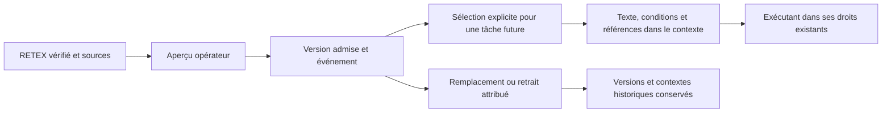
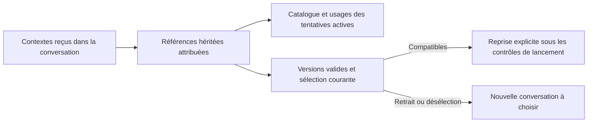
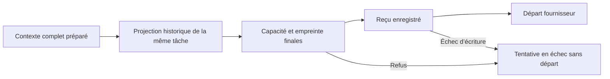
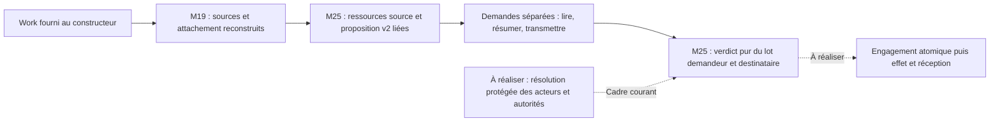
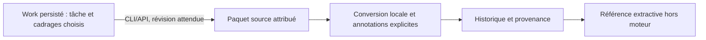
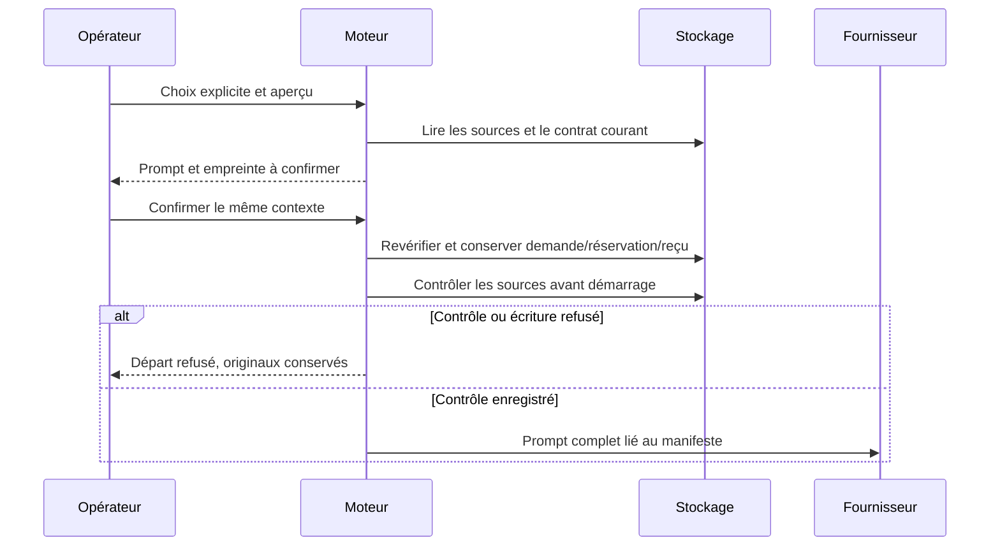
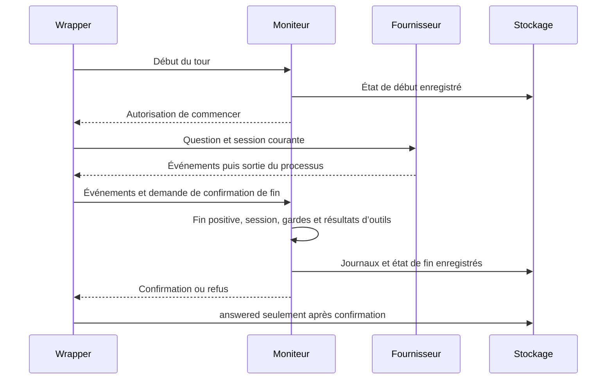
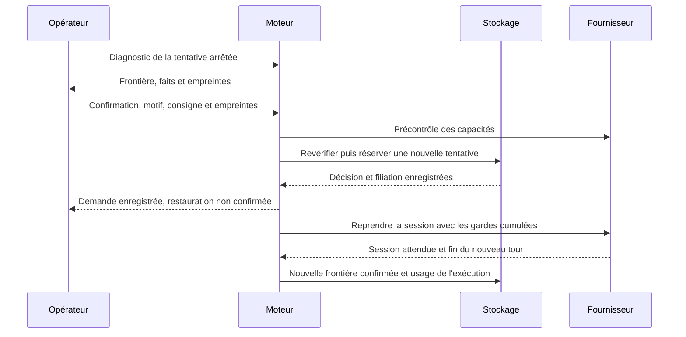

# Mémoire du projet

La mémoire de projet conserve une expérience ou une procédure issue d’un RETEX
vérifié, puis permet à l’opérateur local de sélectionner sa version pour une
tâche exécutante future. Elle ne modifie ni les méthodes du moteur, ni les
permissions, budgets, critères ou preuves d’acceptation.

L’accès se trouve dans la vue RETEX, lien **Mémoire du projet**. La page
`/project-memory.html` propose le même contrat que la CLI et l’API. Un RETEX
`verifie`, de nature `fait`, doit conserver son échange ou sa recette source et
une tâche acceptée avec des preuves fraîches. Le moteur recontrôle ces sources
à l’admission, à la sélection et avant le premier appel fournisseur de la tentative.



## Utilisation

1. Choisir la mission source, son RETEX vérifié et le type `experience` ou
   `procedure`. Rédiger la leçon, ses conditions de réemploi et le motif.
2. Examiner l’aperçu puis appliquer. L’aperçu ne change ni révision ni stockage.
3. Choisir la mission destinataire, une tâche `todo` exécutante et les versions
   actives utiles. Motiver la sélection, examiner le contenu puis l’enregistrer.
4. Lancer la tâche par le parcours habituel. Son contexte contient le texte exact,
   les conditions, le travail source, le RETEX, la version et leurs empreintes.
5. Pour corriger une leçon, choisir **Remplacer cette version** ou **Retirer cette
   leçon**. Les anciens textes restent historiques. Une sélection devenue périmée
   doit être refaite ou vidée avant le prochain départ.

La recherche initiale est textuelle et littérale, dans le contenu et les
conditions. Le choix explicite de l’opérateur établit la pertinence pour la tâche ;
aucune extraction automatique, recherche vectorielle ou amélioration LLM n’est
présumée. Une procédure mémorisée reste une connaissance conditionnelle ; elle
ne réécrit pas librement les consignes communes ou les poids du modèle.

## CLI et API

`swarm memory list --json` retourne les versions, leur provenance et leur état.
Les autres opérations prennent `--input demande.json` :
`admit-preview`, `admit`, `replace-preview`, `replace`, `withdraw-preview`,
`withdraw`, `select-preview`, `select`.

L’API locale authentifiée expose `GET /api/v1/project-memory?q=texte` et
`POST /api/v1/project-memory?action=OPERATION`. Les écritures HTTP suivent la
session et le contrôle d’origine/CSRF existants. Les opérations de mémoire
partagent la validation Go avec la CLI ; elles ne créent pas de nouveau rôle.

Exemple d’admission, avec les identifiants et révision réellement lus dans le
projet :

```json
{
  "schema_version": 1,
  "event_id": "memory-admission-1",
  "expected_revision": 12,
  "work": "w-source",
  "id": "verification-parcours",
  "source_retex": "r-source",
  "kind": "procedure",
  "body": "Vérifier le résultat observable après une correction.",
  "conditions": "Parcours concerné, sources et preuves courantes à contrôler.",
  "reason": "Réutiliser le retour vérifié."
}
```

Appeler `admit-preview`, puis ajouter son `preview_token` à la même demande
avant `admit`. Le token couvre décision, révision et sources ; un aperçu périmé
est refusé. Un même `event_id` et contenu rejoue sans écrire deux fois ; le même
identifiant avec un autre contenu est refusé.

Pour remplacer, fournir aussi `expected_sha256`, l’empreinte de la dernière
version, et tous les champs de contenu/source. Le retrait demande uniquement
schéma, événement, travail, identifiant, révision, empreinte attendue et motif.
Il reste possible quand les preuves de la source sont devenues indisponibles.

La sélection demande travail destinataire, révision, tâche, motif et `selections` :

```json
{
  "schema_version": 1,
  "event_id": "memory-selection-1",
  "expected_revision": 8,
  "work": "w-destination",
  "task": "verification",
  "reason": "Même type de correction.",
  "selections": [
    {"work": "w-source", "id": "verification-parcours", "version": 1, "sha256": "empreinte-lue-dans-la-reponse"}
  ]
}
```

Examiner avec `select-preview`, appliquer avec `select` et son token. Un tableau
vide enlève la sélection pour les départs suivants. Une tâche déjà active, une
version retirée/remplacée, une source modifiée ou une preuve périmée provoque un
refus sans modification partielle. Une erreur de stockage n’est pas un catalogue
vide réussi. Le contenu utilisateur est affiché comme texte, sans HTML exécuté.

## Stockage, reprise et limites

Les versions sont ajoutées au travail source dans SQLite et conservées avec ses
événements. La mémoire versionnée a introduit le stockage 33, les états de
frontière du dialogue le stockage 34. La reprise explicite porte le stockage
courant à 35 : un ancien superviseur ne doit pas traiter une restauration comme
un départ sans mémoire. Une sauvegarde privée précède la migration d'un espace
existant. Arrêter les anciens programmes avant cette mise à niveau ;
les commandes de consultation ne migrent pas silencieusement un ancien espace.
Une compilation seule ne met pas à jour un serveur déjà en cours.

Les archives conservent les versions et les contextes reçus. Une importation
marque les leçons comme importées ; elle n’importe pas leur admission locale.
Une nouvelle admission distincte et une source fraîche sont nécessaires. Le
contexte d’une tentative historique n’est jamais corrigé rétroactivement.
La liaison au projet utilise sa racine canonique : un déplacement exige aussi
une nouvelle admission locale des connaissances concernées.

Le catalogue indique les tentatives actives qui ont reçu chaque version ; les
aperçus de remplacement/retrait les signalent également. Une conversation déjà
démarrée conserve son contexte : le retrait ne l’arrête pas et ne revalide pas
chaque tour. Son responsable décide de sa poursuite ou de sa reprise par les
opérations publiques existantes.

Pour une reprise explicite, le lecteur suit aussi les contextes reçus par les
ancêtres de la même conversation, via les références versionnées `context.memory`
et les liens `dialogue_restore`. Le catalogue et les aperçus attribuent leurs
références à la tentative active, même si son dernier manifeste ne les contient
plus. Une même version reçue plusieurs fois compte comme un seul usage par agent.
Une filiation manquante, modifiée ou incohérente provoque une erreur explicite,
pas un catalogue vide indiquant qu'aucun agent n'est concerné.

Toutes les versions héritées doivent rester valides **et présentes dans la
sélection courante** pour reprendre la session. Vider la sélection ne retire
pas une leçon de l'historique fournisseur. Le diagnostic devient bloquant et
n'affiche plus le formulaire de reprise ; une nouvelle conversation est requise
si la leçon doit être écartée. Si la version est encore valide et reste souhaitée,
l'opérateur peut la sélectionner à nouveau avant de refaire le diagnostic.
Le moteur revérifie la chaîne dans la transaction après la sonde, puis au départ.



Le retrait ajoute une version historique ; la désélection change les prochains
départs. Aucun des deux ne purge les prompts, checkpoints, preuves ou copies
conservés par le fournisseur. Les contextes déjà reçus et leurs empreintes
restent consultables. Le lot ne crée aucune politique de rétention ou d'effacement.
Le lecteur ne repère pas les copies libres ou les anciennes lectures d'outils
qui n'ont pas été attribuées à ces références versionnées.

Une leçon du Guide désormais gérée par cette mémoire n’est plus annoncée par
l’index implicite. Sa présence directe dans un profil ou les pièces de reprise
est refusée : retirer cette référence héritée par les opérations de configuration
existantes et sélectionner la version. Les copies libres de texte ne constituent
pas un mécanisme d’effacement global.

Les chemins des pièces de reprise et les liens locaux de l’index sont normalisés
avant ce contrôle, y compris les fragments et encodages des liens. Lorsqu’une
leçon est gérée, une pièce de reprise visant l’index complet est aussi refusée ;
l’index implicite filtré reste disponible. Un retrait ne supprime pas les sources.

Les requêtes mémoire ont une capacité de transport JSON de 1 Mio, commune au
moteur et aux adaptateurs. Le contexte complet reste soumis à la capacité du
parcours de lancement ; il n’est pas tronqué silencieusement pour ajouter une
leçon. Ces bornes ne fixent ni rétention ni budget d’apprentissage. Une politique
supplémentaire doit être persistée et éditable dans Admin, API, CLI et Go.

## Contexte préparé et contexte de départ

Pour une tentative exécutante, le manifeste `context` décrit le texte complet
dans `prompt`, y compris les consignes de livraison gérée. Au départ d’un
exécutant non interactif, le moteur peut ajouter une projection attribuée de la
tentative précédente de la même tâche. Il conserve alors le manifeste initial
dans `prepared_context`, contrôle le contexte complet et enregistre le nouveau
`context` avant de démarrer le fournisseur. Les références mémoire, leur sélection
et leurs conditions restent conservées.



Le SHA-256 et la taille en octets de `context` portent sur le `prompt` complet.
`prepared_context` distingue l’aperçu préparé de l’ajout effectué au départ ; son
absence sur un ancien enregistrement n’est pas une preuve de contexte vide. Une
projection de reprise ne restaure pas la conversation du fournisseur. Ses
opérations restent historiques, à vérifier avant réexécution.

La projection identifie `work`, `task`, `agent` et `attempt` ;
`task_focus.work_revision` date le cadrage courant, distinct du statut historique
de la tentative. `bounded_excerpt` devient vrai si une borne de représentation
raccourcit le cadrage ou les activités. `task_focus.truncated_fields` nomme les
champs raccourcis ; `omitted_criteria_count` compte les critères non joints.
Chaque critère transmis reste `verification_required`, même avec un ancien verdict.
Une tâche introuvable provoque une erreur et empêche ce départ.

`activity_projection.sources` suit le même ordre que `observed_operations` :
chaque entrée donne la séquence `seq` du journal d'activité et son indicateur
`truncated`. Les compteurs distinguent les lignes d'activité encore conservées,
celles examinées, les plus anciennes hors fenêtre, les annonces de résultats
exclues, les doublons après masquage et les lignes omises faute de place.
`omitted_budget_rows` concerne la place de l'extrait, jamais le budget d'exécution.
Deux textes distincts ne sont pas fusionnés parce que leur extrait est identique.
Le masquage des secrets et l'exclusion des résultats bruts restent appliqués ;
ces filtres ne sont pas des preuves que l'historique complet est joint.
Un `bounded_excerpt` faux indique qu'aucune borne de cet extrait n'a été atteinte ;
il n'annonce pas une copie complète de la conversation.

Les bornes existantes sont : les 160 activités les plus récentes examinées,
24 opérations retenues au plus et 4 500 octets de texte d'activité ; chaque
opération fait au plus 240 cellules d'affichage. Le cadrage joint au plus
12 critères, 300 cellules par critère, 600 pour la prochaine action et le blocage,
240 pour le pointeur de rapport. Ce sont des extraits de métadonnées dans un
contexte de lancement borné, pas des limites d'exécution ou une politique de résumé.
L'ajout reste soumis au refus de capacité du contexte complet décrit ci-dessous.

Pour retrouver une source disponible : `swarm --json agent logs AGENT -1`
commence par les 200 premières lignes conservées ; poursuivre avec la dernière
séquence reçue en argument pour paginer, puis chercher le `seq` indiqué.
La lecture ne modifie pas ces journaux. Leur rétention existante conserve au plus
2 000 lignes par agent, tous types confondus, et chaque message est déjà borné à
l'enregistrement : une référence ne promet pas une conservation sans limite.
La recette isolée est `python3 tests/worker_recovery_projection.py BINAIRE SORTIE_NOUVELLE` ;
elle utilise uniquement un fournisseur scripté et compare le texte reçu, les
reçus CLI/API, les sources et leurs compteurs avant/après.

La capacité de lancement existante est de 128 000 octets, appliquée aussi après
ajout de la reprise. Un dépassement ou un échec d’enregistrement empêche le départ,
sans troncature silencieuse. Un reçu enregistré décrit le texte destiné au
fournisseur ; il ne prouve pas, à lui seul, que le processus l’a reçu ou a réussi.

La CLI `swarm --json agent show IDENTIFIANT` et l’API locale authentifiée
`GET /api/v1/agent-detail?work=TRAVAIL&agent=IDENTIFIANT` exposent ces champs dans
`agent`. Les tentatives et consommations antérieures ne sont pas réinitialisées,
les contextes terminés ne sont pas réécrits et aucune acceptation n’est créée.
La reprise implicite d’un wrapper de dialogue déjà commencé reste refusée.

Cette projection seule ne restaure pas une conversation fournisseur après arrêt
du wrapper ; la reprise explicite est décrite plus bas. Elle ne résume pas
automatiquement l’historique et ne prouve pas qu’un LLM applique correctement
la procédure. La recette et ses limites sont conservées dans
`docs/plans/deepagents-integration/`.

## Référence de résumé progressif hors moteur

Le dépôt fournit `tools/memory-evaluation/summarization.py` pour vérifier une
projection extractive sur un historique annoté de fixture. Il conserve des
citations intégrales pour les exigences ouvertes, intentions futures, preuves
historiques et incidents ouverts, avec empreintes des sources, frontière et reçu
parent. Les messages récents restent inchangés ; une paire appel/résultat d'outil
ne peut pas être coupée. Un contenu d'outil vide reste compatible avec un groupe
complet.

Un candidat vide, contradictoire, périmé ou interrompant un groupe produit un
résultat FALLBACK contenant l'historique complet. Un historique source invalide
est une erreur explicite. La recette écrit seulement des fichiers nouveaux ;
elle ne modifie ni base de mission ni contexte d'agent. Ses PASS concernent cette
référence extractive, pas la fidélité d'une paraphrase ou une acceptation métier.
Les annotations et étiquettes de portée ne constituent pas une autorisation.
Voir la [recette et les formats](../tools/memory-evaluation/README.md#référence-extractive-de-résumé-progressif).

La synthèse automatique, sa politique éventuelle dans Admin/API/CLI/Go et son
consommateur réel restent à intégrer et qualifier. Cette référence ne lance
aucun modèle ; elle ne purge pas les historiques et ne restaure pas une session.

Pour préparer cette référence avec des sources du projet, utiliser
`swarm --json memory summary-source --input requete.json`, ou POST authentifié
`/api/v1/project-memory?action=summary-source`. Fournir travail, tâche cible,
révision attendue et références explicites d'échanges de cadrage du même travail.
La lecture refuse les sources modifiées et les révisions périmées ; elle ne migre
pas un ancien stockage. Le paquet attribue son instantané de tâche et ses textes
sources, sans rapports voisins ni reconstruction de l'historique fournisseur.

`tools/memory-evaluation/swarm_source.py` vérifie le paquet et les annotations
explicites, puis crée les fichiers privés de référence et de provenance dans un
dossier nouveau. L'instantané de tâche doit rester protégé. Aucun état métier
n'est inféré ni résumé admis ; la fraîcheur devra être recontrôlée avant un
futur emploi moteur. Les détails et la recette isolée figurent dans la
[documentation du convertisseur](../tools/memory-evaluation/README.md#préparer-la-référence-depuis-des-sources-swarm).

Le convertisseur vérifie aussi que les identifiants de question/réponse sont
ceux dérivés par le producteur Go de leur référence `task`, `attempt`, `sha256`.
Renommer une citation ou répéter le même échange sous un autre identifiant est
refusé, même avec des empreintes et annotations recalculées. Ce refus s'applique
également à `admission.py`, avant création de sortie. Repartir du paquet Swarm
original et de ses identifiants pour corriger la sélection ; ne pas réécrire les
reçus historiques. Une ancienne référence avec `attempt` vide reste compatible.
Cette liaison de contenu ne prouve ni l'identité de l'auteur, ni la propriété,
ni un droit d'usage : leur contrôle effectif reste au chantier M20 et identité.

Le noyau privé d'identité reconnaît maintenant `memory.read`, `memory.summarize`
et `memory.transmit` ; ces opérations ne sont pas encore appliquées aux parcours
mémoire publics. Le [raccord cible](plans/deepagents-integration/CONTRAT-USAGES-MEMOIRE.md)
doit vérifier aussi les sources et le destinataire exacts : l'empreinte du plan
exclut les réponses/historiques, et la préparation initiale précède l'adoption
du plan. Une autorité explicite avant plan reste à fournir ; aucune permission
n'est déduite du rôle, du cookie, d'un texte ou de l'absence de plan.

Une brique interne prépare désormais les demandes exactes du résumé extractif
M19 : sources relues depuis un même `Work`, sélection et attachement reconstruits,
tâche/portée et destinataire liés par empreinte. Elle sépare les contrôles de
lecture, synthèse et transmission ; l'instantané opérateur reste exclu de cette
dernière. Elle ne constitue pas une autorisation et n'est raccordée à aucun
parcours public. Propriété/auteur persistés, destination attestée, autorité avant
plan et engagement atomique restent ouverts. Voir le
[rapport M24](plans/deepagents-integration/RESULTATS-MEMOIRE-20.md).

M25 ajoute un verdict privé complet : tous les droits du demandeur et la lecture
par le destinataire sont vérifiés, sans accord partiel si un contrôle échoue.
Le réemploi reconstruit la sélection et réévalue les deux acteurs ; sa validité
est limitée par la première expiration. Les ressources privées v2 incluent la
tâche source : deux snapshots de tâches différentes ne partagent plus le même
droit de lecture. La preuve d'identité et l'affectation du destinataire, ainsi
que l'engagement réel, restent à fournir par le contrôle protégé. Aucun parcours
public n'est activé. Voir le [rapport M25](plans/deepagents-integration/RESULTATS-MEMOIRE-21.md).



La page mémoire charge la [bibliothèque de cachets et de repères](SEMANTIC-SIGNALS.md).
Au pied de chaque fiche, le cachet distingue expérience/procédure, droits et
identité ; près de la sélection, un badge distingue version active, historique,
retirée ou indisponible. Le type et l'état viennent du catalogue, sans confondre
version active et autorisation. Propriétaire/auteur restent non renseignés,
identité/droits non attestés ; l'acteur historique reste dans les sources.
Les types ou états non reconnus restent inconnus. Ce composant FR/EN réutilisable
par la vue identité ne délivre aucun droit. Le catalogue interactif reste isolé.
Générer les assets avant compilation via `node frontend/embed-signals.mjs` ;
voir le [rapport M23](plans/deepagents-integration/RESULTATS-MEMOIRE-19.md) pour les
preuves frontend sur API conservée et la limite du serveur non redémarré.



## Sélection extractive pour un lancement explicite

Un premier lancement manuel automatisé d'un worker hors mission hiérarchique
peut porter `summary_selection`. Ce choix comporte schéma 1, empreinte du paquet
M18, références de dialogues, frontière, annotations protégées et motif. Le
moteur reconstruit les citations depuis les textes persistés ; il n'accepte ni
paraphrase libre ni reçu Python comme autorité. L'instantané opérateur complet
est vérifié mais n'est jamais injecté : le contrat de tâche reste produit par
le parcours normal du moteur.

Examiner `swarm --json agent context-preview TRAVAIL --input lancement.json`,
puis reprendre exactement cette demande avec son `context_hash` dans
`agent start`. L'action API authentifiée `agent-context-preview` fournit le même
prompt ; `start` exige la même confirmation pour cette sélection. Le motif et
les annotations sont aussi liés par empreinte au prompt. Un aperçu ne réserve
rien et ne migre pas un stockage ancien. Une sélection mal formée, modifiée,
périmée ou incompatible refuse le départ et conserve les originaux.

Le manifeste `context.summary` conserve choix, sources reçues/omises et empreinte
de la pièce jointe. À la mise en file, il lie l'état après les transitions
normales de lancement. Le superviseur recontrôle cet état juste avant le
sous-processus et conserve `checked_before_start_at` / `checked_source_sha256`
avant de démarrer. Dérive ou erreur d'écriture empêche l'appel fournisseur.
Ce contrôle est daté, sans garantie de fraîcheur continue après l'observation.
Le prompt complet, y compris la reprise moteur, reste lié à `context.sha256` ;
`prepared_context` conserve la preuve préparée sans être réécrit.

Le choix n'entre pas dans le profil réutilisable. Brainstorming, hiérarchie,
conducteur, parent, tentative antérieure, terminal, dialogue/restauration et
références complètes simultanées sont refusés pour cette fonctionnalité. Le
succès fournisseur n'accepte pas le travail. Les états des annotations restent
déclaratifs et la qualité LLM non qualifiée ; aucune politique automatique ou
purge n'est ajoutée. Préparation locale et recette :
[admission extractive](../tools/memory-evaluation/README.md#sélection-extractive-admise-par-le-moteur).



## Fin confirmée d’un tour de dialogue

En mode `dialogue`, le wrapper demande au moniteur l’autorisation de commencer
chaque échange, puis sa confirmation de fin. Un code de sortie fournisseur nul
ne suffit pas pour inscrire `answered` dans `agent_dialogue_turns`. Le moniteur
exige un événement terminal positif unique : `turn.completed` pour Codex,
`result` de sous-type `success` pour Claude, sans indicateur d’erreur. L’identité
de conversation doit être présente et rester la même entre les tours.



Un refus fournisseur, un événement après la fin positive, une activité non prise
en charge, un résultat d’outil manquant ou une limite déjà déclenchée interdit la
confirmation. Une panne d’écriture des journaux ou du statut empêche aussi
l’échange suivant. Le superviseur finalise les tours encore `running` en
`interrupted` ; les appels d’outils et usages observés restent comptabilisés.
L’absence d’usage rapporté reste inconnue, sans valeur inventée.

Les échanges confirmés réutilisent la session et les permissions configurées.
Les compteurs sont cumulés sur toute la tentative ; les identifiants d’outils
sont distingués par tour, même si le fournisseur réutilise un identifiant.
`answered` qualifie cette frontière technique. Il n’établit ni la justesse de la
réponse, ni l’acceptation de la tâche, ni un point de restauration complet. Un
wrapper déjà commencé ne peut toujours pas être relancé implicitement : restaurer
les gardes cumulées et vérifier les effets incertains reste nécessaire.

La recette locale utilise des processus fournisseurs de fixture, sans modèle :

```sh
go test ./internal/engine -run '^(TestDialogueIncompleteTurnCannotBeAnswered|TestDialogueActualSupervisorConfirmsTurnReceipts)$' -count=1 -v
```

Elle contrôle les statuts des tours, le nombre d’invocations et les compteurs,
puis relit l’agent par la CLI construite. Les preuves, variantes de panne et
limites sont dans `docs/plans/deepagents-integration/RESULTATS-MEMOIRE-06.md`.

## État durable aux frontières du dialogue

Le moniteur enregistre un état de version 1 dans la colonne `checkpoint` du tour,
avant l’autorisation de commencer et avant la confirmation de fin. L’état conserve
les gardes cumulées : limites, signatures et répétitions, erreurs, appels/résultats,
outils en attente et observations connues, avec l’usage rapporté. Son empreinte
lie les valeurs au projet, à la tentative, au tour et au lancement enregistré.
Elle détecte une incohérence ; elle n’est ni une signature d’autorité ni une preuve
de l’état actuel des permissions ou de la conversation chez le fournisseur.

La CLI `swarm --json agent show IDENTIFIANT` et l’API authentifiée
`GET /api/v1/agent-detail?work=TRAVAIL&agent=IDENTIFIANT` ajoutent un objet
`dialogue` pour ce mode. Il contient `available`, `phase`, `status`,
`boundary_confirmed`, `restart_supported`, l’identité de session, l’empreinte,
la date, `progress`, `usage` et la portée de ces observations. Les signatures et
détails internes des gardes restent dans le stockage privé. L’API contrôle le
travail propriétaire avant de lire cet état.

| État conservé | Interprétation |
| --- | --- |
| `running` | État au début du tour ; effets et usages ultérieurs inconnus. |
| `confirmed` et statut `answered` | Frontière de fin confirmée, avec usage cumulé connu à cette frontière. |
| `confirmed` sans statut `answered` | Confirmation du statut non établie, par exemple après interruption du wrapper. |
| `interrupted` | Dernière frontière d’interruption observée ; effets à examiner avant toute reprise. |
| `available: false` | Aucun état ou ancien tour sans checkpoint ; aucun zéro ni succès de restauration inventé. |

Une écriture d’état refusée au début empêche l’appel fournisseur ; en fin, elle
empêche `answered` et l’échange suivant. Une fermeture observée du canal conserve
l’état interrompu si le stockage est disponible. Un arrêt brutal des deux
processus peut laisser seulement l’état de début : ses effets ultérieurs restent
inconnus. L’état de fin et le statut du tour sont deux écritures successives ;
`boundary_confirmed` exige les deux. L’objet `agent` garde ses compteurs de
supervision périodiques ; `dialogue.usage` donne l’usage durable de cette frontière
sans attendre le battement. Un usage non rapporté reste absent.
Les durées et états d’attente de cette projection sont calculés à la date `at`
de la frontière ; consulter un état interrompu plus tard ne les fait pas croître.

Le lecteur commun vérifie aussi le statut du tour (`running`, `answered` ou
`interrupted`). Pour un tour `answered`, la session enregistrée sur la ligne doit
être exactement celle du checkpoint confirmé. Une session non vide doit respecter
le même format que celui accepté par l'adaptateur de reprise. Les usages et caches
conservés doivent être positifs ou nuls ; un coût rapporté doit être fini et positif
ou nul. Une empreinte correcte ne remplace pas ces contrôles de cohérence.

La confirmation écrit `answered` seulement si le statut est encore `running` et
si la session de départ de la ligne n'a pas changé. Si une autre écriture l'a
remplacée, le wrapper refuse la confirmation et l'échange suivant ; il ne répare
pas silencieusement cette divergence. L'état transitoire `confirmed` avec une
ligne encore `running` ou déjà `interrupted` reste consultable et non confirmé :
la ligne peut encore porter la session précédente avant la confirmation.

Une incohérence est une erreur explicite dans `agent show`, `agent-detail` et
`recovery-preview` (HTTP 400 pour les deux API), sans retour de session ni
modification de l'historique. Le panneau affiche l'erreur et ne propose pas de
confirmation. Examiner les sources conservées avant de décider de la suite ;
aucune lecture ne réécrit une session ou ne reconstitue des compteurs supposés.

Vérification reproductible, dans les fixtures isolées des tests :

```sh
go test ./internal/engine -run '^TestDialogue(BoundaryRejectsInconsistentTurnAcrossConsumers|CheckpointRejectsUnresumableSessionAndInvalidUsage|ConfirmationDoesNotOverwriteChangedSession|BoundaryAllowsUnconfirmedEndBeforeAnswer)$' -count=1 -v
node tests/dialogue_recovery_ui.cjs /chemin/absolu/du/binaire /dossier/de/preuves --integrity
```

La recette navigateur crée son propre projet et un fournisseur scripté local.
L'altération puis la remise en cohérence portent seulement sur cette fixture,
jamais sur la base d'une mission utilisateur. Aucun modèle réel n'est appelé.

Les tours restent conservés lors de la purge des journaux. Leur état est inclus
dans la suppression récupérable et sa restauration locale ; un export historique
standard ne devient pas pour autant un checkpoint exécutable. Un ancien tour
n’est pas reconstruit à partir des journaux tronqués. Un état non vide altéré,
incompatible ou visant un autre lancement est refusé explicitement.

`restart_supported` reste `false` : ni l’inspection ni la reconstitution technique
des gardes n'autorise le redémarrage de ce wrapper. La reprise explicite décrite
ci-dessous ouvre une nouvelle tentative. Avant toute mise
à niveau réelle vers le stockage 35, arrêter les anciens processus selon le
parcours d’installation ; une commande de consultation ne migre pas la base.

Recette locale sans modèle :

```sh
go test ./internal/engine -run '^(TestDialogueBoundaryHasDurableStateBeforeHeartbeat|TestDialogueCheckpointRestoresCumulativeGuardsWithoutAliasing|TestDialogueCheckpointWriteFailureStopsBeforeNextProvider)$' -count=1 -v
```

## Diagnostic avant une reprise de conversation

`swarm --json mission recovery TRAVAIL TACHE [AGENT]`, sa sortie texte et
`GET /api/v1/recovery-preview?work=TRAVAIL&task=TACHE&agent=AGENT` consultent
désormais la frontière du dialogue. Le panneau **Avant une relance** présente
le même diagnostic, sous **Reprise de conversation**, en lecture seule. La
sélection explicite vise l’identité exacte conservée ; sans identifiant, le
moteur lit la dernière tentative de la tâche, même si elle n’est plus parmi les
200 agents récents affichés. Une tentative ancienne sélectionnée est signalée.

L’objet `dialogue` de cet aperçu contient `boundary`, `checks`,
`recommended_path`, `recommendation`, `observed_at`, `facts_sha256`,
`decision_owner`, `decision_recorded` et `resume_supported`. Chaque contrôle a
un code, un statut `pass`, `fail` ou `unknown`, et une explication. Le responsable
ou l’opérateur local reçoit ce diagnostic ; il n’enregistre aucune décision.

| Parcours recommandé | Signification |
| --- | --- |
| `select_latest_attempt` | La sélection ne correspond pas à la dernière tentative courante. |
| `wait_for_stop` | La fin du processus fournisseur n’est pas confirmée. |
| `inspect_history` | Aucun checkpoint exploitable ; gardes et effets historiques restent à qualifier. |
| `reconcile_effects` | Le dernier tour n’a pas une frontière de fin confirmée ; vérifier les effets avant tout rejeu. |
| `review_current_contract` | Une garde, la configuration, les plafonds, la mémoire ou l’attente fournisseur demandent un nouvel examen. |
| `review_boundary` | Frontière confirmée à examiner ; précontrôle et décision restent inconnus. |

Les contrôles relisent la configuration du programme, du modèle et des noms
d’environnement autorisés, la compatibilité des plafonds historiques avec les
réglages actuels, les sources mémoire sélectionnées et l’attente fournisseur
enregistrée. Ils ne lancent ni fournisseur ni précontrôle. La présence d’un
exécutable et une configuration identique ne prouvent ni l’authentification, ni
les permissions effectives, ni la disponibilité de la session. Accès, réservations,
contrat complet de départ et décision fraîche restent à vérifier au lancement.

`facts_sha256` attribue les faits exposés, sans inclure l’heure de consultation ;
ce n’est pas un jeton d’approbation et aucune mutation ne l’accepte comme tel.
Une erreur de lecture du checkpoint non vide est refusée, sans résultat vide
réussi. Une configuration non consultable reste inconnue. L’absence de session
web est refusée selon le contrat existant, et une tentative d’un autre travail
ou d’une autre tâche n’est pas exposée.

`decision_recorded` reste `false` pour la prochaine reprise : une lecture ne prend
pas de décision. `resume_supported` indique qu'une demande explicite est disponible
pour une frontière confirmée hors copie Git gérée ; il ne prouve ni le précontrôle
ni les réservations. Les opérations existantes de nouvelle tentative et de reprise
corrective gardent leurs propres règles ; elles ne restaurent pas implicitement
la conversation. L’aperçu ne crée aucun agent, réservation, remise à zéro ou
acceptation. L'opération explicite de restauration refait les contrôles de départ
sur les faits examinés et les conditions actuelles.

## Reprise explicite d'une conversation arrêtée

La reprise ouvre une **nouvelle tentative d'exécution** et reprend la **même
conversation fournisseur**. L'ancienne identité, ses preuves et ses coûts restent
conservés. Le lancement normal applique droits, dépendances, plafonds de tentatives,
espace et réservations. Une copie Git gérée imposant un nouvel espace est refusée :
utiliser sa reprise de production. L'opérateur local authentifié décide ; aucun
superviseur n'obtient une autorisation implicite à partir du diagnostic.



Un refus interrompt ce parcours à sa frontière de contrôle ; le reçu de demande
ne remplace jamais la confirmation du nouveau tour.

Après `mission recovery`, recopier les deux empreintes examinées dans une demande :

```json
{
  "schema_version": 1,
  "event_id": "reprise-conversation-1",
  "expected_revision": 8,
  "checkpoint_sha256": "empreinte-lue-du-checkpoint",
  "facts_sha256": "empreinte-lue-des-faits",
  "confirm": true,
  "reason": "Frontière et conditions de reprise examinées.",
  "instruction": "Poursuivre la tâche avec son contrat courant et la conversation conservée."
}
```

Remplacer révision et empreintes par les valeurs réellement lues. Le motif fait
8 à 2000 octets, la consigne 20 à 16000 octets. Le rejeu d'un événement identique
retourne la même exécution ; un autre contenu avec le même événement est refusé.

```sh
swarm --json agent resume-dialogue-preview AGENT_SOURCE --input reprise.json
swarm --json agent resume-dialogue AGENT_SOURCE --input reprise.json
```

Les API sont `POST /api/v1/dialogue-resume-preview` et
`POST /api/v1/dialogue-resume`, avec `work` et `agent` dans la query, le même JSON,
la session web, l'origine et la protection CSRF habituelles. Le panneau **Avant
une relance → Reprise de conversation → Demander une reprise de conversation**
recueille motif, consigne et confirmation explicite. Une erreur conserve la saisie.

Le transport HTTP accepte au plus 128000 octets de JSON brut, indépendamment
des limites sur les champs décodés. Cette taille couvre leur encodage échappé ;
elle n'est pas un plafond de consommation ou de tentatives. Les commandes de
diagnostic, changements, dépenses et aperçu de reprise sont des inspections :
un ancien stockage doit être refusé avec `storage_upgrade_required`, sans migration
implicite ni sauvegarde créée par la lecture. Arrêter les anciens processus avant
une mise à niveau explicite avec le nouveau programme.

L'aperçu peut exécuter la sonde fournisseur configurée ; il ne crée ni agent,
ni réservation, ni décision enregistrée. Le reçu doit vérifier les capacités
fournisseur (`verified`) : une ancienne sonde seulement compatible ne suffit pas.
La transaction revérifie la source après la sonde, puis enregistre décision,
nouvelle tentative et réservation. Le précontrôle et le contrat sont encore
vérifiés avant le processus. Une révision, source, configuration, mémoire,
réservation ou capacité incompatible provoque un refus explicite.

Le reçu `agent.dialogue_restore` attribue source, tentative source, empreintes,
racine de conversation, nombre d'échanges antérieurs, motif, acteur et date.
La réponse de demande porte `restoration_confirmed: false` : l'enregistrement
n'est pas encore un succès de restauration. Le nouveau tour doit confirmer la
session attendue et sa fin. Session différente, résultat manquant ou interruption
restent en échec ou à qualifier, sans relance automatique ni remboursement.

Le checkpoint conserve gardes et usages **cumulés de la conversation**.
`agent.progress` et `agent.usage` ne comptent que la **nouvelle exécution** : les
synthèses additionnent les agents sans doubler l'histoire. La limite existante
de vingt échanges reste cumulée. Le seuil de durée reste celui du lancement,
selon son contrat d'observation ; les durées antérieures restent enregistrées.
L'ancien wrapper n'est jamais redémarré implicitement.

Les tests locaux utilisent des fournisseurs scriptés, pas des modèles réels.
Ils ne qualifient ni l'authentification d'un compte fournisseur ni la disponibilité
d'une vraie session. Un échec avant la création d'une nouvelle frontière ne
fabrique pas de checkpoint : conserver les preuves et examiner la dernière
exécution avant de décider de la reprise suivante.
