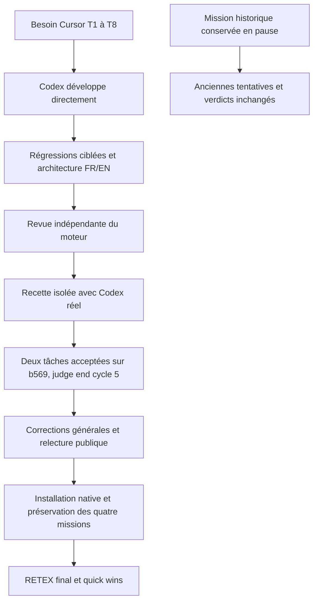

# RETEX final de la livraison directe — Cursor T1–T8

[English report](../../en/CURSOR-ENGINE-RETEX-20261013.md).

13 octobre 2026. Développement direct Codex puis recette isolée explicitement autorisée, sans Claude. La mission historique `w-ca937edf4e0abd85f8d3d67b` est conservée en pause ; ses anciennes acceptations ne sont pas remplacées par celles de la recette.

## Résultat et preuves

Le candidat moteur `60c3dc65edf0f1f3915414e284f58543c6814924` a conduit une recette réelle Codex jusqu’au jugement `end`, cycle 5. Deux tâches worker ont été acceptées, les neuf scopes conservés ont été fermés et le bundle publié `b569bb35fb5816bb806826000f99be32b973108c` retourne alpha=42 et beta=7. L’arbre source isolé reste au baseline `12237f3054868454d7c1ed415f49a84217245b9b`, avec les deux valeurs initiales zéro. Deux sous-planificateurs étaient simultanément réservés ; les workers se chevauchent 53,149 secondes.

Les deux appels natifs de revue comprennent une revue finale cumulative qui couvre les deux tâches sur le même candidat publié. Leurs contrôles frais sont PASS/exit0 et liés au même candidat. Les événements conservent trois exécutions : alpha sur la première publication, puis alpha et beta sur la suivante. La revue du code de moteur est indépendante de ces revues de résultats. Les reçus et verdicts conservés sont dans `evidence/t7-20261013/`.

La phase finale après réparation de l’ordre du schéma a duré 217,79 secondes, fermeture et vérification du bundle incluses. Ce n’est pas la durée de toute la reprise. Elle ne prouve pas un débit général ni une économie par rapport aux fixtures antérieures.

## Interventions et échecs conservés

- La première recette a forcé le modèle CLI hérité au lieu du standard configuré de Swarm. Le refus réel de capacité de gpt-6.1-sol a été conservé ; la route standard gpt-5.6-sol/medium a ensuite été choisie explicitement via preview/apply publics, pour la racine, le vérificateur puis les scopes concernés. Aucun appel consommé n’a été effacé.
- Le script de recette confondait `mission start` avec `Work`, supposait la révision inchangée après pause et utilisait un champ inexistant de jugement. Ces erreurs de harnais ont été corrigées ; leurs premières sorties restent conservées et ne sont pas des échecs du moteur. Un premier test du compteur utilisait une révision déjà occupée : il n’est pas compté comme rouge comportemental. Le rouge retenu utilise une fixture valide.
- Une consigne « FIRST » a alimenté des cycles répétés. L’opérateur a suspendu les nouveaux départs puis transmis une instruction de phase, sans reset. Le guidage commun reprend désormais le besoin restant après une précondition déjà accomplie.
- Les sous-superviseurs ont créé des planificateurs au lieu de workers, même avec une explication textuelle ; neuf scopes sont conservés. Les probes de clarification et de montée explicite vers le niveau exigeant n’ont pas réparé ce choix. La probe discriminante a changé seulement l’ordre des propriétés JSON : même prompt, modèle et schéma sémantique, `kind` en premier produit `task`. Le correctif du sérialiseur puis la recette réelle démontrent création des workers, exécution et livraison. Aucun plafond de hiérarchie ni conversion silencieuse d’opération n’a servi à forcer ce résultat.
- La revue indépendante a demandé correction de l’aperçu d’historique navigateur, du motif d’erreur Codex perdu et d’un bord où une erreur d’outil était prise pour un refus fournisseur. Les rouges/verts sont conservés.
- Une compilation a rencontré ENOSPC. Le cache Go reconstructible de 45 Go a été nettoyé après vérification d’absence de build concurrent ; aucune preuve, mission ou copie de travail n’a été supprimée.
- La lecture du bilan renvoyait zéro contrôle malgré les événements de publication. Le filtre commun a été corrigé pour les contrôles gérés et automatiques, avec test normal, entrée invalide et autre mission ; relecture publique du même résultat : trois.

Les reprises, changements de modèle et autorisations de quotas sont des interventions de l’opérateur. La livraison finale se déroule ensuite sans acceptation manuelle. Cette campagne ne démontre donc pas une autonomie sans intervention de bout en bout, ni une réparation autonome des défauts de code du moteur par la mission historique.

## Mesures et limites

Le registre natif contient 44 réservations/appels enregistrés : 40 de planification, 2 workers et 2 de revue. Il rapporte 1392836 tokens d’entrée et 29750 de sortie ; 8 entrées n’ont pas de mesure d’usage. Une réservation ne prouve pas son envoi. Les probes de diagnostic externes sont séparées et ne sont pas incluses dans ce total. Aucun appel ne rapporte un coût : **coût inconnu**, et non zéro dollar. Les relances internes du client et le cache ne sont pas tous attribuables.

Le budget de planification/décisions a été porté publiquement de 40 à 60 pour traiter les scopes conservés et clôturer, consommation intacte. 40 activations et 30 décisions sont finalement utilisées, deux tentatives worker seulement et aucune reprise worker. Les choix de route sont demandés et figés ; l’identité réellement exécutée n’est pas inventée si le client ne la rapporte pas.

Les régressions Go sont ciblées ; la suite entière historique n’a pas été répétée ni déclarée PASS. La source, les fixtures, la recette fournisseur réelle, la revue indépendante et l’installation du service ont des preuves séparées. eBPF reste une étude, pas une intégration activée.

## Quick wins réalisés et prévention

1. Schéma : sélectionner le discriminant avant les champs de branche ; contrôler l’égalité sémantique, la délégation légitime et la réception réelle.
2. Erreurs : conserver une catégorie fournisseur exploitable sans texte privé ; ne pas classer un résultat d’outil comme refus du fournisseur.
3. Configuration : aperçu et application valident exactement les mêmes octets persistés, saut de ligne inclus, sans effacer l’historique.
4. Mesure : compter le registre historique des contrôles, sans confondre trois exécutions et deux preuves fraîches.
5. Méthode : figer les valeurs configurées, conserver les snapshots par révision/empreinte et calculer le hash du même buffer que celui lu ; ne pas augmenter le modèle ou répéter un prompt avant une probe discriminante.

La console couleur, les modales Admin, le graphe plein écran avec positions et liaisons modifiables, les mesures 50/200/500 cartes et le parcours RETEX/quick wins ont leurs recettes locales conservées dans T8. Les propositions de nouvelle évolution restent au choix de l’utilisateur et n’autorisent pas une autre mission implicitement.

## Lenteur révélée pendant la mise à jour

La mise à jour révèle une lenteur sur une autre mission conservée. Le snapshot d'une autre mission à cinq tâches validées prend alors 41,663 s ; son CLI prend 20,952 s. Le stockage et les trois autres missions répondent normalement. Le diagnostic source retrouve des gardes de revue répétées sur le même contexte et ses deux lots. Une copie de lecture partage désormais les gardes liées au Work, à la Task et au mode historique ; elle conserve succès et refus seulement pendant cette projection. Le Store vivant et la requête suivante relisent les fichiers.

Le rouge valide démontre la relecture physique répétée ; quatre tests ciblés, neuf avec variantes, passent sous `-race`, dont les refus de contrat, tentative, candidat, état et mode historique, la preuve disparue/restaurée et l'absence de réemploi dans l'acceptation. La revue indépendante du delta est favorable. Sur la même mission, révision43, le snapshot installé prend **1,768 s**, le CLI **10,418 s**, cinq avis et validations fraîches identiques. Une observation par chemin, pas un p95 ni une promesse universelle. La recette T7 relue publiquement au même r127 conserve ses deux acceptations fraîches, sans nouvel appel fournisseur.

## Lecture cumulative JAN/FEB

Les articles de janvier et février restent deux versions, sans certification par addition. La matrice actuelle complète l'audit initial conservé dans le contrat d'architecture.

| Exigence | Effet observé | Limite |
| --- | --- | --- |
| JAN-1 | SPEC explorée et attribution persistée avant création des tâches | Deux modules, pas exploration continue d'un grand dépôt |
| JAN-2 | Deux sous-planificateurs simultanément réservés, décisions conservées | Neuf scopes dont plusieurs issus de sur-décomposition assistée |
| JAN-3 | Deux workers isolés, production parallèle, remise et publication | Les refus de coordination latérale restent testés en fixtures |
| JAN-4 | Verdict racine explicite `end`, cycle 5 et fermeture | La revue de candidat n'est pas le juge global |
| JAN-5 | `continue`/`renew`, nouveau contexte reçu, objectif/historique conservés | Reprises accompagnées par l'opérateur |
| JAN-6 | Deux niveaux mesurés en fixtures ; chevauchement réel53,149s | Pas mesure d'échelle, de débit ou de coût réel comparé |
| JAN-7 | Route standard figée ; discriminant d'opération corrigé et effet réel | Pas comparaison d'endurance de plusieurs modèles |
| FEB-1/FEB-2 | Remises et rapports attribués, descendants acceptés, clôture des propriétaires | Pas réparation réelle d'un worker défectueux après refus sémantique |
| FEB-3 | Renouvellements et fermeture sans perte des preuves | Pas endurance continue sur plusieurs jours |
| FEB-4 | Production parallèle, publication exclusive, trois contrôles enregistrés | Coût inconnu et compromis à grande échelle non mesurés |

## Quick wins suivants proposés, sans nouvelle exécution engagée

| Observation et source | Valeur utilisateur | Effort / risque | Succès attendu |
| --- | --- | --- | --- |
| Recette réelle : workers réussis dès leur seule tentative | Vérifier une réparation autonome après refus de résultat | Moyen / appels fournisseur supplémentaires | Refus indépendant, décision reçue, réparation et acceptation fraîche réellement observés |
| Ledger44 entrées,8 sans usage et aucun coût | Comprendre consommation et rentabilité | Moyen / données fournisseur parfois indisponibles | Usage reçu ou explicitement inconnu par appel ; coût jamais présenté comme gratuit |
| JAN-6/FEB-4 : deux workers et publication exclusive | Fixer les compromis d'échelle à partir de mesures | Moyen / campagne coûteuse si non bornée | Production, attente, revue et débit comparés aux niveaux choisis avec budget autorisé |

Ces propositions ne bloquent pas la livraison directe convenue et n'autorisent pas implicitement une mission, un modèle ou un budget. Les quick wins issus des défauts effectivement rencontrés sont déjà corrigés et vérifiés ci-dessus et dans T8.

## Installation et clôture

Le serveur partagé a été mis à jour par `install.sh --mode native` puis le lanceur local public, avec racine canonique et même adresse. Précontrôle : quatre missions, trois préparations, aucun agent, bail, revue ou tour IA actif. Seul le travail initialement non suspendu est mis temporairement en pause ; les autres le restent. `swarm init` effectue la migration prise en charge et conserve une sauvegarde0600 ; le binaire précédent est gardé dans le cache opérateur, sans lecture ni chirurgie de base privée.

La qualification du code installé `3f121f7` confirme identité du processus/binaire, santé ready, assets Admin/graphe/console identiques aux sources, valeurs Admin lisibles et consommations, candidats, statuts conservés des quatre missions. Les reçus de code et de maintenance sont dans `evidence/t7-20261013/`. La dernière étape de livraison installe les documents seuls par le même parcours et rétablit les départs. Sa clôture opérationnelle est conditionnée aux assertions PASS d'identité et de préservation du reçu `t7-release-final-receipt.json` dans le cache opérateur, sans modifier les reçus précédents. Ces pages ne tiennent pas lieu de ce reçu. La mission historique n'est pas relancée ni acceptée artificiellement.

Le développement direct, sa qualification et son RETEX sont achevés dans ce périmètre ; le contrôle final d'installation ci-dessus établit séparément la clôture opérationnelle. Les limites de démonstration ci-dessus restent explicites ; aucune suite entière historique, autonomie universelle ou certification Cursor n'est annoncée.
