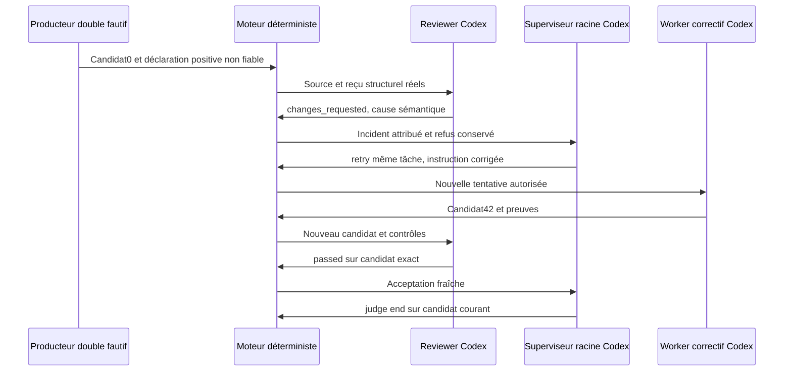

# RETEX des trois suites autorisées — moteur Cursor

[English](../../en/CURSOR-ENGINE-RETEX-SUITES-20261013.md).

13 octobre 2026. Ces suites prolongent le RETEX T1–T8 ; elles ne réécrivent pas
ses résultats ni les preuves de la mission historique, conservée en pause.
Développement direct Codex, puis recettes de projets jetables sur vrai Codex,
sans Claude. Base `b61694264cbeaf0d72cea8e55201c1fd1f7aaed1` ; binaire de
qualification modifié et figé par empreinte dans les originaux.

## Résultats des trois propositions

| Proposition | Résultat observé | Preuve / limite |
| --- | --- | --- |
| RETEX-QW1 : reprise après refus indépendant | Refus sémantique, décision racine retry de la même tâche avec nouvelle instruction, correction Codex, revue neuve, acceptation fraîche et judge end cycle 1 | [Chaîne publique](evidence/retex-20261013/qw1-public-chain.json), [résultat](evidence/retex-20261013/qw1-result.json) ; premier producteur double fautif étiqueté, pas une erreur spontanée |
| RETEX-QW2 : visibilité par appel | Registre CLI JSON/API/UX attribué, inconnu distinct de zéro, caches séparés ; historique complet et reprises ordinaires corrigés | [Contrat](../../architecture/CALL-ACCOUNTING.md), [recette web](evidence/retex-20261013/qw2-browser.json), [revue favorable du correctif](evidence/retex-20261013/qw2-review-followup.md) |
| RETEX-QW3 : concurrence mesurée | Même charge de quatre tâches, niveaux 1 et 4, 4/4 acceptées fraîches dans chaque campagne, même politique et binaire, bundle fonctionnel vérifié, judge end cycle 1 | [Comparaison](evidence/retex-20261013/qw3-comparison.json), [résultat1](evidence/retex-20261013/qw3-serial-result.json), [résultat4](evidence/retex-20261013/qw3-parallel-result.json) ; une observation par niveau, pas p95/endurance |

### QW1 : les responsables traitent le défaut

Mission `w-630ae432039dbb236949d842`. Le double initial retourne réellement 0,
avec une déclaration positive volontairement fausse et clairement étiquetée
comme injection non fiable. Le contrôle structurel ne vérifie que le type :
il réussit réellement, mais ne prouve pas 42. Le reviewer réel refuse le candidat
`91f57dc...` pour ce défaut. Aucun avis, reçu ou statut d'acceptation n'est injecté.

La décision racine r15 cite l'événement `review-04d276...`, émet retry pour
`recover-number` et impose la correction exacte plus une régression sémantique.
La seconde tentative Codex est distincte ; l'original et le refus restent dans
l'historique. La revue suivante passe sur `8f447568...`, puis l'état public r22
montre une validation fraîche et le jugement end. L'assertion indépendante du
bundle `number.answer()==42` réussit. Durée recette225,216 s. Le moteur conserve
sa politique de contrôle autorisée : le test exact du worker et du bundle ne
sont pas présentés comme un nouveau contrôle sémantique moteur.

Préconfiguration, affectation manuelle et injection précèdent le lancement.
Le harnais ne corrige, ne relance et n'accepte aucune tâche après ce lancement ;
le compteur0 n'est pas une preuve d'absence de toute intervention extérieure
possible. Deux activations racine réelles, deux revues réelles et un worker
correctif réel suivent le double. La réservation manuelle de préparation reste
comptée. La relecture avec le moteur QW2 retrouve 7 lignes et 1 reprise ordinaire,
sans nouvel appel payant.

### QW2 : erreurs corrigées au contrat commun

Le premier test rouge montrait l'absence du registre. Un second établissait
que `null` entouré d'espaces devenait0/0 ; la lecture nullable est corrigée et
les objets incomplets/invalides/négatifs refusés. La revue a trouvé une perte
silencieuse au-delà de 200 agents. Le rouge 201 puis le vert démontrent la
lecture complète dédiée à la comptabilité ; le panneau récent reste borné.
Les agents étrangers sont exclus et la première tentative reste présente.
Enfin la recette réelle QW1 révélait 0 reprise malgré deux tentatives : le
compteur utilise désormais les tentatives distinctes et les liens historiques.

Cinq tests Go ciblés passent sous `-race`, plus la variante première/étrangère.
Les tests Node vérifient texte sûr, FR/EN, usages/coûts inconnus, zéro explicite,
caches et non-duplication. Le navigateur réel vérifie quatre combinaisons
langue/thème, clavier, Échap, focus restauré, largeur 390, diagnostics et mission
inchangée. Les échecs conservés du harnais provenaient du bouton sous accordéon
fermé, puis d'une ouverture déjà mémorisée que le test refermait. La recette
ouvre l'état réel ; aucune protection ou source produit n'a été contournée.

### QW3 : mesure et conséquence d'architecture

Arbre initial Git, configuration fournisseur, politique `gpt-5.6-sol/medium`
standard et empreinte binaire sont identiques. Quatre modules indépendants,
quatre critères exacts, copies distinctes ; aucun appel Claude. Affectation
initiale manuelle, aucune correction opérateur par le harnais après lancement.

| Mesure reçue | 1 créneau | 4 créneaux |
| --- | ---: | ---: |
| Démarrage métier → décision end | 352,434 s | 131,815 s |
| Recette complète, bundle et arrêt compris | 356,611 s | 134,760 s |
| Somme des durées worker | 321,326 s | 236,244 s |
| Contrôles cumulés / durée cumulée | 10 / 0,509 s | 10 / 0,385 s |
| Revues distinctes / durée cumulée | 4 / 46,706 s | 4 / 39,993 s |
| Réservations racine, dont préparation manuelle | 5, dont 1 | 3, dont 1 |
| Fenêtres de progression outils de plusieurs workers | 0 | 14, pause nominale 2 s |
| Jetons bruts entrée / sortie reçus | 1 574 459 / 29 968 | 1 562 170 / 28 860 |
| Entrée cache déclarée, séparée des bruts | 1 293 184 | 1 342 336 |
| Facture / coût fournisseur reçu | Inconnu | Inconnu |

Les intervalles observés entre lectures agents varient de 2,136 à 2,639 s ;
les fenêtres ne prouvent pas des inférences au même instant.
Rapport observé de durée 2,67 ; aucune promesse de gain proportionnel ou universel.
Les temps des processus incluent outils et attente, pas seulement inférence.
L'intervalle fin worker → premier contrôle inclut préparation et attente de la
voie exclusive : jusqu'à 24,410 s à quatre créneaux, contre 0,518 s à un créneau.
La revue puis sa fin → publication sont distinctes. Les sommes se chevauchent
et ne s'additionnent pas pour reconstituer le temps mur. Dix contrôles comprennent
les recontrôles cumulatifs, pas dix critères ou dix facturations. La durée après
la dernière publication jusqu'au jugement est incluse dans le temps métier.

Le nombre de tâches et les politiques sont identiques, mais les temps provider
et les productions diffèrent entre deux appels réels. Cette paire établit une
capacité utile et son attente centrale, pas une isolation causale de chaque gain.
La diminution des activations racine et les usages cache restent visibles.
Les quatre retours exacts du bundle sont vérifiés et les sources originales
restent propres sur leur commit initial.

## Revue indépendante et clôture de la qualification

La [revue QW3](evidence/retex-20261013/qw3-review.md) est favorable dans le
périmètre de cette paire : durées recalculées, arbres/politiques/binaires comparés,
huit acceptations fraîches, contrôles, revues, livraisons et limites examinés sans
nouveaux appels fournisseur. Elle ne qualifie pas une endurance à grande échelle.
La revue QW2 est également favorable après correction de son finding P2.
Le correctif de comptabilité est séparé des recettes/documentation dans Git,
pour rester réversible et revuable indépendamment de l'étude de concurrence.

## Prévention et suites au choix

- Conserver des unités différentes pour tentative, réservation, inférence,
  outils, contrôles et facture ; une liste récente ne peut servir de comptabilité.
- Le refus sémantique déclenche la décision du propriétaire et une tentative
  corrigée, avec nouveaux contrôles/revue ; aucune répétition inchangée.
- Le harnais interdit les modes contradictoires avant accès disque/fournisseur,
  lie retry à l'identité du refus et utilise `judge_verdict`, le champ réel du
  producteur. Les erreurs de chemins/champs de notre méthode restent des erreurs
  de méthode, sans imputation au moteur ni nouvel appel pour les corriger.
- Choisir la concurrence dans l'Admin avec ses valeurs persistées. Cette recette
  ne crée ni plafond implicite ni réglage de production nouveau. Une prochaine
  étude d'endurance ou de pipeline de publication reste une évolution à choisir,
  avec critères, droits et budgets ; elle n'est pas un correctif manquant ici.

Les originaux et leurs empreintes sont conservés dans
[originals.json](evidence/retex-20261013/originals.json). Les exports de ce dossier
ne contiennent ni configuration fournisseur ni session privée. L'installation
et sa version effective sont contrôlées séparément lors de la livraison ; un
binaire local vert ne prouve pas que l'application a été mise à jour.
