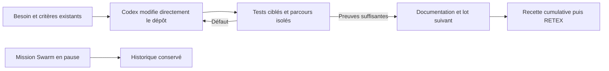

# Reprise du développement direct — 12 octobre 2026

L'utilisateur demande de poursuivre le développement du moteur directement dans
le dépôt `/home/fpizzi/Documents/ChatGPT/swarm`, avec Codex seul, sans Claude et sans les phases d'orchestration Swarm.
La mission `w-ca937edf4e0abd85f8d3d67b` est conservée et mise en pause par
l'opération publique ; sa révision observée est 839. Aucun agent n'est actif.
Les tentatives, dépenses et avis précédents restent historiques.

## Plan conservé, mode d'exécution changé

L'[audit de clôture](completion-audit-20261012.md) rattache les critères conservés
aux preuves et aux limites actuelles ; sa mise à jour du 13 octobre clôt la livraison directe. Aucun nombre de
tests réussi ne remplace cette vérification lot par lot.

Évolution suivante ajoutée à la demande de l'utilisateur :
[UX-GRAPH-01 — graphe moderne, plein écran et édition visuelle](graphe-ux-20261012.md).
Son ajout conserve T1–T8 et ne lance aucune orchestration native.

| Lot | Développement à poursuivre | Vérification attendue |
| --- | --- | --- |
| T1 | Décision d'architecture existante | Conserver les références JAN/FEB et les limites |
| T2 | Jugement global et renouvellement des cycles | Persistance, fraîcheur, refus et rejeu sans double effet |
| T3 | Exploration et sous-planification concurrente | Lecture attribuée, adaptation du graphe, baux et budgets partagés |
| T4 | Publication, conflits et remises | Reprises observables, attribution exacte et candidat conservé |
| T5 | Politiques Admin et consignes par rôle | Même configuration web/CLI/moteur, validation et historique |
| T6 | Vérification et mesures | Tests nécessaires aux contrats modifiés, résultats et limites explicites |
| T7 | Recette cumulative | Parcours du moteur sur données isolées ; autonomie réelle distinguée des doubles |
| T8 | RETEX et améliorations proposées | Bilan après recette, documentation d'architecture et exemples |

La première correction traite l'avis d'une ancienne tentative qui reste courant
après une nouvelle production. Elle doit conserver cet avis en historique,
refuser une revue encore active ou non attribuable, et permettre le précontrôle
du nouveau candidat sans appel ni nouvelle tentative implicite.

Les vérifications utilisent des racines et bases de test isolées. Le moteur reste
l'objet du développement et des tests ; il ne conduit plus ce développement.
Les contrôles historiques de Swarm ne sont pas transformés en acceptations.
La progression du code est rapportée séparément des validations natives : le
dernier état natif comporte une tâche au statut historique `accepted` sur huit.
Ce statut ne mesure pas la progression actuelle : l'accès public à son rapport
est refusé après le déplacement du dépôt. Voir le
[diagnostic des chemins](repertoires-20261012.md#défaut-découvert-après-le-déplacement).

Une vérification dans cette conversation constitue un contrôle direct de Codex,
pas un avis indépendant. Toute preuve manquante de fournisseur réel ou de revue
indépendante reste déclarée comme telle ; aucun statut natif n'est forcé.

## Niveau de qualité commun repris de Wattson

À la demande de l'utilisateur, `AGENTS.md` et `CLAUDE.md` ont été renforcés
à partir du projet Wattson principal :
`/home/fpizzi/wattson_devcontainer/flaskProject/.claude/CLAUDE.md`, de son
`AGENTS.md`, des règles référencées sous `.claude/rules/` et de l'index du guide
de terrain. Le CLAUDE.md du squelette `microservice_wattson` a aussi été consulté ;
il ne constitue pas la référence principale de qualité.

| Exigence Wattson | Adaptation Swarm |
| --- | --- |
| Lire les producteurs, ne pas inventer d'interface | Vérifier Go, JSON, persistance et consommateurs API/CLI/UX avant modification |
| Détecter les échecs silencieux, définition de terminé | Reproducteur, tests ciblés réellement exécutés, contenu/effet observé, recette et documentation |
| Configuration commune | Politiques persistantes et modale Admin, validation partagée, consommation conservée |
| Charte et validation des thèmes | Système graphique Swarm, paires sémantiques, FR/EN, mobile, clavier et inspection rendue |
| Documentation vérifiée et Mermaid | Contrat actuel FR/EN, cible explicitement marquée, rapports historiques séparés |
| RETEX et mémoire de terrain | Apprentissages vérifiés dans les règles/notes existantes, preuves et limites conservées |
| Livraison traçable et règles Git | Sources versionnées, opérations publiques, autorisation existante, aucun coauteur ajouté |

Les seuils Python, commandes Docker/MkDocs, pipelines Wattson et compétences
absentes de Swarm ne sont pas recopiés. L'interdiction Wattson de mentionner l'IA
ne s'applique pas au vocabulaire fonctionnel de Swarm, dont les agents et leurs
fournisseurs font partie du produit. Les exigences qualité n'autorisent aucune
délégation ni remise en marche de la mission native.

Vérification : cohérence du pack par `python3 tools/agent-workflows/check.py`,
contrôle ciblé `TestAgentWorkflowRolesAreBounded` et `git diff --check` sur les
documents modifiés. Les sorties sont conservées dans l'espace de vérification
existant (`direct-wattson-rules-workflow-check.out` et
`direct-wattson-rules-context.jsonl`). Ce contrôle confirme la validité du cadrage
embarqué actuel ; il ne prouve pas que les nouvelles consignes des fichiers racine
ont été transmises à des agents natifs. Le moteur assemble son contexte depuis
`tools/agent-workflows/CONTRACT.md` et les méthodes embarquées, comme vérifié dans
`internal/engine/agent_workflow.go`.

## T4 : remettre un résultat pendant la revue d'un autre candidat

Le reproducteur `TestManagedPublicationLaneRetainsSiblingWithoutPaidReview`
échouait : une voie de publication occupée empêchait de conserver le commit du
second worker terminé (`direct-publication-staging-red.out`). Deux solutions ont
été comparées : paralléliser les revues sur des bases susceptibles d'être périmées,
ou conserver les résultats avant la voie de contrôle/revue/publication. La seconde
est retenue pour préserver les verdicts exacts et éviter des appels inutilisables.

Le code partage désormais les gardes d'intégration et la conservation du résultat
entre les deux chemins. La remise anticipée ne modifie pas l'acceptation, la
révision métier ou les compteurs de revue. Le commit et son rapport restent
immuables au rejeu malgré une modification de la copie. La publication attend
la voie libre et reconstruit le candidat avec les preuves correspondantes.
La documentation FR/EN `AGENT-PARALLELISM.md` explique cette séparation avec Mermaid.

Le premier contrôle ciblé du comportement et des revues concurrentes passe.
Le lot de dépendances exécute 61 tests/sous-cas : 60 passent ; une assertion du
scénario renforcé lit le compteur fichier avant que le script bloqué ne l'écrive.
Cette assertion est remplacée par la vérification du compteur réservé dans l'état
du moteur, sans changement de la correction. La sortie originale est conservée
dans `direct-publication-staging-contracts.jsonl`. La vérification finale avec
détection de courses est conservée dans `direct-publication-staging-race.jsonl` ;
les 20 tests/sous-cas ciblés passent, avec détection de courses activée
(13,161 secondes d'exécution). Le rejeu immuable, les refus d'identité/pauses,
la conservation d'une revue active et le conflit de fusion sont vérifiés.

Ces contrôles utilisent deux connexions Store et un sous-processus fournisseur
déterministe sur une racine isolée. Ils ne lancent aucun modèle réel, ne changent
pas la mission en pause et ne constituent pas une preuve d'autonomie IA ou de
performance globale.

## Jugement raccordé et recette de la reprise

La racine peut désormais proposer `judge` et `renew` dans sa décision structurée
ordinaire. Le contexte et le schéma exposent seulement les opérations admissibles,
le cycle exact et les conditions de fin. Un verdict continue conserve l'historique
et réveille la racine ; le renouvellement ouvre un cycle neuf avec un nouvel
événement, sans remboursement de consommation. Le transport par sous-processus
déterministe reçoit effectivement ces opérations puis le contexte du cycle 2.
Une fin explicite avec preuves fraîches ferme la racine et expose le RETEX ;
un processus actif ou une preuve manquante refuse la mutation.

La recette web a également reproduit un retour périmé de l'inspecteur après
succès ou refus d'un rejet de consigne. Le retour local participe maintenant à
son cache et les deux sorties actualisent la carte. Un refus est affiché avant
une relecture lente, puis l'utilisateur décide à nouveau sur l'état relu.
Les quatre parcours FR/EN × clair/sombre passent, au clavier et après rechargement,
avec proposition RETEX sourcée et absence de lancement implicite. Les réglages
Admin sont sauvegardés/relus et leur présentation est compactée dans les deux
langues et sur mobile.

La [note de recherche et RETEX de cette reprise](../../publications/20261005-cursor-moteur/dossier-recherche/revisions/20261012-developpement-direct.md)
regroupe les corrections, les six essais de concurrence, les limites et les
enseignements. Le [reçu](evidence/direct-20261012/verification-receipt.json) lie
les preuves, le binaire testé, l'intégrité des sources et l'état natif conservé.
Les recettes locales passent ; T7 avec fournisseur réel et revue indépendante
reste non démontré. L'exécutable installé historique n'est pas remplacé, et
l'objectif complet n'est pas clôturé par ce RETEX intermédiaire.

## T5 : délais navigateur persistants

Le hardcoding 15/60/65 secondes du cockpit et 15 secondes des autres interfaces
a un reproducteur public rouge (`direct-web-requests-red.jsonl`). Le choix retenu
est une politique Go/API/CLI commune, persistée avec révision et historique, puis
servie aux interfaces avant leurs scripts. Dupliquer des réglages locaux aurait
créé plusieurs vérités. La modale Admin propose un aperçu puis une application
protégée contre les révisions périmées. `0` supprime l'expiration navigateur ;
un timeout ne rejoue rien et ne prouve pas une annulation serveur.

Les trois tests de configuration passent. Le contrôle JavaScript vérifie le corps
complet, zéro, les longues durées, l'annulation et le nettoyage ; sa première
recette attendait incorrectement la préparation du corps après une seule microtâche.
La recette navigateur a révélé un défaut réel de focus pendant la relecture :
correction de la séquence et garde avec une relecture volontairement lente.
L'inspection mobile a ensuite révélé un libellé coupé et des boutons jointifs :
les composants partagés sont corrigés/utilisés puis la recette réexécutée.
Les originaux sont conservés. Quatre parcours FR/EN × thèmes passent, sans appel
IA réel, avec persistance, parité CLI, configuration reçue, expiration observée
sur probe interceptée, aucun rejeu, refus de révision périmée et clavier/mobile.

Le [contrat FR/EN et Mermaid](../../architecture/WEB-REQUEST-POLICY.md) décrit les
valeurs initiales, leur réception et les limites. Les sept tests ciblés de
configuration et d'authentification/préparation passent avec détection de courses.
Cela ne clôt pas le hardcoding global : les délais serveur de connexion IA et
de chargement de l'éditeur restent à administrer. Le serveur natif n'est pas
remplacé. Le reçu de cette correction conserve une identité distincte des
preuves précédentes et ne renouvelle aucune acceptation historique.

## Suite obligatoire : graphe, quick wins et RETEX

L'utilisateur confirme de poursuivre toutes les tâches, y compris la nouvelle
UX-GRAPH-01, les quick wins retenus et le RETEX. Une tâche ajoutée au plan n'est
pas une fonction livrée. La recette cumulée doit inclure les interactions du
graphe ; les améliorations issues de la recette sont identifiées, réalisées et
vérifiées avant le RETEX final. Les propositions de futures évolutions restent
distinctes des corrections nécessaires au besoin déjà autorisé.

La suppression des secondes limites à 60/300 secondes utilise maintenant la
durée totale existante dans Admin. Les tours de page héritent de cette politique
et conservent les délais explicites des fournisseurs. Une valeur modifiée entre
aperçu et confirmation exige un nouvel aperçu. Dix-sept cas ciblés passent avec
détection de courses ; les quatre recettes navigateur FR/EN observent huit
appels HTTP locaux, quatre annulations attendues et aucune répétition. Aucun
modèle réel n'est appelé. La recette trouve une superposition du bouton de menu
sur les réglages après défilement : le contrôle de menu revient dans le flux,
puis la recette passe. Les originaux restent conservés.

Le commit et le push demandés sauvegardent les sources, documents et preuves
versionnables. Les bundles de reprise et deux patchs cumulatifs de sources de
22,4 Mio chacun restent dans leurs emplacements locaux, exclus de Git ; aucune
archive ni preuve historique n'est supprimée. Les sources du manifeste de
vérification ne dépendent pas de ces archives. La sauvegarde ne vaut pas
déploiement, indépendance de revue ou acceptation native.

## Livraison locale du 13 octobre

L'atelier du graphe, les quick wins liés à sa recette et le délai éditeur hérité
de la modale Admin sont développés et vérifiés. Les rapports T1–T8 sont consolidés
sans acceptation fabriquée. Voir le [reçu du lot](evidence/direct-20261012/graph-studio-verification-receipt.json)
et le [RETEX local](evidence/T8-handoff.md). La question d'une recette Codex isolée
avec vrai modèle et revue indépendante est explicitement posée ; elle ne relance
pas la mission historique. Le candidat reste distinct du serveur installé.

## Clôture directe du 13 octobre

T7 isolé avec Codex réel et revue indépendante a été autorisé explicitement, puis réalisé ; la mission historique n'est pas relancée. Le [RETEX final](RETEX-final-20261013.md) et [l'audit courant](completion-audit-20261012.md) remplacent les anciennes conditions de reprise de ce rapport. Les échecs, sources/révisions, interventions, limites et coûts inconnus restent conservés. L'installation native est vérifiée séparément du bundle de recette et des anciens verdicts historiques.
