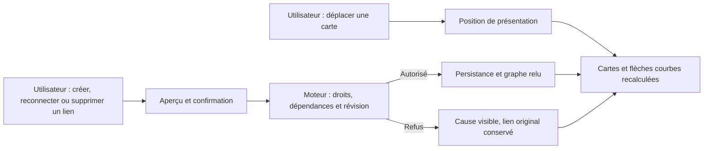

# UX-GRAPH-01 — Graphe moderne et édition visuelle

Statut : **implémentation et recette locale vérifiées ; revue indépendante et déploiement natif non effectués**.
Demande utilisateur du 12 octobre 2026. Cette tâche est développée directement ; elle n’est pas adoptée dans la mission native en pause et ne remplace aucun lot T1–T8.

## Résultat attendu

Faire du graphe une surface de travail centrale, ample et précise : cartes
déplaçables, liens courbes lisibles, édition des relations par manipulation
directe et couleurs expressives cohérentes avec l'identité Swarm. Le parcours
doit être agréable sur de grands graphes, au clavier comme au pointeur.

Propriétaire de livraison : développement direct Codex selon l'autorisation
actuelle. L'utilisateur décide de l'évolution produit ; le moteur contrôle toute
modification de tâches ou dépendances. La revue et la recette doivent être
identifiées avant de déclarer cette tâche terminée.

## Critères vérifiables

| ID | Déclencheur | Résultat et recette attendus |
| --- | --- | --- |
| GRAPH-01 | Ouvrir le graphe ou activer le plein écran | Le graphe occupe l'espace disponible ; barre d'outils compacte, inspecteur repliable, retour clair au cockpit et sortie au clavier |
| GRAPH-02 | Déplacer une carte au pointeur | Déplacement fluide, positions mémorisées par graphe selon le contrat de présentation ; aucune modification métier due au seul déplacement |
| GRAPH-03 | Déplacer ou rapprocher des cartes reliées | Les flèches courbes suivent les ports, indiquent leur sens et évitent autant que possible cartes et libellés ; sélection et état restent lisibles |
| GRAPH-04 | Tirer un lien d'une carte vers une autre | Aperçu du lien et de son sens, confirmation de la dépendance par l'opération publique du moteur ; une relation interdite est refusée sans effet partiel |
| GRAPH-05 | Sélectionner un lien puis le supprimer ou changer son extrémité | Proposition explicite, confirmation, contrôle de révision et état relu ; conserver l'ancien lien en cas de refus et proposer une reprise compréhensible |
| GRAPH-06 | Explorer un grand graphe | Zoom, déplacement du canevas, ajustement à la vue, recherche et repérage du contexte ; éviter les déplacements involontaires de cartes lors du déplacement du canevas |
| GRAPH-07 | Changer thème, état ou sélection | Palette sémantique plus expressive pour rôles, groupes et états ; libellés/icônes en complément des couleurs, contraste et focus lisibles |
| GRAPH-08 | Utiliser FR/EN, clavier, mobile ou interaction annulée | Libellés traduits, actions accessibles sans glisser-déposer, Échap annule, aucune mutation involontaire, état vide/chargement/refus visible |
| GRAPH-09 | Recharger, recevoir une modification concurrente ou relire après une erreur | Positions de présentation cohérentes ; graphe métier reconstruit depuis le moteur ; aucun succès optimiste ni rejeu automatique d'une mutation incertaine |

Les formes, couleurs, espacements et animations utilisent les composants et
jetons partagés. Les politiques de performance ou de disposition ajoutées doivent
être configurables selon le contrat Admin, sans second plafond caché.

## Démarche et dépendances

1. Examiner les composants existants (`graph.js`, `pilot-graph.js`,
   `product-graph.js`, `graph-draft.js`, `preparation-work-graph.js`) : conserver
   courbes, cache, sélection et contrôles déjà présents qui répondent au besoin.
2. Concevoir et montrer le parcours : plein écran, ports, sélection de lien,
   inspecteur, raccourcis et refus. Distinguer organisation proposée en préparation
   et modification d'un plan adopté ; vérifier les opérations publiques disponibles.
3. Implémenter présentation et édition sous les contrôles de droits, cycles,
   dépendances, activité des tâches et fraîcheur. Ajouter un contrat moteur si
   une opération manque, plutôt que modifier silencieusement les données.
4. Vérifier les interactions réellement rendues FR/EN, clair/sombre, mobile,
   clavier et grandes charges ; mesurer la fluidité avec les réglages de recette
   existants. Tests ciblés, documentation d'architecture et RETEX inclus.

Livrables : composants réutilisables du graphe, contrats nécessaires, recette
d'interaction avec preuves visuelles et mesures, documentation FR/EN et Mermaid.
La suppression d'un lien ne signifie pas la suppression d'une tâche ; cette
dernière reste une action métier distincte, explicite et contrôlée.

## Décision d'implémentation — 13 octobre

Le rendu SVG/Dagre existant et le brouillon public sont conservés. Un nouveau
framework de graphe aurait ajouté une dépendance, une migration de préférences et
un second contrat d'édition. Le module `graph-studio.js` enveloppe les cartes et
leurs commandes, mémorise uniquement leurs positions et réutilise les opérations
publiques pour les relations. Les courbes cubiques sont recalculées entre ports ;
l'évitement automatique de toute carte dans un placement arbitraire reste une
limite explicitée, pas une propriété vérifiée.

Quick wins liés à la recette : empêcher la prévisualisation d'un ancien brouillon
après un enregistrement refusé ; différer le rendu Monaco d'une console masquée
jusqu'à sa visibilité ; enrichir les diagnostics navigateur pour conserver la
cause d'une erreur Monaco plutôt qu'un simple `JSHandle@error`.

## Recette livrée

Le [reçu candidat](evidence/direct-20261012/graph-studio-verification-receipt.json)
conserve les empreintes des composants et des harnais, quatre recettes FR/EN
clair/sombre, l'effet public d'ajout/retrait/reconnexion, le cycle refusé, le
pointeur et son annulation, l'inspecteur visible et le mobile. Le test moteur
ciblé compte six tests principaux et douze avec leurs sous-cas. Les images sont
dans le même dossier de preuves. Mesure locale à 50 cartes : p95 des cinq
rechargements 739 ms, clavier 31,9 ms. Les charges 200/500 ne sont pas requalifiées.

[Architecture FR](../../architecture/GRAPH-STUDIO.md) ·
[Architecture EN](../../en/GRAPH-STUDIO.md) ·
[RETEX et quick wins](evidence/T8-handoff.md).

Qualification supplémentaire à 500 cartes par la recette configurable : p95 1 342 ms, clavier 31 ms sur cinq observations, avec cibles inchangées. La réserve à 500 cartes du premier reçu reste historique ; le [reçu complémentaire](evidence/direct-20261012/performance-policy-verification-receipt.json) établit cette nouvelle preuve. La charge 200 n’est pas requalifiée.

Le profil 200 cartes est désormais vérifié séparément : p95 919 ms, clavier 32,6 ms, seuils 1 000 ms/100 ms inchangés ; ouverture froide 1 057 ms distincte. Voir le [reçu complémentaire](evidence/direct-20261012/performance-200-verification-receipt.json), sans réécriture des réserves des premiers reçus.
