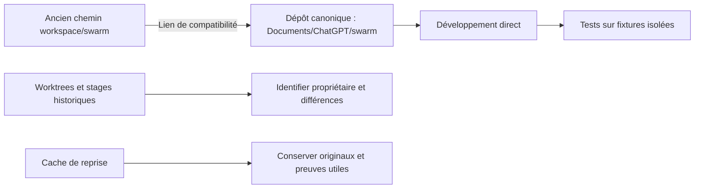

# Dépôt canonique et copies conservées

Le dépôt choisi par l'utilisateur est `/home/fpizzi/Documents/ChatGPT/swarm`.
Le déplacement a conservé l'inode du dépôt, le HEAD et les fichiers modifiés.
L'ancien chemin `/home/fpizzi/workspace/swarm` est un lien de compatibilité.
La mission reste en pause ; son état public et ses tâches sont conservés à la
révision 839. Le dossier de destination ne contenait qu'un Git sans commit,
sans remote ni fichier de travail ; il a été conservé séparément avant déplacement.

L'inventaire observe 25 autres dossiers dont le nom contient Swarm sous
`/home/fpizzi/workspace`, ainsi que 157 dossiers dans le cache de reprise,
dont 22 copies comportant des sources Go. Ces nombres ne représentent pas
des versions livrées de l'application. Certains dossiers sont des worktrees
enregistrés de branches distinctes ; d'autres contiennent stages, paquets,
préimages, contrôles ou preuves. Leurs noms ne prouvent ni leur propriétaire,
ni leur inutilité, ni l'intégration de leurs changements.

Cette accumulation vient de l'isolation répétée des réparations et a compliqué
le suivi. La nouvelle démarche utilise un seul dépôt de développement et les
racines de fixtures isolées nécessaires aux tests. Aucun ancien dossier n'a été
supprimé ou déclaré redondant sans examen de ses changements et de ses preuves.
L'inventaire original et le reçu de déplacement sont conservés dans le cache
de vérification de cette intervention.

## Audit des chemins opérationnels

Le scan des sources Go de production sous `internal/engine` et `cmd`, de la
configuration versionnée et du frontend ne trouve pas de référence littérale à
`/home/fpizzi`. Cela ne prouve pas que chaque chemin est configurable dans l'Admin.
Les chemins historiques dans les rapports et les accords de développement
identifient leur environnement d'origine ; ils ne doivent pas être remplacés
pour faire croire à une nouvelle exécution.

| Chemin ou origine | Contrat observé | Limite actuelle |
| --- | --- | --- |
| Racine du moteur | `--root`, répertoire courant par défaut ; résolution physique à l'ouverture | Pas de changement de racine dans une modale Admin |
| Lanceur local | `SWARM_PROJECT_ROOT`, `--root`, puis `deploy/local-web.json` ; source déduite du fichier Python | Réglage du lanceur, pas une configuration Admin du moteur |
| Installation | `--project`, `--bin-dir`, `--agent-home`, `SWARM_BIN_DIR`, `SWARM_AGENT_HOME` et HOME | Les valeurs de l'hôte ne sont pas figées dans Go |
| Catalogue Codex | `CODEX_HOME`, sinon HOME + `.codex` | Convention du fournisseur, pas un chemin personnel littéral |
| Données du moteur | `.swarm` sous la racine et sous-répertoires attribués | Convention de stockage ; pas une destination libre modifiable en cours de mission |
| Outils de vérification Chrome | Plusieurs scripts utilisent `CHROME_BIN` ; `t5_ci.py` impose `/usr/bin/google-chrome` | Hardcoding résiduel dans l'outillage |
| Masquage optionnel du lanceur | `--mask-cifs` utilise `/cifs` dans la commande bwrap | Hardcoding résiduel, hors moteur Go ; pas de réglage Admin |
| Conteneur | `/workspace` comme destination interne ; montage hôte choisi par `SWARM_PROJECT` | Contrat d'image distinct du chemin du poste |

### Défaut découvert après le déplacement

La lecture publique d'un rapport attribué à T1 renvoie HTTP 400 « chemin hors
projet » sur le serveur historique : celui-ci conserve l'ancienne racine textuelle,
alors que la cible du lien est devenue le nouveau chemin physique. Le déplacement
et la conservation de l'état public ne prouvaient donc pas tous les accès aux
preuves. La tâche au statut historique `accepted` ne vaut pas revalidation actuelle.

La correction source résout la racine et la cible dans le même espace physique
pour les fichiers, les empreintes d'artefacts, les espaces de travail et la lecture
des rapports. Le contrôle ciblé exécute 22 tests/sous-cas, tous PASS, avec maintien
du refus des liens vers un fichier privé ou hors projet. Les originaux rouge,
échec de compilation et vert sont conservés ; le reçu de chemins indique les
empreintes des sources concernées et les résultats réellement exécutés.

Cette vérification ne porte pas sur toute la migration d'une mission gérée : les
gardes de dépôt, copie et remise conservent leurs contrôles contre les redirections.
Leurs références absolues historiques demandent une vérification distincte avant
reprise. Aucun remplacement de chemins dans la base native ni suppression de
preuve n'est effectué. Le serveur ouvert utilise toujours son ancien binaire.
Son redémarrage ne doit pas interrompre l'autre mission observée activée et non
en pause ; le précontrôle ne permet pas de déclarer tout le service en pause.
