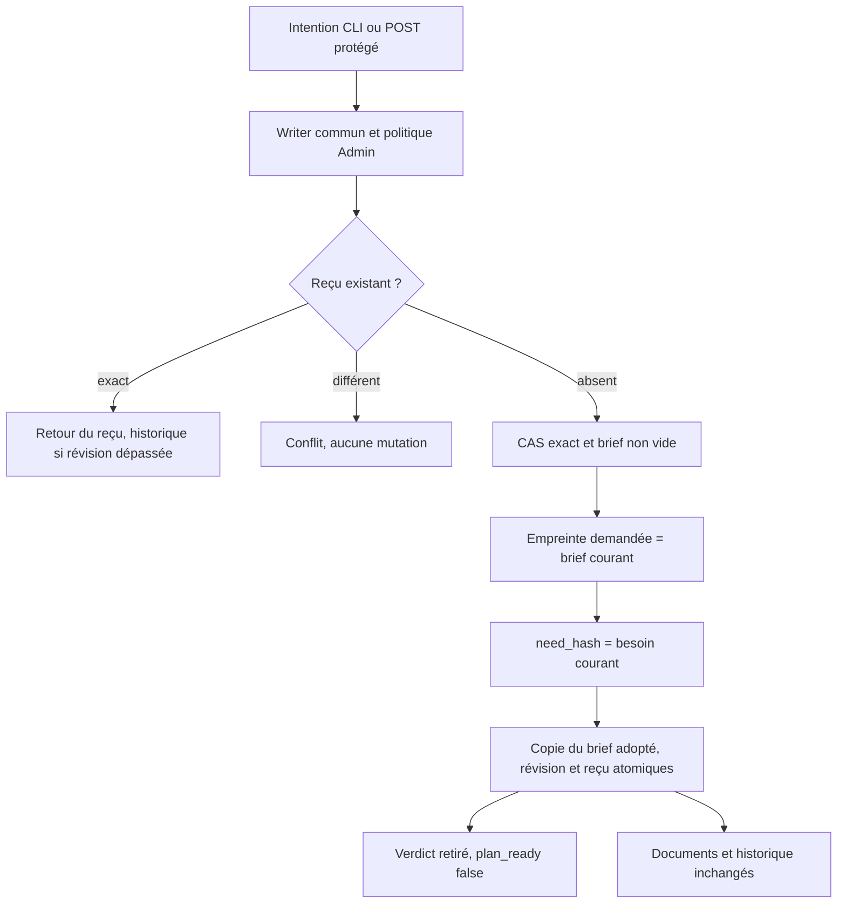

# Préparations Rust — adoption explicite du brief,26octobre2026

Owner Codex, revue/proposition de test GLM5.2 sans outils ; intégration et tests
par Codex. Reprise de la migration après le lot méthode82, instance84 observée.
État : dev87 actif ; recette complète86 vérifiée, mêmes entrées effectives, parcours44 rejoué sur87. Contrôles finaux de l’interface servie PASS.

Ce parcours ne valide aucun plan et n’atteste pas une identité humaine nommée.
Il ne réserve aucun budget et ne lance aucun agent. L’absence de besoin peut
produire deux hash vides égaux, comme en Go : pas de durcissement implicite.
Réglages réutilisés : interrupteur et limites Admin persistés, sans nouveau seuil.

## Replan et preuves originales

- Baseline84 : création/sauvegarde de brief valides, adopt-brief refuse exit2,
  aucune mutation du dump SQL ; témoin conservé avant correction.
- Première compilation86 refuse E0308 : préparation.adopted_brief est un Box.
  Corrigé avec Box::new, sans changer la représentation JSON ni l’autorité.
  La preuve originale est conservée ; aucun candidat en échec activé.
- Les sources de préparation propres sont réservées ; ajouts partagés aux listes
  de capacités/help/erreurs et version_history. Biba/SCALING restent hors scope.
  Une autre construction86 observée a rencontré le même défaut : ne pas confondre
  les preuves ni prétendre que le compte des runs mesure la migration restante.

## Critères de vérification

Cas publics : absence/vide/Unicode du brief, empreinte exacte, besoin changé,
CAS/événement, champs étrangers, reçu historique avant nouvelle fraîcheur,
conservation docs/historique, limite texte0 sans rétroactivité, refus désactivé,
sortie /dev/full après témoin valide et reprise du reçu, API auth/CSRF et409.
Le verdict présent est une fixture historique explicite, pas une validation Rust.
Le test SDK de rollback doit précéder l’injection par une adoption valide, puis
forcer l’échec du reçu, vérifier toute la préparation et les nombres de lignes,
et reprendre la même intention après retrait du seul trigger de fixture.
Recette maintenue : preparation-writes-rust ; nouvelle étape public-brief-adoption.
Toute borne globale de vérification reste désactivée ; aucune base vivante utilisée.

## Revue GLM et adaptation vérifiée

Un appel direct GLM5.2, sans retry/plafond client : réponse utilisable,66598 tokens
déclarés et392,664s selon le service. Pas de gain chiffré inféré. Son défaut concret
Box correspond à la compilation déjà réparée ; aucune autre anomalie concrète
retenue dans la branche adoption. Les mappings CLI/API et l’authentification,
absents du contexte de revue, sont vérifiés par les44 assertions publiques.
Le test SDK proposé est intégré après ajout d’un témoin public d’adoption valide,
puis d’un nouveau brief avant l’injection du trigger. Il vérifie aussi l’ancienne
copie adoptée et le verdict, aucune ligne documentaire supplémentaire, reprise du
même événement et lecture après réouverture. La revue GLM ne constitue pas une
acceptation indépendante à l’exécution.

Premier run public interrompu sur une attente de test incorrecte : l’ID CLI
positionnel est contrôlé avant la validation moteur. Contrôles séparés : refus
CLI sans mutation et schéma ID invalide via API400. Second run :44 assertions PASS.
Un extracteur de bloc de code GLM s’est arrêté avant écriture sur le premier
exemple Rust, qui était seulement la ligne erronée ; sélection par nom de fonction
puis adaptation du test complet, sans compilation après la précondition en échec.

Amélioration de méthode : conserver les candidats lexicaux volumineux privés et
publier une revue compacte liée aux SHA, avec périmètre exact et limites. Les
candidats ne sont ni une preuve sémantique ni une garantie d’absence de défaut.
Réduire les prochains contextes GLM aux producteurs/gardes utiles ; temps et usage
restent mesurés, sans plafond arbitraire ni allégation d’économie non démontrée.

## Recette complète sur le candidat qualifié

Cinq étapes PASS, intégrité vérifiée :50 contrôles écritures,37 méthode,
44 adoption,8 identifiants et4 tests SDK nommés (rollback document/reçu,
intégrité du reçu courant, méthode et adoption). Les45 contrôles Admin sont
inclus dans le parcours écritures. Profil natif du build conservé, distinct du
profil SDK ; aucune compilation toutes-features utilisée comme preuve de livraison.
Les16 fichiers de la revue ciblée correspondent à leurs SHA après recette.
Les fichiers partagés restent qualifiés uniquement sur les ajouts de ce lot,
pas sur les fonctionnalités concurrentes. Aucun commit/push demandé pour ce lot.

## Livraison :86 testé,87 actif

Le lanceur réutilise87 lors du redémarrage. Comparaison des inventaires : égalité
complète des entrées effectives86/87, pas seulement des cinq sources d’adoption.
Les binaires restent distincts par leurs métadonnées de build ; leurs identités
sont conservées séparément. Les44 assertions publiques d’adoption passent aussi
sur le binaire87 exact. La recette complète86 est réutilisée sur son périmètre
inchangé ; aucune qualification des chantiers concurrents n’est déduite.

## Livraison vérifiée et RETEX

Dev87 actif : processus et SHA du candidat concordants. Onze assertions HTTP
vérifient notamment réglages conservés, missions suspendues révisions50/469,
capacité adopt-brief et octets des ressources réellement servies. Quatorze
assertions Version FR/EN : numéro, notes courantes, commit réel, changements
non committés, fermeture et focus. Aucun appel fournisseur métier ni commit/push.
Preuves : evidence/20261026-preparation-adoption ; original GLM et recette privés.

Apprentissages vérifiés : relire le type complet des champs copiés (Box), séparer
le refus d’adaptateur de celui du moteur, et exiger un témoin positif avant un
trigger ou /dev/full. Les gardes permanentes sont dans les sources de tests et
le manifeste de recette ; une réponse GLM seule ne prouve aucune exécution.
Préserver les deux identités de binaire lorsqu’une métadonnée de livraison change,
comparer les entrées effectives et rejouer le parcours public sur celui installé.
Les consignes du dépôt ne mettent pas à jour les contextes natifs déjà démarrés.
L’éditeur graphique, les transitions suivantes et la qualification globale restent
ouverts ; la suite bornée est la validation explicite du plan après brief adopté.

## Commit demandé après livraison

Demande utilisateur : conserver ce lot en Git, sans push. Le commit sélectionne
les seuls ajouts d’adoption dans les fichiers partagés et conserve les108 chemins
déjà en staging. Les preuves décrivent le snapshot réellement testé/servi ; elles
ne prétendent pas qualifier les changements concurrents exclus de ce commit.
