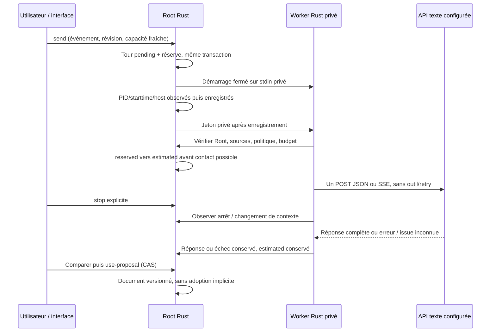

# Appels IA de préparation — lot vertical en cours

OwnerCodex, replan/APEX ; GLM propose le budget transactionnel, revue avant usage.
Parcours : API texte configurée → capacités → send/CAS → réservation → worker
Rust → JSON/SSE → historique → comparaison/utilisation explicite → stop/reprise.
Premier adaptateur API texte ; CLI/outils et agents Work API restent explicitement
non portés, aucun refus de lancement de ces domaines n'est levé par ce lot.
Aucun appel fournisseur réel de recette ni redémarrage de mission historique.
Politiques persistées/Admin : activation, message/contexte/réponse/nombre de tours,
timeout et maximum (initial300/600 de config/preparation-timeout.json), observation
et refresh (initial200/2000 Go), transport JSON/SSE et bornes techniques headers.
Source native explicite après adoption Admin, ancienne config Go préservée ;
kill switch de déploiement existant jamais ignoré. Aucun watchdog global de test.
Réservation avant contact, estimated jamais remboursé automatiquement ; worker
lié au datastore ouvert et à son noyau observé ; clone/source/péremption refusent.
Fichiers réservés : nouvelle crate swarm-api-client + Cargo additif, modules
preparation_call* / policy, preparation writer et exports/adaptateurs additifs,
UI conversation existante, catalogues/locales/docs/tests. Préserver Biba/identité.
Vérifier un seul lot complet : faux HTTP/SSE compté, CAS/rejeu, budget prep+Work,
triggers/refus/reprise, erreur/outcome inconnu, stop avant/pendant, source/Root changé,
aucune adoption automatique, FR/EN/themes/mobile, profil normal et installation.
Transport reqwest0.13.5 à confirmer par Cargo, TLS système, redirections/refus
et retries désactivés ; timeout effectif du produit, aucun30s implicite du
client blocking. Sources : https://docs.rs/reqwest/0.13.5/reqwest/struct.ClientBuilder.html
et https://docs.rs/reqwest/0.13.5/reqwest/retry/fn.never.html .

## Reprise du 27 octobre — implémentation, pas encore livrée

Le sous-lot est maintenant codé : crate réseau séparée du moteur, politique v46,
admission transactionnelle, worker privé Rust lié à PID/starttime/host et Root,
réservation avant contact, historique actif natif, arrêt, utilisation explicite
avec CAS et provenance. CLI et HTTP sont raccordés ; UI conserve le lecteur
historique si la politique manque. La compilation finale et les parcours restent
à qualifier avant toute annonce de livraison. Aucun changement du Root réel ni
appel fournisseur réel ; aucun commit ou push dans cette reprise.

Preuves originales sous `.cache/preparation-ai-call-next/`, à retenir dans la
zone permanente après qualification. L'ancien binaire152 refuse les capacités
(contre-témoin public). Trois tests du transport passent après un reproducer
qui échouait : duplicate `tool_calls` puis null effaçait une déclaration. Le
nouveau décodage refuse les clés répétées récursivement avant projection Value.
L'échec original reste conservé. Les vérifications budgétaires et le parcours
HTTP compté sont encore en cours ; ce texte ne les déclare pas réussis.

GLM budget :169.73s,35043 tokens déclarés ; code intégré après correction du
schéma `planning_calls.estimate`, des GoFloat et des témoins. GLM transport :
565.431s,81492 tokens déclarés, dont69549 de raisonnement ; proposition complète
reçue, pas une exécution ni une acceptation indépendante. Le principal a écrit
le transport durant l'appel et confronte la proposition au code ; conserver les
causes typées et le refus des déclarations d'outils, sans imposer la comparaison
stricte du nom de modèle retourné aux alias de modèles configurés. Aucun gain
de tokens n'est établi. Les prochains appels devront viser un helper ou une
revue précise à partir des sources effectives plutôt qu'une bibliothèque entière.

Contrôles ouverts avant clôture : tous les triggers après dernières écritures,
settlement/réception d'erreurs et reprise de worker, anciennes politiques,
capacité périmée, annulation avant et pendant, réponses JSON/SSE invalides,
questions opérateur jamais inventées, UX FR/EN/themes/mobile, profil effectif,
installation protégée et ressources embarquées. Le schéma décrit l'implémentation
visée ; seuls les scénarios effectivement exécutés clôtureront ces points.

## Qualification intermédiaire —27octobre

Candidat164 bfc8ebd479f59e432c2047ab580efc8192ac41f1e36f653040b8a16ada26aa8f :
28 assertions CLI/HTTP et48 navigateur passent, dont7 POST UI pour5 contacts,
rejeu d'accusé malformé, capacité périmée puis actualisation explicite,
focus restauré, FR/EN, deux thèmes et390/1440px. Root réel non modifié.
Le candidat162 avait déjà prouvé27 assertions backend, dont SIGKILL via pidfd
avec PID/starttime observés : le serveur réconcilie sans rembourser estimated.
Les budgets préparation/Work refusent et reprennent par opérations publiques,
sans remise à zéro des consommations.

Nouvelles preuves :4 tests retained-Root passent après correction du COMMIT
refusé (avant : DatabaseBusy empêchait même DROP TRIGGER sur la fixture).
Le premier essai avait une erreur de syntaxe, puis des fixtures664 refusées par
la garde privée ; ces prérequis ont été corrigés en600, sans désactiver la garde.
Une édition cherchait une frontière antérieure à rustfmt et a échoué ; le shell
a lancé un test inchangé à tort. Désormais les étapes dépendantes utilisent
`set -e`, une frontière réellement lue et un remplacement atomique vérifié.
Toutes les sorties originales sont conservées. Les4 tests couvrent transaction,
triggers, changement de sources/politique, datastore remplacé/restauré ; leur
registration de processus est une injection explicite et n'atteste pas l'autorité
native. Le parcours public complémentaire exerce le vrai worker Rust.

Le nouveau caller de contexte bloquait déjà les mémoires versionnées mais en500
sans la raison statique (reproducer `context-baseline164`). Correction de la
projection HTTP seulement :501 et raison sûre, aucun contournement du reader.
La qualification finale et l'installation de ces derniers octets restent ouvertes.
La construction166 a été correctement refusée pendant une modification concurrente
de `swarm-enrollment-authority/src/provisioning/service_installation.rs` ; original
`rust-s9dvo9el/build/profile/failure.json` conservé. Reprendre sur les nouveaux
octets observés, sans masquer la garde ni contacter/geler l'autre conversation.

Maintenance du cache :387504974 octets de scratch incremental du projet libérés
après inventaire SHA et sous verrous Cargo, aucun compilateur actif, sources,
binaires, fingerprints et preuves préservés. Ce nombre décrit notre suppression,
pas toute variation de l'espace libre. Les deux anciens ELF de tests sont en
cours de conservation gzip avec vérification aller-retour avant suppression de
leurs seules copies de cache ; ne pas les considérer nettoyés sans résultat.

Améliorations conservées pour la suite (ownerCodex) : rejouabilité des événements
Go historiques sans enveloppe native pas encore qualifiée ; aide contextuelle du
dialogue masquée jusqu'à raccord vérifié ; modèle déclaré par le fournisseur non
persisté comme identité ni attesté (modèle demandé seul affiché) ; réponses de
capacités concurrentes à ordonner par génération. Aucun de ces points ne vaut
une protection démontrée. Le lot présent qualifie les nouveaux appels texte
natifs, pas les adaptateurs CLI, les anciens superviseurs ni la migration globale.

## Recette finale du candidat166 —27octobre

Le profil normal166 (`97f71d4a7439cc1b3aff2fcffd32c59d1328dd56ed08ca69def4d169b46023be`)
passe les quatre étapes de `preparation-calls-rust` :34 assertions CLI/HTTP,
48 contrôles navigateur,4 tests du transport actuel (dont le probe partagé),
7 de politique/budget et4 d'incidents retained-Root. `recipe.py verify` confirme
l'intégrité du résultat PASS. Aucune acceptation globale ou fournisseur réel.
Originaux : `.cache/preparation-ai-call-next/recipe166-release-notes-separated`.
Le compteur transport précédent attendait3 malgré4 tests exécutés : corrigé en
exigeant leurs quatre noms. Un premier stdout vide reste de cause non établie ;
le passage complet frais est distinct, sans réécriture de cet original.
Les notes de version changeaient pendant la recette : elles ne sont pas une
entrée consommée par le binaire immuable exercé et sont vérifiées séparément
sur le produit installé ; les sources code/tests restent gardées par la recette.

La Rustdoc du client compile après un premier ENOSPC conservé. Au diagnostic,
11Go étaient disponibles, sans nouveau nettoyage de notre part : ne pas lui
attribuer cette libération. Les deux anciens ELF de tests ont bien été archivés
avec SHA et vérification gzip aller-retour :256542822 octets nets récupérés,
seules les copies régénérables du cache ont été retirées. Originaux et inventaire
sont conservés, de même que les387504974 octets de scratch précédemment nettoyés.

Revue GLM bornée du transport :175.489s,5475 jetons d'entrée et23312 de sortie
(28787 total déclarés), route demandée/déclarée `glm-5.2`, backend5.3 indiqué par
l'utilisateur non attesté. Aucun défaut reproductible proposé sur les deux
fichiers fournis. Cargo/features et chaîne d'erreurs externe restent hors de son
contexte ; cette revue ne vaut ni test ni acceptation indépendante. Les features
réelles sont à lire dans les profils de construction conservés, pas à déduire de
cet avis. Aucun gain de consommation n'est chiffré.

La première tentative de livraison168 a refusé `version_history.json` modifié
pendant le build (`rust-6l001lj5/build/profile/failure.json`) ; l'ancien service
est conservé. Un build concurrent observé est laissé terminer, sans le geler ni
contacter son propriétaire. L'installation et ses ressources protégées restent
à vérifier avant d'employer « livré » pour ce lot.

Suite bornée engagée sans relance : reproduire le refus d'un rejeu exact d'un tour
Go terminé dépourvu de `_native`, puis conserver l'interdiction des tours Go actifs
et des nouveaux appels CLI/niveaux non portés. Deux régressions maintenues dans
`swarm-engine/tests/preparation_calls.rs` sont lancées avant correction ; leur
résultat ne doit pas être anticipé. Ces fixtures de données historiques sont
synthétiques, pas une preuve de reprise d'un ancien superviseur Go réel.

## Livraison locale168 vérifiée —27octobre

Le build concurrent168 est qualifié en profil normal,558 entrées effectives,
features des crates cœur vides, test=false et aucune feature fixture.33 des36
entrées compilées déclarées par notre recette sont identiques à166 ; différences
conservées : CLI Cargo (identité/test-fixtures déclarée mais inactive), module/help
CLI identité, commentaires du client API. Aucune acceptation de ces autres
chantiers n'est déduite de notre comparaison. Le parcours complet a été réexécuté
sur168 :34 assertions CLI/HTTP et48 navigateur passent à nouveau.

Redémarrage effectué par `./swarm.sh restart --no-open`, qui a réutilisé la
version inchangée168 après réussite du build, sans binaire externe ni bypass.
ELF servi : `e5f10f4b9972ab1420327123a2fb22abfebb2f949773464712f6a36aed13da77`.
22 assertions d'installation passent, dont ressources réellement servies et
catalogue/traductions comparés à l'archive du compilateur, version/notes FR/EN,
CLI/API readonly, historique, capacités et revue de conversion. La boîte Version
passe14 contrôles et la page installée11 ; commit réel et état modifié visibles.
Les réglages41 et les missions historiques (révisions50/469, pausées) sont
identiques au témoin avant redémarrage. Les capacités retournent explicitement501
pour le groupe d'appel absent : aucun groupe adopté et aucun modèle activé sur
le Root vivant. La recette réseau utilise seulement des fournisseurs loopback
sur des installations inertes ; disponibilité/coût d'un fournisseur réel restent
non établis.

Revue des trois axes et documentation liée aux SHA, sources/profils, sorties et
échecs originaux conservés dans `evidence/20261027-preparation-api-calls` privé :
archive originale1896 fichiers vérifiée aller-retour, preuve de livraison séparée,
manifestes SHA et liens physiques des deux ELF immuables166/168 (aucune seconde
copie physique des ELF). Les preuves fonctionnelles des recettes restent liées
à leurs snapshots d'origine ; les deux nouveaux tests historiques en échec ne
sont pas déclarés passants ni inclus rétroactivement dans les quatre anciens.

RETEX de ce parcours : assembler le trajet complet a exposé des défauts que les
briques seules ne prouvaient pas (COMMIT conservant une transaction, accusé UI
perdu, fils mort non réconcilié, décisions modèle et compte de dépendances).
Garder ces régressions permanentes, l'exact événement pour la reprise et la preuve
du binaire servi. Une modification concurrente des notes de version doit rester
une cause de refus du build, puis donner lieu à observation d'une précondition
nouvelle/réutilisation d'un build qualifié, jamais à suppression de la garde.
Le lot natif pilote est livré ; la migration globale, la revue indépendante et
les contrats explicitement ouverts ne le sont pas. Suite : rejeu historique borné.
