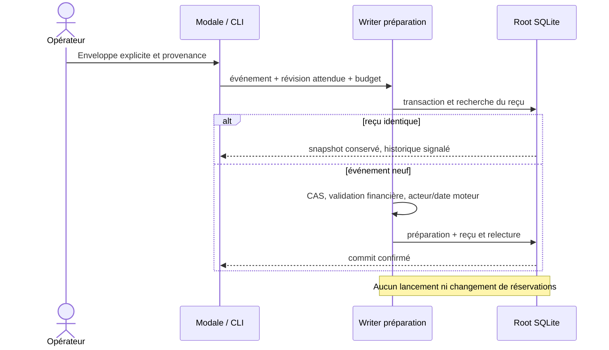

# Enveloppe de préparation Rust — 26 octobre 2026

Owner Codex ; reprise de l’équipe initiale avec APEX/replan et proposition GLM.
Besoin : porter l’écriture explicite du budget de préparation, distinct du budget
Work et des consommations. Pas de commande Go, appel IA produit, commit ou push.

## Contrat livré par les sources

`prepare budget ID --input FILE`, POST préparation et modale native partagent
le writer CAS/reçu. `budget` porte limit_usd, reserve_per_launch_usd,
estimate_source, reference_date ; actor/updated sont remplacés par le moteur.
Zéro signifie illimité. Une limite positive exige réservation positive, source
non blanche et vraie date. Le validateur financier existant garde ses causes.
Le reçu lie exactement la requête soumise, y compris ses métadonnées inertes ;
aucune métadonnée ne devient une authentification de personne humaine.

Documents/verdicts, Work et réservations ne sont pas réécrits. Une réduction
sous les engagements garde ces engagements : elle ne rembourse pas la consommation.
Le formulaire n’invente aucun montant initial ni plafond. La lecture des coûts
historiques reste à raccorder et cette limite est visible ; aucun coût nul affiché.
Le mode sans limite nécessite donc un choix explicite, jamais un fallback vide.

## Preuves et erreurs de méthode conservées

- Baseline124 : action non portée, SQL intact.
- Un test Rust nommé vérifie témoin valide, reçu injecté en échec, rollback,
  révision et documents intacts, reprise du même événement et réouverture.
- Recette permanente `preparation-budget-rust.json` :27 assertions CLI/API et46
  navigateur, FR/EN × etat/sombre,1440/390px. Montants invalides, date impossible,
  source manquante, champ inconnu, budget absent, CAS, conflit/rejeu, réponse
  perdue et intention figée, champs vides, clavier/focus, consommation conservée,
  limite réduite et verdict du plan conservé. Réservations historiques synthétiques
  injectées uniquement dans la fixture ; aucun appel fournisseur de recette.
- Deux profils refusés sur sources enrollment-authority modifiées concurremment ;
  compilation suivante refusée sur assemblage temporairement incomplet du writer
  publication (autre propriétaire). Aucun fichier étranger corrigé pour contourner.
- Modale initialement inaccessible car bouton dans conversion-state masqué :
  contre-exemple conservé, bouton déplacé dans la note générale, recette positive.
- Profil normal125 vérifié, mais livraison encore refusée après changement des
  notes partagées. Le lanceur a correctement préservé l’ancien serveur. Un profil
  ou une fixture verte ne constitue pas une activation. Requalification en cours.
- Une commande erronée `version_delivery.py --help` a exécuté son ancien contrôle
  historique qui refuse le hash .dockerignore. Aucune qualification n’en est déduite ;
  le script n’est pas une CLI d’aide. Les commandes maintenues sont lues avant emploi.

## Revue liée aux octets

Politiques : montants explicites persistés ; zéro/positivité/date sont le contrat
monétaire existant. Aucun prix, retry, délai ou plafond caché ajouté. Les valeurs
12/9/0.5, dates et réservations de recette sont des données de test.
Fonctions : commande et shape Budget, writer apply, adaptateurs CLI/capacité,
modale et helpers de recette documentent entrées, sorties, erreurs et limites.
Erreurs : frontière budget-invalid conserve codec/date/validation ; SQL, acteur,
commit/rollback/close et publication gardent les causes partagées.400 uniquement
pour l’entrée budget ; aucune écriture des réservations n’est effectuée.
Documentation : guides FR/EN, architecture, recettes et notes locales actualisés.
Les preuves ne qualifient ni les autres changements partagés ni la migration entière.

## Contribution GLM et RETEX du lot

Route demandée/déclarée glm-5.2, backend5.3 non établi. Une réponse complète en
243.463s :7848 tokens entrée,12277 sortie,20125 total déclarés. Proposition pure
utile pour réutiliser décodeur/validateur. Le writer réutilise la shape déjà présente,
sans second helper redondant. L’affirmation « acteur authentifié » et l’effacement
suggéré des métadonnées de l’identité de reçu ne sont pas repris : acteur local
observé et reçu exact restent les contrats. La suggestion d’ignorer une cause
serde n’est pas reprise. Aucun code modèle exécuté automatiquement ni économie
Codex chiffrée. L’avis GLM n’est pas une acceptation indépendante.

Apprentissage vérifié : un contrôle serveur vert n’établit pas qu’un bouton soit
visible avant conversion ; garder l’ouverture réelle depuis une préparation neuve.
La séparation candidat compilé/profil/livraison a empêché l’activation d’une version
qui ne contenait plus les notes courantes. Ne pas contourner cette protection.
Suite : relevé de consommation, appels IA de préparation et autres parcours non
portés restent ouverts ; aucune clôture globale ni consentement de mission déduit.

### Replan de la garde Git

Le build ta88c_az a refusé uniquement deux nouveaux chemins Git : notre rapport
et le test personal du chantier identité. HEAD/modifié injectés restaient identiques.
Deux options : exiger un gel global incluant documents/tests sans effet compilé,
ou vérifier les faits réellement injectés et conserver séparément tous les status.
La seconde est retenue ; le collecteur refuse toujours les entrées compilées ou
configurations modifiées, le lanceur vérifie encore ses empreintes et notes finales.
Le résultat conserve git_observations_stable (peut être false) et git_metadata_stable.
Le contre-exemple utilise le flux build complet avec collecteur/processus doubles ;
les premières doubles ont mal reproduit l’injection schema_version/forgery.
Ces erreurs sont conservées, puis le témoin corrigé échoue sur l’ancien prédicat
strict réexécuté en mémoire et passe sur le nouveau. HEAD et dirty changés refusent.
Quatre tests métadonnées et cinq tests réels des inventaires effectifs passent.
Aucun de ces doubles ne vaut construction/activation réelle. Pas de changement
de la garde finale conservative du lanceur, notamment sur les notes versionnées.

## Livraison effectivement vérifiée

Enveloppe installée dev125, SHA2832829115e2d0e8c508a1433db9c6ecf7aaaeef9263da532a93377efbca4d54. Recette finale27 CLI/API +46 navigateur PASS/VERIFIED sur ce binaire. Cinq tests transactionnels passent ; i18n PASS. Activation normale sans nouvelle construction au restart ;16 contrôles HTTP/processus/ressources,14 Version FR/EN et6 préparation en lecture seule passent. Réglages et état des deux missions préservés. Aucun commit/push. Le lecteur de consommation est le prochain incrément, encore absent de125.
