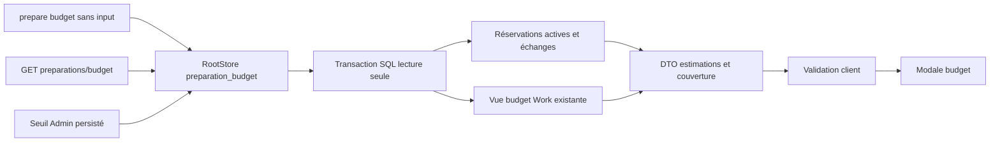

# Lecture budget préparation Rust — 26 octobre2026

Owner Codex ; suite de l’enveloppe installée125. Travail en cours, pas encore
qualifié/activé. Relevé CLI sans input, GET budget, modale existante. DTO plat
Go, estimation/réservé distincts, coût null≠zéro, couverture des échanges/jetons,
Work lié via le lecteur partagé. Alerte Admin persistée, null désactive.
Montants/usage consommés négatifs, non finis ou débordés, identités de lignes
incohérentes et JSON malformé refusent ; les historiques ne sont pas réparés
implicitement. Les champs du turn non consommés ne sont pas tous validés.
Aucun appel fournisseur, mutation ou authentification de facture.

La source Rustdoc CLI héritée a été corrigée : configure-team et enveloppe
existent bien, sans conversion dans un Work existant ni lancement synchrone.
Cette correction ne réécrit pas le binaire125 ni sa preuve historique.

GLM demandé/déclaré glm-5.2, backend non établi.677.017s,18856 entrée,51984 sortie,
70840 total déclarés. Réutilisation view Work et DTO plat corroborée ; helper
amount repris. Pas de copie automatique du module proposé : u64 ne reproduit
pas le compteur Go i64, son exemple Some(79) à16/20 est arithmétiquement faux,
et sa validation des montants released élargissait le périmètre sans nécessité.
Le lecteur valide les engagements actifs, conserve les données released intactes,
utilise le décodeur Go pour les champs consommés et lie corps/identité/statut.
Aucun test GLM exécuté ni gain de vitesse/jetons démontré par cet appel.

Preuves attendues : baseline125, recettes CLI/API, refus/reprise, warning modifié
et désactivé via opérations publiques, Work lié, modale FR/EN×thèmes, profil
normal et identité/version/ressources réellement servies après activation.

Premier profil126 et recette PASS :23 contrôles lecteur +27 enveloppe +46 navigateur. Aide Admin précisée avant livraison finale pour distinguer le relevé réservé+estimé des alertes serveur sur max(engagé,rapporté). Tests ajoutés pour coût absent dans usage, dépassement de somme et aide embarquée, sans reconduire un80% caché. Requalification finale requise.

Replan UI : la recette Admin attendait l’ancien conteneur sur le cockpit.
Inspection CDP du seul navigateur fixture : aucun native-settings-admin ; le
producteur protégé sert le composant à native-runtime.html. La recette interrompue
est conservée ; notre lien préparation pointait lui aussi au mauvais écran.
Il rejoint désormais cette entrée réelle et préserve langue/thème ; la recette
part du lien de préparation, sans inventer un sélecteur du cockpit.
Contre-exemple127 : GET budget200 avec{} ouvrait une modale contenant undefined.
Validation des champs consommés, coûts null/zéro et compteurs exacts ajoutée ;
le navigateur refuse les compteurs hors représentation entière exacte, sans en
faire une politique d’exécution. La nouvelle recette exige refus visible puis
lecture valide de reprise avant toute écriture.

La recette128 a passé28 assertions lecteur et47 navigateur, puis a perdu son chemin de staging lors d’une activation partagée. Ses dernières relectures CLI sont incomplètes, pas PASS. Reprise sur le binaire immuable de même SHA.22 assertions d’aide Admin réelle passent, dont lien préparation/langue/thème, texte traduit, mobile et retour de focus, sans modification des réglages.

## Livraison128 vérifiée

Binaire immuable et exécuté eb8ee30e890f3c9e91c5cd83b1942e62d468fdf27c3fe7e5f89bf481ff0f6663,
profil normal494 entrées effectives.28 lecteur +27 enveloppe +47 navigateur
PASS/VERIFIED sur cet exécutable ;22 contrôles aide Admin PASS/VERIFIED.
Activation partagée déjà effectuée ; aucun restart supplémentaire. Vérification
réelle17 HTTP/processus/ressources et association après navigateur +14 Version
FR/EN +6 préparation readonly. Les réglages et deux missions sont conservés.
Le probe status rapide a dépassé sa borne1s sous pression mémoire ; observation
protégée sans watchdog global : version0.446s et capacités0.095s, SHA du processus
et propriété avant/après vérifiés. Aucune limite modifiée pour fabriquer PASS.

La lecture du seuil fichier précède SQL : le schéma n’affirme pas une transaction
commune entre configuration et base. Le client refuse une représentation de
compteur imprécise. Coûts déclarés, contrôle d’intégrité et acceptation globale
restent distincts. Appels IA de préparation et sources ne sont pas portés par ce lot.
