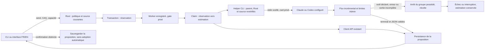

# Préparation Rust — fournisseurs CLI, 27 octobre 2026

État : livré et vérifié localement en192 ; migration globale et suites ouvertes. Responsable : Codex ; proposition ciblée GLM via SKYNET.
Besoin : rendre send/stop/résultat de préparation utilisables avec Claude/Codex configurés, sans nouvelle autorité métier.
Référence installée : livraison184 ; preuves API/révision conservées dans leurs dossiers.
Fichiers annoncés : preparation_call.rs, nouveau preparation_cli_output.rs, préparation worker CLI, exports associés, tests/parcours et documentation FR/EN.
Préserver les chantiers concurrents identité/BIBA/Admin et leurs octets.

1. Sélection : catalogue/route persistés, source et exécutable vérifiés, préflight et autorisations conservés.
2. Worker : gate privé existant, budget estimé avant contact, enfant possédé, arrêt/timeout de politique, aucun fallback.
3. Sortie : parseur incrémental partagé ; limites Admin avant accumulation, terminal et réponse obligatoires ; erreurs sans texte privé.
4. Parcours : faux fournisseurs uniquement, résultat/proposition/arrêt/refus/reprise, API antérieure inchangée.
5. Livraison : recette permanente, revue des octets politiques/docstrings/erreurs, build/restart/version/ressources réellement servies.

## Reprise et limites
GLM reçoit uniquement les sources utiles, sans accès au dépôt. Premier appel interrompu côté client après plus de330000 caractères de raisonnement et zéro code : tâche de sélection/lifecycle trop large. Flux original et motif conservés ; annulation distante/coût non établis. Reprise : implémentation locale et revue GLM sur une frontière plus petite, sans imposer de plafond arbitraire.
Le parseur utilise les faits fournisseur existants : consommation absente/invalide reste inconnue, jamais zéro ; aucune tarification ajoutée.
Le terminal obligatoire évite de publier une réponse partielle après EOF ; ceci corrige un risque réel, sans prétendre certifier l’isolation externe.
Les tâches Go actives anciennes ne sont pas adoptées ; aucun PID historique ne donne autorité.
Aucun appel réel Claude/Codex et aucune acceptation indépendante établis.

Tests initiaux du parseur : quatre tests nommés PASS,606 filtrés ; logs parser-unit dans .cache/preparation-cli-next. Ce résultat ne prouve ni raccordement ni installation.

Premier cargo check : refus de compilation UnixStream→Stdio ; corrigé par conversion explicite en OwnedFd, sans changement de politique. Réutilisation du runner pidfd existant, aucune nouvelle borne temporelle. Nouveau check sur sources corrigées requis.

Recette187 : FAIL avant lancement, catalogue API absent traité comme erreur alors que CLI seul est valide. Correction : absence reconnue par le helper Root existant, autres erreurs conservées, présence/absence incluse distinctement dans le digest. Aucun fichier API factice créé pour contourner le défaut. Sources recette stables ; reprise avec nouveau candidat exigée.

Recette188 : helper Codex réel, réponse structurée, route, stdin privé, nettoyage, rejeu : huit assertions PASS. Échec suivant dans le test budget : enveloppe illimitée=0 conserve une réservation de0 selon le contrat Go déjà documenté. Fixture corrigée vers enveloppe finie10, sans modification du ledger produit. Réexécution sur le même binaire justifiée par cette précondition corrigée.
Revue GLM finale : nettoyage signalé sur ancien contexte, correction déjà présente ; hypothèse close(RawFd) rejetée sur signature nix0.30.1 IntoRawFd et compilation locale. Aucun statut d’acceptation indépendante attribué à cette revue statique.

Recette188 enveloppe finie : quatorze assertions PASS puis assertion de fixture « cancelled » incorrecte : le contrat public est « stopping » puis « interrupted ». Le polling et l’assertion suivent désormais ce contrat existant. Revue du nettoyage étendue aux échecs du runner dont la récolte est établie ; répertoire conservé seulement si ownership/perte de récolte restent ouverts. Nouveau candidat requis avant assertion de nettoyage après arrêt.

Build189 refusé : modifications concurrentes lib.rs CLI/engine, local_storage.rs, root_store.rs et service web durant profil effectif. Aucun gel ni message demandé à un autre chantier. Preuve originale rust-139ook74 conservée. Travaux indépendants poursuivis : couverture des erreurs avant spawn et canal privé de diagnostic pré-exec ; stderr du fournisseur reste distinct et non publié. Nouvelle qualification sur sources stables requise.

Check3 : une erreur locale de variable renommée au raccordement du canal diagnostic, corrigée ; trois erreurs indépendantes du chantier graphique concurrent (fichier config absent, module policy absent, méthode de verrou renommée) empêchent aussi la compilation à cet instant. Aucun fichier graphique modifié par ce chantier. Nouvelle précondition requise : ces entrées doivent exister/coïncider avant relance Cargo. Pendant ce délai : validation des métadonnées de fournisseurs indisponibles, cause de pré-exec sur canal CLOEXEC distinct de stderr, et fermeture explicite stdin en cas de jeton invalide.

Précondition modifiée observée : le chantier graphique a rétabli config/graph-performance.json, le module graph_performance et reserve_graph_performance ; check4 CLI/engine/web PASS sans modifier leurs fichiers. Reprise de la qualification normale autorisée. Canal diagnostic : une erreur de pré-exec voyage sur la socket privée CLOEXEC ; EOF ne prouve jamais le succès, qui exige toujours terminal+contrat JSON+exit réussi. Stderr du fournisseur est drainé sans publication.

Build4 : refus de profil limité à version_history.json modifié en parallèle pendant compilation80s. Binaire conservé par lien physique avec statut NON QUALIFIÉ, utilisé uniquement pour diagnostic isolé. Recette : CLI/stop/nettoyage/réservation vérifiés, navigateur48 assertions PASS ; suite bloquée par CAS périmée dans la fixture après quatre sauvegardes navigateur. Relecture publique de la préparation ajoutée avant scénario pré-exec, aucune exception CAS produit. Nouvelle fenêtre de qualification : notes inchangées depuis05:31:30, cadence observée supérieure au dernier temps de compilation ; aucune borne de test ajoutée.

Recette diagnostique189 : CLI25 + navigateur48, API34 + navigateur48 PASS, deux étapes et sources déclarées stables. Qualification normale189 obtenue par build5/rust-6j3xymrg (ELF8648d95a…). Comparaison correcte sur le graphe effectif : dérive originale=notes seules ; candidat qualifié diffère aussi par trois ressources CSS/graphique partagées. Recette complète relancée sur le candidat qualifié pour couvrir ce changement de ressources servies ; aucune prétention de qualification rétroactive du binaire de diagnostic. Le premier calcul de delta, inventaire prévu contre graphe effectif, est conservé mais explicitement invalide pour cette conclusion.

Anomalie avant installation : contre-exemple public189 après témoin Codex valide, déclaration tool_use suivie d’une réponse finale acceptée. Preuve tool-declaration-before189, statut DEFECT_OBSERVED distinct de PASS produit. Correction : refus protocolaire des déclarations connues Claude/Codex avant publication, contrôleur partagé arrête/nettoie le groupe ; réservation tentée conservée. Ce refus ne prouve pas le confinement ni l’annulation d’effets externes. Garde unitaire dédiée et nouvelle variante de fixture, budget attendu4 (huit appels tentés) ; prochaine qualification et recette requises.

## Contrat raccordé et vérifié dans le pilote192

Garanties bornées : association physique Root/processus/gate et fraîcheur des sources, pas authentification cryptographique de l’acteur ni confinement OS du fournisseur. Le canal pré-exec CLOEXEC conserve un diagnostic de l’engine ; le flux fournisseur ne peut pas le remplacer. EOF ne prouve aucune réussite. Les anciennes données Go actives restent protégées par leur refus existant.

## Revue des politiques, fonctions et erreurs

- Politiques : limites de message/contexte/sortie/événement, timeout et cadence proviennent des réglages persistés existants, avec validation/Admin/CLI/API déjà raccordés. L’exécution reprend les valeurs Native enregistrées, puis vérifie leur fraîcheur. La requête CLI publique n’accorde aucune autorité. Le droit `agent_allow_unverified_provider_context` et les préflights restent des refus effectifs.
- Invariants de protocole : adaptateurs claude/codex, namespace api-, noms d’événements/outils connus, gate SHA256 de64octets, première duplication fd3 et mode privé0700. Ils ne constituent ni budgets ni limites d’essais cachées. Aucun prix ni retry ajouté.
- Fonctions : inventaire des quinze fichiers dans final-scope-inputs.json ; Rustdoc des constructeurs, sélection, claim, runner, helper, parsing/finalisation et contrats d’erreur réexaminée. La visibilité de l’observateur d’exécutable existant seule est élargie au crate, son algorithme est conservé.
- Erreurs : lecture/décodage/collision/source modifiée refusent ; absence du seul catalogue API est distinguée. Indisponibilité individuelle d’une route/grant CLI est une observation explicite, sans rendre l’API indisponible. Un envoi revalide et conserve sa cause originale. Erreurs de flux/caps/outils/timeout/stop/exit et pré-exec conduisent au nettoyage possédé et à une fin non réussie ; erreur primaire et cleanup restent associées. Pas de remboursement d’une tentative. Workspace conservé si propriété/récolte deviennent indéterminées.
- Limites ouvertes : efficacité des flags sur des CLI externes réelles non testée ; éventuels effets externes/descendants échappés non annulés ; revue GLM statique non indépendante ; autres chantiers du dépôt hors conformité globale. La source du diagnostic pré-exec expose le premier errno et conserve la projection complète privée ; elle ne reconstitue pas les messages privés du processus distant.

## Apprentissage réutilisable

Le modèle délégué ne remplace pas l’assemblage local. La première délégation globale a tourné en raisonnement sans patch ; la seconde, ciblée, a rendu une revue exploitable mais aussi une hypothèse de signature nix incorrecte. Comparer ses affirmations aux dépendances réellement compilées. Un test de parcours et un témoin valide ont ensuite découvert le défaut d’acceptation d’outil hors du contexte de cette revue. Aucun avis du modèle ni recette verte antérieure n’établissait cette propriété.

Décodeur final : cinq tests nommés PASS,611 filtrés,90s de compilation (aucun watchdog global). Inventaire final quinze fichiers inchangé pendant ce contrôle. Inspection visuelle des captures189 EN sombre390 et FR clair1440 : contenu lisible, actions accessibles et aucun débordement horizontal ; les assertions clavier/focus/erreurs et variantes FR/EN×deux thèmes sont dans la recette. Découverte UX différée, responsable frontend : la date affichée dans le dialogue FR reprend la locale du navigateur anglais (10/27, AM) ; vérifier un format lié à la langue sélectionnée sans modifier le timestamp conservé. Critère de reprise : fixture navigateur locale EN + interface FR, puis FR/EN explicites. Cette observation ne concerne pas le raccordement d’exécution CLI.

Recette190 finale : CLI26 + navigateur48 ; API34 + navigateur48, deux étapes PASS, sources déclarées stables. Revue documentaire finale : quatre lignes Rustdoc ajoutées aux helpers internes fields/tool ; comparaison à l’archive compilée190 prouve le reste identique (delivery-rustdoc-only.json/.diff). Preuves comportementales190 réutilisées sur cette portée seulement, nouveau profil/identité de livraison à vérifier. Aucun nouveau contrôle produit, budget, flag ou algorithme ajouté.

Build7 après Rustdoc : échec Cargo sur service/exchanges.rs consommant agent_exchanges absent de l’engine compilé. Producteur RootStore::agent_exchanges et mod exchange_read désormais présents dans le checkout (mtime05:45:20, pendant ce build) ; précondition nouvelle constatée, aucun fichier exchanges modifié ici. Nouvelle construction normale sur l’interface désormais raccordée.

## Replan de livraison après collisions répétées

Build8 : compilation réussie80s, avant/après stables, puis refus de l’archive car `web/native-runtime.css` change durant sa conservation. Aucune qualification rétroactive ni suppression de contrôle. Le chemin normal impose une nouvelle compilation au redémarrage ; répéter ce chemin inchangé n’établit pas une précondition stable.

Décision bornée : ajouter `restart --prepared-build SHA256` au lanceur source. Sélection explicite du dernier record qualifié, SHA attendue obligatoire, profil sans fixtures + archive/inventaire + version/notes protégées revérifiés avant arrêt. Le chemin binaire reste géré ; les modifications de sources ultérieures restent annoncées en attente. Une version active plus récente ou non comparable refuse. Le redémarrage ordinaire garde sa reconstruction actuelle. Tests isolés du chemin public et erreurs/témoin exigés avant usage vivant.

Livraison observée192 : un autre chantier a qualifié/installé ELF2970d850… pendant notre sélection190 ; empreinte190 refusée avant arrêt, comportement attendu. Nos fichiers productifs sont identiques dans192, décodeur final compris ; seize deltas effectifs depuis190 concernent notamment échanges/habillage/enrôlement, et Rustdoc. CLI19226+navigateur48 PASS. Vérification vivante19222 assertions + Version14 + page11, réglages et missions préservés ; aucune écriture métier par cette vérification.
API192 : échec original local-storage/Lock/errno11 sur apply CLI externe pendant serveur actif, après arrêt de tour confirmé. Titulaire du verrou non observé à l’instant exact : cause concurrente précise reste hypothèse. Précondition de recette revue : paramètres avant démarrage via CLI, puis preview/apply/readback sur le parcours Admin HTTP actif ; aucun retry ni délai de test ajouté. Étape CLI192 inchangée conservée ; étape API seule dérivée de la recette permanente à rejouer. Découverte à reprendre, propriétaire stockage/UX : reproduire un lecteur concurrent contrôlé et examiner le marquage retryable=false du refus Lock avant de conclure à un défaut produit.

## Résultat observé — livraison192

- Binaire normal qualifié et déjà installé par le chantier parallèle : `2970d850e85e013d1d55894673fae1271f97d6a6abf958cb24da83e6d01584eb`, preuve `rust-evtnoppv/build/result.json`.
- Nos fichiers productifs exacts sont présents, décodeur final/Rustdoc compris. CLI19226 + navigateur48 PASS ; API19234 + navigateur48 PASS sur l’étape de reprise publique HTTP. L’échec original CLI externe/Lock reste conservé et son titulaire exact non prouvé.
- Installation réelle :22 assertions, dialogue Version FR/EN14 et page11 ; SHA/processus/ressources protégées/notes/Git/modifications locales vérifiés. Réglages schéma41/révision2 et missions historiques révisions50/469 toujours pausées ; aucune adoption de politique, nouvelle mission ou utilisation de modèle réel.
- `start --prepared-build` sur l’image192 active : contrôle réel de l’archive et des métadonnées, succès idempotent sans remplacer le processus. Les cinq tests du lanceur comprennent sept variantes de refus, course d’artefact, ordre de version et lifecycle réel sous fixture. Recette permanente `prepared-local-delivery-rust.json` PASS/intégrité vérifiée.
- Le snapshot de vérification vivante tient le verrou de lifecycle existant en lecture du fichier de coordination ; il ne bloque pas les sources ni ne modifie les données et empêche un redémarrage conforme de mélanger les versions pendant ses assertions.
- Consignes de livraison transmises dans AGENTS.md, lu par CLAUDE.md. Documentation FR/EN, exemples, limites de preuve et suites présentes. Revue indépendante et migration globale non acquises.

Suite : qualifier les sources mémoire versionnées de préparation sans contourner leurs droits ; garder la reprise des anciens tours Go actifs sous refus explicite tant qu’une autorité sûre n’est pas établie. Les chantiers identité/Biba/échanges restent sous leurs propriétaires.

Notes de livraison du nouveau mode préparé ajoutées FR/EN dans version_history.json pour la prochaine compilation ; le serveur192 conserve honnêtement ses notes effectivement embarquées. Les outils Python sont déjà vérifiés dans le dépôt. Les consignes AGENTS/CLAUDE atteignent les prochains contextes qui les lisent ; elles ne modifient ni les consignes embarquées192 ni les processus déjà démarrés. Le compteur du mode préparé décrit les entrées compilées de son candidat, pas un inventaire exhaustif des nouveaux fichiers.
