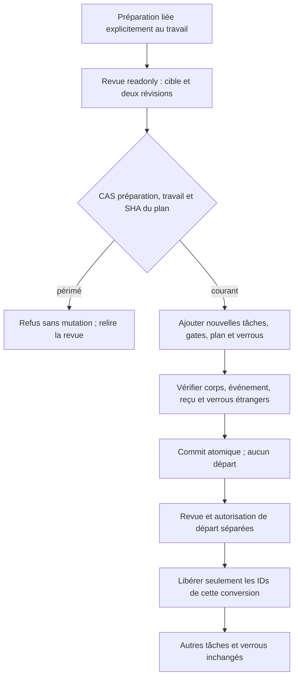

# Préparation vers un travail existant — lot vertical

Owner Codex, proposition GLM bornée ; aucune intervention dans les chantiers
BIBA/identité/S2/Admin/fournisseurs parallèles. Baseline normale176.
Besoin : ajouter un plan validé à un travail explicitement choisi, sans remplacer
ses tâches, historiques, plans, budgets ni configuration. Aucun départ implicite.
Fichiers réservés : preparation_conversion.rs, preparation_command.rs,
preparation_release.rs, preparation_release_review.rs, préparation web et recettes
conversion associées ; modifications partagées additives uniquement.

Critères : revue readonly du travail cible et de sa révision ; CAS des deux
révisions et du plan ; ajout atomique des tâches/gates/verrous/provenance/événement/
reçu ; rejeu exact sans second effet ; anciens contrats inchangés ; refus avec
SQL intact et reprise ; autorisation explicite limitée aux tâches ajoutées.
La configuration initiale d'équipe conserve sa garde pristine jusqu'à preuve
supplémentaire ; le formulaire ne doit pas prétendre la rendre possible ici.
Vérifier CLI/API/UI FR/EN et thèmes, profil normal, puis installer par swarm.sh.
Preuves permanentes ciblées, pas de fournisseur réel ni watchdog global arbitraire.
État initial : validator exige révision cible0, matérialiseur refuse work_id,
UI désactive la conversion ; GLM a reçu les producteurs et gardes complets.

Baseline176 : le scénario public refuse avant mutation SQL (1 assertion).
Le premier script frontend a supposé à tort web/locales/en.json ; les éditions
précédentes ont été conservées, puis la vraie source locales/en.json a été
repérée et traduite. La commande i18n lancée après cet échec ne prouvait pas
la traduction nouvelle ; génération et syntaxe rejouées après correction.

GLM : réponse complète226,151s,22361 jetons entrée +42631 sortie =64992 déclarés,
route demandée/déclarée glm-5.2 ; backend5.3 indiqué par utilisateur non vérifié.
Proposition intégrée pour la séparation fresh/bound, append de plans, CAS SQL
et révision événement/témoin ; équivalent en partie à notre correctif parallèle.
La proposition ne prouve aucune exécution. Le témoin final du lot va plus loin
que son simple comptage scoped : il conserve et compare les verrous étrangers.
Laisser la libération whole-Work refusée n'est pas retenu pour ce parcours :
porter la libération explicite du sous-ensemble, avec garde de non-régression,
permet de terminer le besoin sans libérer les autres préparations.

Premier parcours177 : append, conservation, CAS, rejeu et seconde préparation
passent. La libération aboutit mais l'assertion lisait launch_held comme champ
obligatoire ; la sérialisation Go-compatible omet false. Corriger uniquement
l'assertion vers get(false), conserver les sorties originales et reprendre sur
le même ELF, sans modifier le contrat moteur pour satisfaire le test.

Deuxième parcours177 :15 contrôles backend puis6 HTTP passent ; navigateur
arrêté après Escape/réouverture. La revue de cible ajoute une lecture asynchrone :
la recette cliquait confirmer avant l'ouverture réelle. Attendre l'état observable
dialog[open] après réouverture, sans sleep/timeout arbitraire ; original conservé.

Replan de recette : seconde occurrence de réouverture sans attente après refus
connu, même cause identifiée ; toutes les réouvertures attendent maintenant
dialog[open]. Pas de retry identique ni de hausse de timeout. Le test interne
nommé passe (12 injections de dommage +3 reprises, dont verrous étrangers).
Amélioration nécessaire découverte : texte de libération whole-Work devenu faux
pour l'ajout ciblé. Texte FR/EN et liste ramenés aux seuls IDs de conversion ;
schéma de réponse contrôlé avant affichage. Recette navigateur de libération
réutilisée aussi sur les travaux préexistants, avec leur vraie révision.

Incident de capacité : construction178 interrompue volontairement (seul cargo
3893989, filiation du rustc3894215 vérifiée) après observation de3 compilations
moteur simultanées,472Mio disponibles et swap plein. Pas un défaut fonctionnel ni
un timeout de test : résultat build incomplet conservé. Après interruption de
notre seul build, disponibilité observée1842Mio. Les autres processus n'ont reçu
aucun signal/message. Reprendre une construction neuve après diminution observable
de la contention, puis tester les vrais octets finaux. Le pilote176 reste actif.

Précondition de reprise observée : plus de rustc moteur actif des autres
chantiers,4090Mio disponibles, pression mémoire avg10 some0,14/full0,04.
Construction neuve reprise avec cette capacité différente, sans hausse de délai.
Conservation des seuls ELF de cache attribués158/160/162/164 et du test interne :
SHA source/lien actif vérifiés, compression puis relecture/SHA avant suppression
de la copie régénérable ; verrou Cargo du seul target possédé. Pas de suppression
d'originaux de recette, de racine métier ni de cache d'un autre chantier.

Recette178 : nouveau parcours45 CLI/HTTP,51 navigateur conversion et42 navigateur
libération passent, puis l'ancienne recette bloque sur son assertion d'aide.
L'aide contient bien toutes les commandes FR/EN, avec send|stop|use-proposal
insérés avant create. Remplacer la comparaison de préfixe par l'inventaire des
verbes annoncés et conserver maintenant stdout/stderr de l'aide. Ce changement
de test n'exige aucun rebuild. Le premier step vert reste réutilisable sur ses
entrées exactes ; ne pas le rejouer pour cette assertion indépendante.

Ancienne recette de création désormais verte sur178. La recette de libération
atteint l'ancien cas « tâche ajoutée ⇒ refus whole-Work » : attente volontairement
obsolète après notre port du sous-ensemble, que le parcours45 vient de prouver.
Remplacer ce cas par une libération réussie avec corps de la tâche externe
strictement conservé. Aucune garde de droits ou verrou retirée pour satisfaire
le test. Reprendre seulement libération/revue/équipe sur une fixture neuve ;
ne pas rejouer création ni le nouveau parcours inchangés. Originaux conservés.

Résultats178 :45 nouveau CLI/HTTP +51 navigateur ajout +42 navigateur libération ;
50 création historique +51 navigateur ;52 libération +42 navigateur ;17 revue ;
38 équipe +54 navigateur. Le collecteur restant(3 steps) PASS et intégrité
VERIFIED ; les premiers collecteurs FAIL restent intègres, leurs steps verts
sont conservés sur leurs octets, seuls les tests indépendants obsolètes changent.
Aucun manifeste globalement FAIL n'est présenté comme PASS. Deux captures
inspectées (FR1440 et EN390) montrent la cible/révision et le sous-ensemble
libéré ; vérifications réelles Escape/focus/mobiles et quatre langue/thème.

Observation avant installation : le serveur était déjà178 lors du témoin
(restart parallèle ; ne pas attribuer ce changement à notre reprise). Réglages
réels : schéma41, révision2,136 valeurs ;41 n'est pas un compteur de révision.
Missions toujours pausées révisions50/469. La reprise source gérée prépare179
après nouveaux inputs concurrents ; comparer son archive aux octets178 avant
d'étendre les conclusions au processus effectivement installé.

## Installation vérifiée179

SHA `bdb4966bead4c4c929ff3efce57dbbc2a0d4c9c6637ce888e3ca7cb4f3039edb`,
profil normal sans fixture. Le delta178→179 contient seulement un test
#[cfg(test)] Linux du chantier voisin et ses notes FR/EN ; aucun octet produit
de notre parcours ne change.26 contrôles installés, Version14 et page11 passent.
Réglages schéma41/révision2 et missions pausées50/469 identiques au témoin ;
aucune conversion ni autorisation vivante n'a été appliquée par nos tests.
Tests178 réutilisés dans cette portée exacte ; le test Linux ajouté n'est pas
qualifié par nous. Aucun commit/push ni fournisseur métier appelé.

Le vieux .cache/rust-build-live/debug/incremental demandé par l'utilisateur
contenait8744 fichiers scratch Rust (.o/.bin/.lock/.rmeta), sans symlink.
Verrous Cargo exclusifs, absence de compilation de cette cible, inventaire SHA
conservé avant retrait ; seules ces entrées régénérables sont déliées. Le total
7,05Go du collecteur additionne les chemins et peut compter des liens physiques
plusieurs fois : ce n'est pas une mesure des blocs récupérés. Espace libre
observé après :6,2Go. Preuves, sources et données hors de ce cache préservées.

Amélioration hors lot conservée : capture EN390 montre le label global Langue
encore français. OwnerCodex UX, critère libellé Language en EN sans régression
FR ; à reprendre avec la navigation/i18n globale. Ce défaut de header n'est pas
présenté comme traduction nouvellement livrée. Équipe initiale pristine reste
une limite explicite ; la révision comparée/matérialisée est le prochain lot.

Conservation :2344 fichiers de preuve et10 racines inertes attribuées, archive
relue SHA par SHA ; ELF177/178/179 et sauvegardes compressées de cache retenus
par liens physiques sans nouvelle copie. Originaux de recettes conservés.
Revue bornée politiques/fonctions/erreurs/documentation dans
[evidence](evidence/20261027-preparation-existing-work/source-review.json).
Cette livraison clôt le parcours d'ajout ciblé, pas la migration globale.
