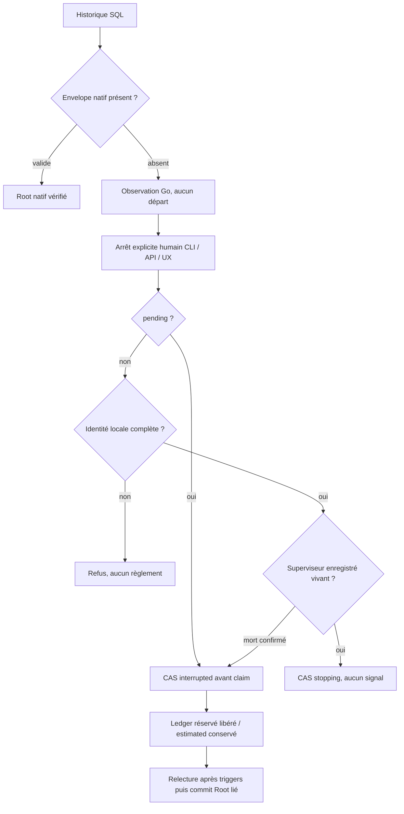

# Dialogues Go actifs — reprise Rust

Owner Codex, suite autorisée sans relance ; revue bornée GLM/SKYNET conservée dans `.cache/preparation-legacy-active-next/glm-review` (API demandé/déclaré5.2, backend5.3 selon utilisateur). Aucun fournisseur métier réel.

1. Reproduire le refus sur un candidat normal existant, fixture Root privée.
2. Historique actif observé sans adoption ; replay send actif reste refusé avant dispatcher.
3. Arrêt explicite CLI/HTTP : pending CAS→interrupted ; running vivant→stopping ; mort confirmé→interrupted. Identité inconnue refuse le règlement terminal.
4. Conserver JSON historique privé/inconnu ; aucun envelope natif, signal, délai15s ou lancement hérité. Réservation intacte libérée, estimation conservée, ledger absent refuse avec rollback.
5. UX lecture seule : arrêt explicite sans activer les appels ; actualisation manuelle, aucun polling nouveau. UX native : nouvelle demande possible sur stopping.
6. Tests publics + SQL/CAS/triggers + navigateur FR/EN/thèmes ; doc/Rustdoc et revue octets ; build normal, recette, installation locale et preuve ressources.

Fichiers réservés : preparation_call.rs (raccords seulement), nouveau preparation_call_legacy.rs, preparation_dialogue.rs, preparation_turn.rs ; preparation-native-dialogue.js et traductions additives, tests/recette dédiés. Préserver les changements concurrents identité/BIBA/activité. Etat : candidat non compilé, aucun effet installé annoncé.

Revue GLM : CAS statuts requis, stopping doit pouvoir être repris après mort, ne jamais rembourser estimated, identité absente pour pending acceptable. Vérification réelle Go : claim pending→running CAS ; markPreparationAttempt avant cmd.Start ; écriture PID gardée running ; finish gardé précédent statut. Risque restant : enfant fournisseur survivant au superviseur, coût distant inconnu ; aucune prétention de confinement ou arrêt effectif sans témoin.

Préconditions de méthode : premier check Cargo commencé avant les derniers ajouts Rust ; résultat diagnostic seulement, test ciblé final distinct. Le script de note a supposé local_changes=array, alors que le producteur réel est objet/items : AttributeError conservé, aucune écriture version_history faite ; correction par le champ réel. Shell a continué sur ce prérequis documentaire en erreur : test unitaire conserve sa portée code, aucune recette/livraison lancée ni succès global inféré. Première i18n vérifie justement l’écart généré : labels désormais ajoutés à locales/en.json puis générateur canonique ; original FAIL conservé.

Recette dédiée : active CLI/HTTP+4parcours navigateur, replay terminal historique,
API native+UI en régression car décodeur/stop partagés. Aucun re-test profils mémoire
nécessaire pour ce contrat inchangé ; leurs preuves201 sont conservées séparément.
Recette déclarée n’inventorie pas tout le graphe compilateur : le build normal et
ses entrées effectives restent requis avant installation. Aucun test complet de
migration ni acceptation indépendante prétendu.

Build216 refusé après compilation5m43 : sept entrées effectives changées par les chantiers concurrents (locales/en.json, version_history.json, lib moteur, trois sources enrollment-authority, i18n généré). Refus original rust-ge16golu conservé ; aucune installation. Le test fonctionnel diagnostique utilise une image hardlinkée explicitement non qualifiée, pour corriger les éventuelles fixtures avant une nouvelle construction. Ni compilation verte ni ces tests ne qualifieront les sources du binaire216. Snapshot vivant préalable achevé après attente lifecycle ; aucune donnée modifiée. Pression mémoire/swap observée pendant plusieurs compilations, sans interruption d’autrui ni borne imposée.

Diagnostic216 : contrôles publics CLI/HTTP réussis avant navigateur. L’attente navigateur visait le mode historique sans fournisseur, mais Fixture installe par défaut un faux CLI : l’interface native configurée s’est donc ouverte correctement, même appels désactivés, et le contrôle lecture-seule ne pouvait apparaître. DOM réel inspecté via CDP du seul navigateur détenu, capture browser-diagnostic.png ; navigateur détenu fermé explicitement après cause établie, original incomplet conservé. Précondition corrigée : retirer uniquement cette configuration de fournisseur factice avant la recette lecture seule. La régression API maintenue couvre l’éditeur natif. Aucun timeout ajouté. Tentative de diagnostic CDP initiale a pris le PID zygote pour le navigateur : échec StopIteration/ENOENT conservé ; parent réel identifié dans /proc puis diagnostic reçu.

Diagnostic216 après correction de précondition :24 assertions CLI/HTTP et40 navigateur PASS. Quatre FR/EN×thèmes, deux largeurs, focus clavier et contraste du nouveau contrôle, absence d’appels et seul POST stop explicite ; reçu200 invalide visible puis actualisation/reprise. Captures fr-etat390/en-sombre390 examinées : contrôle et aide visibles, pas de débordement. Le titre français « Nouvelle préparation » dans la capture anglaise est le titre persistant de cette fixture, distinct d’une étiquette UX traduite. Ces preuves restent diagnostiques, pas qualification216. Deux tests unitaires Rust finaux PASS, source arrêt inchangée depuis ; première compilation check était diagnostique car démarrée avant les derniers ajouts.

Recette216 complète :3steps PASS/intégrité VERIFIED (24public+40UI actifs,
12replay historique,35API native+48UI). Image07c945... issue du profil partagé
rust-5j70z5h2, pas de la commande de build finalement refusée rust-7dqnidha.
Cinq sources arrêt/historique/UI vérifiées identiques à l’inventaire compilé.
Clarification de provenance : l’attente du lanceur incluait le verrou de livraison
partagé ; ne pas attribuer toutes les compilations observées à notre commande.
Le profil qualifié seul n’a pas publié de record installable : deploy/local-build
reste215 à ce constat. Notre commande suivante7d refuse E0063, Identity.head absent
à trust_action.rs184 ; ce chantier concurrent a depuis ajouté head (octets observés,
aucune édition de ce fichier par Codex ici). Nouvelle commande autorisée sur cette
précondition modifiée, sans répéter un échec inchangé ni contacter l’autre chat.
La recette216 ne prouve pas les sources identité postérieures ni une installation.

Suite identifiée pour le contrat Go strict : replay d’un événement encore actif sans nouveau dispatch. Le refus actuel est conservé dans ce lot, car les adaptateurs CLI/HTTP déclenchent encore le dispatcher pour pending/supervisor0 ; supprimer seulement le refus serait une erreur. Prochaine modification bornée : observation explicite du replay à la frontière dispatch, envelope natif toujours exigé pour tout lancement, tests absence de réservation/lancement à travers send CLI et HTTP. Aucune sélection automatique de fournisseur ou adoption de processus historique. Ce besoin n’est pas masqué par le succès du lot stop.

Replan de regroupement : build détenu _w6fel2v encore en attente Cargo interrompu par SIGINT via pidfd après vérification de sa filiation (preuve owned-build-cancel.json), aucun processus tiers interrompu. Raison : intégrer le replay strict avant la prochaine construction finale, éviter un tour complet pour un raccord immédiat. Le nouveau préparation_dispatch_if_native observe le vrai envelope sous transaction Root avant de déléguer au gate existant ; legacy retourne false, aucun helper lancé. Adaptateurs CLI/HTTP consomment ce contrat ; replay actif peut retourner son état sans toucher réservations. Le dispatcher original exige toujours le native metadata avant d’ouvrir le gate ; aucun PID historique n’est adopté.

Amélioration de preuve découverte : le test historique ledger_state visait preparation_calls (absent) plutôt que preparation_reservations. L’ancienne assertion169/216 ne prouve donc pas le ledger réel ; ses originaux restent conservés, pas réécrits. Le test maintenu vise maintenant le vrai producteur, avec ligne témoin2.5USD estimated puis matrice3statuts×2états et comparaison exacte des montants/états, CLI/HTTP, conflits et absence de départ fournisseur. Les preuves stop24 incluaient déjà la vraie table et restent valides sur216.

Revue du raccord replay : pas de nouveau choix opérateur ; pending/running/stopping, envelope et CAS sont protocoles/invariants. Native dispatch préflight sous le même Root lié, puis gate existant répète les contrôles ; bool true signifie chemin demandé, jamais coût/exécution prouvés. Pas d’erreur interceptée/ignorée, faux signifie uniquement observation historique ou absence d’éligibilité. Fonctions publiques et adaptateurs documentés. Recette replay historique mise à jour pour33assertions attendues du nouveau contrat, résultat réel encore à observer. Les sources UI/stop demeurent celles déjà testées216 ; seul préflight dispatch/replay et ses adaptateurs nécessitent cette nouvelle recette.

Construction replay r7niqf80 refusée avant compilation : Cargo.lock périmé avec --locked. La résolution publique cargo metadata --offline --locked passe ensuite : correction concurrente déjà présente. Diagnostic sur16manifestes copiés seuls (sources liées, aucune compilation) produit le même Cargo.lock que la source actuelle ; aucun octet Cargo.lock source modifié ici, aucun --locked supprimé. Build4vek3a5q est un autre profil partagé commencé avant nos derniers raccords ; son refus sur nos quatre fichiers modifiés est conservé sans l’attribuer à notre commande. Le suivi s’appuie désormais sur la filiation et les FD de notre sortie, pas sur « le dossier le plus récent ».

Limite d’attribution explicite : host/boot/stamp observés ne prouvent ni identité d’agent ni accès du processus au même magasin physique actuel. Le statut stopping est enregistré, sa réception par l’ancien worker n’est pas attestée (p.ex. Root remplacé depuis). UX reste en attente, aucune terminaison distante revendiquée. La référence FR/EN précise cette distinction ; aucun signal/adoption ajouté.

Revue GLM additionnelle ciblée du seul raccord replay/préflight lancée (dispatch-glm) avec producteurs, transaction, gate et deux adaptateurs ; outil-free, aucune autorité d’acceptation. Résultat à examiner, pas installation. Attente du lanceur désormais attribuée via le FD de build-lock-current.stdout :2196101, collector2203717, profil rust-lxlxjy49. Ces PID sont des observations de diagnostic datées, jamais une règle moteur ni une autorité de signal.

Consolidation BLD-FREEZE-1 existant, sans seconde tâche : les preuves de ce lot ajoutent des mesures réelles (compilation moteur entière pour un petit raccord, attente de locks, swap saturée et invalidations par mutations partagées). Valeur attendue d’un artefact installable lié à un snapshot effectif immuable : éviter de recommencer un profil vert quand le checkout avance. Propriétaire : chantier livraison/build existant ; état proposé, aucune amélioration de performance mise en œuvre ou chiffrée ici. Critère : une compilation stable, sources conservées, profil normal et recette liés à son empreinte, installation supportée possible sans dépendre de nouvelles éditions non compilées ; aucune qualification d’image altérée ni changement de droits implicite. Ne pas modifier le lanceur pendant une construction active.

Revue GLM replay reçue :57,240tokens déclarés,534s, deux constats à vérifier, aucune économie ni acceptation inférée. Point1 (policy disable au replay natif) décrit déjà l’ancien adaptateur qui appelait preparation_dispatch après replay natif pending0 ; le nouveau helper n’ajoute aucune voie legacy (false) et le worker revalide le settings_digest/policy avant contact. Point2 (erreur après admission ne prouve pas absence d’enregistrement) était déjà le contrat des adaptateurs, documenté depuis168/192 avec intention conservée/relecture/stop ; ne pas remplacer une erreur Root par un succès ambigu. Vérification de ces gardes réelles en cours, pas de patch proposé par GLM appliqué aveuglément. Le paquet ne comprenait pas les anciennes lignes d’adaptateur ni tout le worker ; portée de la revue limitée, contexte manquant reconnu.

Replay lxl diagnostique :33 assertions PASS, dont6combinaisons statut/ledger,
CLI/HTTP et absence de départ fournisseur. preparation_worker_claim appelle
preparation_call_current avant demande fournisseur : SavedPolicy exacte,
enabled/deployment kill-switch, Root et settings_digest. Les deux constats GLM ne
sont pas des régressions introduites : ancien adaptateur lançait déjà le même gate
natif, les refus actuels sont conservés, aucun faux succès Root ajouté. Nouvelle
recette complète diagnostique et construction sur les quatre entrées settings/lib
changées après le refus lxl ; cette précondition est conservée. Image lxl refusée
reste refusée, jamais installée ni rebaptisée qualifiée.

Défaut froid216 réellement reproduit et conservé : image qualifiée f47b2099...
profil4jxv_r0a, `init` Root neuf retourne settings-document-envelope. Cause : ajout
concurrent des valeurs report-read schema47 alors que validate_change et
EngineSettingsDocument.validate s’arrêtaient encore à46. Correction bornée annoncée :
les deux bornes consomment SETTINGS_SCHEMA_MAX=47, invariant de protocole, pas choix
opérateur ; versions de groupes historiques inchangées, aucun default adopté dans
le Root vivant. Original engine_settings.rs conservé avant correction ; recette
froid/ancien46/preview/apply/relecture/futur refusé ajoutée avant nouvelle livraison.
Ce patch ne vaut ni acceptation du chantier report-read ni autorisation de ses coûts.

Build m1ggw80w qualifié et prêt216, SHA3a5291... ; contrôle serveur froid passe
après correction schema47. Recette finale première tentative : bootstrap47,
idempotence, témoin initialisation cassée et reprise du Root partiel, lecture46
sans adoption, refus48 et preview readonly PASS ; apply/relecture réussissent puis
assertion de recette TypeError (révision SettingCount est une chaîne décimale,
pas int). Original FAIL conservé avec journal fixture déjà47 ; aucune erreur
produit/refus masqué. Correction de la seule assertion par comparaison de chaîne
canonique incrémentée ; nouveau dossier de recette, pas de reconstruction requise.

Clôture bornée216 : recette finale4steps PASS/intégrité VERIFIED après correction de l’assertion décimale.11bootstrap (y compris ancien46 sans adoption, recovery du Root initialement cassé, refus48, preview/apply/relecture et histoire conservée),24arrêt,33replay,35API et40+48navigateur. Deux unités helpers inchangés PASS avant ce regroupement ; pas de preuve d’unité globale/fixture-free inférée de leur profil. Build normal m1ggw80w, huit sources moteur/CLI/API/UX propres identiques à son archive effective, aucun feature fixture. Installation par restart préparé SHA3a5291dac03c91865b90acc8a57f6cbd116620868b8007bb8c499f8f37263b0c, version216 ; avant215. Contrôle vivant20, dialogueVersion14 etpage11, ressources protégées comparées à l’archive, notes FR/EN et réglages/cinq travaux conservés. Trois fichiers plus récents gate_evaluation/lib/native_diagnostics sont en attente, jamais déclarés installés. Aucun fournisseur métier, commit/push ni acceptation des chantiers tiers.

Preuves permanentes : evidence/20261027-preparation-legacy-active,41archives roundtripSHA/fsync,21Roots inertes attribués,6images hardlinkées ; originaux non supprimés, aucun Root vivant archivé. Source-review quatre axes liée à ce profil et aux octets exacts. Incident Admin concurrent local-storage500 antérieur reste ouvert ; pas de réparation ni de conformité globale prétendue. Migration globale reste active.

Réexamen du lot195 concerné : le témoin ancien worker192 ne sait pas lire un Root neuf47 (refus réellement observé, older192-schema47.*). La promesse195 « v1 lisible/v2 refusé » portait sur son journal46, pas sur une nouvelle enveloppe qu’il ne connaît pas. Le test CLI optionnel old-worker initialise désormais sa seule fixture avec cet ancien binaire, vérifie le journal compatible46 puis utilise le nouveau moteur ; autre invocation courante sans ancien binaire couvre le Root neuf47. Aucune régression45/46 masquée, aucun défaut runtime accepté et aucun ancien exécutable appliqué au Root vivant. Profil livré216 inchangé, recette supplémentaire ciblée à confirmer.

CLI courant47 : tests de modes/parser/refus passent, puis recette échoue en lisant le témoin fake CLI ouvert mais encore vide (JSONDecodeError). Cause de fixture : open('x') publiait le nom avant json.dump. Original source/canaux conservés ; tour de la fixture échouée réglé via stop CLI public avant reprise, aucun signal brut ni Root vivant. Producteur du témoin modifié par publication atomique sans remplacement : JSON complet flush/fsync dans pending, link final puis suppression du seul pending ; aucune boucle de retry JSON, aucun délai ajouté. Cette correction de méthode ne prouve pas le succès des prochaines assertions.

CLI journal46 : contrôles worker ancien et v2 passent, navigateur échoue Failed to fetch. Canal réel serveur conservé : web-conductor-after-http, configuration déjà enregistrée revision5, agent-storage-busy/local-storage/Lock/errno11. C’est une nouvelle preuve du défaut Admin concurrent antérieur, pas une réparation. La recette CLI ne drainait pas stdout pendant le navigateur (8.1KB conservés), contrairement à la recette API ; ajout du collecteur asynchrone existant et transmission de l’erreur primaire au cleanup. Cette précondition de collecte corrigée est nécessaire mais ne prouve pas la cause du verrou ni sa correction. Reprise prévue sur Root courant47 avec collecte active, témoin ancien46 séparé. Aucun timeout ni retour500 masqué.

Avant exploitation de la recette CLI boundary : son premier manifeste transmettait l’env OLD_BINARY au scénario current47, ce qui sélectionne implicitement l’ancien journal via argparse. Ce run est diagnostic46, jamais preuve Root47 ; manifeste retenu par le runner, contexte examiné avant succès. Wrapper corrigé pour retirer cette env du subprocess et fournir l’ancien binaire uniquement en argument au cas legacy46. Aucun effet sur le profil livré216, aucune réutilisation de cette preuve sous une mauvaise étiquette.

Supplément vérifié218 : CLI courant47 CLI29/browser60, journal compatible46
CLI30 (ancien worker192), recette2steps PASS/intégrité VERIFIED. Le défaut produit
Admin Lock/errno11 a persisté après collecte stdout correcte : cause de découverte
réservée traitée dans WEB-DISCOVERY-OBSERVATION-20261027, pas masquée par le test.
Régression complète préparation sur218 :4steps PASS/intégrité VERIFIED ; vivant
20+Version14+page11, réglages/cinq travaux conservés. Revue source quatre axes
maintenant effectivement présente dans evidence/20261027-preparation-legacy-active.
Originaux ultérieurs et fixtures CLI conservés séparément dans le dossier de
preuves web-discovery, sans écrasement des41archives historiques de ce lot.
