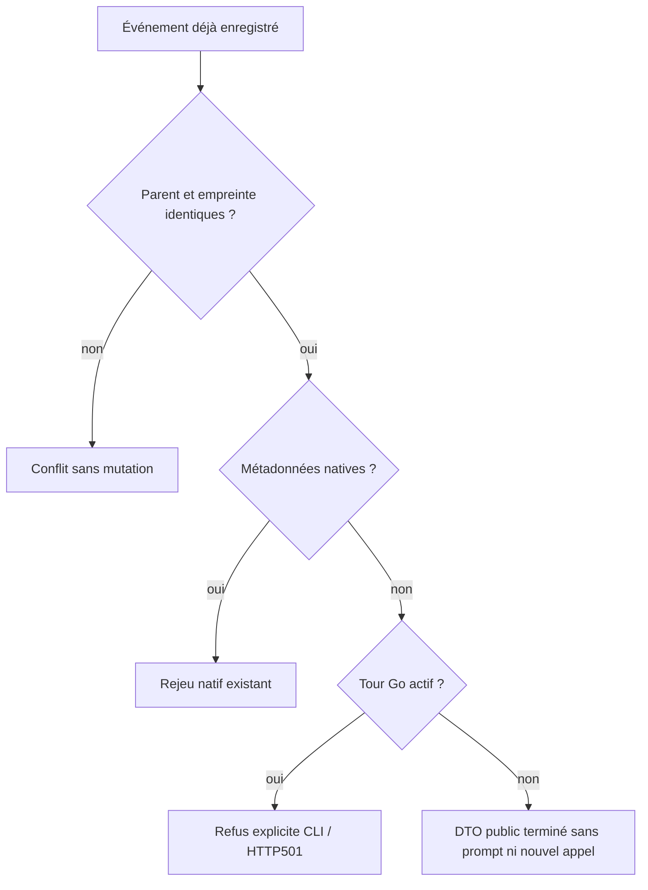

# Rejeu historique préparation —27octobre

OwnerCodex ; replan après le lot API texte168, délégation GLM bornée.
Besoin : rejouer un événement Go terminé sans inventer de worker natif ; conserver
les refus d'exécution et les empreintes, les données privées et le budget.
Fichiers : helpers record/turn/replay dans preparation_call.rs, seule projection501
preparation-call dans service.rs, deux tests Rust et recette CLI/HTTP maintenue.
Aucun schéma, choix opérateur, provider, budget ni mission vivante modifié.
Le lecteur accepte l'absence historique de métadonnées pour le seul rejeu terminé ;
worker/dispatch/stop exigent toujours l'enveloppe native. Empreinte et parent sont
comparés avant la garde active ; nouveau niveau autre que vide/auto reste refusé.

Preuves avant : deux tests Rust échouent ;168 refuse le parcours public avec
preparation-send-invalid. Correction intermédiaire :6 tests passent, puis le cas
actif avec autre message montre que le diagnostic unported précédait à tort le
conflit. Ordre corrigé ;6 tests passent de nouveau. Les sorties restent distinctes.
Les premières fixtures publiques avaient une table de ledger absente puis un
trigger inconnu refusé à l'ouverture : préconditions corrigées, aucune garde levée.
L'absence du ledger est maintenant observée et comparée distinctement du vide.
Les triggers de la suite retained-Root restent pertinents sur une connexion déjà
ouverte ; leur présence ne qualifie pas le schéma d'une nouvelle ouverture publique.
Le premier test utilisait unwrap_err exigeant Debug sur le DTO privé : corriger
le test via err/expect, jamais ajouter Debug aux prompts pour satisfaire le test.

GLM propose lecteur optionnel + wrapper strict et priorité du conflit ; les mêmes
frontières sont intégrées et vérifiées par le principal. Statut supposé completed
et liste limitée au niveau high rejetés : Go emploie answered/failed/interrupted
et le rejeu compare le contenu enregistré avant l'admission d'un nouveau niveau.
146.029s et27544 jetons déclarés ; route demandée/déclarée glm-5.2, backend5.3 indiqué
par l'utilisateur non attesté. Pas de test exécuté par GLM ni économie démontrée.

Recette permanente preparation-legacy-replay-rust : CLI/HTTP readonly avec faux
anciens tours, parité/conflict/private/501, aucun provider configuré et politique
d'appel désactivée ; puis parcours natif complet et six tests retained-Root.
Profil normal et livraison locale restent à qualifier. L'état actuel est candidat,
pas installé ; les tours Go actifs et adaptateurs CLI ne sont pas migrés par ce lot.

## Résultat vérifié et livré

Recette169 PASS, intégrité VERIFIED :12 contrôles CLI/HTTP historiques,34 du
parcours API natif et48 navigateur, six tests Rust retained-Root. Les premières
preuves en échec sont conservées séparément ; aucun retry de provider réel.
Version169, SHA256 `6b1dc0c9f0e599ee8b7efb1f4848c76bdd7807462658d5ba9f00129f99a3ee85`,
558 entrées effectives, profil normal/core features vides/test=false/sans fixture.
Build puis restart via swarm.sh. Instance réelle :22 contrôles, Version FR/EN14,
page11 ; ressources protégées et métadonnées comparées au build. Réglages41 et
missions pausées révisions50/469 identiques au témoin avant redémarrage ; aucune
activation ni modification des données vivantes, aucun commit/push.

Revue explicite : aucun choix opérateur ajouté ; version, empreinte, niveaux
nouveaux supportés et états actifs sont des contrats/capacités, pas des plafonds.
Les fonctions record/turn/replay/send conservent leur Rustdoc et les erreurs
SQL/codec/finalize ; le wrapper strict ne construit aucune Native. Le formatter
HTTP ajoute seulement preparation-call au501 typé, sans aplatir de cleanup.
Régression utile de notre propre correction : priorité du conflit prouvée par
le cas qui échouait après le premier correctif. Ne pas accepter une liste de
statuts ou niveaux inventée par un modèle faute de lui avoir transmis leur
producteur réel ; confronter la proposition au code effectif et conserver le rejet.
Pas de changement du format de stockage ni d'appropriation de processus Go.
Les défauts historiques ouverts dans la revue168 sont résolus pour ce périmètre
par la revue169, sans réécrire la preuve originale. Les adaptateurs CLI, processus
Go actifs, mémoire versionnée et conformité globale restent hors de cette preuve.
