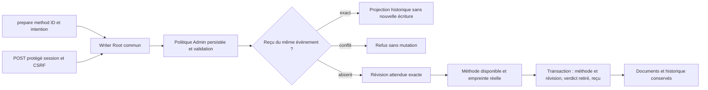

# Préparations Rust — sélection de méthode, 26 octobre 2026

Besoin : poursuivre la migration avec GLM, en préservant Biba et SCALING.
Owner : Codex ; contribution GLM sans outils, intégration/revue/exécution Codex.
État : dev82 installé et vérifié ; aucune clôture globale de migration.

Le défaut Admin de méthode s’applique seulement à create. Pour method, vide ou
inconnu refuse ; audit_pdca est normalisé. La politique d’écriture reste commune
et s’applique aux rejeux. Aucun nouveau plafond opérateur ou appel métier.
Les cinq noms sont un catalogue de capacités ; version1 et identifiants ASCII128
sont des représentations de protocole. Les limites sources sont celles d’Admin.

## Preuves originales et replan

- Dev80 : create valide puis method refusé, exit2, SQL inchangé (avant correctif).
- Premier build81 : compilation verte, qualification refusée car une autre session
  ajoute protection-contract/tests/payment_registry.rs pendant l’observation Git.
- Premier parcours candidat : source illisible classée root-cleanup/exit2 au lieu
  de method-unavailable/exit5. Cause conservée mais consommateur incorrect.
  Correction : enveloppe métier autour des causes sources, sans modifier les
  classifications globales ni cacher une véritable erreur de rollback/close.
- Second build81 : compilation verte, lib.rs CLI modifié concurremment ; inventaire
  effectif refusé. Pas d’activation ni contournement ; tests indépendants poursuivis.
- Revue GLM initiale : décisions vides acceptées en Rust mais refusées par le
  contrat Go. Acceptation reproduite sur80 ; validation corrigée pour distinguer
  absence/null de tableau explicitement présent, même vide. Garde permanente.
  Les suggestions de réintroduire les constantes Go ou le switch environnement
  sont écartées : politiques Admin persistées décidées par l’utilisateur.
  plan_ready est une projection : retirer verdict impose false ; aucune preuve
  d’une régression sur ce point. Revue finale ciblée demandée avec les sources.

## Périmètre des vérifications

Recette maintenue : preparation-writes-rust, avec rust_preparation_method.py et
le test SDK de rollback du reçu method. Les données d’approbation sont des
fixtures historiques explicites, pas une preuve d’adoption/validation portée.
CLI et API sont raccordées ; l’éditeur graphique, les autres transitions et
l’acceptation globale de migration restent ouverts. Aucun test sur les bases
vivantes ; aucune autorité Biba/SCALING, aucun commit/push implicite.

## Vérification retenue et revue

Deux réponses GLM utilisables, 92537 tokens déclarés ; aucun gain chiffré inféré.
La revue ciblée confirme create/method, CAS, reçus et conservation des documents.
Ses cas supplémentaires ont donné37 assertions méthode : sources locales changées,
resélection, limite Admin0 puis reprise, refus API conflit/absent/désactivé inclus.
Le signalement historique/projection est conforme au Go (history appelle
preparation). Le DTO CLI Go ne contient pas de sidecar de diagnostic ; les causes
restent requises lors d’un échec tardif. Pas de modification spéculative du contrat.
L’alias Admin non canonique est déjà refusé par engine_settings ; le défaut n’est
pas libre. Duplication possible de causes après BUSY : hypothèse conservée,
owner Root/retry, reprise sur reproducteur avec tentative effectivement relancée.

Le premier run de recette révèle une ancienne attente erronée decisions:[] ;
les sorties originales restent conservées. Le témoin équivalent utilise null,
le tableau explicite a désormais son propre refus sans mutation. Nouveau run
PASS :50 écritures,37 méthode,8 identifiants,3 tests SDK ;45 contrôles Admin
inclus dans le parcours écritures. Trois unités codec et trois tests du lanceur
complètent les preuves ciblées. Aucune acceptation indépendante à l’exécution.

Après trois collisions, observation des441 entrées effectives pendant le parcours
isolé avant reprise ; la tentative suivante échoue sans rapport final collecteur.
La cause historique de cette terminaison reste inconnue, sans preuve d’OOM.
Amélioration du lanceur : collector-result.json conserve dorénavant code/signal et
empreintes stdout/stderr avant refus ; simulation signal9 vérifiée, sans désactiver
la protection. Build suivant qualifié dev82, SHA2a328c56… ; recette permanente
rejouée sur ce binaire exact et intégrité vérifiée. Les fichiers compilés Biba/
SCALING restent sous leur propriétaire ; aucune qualification globale déduite.

Découverte livraison : artifact de deploy/local-build.json nomme le temporaire
renommé vers bin/swarm. Le résultat build/result.json conserve le binaire immuable
et son SHA ; ce chemin a été vérifié pour la recette. Amélioration à étudier par
owner installation : exposer explicitement destination publiée et artefact figé,
critère observable tous chemins annoncés existants avec SHA concordant. Ne bloque
pas cette livraison, dont les octets sont identifiés ; aucun nettoyage implicite.

## Livraison et RETEX

Redémarrage pris en charge : version inchangée82, sans nouvelle compilation.
Processus réel SHA2a328c56… concordant,10 assertions HTTP dont ressources servies
comparées aux entrées compilées et réglages inchangés ;14 assertions Version
FR/EN, notes, commit réel, changements non committés et focus/Escape. Deux missions
encore suspendues, révisions50/469 intactes. Aucun appel fournisseur métier.
Preuves privées conservées dans evidence/20261026-preparation-method/private ;
résultats publics et limites dans le README associé. Aucun commit/push effectué.

Apprentissage : distinguer absence/null et collection vide selon la validation
métier, même lorsque la sérialisation omet les deux. Le test historique incorrect
est conservé, le nouveau témoin prouve refus et absence de mutation. Appliquer
cette lecture aux prochains codecs, sans prétendre qu’un scanner garantit tout.
Pour les causes d’une méthode refusée, conserver l’enveloppe métier à la frontière
CLI/API ; réserver les erreurs de nettoyage aux vrais échecs de nettoyage.
Les sources de tests sont permanentes et les recettes rejouables ; le contexte
GLM doit inclure producteurs/gardes avant toute reprise de ses suggestions.

## Conservation Git demandée le26octobre

Demande utilisateur : commit, sans push. Sélection limitée aux changements de
préparations et au diagnostic collecteur ; les ajouts concurrents SCALING/PAEA et
les108 entrées déjà en staging sont conservés hors de ces commits. Les fichiers
partagés sont reconstruits depuis HEAD avec les seules lignes de ce lot.
Le binaire dev82 correspond à l’inventaire de build conservé ; ces commits ciblés
ne prétendent pas contenir tous les travaux concurrents compilés dans ce binaire.
