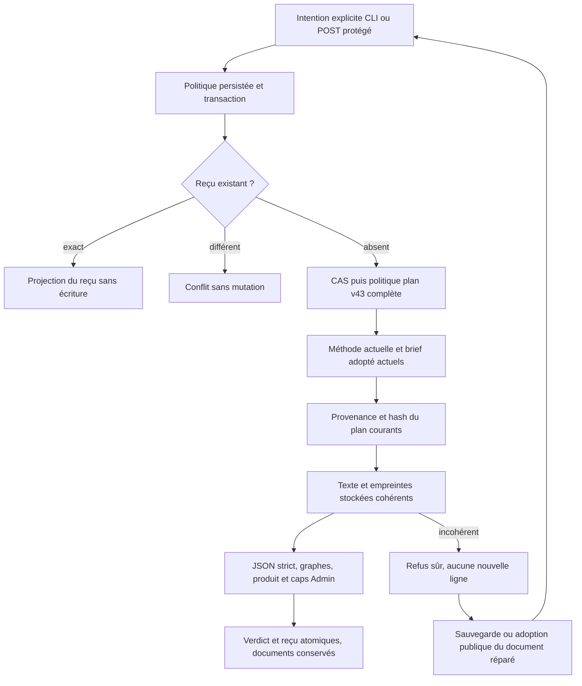

# Préparations Rust — validation de plan,26octobre2026

Owner/intégration Codex ; GLM5.2 propose le validateur puis une revue ciblée en
requête indépendante. Aucune acceptation indépendante à l’exécution. Objectif :
validate-plan CLI/API après adoption de brief, sans conversion ni mission lancée.
État : dev92 installé et vérifié ; recette finale et upgrades PASS.

## Reprise et périmètre

Refus87 reproduit après création/brief adopté/plan sauvé ; aucune mutation SQL.
Les DTO ActionPlan étaient portés, pas leurs contrôles. Le module GLM reprend
version/listes/questions résolues/tâches/product/graphes, avec Kahn itératif pour
les tâches et stories. Les IDs32/64, vocabulaire/complexité1–4 sont le contrat v1 ;
les politiques sont injectées : task_max_attempts/tool_calls/criteria existants,
et quatre caps v43 complets (32000octets,8tâches,16hypothèses,16questions).
Null illimité et zéro vide seulement. Une ancienne installation n’adopte rien en
lecture ; la validation nouvelle refuse tant que ces caps ne sont pas enregistrés.
Admin affiche11 champs de préparation, aides/traductions et contexte IA courants.
Le guide opérationnel FR/EN expose valeurs, effets, erreurs et reprise.

## Replans et preuves originales

- Premier candidat89 compilé/qualifié, mais sans la note de livraison finale ;
  conservé comme témoin avant correction de l’intégrité, jamais annoncé installé.
- Deux runs publics échouent sur des événements réutilisés par save/validate,
  correctement refusés par le moteur. Correction générale du helper de sauvegarde
  de fixture, au lieu d’exceptions par cas ; originaux journey1/journey2 conservés.
- Run suivant95 assertions PASS ; trois variantes produit ajoutées ensuite,
  dont cycle de stories, story sans parcours et complexité4/risque/task_ids vide.
  Leur preuve doit venir de la recette finale, pas du run95 antérieur.
- Upgrade42→43 :9 assertions PASS, dont sauvegarde Admin réelle, historique
  conservé, cap enregistré puis refus/reprise de la même intention par la CLI.
- Test SDK de verdict : contrôle valide avant trigger, rollback complet puis
  même événement rejoué ;1test PASS. Catalogue/validation des réglages :2tests.
- Revue GLM : stockage incohérent permettait un verdict sur le hash d’autres octets.
  Reproduit sur89 avant correction, puis matrice legacy12 contrôles : plan, brief,
  besoin et copie adoptée, y compris adoption/provenance consommant les mauvais hash.
- Correction générale du contrat de documents consommés : recalcul du digest pour
  verdict/adoption/provenance save, et jamais ready sur la projection incohérente.
  Réexamen des lots création/sauvegarde/adoption, sans réécrire leurs preuves.
  La sauvegarde du document cible ou la réadoption permet toujours une reprise
  publique : aucun blocage exigeant une réparation SQL n’est créé.
- Matrice corrective29 contrôles PASS sur92, dont HTTP500 sûr, refus sans mutation,
  réparation publique et reprise/rejeu. Aucun texte privé repris dans le diagnostic.
- Build91 : profil compilé mais observation Git changée par des tests/recettes PAEA
  concurrents ; refus conservé, aucun contournement. Build92 qualifié après nouvelle
  correction et témoin avant/après, pas une répétition inchangée de91.

## Limites conservées

Le verdict est structurel, pas une identité humaine ou un droit de lancement.
plan_ready reste une projection de fraîcheur Go ; les anciens verdicts ne sont
pas réexécutés sur chaque lecture lors d’un changement de cap. La nouvelle
validation consomme bien les plafonds courants et refuse si nécessaire. Toute
future conversion devra les vérifier à nouveau avant de créer des missions.
L’absence de besoin reste admise comme en Go ; aucune application complète ou
couverture n’est inventée par un produit valide avec une story non encore liée.
Histoires/parcours/références restent soumis au budget d’octets et au transport,
sans plafond nouveau masqué. Byte cap après normalisation n’est pas un plafond
de mémoire du parseur. Cohérence SHA n’est pas authenticité du registre.
Biba/SCALING restent à leur propriétaire, éditeur de préparation et conversion
ouverts. Aucun fournisseur métier, commit ou push n’est autorisé par ces preuves.

Apprentissage futur retenu : le prompt Go historique des phases omet retex alors
que son validateur l’accepte. Rust conserve la capacité réelle ; le prochain
raccordement du dialogue devra reprendre ce vocabulaire vérifié (owner préparation).

## Livraison et RETEX vérifiés

Recette finale de9étapes PASS :50 écritures,37 méthode,44 adoption,98 plan,
29 intégrité,8 identifiants,4 SDK historiques,1 SDK verdict et2 catalogue.
Les54 contrôles Admin sont inclus par parcours (FR/EN, etat/sombre,390/1440,
aide/focus, contexte IA, sauvegarde et réouverture du cap). Upgrade42→43 :9cas,
ancien41→43 :6cas. Intégrité des trois recettes vérifiée. Régression ciblée des
lectures antérieures :58cas PASS, y compris projection/historique et Admin.

Dev92 actif :446 entrées effectives qualifiées, SHA du processus = candidat testé.
Treize contrôles HTTP comparent paramètres, missions pause50/469, capacité,
catalogue43 et octets des ressources servies ;14 contrôles Version FR/EN passent.
Les réglages vivants restent v41, inchangés. L’opérateur devra adopter dans Admin
les groupes42/43 avant d’utiliser les nouvelles écritures sur cette installation ;
les parcours de cette adoption sont vérifiés en fixtures, sans changement implicite
sur les missions ou budgets réels. Aucun fournisseur métier, commit ou push.

Les deux réponses GLM5.2 sont utilisables :48892 et38002 tokens déclarés,
respectivement implémentation et revue ciblée. Aucun retry ni plafond client ;
aucune économie Codex inventée. La revue statique antérieure au correctif est
instruite avec reproducteur89 et matrice92 ; pas d’acceptation indépendante du
runtime. L’absence de besoin est une compatibilité Go décidée, pas une anomalie
à durcir implicitement. Le calcul de fraîcheur compare bien les hash observés.

Capitalisation : contrôler les octets dont un verdict dit vérifier l’empreinte,
pas seulement l’égalité de métadonnées. Vérifier tous les consommateurs du même
contrat et préserver une réparation publique ; détecter sans voie de reprise ne
clôt pas le besoin. Les gardes permanentes et manifestes portent l’apprentissage
aux prochains contextes ; les agents natifs déjà lancés ne sont pas reconfigurés.
Les historiques antérieurs restent inchangés. Suite bornée : réponses aux questions
ou conversion sous politiques courantes, à cadrer sans reprendre les anciens
plafonds cachés. L’éditeur graphique et la qualification globale restent ouverts.

Point de reprise conversion : le validateur retourne le plan inchangé, car le
caller Go validate-plan ignore l’ordre topologique calculé. La matérialisation
future doit construire son ordre de dépendances, pas supposer les tâches déjà
triées (cas de référence avant définition couvert par le parcours public).

À la clôture, quatre fichiers partagés ont changé après la recette : exports et
module review-check, aide CLI et note associée. Comparaison à l’archive native92 :
ces seuls ajouts sont établis, code/contrats de préparation inchangés. Les hashes
de preuve d’origine sont conservés ; le delta et les SHA du workspace sont
enregistrés séparément. Ces ajouts concurrents ne sont ni construits ni acceptés
par ce lot ; le serveur92 vérifié reste la livraison de notre périmètre.
