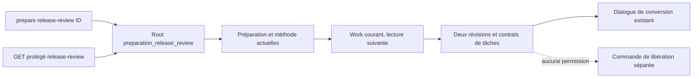

# Revue de conversion — raccord CLI/API livré149

OwnerCodex ; helper GLM demandé/déclaré glm-5.2, backend5.3 non établi.
Contexte40804octets ;9947entrée+21315sortie=31262jetons déclarés,118,543s.
Proposition conservée, aucune exécution par GLM. La version proposée perdait
explicitement les causes sidecar lors d’un refus ultérieur : corrigée avant
intégration par la même composition Cleanup que le lecteur existant.

Baseline146 : CLI refuse cette lecture, SQL inchangé,1 assertion. API existante
possède déjà le parcours ; extraction plutôt qu’une seconde implémentation CLI.
Deux lectures successives, pas de snapshot atomique. Révisions à revérifier par
le writer existant. Aucun nouveau cap/default, verrou, politique, budget ou agent.
Source et cause indisponibles ne deviennent pas un succès vide. La revue Go
complète avec comparaison/revise-missions et conversion sur Work existant reste
ouverte ; cette unité ne prétend pas la remplacer.

Critères : JSON CLI/API identique, contrats actuels après édition de tâche,
refus sans conversion/scope, causes conservées sur refus ultérieur, SQL intact,
recette de libération/UI inchangée, installation locale FR/EN et missions préservées.

Replan de recette : assertion400 incorrecte, candidat148 et ancien146 renvoient
tous deux409 pour préparation non convertie. Les deux échecs originaux conservés
établissent le même transport ; aucune modification produit de statut nécessaire.
Contrat du test corrigé409 et aide CLI complétée ; reprise sur ces préconditions.

Les17 contrôles du lecteur passent sur148 après correction des attentes de test :
HTTP409 confirmé aussi sur146 ; une erreur composée garde son code root-cleanup,
le refus principal et preparation-method-open/errno40 dans ses causes. Aucun
aplatissement pour faire passer le test.
Build149 refusé : ajout partagé c_http=http au manifeste moteur sans entrée
lock correspondante. Cargo metadata --offline a ajouté uniquement http dans les
dépendances swarm-engine du lock ; ancien lock/diff conservés, aucun téléchargement
ni modification du code concurrent. Reprise149 avec ce prérequis corrigé.

Replan compilation suivante149 : module partagé provider_connection_change.rs
utilisait Kind::Int inexistant pour version:i64. Original conservé ; correction
locale minimale Kind::Int64 et contrat du commentaire, sans toucher aux champs,
validation, secrets ou appels de ce chantier. Compilation à revérifier ; aucune
qualification de son nouveau writer n’est déduite de ce raccord.

Recette149 PASS/VERIFIED :17 lecteur+52 libération moteur+42 navigateur FR/EN,
thèmes, mobile, CAS et réponse perdue/rejeu. Binaire normal149
SHA0331eb45e1429826ae5571f3dc81c4e341d8248630c22ce7dea5195f9a041d9a.
Installation réelle :17 HTTP/process/assets/état+14 Version+6 page PASS ;
CLI/API identiques pour une conversion existante. Réglages41 et missions pausées
conservés. Aucune configuration, décision ou exécution de fournisseur par ce lot.

RETEX : une extraction doit conserver les sidecars aussi sur les sorties en
erreur. La proposition GLM et les attentes erronées du test sont conservées ;
le contre-exemple final vérifie refus principal+cause méthode+errno. Ne pas
déduire le transport de la seule branche finale d’un match : comparer le témoin
réel et l’ensemble du chemin. Réutiliser la recette de libération existante.
Limites : ce nouveau lecteur release-review n’est pas la commande Go conversion
complète ; comparaison/révision des missions, Work existant et dialogue IA restent
à porter. Pas de revue indépendante ni clôture/acceptation globale.
