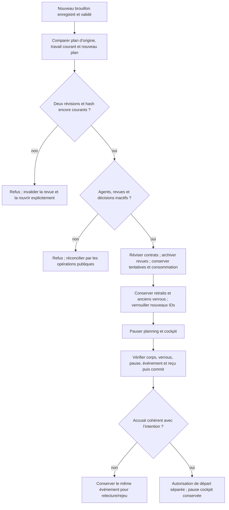

# Révision comparée et application du plan préparé

Owner Codex, proposition GLM ciblée ; baseline produit179, données vivantes
préservées. Ne pas modifier les chantiers BIBA/identité/S2/administration parallèles.
Besoin : comparer le plan matérialisé au nouveau plan validé puis appliquer une
révision explicite, conserver tentatives/historiques/budgets et remettre les tâches
impactées en vérification, mission pausée et nouvelle autorisation nécessaire.
Deux approches : comparaison seule laisserait un cul-de-sac ; retenir un lot
vertical lecteur/transaction/CLI/API/UI avec une garde interne de relecture finale.
Réserver modules préparation, CLI préparation, bras/capacités web additifs,
contrôleur préparation, recettes et documentation FR/EN correspondantes.
Critères : ordre/classification Go, fermeture transitive des anciens dépendants ;
CAS et digest ; refus agents/revue/décision actifs, collisions et dépendance vers
retrait ; conservation des résultats historiques et appels ; pause/verrous/reçu
atomiques ; rejet/reprise/rejeu, sorties tardives et parcours FR/EN/thèmes/mobile.
GLM fournit classification pure et transformation ; Codex assemble, vérifie et
installe le profil normal. Pas de modèle métier, plafond neuf ni watchdog global.
Ne pas porter la constante historique4 de récupération comme politique cachée :
préserver l'observation de limite déjà accordée si le plan ne change pas ce plafond,
sans créer un grant ; expliciter la différence et vérifier réduction explicite.
État : classification proposée, relue mais pas encore exécutée ; deuxième GLM en
cours. Mission révisée non portée179. Le commentaire CLI « No existing-work
conversion » découvert après179 est obsolète : corriger avec le raccord de ce lot,
sans modifier les preuves antérieures ni prétendre que tous les callers étaient
entièrement documentés179.

Assemblage en cours : DTO readonly facultatif sur release-review pour le plan
validé différent ; anciens DTO inchangés sans révision. Classification des
changements et ordre conservés. Le témoin des verrous est généralisé du
propriétaire vers les IDs actifs : une tâche retirée conserve son verrou et son
historique, même lorsqu'elle appartient à la même préparation. Les anciens
parcours d'ajout/libération/équipe devront être revérifiés pour ce contrat partagé.
Le nouveau test interne couvrira aussi un verrou conservé de même préparation.

Garde native identifiée avant mutation : require_idle_task_review consulte le
ledger normalisé claimed/registered/permitted/unresolved dans notre transaction
et conserve erreurs de schéma/job/SQL. Réutiliser cette frontière existante pour
les tâches du Work, plutôt que recopier les phases ou assimiler un lease expiré
à une revue terminée. Reprise publique existante : task review-reconcile ou
review-retire-stale selon l'état et les droits, jamais effacement de réservation.

GLM mutation :392,706s et98776 jetons déclarés (22383entrée/76393sortie),
route demandée/déclarée glm-5.2 ; backend5.3 utilisateur non vérifié. Premier
bloc explicitement retiré par GLM (stubs/troncature), non intégré. Second bloc
repris avec deux corrections préalables : ne pas vider next_by avant le contrôle
des dépendances retirées ; ne pas annuler la récupération lorsque la limite
stockée dépasse l'ancien plan. Sa phrase « Go écrase aussi cette extension »
était fausse : Go préserve4 pour un plan inchangé de3. Le port conserve la
limite stockée sans accorder de nouvel appel, avec tests matrice à fournir.
Aucune proposition GLM n'est tenue pour preuve d'exécution ou acceptation.

Amélioration liée au nouveau raccord : mutate vérifiait seulement id/révision
pour un200. Un reçu JSON valide mais sans le bon conversion.plan_hash ou sans
released_at aurait perdu l'événement d'une mutation pourtant déjà enregistrée.
Predicate partagé sur conversion/cible/IDs/hash et marqueur de libération ou
équipe, sans attestation d'identité. Les deux recettes de création/libération
injectent maintenant un200 syntaxiquement valide mais sémantiquement faux APRÈS
le vrai commit, puis exigent le même événement. Preuve avant correction à établir
sur179 ; les anciens tests de JSON malformé restent conservés dans leurs archives.

Premières preuves exécutées :3 tests de transformation (historique/tentatives,
récupération4 et6, réduction explicite, dépendances externes/reprise, planification
et budgets/exigences),3 tests de classification Go (contrat story, dépendants
transitifs/retrait, nil versus liste vide),1 test de témoin avec21 dommages SQL
et5 reprises. Tous passent ; pas une exécution d'agent ni une acceptation réelle.
Un second Cargo a recompilé à cause des notes de version concurrentes incluses
dans mission_status_runtime ; preuve de coût de méthode conservée, pas un
benchmark ni une raison d'augmenter un timeout. Grouper les filtres libtest
dans une seule invocation Cargo est possible ([FILTERS...] observé) pour les
prochains lots, sans élargir aux cibles d'intégration ni relancer le compilateur
entre filtres. Les ultimes changements Rustdoc sont sans logique nouvelle.

Construction182 refusée car web_request_policy_store.rs a changé pendant Cargo
(chantier voisin) ; compilation terminée mais inventaire non stable, donc preuve
non qualifiée conservée. Un build normal182 ultérieur est déjà qualifié dans
rust-09earwls ; ses six sources moteur/UI de ce lot sont identiques aux sources
actuelles. Réutiliser cet ELF immuable pour la recette complète plutôt que
recompiler une troisième fois. Git dirty a changé mais commit/modified sont
stables dans le collecteur ; cela ne qualifie pas les changements d'autrui.
La baseline d'accusé179 observe réellement le faux succès et la vraie conversion
correcte au stockage ; elle est classée DEFECT_OBSERVED, jamais PASS produit.

Replan de fixture182 : avant toute application, les5 contrôles publics passent.
L'injection Python du Work « running » est refusée par la fonction identité
swarm_identity_plan_digest_v1 non enregistrée dans ce client. Ce n'est ni un
refus de notre mutateur ni la preuve d'une tâche active. Ne pas enregistrer un
stub UDF ni retirer le trigger du chantier identité. Garder l'original ; déplacer
ce scénario dans le test de transformation Rust avec témoin valide et reprise,
et conserver le parcours public sans écriture SQL directe. La protection
d'identité reste inchangée ; aucun succès fonctionnel n'est déduit de cet échec.

Replan navigateur182 : CLI/API pause et garde de verrous passent ; FR deux thèmes
et l'accusé incohérent/rejeu passent. Au conflit Work réel, le serveur refuse
correctement, mais le test attendait à tort le comparateur de préparation.
État observé CDP du seul navigateur possédé : Work409 visible, comparateur
préparation caché, revue ouverte et confirmation réactivée. Le vrai défaut UX
est cette confirmation encore possible avec l'ancienne révision. Conserver
DOM/chaînes/processus ; fermer seulement ce navigateur pour terminer proprement
la recette, sans interrompre le serveur utilisateur ni attendre un watchdog.
Corriger le contrat commun : invalider la revue au Work409 et exiger fermeture/
réouverture explicites ; le test attend cet état réel, pas un conflit de document.

La libération après révision ne supprime pas la pause cockpit enregistrée :
configuration de planning et pause cockpit sont distinctes. Ajouter la preuve
publique de cette séparation et documenter la reprise mission explicite ;
aucun clear implicite du contrôle cockpit pour provoquer un départ.

Banc différentiel ajouté sans réintroduire Go dans le produit : fragments exacts
du commit0e9b5145247090714ebcc3731df48470b0e42d3a lus par git show, types et
fonctions sélectionnés identiques aux sources Go locales conservées. Comparer
les paires old/next réellement reçues par les revues CLI Rust. Premier collecteur
a écrit le harness comme chaîne JSON (publish sérialise les str) : Go refuse
avant exécution. Original conservé ; écrire des octets source et refuser les
champs inconnus avant reprise neuve. Aucun résultat de parité déduit de cet échec.

## Qualification et installation184

Recette183 complète7steps PASS et intégrité VERIFIED, sans modification des
inputs pendant le run :41 CLI/API et59 navigateur pour révision ; accusé3
contrôles navigateur avec vrai commit ;45 ajout existant +51 conversion/42
libération navigateur ;50 création +51 navigateur ;52 libération +42 navigateur ;
17 revue ;38 équipe +54 navigateur. Huit tests Rust passent dans une invocation
filtrée, dont21 corruptions SQL et5 reprises du témoin pause/verrous.

Différentiel Go : deux observations CLI réelles, une paire unique old/next,
comparées au producteur original0e9b514 ; types/helpers sélectionnés identiques
aux sources locales. PASS et recette séparée source-bound/intégrité VERIFIED.
Cette preuve vise l’ordre et les valeurs de changes, pas le store complet Go,
les refus d’autorité ou toute l’exécution. Le manifeste permanent inclut désormais
ce comparatif dans la première étape pour les futurs rejeux ; le run7steps
conservé n’est pas requalifié rétroactivement en run avec Go. Le compilateur Go
sert seulement cet oracle développeur, via l’historique ; aucun fichier Go n’est
réintroduit dans le produit ou l’installation Rust.

184 : SHA `7fcf93fdfd82935ea25eba749922071eaa40f2f6eeb526ef0ee4d3995ab005e2`,
profil normal qualifié, features cœur vides/test=false/sans fixture. Nos sources
produit sont identiques183 ; seuls des chantiers Admin/identité et leurs
dépendances/notes changent. Aucun ancien libellé EN modifié ou retiré, trois
libellés Admin ajoutés ; ressources générées réellement servies comparées à
l’archive184. Nouveau backend public184 :12 contrôles passent pour réexaminer
la dépendance d’identité liée aux écritures. Les autres parcours183 sont
réutilisés dans leur portée exacte ; cela ne qualifie pas les nouveaux composants
d’identité ou d’Admin ni leur usage futur.

26 contrôles installés184, boîte Version14 et page11 passent : processus/SHA,
notes FR/EN, Git réel/dirty, ressources, lecteurs publics, réglages et missions
identiques au témoin. Aucun plan ni autorisation vivant appliqué, aucun agent
réveillé, aucun fournisseur métier, commit ou push. Captures FR1440/ENsombre390
inspectées : trois contrats, texte littéral et actions visibles ; le message
rouge de la capture FR provient du faux aperçu injecté avant reprise, pas d’un
refus de la revue affichée. Lisibilité observée, pas de certification WCAG globale.

RETEX borné : la majorité des reprises venait de préconditions de recette
(héritage du comparateur attendu, écriture Python interdite, code généré encodé
comme JSON) et d’une évolution concurrente du profil. Les originaux restent
conservés ; les vrais défauts d’accusé et de revue périmée sont reproduits puis
vérifiés dans le parcours public. Garder les trois ensembles distincts :
comparaison sémantique, mutation transactionnelle, effet réellement installé.
La migration globale et ses autres propriétaires restent ouverts.

Conservation privée :2297 fichiers et11 racines inertes attribuées, SHA vérifiés
par relecture de l’archive ; ELF182/183/184 et unité8 retenus par liens physiques,
sans nouvelle copie physique. Originaux intacts.
[Revue bornée](evidence/20261027-preparation-revision/source-review.json) sur
les octets livrés, politiques, fonctions, erreurs, docs et limites de réutilisation.
La suite reprend les adaptateurs CLI de préparation avec GLM, sans relance.
