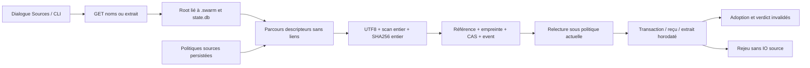

# Sources documentaires Rust — livraison locale vérifiée

Owner Codex ; besoin : attacher des preuves locales sans appel fournisseur,
parcours CLI/API/interface, réglages Admin persistés. Capture proposée par GLM
interne, revue et correction locales ; modèle demandé/déclaré glm-5.2, backend
5.3 annoncé par utilisateur non vérifié. Aucun agent natif exécuté.

Risque préalable reproduit128 : doublon budget limit10 puis null devenait0
illimité, alias majuscule perdait l’ordre, objets répétés ne fusionnaient pas ;
anciens reçus équivalents refusés par comparaison binaire. Baseline permanente
`tests/rust_preparation_wire.py --expect-defects` conservée. Correction au
premier décodeur imbriqué et normalisation comparative sans réécriture du reçu.
Pas de promesse de parité Unicode entre futures versions de tables de caractères.

Capture GLM corrigée avant compilation : identité directory=.swarm et non
racine projet ; SHA artisanal remplacé par sha2 ; fermetures et causes conservées ;
conversions non ignorées et allocations fallibles ; aucune sortie modèle acceptée
comme preuve d’exécution. `regex`1.13.1 épinglé :
[crate officiel](https://docs.rs/crate/regex/1.13.1),
[syntaxe Go](https://pkg.go.dev/regexp/syntax).
La regex conserve les espaces/bornes ASCII Go et les répétitions en scalaires.

Politiques : douze champs groupe44 ; valeurs Go initiales rendues modifiables,
avec exclusion opérateur explicite supplémentaire `private`. Invariants :
chemins privés connus/absence de liens/types réguliers/UTF8/secret ; chunks8192
techniques et indices ligne1 protocole ; aucune borne temporelle produit ajoutée.
Pas de garantie de mémoire/durée pour l’énumération triée, pas d’instantané FS,
pas de confinement OS ni d’authentification d’auteur fournie par ces captures.

Livré et vérifié localement : **v0.1.1-dev.133**, SHA256
`400f2b2716854cac97013931d22dd57f333d1c1c13b067cdefd24ab59f2c2dc5`.
Profil normal508 entrées effectives, aucune feature fixture. Le candidat132 a
porté les recettes : seules des déclarations/routes additives provider_models
ont changé dans service/root_store avant133, diff archivé ; sources préparation,
adaptateurs propres et ressources identiques. Aucune acceptation du chantier
fournisseur ou d’identité n’est déduite de cette réutilisation ciblée.

Preuves :6 wire,49 moteur/API sources,49 navigateur sources,31 navigateur Admin ;
upgrade43→44 explicite, historique conservé et consommateur réel/reprise vérifiés.
Régressions :8 politiques,27 budget+47 navigateur,38 équipe+54 navigateur,
29 questions ;1 test Unicode nommé (les560 autres filtrés ne sont pas déclarés
exécutés). Deux recettes PASS puis VERIFIED, sources et méthodes retenues.
Installation :14 contrôles HTTP/processus +14 Version FR/EN +6 page réelle ;
réglages et états des deux missions conservés, aucun POST métier en live.

[Résultats, revue liée aux octets et preuves](evidence/20261026-preparation-sources/result.json).
2813 fichiers privés conservés dans cette preuve au moment du relevé, manifeste
SHA256 ; FIFO représentées par leur type original, jamais ouvertes comme preuve.
Recettes permanentes : `preparation-sources-rust.json` et
`preparation-sources-regressions-rust.json`. Tests de livraison readonly maintenus
sous tests ; identifiants d’instance fournis en arguments, aucun secret retenu.

Replans vérifiés : la recette sur checkout partagé a passé ses3 étapes exécutées
puis refusé la stabilité de service.rs modifié ailleurs. Paquet de vérification
limité (pas de copie de travail/build du dépôt), sources compilées issues de
l’archive qualifiée et code des tests figé, nouvelle recette complète PASS. Les
refus de build pour notes/sources concurrentes restent conservés ; aucun garde
abaissé. Comparaison HTML brute refusée : renderer natif remplace volontairement
le head et rend3 champs inertes ; vérifier le body transformé attendu et les
ressources embarquées, puis navigateur réel, a rétabli la preuve.
Copie de preuves interrompue sur FIFO puis liens déjà copiés : reprise par
traversée explicite sans suivre les liens et vérification des octets existants.

Disque observé1,6Go libre : trois copies de nos binaires historiques ont été
remplacées par des liens matériels vers leurs preuves persistantes après contrôle
SHA256 (192824496 octets dédupliqués), chemins et octets conservés. Aucun cache
ou processus d’autrui supprimé ; marge restante à surveiller au prochain build.
GLM :318,753s,4368 entrée +60116 sortie (53543 raisonnement,6573 texte),64484 total
déclarés. Contribution capture intégrée après corrections documentées ; aucune
économie nette ni version backend5.3 prouvée.

RETEX : une capture documentaire n’accorde aucun droit d’agent ; la limite finie
ne doit jamais être perdue avant projection des objets structurés. Réutiliser
les reçus sémantiquement sans réécriture de l’historique. Les caps de listing ne
prouvent pas une borne de mémoire/durée. Le chemin source-response-loss dans le
navigateur n’a pas sa propre injection ; le handler partagé a son témoin budget,
et le rejeu source sans fichier est vérifié CLI. Pas de confinement OS, instantané
FS, parité globale ou revue indépendante prétendus. Suite : autres parcours de
préparation encore non raccordés (modèles/IA/conversion partielle), programme
S2/identité aux propriétaires existants, qualification globale et RETEX final.
