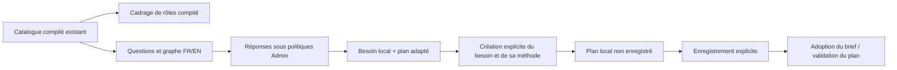

# Modèles de préparation Rust — livraison locale vérifiée

Owner Codex ; GLM interne propose le helper pur de vérification et projection.
Catalogue métier conservé, aucun modèle ajouté/modifié. Base133 : CLI refuse,
API404 web-route-unported ; première attente de test501 corrigée après observation,
original conservé. Politiques groupe45 : réponse1000/brouillon16000 initialement,
modifiables/null explicite, sans plafonds navigateur cachés.

Helper GLM reçu non exécuté : modèle demandé/déclaré glm-5.2 ; backend5.3 non
vérifié. Usage38478 entrée +61407 sortie=99885 déclaré, dont56601 raisonnement ;
352,275s. Types et décodeur Go-map/nested ajoutés par propriétaire ; aucune
preuve d’exécution ou acceptation donnée par la réponse. Code partiel refusé
au stade édition sur marqueur d’export inexact ; source partielle préservée puis
reprise à l’export réel, sans compilation après l’échec non traité.
Cargo check CLI normal PASS39,52s ; parcours/recette/livraison encore à vérifier.

Replan compatibilité réelle : instance locale encore en settings41. Fixture née
avec le binaire historique48, témoin Work/settings valide, catalogue136 renvoyait
500 pour politique de plan absente. Le prérequis typé doit être501 avec guide
Admin, sans adoption silencieuse ; correctif de classification et message partagé
ajoutés. Baseline conservée dans legacy136 ; reprise à vérifier sur build final.
Recette136 modèles3 étapes PASS/VERIFIED (30 CLI/API,41 navigateur,31 Admin) ;
non-régression Sources4 étapes PASS/VERIFIED (6 wire,49 moteur,49 UI,31 Admin).
Les résultats136 restent distincts de la prochaine livraison corrigée.

## Livraison et preuves finales

**v0.1.1-dev.138**, SHA256
`8fd5cc7b7c90c3ab3b849ccc8747c9c273e7f670618de4bb381669f588a166d8`.
Profil normal517 entrées compilées, features fixture absentes. Recette permanente
`preparation-templates-rust.json`4 étapes PASS puis VERIFIED :30 CLI/API,
41 navigateur parcours,31 Admin,22 navigateur configuration historique41.
Quatre préparations ont besoin+plan sauvegardés, méthodeks-product, aucune
adoption ni conversion présumée. Rejet des réponses, caps, objets Go avec alias/
merges/null, état SQL inchangé par les checks et reprise des limites vérifiés.
L’ancienne config44 adopte explicitement45 ; la config41 conserve son état et
rend le prérequis501 avec guideAdmin traduit, fermeture/focus et aucun POST.

Installation par le lanceur officiel :19 contrôles HTTP/processus/ressources,
14 Version FR/EN et9 page Préparation, dont le prérequis réel de l’instance41.
Réglages et six champs d’état des deux missions conservés. L’instance n’adopte
pas automatiquement les politiques42–45 et ses écritures restent désactivées.
La recette Sources sur136 est PASS/VERIFIED (6 wire,49 moteur/API,49 UI,31 Admin),
réutilisée dans son périmètre exact ; elle n’est pas présentée comme exécutée sur138.
Les fichiers compilés/fonctionnels, méthodes, argv, canaux et échecs d’origine
restent liés aux empreintes dans [les preuves](evidence/20261026-preparation-templates/result.json).
2019 fichiers privés retenus au relevé initial, dont binaires41/44/136/138 et
inventaires ; finalisations documentaires supplémentaires dans le manifeste.
Pas de commit ni push ; aucune acceptation indépendante ou clôture globale.

## RETEX et suites

Inclure la **version des réglages réellement installés** dans les préconditions,
pas seulement une Root nouvellement initialisée : le cas41 a révélé500 après
le passage de44→45 en fixture. Conserver sa baseline et prouver le refus corrigé
avant d’annoncer l’installation. Le statut « besoin complet » n’est pas « plan
validé » : les décisions du graphe restent ouvertes et le flag de lancement est
un invariantfalse, sans option Admin pour le contourner.

La reprise documentaire a corrigé les anciennes instructions d’organisation et
la borne1000 présentée comme fixe ; les sources actuelles exigent configure-team
puis release-plan et deux caps Admin. Un marqueur de titre supposé a interrompu
le script avant écriture : relire le titre réel, puis publier atomiquement.
Les commentaires CLI et l’aide de l’interface ont aussi été alignés sur la
sauvegarde explicite du plan ; aucun événement de sauvegarde n’est fabriqué.

Risque disque pris en charge :12 408 989 231 octets de caches incrémentaux Rust
du projet supprimés sous verrous Cargo après inventaire/hachage de12622 fichiers.
Les répertoires non attribués sont restés en place. Le premier contrôle a refusé
leur présence sans supprimer ; reprise limitée aux crates swarm_* identifiées.
Aucune source, dépendance liée, exécutable, donnée, preuve ou processus supprimé.
Le build138 normal et l’installation vérifiée après ce nettoyage établissent la
reprise ; environ11Go libres observés, aucune promesse de stabilité future du disque.
73 510 217 octets de doublons de campagnes terminées ont aussi été retirés après
comparaison exacte avec leurs preuves persistantes ; copies conservées intactes.

Amélioration retenue, ownerCodex : les refus génériques conservent leurs causes
sémantiques dans failure.causes, mais la modale ne présente pas toutes ces causes.
Valeur attendue : aider à corriger une réponse trop longue sans perdre le texte.
Critère : refus visible et exploitable sous les deux langues, mêmes réponses
conservées et reprise réussie, sans interpréter une formulation d’erreur comme
une autorisation. À traiter dans le contrat commun des diagnostics ; le backend
refuse déjà sans mutation. Ne pas présenter cette amélioration comme réalisée.

Suite indépendante : observer les consignes/profils projet effectivement chargés
par Rust, puis raccords de sélection, dialogue IA et conversions restantes.
S2/identité restent à leurs propriétaires ; qualification globale/RETEX ouverts.
