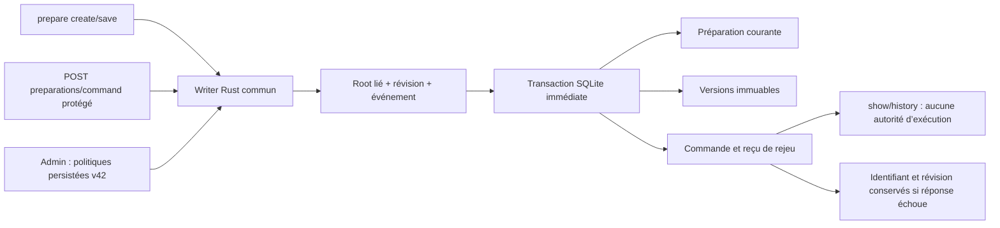

# Préparations Rust — création et sauvegarde sur instantané isolé
État actualisé : correctif livré et vérifié en dev78 ; voir
[la livraison](DELIVERY-PREPARATIONS-20261025.md). Les états « non installé »
ci-dessous conservent la chronologie de la phase isolée, avant cette livraison.

Origine : reprise du chantier migration, requête utilisateur « go ». Owner : Codex,
GLM SKYNET pour propositions sans outils. Biba et SCALING S2 restent réservés aux
sessions concernées. Base observée : dev74, Git d566ed35, checkout modifié conservé.

## Besoin et critères
Créer une préparation puis sauvegarder besoin/brief/plan par CLI et API protégée,
relire les octets et les versions, rejouer le même événement sans duplication.
Conflit de contenu sous le même événement et révision périmée refusés sans mutation.
Aucune adoption, conversion, validation de plan ou exécution d’agent.

Schéma du parcours implémenté et exercé sur une Root isolée, sans installation.
Les tables existaient déjà (schéma37).
Le Go conserve les trois familles dans une transaction ; son ignore de Rollback
n’est pas reproduit. Création ID déterministe et noms de document restent des
invariants de protocole ; les limites et la méthode par défaut sont des choix Admin.

## Politiques et reprise
Groupe v42 : preparation_write_enabled (0/1), preparation_document_max_bytes,
preparation_title_max_bytes (null sans plafond), preparation_default_method.
Valeurs initiales proposées : 1, 16000, 240, apex ; installations anciennes doivent
adopter explicitement les réglages avant écriture. Les lectures historiques restent
possibles. L’ancien interrupteur d’environnement Go n’est pas un second réglage
Rust : l’interrupteur persisté est la source commune CLI/API/Admin.
Le titre vide utilise le libellé éditorial « Nouvelle préparation ». Les plafonds
s’appliquent aux octets fournis, avant normalisation, sans troncature.

## État et preuves

Implémenté : création/sauvegarde, histoire et rejeu communs CLI/API protégée ;
réglages Admin FR/EN persistants et conservation du reçu après échec de sortie.
Le lot ne porte ni éditeur de documents, ni dialogue, adoption ou conversion.
Les tests emploient uniquement des Roots isolées, sans fournisseur ni mission live.

Preuves retenues : [dossier du lot](evidence/20261025-preparation-writes/README.md).
Les originaux, sources, requêtes GLM, Roots factices et binaires sont conservés
sous `private/`, exclu de Git : les fixtures comprennent des jetons de session.
Les recettes permanentes sont `preparation-writes-rust.json` (47 assertions
publiques, 8 cas d’identifiants, 2 tests SDK : deux injections transactionnelles
et intégrité du reçu courant)
et `preparation-upgrade-rust.json` (6 assertions de reprise v41 → v42).
Leurs parcours Admin comportent chacun 45 assertions navigateur : FR/EN,
état/sombre,390/1440px, aperçu puis application, réouverture et consommateur réel.
La suite lecture 58 assertions provient du candidat précédent ; son périmètre
est conservé séparément, sans prétendre qu’elle a été relancée sur le dernier.
Rustdoc moteur/web/CLI compilé ; avertissements existants conservés dans le log.
Les derniers résultats et empreintes sont ceux de l’index de preuves, pas une
qualification du checkout concurrent ni une parité différentielle Go exécutée.

Niveau A : revue statique indépendante GLM reçue et instruite ; le défaut D1
est reproduit avant correction et la garde ciblée passe après. Les limites et
réponses sont dans `independent-review-assessment.json` du dossier de preuves.
La première revue504 reste conservée, sans être qualifiée en succès.
Aucune acceptation globale ni installation effectuée par cette conversation. Deux builds communs75 ont
été refusés par le contrôle d’entrées concurrentes ; ne pas contourner ce contrôle.
L’utilisateur a choisi les travaux indépendants et refusé l’envoi d’une demande
de gel à l’autre conversation. La reprise d’installation exige un état commun
stable et les qualifications des propriétaires concernés ; aucun message envoyé.

GLM : trois réponses utiles, dont la revue ciblée ;206 415 tokens déclarés
pour ces trois réponses. La requête504 a une consommation inconnue.
Le nom API `glm-5.2` ne prouve pas la version backend annoncée GLM5.3 par l’utilisateur.
Pas de plafond client arbitraire ni de retry automatique. La revue ciblée a duré319,959s ; aucune économie chiffrée n’est déduite.

## Replans conservés
- Lectures lot1478 : les identifiants de préparation avaient été soumis à la
  limite100 de l’identité agent, au lieu des128 du protocole Go. Reproducteur
  permanent rust_preparation_keys.py : témoin100, défauts101/128, refus129 ;
  échec ancien reproduit contre dev74. Validation commune corrigée ; 8 cas CLI/HTTP du
  nouveau binaire passent, avec mêmes témoins/refus. Aucun changement de la limite des agents.
- Revue des entrées : les champs Go connus à zéro doivent garder leur omission
  canonique pour reconnaître les anciens événements. Les transitions non nulles
  étrangères au lot restent refusées. Proposition GLM corrigée sur ce point.
- Une méthode indisponible ne doit pas interdire un brouillon (comportement Go).
  Son empreinte reste vide et ses causes annexes sont conservées comme dans les
  lecteurs, y compris après un échec tardif ; aucune fraîcheur/adoption supposée.
- Candidat75 refusé : publication.rs a changé durant la compilation (autre
  session). Original .cache/local-delivery/rust-_bvfev7l conservé ; dev74 actif.
  Précondition nouvelle observée : correctif de l’autre owner et25tests nommés
  réussis dans native-cohort-71bzc4jf/unit.stdout, sans acceptation S2 déduite.
  Une seconde construction a été invalidée par managed_receipt.rs ; aucune
  des deux ne constitue une livraison. L’instantané compiler432 entrées élimine
  cette course pour notre recette, sans accepter les changements SCALING inclus.

- Première injection SQL depuis une fixture rouverte : le contrôle de schéma
  refusait la Root avant le défaut visé. L’échec est conservé ; aucune preuve de
  rollback déduite. Le test SDK ouvre d’abord une Root valide, injecte ensuite le
  défaut sur une connexion de fixture et vérifie les trois tables puis la reprise.
- Contrat CLI : le candidat rendait2 pour conflit/désactivation, contre3/4 en Go.
  Écart reproduit et corrigé ; méthode inconnue rend5, diagnostic Rust conservé.
  Références Go inspectées, pas de binaire Go exécuté ni parité globale supposée.
- Assemblage d’instantané : manifestes Cargo et modules de dev-dependencies
  absents ont refusé la construction. Inventaire réel complété, échecs conservés ;
  aucun contournement par features de fixture ou copie complète du dépôt.

## RETEX du lot et suite

Le parcours vertical a révélé des écarts que les tests de fonctions n’établissaient
pas : codes de sortie, identifiants historiques et adoption effective de réglages.
Conserver ces cas dans les recettes versionnées, et contrôler un témoin valide
avant injection : un refus préalable commun peut masquer le défaut recherché.
La figération des seules entrées effectives permet des travaux indépendants ;
elle ne résout pas la coordination d’une livraison partagée.

Amélioration à qualifier après bascule (owner Codex) : l’horodatage est demandé
avant recherche de reçu. Vérifier avec un environnement dont l’horloge échoue si
un rejeu déjà connu doit rester disponible sans nouvelle horloge ; aucun défaut
natif observé ni changement de politique décidé à ce stade. Critère : contrat
Go/Rust et cas de rejeu explicites avant correction éventuelle.

Revue indépendante instruite ; restant pour ce lot : qualifier l’ensemble stable,
installer par le lanceur pris en charge puis vérifier version et parcours local.
Les autres transitions préparation restent dans la matrice de migration ; ce lot
ne clôt pas le groupe, Biba, SCALING ou la migration intégrale.

## Replan après revue et observation de dev77

D1 reproduit : reçu altéré à id/révision identiques accepté. Le writer refuse
maintenant un reçu courant différent du corps stocké, avant projection ; témoin
valide, corruption, absence de nouvelle ligne, réparation et rejeu sont permanents.
Les reçus historiques restent distincts, sans prétendre vérifier leur contenu par
la seule ligne courante. Cette garde détecte une incohérence ; elle ne protège pas
contre un acteur autorisé à réécrire toutes les tables.
D2 : borne du titre fourni (contrat Go), exemption du libellé automatique désormais
explicite FR/EN et testée. D3 : hypothèse100 octets contredite par code et8témoins.
D4 : hypothèse conservée après bascule, owner Codex : causes annexes de plusieurs
essais BUSY éventuellement dupliquées. Reprise sur témoin contrôlé après catalogue
et contrat de provenance ; aucune perte de cause ou mutation erronée reproduite,
aucun effacement de diagnostics ni nouveau seuil introduit pour la masquer.

Une lecture du statut public a constaté dev77 actif (SHA7e7563dd…), activé ailleurs.
Copie du binaire réellement exécuté vérifiée par empreinte : parcours44+8 et
reprise6+45 passent sur fixtures isolées ; SDK transactionnel exécuté séparément
sur les sources figées. Cela ne teste pas les données/missions de l’instance live.
Ce build contient les écritures initiales, mais pas la garde D1 ajoutée ensuite,
ni les deux corrections Rustdoc : aucune annonce de livraison de ce correctif.
Aucun redémarrage, aucune adoption des réglages live ou message à l’autre session.
La reprise de livraison nécessite sources communes stables, qualification de la
correction et vérification locale du parcours/version ; le dernier choix de
l’utilisateur reste travaux indépendants seulement.
