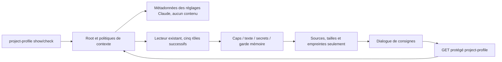

# Profil projet Rust — lecture livrée147

OwnerCodex, APEX/replan ; helper de statut proposé par GLM interne puis relu.
Modèle demandé/déclaré glm-5.2 ; version backend5.3 annoncée non établie.
Contexte19441 octets, usage5038 entrée+16695 sortie=21733 déclaré,85,845s.
La réponse ne prouve ni compilation ni acceptation. Commentaire contradictoire
« aucun prompt produit » corrigé : le lecteur crée un prompt transitoire, le
statut le laisse tomber sans le retourner/persister. Wrapper Root ajouté par owner.

Baseline138 : CLI refuse, API404,2 assertions. Cargo check normal CLI31,69s PASS.
Nouveaux wrappers readonly Root/CLI/API ; dialogue existant restauré, DTO vérifié,
chargement/erreur/reprise et focus. L’API commune affiche uniquement le motif statique public fourni par ce lecteur,
sans piloter les décisions par son texte. Les causes internes restent masquées.
Aucune sélection ni configuration du profil, aucun appel fournisseur/agent.
Garde mémoire versionnée non portée maintenue, refus501 typé dans ce lecteur ;
une erreur de profil conservé reste500. Pas de snapshot FS, droits, reçu d’agent
ou authentification déduits de ces empreintes. Recette/livraison à établir.

Replan de preuve : core143 a passé ses lectures/refus/reprises jusqu’au garde
mémoire puis le test a demandé à tort failure.causes, absent du contrat HTTP
expurgé. Les originaux restent conservés ; mode du fichier privé synthétique
relevé puis restauré pour rétention. Le correctif conserve la suppression des
causes internes et ajoute failure.reason uniquement pour les identifiants statiques
Context/Path de cette lecture, sans aplatir cleanup/erreurs composées. Test prévu
pour refuser une fuite de clé/valeur JSON non fiable dans la réponse.
UI14336 assertions PASS : public reason injecté (initialement cause synthétique),
lecture réelle,5 rôles, métadonnées seules, sécurité de rendu, FR/EN/thèmes/mobile.
Aucune preuve du nouveau reason réel n’est déduite de cette injection.

Recette normale146 :34 CLI/API+40 navigateur PASS/VERIFIED, dont motif statique
réel, aucun contenu privé, caps et refus/reprises, rôle ouvert lisible sur mobile.
Régressions146 : modèles41 et sources49 navigateur PASS ; aucun agent/fournisseur.
Erreur de preuve historique : la revue modèles138 mentionnait failure.causes
pour les réponses HTTP ; ce champ n’était pas publié. Causes CLI/typées conservées,
transport expurgé maintenu ; amélioration du diagnostic fin des modèles reste ouverte.
Installation en vérification, aucun acquis sur la sélection/écriture de profil.

Livraison147 SHA981222cdd5fd51515d192b7dcf865070f7af3aa432c0ef698afb8e71a64fd454.
Les15 entrées compilées du périmètre sont identiques entre146 qualifié et147
livré ; comparaison conservée, aucune généralisation aux autres modifications.
Transport147 :37 contrôles CLI/API PASS, dont HEAD vide, auth403 et méthode405.
Instance réelle :17 contrôles HTTP/process/assets/état+14 Version FR/EN+9 page
readonly PASS ; profil réel absent explicitement, réglages41 et deux missions
pausées conservés. Sources metadata observées seulement, aucune sélection.

RETEX : contrôler les champs HTTP réellement publiés avant de construire la
preuve UX. Le JSON typé du moteur n’est pas le contrat du transport. Correction
générale limitée aux identifiants statiques du lecteur, pas aux causes arbitraires.
Limites : aucune revue indépendante ou acceptation globale ; sélection/application
et garde mémoire restent ouverts. Prochaine unité : revue de conversion partagée
Root/CLI/API, sans écrire ni démarrer de mission.
