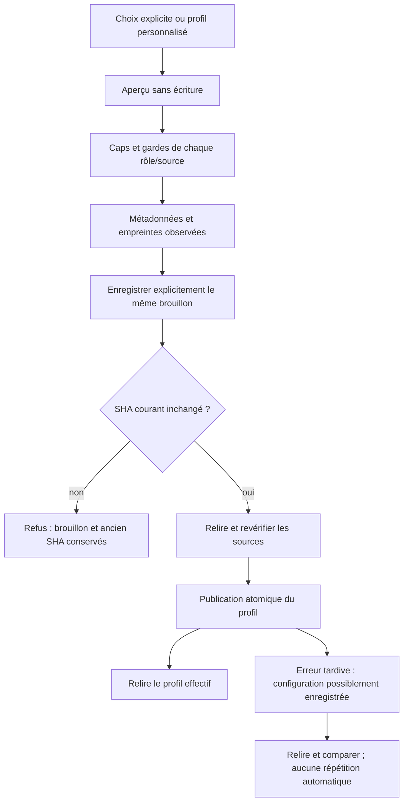

# Profils projet — sélection et application Rust

OwnerCodex ; suite169, migration autorisée avec GLM, APEX/replan.
Parcours : examiner catalogue et sources → sélectionner explicitement → CAS sur
SHA actuel → prévalider les cinq rôles → publication atomique → relire les
empreintes effectives dans CLI/API/dialogue, sans agent lancé ni import de permissions.
Contrats Go : project_profile.go/catalog/cli et web/project-profile-settings.js.
Réutiliser ContextPolicyLimits persistées ; aucun16k/32k/16/100/512 implicite.
Sources mémoire versionnées restent indisponibles avec leur raison, jamais ignorées.
Fichiers prévus : extraction project_context.rs, nouveau Root writer/catalogue,
local_storage seulement si réutilisation de garde insuffisante, exports/adaptateurs
CLI/HTTP additifs, dialogue existant project-profile.js, FR/EN et recette dédiée.
Préserver les chantiers identité/Biba/S2/fournisseurs ; annoncer les fichiers partagés.
Critères : lecture/aperçu sans mutation, profil absent/invalide/périmé, source hors
Root/secret/mémoire/limites, CAS, erreurs de publication et reprise sans perte,
parcours UI FR/EN/deux thèmes/mobile puis profil normal installé et preuves retenues.
Root vivant conservé : aucune sélection automatique, aucun appel fournisseur réel.
GLM propose le helper de validation d'un document fourni sans écrire le profil.

Implémentation engagée : extraction proposée par GLM intégrée ;130.547s,
4670+27551=32221 jetons déclarés, route demandée/déclarée glm-5.2 et backend5.3
indiqué par l'utilisateur non attesté. Un test Linux nommé passe : document fourni
identique au lecteur (tout le DTO encodé et prompt), limites/NUL/mémoire refusés,
profil vivant inchangé, validation possible sans créer de profil. Le fixture
proposé par GLM supprimait un répertoire basé sur PID ; rejeté au profit d'une
création unique attribuée, sans nettoyage destructif, conservée en cas d'échec.
La garde de test est Unix ; aucune couverture Windows n'est annoncée.
Le petit reader optionnel de document est ensuite partagé avec le futur writer ;
ce dernier incrément reste à requalifier. Pas encore de commande de sélection,
pas de modification du profil vivant, pas d'annonce de livraison de ce chantier.

Amélioration de méthode à mesurer après ce parcours (ownerCodex) : les tests de
bibliothèque debug2 ont produit des ELF d'environ174Mo et une compilation142.3s
retenue dans le lot précédent. Comparer debug0/debug2 sur mêmes tests/sources et
profil déclaré avant de proposer une politique de build de recette plus légère.
Aucun gain n'est établi, aucun profil livré n'est changé ni cache d'autrui supprimé.

Replan — défaut réel de confidentialité, pas un durcissement spéculatif :169
produit un prompt contenant notre faux jeton quand il figure dans le nom du
profil OU le chemin d'une source ordinaire. Deux témoins valides et leur reprise
encadrent ces injections ; SQL inchangé et aucun fournisseur appelé. Preuves
metadata-before169/metadata-{name,path}-observation.json :exit0/token_in_prompt=true.
Le contrôle des secrets reconnaissables couvrait le texte, mais pas ces métadonnées
pourtant encodées dans le même prompt. La même fonction de reconnaissance est
maintenant appliquée au nom et aux chemins dans le lecteur partagé : anciens
profils, prévalidation et nouveaux writers passent par cette frontière unique.
La correction est réalisée, sa vérification sur un nouveau profil normal reste
ouverte. Filtrage par motifs, toujours pas garantie d'absence de tous les secrets.

Raccord réalisé, non encore qualifié : catalogue Root, preview readonly, apply
atomique/CAS et select partagés CLI/HTTP, marqueurs de configuration préservée,
éditeur de fichiers/rôles dans la modale existante,49 traductions ajoutées et
bundle généré. Cargo check moteur puis CLI/web passent avant les derniers gardes
source ; syntaxe JS et test i18n passent. Ces contrôles ne prouvent pas le parcours.
Le catalogue signale explicitement un JSON actif invalide avec son SHA plutôt que
de masquer cette erreur derrière un nom de repli ; les causes restent accessibles
aux appelants Rust, seules les raisons statiques sont sérialisées.

Autres contre-exemples confirmés sur169 : alias Markdown vers les réglages natifs,
alias vers `.swarm/stored-fixture.md` et lien physique vers ce fichier privé
transmettent notre valeur opaque fictive dans le prompt (trois exit0/true, SQL
inchangé). Le regex de texte ne reconnaît pas toute clé opaque : corriger son
origine de lecture plutôt que prétendre étendre le regex à tous les secrets.
Implémentation : vérifier le format/cible canonique et les espaces privés,
ouvrir chaque composant résolu en NOFOLLOW sur Unix et refuser les sources à
plusieurs liens physiques. Les alias documentaires contenus ordinaires restent
possibles ; aucune garantie de confinement face à un processus de même UID.
La lecture de livraison de revue garde sa catégorie distincte, pas la politique
des consignes projet. La qualification actuelle est Linux, pas les autres OS.
Les cinq cas de fuite sont maintenant des gardes maintenus dans la recette de
lecture antérieure ; preuve après correction encore attendue.

Recettes nouvelles maintenues : CLI/HTTP catalogue/preview/nulls/erreurs/CAS/caps,
sortie réelle vers /dev/full et réparation de profil invalide ; test du Root
conservé remplacé/restauré ; navigateur FR/EN/deux thèmes/1440-390, faux200 après
véritable écriture, brouillon et CAS conservés, re-sélection explicite, focus,
contraste des champs et erreurs réseau/JS. Elles restent à exécuter sur le build
normal final. Aucun appel modèle métier ni changement du profil réel autorisé ici.

## Qualification et livraison175

Profil normal175 : `48a6d32b94b7d1e1fbd68d8fc9b6724fe17bfe3b78763ce48772d13a0f76288e`,
571 entrées effectives, toutes les features cœur vides, test=false, sans fixture.
24 assertions CLI/HTTP et62 navigateur passent ;52 vérifications du reader passent,
dont les cinq anciens cas de fuite, maintenant refusés sans jeton dans l'erreur,
sans mutation SQL et avec reprise positive. Deux tests Rust nommés passent :
Root remplacé/restauré et helper de document fourni sans écriture du profil.
Le premier test navigateur lisait window.name au lieu de son attendu : périmètre
de l'évaluation corrigé dans la recette, binaire inchangé. Le compteur hérité49
était faux :52 assertions nommées ont réellement passé. L'original FAIL est
conservé ; le collecteur de fin vérifie son intégrité, les SHA de toutes les
entrées, le même ELF exercé et le seul delta49→52 du manifeste, puis réévalue les
deux sorties publiques sans rejouer les scénarios. Les deux tests bibliothèque
sont exécutés ; recette dérivée PASS et intégrité VERIFIED. Le manifeste permanent
corrigé garde un rejeu complet futur, sans dépendre de cette réutilisation ponctuelle.

La première construction175 échouait dans la CLI du chantier run-limits (appel
privé AgentLaunchError::caused), pas dans notre code. Original conservé ; l'autre
propriétaire a supprimé cet appel, précondition SHA enregistrée avant reprise.
Aucun élargissement de visibilité ni modification de son chantier par nous.

Build/restart pris en charge,175 inchangée réutilisée.26 contrôles d'installation
passent : processus/SHA/version/notes FR/EN, Git réel/état modifié, ressources
protégées comparées à l'archive du compilateur, API/CLI du catalogue, absence de
cause/prompt publiés et aucun enregistrement implicite par l'ouverture de la vue.
Boîte Version14 et page11 contrôles. Réglages et missions identiques au témoin
avant restart. Aucun profil réel sélectionné, aucun agent relancé, aucun modèle
métier appelé, aucun commit/push. Le catalogue vivant peut rester indisponible
pour certaines sources selon limites et garde mémoire ; installation ≠ adoption.

Captures fr-etat1440 et en-sombre390 inspectées : champs distincts, focus visible,
accents/langues, repli des sources et absence de débordement. Les62 contrôles
couvrent les quatre couples langue/thème et deux largeurs ; contraste4.5 mesuré
pour le label et champ nom, pas une certification WCAG globale. Amélioration UX
conservée (ownerCodex, après ce lot) : sur formulaire long défilé, maintenir titre
et fermeture visibles ; critère390/1440 avec défilement. L'Escape et le retour
au déclencheur sont déjà prouvés, pas la fermeture persistante pendant le scroll.

RETEX : la qualification verticale a conservé les anciens contrats de lecture et
mis au jour des fuites de métadonnées/origines qu'un simple test du texte n'aurait
pas couvertes. Garder la frontière commune et les cinq cas sur les futurs callers ;
ne pas assimiler un filtrage regex à une preuve d'absence de secret, un hash à une
identité, ni un champ configuration-preserved à un rollback. Les autres chantiers
et la migration globale restent ouverts ; la suite peut avancer sans relance.

## Livraison finale176 et conservation

176 est activée par build/restart pris en charge : SHA
`640fca89b752ac5ad130b6dfbfd73247e74ad8c7fcae82a1fba304130c069b0a`.
26 contrôles installés, Version14 et page11 passent ; réglages41 et missions
pausées inchangés. Le delta175→176 de notre module consiste uniquement en six
Rustdoc privées ; les sept autres entrées modifiées concernent le chantier Admin
parallèle, sans qualification fonctionnelle globale par ce lot. Les ressources
préparation servies sont comparées à l'archive effective176. Résultats publics
24+62+52 et deux tests Rust conservés sur leurs octets175, sans prétendre les
avoir rejoués176. Le différentiel exact est conservé avec les preuves.

Conservation privée :692 fichiers et10 racines inertes attribuées, archive relue
et SHA de chaque contenu vérifié ; ELF175/176 retenus par liens physiques sans
copie supplémentaire. Un premier fichier de fixture délibérément illisible a interrompu
le premier collecteur : il reste intact avec mode/errno/taille consignés ; deux fichiers illisibles sont consignés ; leurs
octets ne sont pas déclarés conservés. Aucun chmod ni nettoyage des originaux.
Revue sémantique bornée et manifeste dans
[evidence/20261027-project-profile-selection](evidence/20261027-project-profile-selection/source-review.json).
La suite continue sur la conversion vers un travail existant ; pas de clôture
globale de migration, de commit ou de push.
